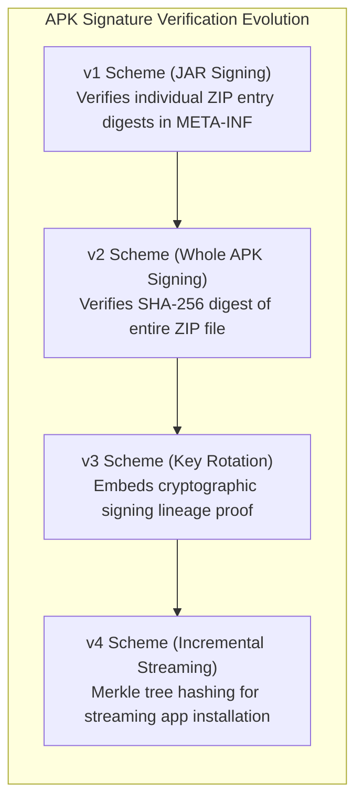
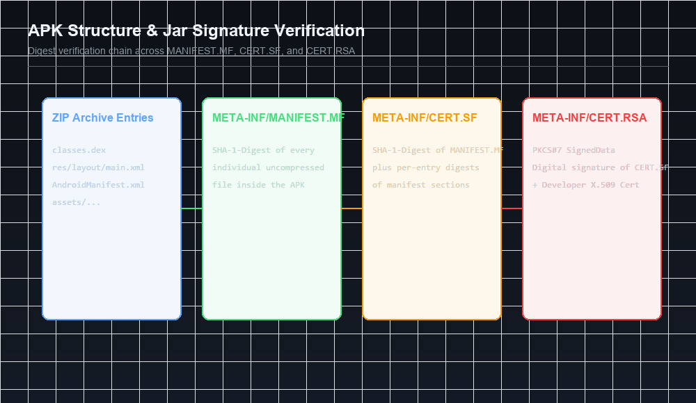

Welcome back to our book summary series covering **"Android Security Internals"** by **Nikolay Elenkov**, expanded with binary analysis and signature exploitation research from **Bluebox Security**, **GuardSquare**, and the **OWASP Mobile Application Security Testing Guide (MASTG)**.

In [Chapter 2](/posts/android-security-internals-chapter-2/), we analyzed the Android permissions framework and runtime Binder hook checks. In this installment, we explore **Chapter 3: Package Management**, dissecting the exact file structures, cryptographic verification algorithms, bytecode containers, and installation daemons that convert an untrusted APK archive into an active, sandboxed application.

We will deconstruct the anatomy of the APK archive, trace how `PackageManagerService` orchestrates installations with the native `installd` daemon, inspect the Java JAR signing architecture (`MANIFEST.MF`, `CERT.SF`, `CERT.RSA`), contrast it with modern **v2, v3, and v4 APK Signature Schemes**, and examine the mechanics behind historic signature tampering exploits including **FakeID (CVE-2014-4451)** and **Janus (CVE-2017-13156)**.


<div class="ff-series-nav">
  <a href="/posts/android-security-internals-chapter-2/" class="ff-nav-btn text-start">
    <div class="ff-nav-arrow"><i class="fas fa-arrow-left"></i></div>
    <div class="ff-nav-text">
      <span class="ff-nav-kicker">Previous</span>
      <span class="ff-nav-title">Chapter 2: Permissions Architecture</span>
    </div>
  </a>
  <div class="ff-nav-center">
    <span class="ff-center-badge"><i class="fas fa-layer-group"></i> Android Security</span>
    <span class="ff-center-part">Chapter 3: Package Management</span>
  </div>
  <a href="/posts/android-security-internals-chapter-4/" class="ff-nav-btn text-end">
    <div class="ff-nav-text">
      <span class="ff-nav-kicker">Next</span>
      <span class="ff-nav-title">Chapter 4: User Management</span>
    </div>
    <div class="ff-nav-arrow"><i class="fas fa-arrow-right"></i></div>
  </a>
</div>
## Key Takeaways

* **The APK Container**: An Android application package (`.apk`) is a standard ZIP 32 archive containing compiled Dalvik Executable bytecode (`classes.dex`), binary XML manifests, compiled resources (`resources.arsc`), native ELF shared libraries (`lib/`), and cryptographic signature blocks.
* **The Evolution of APK Signing**: Android evolved from file-based JAR signing (v1) to whole-file hash trees (v2), key rotation support (v3), and fs-verity streaming installations (v4).
* **Package Installation via `installd`**: The Java-based `PackageManagerService` cannot execute low-level filesystem operations directly with root privileges. It issues commands over a UNIX domain socket to `/system/bin/installd`, which creates sandbox directories and assigns file ownership.
* **Shared User IDs**: The `android:sharedUserId` manifest directive enables two or more distinct APKs signed with the exact same certificate to share a single Linux UID, execute inside the same process space, and freely read each other's private data directories.
* **Historic Exploitation**: The divergence between ZIP central directory parsers and signature verifiers led to catastrophic vulnerabilities: the **Master Key** bug (CVE-2013-4787), **FakeID** (CVE-2014-4451), and **Janus** (CVE-2017-13156).

---



## 1. Anatomy of an APK Package

An Android application package is structured as a ZIP archive:

```text
my-app.apk
├── AndroidManifest.xml       (Compiled binary XML format)
├── classes.dex               (Compiled Dalvik bytecode)
├── resources.arsc            (Compiled resource table)
├── res/                      (Application assets: layouts, drawables)
│   ├── layout/activity_main.xml
│   └── drawable-xxhdpi/ic_launcher.png
├── assets/                   (Raw uncompiled application assets)
├── lib/                      (Compiled native architectures)
│   ├── arm64-v8a/libnative.so
│   └── x86_64/libnative.so
└── META-INF/                 (v1 JAR Cryptographic code signature)
    ├── MANIFEST.MF           (Per-file SHA-1 / SHA-256 digests)
    ├── CERT.SF               (Manifest section digests)
    └── CERT.RSA              (PKCS#7 signature + X.509 Certificate)
```

### Binary XML Format (AXML)

Android does not store plain-text XML manifests inside an APK. Parsing raw text XML at application startup would consume unnecessary CPU cycles and RAM. Android compiles XML files into **AXML (Android Binary XML)**:

1. **String Pool**: All attribute names, tag names, and string literals are collected into a global string pool located at the head of the file.
2. **Tokenized Elements**: XML tags (e.g., `<manifest>`, `<application>`, `<activity>`) and attributes (e.g., `android:name`, `android:exported`) are replaced with 32-bit integer token IDs.
3. **Resource Mapping**: Attribute IDs correspond directly to system resource constants defined in the platform framework (`0x01010003` maps to `android:name`).

---

## 2. DEX Bytecode & Execution Optimization

Java and Kotlin source files are compiled into standard Java bytecode (`.class`) before being translated and consolidated by `d8` into a unified Dalvik Executable binary: `classes.dex`.

### The DEX Header Specification

The `classes.dex` file begins with a fixed 112-byte header:

```text
Offset | Field Name       | Size    | Description
-------|------------------|---------|---------------------------------------------
0x00   | magic            | 8 bytes | 'dex
035\0' (DEX version identifier)
0x08   | checksum         | 4 bytes | Adler32 checksum of rest of file
0x0C   | signature        | 20 bytes| SHA-1 signature of rest of file
0x20   | file_size        | 4 bytes | Total size of the DEX file in bytes
0x24   | header_size      | 4 bytes | Header size in bytes (typically 0x70 / 112)
0x28   | endian_tag       | 4 bytes | Endianness flag (0x12345678 = Little Endian)
0x38   | string_ids_size  | 4 bytes | Number of strings in string table
0x40   | type_ids_size    | 4 bytes | Number of type descriptors
0x48   | proto_ids_size   | 4 bytes | Number of method prototype descriptors
0x50   | field_ids_size   | 4 bytes | Number of field identifiers
0x58   | method_ids_size  | 4 bytes | Number of method identifiers
0x60   | class_defs_size  | 4 bytes | Number of class definitions
0x68   | data_size        | 4 bytes | Size of the data section
```

### Optimization: `dexopt` vs. `dex2oat`

During installation, Android optimizes bytecode to maximize runtime performance:

* **Dalvik Era (`dexopt`)**: Verified bytecode and generated an **Optimized DEX (`.odex`)** file saved in `/data/dalvik-cache`.
* **ART Era (`dex2oat`)**: Compiles DEX bytecode Ahead-Of-Time (AOT) into native ARM/x86 machine instructions, packing them into an **ELF shared library (`.oat`)**.

---

## 3. Code Signing Architecture: v1, v2, v3, and v4 Schemes

Code signing on Android is not tied to commercial CAs; developers sign APKs using self-signed X.509 certificates to establish origin authentication, update integrity, and mutual trust boundaries.



### The Four Signing Eras

| Signature Scheme | Introduced In | Scope Protected | Key Rotation Support | Performance |
| :--- | :--- | :--- | :--- | :--- |
| **v1 (JAR Signing)** | Android 1.0 | Individual file byte streams | No | Slow (unzips every file) |
| **v2 (APK Signing Block)** | Android 7.0 | Entire ZIP archive bytes | No | Instantaneous (Merkle tree) |
| **v3 (Key Rotation)** | Android 9.0 | Entire ZIP archive bytes | Yes (Signing Lineage) | Instantaneous |
| **v4 (Streaming Install)** | Android 11.0 | Merkle tree over all blocks | Yes | Instantaneous (fs-verity) |

### The v2/v3 APK Signing Block

To eliminate the vulnerabilities inherent in JAR signing (where ZIP metadata could be altered without breaking file digests), Google introduced the **APK Signing Block** in Android 7.0:

```text
[Contents of ZIP entries (files)]
[APK Signing Block]  <--- Inserted immediately before Central Directory!
   ├── ID-value pair: 0x7109871a (v2 Scheme Block)
   └── ID-value pair: 0xf05368c0 (v3 Scheme Block with Signing Lineage)
[ZIP Central Directory]
[ZIP End of Central Directory (EOCD)]
```

Because v2/v3 signing computes a cryptographic Merkle tree hash across all three remaining sections (ZIP entries, Central Directory, and EOCD), **any modification to any byte anywhere in the APK file invalidates the signature immediately.**

---

## 4. The Package Installation Lifecycle & `installd`

Package installation is orchestrated by `PackageManagerService` (PMS) inside `system_server` in coordination with the native `installd` daemon:

```text
Client (ADB / App Store)
          |
          v
PackageManager.installPackage()
          |
          v
PackageManagerService (system_server)
   ├── 1. Copies APK to /data/app/vmdl<id>.tmp
   ├── 2. Parses AndroidManifest.xml (PackageParser)
   ├── 3. Verifies Signatures (JarVerifier / apk_verify)
   ├── 4. Checks Update Permissions & Version Codes
   └── 5. Connects via UNIX socket to /system/bin/installd
                    |
                    v
          installd (Native Daemon - UID root)
             ├── mkdir /data/data/<package_name>
             ├── chown u0_a87:u0_a87 /data/data/<package_name>
             ├── chmod 0751 /data/data/<package_name>
             └── dexopt / classes optimization
```

### Diagnostic Command: `apksigner`

Security analysts can inspect and verify signature schemes using the Android SDK's `apksigner`:

```bash
# Verify all signature schemes on a target APK
apksigner verify -v --verbose target.apk

# Output snippet:
# Verifies
# Verified using v1 scheme (JAR signing): true
# Verified using v2 scheme (APK Signature Scheme v2): true
# Verified using v3 scheme (APK Signature Scheme v3): true
# Verified using v4 scheme (APK Signature Scheme v4): false
# Number of signers: 1
```

---

## 5. Historic Vulnerability Post-Mortem: FakeID and Janus

### 1. FakeID (CVE-2014-4451)

Discovered by Jeff Forristal (Bluebox Security), **FakeID** was a catastrophic cryptographic failure in Android's certificate chain verification library (`JarUtils.java`):

* **The Vulnerability**: When validating certificate chains, Android checked that Certificate A claimed to be issued by Certificate B. **However, it failed to verify the cryptographic signature linking Certificate A to Certificate B!**
* **The Exploit**: An attacker generated a self-signed certificate, manually forged the Issuer DN to match the **Adobe Systems** certificate, and embedded it in a malicious APK.
* **The Impact**: Because Android's WebView granted Adobe-signed apps special access to invoke internal C plugins directly inside memory, FakeID allowed malicious apps to escape the application sandbox without displaying any security warnings!

### 2. Janus (CVE-2017-13156)

Discovered by GuardSquare, **Janus** exploited a structural discrepancy between the APK ZIP specification and the DEX file specification:

* **The Concept**: A valid DEX file begins at offset `0` with the magic bytes `dex
035\0`. A valid ZIP file, however, can contain arbitrary data *before* its first ZIP local file header, because the ZIP parser starts reading from the End of Central Directory (EOCD) record at the end of the file!
* **The Exploit**: Attackers took a legitimate APK signed with v1 signatures and prepended a rogue `classes.dex` binary directly to the beginning of the file.
* **The Result**: 
  * The Java v1 signature verifier skipped the prepended bytes and verified the original ZIP contents successfully.
  * The ART runtime saw the `dex
` magic at offset `0` and executed the attacker's prepended DEX bytecode as root or system!
* **The Mitigation**: Modern Android devices mandate APK Signature Scheme v2 or higher, which signs the entire file byte stream and detects any prepended data.

---

## Next in the Series: Chapter 4 Preview

In [Chapter 4: User Management](/posts/android-security-internals-chapter-4/), we will examine:

* The evolution of Android's multi-user model (tablets, phones, secondary users, and guest accounts).
* The deterministic UID calculation formula: `userId * 100000 + appId`.
* Storage virtualization and per-user directory sandboxing (`/data/user/[userId]`).
* Work Profiles, cross-profile intent filters, and `UserManagerService` mechanics.

---

## References & Authoritative Reading

1. Elenkov, Nikolay. *Android Security Internals*. No Starch Press, 2015. Chapter 3: "Package Management," pp. 51–86.
2. [AOSP Documentation - Application Signing Schemes (v1, v2, v3, v4)](https://source.android.com/docs/security/features/apksigning)
3. Forristal, Jeff. *FakeID: Android Security Vulnerability (CVE-2014-4451)*. Bluebox Security Research, 2014.
4. GuardSquare Research. *Janus: Android APK Signature Bypass (CVE-2017-13156)*. GuardSquare, 2017.
5. [OWASP Mobile Application Security Verification Standard (MASVS-CODE)](https://mas.owasp.org/)

---

## Let's Connect

Have questions regarding DEX bytecode manipulation or APK signature analysis?

* [LinkedIn](https://www.linkedin.com/in/3bdo-fathi) | [GitHub](https://github.com/3bdo-fathi) | [Contact Page](/contact-me/)

---

*Author: Abdulrahman M. Fathi (0x3bdo) • Cyber Security Engineer & Penetration Tester*
