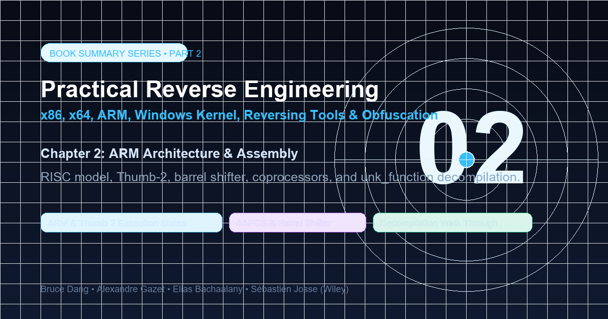
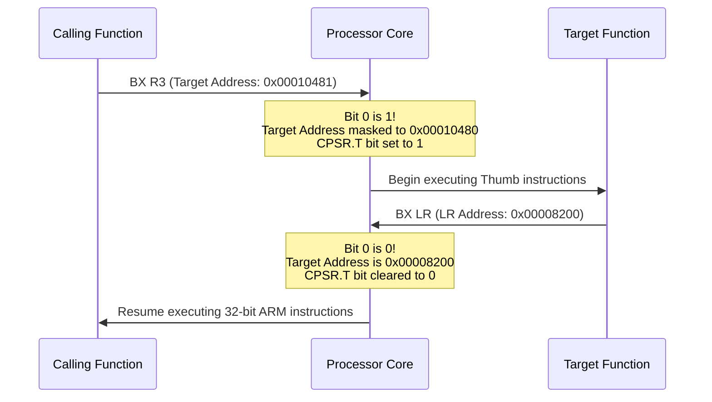

Hello everyone,

Welcome to the second installment of our deep-dive series covering **"Practical Reverse Engineering"** by **Bruce Dang, Alexandre Gazet, Elias Bachaalany, and Sébastien Josse** (Wiley, 2014).

While x86 and x64 dominate traditional desktop and server workloads, **ARM (Advanced RISC Machine)** powers the modern mobile, embedded, and IoT universe—from Android and iOS smartphones to smart automotive ECUs, network routers, and Apple Silicon. For a reverse engineer, transitioning from x86 to ARM requires a mental paradigm shift: moving away from complex variable-length CISC instructions with direct memory arithmetic, toward a lean, orthogonal **Reduced Instruction Set Computer (RISC) load-store architecture**.

In this post, we dissect the ARM architecture: privilege modes, banked registers, the ARM vs. Thumb-2 execution states, the zero-cycle hardware barrel shifter, coprocessor interactions (`CP15`), AAPCS calling conventions, memory synchronization primitives, cache coherency in self-modifying code, the complete decompilation of the Chapter 2 **`unk_function`** walk-through, and comprehensive solutions to all chapter exercises.



---

### Series Navigation

| **Previous Chapter** | **Current Chapter** | **Next Chapter** |
| :---: | :---: | :---: |
| [Chapter 1: x86 and x64 Architecture](/posts/practical-reverse-engineering-chapter-1/) | **Chapter 2: ARM Architecture & Assembly** | [Chapter 3: The Windows Kernel & Rootkits](/posts/practical-reverse-engineering-chapter-3/) |

---

## Key Takeaways

* **Load-Store Architecture**: In ARM, data-processing instructions (`ADD`, `SUB`, `AND`, `ORR`) operate strictly on registers. Memory can never be directly modified in place; operands must be explicitly loaded into registers via `LDR`, manipulated, and committed back using `STR`.
* **Multi-State Execution**: ARM processors support dual instruction execution states: 32-bit standard ARM state and 16/32-bit Thumb/Thumb-2 state. State transitions are governed by the Least Significant Bit (LSB) of the branch target address during `BX` or `BLX` instructions. An odd target address switches execution to Thumb mode.
* **Pipelining and PC Quirks**: Because of three-stage processor pipelining (Fetch, Decode, Execute), reading the Program Counter (`PC` / `R15`) yields `PC + 8` in ARM state and `PC + 4` in Thumb state.
* **The Hardware Barrel Shifter**: ARM processors integrate a dedicated barrel shifter into the ALU datapath. Data-processing instructions can shift or rotate a secondary operand (`LSL`, `LSR`, `ASR`, `ROR`, `RRX`) at zero additional CPU cycle cost.
* **Conditional Execution & IT Blocks**: ARM instructions can be conditionally executed based on condition codes. In Thumb-2, multi-instruction conditional execution is realized via the **`IT` (If-Then)** instruction block.
* **Cache Coherency & JIT Engines**: ARM implements a split Harvard memory architecture (separate L1 Instruction and Data caches). When executing dynamically generated shellcode or JIT code, the Data Cache must be flushed to the Point of Coherency (PoC) and the Instruction Cache must be invalidated via coprocessor `CP15` or kernel syscalls (`__clear_cache`).

---

## 1. The ARM RISC Model and Operating Modes

### 1.1 The Load-Store Principle

In x86 CISC architectures, a single instruction can read from memory, perform an operation, and write back to memory:
```nasm
; x86 CISC: memory operand directly modified
add dword ptr [ebp-4], 10
```

In ARM RISC, this operation requires three explicit instructions:
```armasm
; ARM RISC: explicit Load, Arithmetic, and Store
LDR  R1, [SP, #4]       ; 1. Load memory into register R1
ADD  R1, R1, #10        ; 2. Add immediate 10 to R1 in ALU
STR  R1, [SP, #4]       ; 3. Store result from R1 back into memory
```

### 1.2 Processor Privilege Modes & Banked Registers

ARMv7-A defines eight distinct operating modes:

| Mode | Abbreviation | Privilege | Purpose |
| :--- | :--- | :--- | :--- |
| **User** | `USR` | Unprivileged | Normal application execution |
| **System** | `SYS` | Privileged | Operating system tasks sharing User registers |
| **Supervisor** | `SVC` | Privileged | Entered on software interrupt (`SVC` / `SWI`) or system reset |
| **Interrupt Request** | `IRQ` | Privileged | General-purpose hardware interrupt handling |
| **Fast Interrupt** | `FIQ` | Privileged | High-priority, low-latency interrupt handling |
| **Abort** | `ABT` | Privileged | Memory access violations (Data or Prefetch abort) |
| **Undefined** | `UND` | Privileged | Undefined instruction traps (e.g., coprocessor emulation) |
| **Monitor** | `MON` | Secure | TrustZone security state switching |

```
Standard (USR/SYS):   R0 - R12,   SP,   LR,   PC,   CPSR
FIQ Mode:             R0 - R7,   [R8_fiq - R12_fiq], [SP_fiq, LR_fiq], PC, CPSR, SPSR_fiq
SVC Mode:             R0 - R12,  [SP_svc, LR_svc], PC, CPSR, SPSR_svc
ABT Mode:             R0 - R12,  [SP_abt, LR_abt], PC, CPSR, SPSR_abt
IRQ Mode:             R0 - R12,  [SP_irq, LR_irq], PC, CPSR, SPSR_irq
UND Mode:             R0 - R12,  [SP_und, LR_und], PC, CPSR, SPSR_und
```

> [!NOTE]
> **Banked Registers**: To ensure ultra-fast context switching during hardware interrupts without trashing user-space stack pointers, privileged modes switch to dedicated shadow copies of `SP`, `LR`, and the **SPSR (Saved Program Status Register)**. `FIQ` mode goes further, banking `R8` through `R12` so interrupt routines can execute without saving registers to the stack.

---

## 2. Register Sets and Status Flags

ARM features 16 core 32-bit registers accessible in user mode:

```
+------------+-----------------------------------------------------------+
| Register   | Architectural Role / AAPCS Calling Convention             |
+------------+-----------------------------------------------------------+
| R0         | 1st Argument / Function Return Value                      |
| R1         | 2nd Argument / Second Return Value (64-bit high half)     |
| R2         | 3rd Argument                                              |
| R3         | 4th Argument                                              |
+------------+-----------------------------------------------------------+
| R4 - R11   | Local variables / Callee-saved (preserved across calls)   |
| R11 (FP)   | Often designated as the Frame Pointer                     |
+------------+-----------------------------------------------------------+
| R12 (IP)   | Intra-Procedure-call scratch register (linker thunks)     |
| R13 (SP)   | Stack Pointer (Points to full descending stack top)       |
| R14 (LR)   | Link Register (Holds function return address)             |
| R15 (PC)   | Program Counter (Fetch address: PC+8 ARM, PC+4 Thumb)     |
+------------+-----------------------------------------------------------+
```

### 2.1 The Program Status Registers (CPSR & APSR)

```
 31 30 29 28 27 26             8  7  6  5  4       0
+--+--+--+--+--+--+-----------+--+--+--+--+--+------+
| N| Z| C| V| Q|IT|  Reserved |GE| I| F| T|  Mode   |
+--+--+--+--+--+--+-----------+--+--+--+--+--+------+
```

* **N (Negative)**: Set if result is negative in signed arithmetic (MSB = 1).
* **Z (Zero)**: Set if result of operation is zero.
* **C (Carry)**: Set if unsigned addition overflows, or if unsigned subtraction does not borrow.
* **V (Overflow)**: Set if signed addition/subtraction overflows.
* **T (Thumb bit, bit 5)**: `1` indicates processor is currently executing in Thumb/Thumb-2 state; `0` indicates ARM state.
* **Mode bits `M[4:0]`**: Encodes current CPU operating mode (`10000` = USR, `10011` = SVC).

---

## 3. The Hardware Barrel Shifter

In ARM, the second operand (`Operand2`) of any standard ALU instruction passes through an integrated hardware barrel shifter before entering the arithmetic unit.

```
+------------------+      +-------------------------+
| Register 1 (Rn)  |      | Register 2 (Rm) / Imm   |
+------------------+      +-------------------------+
         |                             |
         |                     +----------------+
         |                     | Barrel Shifter | (LSL, LSR, ASR, ROR, RRX)
         |                     +----------------+
         |                             |
         v                             v
    +--------------------------------------+
    |        Arithmetic Logic Unit         |
    +--------------------------------------+
                       |
                       v
               Result Register (Rd)
```

### Shift Types

1. **LSL (Logical Shift Left)**: Multiplies by powers of 2, zeros shifted into LSB.
2. **LSR (Logical Shift Right)**: Unsigned division by powers of 2, zeros shifted into MSB.
3. **ASR (Arithmetic Shift Right)**: Signed division by powers of 2; replicates the sign bit (MSB).
4. **ROR (Rotate Right)**: Bits shifted out of bit 0 re-enter at bit 31.
5. **RRX (Rotate Right with Extend)**: 33-bit rotation incorporating the Carry flag.

```armasm
ADD  R0, R1, R2, LSL #2    ; R0 = R1 + (R2 << 2)  -> R0 = R1 + (R2 * 4)
SUB  R3, R4, R5, ASR #3    ; R3 = R4 - (R5 >> 3)  (signed arithmetic shift)
MOV  R0, R1, ROR #8        ; R0 = R1 rotated right by 8 bits
```

> [!TIP]
> In x86, array indexing like `array[i]` requires complex base-index scaling syntax (`[ebx + ecx*4]`). In ARM, this is natively implemented via the barrel shifter: `LDR R0, [R1, R2, LSL #2]`.

---

## 4. ARM vs. Thumb and Thumb-2 States

### 4.1 State Characteristics

* **ARM State**: Fixed 32-bit instruction encoding. High performance, complete feature set, every instruction conditionally executable.
* **Thumb State**: Compact 16-bit instruction encoding designed for code density in memory-constrained devices (reducing binary size by 30-40%). Can only access low registers (`R0-R7`).
* **Thumb-2 Technology**: Blends 16-bit and 32-bit instructions dynamically. Eliminates the need to switch between ARM and Thumb states, achieving 32-bit ARM performance with Thumb code density.

### 4.2 Interworking and State Switching

The processor determines execution state via the **least-significant bit (LSB)** of the target branch address:



---

## 5. Memory Access, Addressing Modes, and Literal Pools

### 5.1 Load and Store Addressing Modes

ARM provides three primary indexing modes:

1. **Immediate / Register Offset**:
   ```armasm
   LDR  R0, [R1, #8]       ; Read from (R1 + 8). R1 remains unchanged.
   ```
2. **Pre-Indexed with Write-back (`!`)**:
   ```armasm
   LDR  R0, [R1, #8]!      ; R1 = R1 + 8; Read from new R1.
   ```
3. **Post-Indexed**:
   ```armasm
   LDR  R0, [R1], #8       ; Read from R1; Then R1 = R1 + 8.
   ```

### 5.2 Block Data Transfers: `LDM` and `STM`

Block transfers allow loading or storing multiple registers in a single instruction:

| Suffix | Description | Stack Equivalent |
| :--- | :--- | :--- |
| `IA` | Increment After | - |
| `IB` | Increment Before | - |
| `DA` | Decrement After | - |
| `DB` | Decrement Before | PUSH (`STMDB SP!, {...}`) |

```armasm
; Function Prologue: Pushes R4, R5, FP, and LR to stack
PUSH {R4, R5, R11, LR}     ; Syntactic sugar for: STMDB SP!, {R4, R5, R11, LR}

; Function Epilogue: Pops saved registers and returns directly to caller
POP  {R4, R5, R11, PC}     ; Syntactic sugar for: LDMIA SP!, {R4, R5, R11, PC}
```

### 5.3 Loading 32-Bit Constants & Literal Pools

Because 32-bit ARM instructions cannot encode an arbitrary 32-bit immediate directly, compilers utilize **Literal Pools** or ARMv7-A dual-instruction moves:

```armasm
; Method A: PC-Relative Literal Pool Load
LDR  R0, =0xDEADBEEF       ; Assembler places 0xDEADBEEF in a constant pool
                           ; Emits: LDR R0, [PC, #offset_to_pool]

; Method B: MOVW / MOVT (ARMv7+)
MOVW R0, #0xBEEF           ; R0[15:0]  = 0xBEEF, R0[31:16] = 0
MOVT R0, #0xDEAD           ; R0[31:16] = 0xDEAD, R0[15:0] unchanged
```

---

## 6. Conditional Execution & Thumb-2 IT Blocks

### 6.1 ARM State Condition Codes

In ARM state, bits `31:28` of every instruction encode condition flags:

```armasm
CMP  R0, #0
MOVEQ R1, #1               ; If Z==1 (Equal), R1 = 1
MOVNE R1, #0               ; If Z==0 (Not Equal), R1 = 0
```

### 6.2 Thumb-2 `IT` (If-Then) Blocks

Because 16-bit Thumb instructions lack room for condition bits, Thumb-2 introduced the `IT` block instruction. An `IT` instruction can specify conditions for up to **four** subsequent instructions:

* `I`: Then (must match base condition)
* `T`: Then (must match base condition)
* `E`: Else (must match inverse condition)

```armasm
CMP   R0, R1               ; Compare R0 and R1
ITTE  GT                   ; ITTE block: Then, Then, Else for condition GT (Greater Than)
MOVGT R2, #1               ; (T) Executed if R0 > R1
ADDGT R3, R3, #5           ; (T) Executed if R0 > R1
MOVLE R2, #0               ; (E) Executed if R0 <= R1
```

---

## 7. Coprocessors and System Control (CP15)

ARM supports up to 16 coprocessors (`CP0` to `CP15`):
* `CP10` & `CP11`: Floating Point (VFP) and NEON SIMD engines.
* **`CP15`**: **System Control Coprocessor**. Mediates the MMU, Page Tables (TTBR0/TTBR1), Translation Lookaside Buffers (TLB), and CPU Caches.

Instructions:
* **`MRC`**: Move to ARM Register from Coprocessor.
* **`MCR`**: Move to Coprocessor from ARM Register.

```armasm
; Syntax: MCR coproc, opcode1, Rd, CRn, CRm, opcode2

; Read Thread ID Register (TPIDRURW / TLS pointer in user space)
MRC  p15, 0, R0, c13, c0, 2

; Invalidate Entire Instruction Cache (Point of Unification)
MOV  R0, #0
MCR  p15, 0, R0, c7, c5, 0
```

---

## 8. Walk-Through: Decompiling `unk_function`

Let us examine the Chapter 2 walk-through: decompiling an unknown Thumb-2 subroutine `unk_function`.

### 8.1 Disassembly Listing

```armasm
unk_function:
.text:000108A0 PUSH    {R4-R7, LR}
.text:000108A2 SUB     SP, SP, #0x14
.text:000108A4 MOVS    R4, R0              ; R4 = arg0 (Device Context)
.text:000108A6 MOVS    R5, R1              ; R5 = arg1 (Packet Buffer)
.text:000108A8 MOVS    R6, R2              ; R6 = arg2 (Packet Size)
.text:000108AA CMP     R4, #0
.text:000108AC BEQ     exit_failure
.text:000108AE CMP     R5, #0
.text:000108B0 BEQ     exit_failure
.text:000108B2 CMP     R6, #8
.text:000108B4 BLT     exit_failure
```

The function begins by saving `R4-R7` and `LR`, then allocating `0x14` (20 bytes) on the stack. It validates that pointers `R0` and `R1` are non-null and that `R2` ($\text{size}$) is at least 8 bytes.

```armasm
.text:000108B6 LDR     R0, [R4, #0x10]     ; R0 = dev->state
.text:000108B8 CMP     R0, #2              ; Check if state == READY (2)
.text:000108BA BNE     exit_busy
.text:000108BC LDRH    R7, [R5, #0]        ; R7 = *(uint16_t*)(packet + 0) [Magic]
.text:000108BE MOVW    R1, #0x5359         ; 'YS' -> Magic: 0x5953 ('SY')
.text:000108C2 CMP     R7, R1
.text:000108C4 BNE     exit_invalid_magic
```

The function reads a 32-bit state field at offset `0x10` of `R4`, confirming `state == 2`. It then loads a 16-bit halfword at offset `0` of the packet, verifying the magic signature `0x5953` (`'SY'`).

```armasm
.text:000108C6 LDRH    R2, [R5, #2]        ; R2 = *(uint16_t*)(packet + 2) [Command ID]
.text:000108C8 LDR     R3, [R4, #0x14]     ; R3 = dev->dispatch_table
.text:000108CA CMP     R2, #4
.text:000108CC BGT     exit_invalid_cmd
.text:000108CE LSLS    R2, R2, #2          ; R2 = cmd_id * 4
.text:000108D0 LDR     R3, [R3, R2]        ; Handler function pointer
.text:000108D2 CMP     R3, #0
.text:000108D4 BEQ     exit_no_handler
.text:000108D6 ADD     R1, R5, #4          ; Payload pointer (packet + 4)
.text:000108D8 SUBS    R2, R6, #4          ; Payload size = total_size - 4
.text:000108DA MOVS    R0, R4              ; Pass Device Context as Arg 0
.text:000108DC BLX     R3                  ; Invoke handler(dev, payload, payload_size)
.text:000108DE MOVS    R4, R0              ; Store handler return value
.text:000108E0 B       cleanup

exit_failure:
.text:000108E2 MOVS    R4, #-1
.text:000108E4 B       cleanup

exit_busy:
.text:000108E6 MOVS    R4, #-2
.text:000108E8 B       cleanup

cleanup:
.text:000108EA MOVS    R0, R4              ; Set return value
.text:000108EC ADD     SP, SP, #0x14
.text:000108EE POP     {R4-R7, PC}         ; Restore registers and return
```

### 8.2 Structure Recovery

From the memory offsets accessed in the disassembly, we reconstruct the exact C data structures:

```c
#include <stdint.h>
#include <stdbool.h>

#define PACKET_MAGIC 0x5953

typedef struct _DEVICE_CONTEXT DEVICE_CONTEXT;

typedef int (*CMD_HANDLER)(DEVICE_CONTEXT* dev, const uint8_t* payload, uint32_t payload_len);

struct _DEVICE_CONTEXT {
    uint32_t hardware_id;       // Offset 0x00
    uint32_t flags;             // Offset 0x04
    void* rx_buffer;            // Offset 0x08
    void* tx_buffer;            // Offset 0x0C
    uint32_t state;             // Offset 0x10 (Expected: 2)
    CMD_HANDLER* dispatch_table;// Offset 0x14 (Array of function pointers)
};

#pragma pack(push, 1)
typedef struct _PACKET_HEADER {
    uint16_t magic;             // Offset 0x00: 'SY' (0x5953)
    uint16_t command_id;        // Offset 0x02: Valid 0 to 4
    uint8_t payload[];          // Offset 0x04: Variable payload
} PACKET_HEADER;
#pragma pack(pop)
```

### 8.3 Idiomatic C Decompilation

```c
int unk_function(DEVICE_CONTEXT* dev, const uint8_t* packet_raw, int size)
{
    // 1. Input parameter validation
    if (!dev || !packet_raw || size < 8) {
        return -1;
    }

    // 2. State verification
    if (dev->state != 2) {
        return -2;
    }

    const PACKET_HEADER* packet = (const PACKET_HEADER*)packet_raw;

    // 3. Header magic verification
    if (packet->magic != PACKET_MAGIC) {
        return -3;
    }

    // 4. Command dispatch bounds checking
    if (packet->command_id > 4) {
        return -4;
    }

    // 5. Locate dispatch handler
    CMD_HANDLER handler = dev->dispatch_table[packet->command_id];
    if (!handler) {
        return -5;
    }

    // 6. Execute command handler passing payload slice
    const uint8_t* payload = packet->payload;
    uint32_t payload_size = (uint32_t)(size - 4);

    int result = handler(dev, payload, payload_size);
    return result;
}
```

---

## 9. Chapter 2 Exercises: Complete Solutions & Analysis

### Exercise 1: Barrel Shifter Decoding

**Question**: Translate the following single ARM instructions into their equivalent C mathematical expressions:
1. `ADD R0, R1, R2, ROR #16`
2. `RSB R0, R1, #0`
3. `BIC R0, R1, R2, ASR #4`

**Solution**:
1. `ADD R0, R1, R2, ROR #16`:
   Computes $R0 = R1 + ((R2 \gg 16) \mid (R2 \ll 16))$. In C:
   ```c
   uint32_t r2_rotated = (r2 >> 16) | (r2 << 16);
   uint32_t r0 = r1 + r2_rotated;
   ```
2. `RSB R0, R1, #0`:
   `RSB` stands for **Reverse Subtract** ($0 - R1$). In C:
   ```c
   int32_t r0 = -r1;
   ```
3. `BIC R0, R1, R2, ASR #4`:
   `BIC` stands for **Bit Clear** ($R1 \ \& \ \sim(\text{Operand2})$). Operand2 is $R2$ arithmetically shifted right by 4. In C:
   ```c
   int32_t shifted = ((int32_t)r2) >> 4;
   uint32_t r0 = r1 & (~(uint32_t)shifted);
   ```

### Exercise 2: Thumb-2 IT Block Branch Recovery

**Question**: Decompile the following Thumb-2 IT instruction sequence into a high-level `if-else` statement:
```armasm
CMP   R0, #100
ITEE  LE
MOVLE R1, #1
ADDLE R2, R2, #10
MOVGT R1, #0
SUBGT R2, R2, #5
```

**Solution**:
The condition base is `LE` (Less than or Equal). The IT block format is `ITEE` (If-Then-Else-Else):
```c
if (r0 <= 100) {
    r1 = 1;
    r2 = r2 + 10;
} else {
    r1 = 0;
    r2 = r2 - 5;
}
```

### Exercise 3: Self-Modifying Code and Cache Flushing

**Question**: An analyst discovers an ARM binary that writes machine instructions into a heap buffer and immediately branches to it via `BLX R0`. On an ARMv7 target running Linux, the process crashes with `SIGILL` (Illegal Instruction) or executes old stale memory. Explain why and provide the remedy.

**Solution**:
1. **Root Cause**: ARM uses a split Harvard cache architecture. Data writes go to the L1 Data Cache (D-cache). The CPU fetches instructions exclusively from the L1 Instruction Cache (I-cache). Without explicit synchronization:
   * The newly written shellcode remains buffered in the D-cache and has not been written out to physical RAM.
   * The I-cache retains stale or invalid cached instructions from that address.
2. **Remedy**: The program must execute a cache flush:
   * Clean the D-cache to the Point of Coherency (PoC).
   * Invalidate the I-cache.
   * Execute an `ISB` (Instruction Synchronization Barrier) to flush the CPU pipeline.
   * On Linux, this is safely invoked via the kernel helper `__clear_cache(char *beg, char *end)`.

---

## Conclusion & Next Steps

In this chapter, we explored the RISC mechanics of ARM: execution states, barrel-shifted arithmetic, coprocessor controls, structure recovery from disassembled Thumb-2 listings, and cache coherency.

In [**Chapter 3: The Windows Kernel & Rootkits**](/posts/practical-reverse-engineering-chapter-3/), we dive into the internal architecture of the Windows NT kernel: `KPCR`, `EPROCESS`, system call dispatching, IRQL levels, pool allocations, IRP handling, and analyzing real-world x86 and x64 rootkits.

