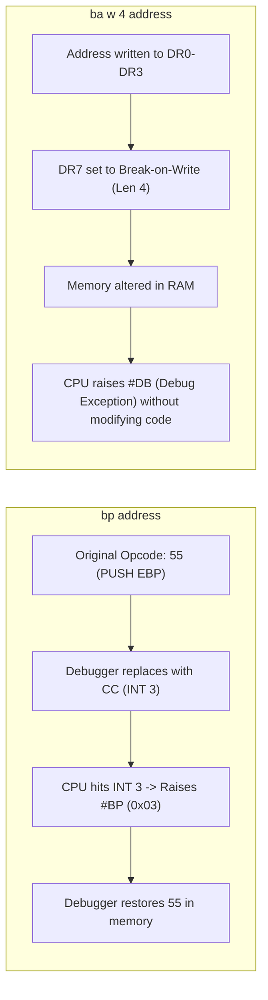

Welcome to the fourth chapter of our comprehensive series covering **"Practical Reverse Engineering"** by **Bruce Dang, Alexandre Gazet, Elias Bachaalany, and Sébastien Josse** (Wiley, 2014).

Static disassembly in IDA Pro or Ghidra provides the structural blueprint of an executable. However, when software employs packed code, encrypted payloads, runtime API resolving, dynamic polymorphism, or complex kernel callbacks, static analysis alone becomes painfully slow. To unpack binaries efficiently, observe live memory transformations, and capture ephemeral keys, the analyst must harness dynamic debugging and automation.

In the Windows realm, Microsoft's **Debugging Tools for Windows (WinDbg, CDB, KD, and the DbgEng engine)** constitute the industry benchmark. Beyond its interactive interface, DbgEng provides a Turing-complete command scripting language and an extensible COM-based C++ SDK.

In this chapter, we dissect: WinDbg architecture, MASM vs. C++ expression evaluators, event filters, memory inspection commands, hardware breakpoints, pseudo-registers, writing complex loop-based DbgEng scripts, an automated **UPX unpacker script**, a live **File I/O monitor**, the **DbgEng C++ Extension SDK**, and complete solutions to the chapter exercises.

---

### Series Navigation

| **Previous Chapter** | **Current Chapter** | **Next Chapter** |
| :---: | :---: | :---: |
| [Chapter 3: The Windows Kernel & Rootkits](/posts/practical-reverse-engineering-chapter-3/) | **Chapter 4: Windows Debugging & Automation** | [Chapter 5: Software Obfuscation & Deobfuscation](/posts/practical-reverse-engineering-chapter-5/) |

---

## Key Takeaways

* **The DbgEng Architecture**: WinDbg, CDB (Command-line Debugger), and NTSD are GUI and console frontends sitting atop a common core dynamic link library: `dbgeng.dll`. Any script or extension written for DbgEng runs seamlessly across user-mode and kernel-mode targets.
* **Dual Expression Evaluators**: WinDbg embeds two distinct expression parsers. The default **MASM evaluator** treats numbers as hex by default and uses `poi(addr)` to dereference pointers. The **C++ evaluator** (invoked via `??` or `@@c++(...)`) enforces C type checking, understands structs, and uses standard `*ptr` and `obj->member` syntax.
* **Hardware vs. Software Breakpoints**: Software breakpoints (`bp`) overwrite target instruction opcodes with the 1-byte `INT 3` (`0xCC`) instruction. Hardware breakpoints (`ba`) leverage processor debug registers (`DR0-DR3`), enabling breakpoints on **memory reads and writes** without altering the target binary image.
* **Turing-Complete Debug Scripts**: Using pseudo-registers (`$t0-$t19`), aliases (`as`, `al`), conditional constructs (`.if`, `.elsif`, `.else`), and iteration engines (`.for`, `.while`, `.foreach`), an analyst can automate complex tasks—such as unpacking binaries and decrypting strings—directly inside the debugger without touching Python or external tools.
* **DbgEng C++ SDK**: The debugger engine exposes COM-based interfaces (`IDebugClient`, `IDebugControl`, `IDebugDataSpaces`, `IDebugSymbols`), allowing analysts to build native DLL extensions to automate memory forensics and exploit payload tracing.

---

## 1. WinDbg Fundamentals and Core Command Syntax

### 1.1 Configuring Symbols and Source Paths

Without accurate symbols, reverse engineering kernel binaries or stripped Windows executables is blind guesswork:

```text
.sympath srv*C:\Symbols*https://msdl.microsoft.com/download/symbols
.reload /f
```

### 1.2 The Two Expression Evaluators: MASM vs. C++

Understanding the difference between the MASM and C++ evaluators is critical to avoiding syntax traps:

```text
0:000> ? poi(esp+4)          ; MASM: poi() dereferences 32-bit pointer at esp+4
Evaluate expression: 1970224 = 001e1030

0:000> ?? ((ntdll!_PEB*)@$peb)->BeingDebugged  ; C++: struct field dereference
unsigned char 0x01 ''

0:000> ?? sizeof(ntdll!_EPROCESS)             ; C++: native type sizes
unsigned int 0x480
```

| Feature | MASM Evaluator (`? expr`) | C++ Evaluator (`?? expr` or `@@c++(...)`) |
| :--- | :--- | :--- |
| **Default Radix** | Hexadecimal | Decimal |
| **Pointer Dereference** | `poi(address)` | `*pointer` or `pointer[index]` |
| **Structure Access** | Not supported (requires `dt`) | `object.field` or `ptr->field` |
| **Type Casting** | Not supported | `(Type*)address` |
| **Symbols** | `module!symbol` | `module!class::member` |

---

## 2. Process Control, Thread Switching, and Event Filtering

### 2.1 Process and Thread Context

* Display all threads: `~* k` (dumps call stacks of all threads).
* Switch to thread 2: `~2s`.
* Freeze thread 1 and resume thread 0: `~1f; ~0u`.
* View Process Environment Block: `!peb`.
* View Thread Environment Block: `!teb`.

### 2.2 Event Filters (`sx`)

WinDbg can halt execution on specific operating system events:

```text
sxe ld:kernel32.dll     ; Break immediately when kernel32.dll is loaded
sxe ct                  ; Break immediately on thread creation
sxd cpr                 ; Disable break on process exit
sxr                     ; Reset all filters to default
```

---

## 3. Memory Inspection and Data Structures

```text
; Display Memory Formats
db 0x00400000 L20       ; Display bytes with ASCII
dd 0x00400000 L4        ; Display 4 double-words (DWORDs)
dq 0x00400000 L2        ; Display 2 quad-words (QWORDs)
du 0x00401050           ; Display null-terminated Unicode string
da 0x00401080           ; Display null-terminated ASCII string
dps esp L10             ; Display pointers on stack resolved to symbols

; Editing and Searching Memory
eb 0x00401000 90 90     ; Overwrite 2 bytes with NOPs (0x90 0x90)
s -a 0x00400000 L?0x100000 "password" ; Search for ASCII string
s -b 0x00400000 L?0x100000 55 8b ec   ; Search for function prologue (push ebp; mov ebp, esp)

; Type Inspection
dt ntdll!_PEB @$peb BeingDebugged ImageBaseAddress
dt -r1 ntdll!_RTL_USER_PROCESS_PARAMETERS poi(@$peb+0x20)
```

---

## 4. Breakpoint Strategies: Software, Hardware, and Conditional

### 4.1 Software vs. Hardware Breakpoints



* `ba e 1 0x00401234`: Break on instruction execution at address.
* `ba w 4 0x00405000`: Break on 4-byte memory write (detects memory patching or unpackers writing to the section).
* `ba r 4 0x00405000`: Break on 4-byte memory read or write.

### 4.2 Scripted Conditional Breakpoints

Syntax: `bp <address> ".if (<condition>) { <actions> } .else { gc }"`

```text
; Break on CreateFileW only if lpFileName contains "malware.exe"
bp kernel32!CreateFileW "
    as /mu ${/v:pFileName} poi(esp+4);
    .if ($spat(\"${pFileName}\", \"*malware.exe*\")) {
        .echo Target file opened!;
        r;
    } .else {
        ad ${/v:pFileName};
        gc;
    }
"
```

---

## 5. DbgEng Scripting Language Architecture

DbgEng features a built-in procedural scripting language:

### 5.1 Registers and Variables

* **Automatic Pseudo-Registers**:
  * `$ip`: Instruction pointer (`EIP` or `RIP`).
  * `$ra`: Return address on top of stack.
  * `$retreg`: Function return register (`EAX` on x86, `RAX` on x64).
  * `$csp`: Current stack pointer (`ESP` or `RSP`).
  * `$peb` / `$teb`: Virtual addresses of current PEB and TEB.
* **User-Defined Variables**:
  * `$t0` through `$t19`: 20 temporary registers storing 64-bit integers.

### 5.2 Control Flow Syntax

```text
; For Loop
.for (r $t0 = 0; @$t0 < 5; r $t0 = @$t0 + 1) {
    .printf "Iteration index: %d\n", @$t0;
}

; While Loop
r $t0 = 0;
.while (@$t0 < 10) {
    r $t0 = @$t0 + 1;
}

; Foreach Token Loop (Iterate over output of another command)
.foreach (token { !process 0 0 }) {
    .echo Found Token: ${token};
}
```

---

## 6. Practical Script 1: Automated UPX Unpacker

UPX (Ultimate Packer for eXecutables) compresses executable sections (`UPX0`, `UPX1`) and decompresses them at runtime via an unpacking stub. The transition from the decompression loop to the unpacked original program occurs through a long unconditional jump called the **Tail Jump**:

```nasm
; UPX Unpacking Stub Epilogue (Tail Jump)
popad
lea     eax, [esp-80h]
push    0
...
jmp     loc_00401000   ; <-- Tail Jump to Original Entry Point (OEP)
```

### The Automated Unpacker Script (`unpack_upx.wds`)

```text
$$ =========================================================================
$$ Script: unpack_upx.wds
$$ Description: Automatically traces execution to OEP and dumps unpacked PE
$$ =========================================================================

.echo [*] Initializing UPX automated unpacker...

$$ 1. Retrieve ImageBase from PEB
r $t0 = poi(@$peb + 0x08)
.printf "[*] Target ImageBase: 0x%p\n", @$t0

$$ 2. Read AddressOfEntryPoint offset from PE Optional Header
$$ e_lfanew is at [ImageBase + 0x3C]
r $t1 = @$t0 + poi(@$t0 + 0x3C)
$$ AddressOfEntryPoint is at [NT_HEADERS + 0x28]
r $t2 = @$t0 + poi(@$t1 + 0x28)
.printf "[*] Packed Entry Point: 0x%p\n", @$t2

$$ 3. Trace execution forward until a POPAD instruction is encountered
.echo [*] Searching for UPX decompression loop termination (POPAD)...
bp @$t2

g

.while (1) {
    $$ Check if current opcode is POPAD (0x61)
    .if (by(@$ip) == 0x61) {
        .echo [+] Found POPAD instruction at:;
        u @$ip L1;
        .break;
    }
    p; $$ Step over instruction
}

$$ 4. Step over the POPAD and find the subsequent long JMP (OEP Tail Jump)
.while (1) {
    $$ Check for JMP opcode: 0xE9 (near jump) or 0xEB (short jump)
    .if (by(@$ip) == 0xE9) {
        .echo [+] Encountered Tail Jump!;
        u @$ip L1;
        t; $$ Step into OEP
        .break;
    }
    p;
}

.printf "[+] Successfully reached Original Entry Point (OEP): 0x%p\n", @$ip

$$ 5. Dump memory image to disk
.writemem C:\Unpacked_Sample.bin @$t0 (poi(@$t1 + 0x50))
.echo [+] Dumped unpacked memory image to C:\Unpacked_Sample.bin!
```

---

## 7. Practical Script 2: Automated File I/O Monitor

Malware frequently drops secondary payloads or modifies persistent startup keys. We can deploy a non-invasive File I/O monitor by intercepting `kernel32!CreateFileW`:

```text
$$ =========================================================================
$$ Script: file_monitor.wds
$$ Description: Logs all file creation/access requests with filename and disposition
$$ =========================================================================

.echo [*] Installing hooks on kernel32!CreateFileW...

bu kernel32!CreateFileW "
    $$ Save function argument pointers (x86 STDCALL)
    r $t0 = poi(esp + 4);  $$ lpFileName (Unicode)
    r $t1 = poi(esp + 8);  $$ dwDesiredAccess
    r $t2 = poi(esp + 16); $$ dwCreationDisposition

    $$ Print timestamp and target path
    .printf \"\n[FILE I/O] Path: %mu\n\", @$t0;
    .printf \"           Access: 0x%08X, Disposition: 0x%X\n\", @$t1, @$t2;

    $$ Resume execution seamlessly
    gc;
"

.echo [+] File I/O Monitor active. Resuming process...
g
```

---

## 8. Extending the Debugger: The DbgEng C++ SDK

While DbgEng scripts are powerful, high-performance binary analysis and emulator integration require native C++ debugger extensions.

### 8.1 Extension Architecture

An extension DLL must export three essential functions:
1. `DebugExtensionInitialize`: Negotiates SDK versions.
2. `DebugExtensionUninitialize`: Cleans up handles.
3. Custom command exports matching signature: `HRESULT CALLBACK CommandName(PDEBUG_CLIENT Client, PCSTR Args)`.

### 8.2 Implementing a Custom Extension (`!dumpstrings`)

```cpp
#include <windows.h>
#include <dbgeng.h>
#include <stdio.h>

PDEBUG_CLIENT4        g_ExtClient;
PDEBUG_CONTROL        g_ExtControl;
PDEBUG_DATA_SPACES    g_ExtData;

extern "C" HRESULT CALLBACK DebugExtensionInitialize(PULONG Version, PULONG Flags)
{
    *Version = DEBUG_EXTENSION_VERSION(1, 0);
    *Flags = 0;
    return S_OK;
}

extern "C" HRESULT CALLBACK dumpstrings(PDEBUG_CLIENT Client, PCSTR Args)
{
    HRESULT hr = Client->QueryInterface(__uuidof(IDebugControl), (void**)&g_ExtControl);
    if (FAILED(hr)) return hr;

    hr = Client->QueryInterface(__uuidof(IDebugDataSpaces), (void**)&g_ExtData);
    if (FAILED(hr)) {
        g_ExtControl->Release();
        return hr;
    }

    ULONG64 targetAddress = 0;
    if (Args && *Args) {
        g_ExtControl->Evaluate(Args, DEBUG_VALUE_INT64, (PDEBUG_VALUE)&targetAddress, NULL);
    } else {
        g_ExtControl->Output(DEBUG_OUTPUT_ERROR, "Usage: !dumpstrings <address>\n");
        return S_OK;
    }

    g_ExtControl->Output(DEBUG_OUTPUT_NORMAL, "[*] Scanning memory at 0x%p for ASCII strings...\n", targetAddress);

    char buffer[256];
    ULONG bytesRead = 0;
    for (ULONG i = 0; i < 10; ++i) {
        ULONG64 currentAddr = targetAddress + (i * 32);
        if (SUCCEEDED(g_ExtData->ReadVirtual(currentAddr, buffer, sizeof(buffer) - 1, &bytesRead))) {
            buffer[bytesRead] = '\0';
            g_ExtControl->Output(DEBUG_OUTPUT_NORMAL, "0x%p: %s\n", currentAddr, buffer);
        }
    }

    g_ExtControl->Release();
    g_ExtData->Release();
    return S_OK;
}
```

---

## 9. Chapter 4 Exercises: Complete Solutions & Analysis

### Exercise 1: MASM Pointer Dereferencing Edge Case

**Question**: An analyst executes `? [esp+4]` in the MASM evaluator, expecting to read the function's first argument from memory. Instead, the debugger returns `0x0012FF84`. Explain why this occurs and provide the correct command.

**Solution**:
1. **The MASM Trap**: In the WinDbg MASM expression evaluator, brackets `[...]` **do not perform a memory dereference**. They serve strictly as arithmetic grouping parentheses (equivalent to `(esp + 4)`). The debugger simply evaluated the address arithmetic `0x0012FF80 + 4 = 0x0012FF84`.
2. **The Correct Command**:
   * To dereference memory in MASM: `? poi(esp+4)`
   * Or switch to the C++ evaluator: `?? *(unsigned int*)(@esp+4)`

### Exercise 2: Scripting a Dynamic XOR String Decryptor

**Question**: A malware sample decodes strings at runtime using a function at `0x00402000` with signature `char* decrypt_string(char* encrypted_blob, int len, char key)`. Write a WinDbg script that places a breakpoint at the function return, reads the decrypted ASCII string from `EAX`, and prints it without stopping execution.

**Solution**:
```text
$$ Place a breakpoint on function entry to catch the return address
bp 0x00402000 "
    $$ Save return address from top of stack
    r $t0 = poi(esp);

    $$ Set a one-shot breakpoint on the return address
    bp /1 @$t0 \"
        .printf \\\"[DECRYPTED STRING] Address 0x%p: %ma\\n\\\", eax;
        gc;
    \";

    gc;
"
```

---

## Conclusion & Next Steps

In this chapter, we explored Windows debugging mechanics: expression evaluation nuances, memory introspection, hardware breakpoints, procedural DbgEng scripting, automated unpacking of protectors, and native C++ debugger extension development.

In [**Chapter 5: Software Obfuscation & Deobfuscation**](/posts/practical-reverse-engineering-chapter-5/), we tackle the ultimate challenge of binary analysis: understanding code obfuscation techniques (opaque predicates, CFG flattening, custom virtual machines, white-box cryptography) and breaking them using automated program analysis, symbolic execution, and solving the famous Quetz keygenme challenge.

---

*Author: Abdulrahman M. Fathi (0x3bdo) • Cyber Security Engineer & Penetration Tester*
