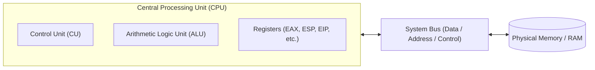
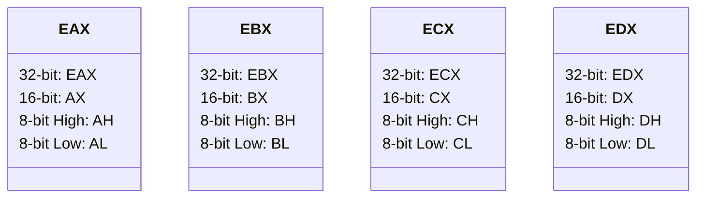
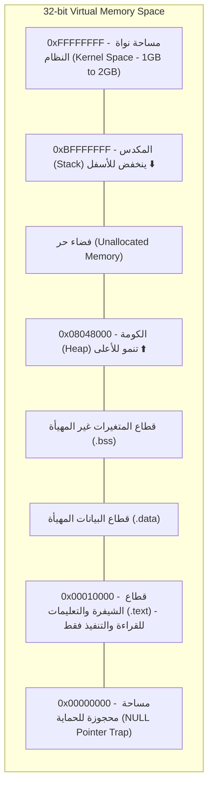

مرحبًا بكم في أولى مقالات السلسلة الشاملة لتغطية منهج واختبار **eCPPT (eLearnSecurity Certified Professional Penetration Tester)** الصادر عن **INE Security**. في هذا الدليل المعمق، لن نكتفي بمجرد المرور السريع على الشرائح التعليمية، بل سنفكك المفاهيم الهندسية من أدنى المستويات البرمجية (Low-Level Architecture) وصولاً إلى الممارسات العملية المتقدمة التي يحتاجها مختبر الاختراق المحترف.

تعتبر وحدة **أمن الأنظمة (System Security)** والتعامل مع **لغة التجميع x86 (Assembly Language)** الحجر الأساس لكافة تقنيات تطوير الثغرات، استغلال طفحان الذاكرة (Buffer Overflows)، وتخطي آليات الحماية الحديثة في أنظمة التشغيل.

---

### جدول التنقل في السلسلة (Series Navigation)

| **المقال السابق** | **المقال الحالي** | **المقال القادم** |
| :---: | :---: | :---: |
| *بداية السلسلة* | **الجزء 1: أمن الأنظمة وأساسيات x86** | [الجزء 2: تطوير الثغرات وطفحان الذاكرة (Buffer Overflows)](/posts/ecppt-v3-part-2-exploit-development-buffer-overflows/) |

---

## أبرز النقاط الرئيسية (Key Takeaways)

* **معمارية المعالج (CPU Architecture)**: تتكون وحدة المعالجة المركزية من وحدة التحكم (CU)، ووحدة الحساب والمنطق (ALU)، ومجموعة السجلات (Registers). يعمل المعالج بدورة محكمة: جلب التعليمة (Fetch)، فك التشفير (Decode)، ثم التنفيذ (Execute).
* **سجلات معمارية IA-32**: تنقسم سجلات 32-بت إلى سجلات عامة (`EAX`, `EBX`, `ECX`, `EDX`)، وسجلات الفهرسة والإشارة (`ESI`, `EDI`, `ESP`, `EBP`)، وسجل مؤشر التعليمات الحرج (`EIP`)، وسجل الرايات (`EFLAGS`).
* **خريطة ذاكرة العمليات (Process Memory Layout)**: تقسم الذاكرة الظاهرية للعملية إلى قطاعات رئيسية: قطاع الشيفرة البرمجية (`.text`)، قطاع البيانات المهيأة (`.data`)، قطاع المتغيرات غير المهيأة (`.bss`)، كومة الذاكرة الديناميكية (`Heap`) التي تنمو لأعلى، والمكدس (`Stack`) الذي ينمو لأسفل نحو العناوين الأقل.
* **إطار المكدس (Stack Frame)**: تحافظ دالتا الدخول والخروج (`Prologue` و `Epilogue`) على حدود الدوال المحلية، حيث يشير `EBP` إلى قاعدة الإطار بينما يشير `ESP` إلى قمته.
* **اتفاقيات الاستدعاء (Calling Conventions)**: تختلف طريقة تمرير المتغيرات ومسؤولية تنظيف المكدس بين `__cdecl` (المنظف هو الدالة المستدعية)، و `__stdcall` (المنظف هو الدالة المستدعاة)، و `__fastcall` (التمرير عبر السجلات).

---

## 1. معمارية المعالج ودورة تنفيذ التعليمات (CPU Internals)

لفهم كيفية استغلال البرمجيات والسيطرة على مسار تنفيذ العمليات، يجب أولاً إدراك كيفية تفاعل المعالج مع الذاكرة العشوائية (RAM).



تتولى وحدة **Control Unit (CU)** توجيه حركة البيانات وجلب التعليمات من قطاع التعليمات في الذاكرة وتفكيك شفرتها. بينما تقوم وحدة **Arithmetic Logic Unit (ALU)** بتنفيذ العمليات الحسابية (الجمع، الطرح) والمنطقية (AND, OR, XOR). يتم تبادل البيانات والعناوين عبر مسارات التوصيل (Buses).

تنفذ وحدة المعالجة المركزية التعليمات عبر دورة مستمرة:
1. **Fetch**: قراءة التعليمة من عنوان الذاكرة المخزن في سجل مؤشر التعليمات (`EIP`).
2. **Decode**: تحليل الأمر وفهم المعاملات (Opcodes & Operands).
3. **Execute**: تنفيذ العملية الحسابية أو المنطقية، أو القفز إلى عنوان ذاكرة آخر، وتحديث الرايات (`EFLAGS`).

---

## 2. تشريح سجلات الذاكرة في معمارية x86 (IA-32 Registers)

في معمارية x86 ذات 32-بت، يمتلك المعالج 8 سجلات عامة الحجم، طول كل منها 32 بت (4 بايت). يمكن تقسيم بعض هذه السجلات للوصول إلى أجزاء 16-بت أو 8-بت للتوافق العكسي:



### السجلات العامة وتخصصاتها القياسية:

1. **`EAX` (Extended Accumulator Register)**: يُستخدم افتراضيًا لتخزين نتائج العمليات الحسابية وقيم الإرجاع (Return Values) من الدوال.
2. **`EBX` (Extended Base Register)**: يُستخدم كمؤشر لقاعدة البيانات في العمليات الحسابية أو كمؤشر ثابت للمصفوفات.
3. **`ECX` (Extended Counter Register)**: يُستخدم كعداد في الحلقات التكرارية (Loops) وعمليات السلاسل النصية (`REP`, `LOOP`).
4. **`EDX` (Extended Data Register)**: مكمل لـ `EAX` في عمليات الضرب والقسمة الكبيرة (I/O operations).
5. **`ESI` (Extended Source Index)**: مؤشر إلى البيانات المصدرية في عمليات معالجة الكتل النصية.
6. **`EDI` (Extended Destination Index)**: مؤشر إلى البيانات الهدف في عمليات النسخ والنقل.

### السجلات الخاصة بالتحكم بالمكدس والمسار:

* **`ESP` (Extended Stack Pointer)**: يشير دائمًا إلى أعلى عنوان مشغول حاليًا في قمة المكدس (Top of the Stack). تتغير قيمته تلقائيًا عند استدعاء `PUSH` أو `POP`.
* **`EBP` (Extended Base Pointer)**: يُعرف بمؤشر إطار الدالة (Frame Pointer)، ويبقى ثابتًا طوال تنفيذ الدالة الحالية لتسهيل الوصول إلى المتغيرات المحلية والمعاملات عبر الإزاحات (Offsets مثل `[ebp-4]`).
* **`EIP` (Extended Instruction Pointer)**: السجل الذهبي في عالم استغلال الثغرات؛ حيث يحمل دائمًا عنوان الذاكرة للتعليمة التالية المراد تنفيذها. إن السيطرة على قيمة `EIP` تعني السيطرة الكاملة على مسار تدفق البرنامج (Arbitrary Code Execution).

### سجل الرايات (EFLAGS):
يتكون من رايات ثنائية (Bits) تُحدّث تلقائيًا بحسب نتائج العمليات:
* **`ZF` (Zero Flag)**: يُضبط على 1 إذا كانت نتيجة العملية الحسابية السابقة تساوي صفرًا.
* **`CF` (Carry Flag)**: يُضبط على 1 في حال حدوث تجاوز حسابي غير مرمز (Unsigned Overflow).
* **`SF` (Sign Flag)**: يُضبط على 1 إذا كانت نتيجة العملية سالبة (البت الأكثر أهمية = 1).
* **`OF` (Overflow Flag)**: يُضبط على 1 في حال حدوث تجاوز في العمليات الحسابية المرمزة (Signed Overflow).

---

## 3. خريطة ذاكرة العمليات (Process Virtual Memory Layout)

عندما يُشغّل نظام التشغيل (سواء Linux أو Windows) ملفًا تنفيذيًا، يخصص له فضاء ذاكرة افتراضية بحجم 4 جيجابايت في أنظمة 32-بت (من العنوان `0x00000000` حتى `0xFFFFFFFF`).



### قطاعات الذاكرة بالتفصيل:
* **قطاع الشيفرة (.text / Code Segment)**: يحتوي على تعليمات التجميع المترجمة القابلة للتنفيذ. يكون مضبوطًا بصلاحيات قراءة وتنفيذ فقط (`R-X`) لمنع التعديل على البرنامج أثناء التشغيل.
* **قطاع البيانات (.data)**: يحتوي على المتغيرات العامة والساكنة (Global / Static Variables) التي تم تهيئتها بقيم أولية مسبقة.
* **قطاع المتغيرات غير المهيأة (.bss)**: يحتوي على المتغيرات العامة التي لم تُعطَ قيمًا أولية ويتم حجزها تلقائيًا بصفر عند بدء التشغيل.
* **الكومة (Heap)**: مساحة مخصصة للذاكرة الديناميكية المحجوزة في زمن التشغيل بواسطة دوال مثل `malloc()` أو `new`. تنمو من العناوين الأقل إلى العناوين الأعلى.
* **المكدس (Stack)**: مساحة مخصصة لإدارة استدعاءات الدوال، المتغيرات المحلية، وعناوين العودة. ينمو بعكس الكومة، أي من العناوين العليا إلى العناوين الدنيا.

---

## 4. تشريح إطار المكدس وعمليات الاستدعاء (Stack Anatomy & Calling Conventions)

يعمل المكدس بمبدأ **LIFO** (Last In, First Out). عند تنفيذ عملية `PUSH`، يتم إنقاص مؤشر المكدس `ESP` بمقدار 4 بايت ثم تخزين القيمة. وعند تنفيذ `POP`، يتم استرجاع القيمة ثم زيادة `ESP` بمقدار 4 بايت.

```text
الذاكرة العليا (High Memory)
+---------------------------------------+
|  معاملات الدالة (Function Arguments)   |  arg2, arg1
+---------------------------------------+
|  عنوان العودة (Return Address / EIP)  |  (المخزن بواسطة تعليمة CALL)
+---------------------------------------+
|  قيمة EBP القديمة (Saved EBP)         |  <--- يشير EBP الجديد هنا
+---------------------------------------+
|  المتغيرات المحلية (Local Variables)   |  buffer, int x, etc.
+---------------------------------------+
|  قمة المكدس الحالية (Top of Stack)    |  <--- يشير ESP هنا
+---------------------------------------+
الذاكرة الدنيا (Low Memory)
```

### دورة حياة إطار الدالة (Function Frame Lifecycle):

عند استدعاء أي دالة في لغة C عبر التجميع، ينفذ المعالج تسلسلاً دقيقًا:

#### 1. ديباجة الدالة (Function Prologue):
```nasm
push ebp         ; حفظ مؤشر إطار الدالة القديمة على المكدس
mov  ebp, esp    ; جعل EBP الحالي يشير إلى قمة المكدس لإنشاء إطار جديد
sub  esp, 0x20   ; حجز 32 بايت على المكدس للمتغيرات المحلية للدالة
```

#### 2. خاتمة الدالة (Function Epilogue):
```nasm
mov  esp, ebp    ; تحرير الذاكرة المحجوزة للمتغيرات المحلية
pop  ebp         ; استعادة مؤشر إطار الدالة السابقة
ret              ; سحب عنوان العودة من المكدس ووضعه في EIP
```

تعليمة `ret` البرمجية تكافئ تمامًا: `POP EIP`. وهنا يكمن جوهر ثغرات طفحان الذاكرة: فإذا استطاع المهاجم تجاوز حدود المتغير المحلي (Buffer) والكتابة فوق `Saved EIP` على المكدس، فعندما تنفذ الدالة تعليمة `ret`، سيقفز المعالج مباشرة إلى العنوان الذي حدده المهاجم!

---

## 5. مقارنة اتفاقيات الاستدعاء (Calling Conventions)

تحدد اتفاقيات الاستدعاء كيفية تمرير المعاملات إلى الدوال، وترتيب وضعها على المكدس، والطرف المسؤول عن استعادة وتنظيف مساحة المكدس:

| الخاصية | `__cdecl` | `__stdcall` | `__fastcall` |
| :--- | :--- | :--- | :--- |
| **الاستخدام الشائع** | برامج C / C++ القياسية على Linux | واجهات برمجة تطبيقات Windows (Win32 API) | البرمجيات التي تتطلب سرعة فائقة |
| **ترتيب المعاملات** | من اليمين إلى اليسار (Right-to-Left) | من اليمين إلى اليسار (Right-to-Left) | أول معاملين في `ECX`, `EDX`، والباقي على المكدس |
| **تنظيف المكدس** | **الدالة المستدعية (Caller)** | **الدالة المستدعاة (Callee)** | **الدالة المستدعاة (Callee)** |
| **تعليمة العودة** | `ret` (يتبعها `add esp, N` في المستدعي) | `ret N` (حيث N هو حجم البايتات للمنظف) | `ret N` |

### مثال عملي في Assembly:

#### في `__cdecl`:
```nasm
; استدعاء الدالة add_numbers(10, 20)
push 20          ; المعامل الثاني
push 10          ; المعامل الأول
call add_numbers ; استدعاء الدالة (يضع عنوان العودة على المكدس)
add  esp, 8      ; المستدعي ينظف المعاملين (4 بايت + 4 بايت)
```

#### في `__stdcall`:
```nasm
push 20
push 10
call add_numbers ; الدالة تنتهي بـ ret 8 لتنظيف المعاملات ذاتيًا
; لا توجد تعليمة add esp بعد الاستدعاء
```

---

## 6. ترتيب البايتات في الذاكرة (Endianness)

تعتمد معمارية Intel x86 نظام **Little-Endian**. في هذا النظام، يُخزن البايت الأقل أهمية (Least Significant Byte - LSB) في العنوان الأدنى للذاكرة، بينما يُخزن البايت الأكثر أهمية (MSB) في العنوان الأعلى.

على سبيل المثال، القيمة الست عشرية ذات 4 بايت: `0x12345678`:

```text
قيمة السجل (Register):     0x12 34 56 78
العناوين في الذاكرة:
العنوان الأدنى 0x00:       0x78  (LSB)
العنوان التالي  0x01:       0x56
العنوان التالي  0x02:       0x34
العنوان الأعلى 0x03:       0x12  (MSB)
```

> [!IMPORTANT]
> عند كتابة ثغرات طفحان الذاكرة وكتابة عنوان العودة لاستبدال `EIP`، يجب عكس ترتيب البايتات دائمًا وفق Little-Endian. فإذا كان عنوان تعليمة `JMP ESP` هو `0x625011AF` في مكتبة DLL، فيجب إرساله في الحمولة على النحو التالي: `\xaf\x11\x50\x62`.

---

## 7. بيئة الفحص والتحليل العكسي (Debugging Environment)

خلال تدريبات eCPPT، ستحتاج إلى إتقان التعامل مع منقحات الأخطاء (Debuggers). في بيئة Linux نعتمد على **GDB** المزود بإضافة **GEF (GDB Enhanced Features)**، بينما في Windows نعتمد على **x64dbg / x32dbg** أو **Immunity Debugger**.

### أوامر GDB الأساسية لفحص الذاكرة:

```bash
# تشغيل الملف الثنائي داخل GDB
gdb -q ./vuln_binary

# تعيين نقطة توقف عند الدالة main
gef➤ b main

# تشغيل البرنامج
gef➤ r

# فحص السجلات
gef➤ info registers

# فحص 16 كلمة في قمة المكدس بصيغة Hex
gef➤ x/16wx $esp

# فحص التعليمات القادمة (Disassemble)
gef➤ x/10i $eip
```

---

## المراجع والمصادر الخارجية (References & Further Reading)

1. **Intel 64 and IA-32 Architectures Software Developer’s Manual**: الدليل المرجعي الرسمي لمطوري المعالجات من Intel.
2. **HackerSploit System Security & Assembly Fundamentals**: الشروحات التأسيسية الرسمية لدورة INE PTP.
3. **Smashing The Stack For Fun And Profit (Phrack Issue 49)**: الورقة البحثية التاريخية لـ Aleph One التي وضعت أسس استغلال المكدس.
4. **GEF - GDB Enhanced Features Documentation**: [https://hugsy.github.io/gef/](https://hugsy.github.io/gef/)
5. **NASM - The Netwide Assembler Project**: [https://www.nasm.us/](https://www.nasm.us/)

---

*Author: Abdulrahman M. Fathi (0x3bdo) • Cyber Security Engineer & Penetration Tester*
