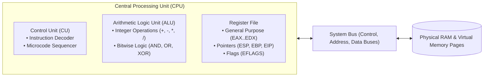
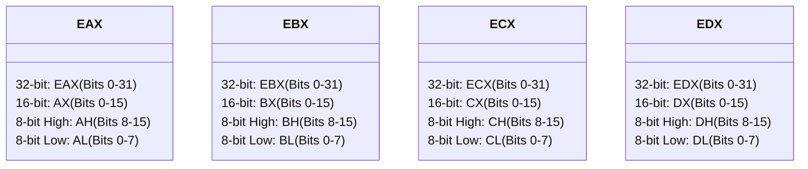
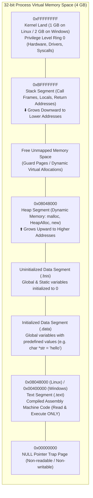
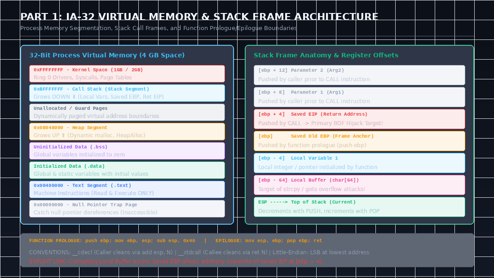
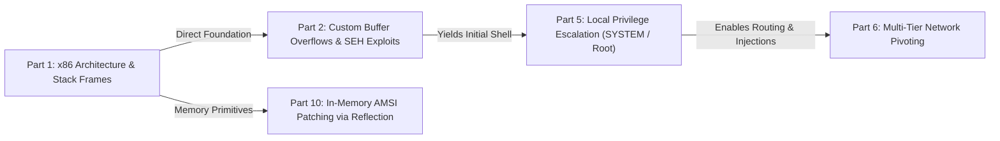

Welcome to the inaugural article of our comprehensive, production-grade masterclass covering the **eCPPT (eLearnSecurity Certified Professional Penetration Tester)** curriculum by **INE Security**. Rather than providing superficial slide summaries, this series deconstructs offensive tradecraft from the lowest architectural layers of computer hardware to advanced enterprise Active Directory attacks, multi-tier pivoting, and evasive command-and-control operations.

In this first installment, we dissect the foundational pillars of **System Security and x86 Assembly Language**. Mastering the execution cycle of the central processing unit (CPU), memory virtualization, stack frame mechanics, and compiler calling conventions is an absolute prerequisite for binary exploitation, custom exploit development, and bypassing modern operating system mitigations.

---

### Series Navigation

| **Previous Part** | **Current Part** | **Next Part** |
| :---: | :---: | :---: |
| *Series Beginning* | **Part 1: System Security & x86 Assembly** | [Part 2: Exploit Development: Stack & SEH Overflows](/posts/ecppt-v3-part-2-exploit-development-buffer-overflows/) |

---

## Key Takeaways

* **Processor Architecture**: The Central Processing Unit (CPU) executes code via a continuous hardware cycle: **Fetch** (retrieving instructions from the address pointed to by `EIP`), **Decode** (parsing opcodes and operands), and **Execute** (performing ALU operations, branch jumps, or memory reads/writes).
* **IA-32 Architecture Registers**: 32-bit x86 systems feature 8 general-purpose registers (`EAX`, `EBX`, `ECX`, `EDX`, `ESI`, `EDI`, `ESP`, `EBP`), the critical instruction pointer (`EIP`), and the processor status word register (`EFLAGS`).
* **Process Virtual Memory Layout**: In a 32-bit protected mode process, 4 GB of addressable space is segmented into the Code (`.text`) segment, Initialized Data (`.data`), Uninitialized Data (`.bss`), the dynamically growing Heap (grows toward higher memory addresses), and the Call Stack (grows downward toward lower memory addresses).
* **Stack Frame Lifecycle**: Subroutine boundaries are created and torn down via the standard **Function Prologue** (`push ebp; mov ebp, esp; sub esp, X`) and **Function Epilogue** (`mov esp, ebp; pop ebp; ret`). Overwriting the `Saved EIP` on the stack allows an attacker to hijack the instruction pointer upon return.
* **Calling Conventions**: In `__cdecl`, the caller cleans the stack; in `__stdcall`, the callee cleans its own stack arguments via `ret X`; in `__fastcall`, leading arguments are passed directly within CPU registers (`ECX`, `EDX`) for maximum execution speed.
* **Byte Ordering (Endianness)**: The x86 architecture is strictly Little-Endian; multibyte numerical values and memory addresses are stored in memory with the Least Significant Byte (LSB) at the lowest memory address.

---

## 1. CPU Internals and the Instruction Execution Cycle

The Central Processing Unit (CPU) is the core computational engine of any modern computer system. To construct reliable exploits, an offensive security researcher must maintain an exact mental model of how instructions travel through silicon pipelines.



The CPU executes compiled machine instructions through three continuous, microarchitectural phases:

1. **Instruction Fetch (IF)**: The Control Unit references the address currently stored in the Instruction Pointer (`EIP`), transmits a read request across the memory address bus, and fetches the machine code bytes into the instruction queue.
2. **Instruction Decode (ID)**: The decoder translates binary opcodes into discrete CPU control signals, determines operand addressing modes (immediate values, register contents, or memory dereferences), and prepares execution pipelines.
3. **Execution (EX)**: The ALU performs arithmetic or bitwise manipulations, updates the status condition bits in `EFLAGS`, and commits results to target registers or memory locations. Finally, `EIP` is incremented to reference the next instruction in sequence.

---

## 2. IA-32 Architecture Register File Breakdown

In 32-bit x86 architecture, the CPU provides 8 primary registers, each 32 bits (4 bytes) wide. To maintain backward compatibility with 16-bit 8086 and 8-bit 8080 processors, the lower portions of several registers can be addressed independently:



### General-Purpose Registers and Architectural Conventions:

* **`EAX` (Accumulator Register)**: Used natively for arithmetic computations, logical comparisons, and storing function return values upon exit from a subroutine.
* **`EBX` (Base Register)**: Historically utilized as a base pointer for memory data segmentation; frequently utilized by compilers as a persistent scratchpad register across loops.
* **`ECX` (Counter Register)**: Serves as the dedicated architectural loop and string counter. Instructions such as `LOOP`, `REP MOVS`, and shift operations (`SHL`, `SHR`) natively decrement or reference `CL`/`ECX`.
* **`EDX` (Data Register)**: Serves as an extension of `EAX` during large multiplication and division instructions (such as `MUL` and `DIV`), storing high-order bits of 64-bit mathematical results.
* **`ESI` (Source Index Register)**: Serves as the source memory pointer in bulk block memory and string transfer operations (`MOVSB`, `LODSB`).
* **`EDI` (Destination Index Register)**: Serves as the destination pointer in bulk memory copy operations (`MOVSB`, `STOSB`).

### Stack and Control Registers:

* **`ESP` (Extended Stack Pointer)**: Points to the current top of the call stack (the lowest numerical address currently utilized by active stack data). Its value is modified automatically by `PUSH`, `POP`, `CALL`, and `RET` instructions.
* **`EBP` (Extended Base Pointer / Frame Pointer)**: Remains static throughout the lifetime of a function call, anchoring the base of the current stack frame. Local variables (`[ebp - offset]`) and function parameters (`[ebp + offset]`) are indexed relative to `EBP`.
* **`EIP` (Extended Instruction Pointer)**: Contains the absolute virtual memory address of the next instruction waiting to be fetched and executed by the CPU. **Controlling `EIP` is the holy grail of memory corruption exploitation.**

### Status and Control Flags (`EFLAGS`):

The `EFLAGS` register contains 32 single-bit condition flags updated automatically by comparison and arithmetic instructions:

| Flag | Name | Semantic Trigger | Exploitation Relevance |
| :--- | :--- | :--- | :--- |
| **`ZF`** | Zero Flag | Set to `1` if an ALU operation yields zero (e.g., `CMP EAX, EAX`). | Governs conditional jumps like `JE` (Jump if Equal) and `JZ`. |
| **`CF`** | Carry Flag | Set to `1` if an arithmetic operation causes an unsigned overflow. | Detects unsigned integer wrap-around vulnerabilities. |
| **`SF`** | Sign Flag | Set to `1` if the most significant bit (MSB) of the result is `1` (negative). | Governs signed conditional jumps (`JL`, `JLE`). |
| **`OF`** | Overflow Flag | Set to `1` if signed integer operations exceed register capacity. | Critical for signed integer overflow and underflow exploitation. |

---

## 3. Process Virtual Memory Architecture

In a 32-bit x86 operating system (Windows or Linux), every running process is allocated an isolated 4 Gigabyte virtual address space spanning from `0x00000000` to `0xFFFFFFFF`. The Operating System Kernel and Memory Management Unit (MMU) use page tables to map these virtual addresses to physical RAM:



### Segment Characteristics:

* **Text Segment (`.text`)**: Contains executable binary instructions. Compilers mark this segment as Read-Only and Executable (`R-X`) to prevent code self-modification during execution.
* **Data Segment (`.data`)**: Stores initialized global and static variables allocated prior to runtime.
* **BSS Segment (`.bss`)**: Stores uninitialized global variables. When the program binary loads, the kernel zero-fills this entire memory page.
* **Heap (`Heap`)**: Dynamically allocated memory requested at runtime via API calls (`malloc`, `calloc`, `HeapAlloc`). It expands upward from lower memory addresses toward higher addresses.
* **Stack (`Stack`)**: Fast, compiler-managed contiguous memory that allocates local function variables, preserves return addresses, and orchestrates subroutine execution. It expands downward from higher memory addresses toward lower addresses.

---

## 4. Stack Anatomy, Stack Frames, and Call Mechanics

The stack operates strictly as a **LIFO (Last In, First Out)** data structure. The pointer register `ESP` tracks the current top of the stack:

```text
High Memory Addresses (0xBFFFFFFF)
+---------------------------------------+
| Function Parameter 2 (Arg2)           | [ebp + 12]
+---------------------------------------+
| Function Parameter 1 (Arg1)           | [ebp + 8]
+---------------------------------------+
| Return Address (Saved EIP)            | [ebp + 4]  <-- Pushed by CALL
+---------------------------------------+
| Saved Frame Pointer (Old EBP)         | [ebp]      <-- Pointed to by EBP
+---------------------------------------+
| Local Variable 1 (char buffer[64])    | [ebp - 4]  ... [ebp - 64]
+---------------------------------------+
| Current Top of Stack (ESP)            | <-- Pointed to by ESP
+---------------------------------------+
Low Memory Addresses (0x00000000)
```

### Subroutine Lifecycle Deconstruction:

When a function executes, the CPU coordinates a standardized set of prologue and epilogue instructions:

#### 1. Function Prologue:
Prior to executing a function's business logic, the new stack frame is established:

```nasm
push ebp          ; 1. Preserve the caller's base pointer onto the stack
mov  ebp, esp     ; 2. Establish a new base pointer anchor matching current ESP
sub  esp, 0x40    ; 3. Allocate 64 bytes of local stack memory by decrementing ESP
```

#### 2. Function Epilogue:
Upon completion, the function tears down its local frame and restores the caller's context:

```nasm
mov  esp, ebp     ; 1. Collapse local variable allocations by restoring ESP to EBP
pop  ebp          ; 2. Restore the caller's original base pointer from the stack
ret               ; 3. Pop the saved return address from stack directly into EIP!
```

> [!IMPORTANT]
> The `ret` instruction is mechanically equivalent to `pop eip`. If an attacker overflows a local variable buffer on the stack and overwrites the `Saved EIP` slot, the instant `ret` executes, the CPU unconditionally pivots execution to the attacker-supplied memory address.

---

## 5. Comparative Analysis of Calling Conventions

Calling conventions define how compilers serialize function arguments, which registers are preserved across calls, and whether the caller or the callee cleans up the stack:

| Property | `__cdecl` (C Declaration) | `__stdcall` (Standard Call) | `__fastcall` (Fast Register Call) |
| :--- | :--- | :--- | :--- |
| **Primary Domain** | Standard C/C++ Linux & GCC Binaries | Microsoft Win32 API (`kernel32.dll`) | Performance-critical math/graphics libraries |
| **Argument Ordering** | Right-to-Left (Pushed onto Stack) | Right-to-Left (Pushed onto Stack) | First 2 args in `ECX`, `EDX`; rest pushed R-to-L |
| **Stack Cleanup Duty** | **Caller** (via `add esp, N`) | **Callee** (via `ret N`) | **Callee** (via `ret N`) |
| **Variable Arg Support** | Supported (e.g., `printf(...)`) | Not Supported | Not Supported |

### Code Comparison:

#### `__cdecl` Routine:
```nasm
; Invoking add_numbers(10, 20) under __cdecl:
push 20           ; Push second argument
push 10           ; Push first argument
call add_numbers  ; Push return address & jump
add  esp, 8       ; Caller cleans up 8 bytes (2 arguments * 4 bytes)
```

#### `__stdcall` Routine:
```nasm
; Invoking add_numbers(10, 20) under __stdcall:
push 20
push 10
call add_numbers  ; The function exits via 'ret 8', self-cleaning the stack
; No 'add esp' is executed by the caller!
```

---

## 6. Endianness: Physical Byte Ordering in Memory

Intel x86 and x64 architectures are strictly **Little-Endian**. In this memory representation scheme, the **Least Significant Byte (LSB)** is stored at the lowest numerical memory address, while the **Most Significant Byte (MSB)** is stored at the highest address.

Consider the 32-bit hexadecimal pointer `0x625011AF`:

```text
Dword Value:          0x 62   50   11   AF
Byte Classification:     MSB  ...  ...  LSB

Physical Memory Placement:
Address 0x0012FB00:   \xaf  (Least Significant Byte)
Address 0x0012FB01:   \x11
Address 0x0012FB02:   \x50
Address 0x0012FB03:   \x62  (Most Significant Byte)
```

When building an exploit payload targeting an address such as `0x625011AF` (e.g., a `JMP ESP` gadget), the byte sequence must be serialized in reverse order:
`b"\xaf\x11\x50\x62"`.

---

## 7. Offensive Debugging Environment & Tooling

To inspect memory structures, analyze binary control flow, and trace stack state during exploitation, professional penetration testers rely on standard low-level debuggers:

* **Linux**: GDB enhanced with plugins such as **GEF (GDB Enhanced Features)** or **PEDA (Python Exploit Development Assistance)**.
* **Windows**: **x64dbg / x32dbg**, **Immunity Debugger** (with `mona.py`), or **WinDbg**.

### Essential GDB/GEF Memory Inspection Commands:

```bash
# Launch a compiled binary in GDB without verbose banners
gdb -q ./vulnerable_elf

# Set a breakpoint at function main
gef➤ break main

# Execute the binary with arbitrary arguments
gef➤ run $(python3 -c "print('A'*100)")

# Inspect CPU registers and EFLAGS status
gef➤ info registers

# Dereference and display 16 dwords on the top of the stack
gef➤ x/16wx $esp

# Disassemble the next 10 instructions from the instruction pointer
gef➤ x/10i $eip
```

---

---

## Visual Architecture: Process Memory & Stack Frame Layout

The following technical diagram illustrates the complete memory mapping of a 32-bit process alongside the exact layer-by-layer anatomy of a function stack frame:



### Key Architectural Observations from the Diagram:
1. **Memory Separation**: The 4 GB address space is bifurcated between User Space (`0x00000000` to `0xBFFFFFFF` on Linux, or `0x7FFFFFFF` on standard Windows) and Kernel Space (`0xC0000000` to `0xFFFFFFFF`). User code cannot dereference Kernel page tables without generating an immediate `Access Violation (0xC0000005)` fault.
2. **Opposing Memory Growth**: The stack expands downward toward lower numerical memory addresses as items are pushed, while the dynamic heap expands upward toward higher memory addresses. This architectural decision preserves maximum contiguous unallocated space for runtime execution.
3. **The Exploit Bridge**: Notice how local variables at `[ebp - X]` sit directly adjacent to the `Saved EBP` and `Saved EIP` slots at `[ebp + 4]`. Because memory copy routines write from lower addresses toward higher addresses, any unbounded string copy into the local buffer inherently overwrites the return pointer.

---

## Attack Chain Interconnection: Bridging Assembly to the Penetration Testing Lifecycle

Low-level assembly language and memory architecture are not isolated theoretical concepts; they form the operational foundation of the entire offensive assessment lifecycle:



* **Direct Feed into Part 2 (Exploit Development)**: Understanding that `EIP` points to the next executable instruction and that the stack pointer `ESP` can be referenced via `JMP ESP` instructions allows us to calculate exact byte offsets and construct weaponized stack buffer overflows.
* **Direct Feed into Part 10 (AMSI Evasion)**: In-memory memory patching techniques (such as replacing `AmsiScanBuffer` with `mov eax, 0x80070057; ret`) require understanding x86/x64 calling conventions and instruction byte opcodes.

---

## Categorized References & Authoritative Sources

### 1. Official Architecture & Compiler Specifications
* **Intel 64 and IA-32 Architectures Software Developer’s Manual**: Volumes 1, 2A-2D, and 3A-3D. [Intel Corporation Documentation](https://www.intel.com/content/www/us/en/developer/articles/technical/intel-sdm.html).
* **System V Application Binary Interface**: *Intel386 Architecture Processor Supplement (Fourth Edition)*.
* **Microsoft Learn: x86 Calling Conventions**: [https://learn.microsoft.com/en-us/cpp/cpp/argument-passing-and-naming-conventions](https://learn.microsoft.com/en-us/cpp/cpp/argument-passing-and-naming-conventions).

### 2. Seminal Security Research & Whitepapers
* **Phrack Magazine Issue 49**: *Smashing The Stack For Fun And Profit* by Aleph One (1996). [http://phrack.org/issues/49/14.html](http://phrack.org/issues/49/14.html).
* **OpenSecurityTraining2**: *Architecture 1001: x86-64 Assembly* by Xeno Kovah. [https://ost2.fyi/](https://ost2.fyi/).

### 3. MITRE ATT&CK Enterprise Techniques
* **T1203**: Exploitation for Client Execution. [https://attack.mitre.org/techniques/T1203/](https://attack.mitre.org/techniques/T1203/).
* **T1055**: Process Injection. [https://attack.mitre.org/techniques/T1055/](https://attack.mitre.org/techniques/T1055/).

### 4. Interactive Practice Labs & Tooling
* **GEF (GDB Enhanced Features)**: Modern debugging environment for exploit developers. [https://github.com/hugsy/gef](https://github.com/hugsy/gef).
* **OverTheWire Wargames: Narnia & Protostar**: Classic hands-on binary exploitation practice. [https://overthewire.org/wargames/narnia/](https://overthewire.org/wargames/narnia/).

---

*Author: Abdulrahman M. Fathi (0x3bdo) • Cyber Security Engineer & Penetration Tester*
