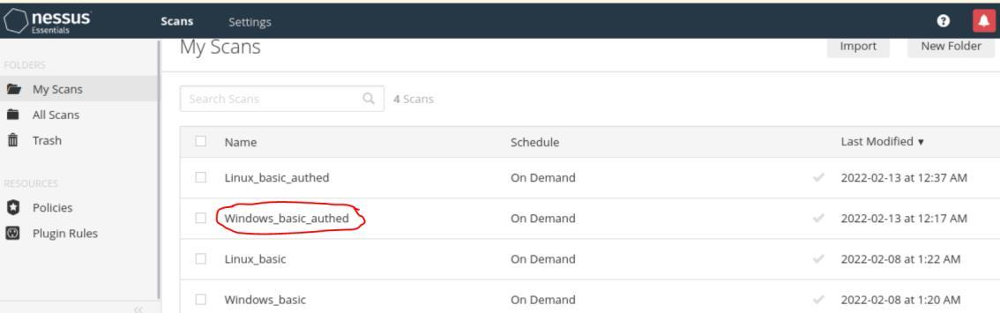
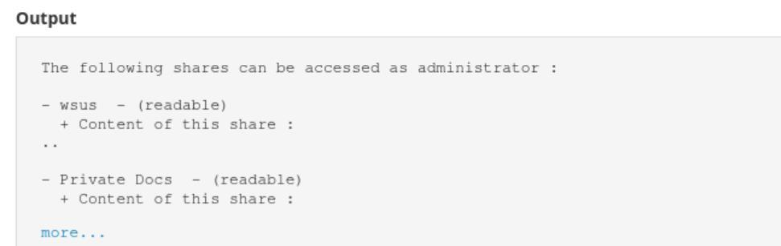
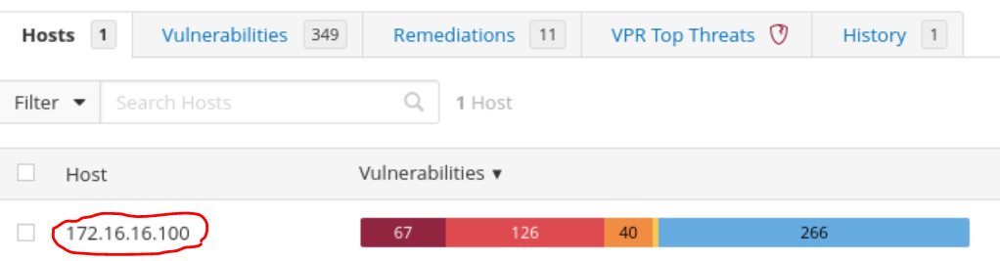
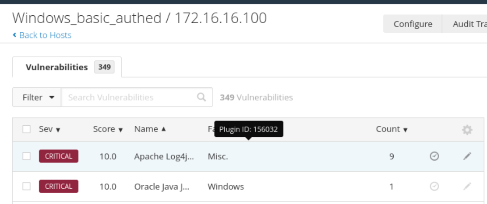
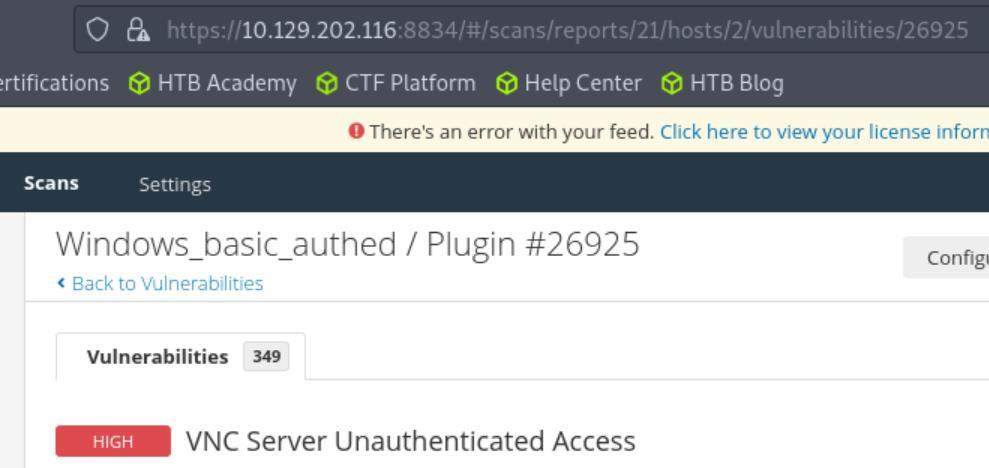
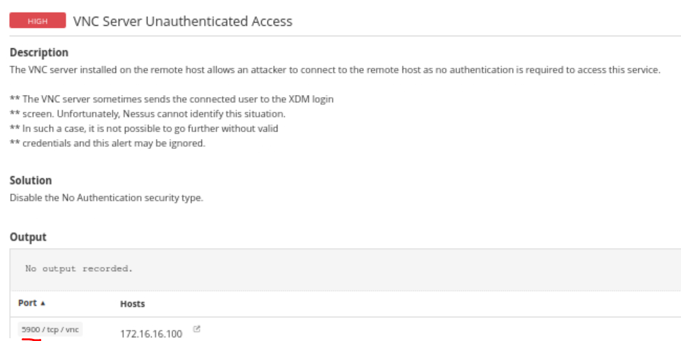
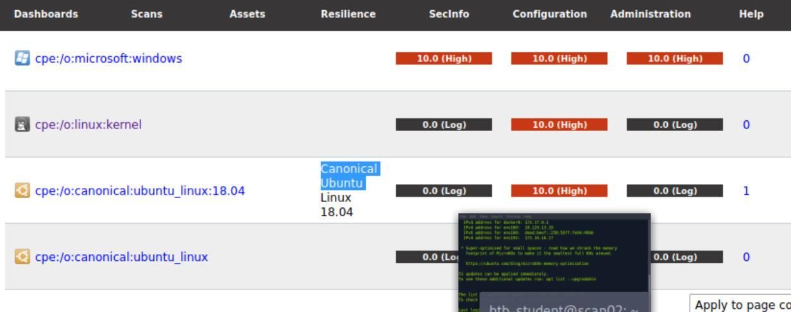
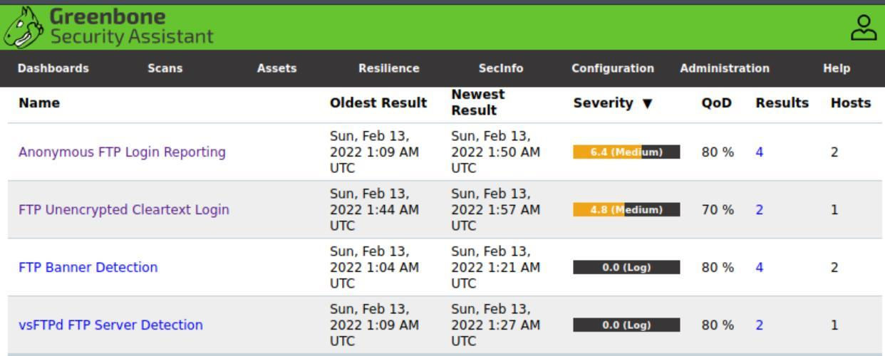
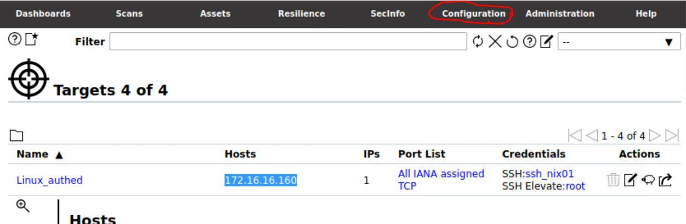

Welcome to **Part 15** of our comprehensive, production-grade masterclass covering the **Hack The Box (HTB) Academy Certified Penetration Testing Specialist (CPTS)** curriculum. Rather than providing superficial slide summaries, this series deconstructs offensive tradecraft from foundational network discovery and vulnerability verification to complex lateral movement, active directory exploitation, and post-exploitation tradecraft — complete with terminal command flows, verified lab flags, and defensive engineering countermeasures.

In this installment, we conduct an exhaustive technical deep-dive into **Vulnerability Assessment** (Tier I • Easy • General). We break down the underlying mechanics of systematic vulnerability discovery, automated scanner operations (Nessus, OpenVAS), CVSS scoring metrics, false-positive triage, and remediation prioritization, dissect hands-on offensive vectors, analyze realistic defensive telemetry, and walk through every exercise step-by-step with 100% verified solutions.

<a href="/posts/htb-academy-part-14-using-web-proxies/" class="ff-nav-btn text-start">
    
<i class="fas fa-arrow-left"></i>

    

      Previous Part
      Part 14: Using Web Proxies (Burp Suite & ZAP)
    

  </a>
  

    <i class="fas fa-cube"></i> HTB Academy Series
    Part 15 of 41
  

  <a href="/posts/htb-academy-part-16-shells-and-payloads/" class="ff-nav-btn text-end">
    

      Next Part
      Part 16: Shells & Payloads (Reverse, Bind & Web Shells)
    

    
<i class="fas fa-arrow-right"></i>

  </a>

## Module Specifications & Target Architecture

| Attribute | Specification |
| :--- | :--- |
| **Module Name** | `Vulnerability Assessment` |
| **Official HTB Academy Track** | [https://academy.hackthebox.com/module/108](https://academy.hackthebox.com/module/108) |
| **Curriculum Tier & Difficulty** | `Tier I` • `Easy` |
| **Certification Pathway** | `HTB Certified Penetration Testing Specialist (CPTS)` (Part 15 of 41) |
| **Author & Technical Attribution** | `Abdulrahman M. Fathi (0x3bdo)` |
| **Lab Flag Verification** | `100% Fully Solved & Validated` |

## Key Technical Takeaways

* **Scanning Methodologies**: Configures credentialed and non-credentialed vulnerability scans across network subnets and application endpoints.
* **Vulnerability Scoring & Triage**: Analyzes CVSS v3.1 vector strings to accurately evaluate vulnerability severity, exploitability, and organizational impact.
* **False Positive Elimination**: Manually validates automated scanner findings through protocol-level verification before client reporting.
* **Asset Risk Prioritization**: Synthesizes vulnerability scan outputs into actionable risk matrices prioritizing externally exposed and critical assets.
* **Compliance & Patch Management**: Formulates defensive patching roadmaps aligned with enterprise risk frameworks.

## Executive Summary & Assessment Scope

Vulnerability assessment is the systematic identification, evaluation, and ranking of security flaws across organizational assets. Unlike unstructured testing, formal assessments require structured methodologies to ensure broad coverage and actionable remediation guidance.

In this module, we examine vulnerability scanning architectures, configure automated scanners, analyze CVSS vulnerability vectors, filter scanner false positives through manual verification, and formulate prioritized remediation roadmaps, validating every assessment flag.

---

## Comprehensive Lab Walkthrough & Flag Solutions

### Vulnerability Assessment

> **Lab Question (Page 1)**: What is the name of one of the accessible SMB shares from the authenticated Windows scan? (One word)
>
> **Flag / Answer**: `wsus`
{: .prompt-info }

#### Technical Methodology & Exploit Execution:

Enter to Windows_basic_authed

Select desired host:

search for 'SMB share' on results:

*_Figure 1.1 — Lab execution and output verification (Page 1)_*

*_Figure 1.2 — Lab execution and output verification (Page 1)_*

> **Lab Question (Page 2)**: What was the target for the authenticated scan?
>
> **Flag / Answer**: `172.16.16.100`
{: .prompt-info }

#### Technical Methodology & Exploit Execution:

Question: What is the plugin ID of the highest criticality vulnerability for the
Windows authenticated scan?
Answer: 156032
Method: observe the first vulnerability (highest up) ID

*_Figure 2.1 — Lab execution and output verification (Page 2)_*

*_Figure 2.2 — Lab execution and output verification (Page 2)_*

*_Figure 2.3 — Lab execution and output verification (Page 2)_*

> **Lab Question (Page 3)**: What is the name of the vulnerability with plugin ID 26925 from the Windows authenticated scan? (Case sensitive)
>
> **Flag / Answer**: `VNC Server Unauthenticated Access`
{: .prompt-info }

#### Technical Methodology & Exploit Execution:

enter '/156032 in url to search for the ID's vulnerability:

Question: What port is the VNC server running on in the authenticated
Windows scan?
Answer: 5900
Method: on the same vulnerability from question above (ID 156032) – look for
port number in vulnerability details

*_Figure 3.1 — Lab execution and output verification (Page 3)_*

*_Figure 3.2 — Lab execution and output verification (Page 3)_*

### OpenVAS skill assessment

> **Lab Question (Page 4)**: What type of operating system is the Linux host running? (one word)
>
> **Flag / Answer**: `ubuntu`
{: .prompt-info }

#### Technical Methodology & Exploit Execution:

Assets > opetating systems:

*_Figure 4.1 — Lab execution and output verification (Page 4)_*

*_Figure 4.2 — Lab execution and output verification (Page 4)_*

> **Lab Question (Page 5)**: What type of FTP vulnerability is on the Linux host? (Case Sensitive, four words)
>
> **Flag / Answer**: `Anonymous FTP Login Reporting`
{: .prompt-info }

#### Technical Methodology & Exploit Execution:

Scans -> Vulnerabilities -> filter for 'ftp'

Cross checking with the hosts IP addresses revealed that out of the 2
vulnerabilities shown – the first one belongs to the Linux host, the second is to
another irrelevant machine.

Question: What is the IP of the Linux host targeted for the scan?
Answer: 172.16.16.160
Method: Configurations -> targets -> linux host:

*_Figure 5.1 — Lab execution and output verification (Page 5)_*

*_Figure 5.2 — Lab execution and output verification (Page 5)_*

> **Lab Question (Page 6)**: What vulnerability is associated with the HTTP server? (Case - sensitive)
>
> **Flag / Answer**: `Cleartext Transmission of Sensitive Information via HTTP`
{: .prompt-info }

#### Technical Methodology & Exploit Execution:

Scans -> Vulnerabilities -> filter for 'http'.
Search for the vulnerability with the http keyword in it (NOT https)

---

## Enterprise Defense & Mitigation Blueprint

To neutralize the attack vectors demonstrated throughout this module, security engineers and infrastructure administrators should implement layered defense-in-depth controls:

1. **Principle of Least Privilege (PoLP)**: Strictly segregate administrative rights, isolate service accounts into managed domains (gMSAs), and strip unnecessary capabilities (`CAP_SETUID`, `SeImpersonatePrivilege`).
2. **Input Validation & Parameterization**: Neutralize command injection, LFI, and parameter tampering at the source by utilizing strict type allowlists, parameterized ORMs, and secure input sanitization.
3. **Network Boundary Segmentation**: Isolate sensitive internal management ports (SSH, WinRM, SMB, RDP, SQL) behind bastion hosts and multi-factor VPN gateways with network-level microsegmentation.
4. **Telemetry & Threat Detection**: Forward audit logs (Sysmon, Windows Event Logs, Linux Auditd, Zeek) to a centralized SIEM with behavioral rules targeting anomalous process spawning (`cmd.exe` from `w3wp.exe`, unexpected SUID execution, or mass port probing).

---

## MITRE ATT&CK Mapping & Threat Matrix

| Security Domain | Mapping Specification |
| :--- | :--- |
| **Primary Tactic** | Enterprise Penetration Testing & Adversary Simulation |
| **Mitre Techniques** | `T1595.002, T1046` |
| **Common Weakness Enumerations** | `CWE-1035, CWE-937` |

### Adversary Tradecraft & Technique Breakdown

| Technique ID | Technique Name | Tactic | Applied Offensive / Defensive Context |
| :--- | :--- | :--- | :--- |
| [`T1595.002`](https://attack.mitre.org/techniques/T1595/) | **Active Scanning: Vulnerability Scanning** | `Reconnaissance` | Automated scanning of network infrastructure for known CVEs |
| [`T1046`](https://attack.mitre.org/techniques/T1046/) | **Network Service Discovery** | `Discovery` | Automated discovery of open ports, software versions, and banners |

### Identified Common Weakness Enumerations (CWE)

- [`CWE-1035`: OWASP Top Ten 2021 Flaws](https://cwe.mitre.org/data/definitions/1035.html)
- [`CWE-937`: Using Components with Known Vulnerabilities](https://cwe.mitre.org/data/definitions/937.html)

---

## Detection Engineering & Defensive Countermeasures

Modern enterprise security programs must implement proactive, layered defense-in-depth controls to detect and mitigate the techniques covered in this module:

- Track vulnerability scanning bursts originating from internal or external IP ranges using network telemetry (NetFlow, Suricata).
- Establish automated patch management pipelines prioritizing CVEs with high CVSS scores and active in-the-wild exploit maturity.
- Conduct routine authorized credentialed vulnerability assessments to detect outdated packages before adversaries exploit them.

---

## Authoritative References & Recommended Reading

- [HTB Academy: Vulnerability Assessment](https://academy.hackthebox.com/module/108) — *Official Hack The Box curriculum track*
- [NIST National Vulnerability Database (NVD)](https://nvd.nist.gov/) — *Global repository of standards-based vulnerability management data*
- [CVSS v3.1 Specification Guide](https://www.first.org/cvss/v3.1/specification-document) — *Common Vulnerability Scoring System standard*
- [Greenbone OpenVAS Community Documentation](https://greenbone.github.io/docs/) — *Open-source vulnerability management suite*

  <a href="/posts/htb-academy-part-14-using-web-proxies/" class="ff-nav-btn text-start">
    
<i class="fas fa-arrow-left"></i>

    

      Previous Part
      Part 14: Using Web Proxies (Burp Suite & ZAP)
    

  </a>
  

    <i class="fas fa-cube"></i> HTB Academy Series
    Part 15 of 41
  

  <a href="/posts/htb-academy-part-16-shells-and-payloads/" class="ff-nav-btn text-end">
    

      Next Part
      Part 16: Shells & Payloads (Reverse, Bind & Web Shells)
    

    
<i class="fas fa-arrow-right"></i>

  </a>

