Welcome to **Part 3** of our comprehensive, production-grade masterclass covering the **Hack The Box (HTB) Academy Certified Penetration Testing Specialist (CPTS)** curriculum. Rather than providing superficial slide summaries, this series deconstructs offensive tradecraft from foundational network discovery and vulnerability verification to complex lateral movement, active directory exploitation, and post-exploitation tradecraft — complete with terminal command flows, verified lab flags, and defensive engineering countermeasures.

In this installment, we conduct an exhaustive technical deep-dive into **Information Gathering (Web Edition)** (Tier I • Easy • General). We break down the underlying mechanics of passive and active web reconnaissance, domain footprinting, DNS record analysis, virtual host (vhost) discovery, and search engine open-source intelligence (OSINT), dissect hands-on offensive vectors, analyze realistic defensive telemetry, and walk through every exercise step-by-step with 100% verified solutions.

<div class="ff-series-nav"><a href="/posts/htb-academy-part-2-file-transfers/" class="ff-nav-btn text-start">
    <div class="ff-nav-arrow"><i class="fas fa-arrow-left"></i></div>
    <div class="ff-nav-text">
      <span class="ff-nav-kicker">Previous Part</span>
      <span class="ff-nav-title">Part 2: File Transfers</span>
    </div>
  </a>
  <div class="ff-nav-center">
    <span class="ff-center-badge"><i class="fas fa-cube"></i> HTB Academy Series</span>
    <span class="ff-center-part">Part 3 of 41</span>
  </div>
  <a href="/posts/htb-academy-part-4-footprinting/" class="ff-nav-btn text-end">
    <div class="ff-nav-text">
      <span class="ff-nav-kicker">Next Part</span>
      <span class="ff-nav-title">Part 4: Footprinting External Infrastructure & Services</span>
    </div>
    <div class="ff-nav-arrow"><i class="fas fa-arrow-right"></i></div>
  </a>
</div>

## Module Specifications & Target Architecture

| Attribute | Specification |
| :--- | :--- |
| **Module Name** | `Information Gathering (Web Edition)` |
| **Official HTB Academy Track** | [https://academy.hackthebox.com/module/144](https://academy.hackthebox.com/module/144) |
| **Curriculum Tier & Difficulty** | `Tier I` • `Easy` |
| **Certification Pathway** | `HTB Certified Penetration Testing Specialist (CPTS)` (Part 3 of 41) |
| **Author & Technical Attribution** | `Abdulrahman M. Fathi (0x3bdo)` |
| **Lab Flag Verification** | `100% Fully Solved & Validated` |

## Key Technical Takeaways

* **Passive OSINT Tradecraft**: Leverages public databases, Certificate Transparency (crt.sh) logs, WHOIS registries, and search engine dorking without transmitting direct packets to the target.
* **DNS Infrastructure Enumeration**: Maps target nameservers, MX records, TXT verification strings, and tests for misconfigured DNS Zone Transfers (`dig axfr`).
* **Subdomain & VHost Discovery**: Utilizes dictionary-based tools and HTTP Host header fuzzing to identify hidden development environments, staging portals, and internal administrative APIs.
* **Web Technology Fingerprinting**: Dissects HTTP response headers, cookies, favicon hashes, and DOM framework signatures using Wappalyzer and Curl.
* **Data Correlation**: Aggregates disparate reconnaissance data into an actionable adversary attack tree before launching active exploitation.

## Executive Summary & Assessment Scope

Reconnaissance dictates the success of every penetration testing engagement. High-profile web applications frequently protect their primary domain with sophisticated Web Application Firewalls (WAF) and Content Delivery Networks (CDN), while internal staging environments and forgotten subdomains remain completely unhardened.

In this module, we conduct comprehensive external reconnaissance against target domains. We analyze passive certificate transparency logs, perform active DNS sweeps, enumerate virtual hosts sharing the same IP infrastructure, and extract hidden endpoints, successfully recovering all flags across every assessment objective.

---

## Comprehensive Lab Walkthrough & Flag Solutions


### Information Gathering - Web Edition

> **Lab Question (Page 1)**: Perform a WHOIS lookup against the paypal.com domain. What is the registrar Internet Assigned Numbers Authority (IANA) ID number?
>
> **Flag / Answer**: `202`
{: .prompt-info }

#### Technical Methodology & Exploit Execution:

Question: What is the admin email contact for the tesla.com domain (also in-
scope for the Tesla bug bounty program)?
Answer: admin@dnstinations.com
Method: we run the command:
whois tesla.com | grep admin
*I've added filtering for the keyword addmin to make the output more
focusded. *:

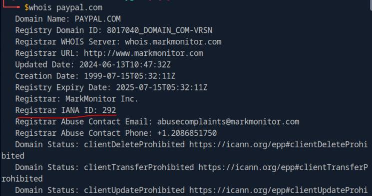
*_Figure 1.1 — Lab execution and output verification (Page 1)_*

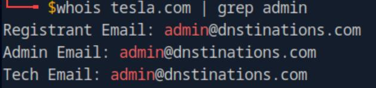
*_Figure 1.2 — Lab execution and output verification (Page 1)_*


### Digging DNS

> **Lab Question (Page 2)**: Which IP address maps to inlanefreight.com?
>
> **Flag / Answer**: `134.209.24.248`
{: .prompt-info }

#### Technical Methodology & Exploit Execution:

we run
```bash
nslookup inlanefreight.com
```
and take the IPv4:


Question: Which domain is returned when querying the PTR record for
134.209.24.248?
Answer: inlanefreight.com
Method: we run
```bash
dig -x 134.209.24.248
```
where -x is the flag for reverse query:

and in the answer we have this:

Another option is:
```bash
nslookup 134.209.24.248
```

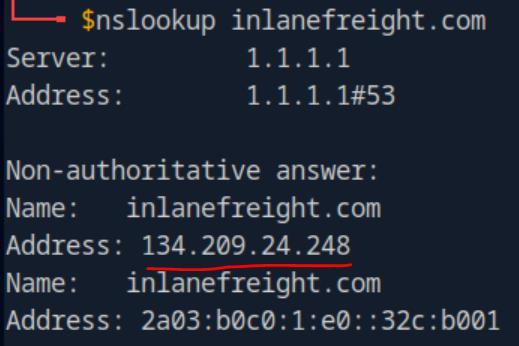
*_Figure 2.1 — Lab execution and output verification (Page 2)_*

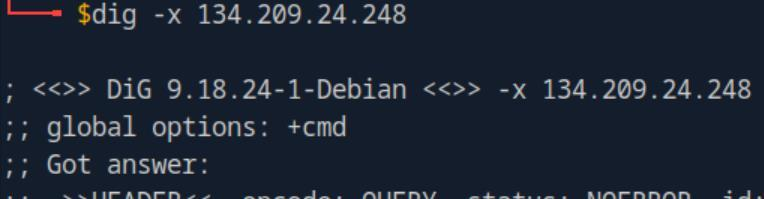
*_Figure 2.2 — Lab execution and output verification (Page 2)_*

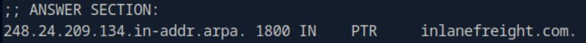
*_Figure 2.3 — Lab execution and output verification (Page 2)_*

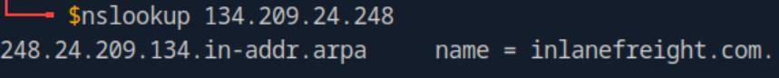
*_Figure 2.4 — Lab execution and output verification (Page 2)_*


### where 'mx' is mail exchange

> **Lab Question (Page 3)**: What is the full domain returned when you query the mail records for facebook.com?
>
> **Flag / Answer**: `smtpin.vvv.facebook.com.`
{: .prompt-info }

#### Technical Methodology & Exploit Execution:

we run the command
```bash
nslookup -query=mx facebook.com
```
where 'mx' is mail exchange:


Subdomain Bruteforcing:
Question: Using the known subdomains for inlanefreight.com (www, ns1, ns2,
ns3, blog, support, customer), find any missing subdomains by brute-forcing
possible domain names. Provide your answer with the complete subdomain,
e.g., www.inlanefreight.com.
Answer: my.inlanefreight.com
Method: we run the command:
dnsenum --enum inlanefreight.com -f
/usr/share/seclists/Discovery/DNS/subdomains-top1million-
20000.txt
in the command we enumerate the target 'inlanefreight.com' , using the
provided wordlist fit for subdomain enumeration:

At the end we get to this list of subdomain, and we take the option ('my') that
was not listed within the question.

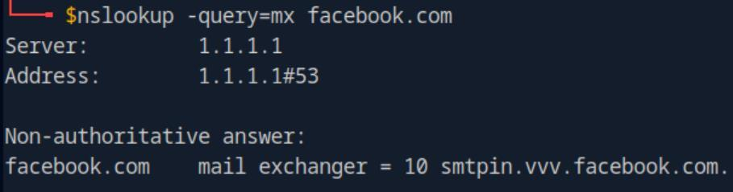
*_Figure 3.1 — Lab execution and output verification (Page 3)_*

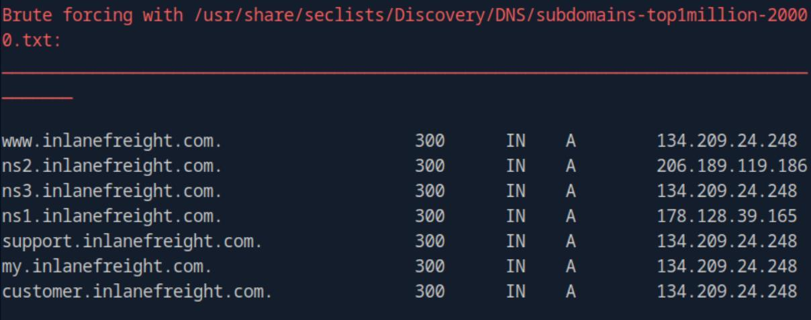
*_Figure 3.2 — Lab execution and output verification (Page 3)_*


### DNS Zone Transfers

> **Lab Question (Page 4)**: After performing a zone transfer for the domain inlanefreight.htb on the target system, how many DNS records are retrieved from the target system's name server? Provide your answer as an integer, e.g, 123.
>
> **Flag / Answer**: `22`
{: .prompt-info }

#### Technical Methodology & Exploit Execution:

First, lets link our domain 'inlanefreight.htb' to the target machine's
IP On the pwnbox 'etc/hosts' – we will use the command:
```bash
sudo nano /etc/hosts
```


When linked we will run the command:
```bash
dig axfr inlanefreight.htb @inlanefreight.htb
```
the command will attempt to perform a zone transfer from the name server
'inlanefreight.htb' for the entire domain of 'inlanefreight.htb':

*
*

*The list of domains displayed within this output screenshots is partial. *
At the end of the output we see the amount of DNS records retrieved from the
target name's server.

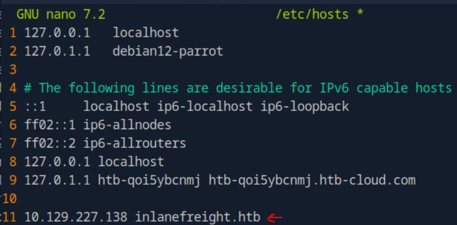
*_Figure 4.1 — Lab execution and output verification (Page 4)_*

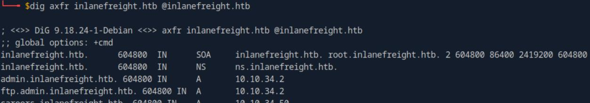
*_Figure 4.2 — Lab execution and output verification (Page 4)_*

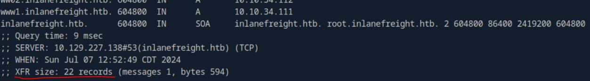
*_Figure 4.3 — Lab execution and output verification (Page 4)_*


### targeted search

> **Lab Question (Page 5)**: Within the zone record transferred above, find the ip address for ftp.admin.inlanefreight.htb. Respond only with the IP address, eg 127.0.0.1
>
> **Flag / Answer**: `10.10.34.2`
{: .prompt-info }

#### Technical Methodology & Exploit Execution:

lets add to the command in the question above a 'grep' filter for more
targeted search:
```bash
dig axfr inlanefreight.htb @inlanefreight.htb | grep
```
ftp.admin.inlanefreight.htb


Question: Within the same zone record, identify the largest IP address
allocated within the 10.10.200 IP range. Respond with the full IP address, eg
10.10.200.1
Answer: 10.10.200.14
Method: here we will add another 'grep' filter, sorting the list from highest to
lowest with the command, and finishing it up with 'head -1' to display only the
first line, which will include the highest IP within the specified range:
```bash
dig axfr inlanefreight.htb @inlanefreight.htb | grep
```
10.10.200 | sort | head -1

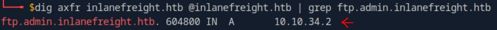
*_Figure 5.1 — Lab execution and output verification (Page 5)_*

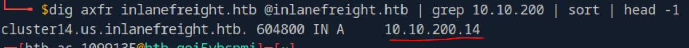
*_Figure 5.2 — Lab execution and output verification (Page 5)_*


### Virtual Hosts

> **Lab Question (Page 6)**: Brute-force vhosts on the target system. What is the full subdomain that is prefixed with "web"? Answer using the full domain, e.g. "x.inlanefreight.htb"
>
> **Flag / Answer**: `web17611.inlanefreight.htb`
{: .prompt-info }

#### Technical Methodology & Exploit Execution:

First, when we initiate a target machine, we notice that the target
machine also comes with a port:

It will come in handy later on.
The target machine IP provided - we will link up with the vHost domain in
'etc/hosts':
```bash
sudo nano /etc/hosts
```


When the configuration is complete – lets start with the virtual hosts
bruteforce with the command:
```bash
gobuster vhost -u http://inlanefreight.htb:58460 -w
/usr/share/seclists/Discovery/DNS/subdomains-top1million-
110000.txt --append-domain
```
the command will brute force for Vhosts within the target of
'inlanefreight.htb:58460', we can notice it is the port provided for us on the
target machine.
Before I will present the output results – its important to differentiate between
virtual host and subdomain:

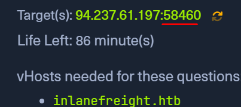
*_Figure 6.1 — Lab execution and output verification (Page 6)_*

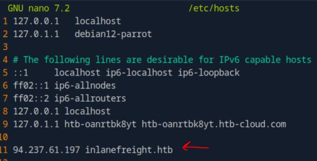
*_Figure 6.2 — Lab execution and output verification (Page 6)_*


### and here is the output

> **Lab Question (Page 7)**: Brute-force vhosts on the target system. What is the full subdomain that is prefixed with "vm"? Answer using the full domain, e.g. "x.inlanefreight.htb"
>
> **Flag / Answer**: `vm5.inlanefreight.htb`
{: .prompt-info }

#### Technical Methodology & Exploit Execution:

from the same result above, we take the 'vm5' option which is the
only answer whose 'vm' is prefix of.

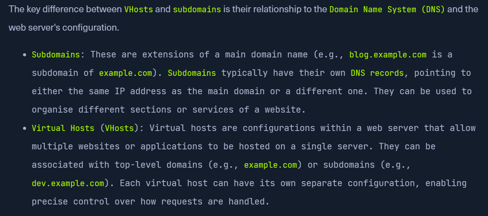
*_Figure 7.1 — Lab execution and output verification (Page 7)_*

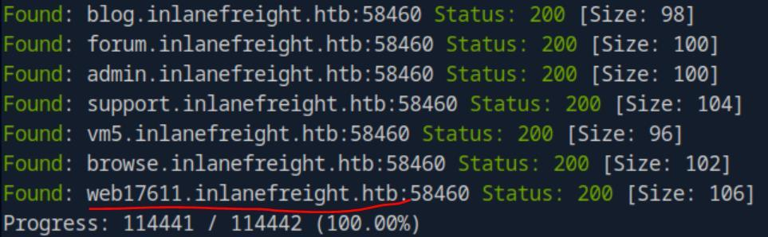
*_Figure 7.2 — Lab execution and output verification (Page 7)_*


> **Lab Question (Page 8)**: Brute-force vhosts on the target system. What is the full subdomain that is prefixed with "br"? Answer using the full domain, e.g. "x.inlanefreight.htb"
>
> **Flag / Answer**: `browse.inlanefreight.htb`
{: .prompt-info }

#### Technical Methodology & Exploit Execution:

from the same result above, we take the 'browse' option which is the
only answer whose 'br' is prefix of.

Question: Brute-force vhosts on the target system. What is the full subdomain
that is prefixed with "a"? Answer using the full domain, e.g.
"x.inlanefreight.htb"
Answer: admin.inlanefreight.htb
Method: from the same result above, we take the 'admin' option which is the
only answer whose 'a' is prefix of.

Question: Brute-force vhosts on the target system. What is the full subdomain
that is prefixed with "su"? Answer using the full domain, e.g.
"x.inlanefreight.htb"
Answer: support.inlanefreight.htb
Method: from the same result above, we take the 'support' option which is the
only answer whose 'su' is prefix of.


### Fingerprinting

> **Lab Question (Page 9)**: Determine the Apache version running on app.inlanefreight.local on the target system. (Format: 0.0.0)
>
> **Flag / Answer**: `2.4.41`
{: .prompt-info }

#### Technical Methodology & Exploit Execution:

First, lets link the target IP with the requested hosts in 'etc/hosts' as
in previous times (line 11 in the screenshot below):

When done, we will run the command:
```bash
nikto -h inlanefreight.com -Tuning b
```
using the tool 'nikto' open source scanner, where The -h flag specifies the
target host. The -Tuning b flag tells Nikto to only run the Software Identification
modules:

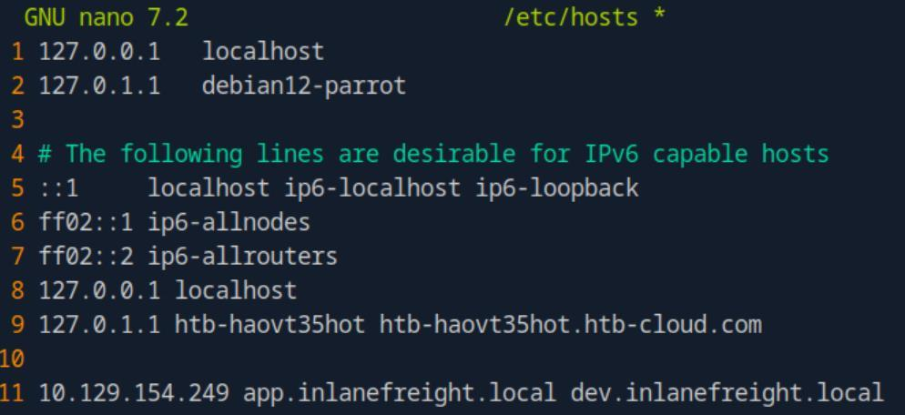
*_Figure 9.1 — Lab execution and output verification (Page 9)_*

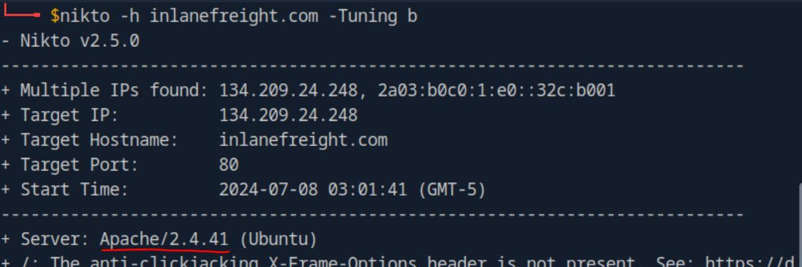
*_Figure 9.2 — Lab execution and output verification (Page 9)_*


### management

> **Lab Question (Page 10)**: Which CMS is used on app.inlanefreight.local on the target system? Respond with the name only, e.g., WordPress.
>
> **Flag / Answer**: `Joomla`
{: .prompt-info }

#### Technical Methodology & Exploit Execution:

we run 'curl' on the command, filtering for 'content:
```bash
curl -s app.inlanefreight.local | grep content
```
and within the deader we will find 'Joomla' as the open-source content
management:


Question: On which operating system is the dev.inlanefreight.local webserver
running in the target system? Respond with the name only, e.g., Debian.
Answer: Ubuntu
Method: lets run curl -I on the target:
```bash
curl -I dev.inlanefreight.local
```


Also,the 'nikto' command from the first question also gives the OS (you can
refer to the 'nikto' results screenshot).

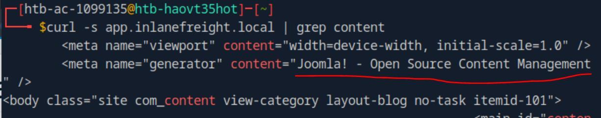
*_Figure 10.1 — Lab execution and output verification (Page 10)_*

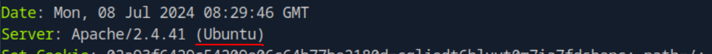
*_Figure 10.2 — Lab execution and output verification (Page 10)_*


### Creepy Crawlies

> **Lab Question (Page 11)**: After spidering inlanefreight.com, identify the location where future reports will be stored. Respond with the full domain, e.g., files.inlanefreight.com.
>
> **Flag / Answer**: `inlanefreight-comp133.s3.amazonaws.htb`
{: .prompt-info }

#### Technical Methodology & Exploit Execution:

Important note – the script downloaded within the section turtorial
from

*from module tutorial* is malfunctioning.
A working (similar) script can be downloaded from here.
Install scrapy module
```bash
sudo apt install python3-scrapy
```
and run the script:
```bash
python3 ReconSpider.py http://inlanefreight.com
```
after a minute or 2 the script will finish running and we will have the output file
'results.json' – open it with grep filter for 'report'
```bash
cat results.json | grep report
```
and we can observe the result:

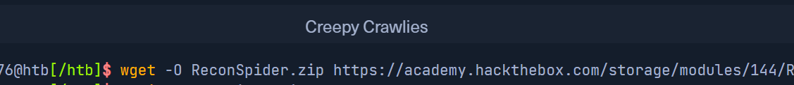
*_Figure 11.1 — Lab execution and output verification (Page 11)_*

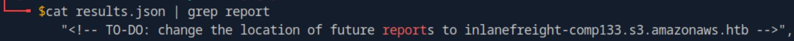
*_Figure 11.2 — Lab execution and output verification (Page 11)_*


### Web Archives

> **Lab Question (Page 12)**: How many Pen Testing Labs did HackTheBox have on the 8th August 2018? Answer with an integer, eg 1234.
>
> **Flag / Answer**: `74`
{: .prompt-info }

#### Technical Methodology & Exploit Execution:

back in 8th August 2018 the hackthebox domain was 'eu'.
Lets go to
`https://web.archive.org/web/20180808080705/https://www.hackthebox.eu/`
(pay attention that the url contains the string '20180808' which means
2018.08.08 in format YYYY-MM-DD), and search for the word 'labs':
Somewhere in the page we will encounter this:


Question: How many members did HackTheBox have on the 10th June 2017?
Answer with an integer, eg 1234.
Answer: 3054
Method: lets set the date to 10th June 2017:
`https://web.archive.org/web/20170610042300/https://www.hackthebox.eu/en`
looking for the keyword 'member' – we will eventually encounter this:

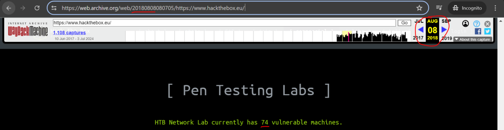
*_Figure 12.1 — Lab execution and output verification (Page 12)_*

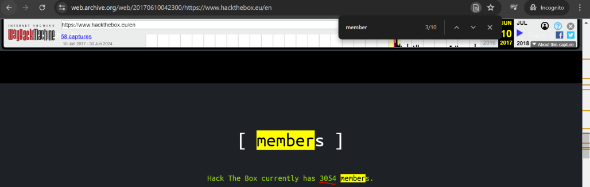
*_Figure 12.2 — Lab execution and output verification (Page 12)_*


### will direct us to

> **Lab Question (Page 13)**: Going back to March 2002, what website did the facebook.com domain redirect too? Answer with the full domain, eg http://www.facebook.com/
>
> **Flag / Answer**: `http://site.aboutface.com/`
{: .prompt-info }

#### Technical Methodology & Exploit Execution:

entering in the URL the address:
`https://web.archive.org/web/20020330205744/http://www.facebook.com`
(remember the '200203' dating format in the url)
will direct us to:


Question: According to the paypal.com website in October 1999, what could
you use to "beam money to anyone"? Answer with the product name, eg My
Device, remove the ™ from your answer.
Answer: Palm 0rganizer
Method: lets go to:
`https://web.archive.org/web/19991013140707/http://paypal.com/`

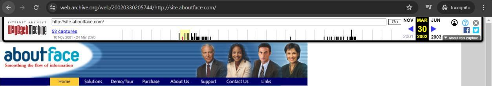
*_Figure 13.1 — Lab execution and output verification (Page 13)_*

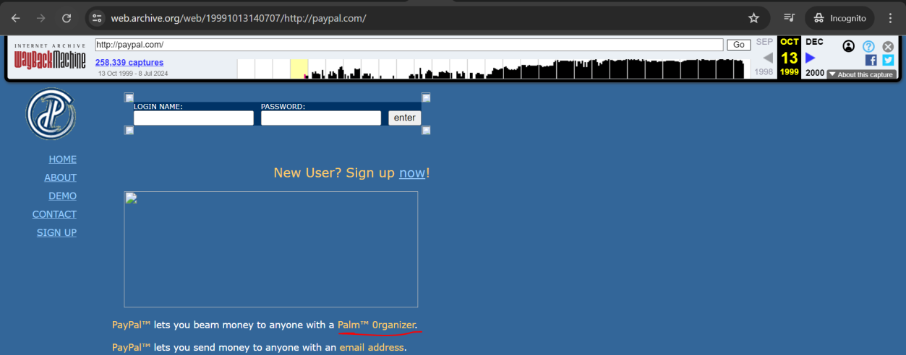
*_Figure 13.2 — Lab execution and output verification (Page 13)_*


### Go to the marked link

> **Lab Question (Page 14)**: Going back to November 1998 on google.com, what address hosted the non-alpha "Google Search Engine Prototype" of Google? Answer with the full address, eg http://google.com
>
> **Flag / Answer**: `http://google.stanford.edu/`
{: .prompt-info }

#### Technical Methodology & Exploit Execution:

go to
`https://web.archive.org/web/19981111184551/http://google.com/`

Go to the marked link:
And we have the answer here:


Question: Going back to March 2000 on www.iana.org, when exacty was the
site last updated? Answer with the date in the footer, eg 11-March-99
Answer: 17-December-99
Method:
`https://web.archive.org/web/20000303211237/http://www.iana.org/`

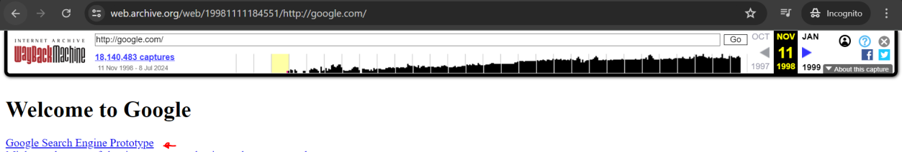
*_Figure 14.1 — Lab execution and output verification (Page 14)_*

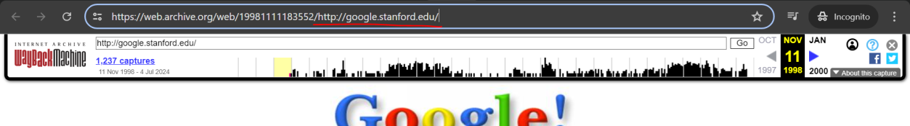
*_Figure 14.2 — Lab execution and output verification (Page 14)_*

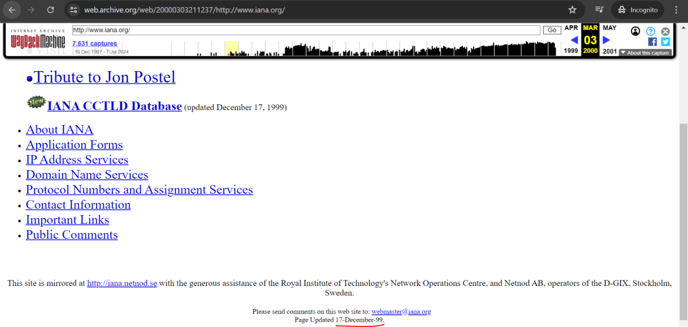
*_Figure 14.3 — Lab execution and output verification (Page 14)_*


> **Lab Question (Page 15)**: According to the wikipedia.com snapshot taken in March 2001, how many pages did they have over? Answer with the number they state without any commas, eg 2000 not 2,000
>
> **Flag / Answer**: `3000`
{: .prompt-info }

#### Technical Methodology & Exploit Execution:

`https://web.archive.org/web/20010331173908/http://www.wikipedia.com/`

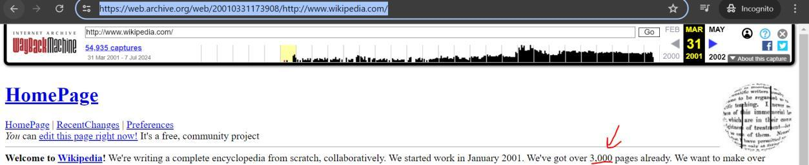
*_Figure 15.1 — Lab execution and output verification (Page 15)_*


### Capstone: Skills Assessment

> **Lab Question (Page 16)**: What is the IANA ID of the registrar of the inlanefreight.com domain?
>
> **Flag / Answer**: `468`
{: .prompt-info }

#### Technical Methodology & Exploit Execution:

in this skill assessment section our target machine also comes with a
porta as well as IP (just like 'Virtual Hosts' section):

We will link in 'etc/hosts' the IP to the vHost:
```bash
sudo nano /etc/hosts
```


Now when the vHost and IP are linked, lets run:
whois inlanefreight.com | grep -i iana
in similar way to what we did in 'Utilising WHOIS' section:

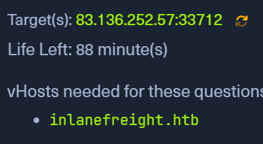
*_Figure 16.1 — Lab execution and output verification (Page 16)_*

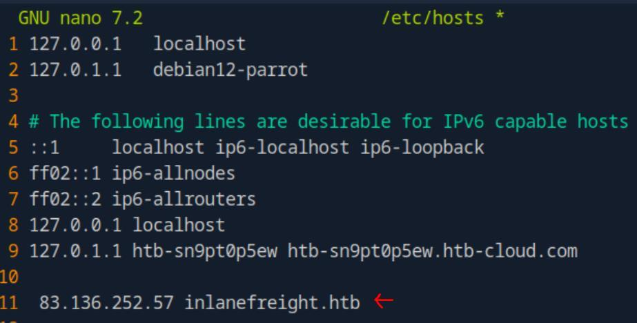
*_Figure 16.2 — Lab execution and output verification (Page 16)_*

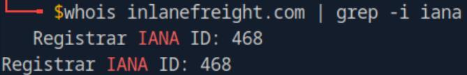
*_Figure 16.3 — Lab execution and output verification (Page 16)_*


### ('top1million')

> **Lab Question (Page 17)**: What http server software is powering the inlanefreight.htb site on the target system? Respond with the name of the software, not the version, e.g., Apache.
>
> **Flag / Answer**: `nginx`
{: .prompt-info }

#### Technical Methodology & Exploit Execution:

using the target port provided, we run:
```bash
curl -I inlanefreight.htb:33712
```
for the page metadata (-I flag is for 'Show document info only'):


Question: What is the API key in the hidden admin directory that you have
discovered on the target system?
Answer: e963d863ee0e82ba7080fbf558ca0d3f
Method: we will start by looking for subdomains, we will use the command:
```bash
gobuster vhost -u http://inlanefreight.htb:<target-port> -w
/usr/share/seclists/Discovery/DNS/subdomains-top1million-
110000.txt --append-domain
```
to bruteforce for subdomains within 'inlanefreight.htb' using provided wordlist
('top1million'):

Within the results, we will observe the bruteforce found the subdomain
'web1337'.

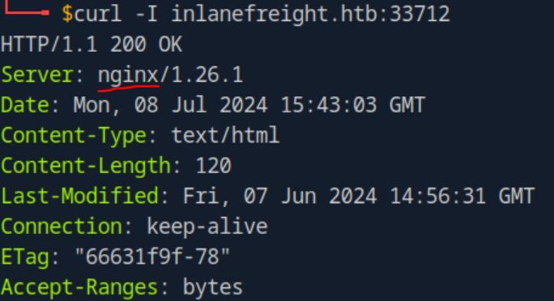
*_Figure 17.1 — Lab execution and output verification (Page 17)_*

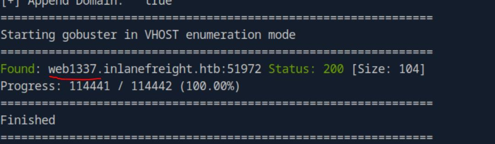
*_Figure 17.2 — Lab execution and output verification (Page 17)_*


### subdomain to '/etc/hosts'

Now, before we proceed – its important to make sure to add the discovered
subdomain to '/etc/hosts':

Once we have that, we can inspect that subdomain – lets see if it has robots.txt
configuration file:

And there is – '/admin_h1dd3n' . crawlers are not permitted to inspects.
Now as it is directory, we wont find anything using the browser, we will use
'curl' instead:
```bash
curl web1337.inlanefreight.htb:<target-port>/admin_h1dd3n/
```

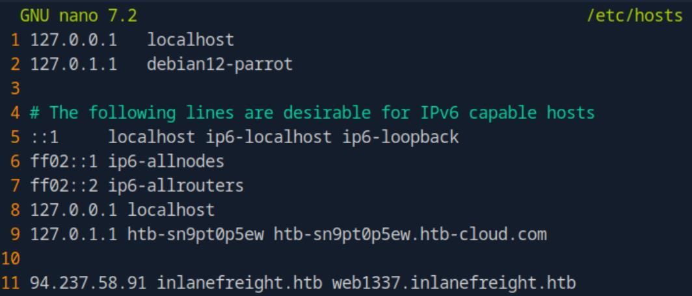
*_Figure 18.1 — Lab execution and output verification (Page 18)_*

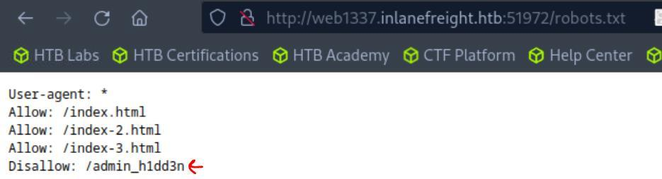
*_Figure 18.2 — Lab execution and output verification (Page 18)_*

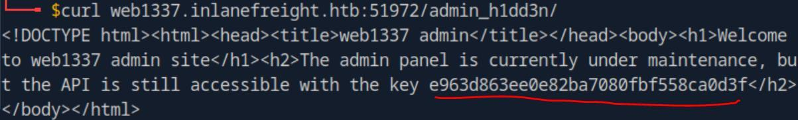
*_Figure 18.3 — Lab execution and output verification (Page 18)_*


### Lets add it to '/etc/hosts'

> **Lab Question (Page 19)**: After crawling the inlanefreight.htb domain on the target system, what is the email address you have found? Respond with the full email, e.g., mail@inlanefreight.htb..
>
> **Flag / Answer**: `1337testing@inlanefreight.htb`
{: .prompt-info }

#### Technical Methodology & Exploit Execution:

let's look for subdomains within the 'web1337' subdomain:
```bash
gobuster vhost -u http://web1337.inlanefreight.htb:<target-port> -w /usr/share/seclists/Discovery/DNS/subdomains-
top1million-110000.txt --append-domain
```


We found a subdomain 'dev.web1337.inlanefreight.htb'
Lets add it to '/etc/hosts':

When that is complete – lets run a crawler:
```bash
python3 ReconSpider3.py
http://dev.web1337.inlanefreight.htb:51972
```
using the same ReconSpider.py tool from 'Creepy Crawlies' section:

when done, an output file 'results.json' will be created, inspecting it will reveal
the mail:

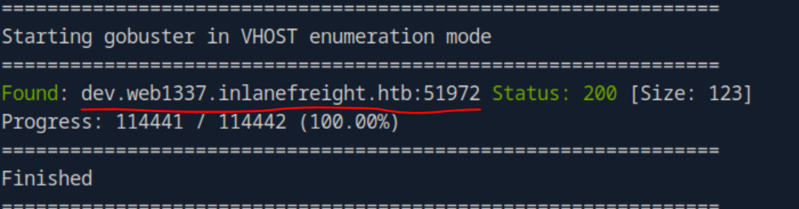
*_Figure 19.1 — Lab execution and output verification (Page 19)_*

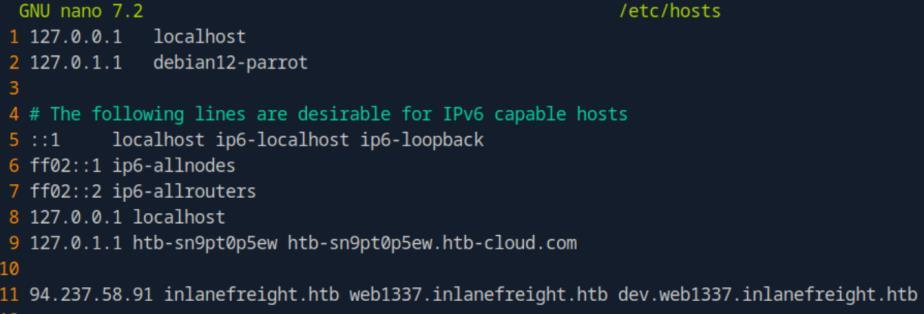
*_Figure 19.2 — Lab execution and output verification (Page 19)_*

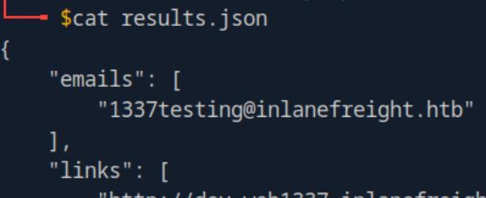
*_Figure 19.3 — Lab execution and output verification (Page 19)_*


### scrolling down to the end, we will see this

> **Lab Question (Page 20)**: What is the API key the inlanefreight.htb developers will be changing too?
>
> **Flag / Answer**: `ba988b835be4aa97d068941dc852ff33`
{: .prompt-info }

#### Technical Methodology & Exploit Execution:

looking at the same 'results.json' from the previous question,
scrolling down to the end, we will see this:

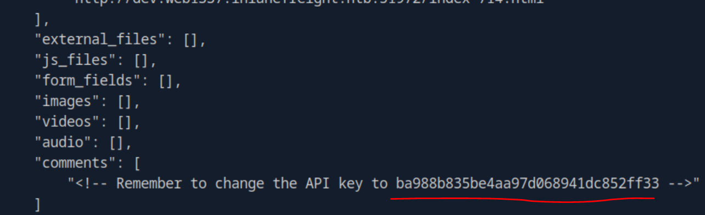
*_Figure 20.1 — Lab execution and output verification (Page 20)_*


---

## Enterprise Defense & Mitigation Blueprint

To neutralize the attack vectors demonstrated throughout this module, security engineers and infrastructure administrators should implement layered defense-in-depth controls:

1. **Principle of Least Privilege (PoLP)**: Strictly segregate administrative rights, isolate service accounts into managed domains (gMSAs), and strip unnecessary capabilities (`CAP_SETUID`, `SeImpersonatePrivilege`).
2. **Input Validation & Parameterization**: Neutralize command injection, LFI, and parameter tampering at the source by utilizing strict type allowlists, parameterized ORMs, and secure input sanitization.
3. **Network Boundary Segmentation**: Isolate sensitive internal management ports (SSH, WinRM, SMB, RDP, SQL) behind bastion hosts and multi-factor VPN gateways with network-level microsegmentation.
4. **Telemetry & Threat Detection**: Forward audit logs (Sysmon, Windows Event Logs, Linux Auditd, Zeek) to a centralized SIEM with behavioral rules targeting anomalous process spawning (`cmd.exe` from `w3wp.exe`, unexpected SUID execution, or mass port probing).


---

## MITRE ATT&CK Mapping & Threat Matrix

| Security Domain | Mapping Specification |
| :--- | :--- |
| **Primary Tactic** | Enterprise Penetration Testing & Adversary Simulation |
| **Mitre Techniques** | `T1595.001, T1596.001, T1590.002` |
| **Common Weakness Enumerations** | `CWE-200` |

### Adversary Tradecraft & Technique Breakdown

| Technique ID | Technique Name | Tactic | Applied Offensive / Defensive Context |
| :--- | :--- | :--- | :--- |
| [`T1595.001`](https://attack.mitre.org/techniques/T1595/) | **Active Scanning: Scanning IP Blocks** | `Reconnaissance` | Target host enumeration and port probing |
| [`T1596.001`](https://attack.mitre.org/techniques/T1596/) | **Search Open Technical Databases: DNS/Passive DNS** | `Reconnaissance` | Passive DNS enumeration via crt.sh and VirusTotal |
| [`T1590.002`](https://attack.mitre.org/techniques/T1590/) | **Gather Victim Network Information: DNS** | `Reconnaissance` | Zone transfer queries (AXFR) and subdomain brute-forcing |


### Identified Common Weakness Enumerations (CWE)

- [`CWE-200`: Information Exposure Through DNS and Metadata](https://cwe.mitre.org/data/definitions/200.html)


---

## Detection Engineering & Defensive Countermeasures

Modern enterprise security programs must implement proactive, layered defense-in-depth controls to detect and mitigate the techniques covered in this module:

- Monitor DNS servers for unauthorized AXFR zone transfer requests from unvetted external IP addresses.
- Inspect web proxy logs for high-frequency requests from non-standard user-agents or automated recon tools (Amass, Sublist3r).
- Rate-limit public DNS and reverse DNS query endpoints to mitigate automated enumeration campaigns.


---

## Authoritative References & Recommended Reading

- [HTB Academy: Information Gathering Web Edition](https://academy.hackthebox.com/module/144) — *Official Hack The Box curriculum track*
- [OWASP WSTG: Information Gathering](https://owasp.org/www-project-web-security-testing-guide/latest/4-Web_Application_Security_Testing/01-Information_Gathering/) — *Web reconnaissance methodology*
- [crt.sh: Certificate Search Engine](https://crt.sh/) — *Public Certificate Transparency log inspection*
- [RFC 1035: Domain Names - Implementation and Specification](https://www.ietf.org/rfc/rfc1035.txt) — *Standard DNS protocol specification*


<div class="ff-series-nav">
  <a href="/posts/htb-academy-part-2-file-transfers/" class="ff-nav-btn text-start">
    <div class="ff-nav-arrow"><i class="fas fa-arrow-left"></i></div>
    <div class="ff-nav-text">
      <span class="ff-nav-kicker">Previous Part</span>
      <span class="ff-nav-title">Part 2: File Transfers</span>
    </div>
  </a>
  <div class="ff-nav-center">
    <span class="ff-center-badge"><i class="fas fa-cube"></i> HTB Academy Series</span>
    <span class="ff-center-part">Part 3 of 41</span>
  </div>
  <a href="/posts/htb-academy-part-4-footprinting/" class="ff-nav-btn text-end">
    <div class="ff-nav-text">
      <span class="ff-nav-kicker">Next Part</span>
      <span class="ff-nav-title">Part 4: Footprinting External Infrastructure & Services</span>
    </div>
    <div class="ff-nav-arrow"><i class="fas fa-arrow-right"></i></div>
  </a>
</div>
