Welcome to **Part 25** of our comprehensive, production-grade masterclass covering the **Hack The Box (HTB) Academy Certified Penetration Testing Specialist (CPTS)** curriculum. Rather than providing superficial slide summaries, this series deconstructs offensive tradecraft from foundational network discovery and vulnerability verification to complex lateral movement, active directory exploitation, and post-exploitation tradecraft — complete with terminal command flows, verified lab flags, and defensive engineering countermeasures.

In this installment, we conduct an exhaustive technical deep-dive into **Network Enumeration with Nmap** (Tier I • Medium • Offensive). We break down the underlying mechanics of advanced Nmap scanning techniques, host discovery, TCP/UDP port scans, service fingerprinting, Nmap Scripting Engine (NSE), and firewall evasion, dissect hands-on offensive vectors, analyze realistic defensive telemetry, and walk through every exercise step-by-step with 100% verified solutions.

<div class="ff-series-nav"><a href="/posts/htb-academy-part-24-introduction-to-penetration-testing/" class="ff-nav-btn text-start">
    <div class="ff-nav-arrow"><i class="fas fa-arrow-left"></i></div>
    <div class="ff-nav-text">
      <span class="ff-nav-kicker">Previous Part</span>
      <span class="ff-nav-title">Part 24: Introduction to Penetration Testing & Standards</span>
    </div>
  </a>
  <div class="ff-nav-center">
    <span class="ff-center-badge"><i class="fas fa-cube"></i> HTB Academy Series</span>
    <span class="ff-center-part">Part 25 of 41</span>
  </div>
  <a href="/posts/htb-academy-part-26-attacking-web-applications-with-ffuf/" class="ff-nav-btn text-end">
    <div class="ff-nav-text">
      <span class="ff-nav-kicker">Next Part</span>
      <span class="ff-nav-title">Part 26: Attacking Web Applications with Ffuf</span>
    </div>
    <div class="ff-nav-arrow"><i class="fas fa-arrow-right"></i></div>
  </a>
</div>

## Module Specifications & Target Architecture

| Attribute | Specification |
| :--- | :--- |
| **Module Name** | `Network Enumeration with Nmap` |
| **Official HTB Academy Track** | [https://academy.hackthebox.com/module/19](https://academy.hackthebox.com/module/19) |
| **Curriculum Tier & Difficulty** | `Tier I` • `Medium` |
| **Certification Pathway** | `HTB Certified Penetration Testing Specialist (CPTS)` (Part 25 of 41) |
| **Author & Technical Attribution** | `Abdulrahman M. Fathi (0x3bdo)` |
| **Lab Flag Verification** | `100% Fully Solved & Validated` |

## Key Technical Takeaways

* **Scan Type Mechanics**: Analyzes packet-level differences between TCP SYN (`-sS`), TCP Connect (`-sT`), UDP (`-sU`), and FIN/Null/Xmas scans.
* **Host Discovery Optimization**: Conducts fast network sweeps using ICMP echo (`-PE`), timestamp (`-PP`), and TCP SYN/ACK ping probes (`-PS`, `-PA`).
* **Nmap Scripting Engine (NSE)**: Deploys specialized Lua scripts across categories (`vuln`, `auth`, `default`, `safe`) for automated vulnerability discovery.
* **Firewall & IDS Evasion**: Bypasses network inspection using packet fragmentation (`-f`), decoy addresses (`-D`), source port manipulation (`--source-port 53`), and data padding.
* **Performance Tuning**: Optimizes scanning speed and accuracy using timing templates (`-T0` through `-T5`) and min-rate parameters.

## Executive Summary & Assessment Scope

Nmap (Network Mapper) is the quintessential network discovery and vulnerability scanning tool used by security professionals worldwide. Efficient network enumeration requires an intimate understanding of low-level TCP/IP packet interactions and firewall filtering behaviors.

This module provides an exhaustive deep-dive into Nmap. We analyze packet captures of various scan types, deploy advanced NSE scripts to uncover vulnerabilities, bypass defensive firewall filters, optimize timing parameters, and extract all lab flags.

---

## Comprehensive Lab Walkthrough & Flag Solutions


### Network Enumeration with Nmap

> **Lab Question (Page 1)**: Based on the last result, find out which operating system it belongs to. Submit the name of the operating system as result.
>
> **Flag / Answer**: `Windows`
{: .prompt-info }

#### Technical Methodology & Exploit Execution:

lets take a look at the nmap scan:

The TTL (time to live) value of the response packet is 128, mostly associated
with windows. Also the packet size is 28 bytes.
*Source: ChatGPT:

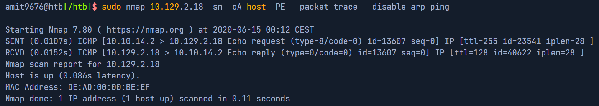
*_Figure 1.1 — Lab execution and output verification (Page 1)_*

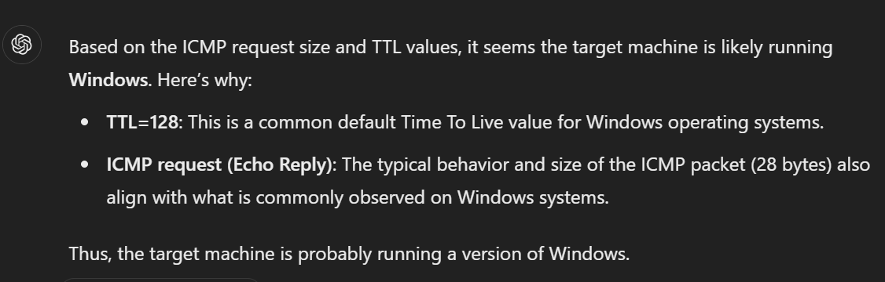
*_Figure 1.2 — Lab execution and output verification (Page 1)_*


### Host and Port Scanning

> **Lab Question (Page 2)**: Find all TCP ports on your target. Submit the total number of found TCP ports as the answer.
>
> **Flag / Answer**: `7`
{: .prompt-info }

#### Technical Methodology & Exploit Execution:

we will use the command:
```bash
nmap <target-IP> -p- | grep "open" | wc -l
```


(we count the amount of lines where the word 'open' is mentioned)
Question: Enumerate the hostname of your target and submit it as the answer .
(case-sensitive)
Answer: NIX-NMAP-DEFAULT
Method: we will run the command:
```bash
nmap <target-IP> -sV -sC | grep host -i
```

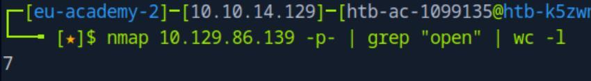
*_Figure 2.1 — Lab execution and output verification (Page 2)_*

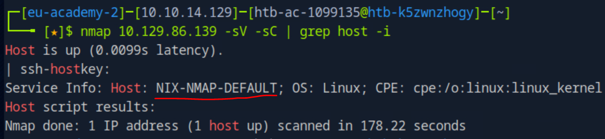
*_Figure 2.2 — Lab execution and output verification (Page 2)_*


### Saving the Results

> **Lab Question (Page 3)**: Perform a full TCP port scan on your target and create an HTML report. Submit the number of the highest port as the answer .
>
> **Flag / Answer**: `31337`
{: .prompt-info }

#### Technical Methodology & Exploit Execution:

lets run the scan:
```bash
sudo nmap <target-IP> -p- -oA target
```
where '-oA' outputs the scan result to a file called 'target':

While we can determine the highest port already, lets get it to HTML report:

One of the output files from the scan is 'target.xml':


Lets get it to html document with the tool 'xsltproc':
xsltproc target.xml -o target.html

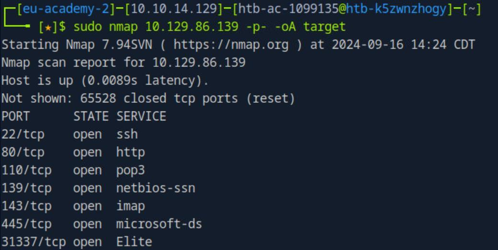
*_Figure 3.1 — Lab execution and output verification (Page 3)_*

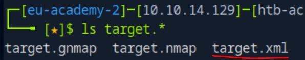
*_Figure 3.2 — Lab execution and output verification (Page 3)_*


### Now lets enter in the browser URL

Now lets open the report on the browser. We will need the file's full path:
realpath target.html


Now lets enter in the browser URL:
/home/htb-ac-1099135/target.html

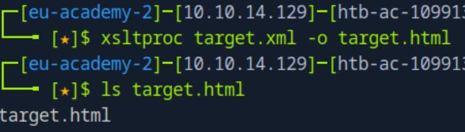
*_Figure 4.1 — Lab execution and output verification (Page 4)_*

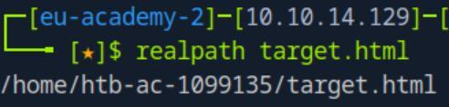
*_Figure 4.2 — Lab execution and output verification (Page 4)_*

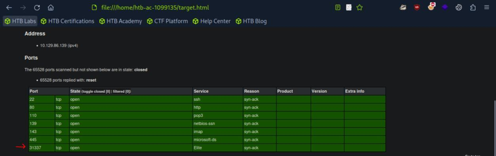
*_Figure 4.3 — Lab execution and output verification (Page 4)_*


### Service Enumeration

> **Lab Question (Page 5)**: Enumerate all ports and their services. One of the services contains the flag you have to submit as the answer .
>
> **Flag / Answer**: `HTB{pr0F7pDv3r510nb4nn3r}`
{: .prompt-info }

#### Technical Methodology & Exploit Execution:

we will run the command:
```bash
nmap 10.129.86.139 -p- -sV -sC
```
where '-sV' and '-sC' performs extra investigation on the service, including
among others: version detection, information obtaining and banner grabbing.
'-p-' assures the scan is performed on all ports.:

*
*

The flag will appear on port 31337 'elite' service scan.

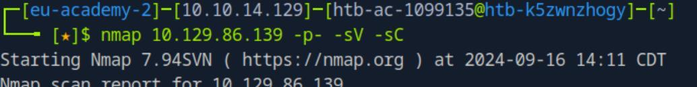
*_Figure 5.1 — Lab execution and output verification (Page 5)_*

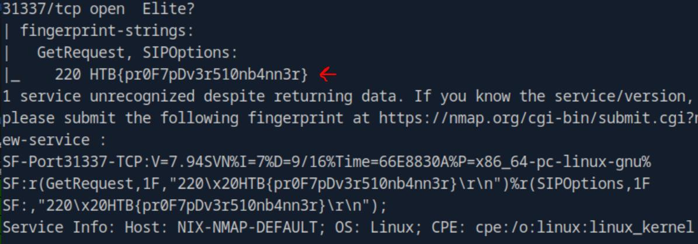
*_Figure 5.2 — Lab execution and output verification (Page 5)_*


### Nmap Scripting Engine

> **Lab Question (Page 6)**: Use NSE and its scripts to find the flag that one of the services contain and submit it as the answer.
>
> **Flag / Answer**: `HTB{873nniuc71bu6usbs1i96as6dsv26}`
{: .prompt-info }

#### Technical Methodology & Exploit Execution:

Lets run nmap vulnerability scan on the target machine port 80 (http):
```bash
sudo nmap <target-IP> -p 80 -sV --script vuln
```


We see the existence of 'robots.txt' file (instructions page for web-crawlers).
Lets take a look in it:
http://<target-IP>/robots.txt

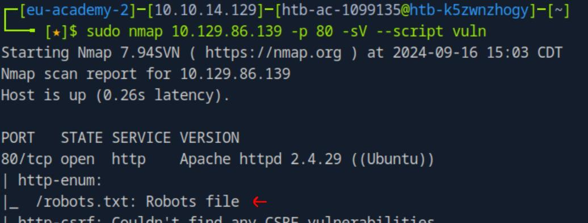
*_Figure 6.1 — Lab execution and output verification (Page 6)_*

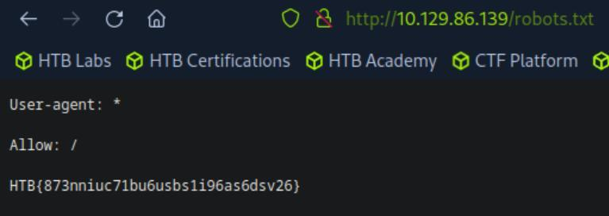
*_Figure 6.2 — Lab execution and output verification (Page 6)_*


### Firewall and IDS/IPS Evasion - Easy Lab

> **Lab Question (Page 7)**: Our client wants to know if we can identify which operating system their provided machine is running on. Submit the OS name as the answer.
>
> **Flag / Answer**: `Ubuntu`
{: .prompt-info }

#### Technical Methodology & Exploit Execution:

in principal, the command:
```bash
nmap <target-IP> -sV
```
will get the results:


However we wish to perform stealthy scan to raise a little alert as possible, we
will use the command:
```bash
sudo nmap <target-IP> -p 22 -sV -D RND:5 --disable-arp-ping
```
-Pn -e tun0

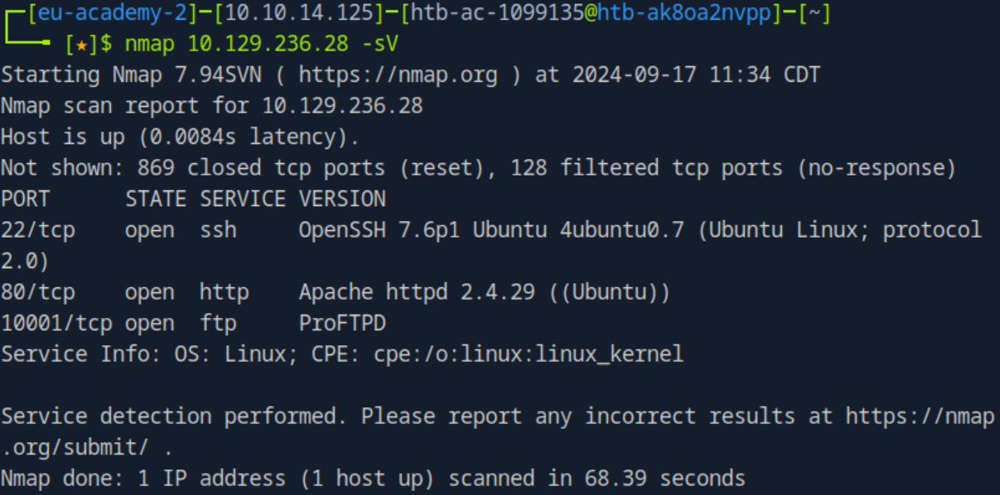
*_Figure 7.1 — Lab execution and output verification (Page 7)_*


Where we run stealth scan againt ssh port 22, with the following features:

Basically we employ decoy tactics to make the real scan less suspicious.

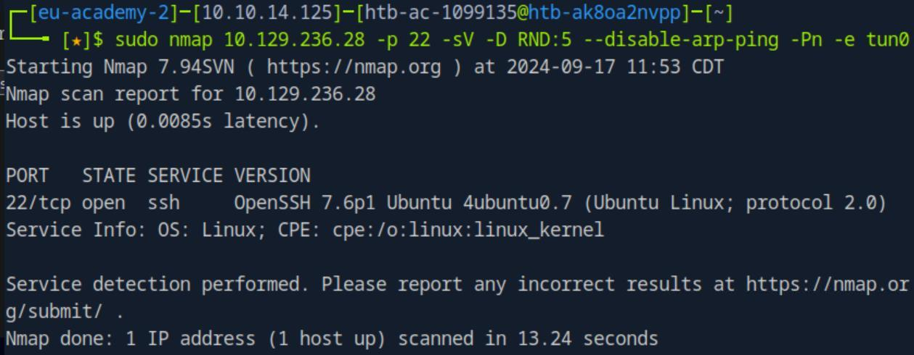
*_Figure 8.1 — Lab execution and output verification (Page 8)_*

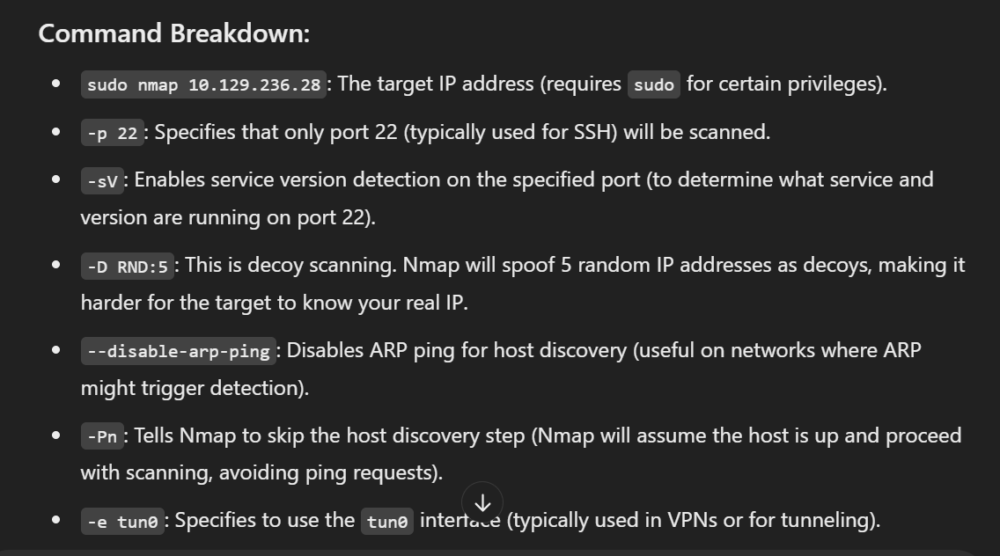
*_Figure 8.2 — Lab execution and output verification (Page 8)_*


### Firewall and IDS/IPS Evasion - Medium Lab

> **Lab Question (Page 9)**: After the configurations are transferred to the system, our client wants to know if it is possible to find out our target's DNS server version. Submit the DNS server version of the target as the answer .
>
> **Flag / Answer**: `HTB{GoTtgUnyze9Psw4vGjcuMpHRp}`
{: .prompt-info }

#### Technical Methodology & Exploit Execution:

we will run the following command:
```bash
sudo nmap -sU -p 53 -D RND:5 --disable-arp-ping -Pn --max-
```
retries 1 --host-timeout <target-IP> -sV


In addition to the stealth parameters, we will scan for UDP ('-sU'), and for
versions ('-sV').

The sequence of command will also work:
```bash
sudo nmap --script-updatedb;
sudo nmap -sV --script=dns-nsid -p 53 -Pn --max-retries 1 --
```
host-timeout 30s <target-IP> -sU;


*update the nmap script database*

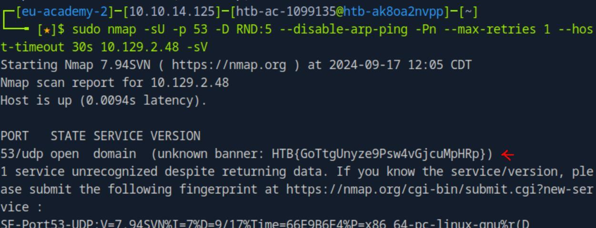
*_Figure 9.1 — Lab execution and output verification (Page 9)_*

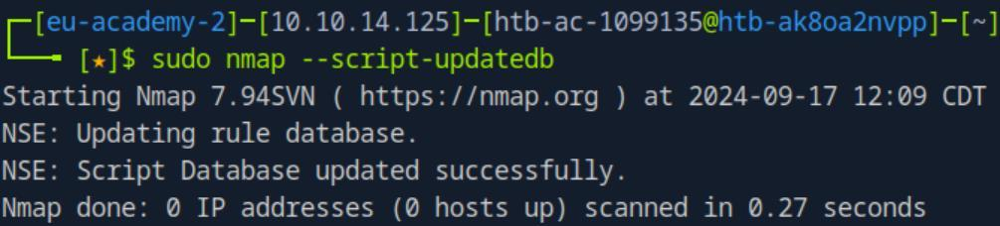
*_Figure 9.2 — Lab execution and output verification (Page 9)_*


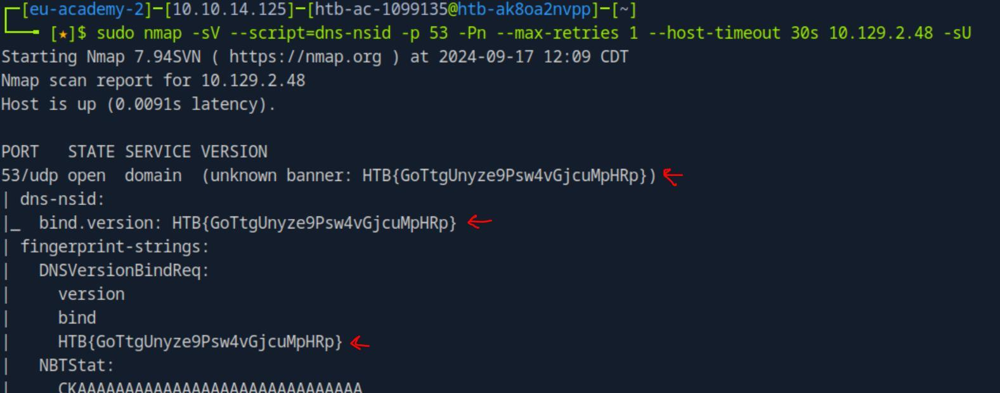
*_Figure 10.1 — Lab execution and output verification (Page 10)_*


### Firewall and IDS/IPS Evasion - Hard Lab

> **Lab Question (Page 11)**: Now our client wants to know if it is possible to find out the version of the running services. Identify the version of service our client was talking about and submit the flag as the answer .
>
> **Flag / Answer**: `HTB{kjnsdf2n982n1827eh76238s98di1w6}`
{: .prompt-info }

#### Technical Methodology & Exploit Execution:

we will adhere to the module section's 'Firewall and IDS/IPS Evasion'
and the question's hint suggestion to scan target port 50000 from our source
port 53:
```bash
sudo nmap <target-IP> -p 50000 -sS -Pn -n --disable-arp-ping
```
--packet-trace --source-port 53


*note – not including source port 53 will not work, due to the assumption the
target port is expecting traffic from DNS service only. (due to firewall/IDS/IPS
rule.
For forther reading from the 'Firewall and IDS/IPS Evasion' section:
*

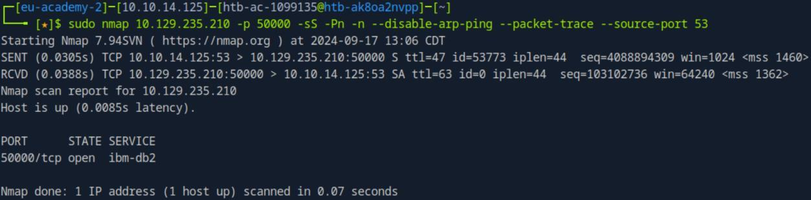
*_Figure 11.1 — Lab execution and output verification (Page 11)_*

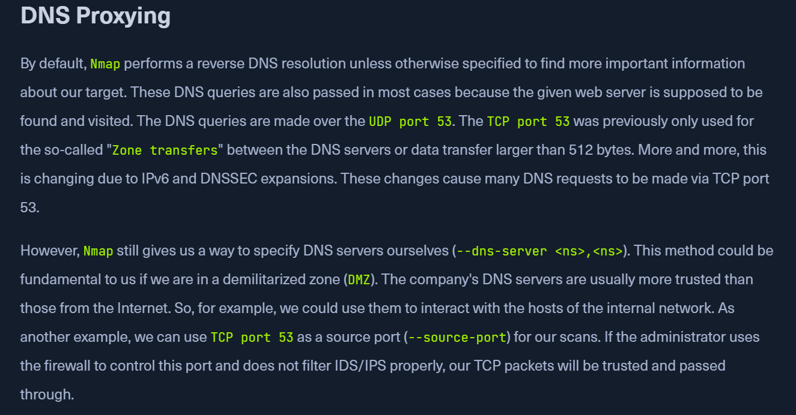
*_Figure 11.2 — Lab execution and output verification (Page 11)_*


Anyway as we established port 50000 is open – lets perform banner grabbing:
```bash
sudo ncat -nv --source-port 53 10.129.235.210 50000
```
*dont forget sudo as the source port is privileged one. *

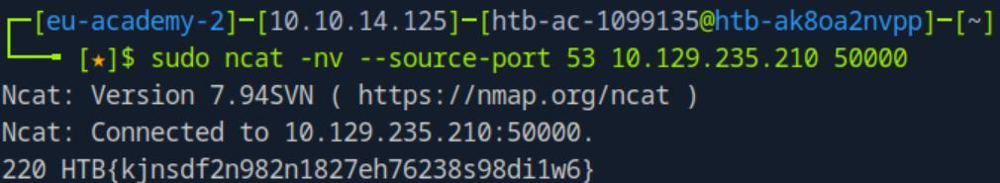
*_Figure 12.1 — Lab execution and output verification (Page 12)_*


---

## Enterprise Defense & Mitigation Blueprint

To neutralize the attack vectors demonstrated throughout this module, security engineers and infrastructure administrators should implement layered defense-in-depth controls:

1. **Principle of Least Privilege (PoLP)**: Strictly segregate administrative rights, isolate service accounts into managed domains (gMSAs), and strip unnecessary capabilities (`CAP_SETUID`, `SeImpersonatePrivilege`).
2. **Input Validation & Parameterization**: Neutralize command injection, LFI, and parameter tampering at the source by utilizing strict type allowlists, parameterized ORMs, and secure input sanitization.
3. **Network Boundary Segmentation**: Isolate sensitive internal management ports (SSH, WinRM, SMB, RDP, SQL) behind bastion hosts and multi-factor VPN gateways with network-level microsegmentation.
4. **Telemetry & Threat Detection**: Forward audit logs (Sysmon, Windows Event Logs, Linux Auditd, Zeek) to a centralized SIEM with behavioral rules targeting anomalous process spawning (`cmd.exe` from `w3wp.exe`, unexpected SUID execution, or mass port probing).


---

## MITRE ATT&CK Mapping & Threat Matrix

| Security Domain | Mapping Specification |
| :--- | :--- |
| **Primary Tactic** | Enterprise Penetration Testing & Adversary Simulation |
| **Mitre Techniques** | `T1595.001, T1046, T1018` |
| **Common Weakness Enumerations** | `CWE-200` |

### Adversary Tradecraft & Technique Breakdown

| Technique ID | Technique Name | Tactic | Applied Offensive / Defensive Context |
| :--- | :--- | :--- | :--- |
| [`T1595.001`](https://attack.mitre.org/techniques/T1595/) | **Active Scanning: Scanning IP Blocks** | `Reconnaissance` | Subnet host discovery and ping sweeps |
| [`T1046`](https://attack.mitre.org/techniques/T1046/) | **Network Service Discovery** | `Discovery` | SYN, TCP connect, and UDP port scans |
| [`T1018`](https://attack.mitre.org/techniques/T1018/) | **Remote System Discovery** | `Discovery` | OS detection and service version fingerprinting |


### Identified Common Weakness Enumerations (CWE)

- [`CWE-200`: Information Exposure Through Banner and Network Metadata](https://cwe.mitre.org/data/definitions/200.html)


---

## Detection Engineering & Defensive Countermeasures

Modern enterprise security programs must implement proactive, layered defense-in-depth controls to detect and mitigate the techniques covered in this module:

- Configure network intrusion detection systems (Snort/Suricata) to alert on TCP scan signatures (SYN without ACK, FIN, Xmas, Null scans).
- Rate-limit ICMP echo requests and drop responses to unexpected network probes at edge firewalls.
- Suppress service banner version disclosure in daemon configurations (Apache `ServerTokens Prod`, OpenSSH banners).


---

## Authoritative References & Recommended Reading

- [HTB Academy: Network Enumeration with Nmap](https://academy.hackthebox.com/module/19) — *Official Hack The Box curriculum track*
- [Nmap Official Documentation & Book](https://nmap.org/book/man.html) — *Authoritative manual for Nmap scanning techniques*
- [Nmap Scripting Engine (NSE) Documentation](https://nmap.org/nsedoc/) — *Official library of NSE automation scripts*
- [RFC 793: Transmission Control Protocol](https://www.ietf.org/rfc/rfc793.txt) — *TCP specifications regarding flag handling*


<div class="ff-series-nav">
  <a href="/posts/htb-academy-part-24-introduction-to-penetration-testing/" class="ff-nav-btn text-start">
    <div class="ff-nav-arrow"><i class="fas fa-arrow-left"></i></div>
    <div class="ff-nav-text">
      <span class="ff-nav-kicker">Previous Part</span>
      <span class="ff-nav-title">Part 24: Introduction to Penetration Testing & Standards</span>
    </div>
  </a>
  <div class="ff-nav-center">
    <span class="ff-center-badge"><i class="fas fa-cube"></i> HTB Academy Series</span>
    <span class="ff-center-part">Part 25 of 41</span>
  </div>
  <a href="/posts/htb-academy-part-26-attacking-web-applications-with-ffuf/" class="ff-nav-btn text-end">
    <div class="ff-nav-text">
      <span class="ff-nav-kicker">Next Part</span>
      <span class="ff-nav-title">Part 26: Attacking Web Applications with Ffuf</span>
    </div>
    <div class="ff-nav-arrow"><i class="fas fa-arrow-right"></i></div>
  </a>
</div>
